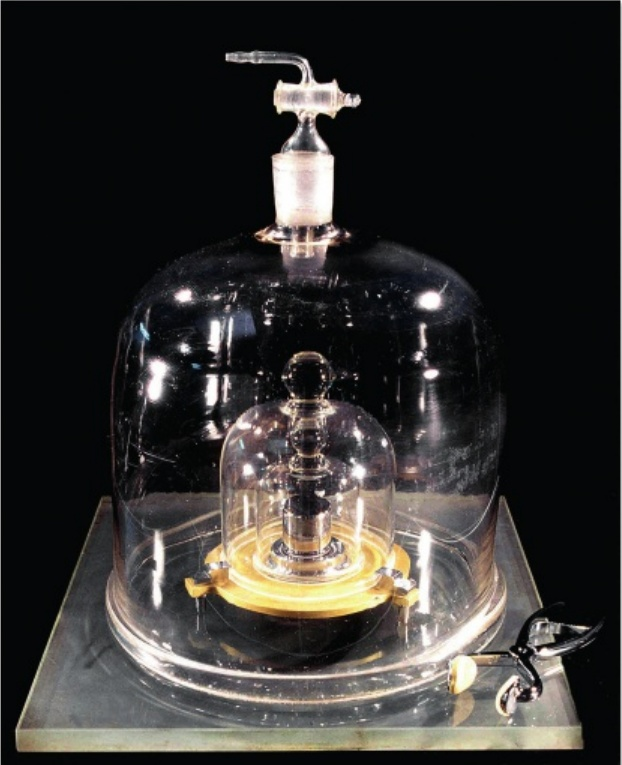
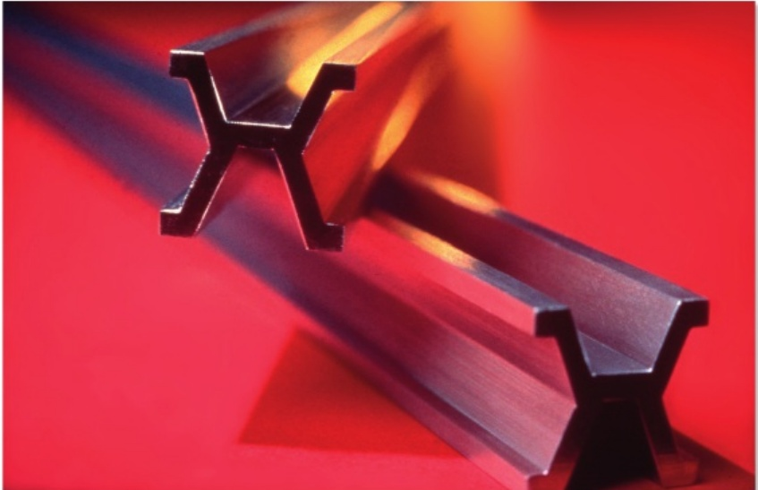
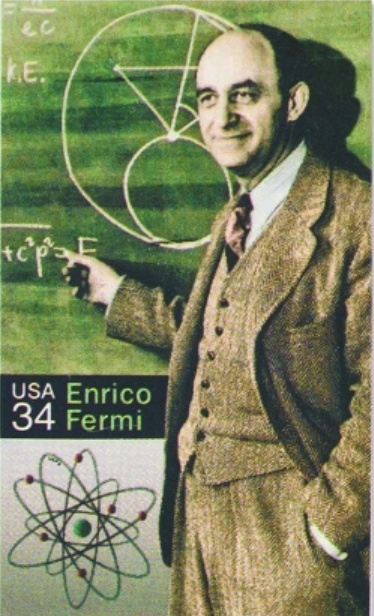

# Working as a physicist

<!-- edx_ial_phy1.pdf p13-18 -->

<!-- page 13 -->

# WORKING AS A PHYSICIST

Throughout your study of physics, you will develop knowledge and understanding of what it means to work scientifically. You will develop confidence in key scientific skills, such as handling and controlling quantities and units and making estimates. You will also learn about the ways in which the scientific community functions and how society as a whole uses scientific ideas.

At the end of each chapter in this book, there is a section called Thinking Bigger. These sections are based broadly on the content of the chapter just completed, but they will also draw on your previous learning from earlier in the course or from your previous studies and point towards future learning and less familiar contexts. The Thinking Bigger sections will also help you to develop transferable skills. By working through these sections, you will:

read real-life scientific writing in a variety of contexts and aimed at different audiences

develop an understanding of how the professional scientific community functions

learn to think critically about the nature of what you have read

understand the issues, problems and challenges that may be raised

gain practice in communicating information and ideas in an appropriate scientific way

apply your knowledge and understanding to unfamiliar contexts.

You will also gain scientific skills through the hands-on practical work that forms an essential part of your course. As well as understanding the experimental methods of the practicals, it is important that you develop the skills necessary to plan experiments and analyse and evaluate data. Not only are these very important scientific skills, but they will be assessed in your examinations.

## MATHS SKILLS FOR PHYSICISTS

- Recognise and make use of appropriate units in calculations (e.g. knowing the difference between base and derived units)

Estimate results (e.g. estimating the speed of waves on the sea)

- Make order of magnitude calculations (e.g. estimating approximately what an answer should be before you start calculating, including using standard form)

- Use algebra to rearrange and solve equations (e.g. finding the landing point of a projectile)

- Recognise the importance of the straight line graph as an analysis tool for the verification and development of physical laws by experimentation (e.g. choosing appropriate variables to plot to generate a straight line graph with experimental data)

- Determine the slope and intercept of a linear graph (e.g. finding acceleration from a velocity-time graph)

- Calculate the area under the line on a graph (e.g. finding the energy stored in a stretched wire)

- Use geometry and trigonometry (e.g. finding components of vectors)

<!-- page 14 -->

## What prior knowledge do I need?

Understanding and knowledge of physical facts, terminology, concepts, principles and practical techniques

Applying the concepts and principles of physics, including the applications of physics, to different contexts

Appreciating the practical nature of physics and developing experimental and investigative skills based on the use of correct and safe laboratory techniques

Communicating scientific methods, conclusions and arguments using technical and mathematical language

Consideration of the implications, including benefits and risks, of scientific and technological developments

Understanding how society uses scientific knowledge to make decisions about the implementation of technological developments

Understanding of how scientific ideas change over time, and the systems in place to validate these changes

## What will I study in this section?

The difference between base and derived quantities and their SI units

How to estimate values for physical quantities and use these estimates to solve problems

## What will I study later?

Knowledge and understanding of further physical facts and terminology, deeper concepts, principles and more complex practical techniques

Practical skills and techniques for some key physics experiments

How to communicate information and ideas in appropriate ways using appropriate terminology

The implications of science and their associated benefits and risks

The role of the scientific community in validating new knowledge and ensuring integrity

The ways in which society uses science to inform decision making

<!-- page 15 -->

# 1 STANDARD UNITS IN PHYSICS

## LEARNING OBJECTIVES

Understand the distinction between base and derived quantities.

Understand the idea of a fixed system of units, and explain the SI system.

## BASE AND DERIVED QUANTITIES

▲ fig A The international standard kilogram, officially known as the International Prototype Kilogram, is made from a mixture of platinum and iridium and is held at the Bureau International des Poids et Mesures in Paris. All other masses are defined by comparing with this metal cylinder.

Some measurements we make are of fundamental qualities of things in the universe. For example, the length of a pencil is a fundamental property of the object. Compare this with the pencil's speed if you drop it. To give a value to the speed, we have to consider a distance moved, and the rate of motion over that distance – we also need to measure time and then do a calculation. You can see that there is a fundamental difference between the types of quantity that are length and speed. We call the length a base unit, whilst the speed is a derived unit. At present, the international scientific community uses seven base units, and from these all other units are derived. Some derived units have their own names. For example, the derived unit of force should be kg m s^{-2}, but this has been named the newton (N). Other derived units do not get their own name, and we just list the base units that went together in deriving the quantity. For example, speed is measured in m s^{-1}.

<table border=1 style='margin: auto; word-wrap: break-word;'><tr><td style='text-align: center; word-wrap: break-word;'>BASIC QUANTITY</td><td style='text-align: center; word-wrap: break-word;'>UNIT NAME</td><td style='text-align: center; word-wrap: break-word;'>UNIT SYMBOL</td></tr><tr><td style='text-align: center; word-wrap: break-word;'>mass</td><td style='text-align: center; word-wrap: break-word;'>kilogram</td><td style='text-align: center; word-wrap: break-word;'>kg</td></tr><tr><td style='text-align: center; word-wrap: break-word;'>time</td><td style='text-align: center; word-wrap: break-word;'>second</td><td style='text-align: center; word-wrap: break-word;'>s</td></tr><tr><td style='text-align: center; word-wrap: break-word;'>length</td><td style='text-align: center; word-wrap: break-word;'>metre</td><td style='text-align: center; word-wrap: break-word;'>m</td></tr><tr><td style='text-align: center; word-wrap: break-word;'>electric current</td><td style='text-align: center; word-wrap: break-word;'>ampere</td><td style='text-align: center; word-wrap: break-word;'>A</td></tr><tr><td style='text-align: center; word-wrap: break-word;'>temperature</td><td style='text-align: center; word-wrap: break-word;'>kelvin</td><td style='text-align: center; word-wrap: break-word;'>K</td></tr><tr><td style='text-align: center; word-wrap: break-word;'>amount of substance</td><td style='text-align: center; word-wrap: break-word;'>mole</td><td style='text-align: center; word-wrap: break-word;'>mol</td></tr><tr><td style='text-align: center; word-wrap: break-word;'>light intensity</td><td style='text-align: center; word-wrap: break-word;'>candela</td><td style='text-align: center; word-wrap: break-word;'>cd</td></tr></table>

## table A The base units

The choice of which quantities are the base ones is somewhat a matter of choice. The scientists who meet to decide on the standard unit system have chosen these seven. You might think that electric current is not a fundamental property, as it is the rate of movement of charge. So it could be derived from measuring charge and time. However, scientists had to pick what was fundamental and they chose current. This means that electric charge is a derived quantity found by multiplying current passing for a given time.

## SI UNITS

For each of the base units, a meeting is held every four or six years of the General Conference on Weights and Measures, under the authority of the Bureau International des Poids et Mesures in Paris. At this meeting, they either alter the definition, or agree to continue with the current definition. As we learn more and more about the universe, these definitions are gradually moving towards the fundamental constants of nature.

fig B A standard metre, made to be exactly the length that light could travel in 1/299 792 458 of a second.

<!-- page 16 -->

## STANDARD UNITS IN PHYSICS

The current definition of each of the seven base units is listed below:

- The kilogram is the unit of mass; it is equal to the mass of the International Prototype Kilogram, as in fig A.

- The second is the duration of 9 192 631 770 periods of the radiation corresponding to the transition between the two hyperfine levels of the ground state of the caesium-133 atom.

The metre is the length of the path travelled by light in vacuum

• during a time interval of  $ \frac{1}{299792458} $ of a second (see fig B).

The ampere is that constant current which, if maintained in two straight parallel conductors of infinite length, of negligible circular cross-section, and placed 1 m apart in vacuum, would produce between these conductors a force equal to  $ 2 \times 10^{-7} $ newton per metre of length.

- The kelvin, unit of thermodynamic temperature, is the fraction  $ \frac{1}{273.16} $ of the thermodynamic temperature of the triple point of water.

The mole is the amount of substance of a system which contains as many elementary entities as there are atoms in 0.012 kg of carbon-12. (When the mole is used, the elementary entities must be specified and may be atoms, molecules, ions, electrons, other particles or specified groups of such particles.)

## EXAM HINT

Table A has the complete list of SI base units. You will not be asked questions about the candela in the exam.

## LEARNING TIP

'Metrology' is the study of the science of measurement, and 'metrics' refers to ways of standardising measuring techniques.

## DERIVED UNITS

In table B you will see many of the derived units that we will study in this book, but this is only a list of those that have their own name.

<table border=1 style='margin: auto; word-wrap: break-word;'><tr><td style='text-align: center; word-wrap: break-word;'>DERIVED QUANTITY</td><td style='text-align: center; word-wrap: break-word;'>UNIT NAME</td><td style='text-align: center; word-wrap: break-word;'>UNIT SYMBOL</td><td style='text-align: center; word-wrap: break-word;'>BASE UNITS EQUIVALENT</td></tr><tr><td style='text-align: center; word-wrap: break-word;'>force</td><td style='text-align: center; word-wrap: break-word;'>newton</td><td style='text-align: center; word-wrap: break-word;'>N</td><td style='text-align: center; word-wrap: break-word;'>kg m  $ s^{-2} $</td></tr><tr><td style='text-align: center; word-wrap: break-word;'>energy (work)</td><td style='text-align: center; word-wrap: break-word;'>joule</td><td style='text-align: center; word-wrap: break-word;'>J</td><td style='text-align: center; word-wrap: break-word;'>kg m $ ^{2} $ s $ ^{-2} $</td></tr><tr><td style='text-align: center; word-wrap: break-word;'>power</td><td style='text-align: center; word-wrap: break-word;'>watt</td><td style='text-align: center; word-wrap: break-word;'>W</td><td style='text-align: center; word-wrap: break-word;'>kg m $ ^{2} $ s $ ^{-3} $</td></tr><tr><td style='text-align: center; word-wrap: break-word;'>frequency</td><td style='text-align: center; word-wrap: break-word;'>hertz</td><td style='text-align: center; word-wrap: break-word;'>Hz</td><td style='text-align: center; word-wrap: break-word;'>s $ ^{-1} $</td></tr><tr><td style='text-align: center; word-wrap: break-word;'>charge</td><td style='text-align: center; word-wrap: break-word;'>coulomb</td><td style='text-align: center; word-wrap: break-word;'>C</td><td style='text-align: center; word-wrap: break-word;'>A s</td></tr><tr><td style='text-align: center; word-wrap: break-word;'>voltage</td><td style='text-align: center; word-wrap: break-word;'>volt</td><td style='text-align: center; word-wrap: break-word;'>V</td><td style='text-align: center; word-wrap: break-word;'>kg m $ ^{2} $ s $ ^{-3} $ A $ ^{-1} $</td></tr><tr><td style='text-align: center; word-wrap: break-word;'>resistance</td><td style='text-align: center; word-wrap: break-word;'>ohm</td><td style='text-align: center; word-wrap: break-word;'>$ \Omega $</td><td style='text-align: center; word-wrap: break-word;'>kg m $ ^{2} $ s $ ^{-3} $ A $ ^{-2} $</td></tr></table>

table B Some well known derived units.

## POWER PREFIXES

Sometimes the values we have to work with for some quantities mean that the numbers involved are extremely large or small. For example, the average distance from the Earth to the sun, measured in metres, is 150 000 000 000 m. Scientists have made an easier system for writing such large values by adding a prefix to the unit which tells us that it has been multiplied by a very large or very small amount. In the Earth orbit example, the distance is equivalent to 150 billion metres, and the prefix giga- means multiply by a billion. So the Earth-sun distance becomes 150 gigametres, or 150 Gm.

<table border=1 style='margin: auto; word-wrap: break-word;'><tr><td style='text-align: center; word-wrap: break-word;'>FACTOR</td><td style='text-align: center; word-wrap: break-word;'>NAME</td><td style='text-align: center; word-wrap: break-word;'>SYMBOL</td><td style='text-align: center; word-wrap: break-word;'>FACTOR</td><td style='text-align: center; word-wrap: break-word;'>NAME</td><td style='text-align: center; word-wrap: break-word;'>SYMBOL</td></tr><tr><td style='text-align: center; word-wrap: break-word;'>$ 10^{1} $</td><td style='text-align: center; word-wrap: break-word;'>deca-</td><td style='text-align: center; word-wrap: break-word;'>da</td><td style='text-align: center; word-wrap: break-word;'>$ 10^{-1} $</td><td style='text-align: center; word-wrap: break-word;'>deci-</td><td style='text-align: center; word-wrap: break-word;'>d</td></tr><tr><td style='text-align: center; word-wrap: break-word;'>$ 10^{2} $</td><td style='text-align: center; word-wrap: break-word;'>hecto-</td><td style='text-align: center; word-wrap: break-word;'>h</td><td style='text-align: center; word-wrap: break-word;'>$ 10^{-2} $</td><td style='text-align: center; word-wrap: break-word;'>centi-</td><td style='text-align: center; word-wrap: break-word;'>c</td></tr><tr><td style='text-align: center; word-wrap: break-word;'>$ 10^{3} $</td><td style='text-align: center; word-wrap: break-word;'>kilo-</td><td style='text-align: center; word-wrap: break-word;'>k</td><td style='text-align: center; word-wrap: break-word;'>$ 10^{-3} $</td><td style='text-align: center; word-wrap: break-word;'>milli-</td><td style='text-align: center; word-wrap: break-word;'>m</td></tr><tr><td style='text-align: center; word-wrap: break-word;'>$ 10^{6} $</td><td style='text-align: center; word-wrap: break-word;'>mega-</td><td style='text-align: center; word-wrap: break-word;'>M</td><td style='text-align: center; word-wrap: break-word;'>$ 10^{-6} $</td><td style='text-align: center; word-wrap: break-word;'>micro-</td><td style='text-align: center; word-wrap: break-word;'>$ \mu $</td></tr><tr><td style='text-align: center; word-wrap: break-word;'>$ 10^{9} $</td><td style='text-align: center; word-wrap: break-word;'>giga-</td><td style='text-align: center; word-wrap: break-word;'>G</td><td style='text-align: center; word-wrap: break-word;'>$ 10^{-9} $</td><td style='text-align: center; word-wrap: break-word;'>nano-</td><td style='text-align: center; word-wrap: break-word;'>n</td></tr><tr><td style='text-align: center; word-wrap: break-word;'>$ 10^{12} $</td><td style='text-align: center; word-wrap: break-word;'>tera-</td><td style='text-align: center; word-wrap: break-word;'>T</td><td style='text-align: center; word-wrap: break-word;'>$ 10^{-12} $</td><td style='text-align: center; word-wrap: break-word;'>pico-</td><td style='text-align: center; word-wrap: break-word;'>p</td></tr><tr><td style='text-align: center; word-wrap: break-word;'>$ 10^{15} $</td><td style='text-align: center; word-wrap: break-word;'>peta-</td><td style='text-align: center; word-wrap: break-word;'>P</td><td style='text-align: center; word-wrap: break-word;'>$ 10^{-15} $</td><td style='text-align: center; word-wrap: break-word;'>femto-</td><td style='text-align: center; word-wrap: break-word;'>f</td></tr><tr><td style='text-align: center; word-wrap: break-word;'>$ 10^{18} $</td><td style='text-align: center; word-wrap: break-word;'>exa-</td><td style='text-align: center; word-wrap: break-word;'>E</td><td style='text-align: center; word-wrap: break-word;'>$ 10^{-18} $</td><td style='text-align: center; word-wrap: break-word;'>atto-</td><td style='text-align: center; word-wrap: break-word;'>a</td></tr><tr><td style='text-align: center; word-wrap: break-word;'>$ 10^{21} $</td><td style='text-align: center; word-wrap: break-word;'>zetta-</td><td style='text-align: center; word-wrap: break-word;'>Z</td><td style='text-align: center; word-wrap: break-word;'>$ 10^{-21} $</td><td style='text-align: center; word-wrap: break-word;'>zepto-</td><td style='text-align: center; word-wrap: break-word;'>z</td></tr><tr><td style='text-align: center; word-wrap: break-word;'>$ 10^{24} $</td><td style='text-align: center; word-wrap: break-word;'>yotta-</td><td style='text-align: center; word-wrap: break-word;'>Y</td><td style='text-align: center; word-wrap: break-word;'>$ 10^{-24} $</td><td style='text-align: center; word-wrap: break-word;'>yocto-</td><td style='text-align: center; word-wrap: break-word;'>y</td></tr></table>

table C Prefixes used with SI units.

## CHECKPOINT

1. Refer to table B and answer the following questions:

(a) Pick any quantity that you have studied before and explain how its base unit equivalent is shown.

(b) All of the derived quantity units are named after scientists. Compare their names and abbreviations. What do you notice?

2. Write the following in standard form:

(a) 9.2 GW (c) 6400 km

(b) 43 mm (d) 44 ns.

3. Write the following using an appropriate prefix and unit symbol:

(a) 3 600 000 joules (c) 10 millionths of an ampere

(b) 31 536 000 seconds (d) 105 000 hertz.

<!-- page 17 -->

# 2 ESTIMATION

## LEARNING OBJECTIVES

Estimate values for physical quantities.

Use your estimates to solve problems.

## ORDER OF MAGNITUDE

In physics, it can be very helpful to be able to make approximate estimates of values to within an order of magnitude. This means that the power of ten of your estimate is the same as the true value. For example, you are the same height as the ceiling in your classroom, if we consider the order of magnitude. The ceiling may be twice your height, but it would need to be ten times bigger to reach the next order of magnitude.

This is made clearer if we express all values in standard form and then compare the power of ten. You are likely to be a thousand times taller than an ant, so we would say you are three orders of magnitude larger.

typical ant height: 1.7 mm = 1.7 × 10^{-3} m

typical human height: 1.7 m = 1.7 × 10⁰ m

fig A We are three orders of magnitude taller than an ant.

In many situations, physicists are not interested in specific answers, as circumstances can vary slightly and then the specific answer is incorrect. An order of magnitude answer will always be correct, unless you change the initial conditions by more than an order of magnitude. So a physicist could easily answer the question 'What is the fastest speed of a car?' because we don't really want to know the exact true value. To give an exact answer would depend on knowing the model of car, and the weather and road conditions, and this answer would only be correct for that car on that day. By estimating important quantities, like a typical mass for cars, we can get an approximate – order of magnitude – answer. The reason for doing so would be that it allows us to develop ideas as possible or impossible. Also it helps us focus on developing the ideas along lines that will eventually be feasible when we get to developing a specific solution. This reduces time and money wasted by following ideas that are impossible. It also helps us quickly notice any miscalculations in an answer to a question. If we used an equation to calculate the answer to the fastest speed of a particular car in particular conditions, and the answer came out as 300 000 000 metres per second (the speed of light), we would immediately know that the answer is wrong, and re-check the calculation.

<table border=1 style='margin: auto; word-wrap: break-word;'><tr><td style='text-align: center; word-wrap: break-word;'>ORDER OF MAGNITUDE SCALE</td><td style='text-align: center; word-wrap: break-word;'>TYPICAL OBJECT</td></tr><tr><td style='text-align: center; word-wrap: break-word;'>$ 1 \times 10^{13} $ m</td><td style='text-align: center; word-wrap: break-word;'>size of the solar system</td></tr><tr><td style='text-align: center; word-wrap: break-word;'>$ 1 \times 10^{11} $ m</td><td style='text-align: center; word-wrap: break-word;'>size of Earth&#x27;s orbit around the sun</td></tr><tr><td style='text-align: center; word-wrap: break-word;'>$ 1 \times 10^{8} $ m</td><td style='text-align: center; word-wrap: break-word;'>size of Moon&#x27;s orbit around Earth</td></tr><tr><td style='text-align: center; word-wrap: break-word;'>$ 1 \times 10^{4} $ m</td><td style='text-align: center; word-wrap: break-word;'>diameter of Manchester</td></tr><tr><td style='text-align: center; word-wrap: break-word;'>$ 1 \times 10^{0} $ m</td><td style='text-align: center; word-wrap: break-word;'>human height</td></tr><tr><td style='text-align: center; word-wrap: break-word;'>$ 1 \times 10^{-3} $ m</td><td style='text-align: center; word-wrap: break-word;'>ant height</td></tr><tr><td style='text-align: center; word-wrap: break-word;'>$ 1 \times 10^{-5} $ m</td><td style='text-align: center; word-wrap: break-word;'>biological cell diameter</td></tr><tr><td style='text-align: center; word-wrap: break-word;'>$ 1 \times 10^{-8} $ m</td><td style='text-align: center; word-wrap: break-word;'>wavelength of ultraviolet light</td></tr><tr><td style='text-align: center; word-wrap: break-word;'>$ 1 \times 10^{-10} $ m</td><td style='text-align: center; word-wrap: break-word;'>diameter of an atom</td></tr><tr><td style='text-align: center; word-wrap: break-word;'>$ 1 \times 10^{-14} $ m</td><td style='text-align: center; word-wrap: break-word;'>diameter of an atomic nucleus</td></tr></table>

table A Examples of object scales changing with powers of ten.

## FERMI QUESTIONS

fig B Enrico Fermi was one of the developers of both nuclear reactors and nuclear bombs, along with other work on particle physics, quantum physics and statistical mechanics. He was awarded the 1938 Nobel Prize for Physics for the discovery of new radioactive elements and induced radioactivity.

Enrico Fermi was an Italian physicist who lived from 1901 to 1954. He was a pioneer of estimation. What have become known as Fermi questions are seemingly specific questions, to which

<!-- page 18 -->

only an order of magnitude answer is expected. It is common for the question to appear very difficult, as we do not have enough information to work out the answer. One of Fermi's most interesting thought experiments was a consideration of whether or not alien life exists. Over a lunch with other scientists in 1950, Fermi surprised the group by asking 'Where is everybody?' referring to extraterrestrials. There seems to be no evidence of the existence of alien life. That is still as true today as it was in 1950. However, when Fermi made an estimation of what would be necessary for an extraterrestrial civilisation to travel to visit us, his estimate came out at a much shorter amount of time than the age of our galaxy.

## 一 

Conditions and likelihood for a visit by extraterrestrials

• A planet that will support life - the galaxy holds about 100 billion stars, so there is a high probability that some other solar systems will have an Earth-like planet.

• Time to develop life – many of the stars in the galaxy are much older than the sun, so alien life developing at the same rate as our own should have been established as long as a billion years before ours.

• Time to develop interstellar travel – even if humans have to live our entire history again in order to develop spaceships that can travel to other stars, that means we will reach other stars in less than a million years of human existence.

• Time to explore the whole galaxy – from the nearest star to exploration of the whole galaxy is, by extrapolation, only a matter of a few million years.

▲ fig C The Fermi Paradox: even the most conservative estimates of the requirements of exploring the galaxy mean that aliens should reach Earth within ten million years of their life beginning. If they existed, they would be here.

You need to work out what steps are needed to make an estimation. First, think about what steps you would take to reach an answer, if you could have any information you wanted. Then, when the necessary data is not all available, make an estimate for the missing numbers. Making sensible assumptions is the key to solving Fermi questions.

## WORKED EXAMPLE

Probably the most famous example of a Fermi question was this challenge to a class:

'How many piano tuners are there in Chicago?'

The only piece of information he provided was that the population of Chicago was 3 million.

Step 1: How many pianos in Chicago?

If each household is 4 people, then there are:

 $ \frac{3\,000\,000}{4} = 750\,000 $ households

If one household in ten owns a piano, then there are:

$ \frac{750\,000}{10} = 75\,000 $ pianos

Step 2: How many pianos per piano tuner?

Assume each piano needs tuning once a year. Further assume a piano tuner works 200 days a year, and can service 4 pianos a day. Each tuner can service:  $ 200 \times 4 = 800 $ pianos.

Step 3: How many tuners?

Each piano tuner works with 800 pianos, and there are 75 000 pianos in total. So there are:  $ \frac{75\,000}{800} = 94 $ piano tuners.

Your answer to Fermi would be 'There are 100 piano tuners in Chicago'. This is not expected to be the exactly correct answer, but it will be correct to order of magnitude. We would not expect to find that Chicago has only 10 piano tuners, and it would be very surprising if there were 1000.

## CHECKPOINT

## SKILLS ADAPTIVE LEARNING

1. Give an order of magnitude estimate for the following quantities:

(a) the height of a giraffe

(b) the mass of an apple

(c) the reaction time of a human

(d) the diameter of a planet

(e) the temperature in this room.

2. Answer the following Fermi questions, showing all the steps and the assumptions and estimates you make.

(a) How many tennis balls would fit into a soccer stadium?

(b) How many atoms are there in your body?

(c) How many drops of water are there in a swimming pool?

(d) In your lifetime, how much money will you make in total?

(e) How many Fermi questions could Enrico Fermi have answered whilst flying from Rome to New York?

