# 1A Motion

<!-- edx_ial_phy1.pdf p19-44 -->

<!-- page 19 -->

# TOPIC 1 MECHANICS

## CHAPTER 1A MOTION

How can we calculate how fast a plane is flying, in what direction it is going and how long it will take to reach a certain destination? If you were a pilot, how would you know what force to make the engines produce and where to direct that force so your plane moves to your destination?

An incredible number of intricate calculations need to be done to enable a successful flight, and the basis for all of them is simple mechanics.

This chapter explains the multiple movements of objects. It looks at how movement can be described and recorded, and then moves on to explaining why movement happens. It covers velocity and acceleration, including how to calculate these in different situations.

We only consider objects moving at speeds that could be encountered in everyday life. At these speeds (much less than the speed of light) Sir Isaac Newton succinctly described three laws of motion. With knowledge of basic geometry, we can identify aspects of movement in each dimension.

Newton's laws of motion have been constantly under test by scientists ever since he published them in 1687. Within the constraints established by Einstein in the early twentieth century, Newton's laws have always correctly described the relationships between data collected. You may have a chance to confirm Newton's laws in experiments of your own. With modern ICT recording of data, the reliability of such experiments is now much improved over traditional methods.

## MATHS SKILLS FOR THIS CHAPTER

Units of measurement (e.g. the newton, N)

• Using Pythagoras' theorem, and the angle sum of a triangle (e.g. finding a resultant vector)

• Using sin, cos and tan in physical problems (e.g. resolving vectors)

Using angles in regular 2D structures (e.g. interpreting force diagrams to solve problems)

• Changing the subject of an equation (e.g. re-arranging the kinematics equations)

• Substituting numerical values into algebraic equations (e.g. calculating the acceleration)

• Plotting two variables from experimental or other data, understanding that  $ y = mx + c $ represents a linear relationship and determining the slope of a linear graph (e.g. verifying Newton's second law experimentally)

- Estimating, by graphical methods as appropriate, the area between a curve and the x-axis and realising the physical significance of the area that has been determined (e.g. using a speed-time graph)

<!-- page 20 -->

## What prior knowledge do I need?

Using a stopwatch to measure times

Measuring and calculating the speed of objects

Gravity making things fall down

Measuring forces, calculating resultant forces

The motion of objects as a result of forces acting on them

## What will I study in this chapter?

The definitions of and equations for: speed, distance, displacement, time, velocity, acceleration

Graphs of motion over time

The classification of scalars and vectors

Adding and resolving vectors

Newton's laws of motion

Kinematics equations

Moments (turning forces)

## What will I study later?

## Topic 1B

• Kinetic energy and gravitational potential energy

Transferring between gravitational potential energy and kinetic energy

Work and power

## Topic 1C

Momentum and the principle of conservation of momentum

## Topic 2A

Fluid movements and terminal velocity

Topic 3A

Wave movements

Topic 5 (Book 2: IAL)

The meaning and calculation of impulse (A level)

<!-- page 21 -->

# 1A 1 VELOCITY AND ACCELERATION

## LEARNING OBJECTIVES

Explain the distinction between scalar and vector quantities.

Distinguish between speed and velocity and define acceleration.

■ Calculate values using equations for velocity and acceleration.

fig A These runners are accelerating to a high speed.

## LEARNING TIP

The upper case Greek letter delta,  $ \Delta $, is used in mathematics to indicate a change in a quantity. For example,  $ \Delta s $ means the change in the displacement of an object, to be used here to calculate the velocity of the object.

## DID YOU KNOW?

The froghopper, a 6 mm long insect, can accelerate at 4 000 m s $ ^{-1} $.

## LEARNING TIP

Vector notation means that vectors are written in bold type to distinguish them from scalar variables.

Movement is fundamental to the functioning of our universe. Whether you are running to catch a bus or want to calculate the speed required for a rocket to travel to Mars or the kinetic energy of an electron in an X-ray machine, you need to be able to work out how fast things are moving.

## RATE OF MOVEMENT

One of the simplest things we can measure is how fast an object is moving. You can calculate an object's speed if you know the amount of time taken to move a certain distance:

 $$ \begin{aligned}speed\left(m s^{-1}\right)&=\frac{distance\left(m\right)}{time\left(s\right)}\\v&=\frac{d}{t}\end{aligned} $$ 

However, the calculation for speed will only tell you how fast an object is moving. Often it is also vitally important to know in what direction this movement is taking the object. When you include the direction in the information about the rate of movement of an object, this is then known as the velocity. So, the velocity is the rate of change of displacement, where the distance in a particular direction is called the 'displacement'.

 $$ \begin{aligned}&velocity\left(m s^{-1}\right)=\frac{displacement\left(m\right)}{time\left(s\right)}\\ &\quad\mathbf{v}=\frac{\boldsymbol{s}}{t}\\ &OR\quad\mathbf{v}=\frac{\Delta s}{\Delta t}\\ \end{aligned} $$ 

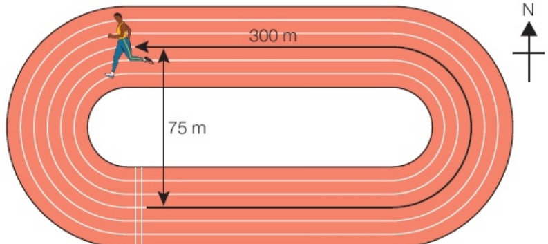

▲ fig B The displacement due north is only 75 m, whilst the actual distance this athlete has run is 300 m. So the velocity due north is much less than the actual speed.

A quantity for which the direction must be stated is known as a vector. If direction is not important, the measurement is referred to as a scalar quantity. Therefore, velocity is a vector and speed is a scalar; distance is a scalar and displacement is a vector.

Scalar and vector quantities are not limited to measurements related to movement. Every measured quantity can be classified to include the direction (vector, e.g. force) or as being sufficiently stated by its magnitude only (scalar, e.g. mass).

<!-- page 22 -->

## AVERAGE AND INSTANTANEOUS SPEED

In most journeys, it is unlikely that speed will remain constant throughout. As part of his training programme, an athlete in fig A wants to keep a record of his speed for all races. From rest, before the starting gun starts the race, he accelerates to a top speed. However, the race timing will be made from start to finish, and so it is most useful to calculate an average speed over the whole race. Average speed is calculated by dividing the total distance for a journey by the total time for the journey. Thus it averages out the slower and faster parts of the journey, and even includes stops.

Instantaneous speed can be an important quantity, and we will look at how to measure it in the next topic.

▲ fig C Most speed checks look at instantaneous speed, but CCTV allows police to monitor average speed over a long distance.

## ACCELERATION

Acceleration is defined as the rate of change of velocity. Therefore, it must include the direction in which the speed is changing, and so acceleration is a vector quantity. The equation defining acceleration is:

 $$ acceleration\ (m s^{-2})=\frac{change in velocity\ (m s^{-1})}{time~taken~to~change~the~velocity\ (s)} $$ 

 $$ a=\frac{v-u}{t} $$ 

OR

 $$ a=\frac{\Delta v}{\Delta t} $$ 

where  $ \pmb{u} $ is the initial velocity and  $ \pmb{v} $ is the final velocity.

The vector nature of acceleration is very important. One of the consequences is that if an object changes only the direction of its velocity, it is accelerating, while remaining at a constant speed. Similarly, deceleration represents a negative change in velocity, and so could be stated as a negative acceleration.

## EXAM HINT

Whilst accelerations can (very briefly) be extraordinarily high, like that for the electron in question 3(b), no speed or velocity can ever be greater than the speed of light, which is  $ 3 \times 10^{8} \, \text{m s}^{-1} $. If you calculate a speed that is higher than this, check your calculation again as it must be wrong.

## CHECKPOINT

## SKILLS PROBLEM SOLVING

1. The athlete in fig B has taken 36 seconds from the start to reach the 300 m mark as shown. Calculate:

(a) his average speed during this 36 seconds

(b) his average velocity due north during this 36 seconds

(c) his average velocity due east during this 36 seconds.

2. A driver in a car travelling at about 40.2 km h $ ^{-1} $ sees a cat run onto the road ahead.

(a) Convert 40.2 km h $ ^{-1} $ into a speed in m s $ ^{-1} $.

(b) The car travels 16.5 m whilst the driver is reacting to the danger. What is his reaction time?

(c) The car comes to a stop in 2.5 s. What is its deceleration?

3. An electron in an X-ray machine is accelerated from rest to half the speed of light in  $ 1.7 \times 10^{-15} $ s. Calculate:

(a) the speed the electron reaches in m s $ ^{-1} $

(b) the acceleration the electron experiences.

## SUBJECT VOCABULARY

speed the rate of change of distance:

 $$ speed(m s^{-1})=\frac{distance(m)}{time(s)} $$ 

 $$ v=\frac{d}{t} $$ 

velocity the rate of change of displacement:

 $$  velocity(m s^{-1})=\frac{displacement(m)}{time(s)} $$ 

 $$ \mathbf{v}=\frac{\boldsymbol{s}}{t}~\mathrm{~O R~}~\mathbf{v}=\frac{\Delta\boldsymbol{s}}{\Delta t} $$ 

displacement the vector measurement of distance in a certain direction

vector a quantity that must have both magnitude and direction scalar a quantity that has magnitude only

average speed speed for a whole journey, calculated by dividing the total distance for a journey by the total time for the journey:

 $$ average~speed\ (m s^{-1})=\frac{total~distance\ (m)}{total~time\ (s)} $$ 

instantaneous speed the speed at any particular instant in time on a journey, which can be found from the gradient of the tangent to a distance-time graph at that time

acceleration the vector defined as the rate of change of velocity:

 $$ acceleration\ (m s^{-2})=\frac{change in velocity\ (m s^{-1})}{time taken to change the velocity\ (s)} $$ 

 $$ \boldsymbol{a}=\frac{\boldsymbol{v}-\boldsymbol{u}}{t}~\mathrm{~OR~}~\boldsymbol{a}=\frac{\Delta\boldsymbol{v}}{\Delta t} $$

<!-- page 23 -->

# 1A 2 MOTION GRAPHS

## LEARNING OBJECTIVES

■ Interpret displacement-time graphs, velocity-time graphs and acceleration-time graphs.

Make calculations from these graphs.

Understand the graphical representations of accelerated motion.

One of the best ways to understand the movements of an object whilst on a journey is to plot a graph of the position of the object over time. Such a graph is known as a displacement-time graph. A velocity-time graph will also provide detail about the movements involved. A velocity-time graph can be produced from direct measurements of the velocity or generated from calculations made using the displacement-time graph.

## DISPLACEMENT-TIME GRAPHS

If we imagine a boat trip on a river, we could monitor the location of the boat over the hour that it travels for and plot the displacement—time graph for these movements. Depending on what information we want the graph to provide, it is often simpler to draw a distance—time graph in which the direction of movement is ignored.

The graphs shown in fig A are examples of plotting position against time, and show how a distance-time graph cannot decrease with time. A displacement-time graph could have parts of it in the negative portions of the y-axis, if the movement went in the opposite direction at some points in time.

The simplest thing we could find from these graphs is how far an object has moved in a certain time. For example, in fig A, both the graphs show that in the first 15 minutes the boat moved 150 m. Looking at the time from 40 to 48 minutes, both show that the boat travelled 120 m, but the displacement-time graph is in the negative region of the y-axis, showing the boat was moving down river from the starting point – the opposite direction to the places it had been in the first 40 minutes.

During the period from 20 to 25 minutes, both graphs have a flat line at a constant value, that shows no change in the distance or displacement. This means the boat was not moving – a flat line on a distance-time  $ (d-t) $ graph means the object is stationary. From 20 to 25 minutes on the velocity-time  $ (v-t) $ graph of this journey (see fig B) the line would be at a velocity of  $ 0 \, m s^{-1} $.

## SPEED AND VELOCITY FROM  $ d-t $ GRAPHS

The gradient of the $d-t$ graphs in fig A will tell us how fast the boat was moving. Gradient is found from the ratio of changes in the $y$-axis divided by the corresponding change on the $x$-axis, so:

for a distance-time graph:

 $$ \begin{aligned}gradient&=\frac{distance\ (m)}{time\ (s)}=speed\ (m s^{-1})\\v&=\frac{d}{t}\end{aligned} $$ 

for a displacement-time graph:

 $$ \begin{aligned}gradient&=\frac{displacement\left(m\right)}{time\left(s\right)}=velocity\left(m s^{-1}\right)\\\boldsymbol{v}&=\frac{\Delta s}{\Delta t}\end{aligned} $$ 

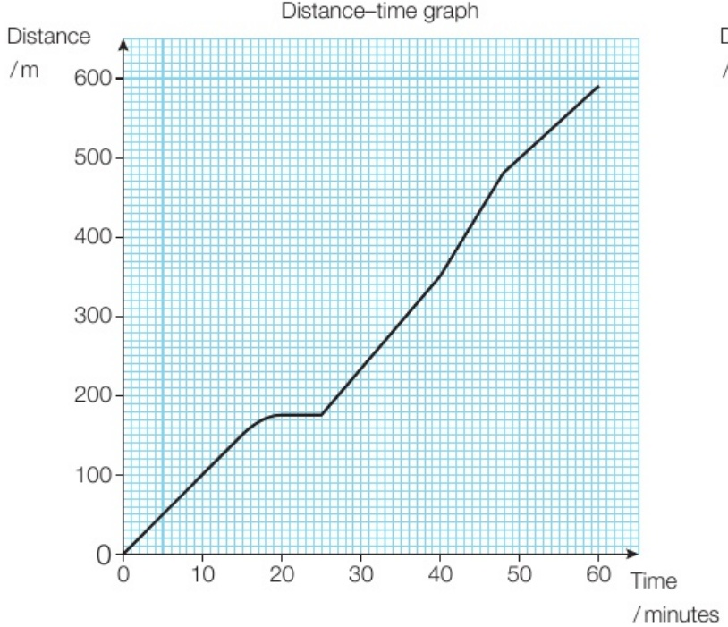

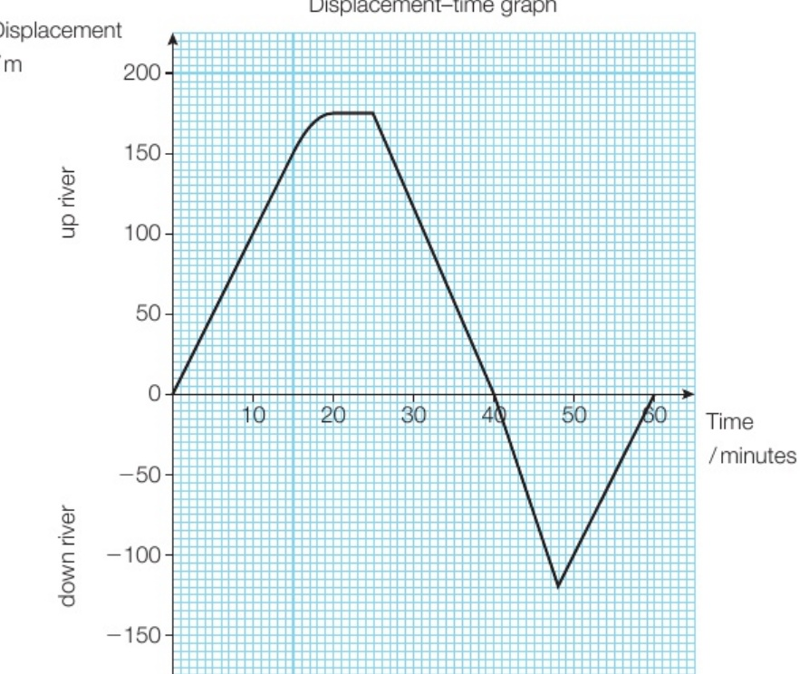

fig A A comparison of the displacement-time graph of the boat trip up and down a river with its corresponding distance-time graph.

<!-- page 24 -->

For example, the first 15 minutes of the boat trip in fig A represents a time of 900 seconds. In this time, the boat travelled 150 m. Its velocity is:

 $$ \mathbf{v}=\frac{\Delta s}{\Delta t}=\frac{150}{900}=0.167m s^{-1}up river $$ 

## VELOCITY-TIME GRAPHS

A velocity-time graph will show the velocity of an object over time. We calculated that the velocity of the boat on the river was  $ 0.167 \, \text{m s}^{-1} $ up river for the first 15 minutes of the journey. Looking at the graph in fig B, you can see that the line is constant at  $ +0.167 \, \text{m s}^{-1} $ for the first 15 minutes.

Also notice that the velocity axis includes negative values, so that the difference between travelling up river (positive y-axis values) and down river (negative y-axis values) can be represented.

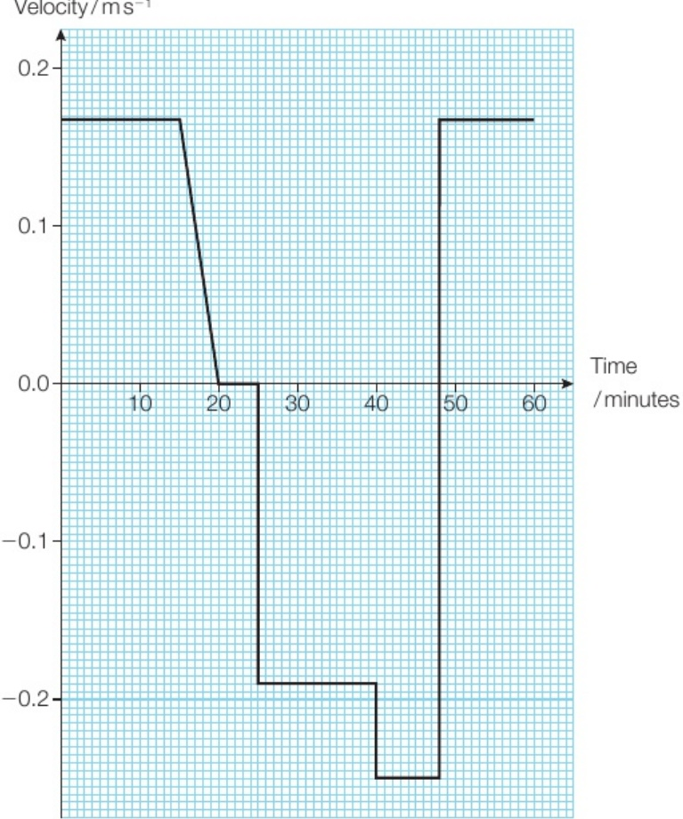

fig B Velocity-time graph of the boat trip.

Acceleration is defined as the rate of change in velocity.

## ACCELERATION FROM v-t GRAPHS

In order to calculate the gradient of the line on a  $ \pmb{v}-t $ graph, we must divide a change in velocity by the corresponding time difference. This exactly matches with the equation for acceleration:

 $$  gradient=\frac{\Delta v}{\Delta t}=\frac{v-u}{t}=acceleration $$ 

For example, between 15 and 20 minutes on the graphs, the boat slows evenly to a stop. The acceleration here can be calculated as the gradient:

 $$  gradient=\frac{\Delta\boldsymbol{v}}{\Delta t}=\frac{\boldsymbol{v}-\boldsymbol{u}}{t}=\frac{0-0.167}{5\times60}=\frac{-0.167}{300}=-0.0006m s^{-2} $$ 

So the acceleration is:  $ \boldsymbol{a} = -0.6 \times 10^{-3} \, \text{m s}^{-2} $.

## DISTANCE TRAVELLED FROM v-t GRAPHS

Speed is defined as the rate of change in distance:

 $$ \begin{array}{l}v=\frac{d}{t}\\\therefore\quad d=v\times t\end{array} $$ 

As the axes on the  $ \pmb{v}-t $ graph represent velocity and time, an area on the graph represents the multiplication of velocity  $ \times $ time, which gives distance. So to find the distance travelled from a  $ \pmb{v}-t $ graph, find the area between the line and the x-axis.

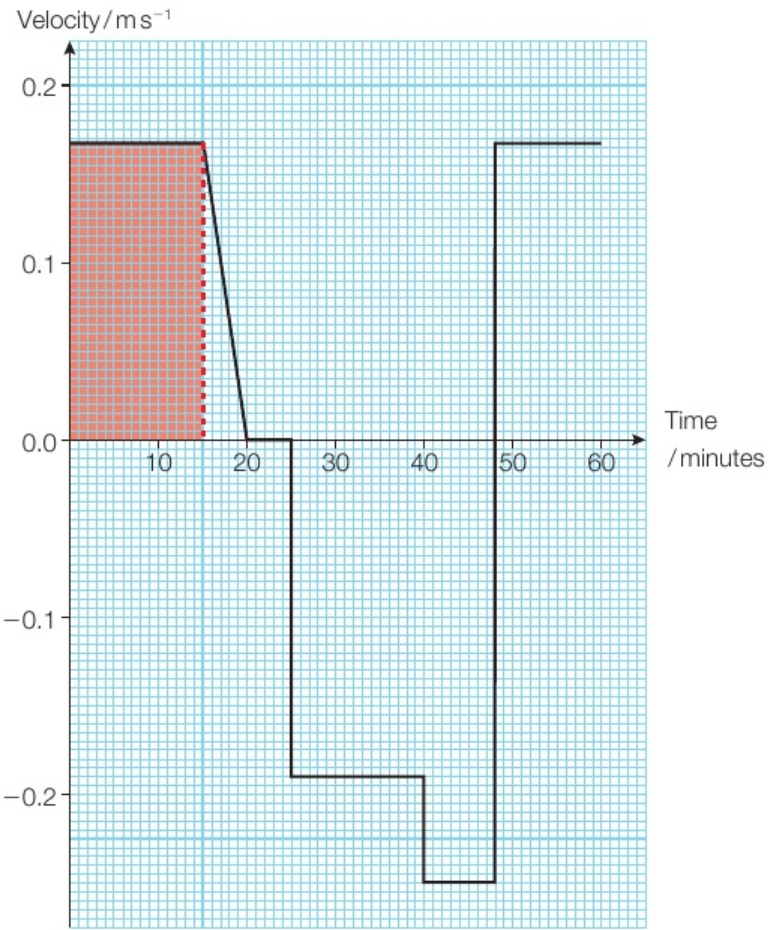

fig C In the first 15 minutes (900 seconds) the distance travelled by the boat moving at  $ 0.167 \, \text{m s}^{-1} $ is given by the area between the line and the x-axis:  $ d = v \times t = 0.167 \times 900 = 150 \, \text{m} $.

If we are only interested in finding the distance moved, this also works for a negative velocity. You find the area from the line up to the time axis. This idea will still work for a changing velocity. Find the area under the line and you have found the distance travelled. For example, from 0 to 20 minutes, the area under the line, all the way down to the x-axis, is a trapezium, so we need to find that area. To calculate the whole distance travelled in the journey for the first 40 minutes, we would have to find the areas under the four separate stages (0–15 minutes; 15–20 minutes; 20–25 minutes; and 25–40 minutes) and then add these four answers together.

<!-- page 25 -->

## PRACTICAL SKILLS

## Finding the acceleration due to gravity by multiflash photography

Using a multiflash photography technique, or a video recording that can be played back frame by frame, we can observe the falling motion of a small object such as a marble (see fig D). We need to know the time between frames.

From each image of the falling object, measure the distance it has fallen from the scale in the picture. A carefully drawn distance-time graph will show a curve as the object accelerates. From this curve, take regular measurements of the gradient by drawing tangents to the curve. These gradients show the instantaneous speed at each point on the curve.

Plotting these speeds on a velocity-time graph should show a straight line, as the acceleration due to gravity is a constant value. The gradient of the line on this v-t graph will be the acceleration due to gravity, g.

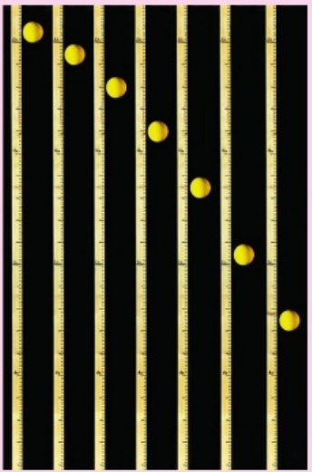

photography allows us to capture the accelerating movement of an object falling under gravity.

fig D Multiflash

Safety Note: Persons with medical conditions such as epilepsy or migraine may be adversely affected by multiflash photography.

## ACCELERATION-TIME GRAPHS

Acceleration-time graphs show how the acceleration of an object changes over time. In many instances the acceleration is zero or a constant value, in which case an acceleration-time  $ (a-t) $ graph is likely to be of relatively little interest. For example, the object falling in our investigation above will be accelerated by gravity throughout. Assuming it is relatively small, air resistance will be minimal, and the  $ a-t $ graph of its motion would be a horizontal line at  $ a = -9.81 \, \text{m s}^{-2} $. Compare this with your results to see how realistic it is to ignore air resistance.

For a larger object falling for a long period, such as a skydiver, then the acceleration will change over time as the air resistance increases with speed.

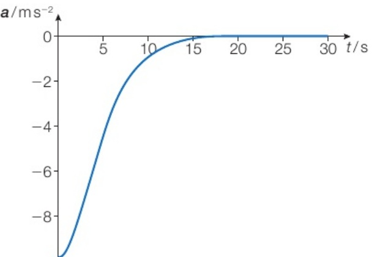

▲ fig E Acceleration-time graph for a skydiver.

The weight of a skydiver is constant, so the resultant force will be decreasing throughout, which means that the acceleration will also reduce (see Section 1A.5). The curve would look like that in fig E. See Section 2A.4 for more details on falling objects and terminal velocity.

## EXAM HINT

Remember that the gradient of a distance-time graph represents speed or velocity. So if the line is curved, the changing gradient indicates a changing speed, which you can describe as the same as the changes in gradient.

<table border=1 style='margin: auto; word-wrap: break-word;'><tr><td style='text-align: center; word-wrap: break-word;'>CHECKPOINT</td><td style='text-align: center; word-wrap: break-word;'>SKILLS</td><td style='text-align: center; word-wrap: break-word;'>INTERPRETATION (OF GRAPHICAL DATA)</td></tr></table>

1. Describe in as much detail as you can, including calculated values, what happens in the bicycle journey shown on the d-t graph in fig F.

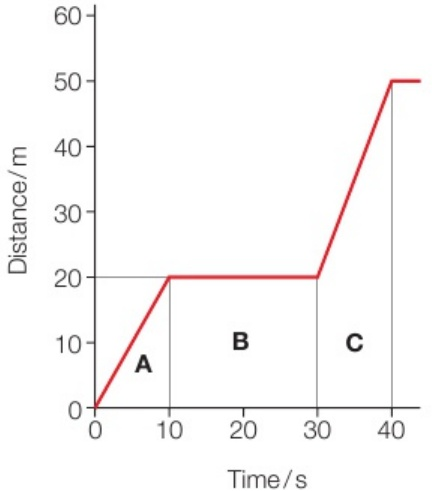

▲ fig F Distance-time graph of a bike journey.

2. Describe in as much detail as you can, including calculated values, what happens in the car journey shown on the v-t graph in fig G.

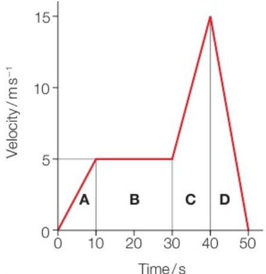

▲ fig G Velocity-time graph of a car journey.

3. From fig B, calculate the distance travelled by the boat from 40 to 60 minutes.

## SUBJECT VOCABULARY

displacement-time graph a graph showing the positions visited on a journey, with displacement on the y-axis and time on the x-axis. velocity-time graph a graph showing the velocities on a journey, with velocity on the y-axis and time on the x-axis. gradient the slope of a line or surface

<!-- page 26 -->

## 3 ADDING FORCES

## LEARNING OBJECTIVES

Add two or more vectors by drawing.

Add two perpendicular vectors by calculation.

Forces are vectors. This means that measuring their magnitude is important, but equally important is knowing the direction in which they act. In order to calculate the overall effect of multiple forces acting on the same object, we can use vector addition to work out the resultant force. This resultant force can be considered as a single force that has the same effect as all the individual forces combined.

## ADDING FORCES IN THE SAME LINE

If two or more forces are acting along the same line, then combining them is simply a case of adding or subtracting their magnitudes depending on their directions.

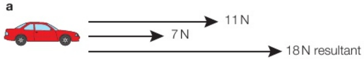

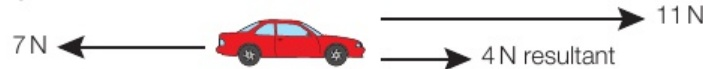

fig A Adding forces in the same line requires a consideration of their comparative directions.

## ADDING PERPENDICULAR FORCES

The effect on an object of two forces that are acting at right angles (perpendicular) to each other will be the vector sum of their individual effects. We need to add the sizes with consideration for the directions in order to find the resultant.

fig B These two rugby players are each putting a force on their opponent. The forces are at right angles, so the overall effect would be to move him in a third direction, which we could calculate.

## MAGNITUDE OF THE RESULTANT FORCE

To calculate the resultant magnitude of two perpendicular forces, we can draw them, one after the other, as the two sides of a right-angled triangle and use Pythagoras' theorem to calculate the size of the hypotenuse.

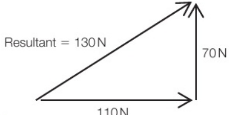

fig C The resultant force here is calculated using Pythagoras' theorem:

 $ F = \sqrt{(70^{2} + 110^{2})} = 130 \, N $

## DIRECTION OF THE RESULTANT FORCE

As forces are vectors, when we find a resultant force it must have both magnitude and direction. For perpendicular forces (vectors), trigonometry will determine the direction.

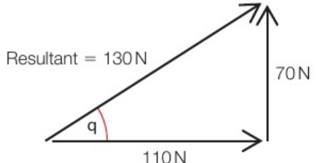

▲ fig D The resultant force here is at an angle up from the horizontal of:  $ \theta = \tan^{-1}\left(\frac{70}{110}\right) = 32^{\circ} $

## EXAM HINT

Always take care to state where the angle for a vector's direction is measured. For example, in fig D, the angle should be stated as  $ 32^{\circ} $ up from the horizontal. This is most easily expressed on a diagram of the situation, where you draw in the angle.

## ADDING TWO NON-PERPENDICULAR FORCES

The geometry of perpendicular vectors makes the calculation of the resultant simple. We can find the resultant of any two vectors by drawing one after the other, and then the resultant will be the third side of the triangle from the start of the first one to the end of the second one. A scale drawing of the vector triangle will allow measurement of the size and direction of the resultant.

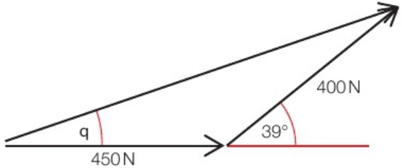

▲ fig E The resultant force here can be found by scale drawing the two forces, and then measurement of the resultant on the drawing using a ruler and a protractor.

<!-- page 27 -->

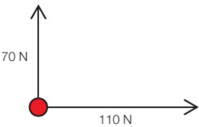

▲ fig G Free-body force diagram of a rugby player (red circle). The forces from the tacklers are marked on as force arrows.

SKILLS ANALYSIS

## THE PARALLELOGRAM RULE

There is another method for finding the resultant of two non-perpendicular forces (or vectors) by scale drawing, which can be easier to use. This is called the parallelogram rule. Draw the two vectors to scale – at the correct angle and scaled so their length represents the magnitude – starting from the same point. Then draw the same two vectors again parallel to the original ones, so that they form a parallelogram, as shown in fig F. The resultant force (or vector) will be the diagonal across the parallelogram from the starting point.

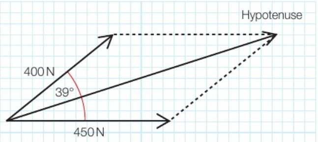

▲ fig F Finding the resultant vector using the parallelogram rule.

## EXAM HINT

The vector addition rules shown on these pages work for all vectors, not just forces. They are useful only for co-planar vectors, which means vectors that are in the same plane. If we have more than two vectors that are in more than one plane, add two vectors together first, in their plane, and then add the resultant to the next vector using these rules again. Keep doing this until all the vectors have been added in.

## FREE-BODY FORCE DIAGRAMS

If we clarify what forces are acting on an object, it can be simpler to calculate how it will move. To do this, we usually draw a free-body force diagram, which has the object isolated, and all the forces that act on it drawn in at the points where they act. Forces acting on other objects, and those other objects, are not drawn. For example, fig G could be said to be a free-body force diagram of the rugby player being tackled in fig B, and this would lead us to draw fig C and fig D to make our resultant calculations.

## CHECKPOINT

1. Work out the resultant force on a toy car if it has the following forces acting on it:

- rubber band motor driving forwards 8.4 N

• air resistance 0.5 N

friction 5.8 N

• child's hand pushing forward 10 N.

2. As a small plane accelerates to take off, the lift force on it is 6000 N vertically upwards, whilst the thrust is 2800 N horizontally forwards. What is the resultant of these forces on the plane?

3. Draw a free-body force diagram of yourself sitting on your chair.

4. ▶ (a) Draw the scale diagram of fig E, and work out what the resultant force would be.

(b) Use the parallelogram rule, as in fig F, to check your answer to part (a).

5. In order to try and recover a car stuck in a muddy field, two tractors pull on it. The first acts at an angle of  $ 20^{\circ} $ left of the forwards direction with a force of 2250 N. The second acts  $ 15^{\circ} $ to the right of the forwards direction with a force of 2000 N. Draw a scale diagram of the situation and find the resultant force on the stuck car.

## SUBJECT VOCABULARY

resultant force the total force (vector sum) acting on a body when all the forces are added together accounting for their directions

free-body force diagram diagram showing an object isolated, and all the forces that act on it are drawn in at the points where they act, using arrows to represent the forces

<!-- page 28 -->

## 4 MOMENTS

## LEARNING OBJECTIVES

Calculate the moment of a force.

Apply the principle of moments.

Find the centre of gravity of an object.

Forces on an object could act so that the object does not start to move along, but instead rotates about a fixed pivot. If the object is fixed so that it cannot rotate, it will bend.

## THE MOMENT OF A FORCE

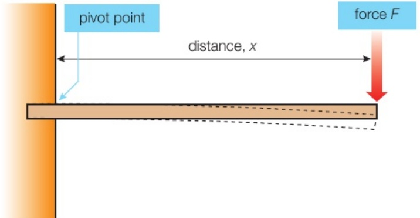

fig A A force acts on a beam fixed at a point. The moment of a force causes rotation or, in this case, bending.

The tendency to cause rotation is called the moment of a force. It is calculated from:

moment (Nm) = force (N) × perpendicular distance from the pivot to the line of action of the force (m)

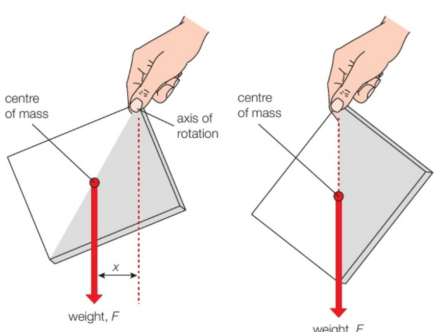

▲ fig B The calculation of moment only considers the perpendicular distance between the line of action of the force and the axis of rotation, through the pivot point. When free to rotate, a body will turn in the direction of any net moment.

## PRINCIPLE OF MOMENTS

▲ fig C Balanced moments create an equilibrium situation.

If we add up all the forces acting on an object and the resultant force, accounting for their directions, is zero, then the object will be in equilibrium. Therefore it will remain stationary or, if it is already moving, it will carry on moving at the same velocity. The object could keep a constant velocity, but if the moments on it are not also balanced, it could be made to start rotating. The principle of moments tells us that if the total of all the moments trying to turn an object clockwise is equal to the total of all moments trying to turn an object anticlockwise, then it will be in rotational equilibrium. This means it will either remain stationary, or if it is already rotating it will continue at the same speed in the same direction.

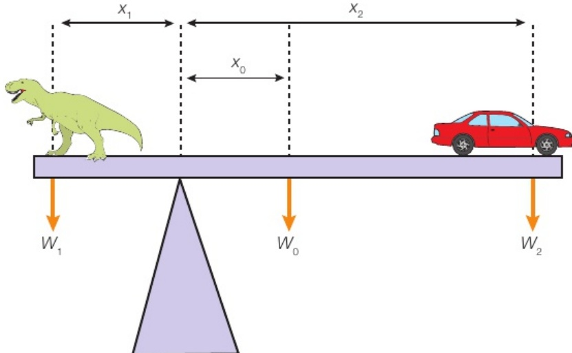

▲ fig D As the metre-long beam is balanced, the sum of all the clockwise moments must equal the sum of all the anticlockwise moments.

## LEARNING TIP

The clockwise moments and the anticlockwise moments must all be taken about the same pivot point.

<!-- page 29 -->

## EXAM HINT

Note that the steps and layout of the solution in this worked example are suitable for moments questions in the exam.

In fig D, we can work out the weight of the beam if we know all the other weights and distances. The beam is uniform, so its weight will act from its centre. The length of the beam is 100 cm. So if  $ x_1 = 20 $ cm, then  $ x_0 $ must be 30 cm, and  $ x_2 = 80 $ cm. The dinosaur ( $ W_1 $) weighs 5.8 N and the toy car's weight ( $ W_2 $) is 0.95 N.

In equilibrium, principle of moments: sum of anticlockwise moments = sum of clockwise moments

## WORKED EXAMPLE

You can consider the terms 'centre of gravity' and 'centre of mass' to mean the same thing. They are exactly the same for objects that are small compared to the size of the Earth.

## LEARNING TIP

In order to calculate the sum of the moments in either direction, each individual moment must be calculated first and these individual moments then added together. The weights and/or distances cannot be added together and this answer used to calculate some sort of combined moment.

## LEARNING TIP

 $$ W_{1}x_{1}\;=\;W_{0}x_{0}+\;W_{2}x_{2} $$ 

 $$ 5.8\times0.20=W_{0}\times0.30+0.95\times0.80 $$ 

 $$ W_{0}=\frac{1.16-(0.76)}{0.30} $$ 

 $$ W_{0}=1.3\mathsf{N} $$ 

## CENTRE OF GRAVITY

The weight of an object is caused by the gravitational attraction between the Earth and each particle contained within the object. The sum of all these tiny weight forces appears to act from a single point for any object, and this point is called the centre of gravity. For a symmetrical object, we can calculate the position of its centre of gravity, as it must lie on every line of symmetry. The point of intersection of all lines of symmetry will be the centre of gravity. Fig E illustrates this with two-dimensional shapes, but the idea can be extended into three dimensions. For example, the centre of gravity of a sphere is at the sphere's centre.

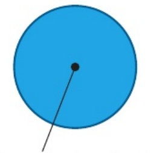

The centre of gravity of

a circle is in the middle.

There are equal amounts

of mass all around this point.

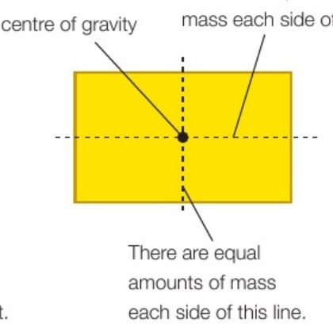

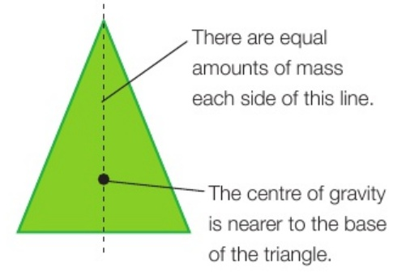

▲ fig E The centre of gravity of a symmetrical object lies at the intersection of all lines of symmetry.

## IRREGULAR OBJECTS

The centre of gravity of an irregularly shaped object will still follow the rule that it is the point at which its weight appears to act on the object. A Bunsen burner, for example, has a heavy base. As such, the centre of gravity is low down near that concentration of mass, as there will be a greater attraction by the Earth's gravity to this large mass.

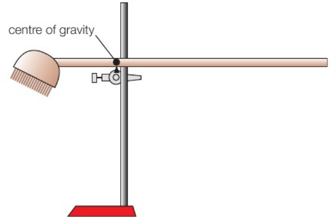

▲ fig F Balancing a broom on its centre of gravity.

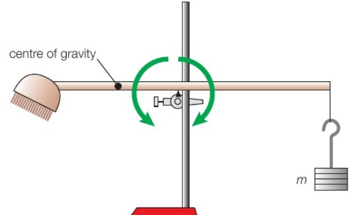

▲ fig G  Finding the centre of gravity of an irregular rod (broom).

<!-- page 30 -->

## PRACTICAL SKILLS

## Finding the centre of mass of an irregular rod

In this investigation, we use the principle of moments to find the centre of gravity of a broom. It is not easy to estimate/determine the (location of the) centre of gravity by looking at a broom because it is not a symmetrical object. With the extra mass at the brush head end, the centre of gravity will be nearer that end.

If you can balance the broom on the edge of a thick metal ruler, then the centre of gravity must lie above the ruler edge. As the perpendicular distance from the line of action to the weight is zero, the moment is zero so the broom sits in equilibrium.

You will probably find it difficult to balance the broom exactly, so you can use an alternative method. First you measure the mass of the broom (M) using a digital balance. Then you use a set of hanging masses (of mass m) to balance the broom more in the middle of the handle, as in fig G. When the broom is balanced, you measure the distance (d) from the hanging masses to the pivot. You calculate the distance (x) from the pivot to the centre of gravity of the broom using the principle of moments:

clockwise moment = anticlockwise moment

 $$ mg\times d=Mg\times x $$ 

 $$ x=\frac{md}{M} $$ 

Note: Do not get into the habit of using only the mass in moments calculations, as the definition is force times distance. It just happens that in this case g cancels on each side.

Safety Note: Securely clamp the base of the stand to the bench. Do not use a very heavy broom as you would need a heavier counterweight which could fall and cause injury.

## CHECKPOINT

1. What is the moment of a 252 N force acting on a solid object at a perpendicular distance of 1.74 m from an axis of rotation of the object?

2. A child and his father are playing on a seesaw, see fig H. They are exactly balanced when the boy (mass 46 kg) sits at the end of the seesaw, 2.75 m from the pivot. If his father weighs 824 N, how far is he from the pivot?

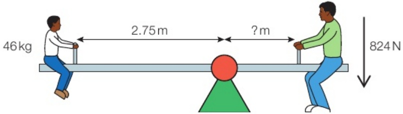

## fig H

3. The weight of the exercise book in the left-hand picture in fig B causes a rotation so it moves towards the second position. Explain why it does not continue rotating but comes to rest in the position of the second picture.

4. If the same set-up as shown in fig D was used again, but the toy car was replaced with a banana weighing 1.4 N, find out where the banana would have to be positioned for the beam to balance – calculate the new  $ x_3 $.

## SUBJECT VOCABULARY

equilibrium the situation for a body where there is zero resultant force and zero resultant moment. It will have zero acceleration

principle of moments a body will be in equilibrium if the sum of clockwise moments acting on it is equal to the sum of the anticlockwise moments

centre of gravity the point through which the weight of an object appears to act

<!-- page 31 -->

# 1A 5 NEWTON'S LAWS OF MOTION

## LEARNING OBJECTIVES

Recall Newton's laws of motion and use them to explain the acceleration of objects.

Make calculations using Newton's second law of motion.

Identify pairs of forces involved in Newton's third law of motion.

Sir Isaac Newton was an exceptional thinker and scientist. His influence over science in the West is still enormous, despite the fact that he lived from 1642 to 1727. He was a professor at Cambridge University, a member of the British Parliament, and a president of the respected scientific organisation, the Royal Society, in London. Probably his most famous contribution to science was the development of three simple laws governing the movement of objects subject to forces.

fig A A portrait painting of Sir Isaac Newton

## NEWTON'S FIRST LAW OF MOTION

If an object is stationary there needs to be a resultant force on it to make it move. We saw how to calculate resultant forces in Section 1A.3. If the object is already moving then it will continue at the same speed in the same direction unless a resultant force acts on it. If there is no resultant force on an object – either because there is zero force acting or all the forces balance out – then the object's motion is not changed.

## NEWTON'S SECOND LAW OF MOTION

This law tells us how much an object's motion will be changed by a resultant force. For an object with constant mass, it is usually written mathematically:

 $$ \Sigma F=ma $$ 

resultant force (N) = mass (kg)  $ \times $ acceleration (m s $ ^{-2} $)

For example, this relationship allows us to calculate the acceleration due to gravity (g) if we measure the force (F) accelerating a mass (m) downwards.

 $$ \boldsymbol{F}=m\boldsymbol{a}=m\boldsymbol{g} $$ 

 $$ \therefore\quad g=\frac{F}{m} $$ 

fig B A stationary object will not move unless it is acted upon by a resultant force.

<!-- page 32 -->

# PRACTICAL SKILLS

Newton's second law investigation

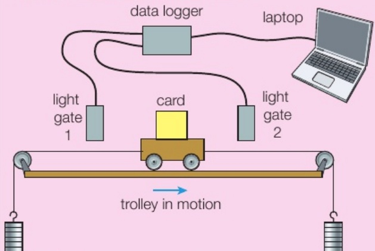

fig C Experimental set-up for investigating the relationship between F, m and a.

You can use the set-up shown in fig C, or a similar experiment on an air track. This set-up measures the acceleration for various values of the resultant force that acts on the trolley whilst you keep its mass constant (table A). By plotting a graph of acceleration against resultant force, a straight line will show that acceleration is proportional to the resultant force. You could also plot a graph for varying masses of trolley whilst you keep the resultant force constant (table B).

Safety Note: Place heavy trolleys and runways where they cannot slide or fall off benches and cause injuries. Place air track 'blowers' on the floor. Secure the hose so that it cannot come loose and blow dirt and dust into eyes.

<table border=1 style='margin: auto; word-wrap: break-word;'><tr><td style='text-align: center; word-wrap: break-word;'>FORCE / N</td><td style='text-align: center; word-wrap: break-word;'>ACCELERATION /  $ m s^{-2} $</td></tr><tr><td style='text-align: center; word-wrap: break-word;'>0.1</td><td style='text-align: center; word-wrap: break-word;'>0.20</td></tr><tr><td style='text-align: center; word-wrap: break-word;'>0.2</td><td style='text-align: center; word-wrap: break-word;'>0.40</td></tr><tr><td style='text-align: center; word-wrap: break-word;'>0.3</td><td style='text-align: center; word-wrap: break-word;'>0.60</td></tr><tr><td style='text-align: center; word-wrap: break-word;'>0.4</td><td style='text-align: center; word-wrap: break-word;'>0.80</td></tr><tr><td style='text-align: center; word-wrap: break-word;'>0.5</td><td style='text-align: center; word-wrap: break-word;'>1.00</td></tr><tr><td style='text-align: center; word-wrap: break-word;'>0.6</td><td style='text-align: center; word-wrap: break-word;'>1.20</td></tr></table>

table A Values of acceleration for different forces acting on a trolley.

<table border=1 style='margin: auto; word-wrap: break-word;'><tr><td style='text-align: center; word-wrap: break-word;'>MASS / kg</td><td style='text-align: center; word-wrap: break-word;'>ACCELERATION / m  $ s^{-2} $</td></tr><tr><td style='text-align: center; word-wrap: break-word;'>0.5</td><td style='text-align: center; word-wrap: break-word;'>1.00</td></tr><tr><td style='text-align: center; word-wrap: break-word;'>0.6</td><td style='text-align: center; word-wrap: break-word;'>0.83</td></tr><tr><td style='text-align: center; word-wrap: break-word;'>0.7</td><td style='text-align: center; word-wrap: break-word;'>0.71</td></tr><tr><td style='text-align: center; word-wrap: break-word;'>0.8</td><td style='text-align: center; word-wrap: break-word;'>0.63</td></tr><tr><td style='text-align: center; word-wrap: break-word;'>0.9</td><td style='text-align: center; word-wrap: break-word;'>0.55</td></tr><tr><td style='text-align: center; word-wrap: break-word;'>1.0</td><td style='text-align: center; word-wrap: break-word;'>0.50</td></tr></table>

table B Values of acceleration resulting from an applied force of 0.5 N when the mass of the trolley is varied.

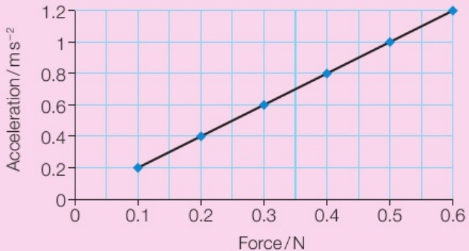

fig D Graph of results from the first investigation into Newton's second law. Acceleration is directly proportional to force.

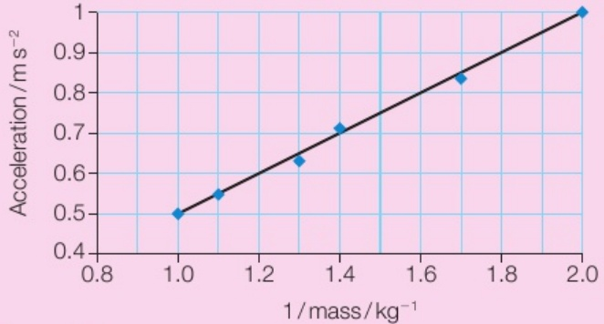

▲Fig E Graph of results from the second investigation into Newton's second law. The x-axis represents the derived data of '1/mass', so the straight best-fit line shows that acceleration is inversely proportional to mass. Note that there is no need for a graph to start at the origin: choose axes scales that will best show the pattern in the data by making the points fill the graph paper.

Experimental verification of Newton's second law is well established. The investigation shown in fig C demonstrates that:  $ a = \frac{F}{m} $

## LEARNING TIP

## Straight-line graphs

Physicists always try to arrange their experimental data into graphs that produce a straight best-fit line. This proves a linear relationship between the experimental variables, and can also give us numerical information about the quantities involved.

The equation for a straight line is:

 $$ y=m x+c $$ 

'm' in the equation is the gradient of the straight line, and 'c' is the value on the y-axis where the line crosses it, known as the y-intercept. If we plot experimental data on a graph and get a straight best-fit line, then this proves the quantities we plotted on x and y have a linear relationship. It is referred to as 'directly proportional' (or simply 'proportional') only if the line also passes through the origin, meaning that c = 0. The graphs in fig D and fig E demonstrate experimental verification of Newton's second law. In each case, the third variable in the equation was kept constant as a control variable. For example, in fig D the straight best-fit line, showing that  $ y \propto x $, proves that  $ a \propto F $, and the gradient of the best-fit line would represent the reciprocal of the mass that was accelerated and was kept constant throughout, as a control variable. In this example c = 0, which means that the proportional relationships are simple:

 $$ y=m x $$ 

 $$ a=\frac{F}{m} $$

<!-- page 33 -->

As both the above equations represent the graph in fig D, it follows that the gradient, m, equals the reciprocal of the mass, 1/m. It is just coincidence that the symbol 'm' for gradient, and 'm' for mass are the same letter in this example.

Note that graphs in physics are causal relationships. In fig D, the acceleration is caused by the force. It is very rare in physics that a graph would represent a statistical correlation, and so phrases such as 'positive correlation' do not correctly describe graphs of physics experiments.

Similarly, it is very rare that a graph of a physics experiment would be correctly drawn if the points are joined 'dot-to-dot'. In most cases a best-fit line should be drawn, as has been done in fig E.

## LEARNING TIP

Identifying Newton's third law of force pairs can confuse people. To find the two forces, remember they must always act on different objects, and must always have the same cause. In fig F, it is the mutual repulsion of electrons in the atoms of the football and the boot that cause the action and reaction.

## NEWTON'S THIRD LAW OF MOTION

When an object A causes a force on another object B, then object B causes an equal force in the opposite direction to act upon object A. For example, when a skateboarder pushes off from a wall, they exert a force on the wall with their hand. At the same time, the wall exerts a force on the skateboarder's hand. This equal and opposite reaction force is what they can feel with the sense of touch, and as the skateboard has very low friction, the wall's push on them causes acceleration away from the wall. As the wall is connected to the Earth, the Earth and wall combination will accelerate in the opposite direction. The Earth has such a large mass that its acceleration can't be noticed. That's Newton's second law again: acceleration is inversely proportional to mass; huge mass means tiny acceleration.

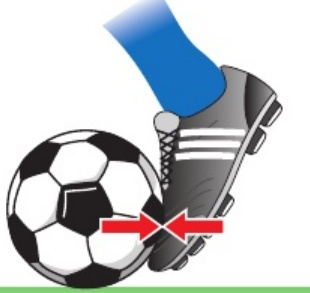

SKILLS ANALYSIS

▲ fig F When the boot puts a force on the football, the football causes an equal and opposite force on the boot. The footballer can feel the kick because they feel the reaction force from the ball on their toe.

## CHECKPOINT

1. In terms of Newton's laws of motion:

(a) Explain why this book will sit stationary on a table.

(b) Describe and explain what will happen if your hands then put an upwards force on the book that is greater than its weight.

(c) Explain why you feel the book when your hands put that upwards force on it.

2. (a) Calculate the gradient of the best-fit line on the graph in fig D and thus work out the mass of the trolley that was accelerated in the first investigation.

(b) State what quantity the gradient of the line on the graph in fig E represents. Calculate the value of that quantity.

3. Calculate the acceleration in each of the following cases:

(a) A mass of 12.0 kg experiences a resultant force of 785 N.

(b) A force of 22.2 N acts on a 3.1 kg mass.

(c) A 2.0 kg bunch of bananas is dropped. The bunch weighs 19.6 N.

(d) During a tackle, two footballers kick a stationary ball at the same time, with forces acting in opposite directions. One kick has a force of 210 N, the other has a force of 287 N. The mass of the football is 430 g.

## SUBJECT VOCABULARY

Newton's first law of motion an object will remain at rest, or in a state of uniform motion, until acted upon by a resultant force

Newton's second law of motion if an object's mass is constant, the resultant force needed to cause an acceleration is given by the equation:

 $ \sum F = ma $

Newton's third law of motion for every action, there is an equal and opposite reaction

<!-- page 34 -->

# 6 KINEMATICS EQUATIONS

CP1 LAB BOOK PAGE 6

## LEARNING OBJECTIVES

Recall the simple kinematics equations.

Calculate unknown variables using the kinematics equations.

Kinematics is the study of the movement of objects. We can use equations to find out details about the motion of objects accelerating in one dimension.

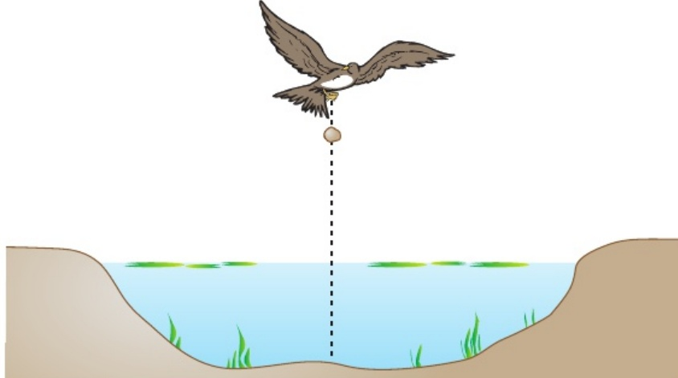

▲ fig A Kinematics is the study of the description of the motion of objects. The equations could be used to make calculations about the stone falling through the air, and separately about its motion through the water. The acceleration in air and in water will be different as the resultant force acting in each will be different.

## ZERO ACCELERATION

If an object has no resultant force acting on it then it does not accelerate. This is uniform motion. In this situation, calculations on its motion are very easy, as they simply involve the basic velocity equation:

 $$ \boldsymbol{v}=\frac{\boldsymbol{s}}{t} $$ 

The velocity is the same at the beginning and end of the motion, and if we need to find the displacement travelled, it is a simple case of multiplying velocity by time:

 $$ s=v\times t $$ 

## CONSTANT ACCELERATION

There are equations that allow us to work out the motion of an object that is moving with a constant acceleration. For these kinematics equations, the first step is to define the five variables used:

s - displacement (m)

 $$ \boldsymbol{u}-\text{initial velocity}(m s^{-1}) $$ 

 $$ \pmb{v}-\mathrm{f i n a l}\mathrm{v e l o c i t y}(\mathrm{m}\mathrm{s}^{-1}) $$ 

 $$ a-acceleration(m s^{-2}) $$ 

 $$ t-time(s) $$ 

Each equation uses four of the variables, which means that if we know the values of any three variables, we can find out the other two.

## ACCELERATION REDEFINED

By re-arranging the equation that defined acceleration, we come to the usual expression of the first kinematics equation:

 $ v = u + at $

For example, if a stone is dropped off a cliff (see fig B) and takes three seconds to hit the ground, what is its speed when it does hit the ground?

Identify the three things we know:

• falling under gravity, so  $ a = g = 9.81 \, \text{m s}^{-2} $

(constant acceleration, so the kinematics equations can be used)

• starts at rest, so  $ u = 0 \, m s^{-1} $

• time to fall t = 3 s

 $ v = u + at = 0 + 9.81 \times 3 = 29.43 $

 $$ \mathbf{v}=29.4m s^{-1} $$ 

## EXAM HINT

Often the acceleration will not be clearly stated, but the object is falling under gravity, so:

 $$ a=g=9.81m s^{-2} $$ 

## EXAM HINT

Often the initial velocity will not be explicitly stated, but the object starts 'at rest'. This means it is stationary at the beginning, so:

 $$ u=0m s^{-1} $$ 

## DISTANCE FROM AVERAGE SPEED

As the kinematics equations only work with uniform acceleration, the average speed during any acceleration will be halfway from the initial velocity to the final velocity. Therefore the distance travelled is the average speed multiplied by the time:

 $$ s=\frac{(u+v)}{2}\times t $$ 

For example, for the same stone dropping off the cliff as in the previous example, we could work out how high the cliff is.

Identify the three things we know:

- final velocity came to be  $ \pmb{v} = 29.4 \, \text{m s}^{-1} $

• starts at rest, so  $ u = 0 \, m s^{-1} $

• time to fall t = 3 s

 $$ \begin{aligned}s&=\frac{(\boldsymbol{u}+\boldsymbol{v})}{2}\times t=\frac{(0+29.4)}{2}\times3=44.1\\s&=44.1m\end{aligned} $$

<!-- page 35 -->

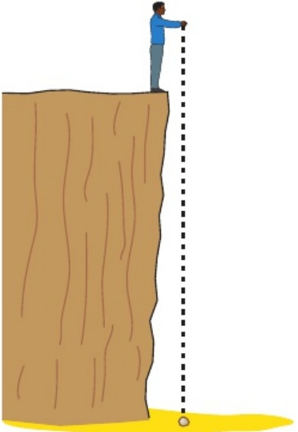

## COMBINING EQUATIONS A

We can combine the equations

fig B Calculations about falling objects are very common.

## EXAM HINT

The kinematics equations are only valid if there is a constant acceleration. If the acceleration is changing they cannot be used.

 $$ \boldsymbol{v}=\boldsymbol{u}+a t $$ 

and

 $$ s=\frac{(u+v)}{2}\times t $$ 

By substituting the first of these equations into the second, we get the combination equation:

 $$ \boldsymbol{s}=\frac{\left(\boldsymbol{u}+\left(\boldsymbol{u}+\boldsymbol{a}t\right)\right)}{2}\times t=\frac{\left(2u t+\boldsymbol{a}t^{2}\right)}{2} $$ 

 $$ s=ut+\frac{1}{2}at^{2} $$ 

We can use this equation to check again how high the stone was dropped from:

• falling under gravity, so  $ a = g = 9.81 \, \text{m s}^{-2} $

• starts at rest, so  $ \pmb{u}=0\mathrm{~m~s}^{-1} $

• time to fall t = 3 s

 $$ \begin{aligned}&s=ut+\frac{1}{2}at^{2}=\left(0\times3\right)+\left(\frac{1}{2}\times9.81\times3^{2}\right)=44.1\\&s=44.1m\\ \end{aligned} $$ 

Notice that the answer must come out the same, as we are calculating for the same cliff. This highlights the fact that we can use whichever equation is most appropriate for the information given.

## COMBINING EQUATIONS B

 $$ s=\frac{(u+v)}{2}\times t $$ 

 $$ \therefore\quad t=\frac{2s}{\left(u+v\right)} $$ 

and  $ v = u + at $

By substituting the first of these equations into the second, we get the combination equation:

 $$ \boldsymbol{v}=\boldsymbol{u}+\boldsymbol{a}\times\frac{2\boldsymbol{s}}{(\boldsymbol{u}+\boldsymbol{v})} $$ 

 $$ \therefore\quad v(u+v)=u(u+v)+2as $$ 

 $$ \therefore v u+v^{2}=u^{2}+u v+2a s $$ 

vu = uv so subtract from each side

 $$ \boldsymbol{v}^{2}=\boldsymbol{u}^{2}+2a s $$ 

Check again what the stone's final velocity would be:

• falling under gravity, so  $ a = g = 9.81 \, \text{m s}^{-2} $

• starts at rest, so  $ u = 0 \, m s^{-1} $

• height to fall s = 44.1 m

 $$ \boldsymbol{v}^{2}=\boldsymbol{u}^{2}+2\boldsymbol{a}\boldsymbol{s}=0^{2}+\left(2\times9.81\times44.1\right)=865 $$ 

 $$ \therefore\quad\mathbf{v}=\sqrt{865}=29.4 $$ 

 $$ \mathbf{v}=29.4m s^{-1} $$ 

Notice that the answer must come out the same as previously calculated, and this again highlights that there are many ways to reach the answer.

<table border=1 style='margin: auto; word-wrap: break-word;'><tr><td style='text-align: center; word-wrap: break-word;'>KINEMATICS EQUATION</td><td style='text-align: center; word-wrap: break-word;'>QUANTITY NOT USED</td></tr><tr><td style='text-align: center; word-wrap: break-word;'>$ \mathbf{v} = \mathbf{u} + \boldsymbol{a}t $</td><td style='text-align: center; word-wrap: break-word;'>distance</td></tr><tr><td style='text-align: center; word-wrap: break-word;'>$ \mathbf{s} = \frac{(\mathbf{u} + \mathbf{v})}{2} \times t $</td><td style='text-align: center; word-wrap: break-word;'>acceleration</td></tr><tr><td style='text-align: center; word-wrap: break-word;'>$ \mathbf{s} = \mathbf{u}t + \frac{1}{2}\mathbf{a}t^{2} $</td><td style='text-align: center; word-wrap: break-word;'>final velocity</td></tr><tr><td style='text-align: center; word-wrap: break-word;'>$ \mathbf{v}^{2} = \mathbf{u}^{2} + 2\mathbf{a}\mathbf{s} $</td><td style='text-align: center; word-wrap: break-word;'>time</td></tr></table>

table A Each of the kinematics equations is useful, depending on the information we are given. If you know three quantities, you can always find a fourth by identifying which equation links those four quantities and rearranging that equation to find the unknown.

<!-- page 36 -->

## PRACTICAL SKILLS

CP1

## Finding the acceleration due to gravity by freefall

A system for timing the fall of an object under gravity can allow us to measure the acceleration due to gravity. In this experiment, we measure the time taken by a falling object to drop under gravity from a certain height, and then alter the height and measure again.

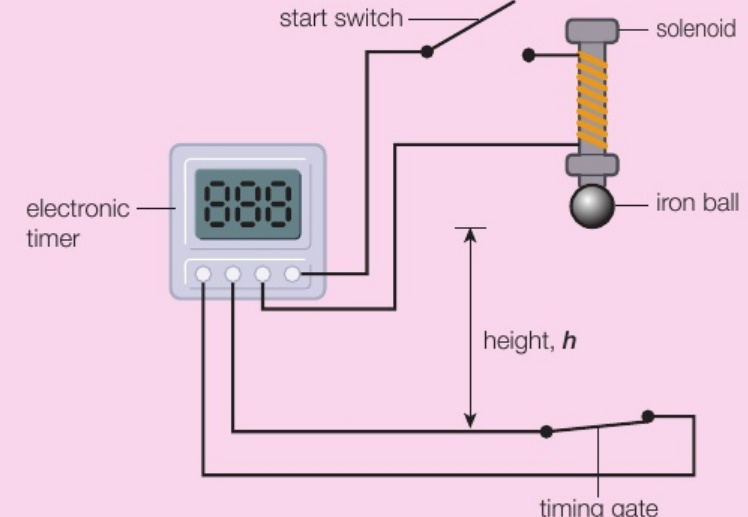

fig C The freefall time of an object from different heights allows us to find the acceleration due to gravity, g.

If we vary the height from which the object falls, the time taken to land will vary. The kinematics equations tell us that:

 $$ s=ut+\frac{1}{2}at^{2} $$ 

As it always starts from rest,  $ \pmb{u} = 0 $ throughout; the acceleration is that caused by gravity,  $ \pmb{g} $; and the distance involved is the height from which it is released,  $ \pmb{h} $. Thus:

 $$ \boldsymbol{h}=\frac{1}{2}\boldsymbol{g}t^{2} $$ 

 $$ \therefore\quad t^{2}=\frac{2\boldsymbol{h}}{\boldsymbol{g}} $$ 

Compare this equation with the equation for a straight-line graph:  $ y = mx + c $

We plot a graph of $h$ on the $x$-axis and $t^{2}$ on the $y$-axis to give a straight best-fit line. The gradient of the line on this graph will be $2/g$, from which we can find $g$.

We could find a value for g by taking a single measurement from this experiment and using the equation to calculate it:

 $$ g=\frac{2h}{t^{2}} $$ 

However, a single measurement in any experiment is subject to uncertainty from both random and systematic errors. We can reduce such uncertainties significantly by taking many readings and plotting a graph, which leads to much more reliable conclusions.

Safety Note: Secure the tall stand holding the solenoid so that it cannot topple over.

## CHECKPOINT

1. What is the final velocity of a bike that starts at  $ 4 \, m \, s^{-1} $ and has zero acceleration act on it for 10 seconds?

2. How far will the bike in question 1 travel in the 10-second time period?

3. Calculate the acceleration in each of the following cases:

 $$ (a)\ \boldsymbol{v}=22\boldsymbol{m}\boldsymbol{s}^{-1};\boldsymbol{u}=8\boldsymbol{m}\boldsymbol{s}^{-1};t=2.6\boldsymbol{s} $$ 

(b) a ball starts at rest and after 30 m its velocity has reached  $ 4.8 \, m \, s^{-1} $

(c) in 15 s, a train moves 100 m from rest.

4. The bird in fig A drops the stone from a height of 88 m above the water surface. Initially, the stone has zero vertical velocity. How long will it take the stone to reach the surface of the pond? Assume air resistance is negligible.

5. If the stone in fig A enters the water at 41.6 m s $ ^{-1} $, and takes 0.6 s to travel the 3 metres to the bottom of the pond, what is its average acceleration in the pond water?

## SUBJECT VOCABULARY

kinematics the study of the description of the motion of objects uniform motion when there is no acceleration:

 $$ \begin{aligned}velocity\left(m\ s^{-1}\right)&=\frac{displacement\left(m\right)}{time\left(s\right)}\\v&=\frac{s}{t}\end{aligned} $$

<!-- page 37 -->

# 1A 7 RESOLVING VECTORS

## LEARNING OBJECTIVES

Explain that any vector can be split into two components at right angles to each other.

Calculate the values of the component vectors in any such right-angled pair (resolution).

We have seen that vectors that act perpendicular to each other can be combined to produce a single vector that has the same effect as the two separate vectors. If we start with a single vector, we can find a pair of vectors at right angles to each other that would combine to give our single original vector. This reverse process is called resolution or resolving vectors. The resolved pair of vectors will both start at the same point as the original single vector.

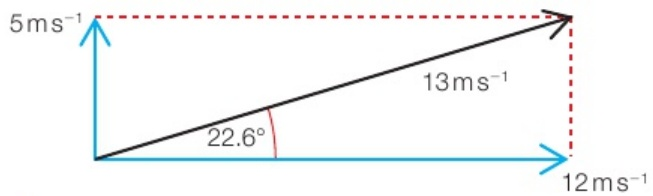

fig A The original velocity vector of  $ 13 \, m \, s^{-1} $ has been resolved into a horizontal and a vertical velocity vector, which would separately be the same overall effect. An object moving right at  $ 12 \, m \, s^{-1} $ and up at  $ 5 \, m \, s^{-1} $ will move 13 metres each second at an angle of  $ 22.6^\circ $ up and right from the horizontal.

## RESOLVING VECTORS CALCULATIONS

In order to resolve a vector into a pair at right angles, we must know all the details of the original vector. This means we must know its size and direction. The direction is most commonly given as an angle to either the vertical or the horizontal. This is useful, as we most commonly want to split the vector up into a horizontal and vertical pair.

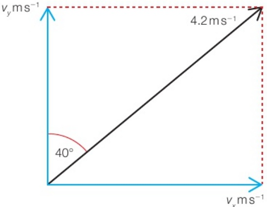

▲ fig B Resolving a velocity vector into vertical and horizontal components.

In the example of fig B, a basketball is thrown into the air at an angle of  $ 40^{\circ} $ to the vertical. In order to find out if it will go high enough to reach the hoop, kinematics calculations could be done on its vertical motion. However, this can only be done if we can isolate the vertical component of the basketball's motion. Similarly, we could find out if it will travel far enough horizontally to reach the hoop if we know how fast it is moving horizontally.

The basketball's velocity must be resolved into horizontal and vertical components. This will require some trigonometrical calculations.

## THE VERTICAL COMPONENT OF VELOCITY

Redrawing the components in fig B to show how they add up to produce the 4.2 m s $ ^{-1} $ velocity vector, shows again that they form a right-angled triangle, as in fig C. This means we can use the relationship:

 $$ \begin{array}{r l r}&{\cos40^{\circ}=\cfrac{\mathbf{v}_{y}}{4.2}}&\\ {\therefore\quad}&{\mathbf{v}_{y}=4.2\times\cos40^{\circ}}&\\ &{=4.2\times0.766}&\\ {\therefore\quad}&{\mathbf{v}_{y}=3.2\mathrm{~m s^{-1}}}&\end{array} $$ 

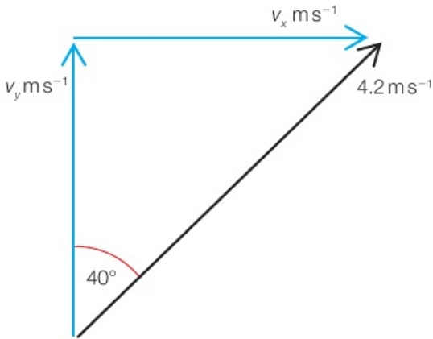

▲ fig C Finding the components of velocity.

## THE HORIZONTAL COMPONENT OF VELOCITY

Similarly, for the horizontal component, we can use the relationship:

 $$ \sin40^{\circ}=\frac{\pmb{v}_{x}}{4.2} $$ 

 $$ \therefore\quad\mathbf{v}_{x}=4.2\times\sin40^{\circ}=4.2\times0.643 $$ 

 $$ \therefore\quad\mathbf{v}_{x}=2.7\mathrm{~m~s}^{-1} $$ 

## LEARNING TIP

sin $\theta^{\circ}$ = opposite/hypotenuse

 $ \cos \theta^{\circ} = $ adjacent/hypotenuse

tan $\theta^{\circ}$ = opposite/adjacent

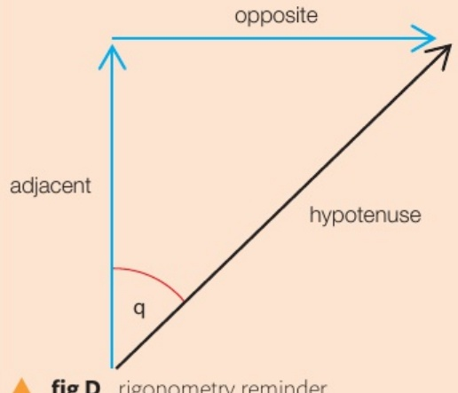

fig D Trigonometry reminder.

<!-- page 38 -->

## LEARNING TIP

Resolving vectors could also be achieved using a scale diagram. Using this method in rough work may help you to get an idea as to what the answer should be in order to check that your calculations are about right.

## ALTERNATIVE RESOLUTION ANGLES

If we know the velocity of an object, we have seen that we can resolve this into a pair of velocity vectors at right angles to each other. The choice of direction of the right-angle pair, though, is arbitrary, and can be chosen to suit a given situation.

Imagine a submarine descending underwater close to an angled seabed.

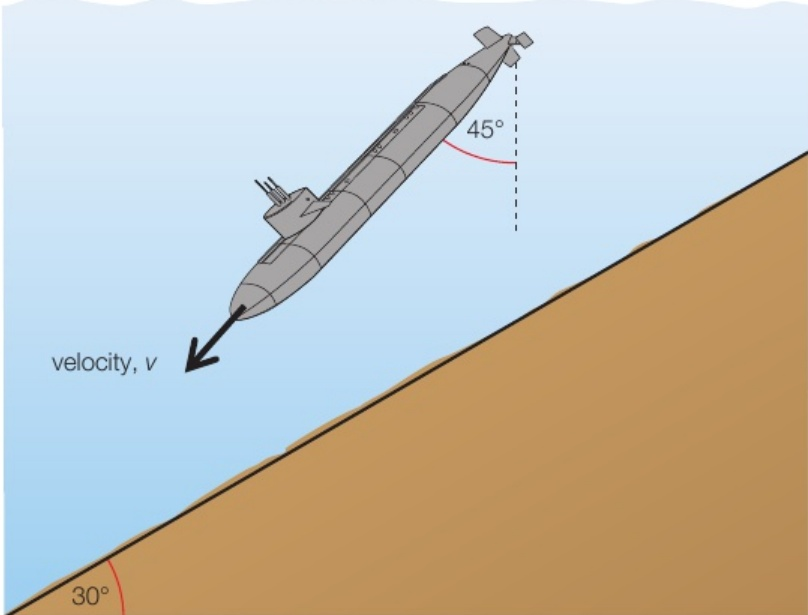

▲ fig E Resolving submarine velocity vectors helps to avoid collision.

The velocity could be resolved into a pair of vectors, horizontal and vertical.

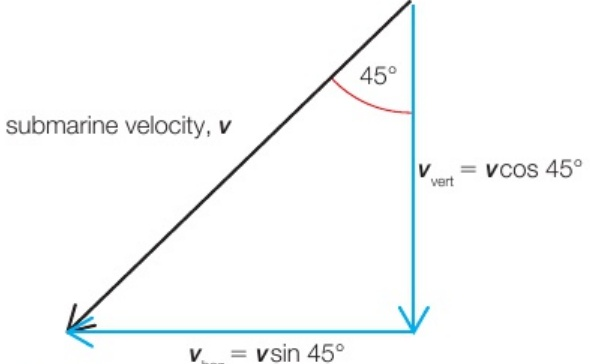

fig F Submarine velocity resolved into horizontal and vertical components.

However, the submarine commander is likely to be most interested in knowing how quickly the submarine is approaching the seabed. This could be found by resolving the velocity of the submarine into a component parallel with the seabed, and the right-angled pair with that will be a component perpendicular to the seabed. It is this  $ v_{perp} $ that will tell the submarine commander how quickly he is approaching the seabed.

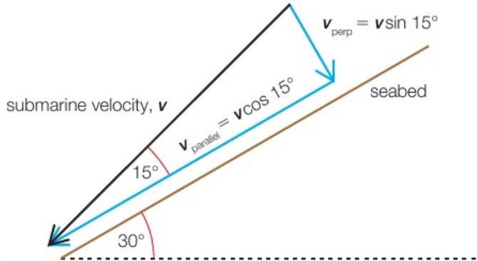

fig G Submarine velocity resolved into components parallel and perpendicular to the seabed.

## LEARNING TIP

The vectors produced by resolution can be at any angle with respect to the original vector, as long as they are perpendicular to each other and their resultant equals the original vector. In order to allow for every pair to add up to the original vector, their magnitudes will vary as the angle changes.

## CHECKPOINT

## SKILLS INTERPRETATION

1. (a) On graph paper, draw a velocity vector for a stone fired from a catapult at  $ 45^{\circ} $ to the horizontal. Your arrow should be 10 cm long, representing a velocity of 10 m s $ ^{-1} $. Draw onto your diagram the horizontal and vertical components that would make up the overall velocity. Use a ruler to measure the size of the horizontal and vertical components, and convert these lengths into metres per second using the same scaling.

(b) Find the horizontal and vertical velocity components for this catapult stone by calculation, and compare with your answers from part (a).

2. A javelin is thrown at  $ 16 \, m \, s^{-1} $ at an angle of  $ 35^\circ $ up from the horizontal. Calculate the horizontal and vertical components of the javelin's motion.

3. A ladder is leant against a wall, at an angle of  $ 28^{\circ} $ to the wall. The 440 N force from the floor acts along the length of the ladder. Calculate the horizontal and vertical components of the force from the floor that act on the bottom of the ladder.

4. A plane is flying at  $ 240 \, m \, s^{-1} $, on a bearing of  $ 125^{\circ} $ from due north. Calculate its velocity component due south, and its velocity component due east.

## SUBJECT VOCABULARY

resolution or resolving vectors the determination of a pair of vectors, at right angles to each other, that sums to give the single vector they were resolved from

catapult a device that can throw objects at high speed

<!-- page 39 -->

## 1A 8 PROJECTILES

## LEARNING OBJECTIVES

Apply kinematics equations to moving objects.

Apply the independence of horizontal and vertical motion to objects moving freely under gravity.

Combine horizontal and vertical motion to calculate the movements of projectiles.

Objects thrown or fired through the air generally follow projectile motion. Here we are going to combine ideas from the various earlier sections in order to solve questions about projectiles. Resolving vectors showed that the actions in each of two perpendicular directions are wholly independent. This means we can use Newton's laws of motion and the kinematics equations separately for the horizontal and vertical motions of the same object. This will allow us to calculate its overall motion in two dimensions.

We only consider the motion after the force projecting an object has finished – for example, after a cannonball has left the cannon. Air resistance is ignored in these calculations, so the only force acting will be the object's weight. Thus, all vertical motion will follow kinematics equations, with gravity as the acceleration. There will be no horizontal force at all, which means no acceleration and therefore  $ \boldsymbol{v} = \boldsymbol{s}/t $.

## LEARNING TIP

Vectors acting at right angles to each other act independently. Their combined effect can be calculated using vector addition, but they can also be considered to act separately and at the same time. This would cause independent effects, which themselves could then be combined to see an overall effect.

## LEARNING TIP

Physics is holistic: you can apply ideas from one area of physics to other areas of physics. Remember that physics is a set of rules that attempts to explain everything in the universe. Every rule should therefore be universally applicable.

## HORIZONTAL THROWS

If an object is thrown horizontally, it will start off with zero vertical velocity. However, gravity will act on it so that its motion will curve downwards in a parabola shape, like the stone in fig A.

In the example of fig A, a stone is kicked horizontally off a cliff with a velocity of  $ 8.2 \, m \, s^{-1} $. How much time is the stone in flight? How far does it get away from the cliff by the time it lands?

Horizontal and vertical motions are totally independent. Here the vertical component of velocity is initially zero, but the stone accelerates under gravity. Uniform acceleration means the kinematics equations can be used.

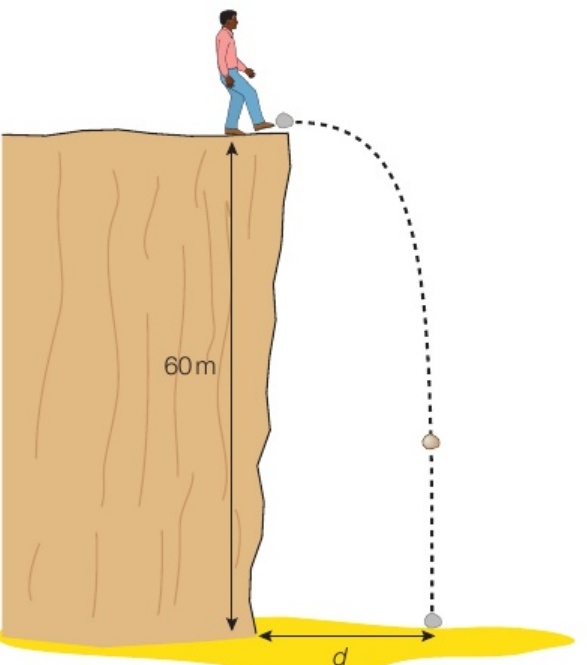

fig A Vertical acceleration on a horizontally moving stone.

The time to hit the beach,  $ t $, will be the same as if the stone was simply dropped. We know  $ \boldsymbol{u} = 0 $ m s $ ^{-1} $;  $ \boldsymbol{a} = -9.81 $ m s $ ^{-2} $; and the height fallen,  $ \boldsymbol{s} = -60 $ m.

 $$ \begin{aligned}\boldsymbol{s}&=\boldsymbol{u}t+\frac{1}{2}\boldsymbol{a}t^{2}\\\boldsymbol{u}&=0\therefore\boldsymbol{u}t=0\\\therefore\quad\boldsymbol{s}&=\frac{1}{2}\boldsymbol{a}t^{2}\\\therefore\quad t&=\sqrt{\frac{2\boldsymbol{s}}{\boldsymbol{a}}}=\sqrt{\frac{(2\times-60)}{-9.81}}\\t&=3.5s\end{aligned} $$ 

Horizontally, there is no accelerating force once the stone is in flight, so it has a constant speed. Thus, to find the distance travelled horizontally, d:

 $$ \begin{array}{r} \begin{aligned}v&=\frac{d}{t}\\ d&=v\times t\\ d&=8.2\times3.5\\ d&=28.7m\end{aligned} \end{array} $$ 

## RECOMBINING VELOCITY COMPONENTS

In the example of the stone kicked from the cliff to the beach, we might also want to calculate the final velocity of the stone on landing. This means adding vertical and horizontal components into their resultant.

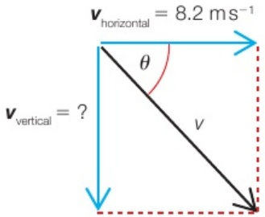

▲ fig B The stone's final velocity is the resultant of its vertical and horizontal components.

<!-- page 40 -->

In the example of fig A, what is the velocity of the stone when it hits the beach?

The horizontal velocity was given as 8.2 m s $ ^{-1} $. To calculate the vertical velocity:  $ \boldsymbol{u} = 0 $ m s $ ^{-1} $;  $ \boldsymbol{a} = -9.81 $ m s $ ^{-2} $; and  $ \boldsymbol{s} = -60 $ m.

 $$ \pmb{v}_{vertical}^{2}=\pmb{u}^{2}+2\pmb{a}\pmb{s}=0^{2}+(2\times-9.81\times-60)=1177.2 $$ 

 $$ \mathbf{v}_{vertical}=\sqrt{1177.2}=-34.3 $$ 

 $$ \pmb{v}_{\mathrm{v e r t i c a l}}=-34.3\mathrm{~m~s}^{-1} $$ 

Pythagoras' theorem gives the magnitude of the final velocity:

 $$ \mathbf{v}=\sqrt{(8.2^{2}+34.3^{2})} $$ 

 $$ \therefore\quad v=35.3m s^{-1} $$ 

Trigonometry will give the angle at which the stone is flying on impact with the beach:

 $$ \begin{aligned}\tan\theta&=\frac{34.3}{8.2}\\\therefore\quad\theta&=77^{\circ}\end{aligned} $$ 

The stone's velocity when it lands on the beach is 35.3 metres per second at an angle of  $ 77^{\circ} $ down from the horizontal.

## EXAM HINT

We use the usual approach that up is positive throughout this section. You can choose any direction to be negative, but you must refer to that direction as negative at every step of the calculation. If you are not consistent, your calculation will be incorrect.

## VERTICAL THROWS

Imagine throwing a ball to a friend. The ball goes up as well as forwards. One common idea in these calculations is that an object thrown with a vertical upwards component of motion will have a symmetrical trajectory. At the highest point, the vertical velocity is momentarily zero. Getting to this point will take half of the time of the whole flight.

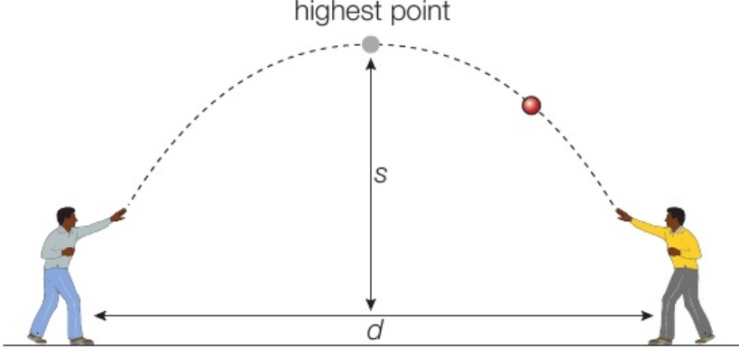

▲ fig C Considering only the vertical component of velocity.

In the example of fig C, a ball is thrown with a vertical velocity component of  $ 5.5 \, m \, s^{-1} $. How much time is it in flight? How high does it get?

These questions would have the same answer if a person threw the ball vertically up and caught it again themselves. This again highlights the independence of horizontal and vertical motions. It may be that an initial velocity at an angle is quoted, so that we need to resolve the velocity vector into its horizontal and vertical components in order to know that here  $ \boldsymbol{v}_{\text{vertical}} = 5.5 \, \text{m s}^{-1} $.

Consider the second question first: uniform acceleration under gravity means  $ \boldsymbol{a} = -9.81 \, \text{m s}^{-2} $ and the kinematics equations can be used. We know  $ \boldsymbol{u} = 5.5 \, \text{m s}^{-1} $; at the top of the path,  $ \boldsymbol{v} = 0 \, \text{m s}^{-1} $; and we want to find the height,  $ \boldsymbol{s} $.

 $$ \mathbf{v}^{2}=\mathbf{u}^{2}+2as $$ 

 $$ \begin{array}{c} \therefore \quad s=\displaystyle\frac{\mathbf{v}^{2}-\mathbf{u}^{2}}{2\boldsymbol{a}}=\frac{0^{2}-(5.5)^{2}}{2\times-9.81} \\ s=1.54\mathrm{m} \end{array} $$ 

Note that 1.54 metres is actually the height the ball reaches above the point of release at which it left the hand – the point where its initial speed was  $ 5.5 \, m \, s^{-1} $ – but this is often ignored in projectiles calculations.

The time of flight for the ball will be just the time taken to rise and fall vertically. We find the time to reach the highest point, and then double that value. We know  $ \boldsymbol{u} = 5.5 \, \text{m s}^{-1} $; at the top of the path,  $ \boldsymbol{v} = 0 \, \text{m s}^{-1} $; and we want to find the time,  $ t $.

 $$ \begin{array}{r} \begin{aligned} v=u+a t \end{aligned} \\ \therefore \quad \begin{aligned} t=\displaystyle\frac{v-u}{a}=\displaystyle\frac{0-(5.5)}{-9.81} \\ t=0.56s \end{aligned} \end{array} $$ 

So the overall time of flight will be 0.56 seconds doubled: total time = 1.12 s.

## EXAM HINT

For virtually all projectile motion calculations, we assume that there is no air resistance, so the only force acting is gravity, vertically downwards.

## CHECKPOINT

## SKILLS PROBLEM SOLVING

1. A boy throws a ball vertically at a velocity of 4.8 m s $ ^{-1} $.

(a) How long is it before he catches it again?

(b) What will be the ball's greatest height above the point of release?

2. The boy in question 1 now throws his ball horizontally out of a high window with a velocity of 3.1 m s $ ^{-1} $.

(a) How long will it take to reach the ground 18 m below?

(b) How far away, horizontally, should his friend stand in order to catch the ball?

3. A basketball is thrown with a velocity of  $ 6.0 \, m s^{-1} $ at an angle of  $ 40^{\circ} $ to the vertical, towards the hoop.

(a) If the hoop is 0.90 m above the point of release, will the ball rise high enough to go in the hoop?

(b) If the centre of the hoop is 3.00 m away, horizontally, from the point of release, explain whether or not you believe this throw will score in the hoop. Support your explanation with calculations.

## SUBJECT VOCABULARY

projectile a moving object on which the only force of significance acting is gravity. The trajectory is thus pre-determined by its initial velocity

<!-- page 41 -->

# IA THINKING BIGGER

# THE BATTLE OF AGRA

## SKILLS

CRITICAL THINKING, PROBLEM SOLVING, ANALYSIS, INTERPRETATION, ADAPTIVE LEARNING, PRODUCTIVITY, ETHICS, COMMUNICATION, ASSERTIVE COMMUNICATION

Agra Fort was built in the 11th Century, although the present structure was built in 1573. In this activity, you need to imagine attacking the fort using a cannon that fires a cannonball as a projectile.

## STUDENT ESSAY

fig A Agra Fort is now an UNESCO World Heritage Site.

In this section, I will use some basic mechanics to answer a question: could the Mughal Empire artillery really have attacked Agra Fort in the way described previously? The nineteenth-century source material suggests that the fortress was under siege by the Mughals for three months and ‘battered by artillery’. However, the current walls bear little in the way of obvious battle scars.

Looking at fig B, the question that needs to be answered here is:

'How high up the front wall of the fortress will the cannonball hit?' This height is marked on fig B as 'H'.

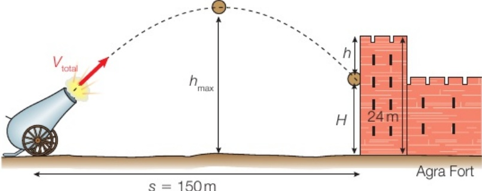

fig B The trajectory of a cannonball fired towards Agra Fort. We assume the cannonball leaves the cannon at ground level.

In addition to the layout shown in fig B, we need information about the initial velocity of the cannonball. The cannon explosion could act for 0.05 s to accelerate the cannonball (mass = 12 kg) with a force of 9300 N. It causes the cannonball to leave the cannon at an angle of  $ 45^{\circ} $ to the horizontal.

## Steps to the answer

We can work out what calculations are required to solve this problem, by working back from the answer we want to find. The fundamental idea is that the parabola trajectory would be symmetrical if the flight was not interrupted by crashing into the fortress wall.

1 To find the height up the wall from the ground, we will need to work out how far down from the cannonball's maximum height it falls:

 $$ H=h_{max}-h $$ 

2 To find $h$, we need to know the time of flight, $t_{total}$ so we can divide this into a time to reach $h_{max}$, and time left to fall height $h$. We will use vertical gravitational acceleration to calculate the vertical drop in that remaining time:

 $$ t_{total}=\frac{s}{v_{horizontal}} $$ 

From fig B, we can see that s = 150 m.

 $ v_{horizontal} $ can be found by resolving the velocity to give the horizontal component:

 $$ v_{horizontal}=v_{total}\times\cos45^{\circ} $$ 

4 The overall velocity will come from the cannon's acceleration of the cannonball:

 $$ v=u+at $$ 

where  $ u = 0 \, m s^{-1} $, and the question tells us that the explosion acts for 0.05 seconds.

5 Newton's second law of motion gives us the acceleration caused by the sling:

 $$ a=\frac{F}{m} $$ 

Calculate the answer by reversing these steps: The acceleration caused by the explosion:

 $$ \begin{aligned}&a=\frac{F}{m}\\&a=\end{aligned} $$

<!-- page 42 -->

## THINKING BIGGER

## SCIENCE COMMUNICATION

1 The extract opposite is a draft for a university essay about the Mughal siege of 1857. Consider the extract and comment on the type of writing being used. For example, think about whether this is a scientist reporting the results of their experiments, a scientific review of data, a newspaper or a magazine-style article for a specific audience. Try and answer the following questions:

(a) How can you tell that the author is doubtful about the historical source material?

(b) What is the purpose of this mathematical analysis, for its inclusion in this essay?

## PHYSICS IN DETAIL

Now we will look at the physics in detail. You may need to combine concepts from different areas of physics to work out the answers.

2 Complete the calculation steps, in reverse as suggested, in order to find out the answer. H:

(a) the acceleration caused by the explosion

(b) overall velocity that the cannonball is projected from the cannon

(c) horizontal and vertical components of the velocity

(d) time of flight found from the horizontal travel

(e) time to reach maximum height using vertical motion

(f) remaining flight time from maximum height

(g) height fallen from the maximum in the remaining flight time

(h) final answer, H.

3 State two assumptions that have been made in these calculations.

4 Calculate what difference there would be in the answer if the cannon was loaded with different cannonballs of masses 10 kg and 14 kg. Note from fig B that the fortress walls are 24 m high. Comment on these answers.

5 If the available supply of cannonballs offered very variable masses, how might the Mughals be able to overcome the problems shown in question 4.

## ACTIVITY

Imagine the writer of this essay is a friend of yours, and he has come to you for help with the calculations as he is not an experienced scientist. His section 'Steps to the answer' was taken from a research source about a different fortress under siege. Write an email to Claus to explain the calculations required in each step.

## INTERPRETATION NOTE

Once you have answered the calculation questions below, decide whether you think the Mughal siege happened as the author suggests.

## THINKING BIGGER TIP

Inside a cannon, an explosion exerts a force on the cannonball to fire it out of the cannon.

## INTERPRETATION NOTE

You can assume that the writer understands mathematics, and is generally intelligent – a student who could have done A Level physics but preferred arts subjects.

<!-- page 43 -->

# 1A EXAM PRACTICE

1 Quantities can be scalar or vector. Select the row of the table that correctly states a scalar quantity and a vector quantity.

<table border=1 style='margin: auto; word-wrap: break-word;'><tr><td style='text-align: center; word-wrap: break-word;'></td><td style='text-align: center; word-wrap: break-word;'>Scalar quantity</td><td style='text-align: center; word-wrap: break-word;'>Vector quantity</td></tr><tr><td style='text-align: center; word-wrap: break-word;'>A</td><td style='text-align: center; word-wrap: break-word;'>acceleration</td><td style='text-align: center; word-wrap: break-word;'>mass</td></tr><tr><td style='text-align: center; word-wrap: break-word;'>B</td><td style='text-align: center; word-wrap: break-word;'>mass</td><td style='text-align: center; word-wrap: break-word;'>weight</td></tr><tr><td style='text-align: center; word-wrap: break-word;'>C</td><td style='text-align: center; word-wrap: break-word;'>speed</td><td style='text-align: center; word-wrap: break-word;'>distance</td></tr><tr><td style='text-align: center; word-wrap: break-word;'>D</td><td style='text-align: center; word-wrap: break-word;'>weight</td><td style='text-align: center; word-wrap: break-word;'>speed</td></tr></table>

(Total for Question 1 = 1 mark)

2 How is the kinetic energy,  $ E_{k} $, of a car related to its speed,  $ v $?

A  $ E_{k}v $

B  $ E_{k}v^{2} $

C  $ E_{k}\sqrt{v} $

D  $ E_{k}\frac{1}{v} $ [1]

(Total for Question 2 = 1 mark)

3 The unit of force is the newton. One newton is equivalent to:

A 0.1kg

B  $ 1 \, kg \, m \, s^{-1} $

C  $ 1 \, kg \, m \, s^{-2} $

D  $ 1 \, m s^{-2} $ [1]

(Total for Question 3 = 1 mark)

4 A ball is thrown vertically upwards at a speed of  $ 11.0 \, m s^{-1} $.

What is the maximum height it reaches?

A 0.561 m

B 1.12 m

C 6.17 m

D 12.3 m [1]

(Total for Question 4 = 1 mark)

5 Calculate the moment exerted on the nut by the spanner shown in the diagram.

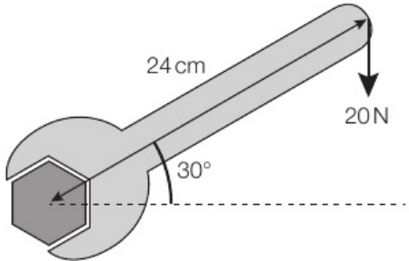

A 2.4 Nm

B 4.2 Nm

C 4.8 Nm

D 420 Nm

6 (a) What is meant by a vector quantity?

(b) A car is driven around a bend at a constant speed.

Explain what happens to its velocity. [2]

(Total for Question 6 = 3 marks)

7 You are asked to determine the acceleration of free fall at the surface of the Earth, g, using a free fall method in the laboratory.

(a) Describe the apparatus you would use, the measurements you would take and explain how you would use them to determine  $ \pmb{g} $. [6]

(b) Give one precaution you would take to ensure the accuracy of your measurements.

(Total for Question 7 = 7 marks)

8 The graph shows how displacement varies with time for an object that starts from rest with constant acceleration.

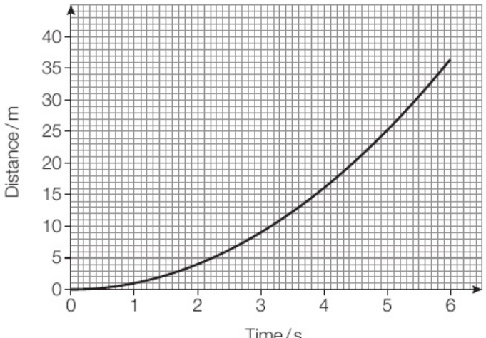

(a) Use the distance-time graph to determine the speed of the object at a time of 4.0 s. [3]

(b) Calculate the acceleration.

(Total for Question 8 = 5 marks)

9 The photograph shows a sequence of images of a bouncing tennis ball.

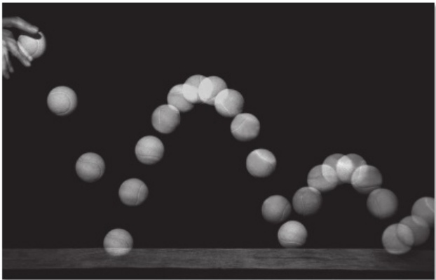

A student plots the following graph and claims that it shows the vertical motion of the ball in the photograph.

<!-- page 44 -->

## EXAM PRACTICE

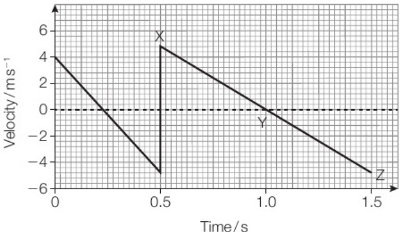

(a) Without carrying out any calculations, describe how the following can be found from the graph

(i) the vertical distance travelled by the ball between 0.5 s and 1.0 s

(ii) the acceleration at Y.

(b) The graph contains several errors in its representation of the motion of the ball

Explain two of these errors. [4]

(Total for Question 9 = 6 marks)

10 There has been a proposal to build a train tunnel underneath the Atlantic Ocean from England to America. The suggestion is that in the future the trip of 5000 km could take as little as one hour.

Assume that half the time is spent accelerating uniformly and the other half is spent decelerating uniformly with the same magnitude as the acceleration.

(a) Show that the acceleration would be about  $ 2 \, m s^{-2} $. [2]

(b) Calculate the maximum speed.

(c) Calculate the resultant force required to decelerate the train.

mass of train = 4.5  $ \times $ 10 $ ^{5} $kg [2]

(Total for Question 10 = 6 marks)

11 During a lesson on Newton's laws of motion, a student says, 'We don't really need to bother with Newton's first law because it is included in his second law'.

State Newton's first two laws of motion and explain how Newton's second law includes the first law. [5]

(Total for Question 11 = 5 marks)

12 The diagram shows an arrangement used to launch a light foam rocket at a school science competition.

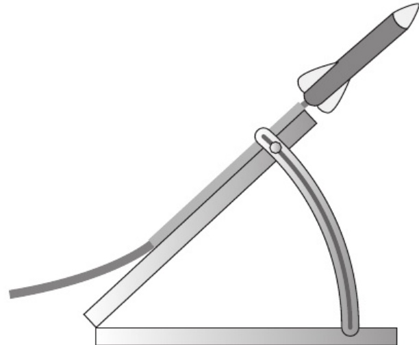

The rocket is launched at the level of one end of a long table and lands at the other end at the same level. The students measure the horizontal distance travelled by the rocket and the time of flight.

(a) The rocket travels 1.88 m in a time of 0.88 s.

(i) Show that the horizontal component of the initial velocity of the rocket is about  $ 2 \, m \, s^{-1} $.

(ii) Show that the vertical component of the initial velocity of the rocket is about 4 m s $ ^{-1} $.

(iii) Calculate the initial velocity of the rocket.

(b) The students obtained their data by filming the flight. When they checked the maximum height reached by the rocket they found it was less than the height predicted using this velocity.

(i) Suggest why the maximum height reached was less than predicted.

(ii) Give two advantages of filming the flight to obtain the data.

(Total for Question 12 = 11 marks)

