# 1B Energy

<!-- edx_ial_phy1.pdf p45-56 -->

<!-- page 45 -->

# TOPIC 1 MECHANICS

## CHAPTER 1B ENERGY

Chapter 1A finished with a discussion of the motion of a projectile cannonball's flight. An alternative way of considering changes in movements of objects affected by gravity is to follow what happens to their energy. An object held up has an amount of gravitational potential energy as a result of its position. This energy can be transferred to kinetic, or movement, energy if the object falls. Humans have evolved over millions of years to avoid situations in which they might fall a great height, as such falls are generally dangerous. The kinetic energy that humans have gained from falling could be transferred to other stores of energy in their bodies, through large forces, and cause injuries.

The effect of gravity on the movement of an object should be considered in relation to the energy a body may possess or transfer. There are equations for calculating kinetic energy and gravitational potential energy, and the transfer of energy when a force is used to cause the transfer. These formulae and Newton's laws can be used together to work out everything we might want to know about the movement of any everyday object in any everyday situation.

Whilst it is difficult for scientists to describe or identify the exact nature of energy, the equations that describe energy relationships have always worked correctly.

## MATHS SKILLS FOR THIS CHAPTER

Units of measurement (e.g. the joule, J)

• Changing the subject of an equation (e.g. finding the velocity of a falling object)

- Substituting numerical values into algebraic equations (e.g. calculating the power used)

• Plotting two variables from experimental or other data, understanding that  $ y = mx + c $ represents a linear relationship and determining the slope of a linear graph (e.g. finding the acceleration due to gravity experimentally)

Using angles in regular 2D and 3D structures (e.g. finding the angle with which to calculate work done)

Using sin, cos and tan in physical problems (e.g. calculating the work done by a force acting at an angle)

<!-- page 46 -->

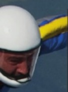

## What prior knowledge do I need?

Calculating gravitational potential and kinetic energies

Energy transfers and the effects of friction

Calculations of work and power

Speed, distance, displacement, time, velocity, acceleration

Newton's laws of motion

Resolving vectors

Kinematics and projectiles

## What will I study in this chapter?

Calculations of gravitational potential energy and kinetic energy

Understanding energy transferred as work done, and making calculations of the work and power

Calculating exchanges between gravitational potential and kinetic energies that are based on energy conservation

How to calculate work done when the force is not along the line of motion

What is meant by efficiency, and how to calculate it

## What will I study later? Topic 1C

Momentum and the principle of conservation of momentum

• Elastic and inelastic collisions

Topic 2A

Fluid movements and terminal velocity

• Elastic potential energy

Topic 4B

Energy conservation in electrical circuits

Power in electric circuits

Topic 6A (Book 2: IAL)

Potential difference modelled on gravitational potential energy

<!-- page 47 -->

# 1B 1 GRAVITATIONAL POTENTIAL AND KINETIC ENERGIES

## LEARNING OBJECTIVES

Calculate transfers of gravitational potential energy near the Earth's surface.

Calculate the kinetic energy of a body.

Calculate exchanges between gravitational potential and kinetic energies, based on energy conservation.

▲ fig A The gravitational potential energy transferred to kinetic energy for a falling coconut can be a significant hazard in tropical countries.

## DID YOU KNOW?

The strength of the Earth's gravitational field at the top of the Eiffel Tower is less than a hundredth of a per cent smaller than at the foot of the Eiffel Tower.

fig B A jumbo jet plane has a lot of kinetic energy.

Gravitational potential energy ( $ E_{grav} $) is the energy an object has by virtue of its position in a gravitational field. Kinetic energy ( $ E_{k} $) is the energy an object has by virtue of its movement. As objects rise or fall, gravitational potential energy can be transferred to kinetic energy and kinetic energy can be transferred to gravitational potential energy.

## GRAVITATIONAL POTENTIAL ENERGY

Gravitational potential energy (gpe) can be calculated using the equation:

 $$ \begin{aligned}&gpe\left(J\right)=mass\left(kg\right)\times gravitational~field~strength\left(N kg^{-1}\right)\times height\left(m\right)\\ &\quad E_{grav}=mgh\\ \end{aligned} $$ 

Usually, the gpe is considered as a change caused by a change in height, for example, the change in gpe when you lift an object onto a shelf. This alters the equation slightly to consider transfers to or from gpe:

 $$ \Delta E_{g r a v}=m g\Delta h $$ 

A brick of mass 2.2 kg is lifted vertically through a height of 1.24 m. The gpe gained is calculated as follows:

 $$ \Delta E_{g r a v}=m g\Delta h $$ 

 $$ \Delta E_{g r a v}=2.2\times9.81\times1.24 $$ 

 $$ \Delta E_{g r a v}=26.8\mathrm{J} $$ 

Writing the formula this way suggests that the gravitational field strength is a fixed value. The gravitational field strength is a measure of the pull of gravity by a planet at a distance from its centre. This is not actually constant, as the strength of the gravitational field experienced by a mass is inversely proportional to the square of the distance from the planet's centre. However, close to the Earth's surface, over small scales, such as the heights that humans deal with in everyday life, it is an acceptably close approximation to say g is fixed at 9.81 Nkg $ ^{-1} $.

## KINETIC ENERGY

Kinetic energy can be calculated using the equation:

kinetic energy (J) =  $ \frac{1}{2} \times $ mass (kg)  $ \times $ (speed) $ ^2 $ (m $ ^2 $ s $ ^{-2} $)

 $$ E_{k}=\frac{1}{2}\times m\times v^{2} $$ 

For example, a large jumbo jet plane might have a cruising speed of 900 km h $ ^{-1} $ and a flight mass of 400 tonnes. What would its kinetic energy be?

First convert into SI units:

 $$ \begin{aligned}v&=900\mathrm{~km}\mathrm{h}^{-1}=900\ 000\mathrm{~m}\mathrm{h}^{-1}=\frac{9\times10^{5}}{60\times60}=250\mathrm{~m}\mathrm{s}^{-1}\\m&=400\times1000=4\times10^{5}\mathrm{~kg}\\E_{k}&=\frac{1}{2}\times m\times v^{2}\\\therefore\quad E_{k}&=\frac{1}{2}\times4\times10^{5}\times250^{2}\\E_{k}&=1.25\times10^{10}\mathrm{J}=12.5\mathrm{GJ}\end{aligned} $$

<!-- page 48 -->

## TRANSFER BETWEEN  $ E_{grav} $ AND  $ E_{K} $

The principle of conservation of energy tells us that we can never lose any energy or gain energy out of nowhere. In any energy transfer, we must have the same total energy before and after the transfer. Gravitational potential energy can be transferred to kinetic energy if an object falls to a lower height. Alternatively, an object thrown upwards will slow down as its kinetic energy is transferred to gpe. In either case:

 $$ \Delta E_{g r a v}=m g\Delta h=\frac{1}{2}m v^{2}=E_{k} $$ 

Depending on the situation, it can often be useful to divide out the mass that appears on both sides of this equation. This allows a convenient calculation of how fast an object will be travelling after falling a certain distance from rest:

 $$ v=\sqrt{2g\Delta h} $$ 

or how high an object could rise if projected upwards at a certain speed:

 $$ \Delta h=\frac{v^{2}}{2g} $$ 

## LEARNING TIP

The fact that mass divides out to give the relationship  $ v = \sqrt{2gh} $ confirms Galileo's idea that objects will fall to the ground at the same rate regardless of their mass.

However, remember that all of the relationships shown in this section assume that no energy is lost through friction or air resistance, and that this can be an important factor when some objects fall.

## ▲ fig C The Burj Khalifa tower in Dubai

For example, how fast would a coin hit the ground if it were dropped from the top of Burj Khalifa tower in Dubai, which is 830 m tall?

 $$ v=\sqrt{2g\Delta h} $$ 

 $$ v=\sqrt{2(9.81\times830)}=\sqrt{16285} $$ 

 $$ v=128m s^{-1} $$ 

Another example: how high would water from a fountain rise if it were ejected vertically upwards from a spout at  $ 13.5 \, m \, s^{-1} $?

 $$ \Delta h=\frac{v^{2}}{2g} $$ 

 $$ \Delta h=\frac{13.5^{2}}{2(9.81)}=\frac{182.25}{19.62} $$ 

 $$ h=9.29m $$ 

▲ fig D Fountain designers need to be able to calculate gpe and kinetic energy.

<!-- page 49 -->

## PRACTICAL SKILLS

## Finding g from energy conservation

There are a number of different experimental methods for finding the gravitational field strength. One example of these relies on the transfer of gravitational potential energy to kinetic energy. In this experiment, we measure the velocity that has been reached by a falling object after it has fallen under gravity from a certain height, and then alter the height and measure the velocity again.

If we vary the height from which the object falls, the gravitational potential energy is different at each height. This gpe will all be transferred to kinetic energy.

 $$ mg\Delta h=\frac{1}{2}mv^{2} $$ 

As we saw previously, this equation can be simplified to give:

 $$ v^{2}=2g\Delta h $$ 

Compare this equation with the equation for a straight-line graph:  $ y = mx + c $

If we plot a graph of $\Delta h$ on the $x$-axis and $v^2$ on the $y$-axis, we will get a straight best-fit line. The gradient of the line on this graph will be twice the gravitational field strength, $2g$, from which we can find $g$.

We could find a value for g by taking a single measurement from this experiment and using the equation to calculate it:

 $$ g=\frac{v^{2}}{2\Delta h} $$ 

However, as mentioned in Section 1A.6, a single measurement in any experiment is prone to uncertainty from both random and systematic errors. The reliability of the conclusions is significantly improved with multiple readings and graphical analysis.

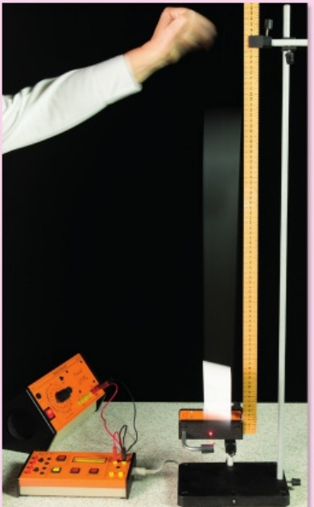

fig E The freefall velocity of an object from different heights allows us to find the gravitational field strength, g.

Safety Note: Secure the tall stand so that it cannot topple over. The object must be positioned so that it cannot cause injury as it falls.

## SKILLS CREATIVITY

## CHECKPOINT

1. Estimate the speed at which a coconut from the tree in fig A would hit the sand.

2. How fast would a fountain need to squirt its water upwards to reach a height of 15 m?

3. How fast would a snowboarder be moving if he slid down a slope dropping a vertical height of 45 m?

4. How high will a 48 kg trampolinist rise if he leaves the trampoline at a speed of 6.1 m s $ ^{-1} $?

5. What assumption must you make in order to answer all of the above questions?

## SUBJECT VOCABULARY

gravitational potential energy  $ E_{grav} $ the energy an object stores by virtue of its position in a gravitational field:

gpe (J) = mass (kg)  $ \times $ gravitational field strength (N kg $ ^{-1} $)  $ \times $ height (m)

 $$ E_{g r a v}=\mathrm{m g h}\mathrm{O R}\Delta E_{g r a v}=\mathrm{m g}\Delta h $$ 

kinetic energy  $ E_{k} $ the energy an object stores by virtue of its movement:

kinetic energy (J) =  $ \frac{1}{2} \times $ mass (kg)  $ \times $ (speed) $ ^2 $ (m $ ^2 $ s $ ^{-2} $)

 $$ E_{k}=\frac{1}{2}\times m\times v^{2} $$

<!-- page 50 -->

## 2 WORK AND POWER

## LEARNING OBJECTIVES

Calculate energy transferred as work done, including when the force is not along the line of motion.

Calculate the power of an energy transfer.

Explain efficiency and be able to calculate.

We often make assumptions that allow simplification of calculations in physics. In general, these assumptions make little difference as they are chosen to ignore effects which have a very small impact on the actual real world answers. An example of this is with the transfer of gravitational potential energy to kinetic energy, where the effects of air resistance are ignored.

It is important to remember that the principle of conservation of energy insists that no energy can be lost in any scenario. Even if we were to consider the loss of kinetic energy to heating of the air through air resistance, the total amount of energy would be constant; it would simply have transferred to different stores.

## WORK

In physics, the phrase ‘doing work’ has a specific meaning to do with energy use. The amount of work done means the amount of energy transferred, so work is measured in joules.

In general terms, we can express any energy transfer as work done. For example, a 15 W light bulb working for 10 seconds transfers 150 J of electrical energy as heat and light – it does 150 J of work. In any situation where we know how to calculate the energy before and after, we can calculate the energy transferred and thus the work done.

## FORCING WORK

If energy is transferred mechanically by means of a force, then the amount of work done can be calculated simply:

work done (J) = force (N) × distance moved in the direction of the force (m)

 $ \Delta W = F \Delta s $

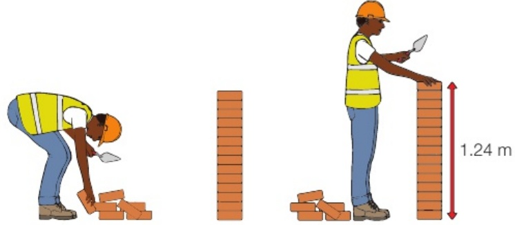

## fig B 'Work' on a building site

In the example of fig B, a brick of mass 2.2 kg is lifted vertically against its weight through a height of 1.24 m. The work done is:

 $$ \Delta W=F\Delta s $$ 

 $$ \Delta W=mg\times\Delta s $$ 

 $$ \therefore\quad W=2.2\times9.81\times1.24 $$ 

 $$ W=26.8J $$ 

Note that this is the same amount of energy as we calculated for the gravitational potential energy of this same brick undergoing the same lift in Section 1B.1.

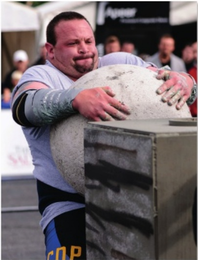

fig A Work is done by transferring gravitational potential energy to a heavy object.

<!-- page 51 -->

## EXAM HINT

Beware of confusing  $ \Delta W $ for work with W for weight, and W as the abbreviation for watts.

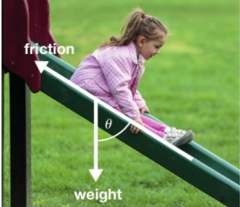

fig C Gravity working against friction.

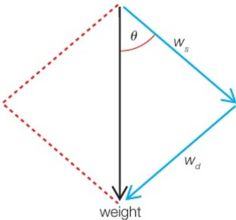

▲ fig D The weight force is the resultant of its components along the slide and perpendicular to it.

## LEARNING TIP

An object that gains gravitational potential energy is having work done on it against its weight force.

weight = mass  $ \times $ gravitational field strength

 $$ W=mg $$ 

 $$ \mathrm{work}=\mathrm{force}\times\mathrm{distance}=\mathrm{weight}\times\mathrm{height}=mg\Delta h $$ 

## WORK DONE BY FORCES AT AN ANGLE

In the bricklaying example on the previous page, the direction of movement was exactly in line with the force lifting the brick. This is an unusual situation, and usually the force doing work will be at an angle to the direction of movement. In fig C, gravity pulls the child down the slide but it must work against friction. The weight acts vertically downwards, but the friction acts up the slide. Friction always acts in the exact opposite direction to movement.

Assuming that the child slides at constant velocity, Newton's first law of motion tells us that this means the friction is exactly balanced by the component of gravity pulling the child down the slope. So to find the component of the weight force that is acting down the slope, we will need to resolve it in the directions of down the slope and perpendicular to it.

The weight component working down the slope equals the friction, F:

 $$ \pmb{F}=mg\cos\theta $$ 

The work done is force multiplied by the distance travelled along the line of the force, so here:

work =  $ \Delta s \times mg\cos\theta $

This example shows us the general formula for calculating the work done when there is an angle between the force and the distance along which we are measuring:

 $$ \Delta W=F\Delta s\cos\theta $$ 

## POWER

Power is defined as the rate of energy transfer. This may be done with reference to work done.

 $$  power\left(W\right)=\frac{energy transferred\left(J\right)}{time\ for\ the\ energy\ transfer\ (s)}\quad P=\frac{E}{t} $$ 

 $$  power\left(W\right)=\frac{work~done\left(J\right)}{time~for~the~work~to~be~done\left(s\right)}\quad P=\frac{\Delta W}{t} $$ 

Remember:

 $$ \begin{aligned}work\left(\mathrm{J}\right)&=force\left(\mathrm{N}\right)\times distance moved~in~the~direction~of~the~force\left(\mathrm{m}\right)\\\Delta W&=F\Delta s\end{aligned} $$ 

So:

 $$ \begin{aligned}power\left(W\right)&=\frac{force\left(N\right)\times distance moved\left(m\right)}{time for the force to move\left(s\right)}\\P&=\frac{F\Delta s}{t}\end{aligned} $$ 

For example, the power of a forklift truck lifting a 120 kg crate vertically up 5.00 m in 4.0 seconds would be calculated as:

 $$ P=\frac{F\Delta s}{t}=\frac{mg\Delta s}{t} $$ 

 $$ P=\frac{120\times9.81\times5}{4.0} $$ 

 $$ P=1470\mathrm{W}=1.47\mathrm{kW} $$ 

## EXAM HINT

1 kilowatt (kW) = 1000 watts (W) = 1 × 10³ W

 $$ 1\ m e g a w a t t\left(\mathrm{M W}\right)=1000\mathrm{k W}=1\times10^{6}\mathrm{W} $$ 

 $$ 1\mathrm{~g i g a w a t t}\mathrm{(G W)}=1000\mathrm{M W}=1\times10^{6}\mathrm{k W}=1\times10^{9}\mathrm{W} $$ 

 $$ 1\ \mathrm{terawatt}\ (\mathrm{TW})=1000\ \mathrm{GW}=1\times10^{6}\ \mathrm{MW}=1\times10^{9}\ \mathrm{kW}=1\times10^{12}\ \mathrm{W} $$

<!-- page 52 -->

## EFFICIENCY

From the equations above, we can calculate the work and power generated in different situations. If most of the energy is not actually transferred to a store that is useful to us, then the activity may be a waste of energy. The ability of a machine to transfer energy usefully is called efficiency.

Efficiency is defined mathematically as:

 $$  efficiency=\frac{useful~work~done}{total~energy~input} $$ 

 $$  efficiency=\frac{useful~energy~output}{total~energy~input} $$ 

If we remember that power is energy divided by time, then measuring the energy flows in a machine for a fixed amount of time means that we can write a power version of the efficiency equation:

 $$  efficiency=\frac{useful~energy~output/time}{total~energy~input/time} $$ 

 $$  efficiency=\frac{useful~power~output}{total~power~input} $$ 

The answer will be a decimal between zero and one. It is common to convert this to a percentage value (multiply the decimal by 100).

## WORKED EXAMPLE

If the forklift truck referred to above lifted the crate when supplied with electrical energy from its battery at a rate of 3000 joules per second, what is its efficiency?

 $$  efficiency=\frac{useful~power~output}{total~power~input} $$ 

 $$ efficiency=\frac{1470}{3000} $$ 

 $$  efficiency=0.49=49\% $$ 

## EXAM HINT

Note that the steps and layout of the solution in this worked example are suitable for efficiency questions in the exam.

## CHECKPOINT

## SKILLS PROBLEM SOLVING

1. In these two situations, who does more work, and by how much?

(a) A lioness carries a 2.8 kg cub 4.60 m up a tree.

(b) An eagle lifts a 1.4 kg rabbit 8.25 m up to her nest.

2. Calculate the work done by the tension in the kite string in fig E over the distance shown.

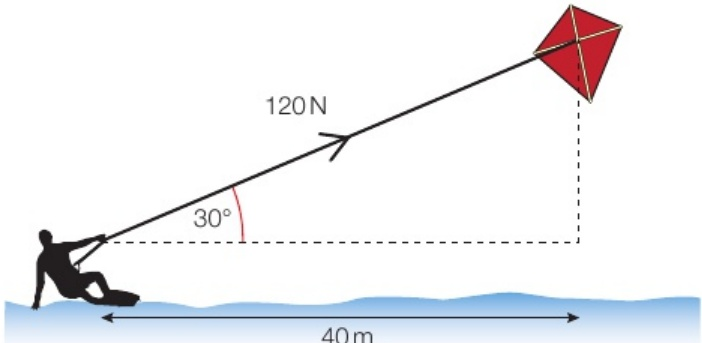

▲ fig E Moving at an angle to the force doing work.

3. (a) What is the power of an electric motor, in watts, if it lifts 500 g, through 80 cm in 20 seconds?

(b) What is the motor's efficiency if the electricity supplied it with a total of 12J to make the lift?

4. In loading a delivery van, the driver pushed a 15 kg crate for 5 metres up a ramp. He had to push with a force of 132 N and the vertical height gained was 1.3 m. What was the efficiency of pushing this crate up the ramp onto the back of the van?

## SUBJECT VOCABULARY

conservation of energy the rule that requires that energy can never be created or destroyed

work done in a mechanical system. This is the product of a force and the distance moved in the direction of the force:

work done (J) = force (N)  $ \times $ distance moved in the direction of the force (m)

 $$ \Delta W=F\Delta s $$ 

energy the property of an object that gives it the capacity to do work. A change in the amount of energy of an object could be equated to work being done, even if this is not mechanical – a change in the heat energy of a sample of gas, for example

power the rate of energy transfer:

 $$ P=\frac{E}{t}=\frac{\Delta W}{t} $$ 

efficiency the ability of a machine to transfer energy usefully:

 $$  efficiency=\frac{useful~energy~output}{total~energy~input} $$ 

 $$  efficiency=\frac{useful~power~output}{total~power~input} $$

<!-- page 53 -->

## 1B THINKING BIGGER

# THE MECHANICS OF SOCCER

Soccer is the most popular sport in the world in terms of numbers of people playing. It is a fast moving, skilful sport in which the ball may fly at over 200 kilometres per hour.

In this activity, we will consider how mechanics can apply to events in soccer.

COACHING BOOKLET

# GOALSCORING

In this section, we will look at some of the science behind shots on goal.

fig A Antoine Griezmann kicks a shot at goal.

If we want to calculate how fast a soccer ball is moving after it has been kicked from stationary (for example, after a penalty shot), we need to think about its acceleration by using Newton's second law. A standard soccer ball has a mass of 0.40 kg. If the foot applies a force of 350 N for a twentieth of a second, we can work out the answer:

 $$ F=m a\mathrm{s o}a=\frac{F}{m} $$ 

 $$ a=\frac{350}{0.40}\therefore a=875m s^{-2} $$ 

 $$ v=u+at $$ 

The ball is stationary before it is kicked

 $$  so u=0m s^{-1},a=875m s^{-2},t=0.05s $$ 

 $$ v=0+875(0.05) $$ 

 $$ v=44m s^{-1} $$ 

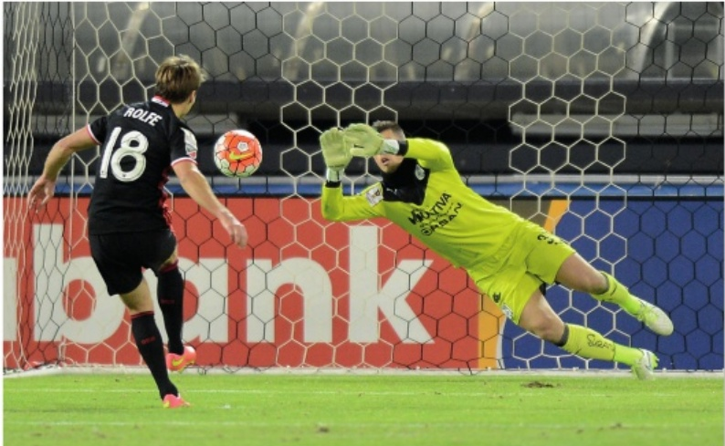

fig B Tiago Volpi tries to save a penalty kick.

A penalty kick is taken from a spot 11 metres from the goal. If we assume zero drag forces, we can calculate the longest time the goalkeeper has to react to this shot after it leaves the foot.

We know the start velocity and the distance, so this is a straightforward question.

 $$ \begin{array}{ll} v=\frac{s}{t} &  s o~z t=\frac{s}{v} \\ \therefore~t=\frac{11}{44} &  t=0.25~s \end{array} $$ 

If the goalkeeper reacts quickly enough to catch the ball, how far will his hands be pushed backwards in order to stop the ball? The maximum decelerating force his arms can provide to slow the ball is 2000 newtons. Here we should consider the removal of all the ball's kinetic energy as work being done.

 $$ E_{k}=\frac{1}{2}m v^{2}=\frac{1}{2}(0.40)\times(44)^{2}=387\mathrm{J} $$ 

 $$ \Delta W=F\Delta s $$ 

 $$ \Delta s=\frac{\Delta W}{F}=\frac{387}{2000}=0.194m $$ 

So the goalkeeper's hands are pushed back just under 20 cm in order to stop the ball. According to Newton's third law, when the hands produce a force of 2000 N on the ball, the ball exerts a force of 2000 N on the hands.

From Soccer is Mad Easy, a booklet aimed at new coaches, particularly teachers who may also need to teach International A Level Physical Education

<!-- page 54 -->

## THINKING BIGGER

## SCIENCE COMMUNICATION

1 The extract opposite is from a booklet to teach soccer coaches the theory behind the sport, especially for reference in International A Level Physical Education lessons, which have a significant amount of theory in them. Consider the extract and comment on the type of writing that is used. Try and answer the following questions:

(a) How has the author maintained the relevance of the calculations for the reader?

(b) Discuss the level of difficulty of the calculations, with reference to the target audience and the purpose of the text.

## PHYSICS IN DETAIL

Now we will look at the physics in detail. Some of these questions link to topics earlier in this book, so you may need to combine concepts from different areas of physics to work out the answers.

Think about the complexity and level of difficulty of these calculations compared with those that you have to do in this physics course. Also consider that the numbers used in the examples are for top players – what level of player are these coaches probably dealing with?

2 Identify, and comment on the validity of, the assumptions that have been made in these calculations.

3 A free kick is awarded 32 m from the goal line. The striker kicks it so that the ball leaves the ground at a  $ 5^{\circ} $ angle and a speed of 40 m s $ ^{-1} $. How long does the goalkeeper have to react before the ball reaches the goal line?

4 The study of mechanics in sport is a popular and often profitable new area of scientific study.

## INTERPRETATION NOTE

(a) Describe how a sports scientist could use electronic equipment to collect data to study the movement of players and equipment over time.

(b) Explain why technological developments have made the data collected more valid and reliable than other traditional methods of studying mechanics.

## ACTIVITY

Junior soccer rules for young children use a reduced pitch, 27.5 m by 18 m, and a ball with a mass of 320 g. Write a similar section for a new version of this coaching manual which is aimed at junior soccer coaches.

## THINKING BIGGER TIP

You will need to consider the strength of small children in order to estimate the forces they can give with a kick.

<!-- page 55 -->

# 1B EXAM PRACTICE

1 The definition of the watt comes from which equation?

A  $ P=\frac{E}{t} $

B  $ P=E\times t $

C  $ \Delta W = F\Delta s $

D  $ \Delta W = F\Delta \cos\theta $

(Total for Question 1 = 1 mark)

2 A 305 g ball is thrown vertically upwards to reach a height of 5.55 m. How much potential energy has it gained at that height?

A 16.6 J

B 16.6 kJ

C 1690 J

D 16 600 J

(Total for Question 2 = 1 mark)

3 Efficiency can be calculated using values of energy, or values of power.

Select the row of the table that correctly gives the expressions for calculating efficiency in terms of either energy or power:

<table border=1 style='margin: auto; word-wrap: break-word;'><tr><td colspan="2"></td><td style='text-align: center; word-wrap: break-word;'>Energy expression</td><td style='text-align: center; word-wrap: break-word;'>Power expression</td></tr><tr><td style='text-align: center; word-wrap: break-word;'>A</td><td style='text-align: center; word-wrap: break-word;'>efficiency =</td><td style='text-align: center; word-wrap: break-word;'>$ \frac{\text{total energy input}}{\text{useful energy output}} $</td><td style='text-align: center; word-wrap: break-word;'>$ \frac{\text{useful power input}}{\text{total power output}} $</td></tr><tr><td style='text-align: center; word-wrap: break-word;'>B</td><td style='text-align: center; word-wrap: break-word;'>efficiency =</td><td style='text-align: center; word-wrap: break-word;'>$ \frac{\text{useful energy output}}{\text{total energy input}} $</td><td style='text-align: center; word-wrap: break-word;'>$ \frac{\text{total power input}}{\text{useful power output}} $</td></tr><tr><td style='text-align: center; word-wrap: break-word;'>C</td><td style='text-align: center; word-wrap: break-word;'>efficiency =</td><td style='text-align: center; word-wrap: break-word;'>$ \frac{\text{total energy input}}{\text{useful energy output}} $</td><td style='text-align: center; word-wrap: break-word;'>$ \frac{\text{useful power input}}{\text{total power output}} $</td></tr><tr><td style='text-align: center; word-wrap: break-word;'>D</td><td style='text-align: center; word-wrap: break-word;'>efficiency =</td><td style='text-align: center; word-wrap: break-word;'>$ \frac{\text{useful energy output}}{\text{total energy input}} $</td><td style='text-align: center; word-wrap: break-word;'>$ \frac{\text{useful power output}}{\text{total power input}} $</td></tr></table>

(Total for Question 3 = 1 mark)

4 A horse pulls a carriage of weight 5600 N with a force of 80 N for a distance of 1.2 km around New York's Central Park.

How much work is done by the horse?

A 6.7 kJ

B 96 kJ

C 538 kJ

D 6720 kJ [1]

(Total for Question 4 = 1 mark)

5 The photograph shows a wind turbine. Kinetic energy of the wind is transferred to electrical energy as the turbine blades rotate.

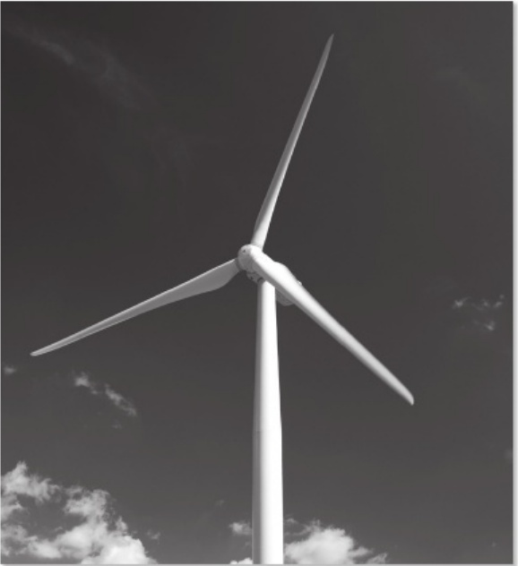

(a) Explain why we can say that the wind is doing work on the blades. [2]

(b) The area swept out by one blade, as it turns through  $ 360^{\circ} $, is  $ 6000 \, m^2 $. Wind at a speed of  $ 9 \, m \, s^{-1} $ passes the turbine.

(i) Show that the volume of air passing through this area in 5 seconds is about 300 000 m $ ^{3} $. [2]

(ii) Calculate the mass of this air.

Density of air = 1.2 kg m^{-3}

(iii) Calculate the kinetic energy of this mass of air.

(iv) Betz's law states that a turbine cannot usefully transfer more than 59% of the kinetic energy of the wind.

Use this law to find the maximum output of the wind turbine. [2]

(c) Suggest a reason why it is not possible to usefully transfer 100% of the kinetic energy of the wind. [1]

(d) Suggest the limitations of using wind turbines to provide power.

(Total for Question 5 = 13 marks)

<!-- page 56 -->

## EXAM PRACTICE

6 One account of the origin of the term horsepower is as follows. In the eighteenth century, James Watt manufactured steam engines. He needed a way to demonstrate the benefits of these compared to the horses they replaced. He did some calculations based on horses walking in circles to turn a mill wheel.

Watt observed that a horse could turn the wheel 144 times in one hour. The horse travelled in a circle of radius 3.7 m and exerted a force of 800 N.

(a) Show that the work done by the horse in turning the wheel through one revolution was about 20 000 J. [3]

(b) Calculate the average power of the horse in SI units. [3]

(Total for Question 6 = 6 marks)

7 In a demonstration of energy transfer, a large pendulum is made by suspending a 7.0 kg bowling ball on a long piece of wire.

A student is invited to pull back the ball until it just touches her nose and then to release it and stand perfectly still while waiting for the ball to return.

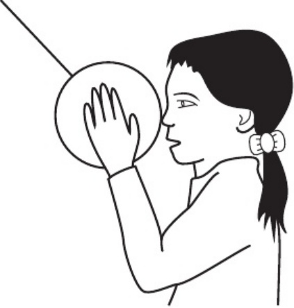

The following instructions are given:

Do not push the ball – just release it.

Do not move your face before the ball returns.

Explain this demonstration and the need for these instructions.

(Total for Question 7 = 6 marks)

8 The photograph shows a lawnmower being used to cut grass.

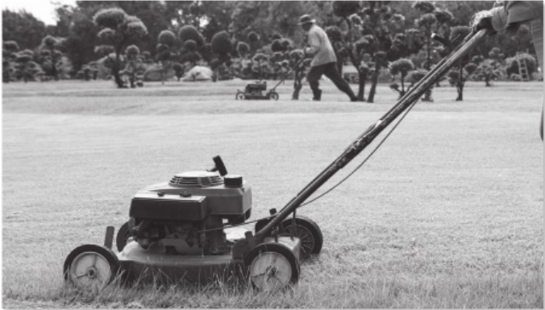

(a) (i) In order to push the lawnmower, a minimum force of 650 N must be applied to the handle of the lawnmower at an angle of  $ 42^{\circ} $ to the horizontal. Show that the horizontal component of the force is about 500 N. [2]

(ii) The lawnmower is used to cut 15 strips of grass, each 7 m long.

Calculate the work done by the person pushing the lawnmower.

(b) This photograph shows a lawnmower with the top section of the handle horizontal.

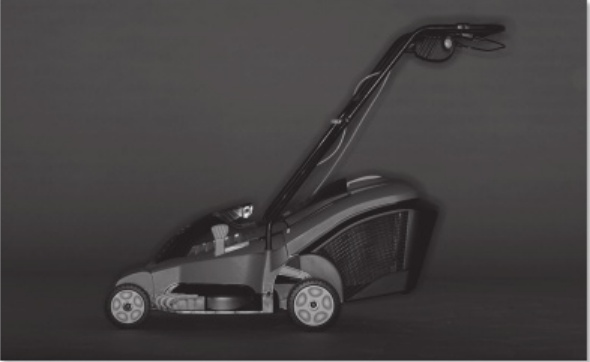

Explain how this changes the minimum force required to push the lawnmower. [2]

(Total for Question 8 = 6 marks)

9 Metrology is the science of measurement and World Metrology Day is May 20th. In 2010, the day was used to celebrate the 50th anniversary of the SI system.

A metrologist from the National Physical Laboratory said on a radio programme that the SI system uses units that everyone can understand. He stated the following example.

'If you hold an apple in your hand it's about a newton, if you raise it through one metre that's about a joule and if you do it in one second that's about a watt.'

Assuming that the apple has a mass of 100 g, explain and justify the statements made about the three words in italics. [6]

(Total for Question 9 = 6 marks)

