# 1C Momentum

<!-- edx_ial_phy1.pdf p57-68 -->

<!-- page 57 -->

# TOPIC 1 MECHANICS

# CHAPTER 1C MOMENTUM

Collisions can be devastating. Vehicle safety is a very important area of technological research, and much of the science is based on the concept of momentum and momentum transfer. Momentum is a property of a moving object. It is larger if the mass is greater and if the object moves faster. To change the momentum of an object requires a force, and this is how car crashes are so damaging. Larger forces cause more damage, whether to the vehicle or its passengers.

To reduce the forces involved in transferring momentum we need to know how momentum transfers and how to calculate the forces depending on the momentum transfer needed.

Not all momentum changes are dangerous. Rocket science is generally based on maximising the forces caused by a transfer of momentum, by maximising that momentum transfer. This will create maximum acceleration in order to move the rocket fast enough to gain enough gravitational potential energy to leave the Earth. This chapter will show you how the properties of a moving object can tell us its momentum, and how to calculate the transfer of momentum, and the forces involved in changing the movement of an object.

## MATHS SKILLS FOR THIS CHAPTER

- Units of measurement (e.g. the unit for momentum, kg m s $ ^{-1} $)

• Changing the subject of an equation (e.g. finding the velocity of an object after collision)

• Substituting numerical values into algebraic equations (e.g. calculating the momentum)

• Plotting two variables from experimental data (e.g. observing changes in momentum over time)

- Using sin, cos and tan in physical problems, and making calculations using them (e.g. resolving a momentum vector)

<!-- page 58 -->

## What prior knowledge do I need? Topic 1A

Ideas about stopping distances of cars, and the safety features in vehicles

Speed, distance, displacement, time, velocity, acceleration

Resolving vectors

Newton's laws of motion and the kinematics equations

## What will I study in this chapter?

Calculations of momentum

What we mean by collisions and explosions, and how momentum is related to them

The principle of conservation of linear momentum

How to apply the principle of conservation of linear momentum in one dimension

The relationship between Newton's laws and changing momentum

## What will I study later? Topic 2A

- Fluid movements and terminal velocity

Topic 2B

Stress and strain and the deformation of solids

Topic 5A (Book 2: IAL)

The conservation of momentum in two dimensions

Elastic and inelastic collisions

Topic 7B (Book 2: IAL)

The relationship between momentum and the kinetic energy of a particle

The importance of particle momentum in the design of accelerators

<!-- page 59 -->

## 1C 1 MOMENTUM

## LEARNING OBJECTIVES

Calculate the momentum of an object.

Explain how momentum is gained or lost.

## MOMENTUM

Momentum is a measure of an object's motion. It is quite difficult to define momentum in words, but it gives an idea of what will be required to stop the object moving. The best definition is mathematical:

momentum (kg m s $ ^{-1} $) = mass (kg)  $ \times $ velocity (m s $ ^{-1} $)

 $$ \boldsymbol{p}=m\times\boldsymbol{v} $$ 

As momentum is the product of mass (a scalar) and velocity (a vector), momentum is a vector. This means its direction is very important and must be remembered. The direction will be the same as that of its velocity.

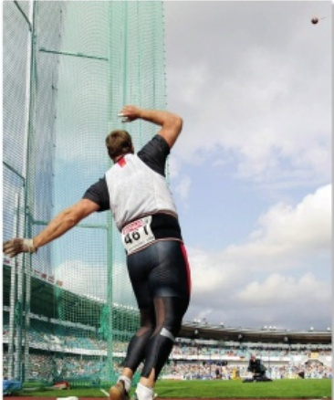

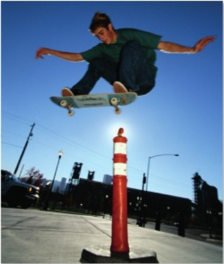

fig A Which object moves with the greatest momentum?

## EXAM HINT

Note that the steps and layout of the solution in this worked example are suitable for momentum questions in the exam.

## WORKED EXAMPLE

An athletics hammer (see fig A) has a mass of 7.26 kg (men's competition standard) and can be released at speeds in excess of 25 m s $ ^{-1} $. Its momentum at 25.0 m s $ ^{-1} $ would be:

 $$ \boldsymbol{p}=m\times\boldsymbol{v} $$ 

 $$ \boldsymbol{p}=7.26\times25.0 $$ 

 $$ p=182\mathrm{~k g}\mathrm{~m~s}^{-1} $$ 

A baseball has a mass of 145 grams. A fast pitcher can throw it at 40 m s $ ^{-1} $. If this baseball is released at 40 m s $ ^{-1} $, its momentum is:

 $$ \boldsymbol{p}=m\times\boldsymbol{v} $$ 

 $$ \boldsymbol{p}=0.145\times40 $$ 

 $$ p=5.8kg m s^{-1} $$ 

These example show that it is much more difficult to stop a well-thrown athletics hammer than to stop a baseball. Think about what 'more difficult' means in this case.

<!-- page 60 -->

## NEWTON'S SECOND LAW OF MOTION

If we want to bring an object to rest or to accelerate it up to a certain velocity, the requirements will be different for different situations. A golf ball is accelerated in a very different way to a ferry. Think of the forces needed and the time for which they act. This brings us to another way of thinking about momentum. It is a measure of the accelerating force, and the time it is applied for, that is required to bring an object up to the speed it is moving at. Alternatively, it is the force required, and for how long, to bring a moving object to rest.

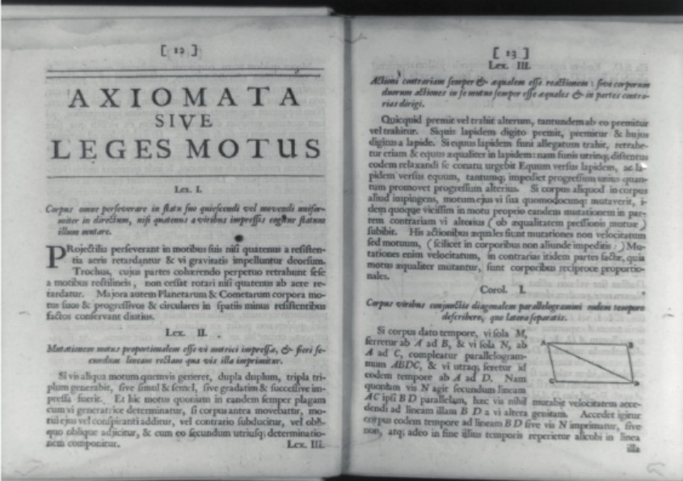

fig B Newton's laws of motion as he originally wrote them.

Newton's second law can be written mathematically as  $ \mathbf{F} = ma $. In fact, that formula is only true if the mass remains constant. When Newton originally wrote his second law in the 1687 book, Philosophiae naturalis principia mathematica, he actually wrote it as:

The rate of change of momentum of a body is directly proportional to the resultant force applied to the body, and is in the same direction as the force.

This can be written mathematically as:

 $$ F=\frac{\mathrm{d}p}{\mathrm{d}t}=\frac{\mathrm{d}(mv)}{\mathrm{d}t} $$ 

Here, F is the applied force, and  $ \frac{\mathrm{d}p}{\mathrm{d}t} $ is the rate of change of momentum in the direction of the force.

The $\frac{\mathrm{d}(x)}{\mathrm{d}t}$ term is a mathematical expression meaning the rate of change of $x$, or how quickly $x$ changes. However, if the quantities are not being measured over a very short timescale, we can express this using average changes:

## PRACTICAL SKILLS

 $$ F=\frac{\Delta p}{\Delta t} $$ 

Investigating momentum change

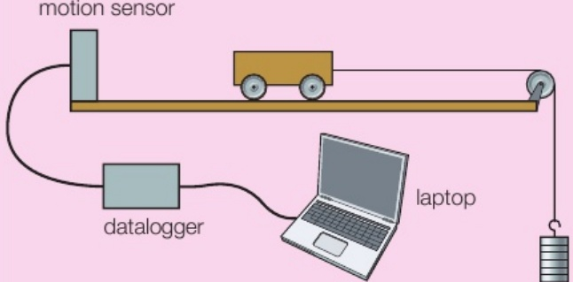

▲ fig C Measuring how a force changes the momentum of a trolley.

You can investigate the rate of change of momentum in the school laboratory. A trolley starts from rest and as a force acts upon it its velocity increases. If you record the trolley's movement over time, you can find the velocity each second. If you then calculate the momentum each second, you will be able to plot a graph of momentum against time. It should be a straight line. As  $ p = Ft $, the gradient of this line will be equal to the accelerating force.

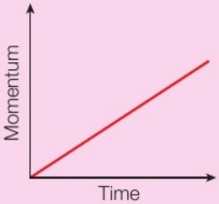

▲ fig D Accelerating from rest, momentum will be proportional to time.

Safety Note: Place trolleys and runways so they cannot fall and cause injuries. For large masses, place a `catch box' filled with crumpled paper or bubbled plastic in the `drop zone' to avoid injury to feet.

## CHECKPOINT

## SKILLS PROBLEM SOLVING

1. Calculate the momentum in each of these examples:

(a) an ice skater with a mass of 64 kg glides at 3.75 m s $ ^{-1} $

(b) a rugby player of mass 120 kg runs at a speed of 4.9 m s $ ^{-1} $

(c) an ant of mass 5 milligrams moves at a speed of 5 centimetres per second.

2. Estimate the momentum of the motorcyclist and the skateboarder shown in fig A.

3. Using the ideas of Newton's second law, explain why hitting an airbag will cause less injury than if a passenger hits the dashboard.

4. Estimate the force applied by a person throwing a Frisbee.

## SUBJECT VOCABULARY

 $$ \mathrm{momentum}\ (\mathrm{kg}\ \mathrm{m}\ \mathrm{s}^{-1})=\mathrm{mass}\ (\mathrm{kg})\times\mathrm{velocity}\ (\mathrm{m}\ \mathrm{s}^{-1}) $$ 

 $$ \boldsymbol{p}=m\times\boldsymbol{v} $$

<!-- page 61 -->

# 1C 2 CONSERVATION OF LINEAR MOMENTUM

## LEARNING OBJECTIVES

Explain the principle of conservation of linear momentum.

Make calculations based on the conservation of linear momentum.

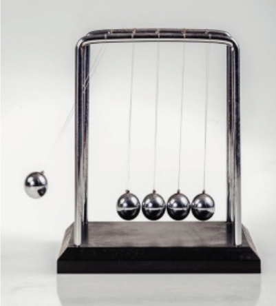

fig A Newton's cradle: each time the balls collide, momentum is transferred from one to another, but the total momentum remains constant.

## LEARNING TIP

Total momentum is only conserved when no external forces (such as friction) act on the system.

## COLLISIONS

When objects collide, we can use the laws of physics to calculate where the objects will go after the collision. We can use the principle of conservation of linear momentum to predict the motion of objects after a collision. This principle tells us that if we calculate the momentum of each object before they collide, the sum total of these momenta (accounting for their direction) will be the same as the sum total afterwards.

## LEARNING TIP

The word 'linear' appears here to remind us that this is all about objects moving in straight lines. There are similar physics principles about rotating objects, but they use different equations for the calculations. In this book we will only consider linear momentum.

This principle depends on the condition that no external force acts on the objects in question. An external force would provide an additional acceleration, and the motion of the objects would not be dependent on the collision alone. As we saw in the previous section, a resultant force will cause a change in momentum, so it makes sense that momentum is only conserved if no external force acts. Imagine if a juggler's ball moving upward collided with one coming down. Momentum conservation would suggest that the one falling down would bounce back with an upward velocity after the collision. Common sense tells us that all balls will still end up back on the ground. The external force of gravity means that the principle of conservation of momentum alone cannot be used to predict the motions after the collision.

fig B David Porter of the TCU Horned Frogs feels the full force of the conservation of momentum.

<!-- page 62 -->

## WORKED EXAMPLE

In an American football match, the stationary quarterback is tackled by a defender who dives through the air at  $ 4 \, m \, s^{-1} $ and, in mid-air, grabs the quarterback and the two move quickly backwards together. Ignoring any friction effects, calculate how fast the two will move back if the tackler has a mass of 140 kg and the stationary player has a mass of 95 kg. Consider the entire situation to be happening horizontally. Before:

Quarterback stationary so zero momentum

 $$ p_{t a c k l e r}=m\mathbf{v}=140\times4=560 $$ 

 $$ \text{momentum before}=560\mathrm{~kg}\mathrm{~m}\mathrm{s}^{-1} $$ 

After:

 $$ \mathrm{momentum~after=momentum~before=560kg\,m\,s^{-1}} $$ 

 $$ \boldsymbol{p}_{both}=m_{both}\times\boldsymbol{v}_{both} $$ 

 $$ \boldsymbol{v}_{both}=\frac{\boldsymbol{p}_{both}}{m_{both}}=\frac{560}{(140+95)}=\frac{560}{235} $$ 

 $$ \pmb{v}_{both}=2.4m s^{-1} $$ 

## LEARNING TIP

In a collision in which two objects join together to become one and move off together, they are often said to 'coalesce'.

## EXPLOSIONS

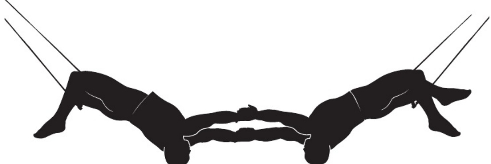

▲ fig C In this illustration, these trapeze artists are stationary. If they let go of each other, they will 'explode' – they will fly apart with equal and opposite momenta.

If a stationary object explodes, then the total momentum of all the shrapnel parts added up (taking account of the direction of their movements) must be zero. The object had zero momentum at the start, so the law of conservation of linear momentum tells us this must be the same total after the explosion. In physics, any such event is termed an explosion, although it may not be very dramatic. For example, if the two trapeze artists in fig C simply let go their hands and swing apart, they have zero total momentum before and will have equal and opposite momenta afterwards, which when added together will total zero again.

## EXAM HINT

For any exam question about momentum in collisions and explosions, make sure you state: 'total momentum before = total momentum after'.

<!-- page 63 -->

## EXAM HINT

Note that the steps and layout of the solution in this worked example are suitable for conservation of linear momentum questions in the exam.

## WORKED EXAMPLE

If the boy has a mass of 55 kg and steps forward at a speed of 1.5 m s $ ^{-1} $, what will happen to the boat which has a mass of 36 kg? (Ignore friction effects.)

This situation is an explosion, so:

total momentum before = total momentum after = zero

 $$ \therefore\quad\pmb{p}_{\mathrm{b o a t}}+\pmb{p}_{\mathrm{b o y}}=0 $$ 

 $$ \therefore\quad\pmb{p}_{boat}=-\pmb{p}_{boy} $$ 

So when the two are added up, the total momentum is still zero.

 $$ p_{boat}=-(55\times1.5)=-82.5kg m s^{-1} $$ 

 $$ m_{boat}\times\mathbf{v}_{boat}=-82.5kg\ m\ s^{-1} $$ 

 $$ \mathbf{v}_{boat}=\frac{-82.5}{m_{boat}}=\frac{-82.5}{36} $$ 

 $$ \pmb{v}_{boat}=-2.3m s^{-1} $$ 

So the boat moves at 2.3 m s $ ^{-1} $ in the opposite direction to the boy.

fig D Caution: explosions may make you wet!

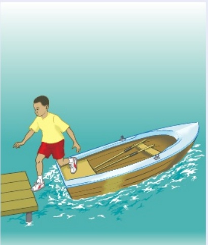

## PRACTICAL SKILLS

## Investigating transfer of momentum

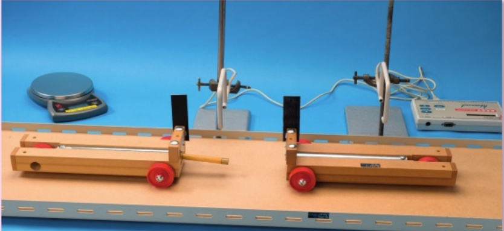

Safety Note: Place trolleys and runways so they cannot fall and cause injuries.

## ▲ fig E Verifying the principle of conservation of linear momentum

You can investigate the transfer of momentum in collisions in the school laboratory using trolleys, or sliders on an airtrack. By recording the movement of one trolley crashing into another, you can find the momentum of each one before and after the collision. The calculation of adding up the total momenta before and after collision will allow you to prove the principle of conservation of linear momentum. Try different types of collision and trolleys with different masses. You could also try an explosion in which the trolleys come apart from a stationary position.

In experiments using trolleys, we often find that momentum is actually not conserved in the measurements we make. With airtrack collisions, the measurements match very closely or exactly with the conservation of momentum theory. What might be the reasons for this difference between the two types of experiment?

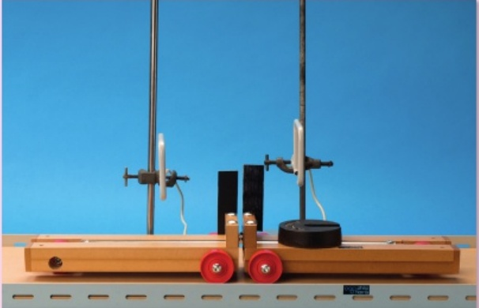

fig F A trolley 'explosion'.

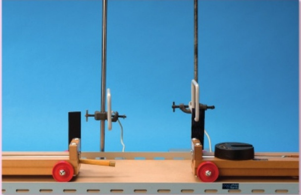

<!-- page 64 -->

## NEWTON'S THIRD LAW

Conservation of momentum is directly responsible for Newton's third law. Remember, this told us that for every force, there is an equal and opposite force. If we think of a force as a way to change

momentum ( $ F = \frac{\mathrm{d}p}{\mathrm{d}t} $) then a force changing momentum in one direction must be countered

by an equal and opposite one to ensure that overall momentum is conserved. For example, if the gravitational pull of the Earth causes an apple to fall from a tree, the apple gains momentum towards the Earth. For conservation of momentum, the Earth must gain an equal and opposite momentum. This is then caused by an equal and opposite gravitational force on the Earth from the apple. The huge mass of the Earth means that its acceleration cannot be noticed by us.

fig G Conservation of momentum causes equal and opposite forces, as Newton explained in his third law of motion.

## EXAM HINT

Make sure you answer the question that has been asked. In Q3, no marks will be awarded for answers that do not refer to Newton's third law.

## CHECKPOINT

## SKILLS ANALYSIS

1. A movie stuntman with a mass of 90 kg stands on a stationary 1 kg skateboard. An actor throws a 3.4 kg brick at the stuntman who catches it. The brick is travelling at 4.1 m s $ ^{-1} $ when caught.

2. A boy in a stationary boat on a still pond has lost his oars in the water. In order to get the boat moving again, he throws his rucksack horizontally out of the boat with a speed of  $ 4 \, m \, s^{-1} $.

Mass of boat = 60 kg; mass of boy = 40 kg; mass of rucksack = 5 kg (a) How fast will this action make the boat move?

(b) If he throws the rucksack by exerting a force on it for 0.2 s, how much force does he exert?

3. How can Newton's third law explain the problem suffered by the boy stepping out of the boat in fig D?

4. In a stunt for an action movie, the 100 kg actor jumps from a train that is crossing a river bridge.

On the river below, the heroine tied to a small boat is drifting towards a waterfall at  $ 3 \, m \, s^{-1} $. The small boat and heroine have a total mass of 200 kg.

(a) If the hero times his jumps perfectly so as to land on the small boat, and his velocity is  $ 12 \, m \, s^{-1} $ at an angle of  $ 80^{\circ} $ to the river current, what will be the velocity of the small boat immediately after his landing? Draw a vector diagram to show the momentum addition. Ignore any vertical motion.

(b) If the waterfall is 100 m downstream, and the hero landed when the small boat was 16 m from the bank, would they drop over the fall? Assume the velocity remains constant after the hero has landed. The small boat and the waterfall are on the same side of the bridge as he jumps.

## SUBJECT VOCABULARY

conservation of linear momentum the vector sum of the momenta of all objects in a system is the same before and after any interaction (collision) between the objects

explosion a situation in which a stationary object (or system of joined objects) separates into component parts, which move off at different velocities. Momentum must be conserved in explosions

<!-- page 65 -->

## 1C THINKING BIGGER

# SAVING HOCKEY GOALKEEPERS

CRITICAL THINKING, PROBLEM SOLVING, ANALYSIS, REASONING/ARGUMENTATION, INTERPRETATION, ADAPTIVE LEARNING, PRODUCTIVITY, SELF-EVALUATION, COMMUNICATION, TEAMWORK

OBO is a New Zealand based company that manufactures hockey goalkeeping equipment. The following extracts from their website explain some of their testing laboratory's abilities, and report on a potential new material used in leg guards.

COMPANY WEBSITE

## A LOOK INSIDE THE O LAB

In order to design and build the world's most protective and best performing goalkeeper equipment we need the facts. The O Lab is packed full of the world's most advanced impact test equipment... and a few very clever people to test and help evaluate the results.

fig A Anatomically correct crash test dummy head.

▲ fig B Data capture software simultaneously showing video and concussion data.

Every detail sorted by a small group of smart committed people. Video capture at speeds up to 2000 frames per second, skin contact analysis, and accurate concussion measurements.

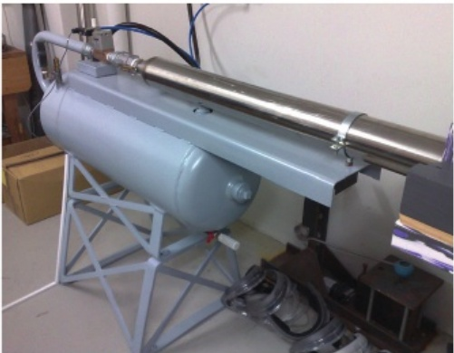

▲ fig C Ball cannon capable of speeds in excess of 200 km h.

## WHY OBO DON'T USE D30

From the OBO website, www.obo.co.nz/the-o-lab

A while ago, an important new protection polymer called D30 was offered to OBO. Because we are always trying to improve our products we were excited by the potential of D30 so our designer made a special trip from New Zealand to England to meet with the D30 creators. He returned home with lots of information and some samples which we tested in the purpose-built OBO impact lab... The O lab.

Our impact lab testing showed that while D30 weighed more than two and a half times the OBO polyethylene and EVA foams, it provided significantly less protection when dealing with the high speed and highly localised impact encountered with a hockey ball.

Have a look at the results on the impact graph below (the horizontal axis is speed, the vertical axis is transferred force – the higher the transferred force, the less the protection).

Protection comparison of D30 vs OBO foam for hockey ball impact August 2006

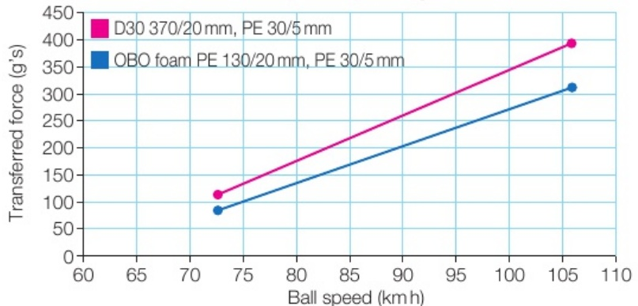

▲ fig D Protection comparison of D30 vs OBO foam for hockey ball impact.

<!-- page 66 -->

## THINKING BIGGER

## SCIENCE COMMUNICATION

1 The website opposite was written to support the business activities of a sports supply company. Consider the article and comment on the type of writing being used. Think about, for example, how the physics involved is explained, and the degree of detail included. Try and answer the following questions:

(a) What range of people do you expect might read the OBO website? What would be the likely scientific background of their customers?

(b) On the actual OBO webpage, there are many more pictures, including brief videos, that we could not fit in this book. How has the ratio of text to images been chosen for the intended audience, and the website as a medium?

(c) Where units have been included, comment on the actual units chosen to measure the quantities involved.

## PHYSICS IN DETAIL

Now we will look at the physics in, or connected to, these website extracts. Some of these questions link to topics in much earlier sections of this book, so you may need to combine concepts from different areas of physics to work out the answers.

2 For the testing of the polymer D3O, calculate the range of momenta for the test balls fired from the cannon. (A standard hockey ball has a mass of 160 grams.)

3 Explain, with reference to Newton's laws:

(a) why the ‘transferred force’, i.e. the force felt through the foam by a goalkeeper wearing it, would be the same as the force needed to decelerate the ball

(b) why the lines on the graph show a linear relationship with a positive gradient.

4 In light of the principle of conservation of linear momentum, how can a goalkeeper remain stationary, whilst the ball's momentum is completely removed in collision with the leg pads?

## ACTIVITY

Imagine you work for OBO as an international sales representative and you have to prepare a presentation to delegates at a trade show. Your presentation will need to explain in much greater scientific detail the testing that the equipment has been through in The O Lab. Prepare a questionnaire, for OBO head office in New Zealand, of questions that will give you the details you need to prepare your presentation.

## DID YOU KNOW?

OBO use one unusual testing procedure they call the DTH test. This involves a real goalkeeper wearing the item under test. A ball is fired at the test subject and the lab researchers ask the question, 'Did That Hurt?'

## INTERPRETATION NOTE

As you read the articles, consider where they have come from, who wrote them and whom they were written for. Established scientific publications are good sources of reliable information, whereas other resources might be less reliable for a number of reasons. Think about what makes a source reliable and why.

## THINKING BIGGER TIP

You do not need to prepare the presentation for the trade show, just your questionnaire designed to get the information you need from OBO head office to be able to prepare such a presentation.

<!-- page 67 -->

# 1C EXAM PRACTICE

1 Which is the correct expression for calculating momentum?

A Mass  $ \times $ speed

B Mass ÷ speed

C Mass  $ \times $ velocity

D Mass ÷ speed

(Total for Question 1 = 1 mark)

2 Which of the following is the correct unit for momentum?

A kg s $ ^{-1} $

B kg m s $ ^{-1} $

C kg m s $ ^{-2} $

D kg m $ ^{-1} $ s $ ^{-1} $

(Total for Question 2 = 1 mark)

3 A hockey ball of mass 158 g is hit with a force of 2000 N so that it travels at 28.1 ms^{-1}. What is the ball's momentum?

A 4.4 kg m s $ ^{-1} $

B 62.4 kg m s $ ^{-2} $

C 4440 kg m $ ^{-1} $ s $ ^{-1} $

D 8880 kg m s $ ^{-1} $ [1]

(Total for Question 3 = 1 mark)

4 An ice skater and his coach begin stationary and push apart from each other with a force of 75 N. The skater has a mass of 64 kg, whilst the coach weighs 804 N.

If the skater moves off to the left with a speed of  $ 3.6 \, m \, s^{-1} $, what is the velocity of the coach?

A  $ 0.022 \, m \, s^{-1} $ to the right

B  $ 2.8 \, m \, s^{-1} $ to the right

C  $ 3.1 \, m \, s^{-1} $ to the left

D  $ 3.1 \, m \, s^{-1} $ to the right [1]

(Total for Question 4 = 1 mark)

5 In an explosion, a stationary object of mass M splits into two objects which move in opposite directions, left and right, at the same speed.

Which row in the table correctly gives the mass of each of the two objects after the explosion?

<table border=1 style='margin: auto; word-wrap: break-word;'><tr><td rowspan="2">A</td><td style='text-align: center; word-wrap: break-word;'>Mass of left moving object</td><td style='text-align: center; word-wrap: break-word;'>Mass of right moving object</td></tr><tr><td style='text-align: center; word-wrap: break-word;'>$ \frac{M}{2} $</td><td style='text-align: center; word-wrap: break-word;'>$ \frac{M}{2} $</td></tr><tr><td style='text-align: center; word-wrap: break-word;'>B</td><td style='text-align: center; word-wrap: break-word;'>$ \frac{M}{2} $</td><td style='text-align: center; word-wrap: break-word;'>2M</td></tr><tr><td style='text-align: center; word-wrap: break-word;'>C</td><td style='text-align: center; word-wrap: break-word;'>2M</td><td style='text-align: center; word-wrap: break-word;'>2M</td></tr><tr><td style='text-align: center; word-wrap: break-word;'>D</td><td style='text-align: center; word-wrap: break-word;'>M</td><td style='text-align: center; word-wrap: break-word;'>M</td></tr></table>

(Total for Question 5 = 1 mark)

6 How tiny bacteria move is of interest in nanotechnology. Mycobacteria move by ejecting slime from nozzles in their bodies.

Explain the physics principles behind this form of propulsion.

(Total for Question 6 = 4 marks)

7 A student is using a ‘Newton’s Cradle’. This consists of a set of identical solid metal balls hanging by threads from a frame so that they are in contact with each other.

He initially pulls one ball to the side as shown.

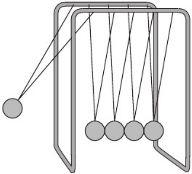

He releases the ball, it collides with the nearest stationary ball and stops. The ball furthest to the right immediately moves away. The middle three balls remain stationary.

(a) Explain what measurements the student would take and describe how he would use them to investigate whether momentum had been conserved in this event. [4]

(b) The student makes the following observations:

- the ball on the right returns and collides with a similar result; this repeats itself a number of times

• after a while, the middle balls are also moving

• shortly afterwards, the balls all come to rest.

Discuss these observations in terms of energy.

(Total for Question 7 = 7 marks)

<!-- page 68 -->

## EXAM PRACTICE

8 A student uses a motion sensor and a datalogging computer to investigate the momentum changes when a trolley is accelerated by a falling weight connected to it. Assume the trolley suffers no friction on the desk, and there is also no friction in the pulley wheel.

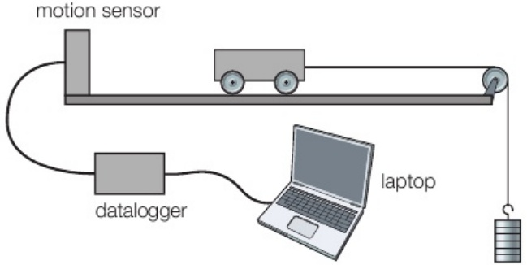

(a) Explain how Newton's second law of motion predicts that the momentum of this trolley will change when the weight is allowed to fall freely. [2]

(b) When the weight is released, the trolley experiences a resultant accelerating force of 2.85 N and has a mass of 350 g. Calculate the rate of change of velocity of the trolley.

(c) The trolley reaches a velocity of 11.1 m s $ ^{-1} $, calculate its momentum at this velocity, including the correct unit.

(d) Explain what is meant by the principle of conservation of momentum.

The student changes the experiment so that he can collide a moving trolley with an identical stationary one.

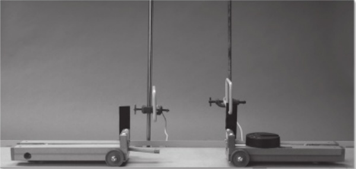

(e) Explain the momentum and speed changes for each trolley if the moving trolley stops on collision, and the stationary one moves away. [4]

(f) Explain the momentum and speed changes involved if the trolleys join together on collision, and both move away together. [4]

(g) Explain how this experiment could be changed to investigate the momentum and speed changes in an explosion.

(Total for Question 8 = 20 marks)

9 Explain how the principle of conservation of momentum in collisions is a consequence of Newton's third law of motion.

(Total for Question 9 = 6 marks)

10 A hockey ball is travelling horizontally with a momentum of 0.8 kg m s $ ^{-1} $ just before it hits a goalkeeper's leg pad. It rebounds horizontally from the leg pad with a momentum of -1.2 kg m s $ ^{-1} $. The graph shows the variation in the momentum of the ball during this process.

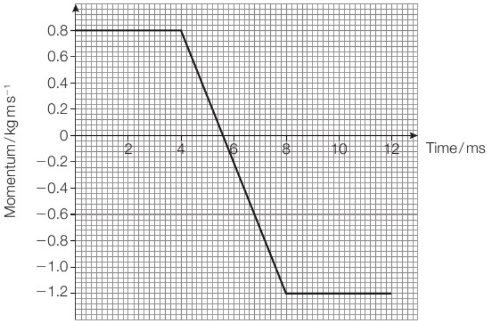

(a) Describe how the ball's momentum changes over time from 0 to 10 ms. [3]

(b) Explain in terms of Newton's laws why the momentum changes from positive to negative during the ball's collision with the leg pad. [2]

(c) What is the resultant force on the ball during the following time periods?

(i) 0-4 ms

(ii) 4-8 ms

(iii) 8-12 ms

(d) Draw a new version of the graph for a collision in which the ball is initially travelling at half the speed, and for which the impact time is also halved, but the force provided by the leg pads is the same.

(Total for Question 10 = 12 marks)

