# 2A Fluids

<!-- edx_ial_phy1.pdf p69-84 -->

<!-- page 69 -->

# TOPIC 2 MATERIALS

## 2 A FLUIDS

In Topic 1A, we calculated the motion of objects. We followed Newton's laws, and assumed zero air resistance. How safe was that assumption? Urban myths describe coins dropped from high buildings that cut deep into the concrete below – are these myths actually true? A very approximate calculation, using estimates of average coin size and mass, and the strength of the concrete, suggests that from a height of 100 metres, a falling coin could penetrate tens of centimetres … if it fell in a vacuum.

The falling coin might tumble in flight, depending upon the exact effects of air resistance. This resistance will slow the coin significantly, and it will hit the ground at a much lower speed than the theoretical estimate in the calculation mentioned above. Most likely, it will land with an impact similar to that of a hailstone.

In this chapter, you will see how gases and liquids behave when flowing, or when causing friction with moving solid objects. You will also learn about some of the factors that can affect these movements.

## MATHS SKILLS FOR THIS CHAPTER

- Units of measurement (e.g. the unit for density, kg m $ ^{-3} $)

- Visualising and representing 3D forms and finding volumes of rectangular blocks, cylinders and spheres (e.g. finding the volume of an object as a step towards finding its density)

• Changing the subject of an equation (e.g. re-arranging the Stokes' law equation)

• Solving algebraic equations (e.g. finding the depth at which a barge floats in a river)

• Substituting numerical values into algebraic equations (e.g. an upthrust calculation)

• Determining the slope of a linear graph (e.g. finding the viscosity from terminal velocity data)

<!-- page 70 -->

## What prior knowledge do I need?

Air resistance – its causes and effects

Topic 1A

Newton's laws of motion

Free body diagrams

Weight and the acceleration caused by gravity

How to calculate resultant forces, and their effects

## What will I study in this chapter?

Stokes' law

How to calculate density and upthrust

How friction is caused by fluids, and the effects of this drag

What we mean by terminal velocity, and what affects it

The meaning of the terms drag, viscosity, laminar flow, turbulent flow and upthrust

How fluids flow, and what changes their flow properties

## What will I study later? Topic 8A (Book 2: IAL)

Other thermal properties of fluids, especially gases

Topic 10A (Book 2: IAL)

Damping of oscillations by fluid drag

Forced vibrations, driven by turbulence in flowing fluids

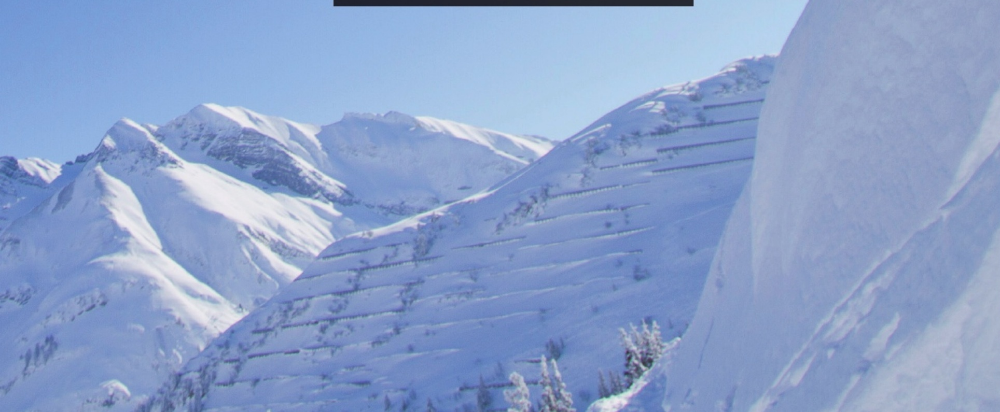

<!-- page 71 -->

# 1 FLUIDS, DENSITY AND UPTHRUST

## LEARNING OBJECTIVES

Use the equation defining density.

Understand how the upthrust force in a fluid can be calculated.

## FLUIDS

Have you ever wondered why it is sometimes so difficult to get thick sauce out of a bottle? The answer is that the manufacturers make it thick on purpose. Market research shows that consumers enjoy a certain consistency of ketchup or mayonnaise on their fries, and producing it that thick makes the sauce flow very slowly.

This chapter will explain various aspects of the movements of fluids, including some of the ways in which fluid properties are measured. A fluid is defined as any substance that can flow. Normally this means any gas or liquid, but solids made up of tiny particles can sometimes behave as fluids; an example is the flow of sand through an hourglass.

## DENSITY

One of the key properties of a fluid is its density. Density is a measure of the mass per unit volume of a substance – this is technically called ‘volumic mass’. Its value depends on the mass of the particles from which the substance is made, and how closely those particles are packed:

 $$ \begin{aligned}density(kg m^{-3})&=\frac{mass(kg)}{volume(m^{3})}\\\rho&=\frac{m}{V}\end{aligned} $$ 

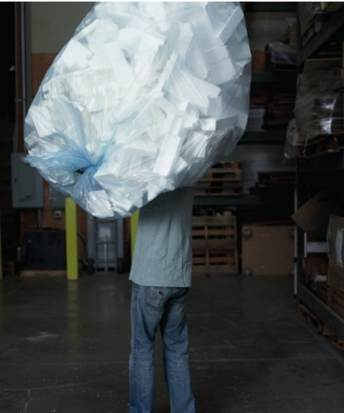

fig A Density is very important in determining the weight of an object.

The equation for calculating density works for mixtures and pure substances, and for all states of matter. Thus, fluid density is also mass per unit volume.

## WORKED EXAMPLE

A house brick is 23 cm long, 10 cm wide and 7 cm high. Its mass is 3.38 kg.

What is the brick's density?

 $$ \rho=\frac{m}{V} $$ 

 $$ \begin{aligned}V&=0.23\times0.10\times0.07\\&=1.61\times10^{-3}m^{3}\end{aligned} $$ 

 $$  mass m=3.38kg $$ 

## EXAM HINT

 $$ \begin{aligned}\rho&=\frac{3.38}{1.61\times10^{-3}}\\\rho&=2100kg m^{-3}\end{aligned} $$ 

Note that the steps and layout of the solution in this worked example are suitable for density questions in the exam.

At  $ 20^{\circ} $C, a child's balloon filled with helium is a sphere with a radius of 20 cm. The mass of helium in the balloon is 6 grams.

What is the density of helium at this temperature?

 $$ \rho=\frac{m}{V} $$ 

 $$ r=0.20m $$ 

 $$ \begin{aligned}V&=\frac{4}{3}\pi r^{3}\\&=\frac{4}{3}\pi\times(0.20)^{3}\\&=0.0335m^{3}\end{aligned} $$ 

 $$ m=0.006kg $$ 

 $$ \rho=\frac{0.006}{0.0335} $$ 

 $$ \rho=0.179\approx0.18kg m^{-3} $$ 

## LEARNING TIP

As objects expand when they get hotter, the volume depends on the temperature, and so the density must also be affected by changes in temperature.

Here is a table showing densities for different materials.

<table border=1 style='margin: auto; word-wrap: break-word;'><tr><td style='text-align: center; word-wrap: break-word;'>MATERIAL</td><td style='text-align: center; word-wrap: break-word;'>STATE</td><td style='text-align: center; word-wrap: break-word;'>DENSITY /  $ kg m^{-3} $</td></tr><tr><td style='text-align: center; word-wrap: break-word;'>air</td><td style='text-align: center; word-wrap: break-word;'>gas (sea level, 20°C)</td><td style='text-align: center; word-wrap: break-word;'>1.2</td></tr><tr><td style='text-align: center; word-wrap: break-word;'>pure water</td><td style='text-align: center; word-wrap: break-word;'>liquid (4°C)</td><td style='text-align: center; word-wrap: break-word;'>1000</td></tr><tr><td style='text-align: center; word-wrap: break-word;'>sulfuric acid (95% conc)</td><td style='text-align: center; word-wrap: break-word;'>liquid (20°C)</td><td style='text-align: center; word-wrap: break-word;'>1839</td></tr><tr><td style='text-align: center; word-wrap: break-word;'>cork</td><td style='text-align: center; word-wrap: break-word;'>solid</td><td style='text-align: center; word-wrap: break-word;'>240</td></tr><tr><td style='text-align: center; word-wrap: break-word;'>ice</td><td style='text-align: center; word-wrap: break-word;'>solid</td><td style='text-align: center; word-wrap: break-word;'>919</td></tr><tr><td style='text-align: center; word-wrap: break-word;'>window glass</td><td style='text-align: center; word-wrap: break-word;'>solid</td><td style='text-align: center; word-wrap: break-word;'>2579</td></tr><tr><td style='text-align: center; word-wrap: break-word;'>iron</td><td style='text-align: center; word-wrap: break-word;'>solid</td><td style='text-align: center; word-wrap: break-word;'>7850</td></tr><tr><td style='text-align: center; word-wrap: break-word;'>gold</td><td style='text-align: center; word-wrap: break-word;'>solid</td><td style='text-align: center; word-wrap: break-word;'>19320</td></tr></table>

table A Examples of density values for solids, liquids and gases.

<!-- page 72 -->

## UPTHRUST

When an object is submerged in a fluid, it feels an upwards force caused by the fluid pressure – the upthrust. It turns out that the size of this force is equal to the weight of the fluid that has been displaced by the object. This is known as Archimedes' principle. If the object is completely submerged, the mass of fluid displaced is equal to the volume of the object multiplied by the density of the fluid:

 $$ m=V\rho $$ 

The weight of fluid displaced (i.e. upthrust) is then found using the relationship:

 $$ W=mg $$ 

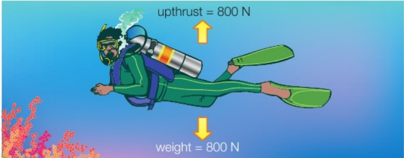

fig B Scuba diving equipment includes a buoyancy control device that can change volume to displace more or less water. This varies the upthrust and so helps the diver move up or down.

## WHY DOES A BRICK SINK?

If the house brick from the example calculation of density above were dropped in a pond, it would experience an upthrust equal to the weight of water it displaced. This is simply the weight of an equal volume of water. As the density of water is 1000 kg m $ ^{-3} $, the mass of water displaced by the brick would be:

 $$ m=1000kg m^{-3}\times1.61\times10^{-3}m^{3}=1.61kg $$ 

The water has a weight of:

 $$ W=1.61\times9.81=15.8\mathrm{~N} $$ 

so there is an upward force on the brick of 15.8 N.

If we compare the weight of the brick with the upthrust when it is submerged, the resultant force will be downwards:

 $$ \mathrm{w e i g h t}=3.38\times9.81=33.2\mathrm{~N~d o w n w a r d s} $$ 

 $$ \mathrm{u p t h r u s t}=15.8\mathrm{~N~u p w a r d s} $$ 

 $$ \mathrm{resultant~force}=33.2-15.8=17.6\mathrm{~N~d o w n w a r d s} $$ 

So, the brick will accelerate downwards within the water until it reaches the bottom of the pond, which then exerts an extra upwards force to balance the weight so the brick rests stationary on the bottom with zero resultant force.

(a)

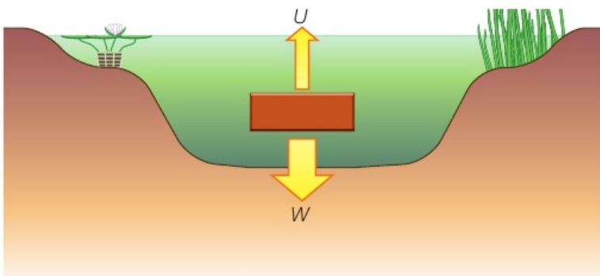

(b)

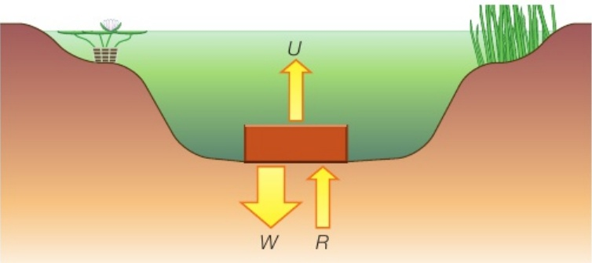

fig C (a) If the upthrust on an object is less than its weight, then the object will sink through a fluid; (b) an object will remain at rest when balanced forces act on it.

## FLOATING

Imagine an object lowering into a fluid. The instant the object touches the surface of the fluid there is no upthrust, because no fluid has been displaced. As the object sinks deeper into the fluid, it displaces an increasing volume of the fluid, so increasing the upthrust acting upon it. If a point is reached when the upthrust and weight are balanced exactly, the object will stop sinking further – it will float there. So, for an object to float, it will have to sink until it has displaced its own weight of fluid.

## WORKED EXAMPLE

A giant garbage barge on New York's Hudson River is 60 m long and 10 m wide. What depth of the hull will be under water if it and its cargo have a combined mass of 1500 tonnes? (Assume that the density of water in the Hudson River = 1000 kg m $ ^{-3} $).

To float:
upthrust = weight
weight = mg = 1500  $ \times $ 1000  $ \times $ 9.81 = 1.47  $ \times $ 10 $ ^{7} $ N
upthrust = 1.47  $ \times $ 10 $ ^{7} $ N

The upthrust is equal to the weight of the volume of water displaced by the hull:
upthrust =  $ \rho \times V \times g $

where:
volume V = length of hull, l  $ \times $ width of hull, w  $ \times $ depth of hull under water, d

So:
upthrust = 1000  $ \times $ 60  $ \times $ 10  $ \times $ d  $ \times $ 9.81
= 5.89  $ \times $ 10 $ ^{6} $  $ \times $ d
d =  $ \frac{1.47 \times 10^{7}}{5.89 \times 10^{6}} $
d = 2.5 m

The hull will be 2.5 m underwater.

## EXAM HINT

Note that the steps and layout of the solution in this worked example are suitable for upthrust questions in the exam.

<!-- page 73 -->

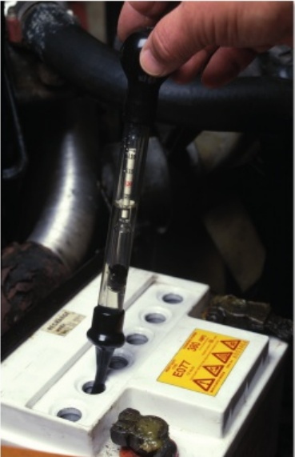

fig D A hydrometer can check the density of battery fluids, which tells us if the fluids need changing.

SKILLS PROBLEM SOLVING

## THE HYDROMETER

The idea of floating at different depths is the principle behind the hydrometer, an instrument used to determine the density of a fluid. The device has a constant weight, so it will sink lower in fluids of lesser density. This is because a greater volume of a less-dense fluid must be displaced to balance the weight of the hydrometer. Scale markings on the narrow stem of the hydrometer indicate the density of liquid.

Some car batteries use a sulfuric acid solution. The density of this solution tells us the charge level of the battery, and should be checked by a mechanic when the car is serviced.

<table border=1 style='margin: auto; word-wrap: break-word;'><tr><td style='text-align: center; word-wrap: break-word;'>HYDROMETER READING\n(DENSITY COMPARED TO WATER)</td><td style='text-align: center; word-wrap: break-word;'>STATE OF CHARGE</td></tr><tr><td style='text-align: center; word-wrap: break-word;'>1.255-1.275</td><td style='text-align: center; word-wrap: break-word;'>100%</td></tr><tr><td style='text-align: center; word-wrap: break-word;'>1.215-1.235</td><td style='text-align: center; word-wrap: break-word;'>75%</td></tr><tr><td style='text-align: center; word-wrap: break-word;'>1.180-1.200</td><td style='text-align: center; word-wrap: break-word;'>50%</td></tr><tr><td style='text-align: center; word-wrap: break-word;'>1.155-1.165</td><td style='text-align: center; word-wrap: break-word;'>25%</td></tr><tr><td style='text-align: center; word-wrap: break-word;'>1.110-1.130</td><td style='text-align: center; word-wrap: break-word;'>0%</td></tr></table>

For a particular car battery, the hydrometer readings can be compared to a table to tell us how charged the battery is.

## CHECKPOINT

1. A car battery contains 1 litre of sulfuric acid solution. The mass of the liquid in the battery is 1.265 kg. What is the density of this battery fluid? (1000 litres = 1 m³)

2. The radius of a bowling ball is 0.11 m and its mass is 7.26 kg. What is its density (a) in kg m $ ^{-3} $?

(b) in g cm $ ^{-3} $?

3. ▶ Estimate the mass of air in this room.

4. A golf ball has a diameter of 4.27 cm.

(a) If a golf player hits the ball into a stream, what upthrust does it experience when it is completely submerged? (Assume density of water = 1000 kg m $ ^{-3} $.)

(b) If the mass of the ball is 45 g, what is the resultant force on it when underwater?

(c) Referring to Newton's laws of motion, explain what will happen to the submerged golf ball.

5. A ball bearing of mass 180 g is hung on a thread in oil of density 800 kg m $ ^{-3} $. Calculate the tension in the string if the density of the ball bearing is 8000 kg m $ ^{-3} $.

6. Estimate your own density.

## SUBJECT VOCABULARY

fluid any substance that can flow

density a measure of the mass per unit volume of a substance

upthrust an upwards force on an object caused by the object displacing fluid

Archimedes' principle the upthrust on an object is equal to the weight of fluid displaced

hydrometer an instrument used to determine the density of a fluid

<!-- page 74 -->

## 2 FLUID MOVEMENT

## LEARNING OBJECTIVES

Understand the terms laminar flow and turbulent flow.

If you ski down a hill, you can go faster by tucking your body into a crouching position. By presenting a smaller area to air resistance, you reduce the force slowing you down. However, speed skiers chasing world record speeds go further in their efforts to increase their speeds.

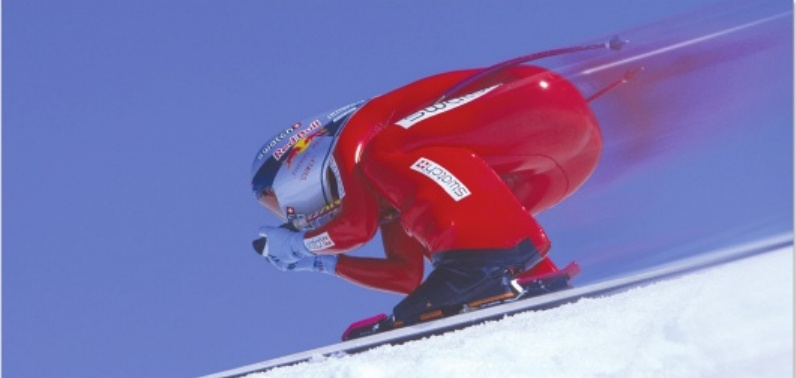

▲ fig A Why does this skier have such an oddly shaped helmet and adaptations to the suit's lower legs?

## LAMINAR FLOW

When a fluid moves, there are two ways this can happen: laminar flow (also called streamline flow) and turbulent flow. In general, laminar flow occurs at lower speeds, and will change to turbulent flow as the fluid velocity increases past a certain value. The velocity at which this changeover occurs will vary depending upon the fluid in question and the shape of the area through which it is flowing.

If we take a simple example such as water flowing slowly through a pipe, it will be laminar flow. Think of the water in the pipe as several concentric cylinders from the central axis outwards to the layer of water in contact with the pipe itself. Friction between the outermost layer and the pipe wall means this layer will only be able to move slowly. The next layer in will experience friction with the slow-moving outermost layer, but this will be less than the friction between the outermost layer and the pipe. Thus, this inner layer will move faster than the outermost layer. The next layer in moves faster again, with the velocity of each layer increasing nearer the centre, where a central cylinder of water is moving the fastest.

As with most areas of scientific investigation, Isaac Newton produced much work on the subject of fluid flow. In particular, he is credited with the development of equations to describe the frictional force between the layers in streamline flow. If a liquid follows his formulae, as most common liquids do, it is known as a Newtonian fluid.

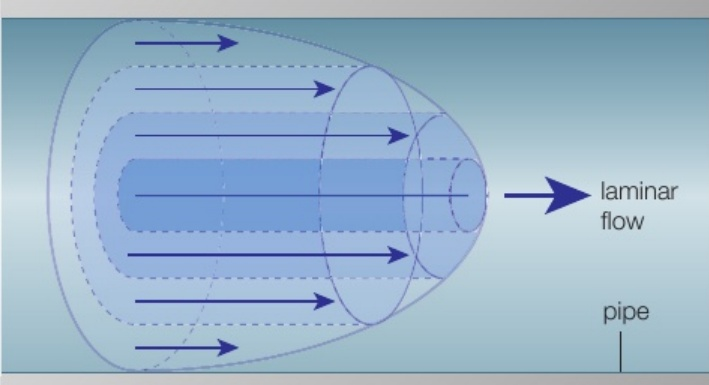

▲ fig B Laminar flow in a pipe shows streamlines of different but unchanging velocities.

<!-- page 75 -->

The lines of laminar fluid flow are called streamlines. At any point on any one of these streamlines, the velocity of the flow will be constant over time. Remember that velocity is a vector, so this means that the water at any point in the pipe will always move in the same direction and at the same speed. The direction and/or speed may be different in different places, but at any given place direction and speed must stay constant.

## STREAMLINING

In the wind tunnel in fig C, the smoke would flow over the car in exactly the same pattern forever if all the wind tunnel factors were kept constant. Changing the speed of the airflow in the tunnel allows designers to test how the prototype would behave at faster speeds, and at what point laminar flow changes to turbulent flow.

fig C Smoke streamlines show laminar flow of air over a well-designed car.

In turbulent flow the fluid velocity in any given place changes over time. The flow becomes chaotic and swirling eddies form (you see eddies when water runs away through a plug hole). A poorly designed car would cause turbulent flow of air over it. In the wind tunnel the smoke trails over the car would be seen to swirl in ever-changing patterns. Turbulent flow increases the drag on a vehicle and so increases fuel consumption.

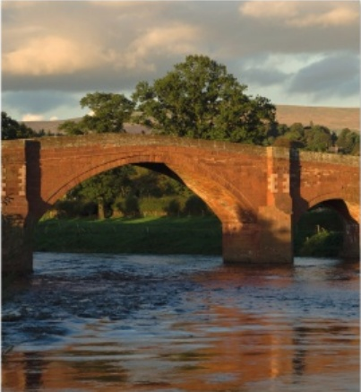

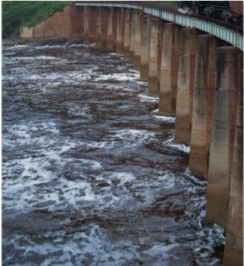

fig D Increased speeds change streamline flow to turbulent flow.

## PRACTICAL SKILLS

## Investigating types of flow

Turbulent flow was first demonstrated by Osborne Reynolds in 1883 in an experiment showing coloured water flowing in a glass tube. You can set up a similar experiment to show turbulence caused by faster fluid flow, or by different shapes of obstacles. At most speeds, a smooth, curved obstacle will produce less turbulence than a squarer one.

▲ fig E A few crystals of potassium manganate(VII) will produce purple trails in the water flow which can then be made to pass around objects made from clay. You can alter the flow rate and the obstacle shapes in order to see how the flow changes.

Safety Note: Avoid skin contact with the potassium manganate (vii), and the clay after it has been used.

## CHECKPOINT

## SKILLS ADAPTIVE LEARNING

1. Give three examples of objects that are designed to reduce the amount of turbulent flow of air or water over them.

2. Sketch diagrams to illustrate the basic definitions of streamline flow and turbulent flow. Explain how your diagrams show each type of flow.

3. The text on streamlining above says the water flowing at a particular point in a pipe 'will always move in the same direction and at the same speed'.

Explain why the smoke in the wind tunnel can change direction and move up and over the car.

## SUBJECT VOCABULARY

4. Describe and explain the differences in the water surfaces in the two pictures in fig D.

laminar flow/streamline flow a fluid moves with uniform lines in which the velocity is constant over time

turbulent flow fluid velocity in a particular place changes over time, often in an unpredictable manner

streamlines lines of laminar flow in which the velocity is constant over time

<!-- page 76 -->

## 3 VISCOSITY

## LEARNING OBJECTIVES

Understand the concept of viscosity.

Know how viscosity is related to temperature.

## VISCOSITY

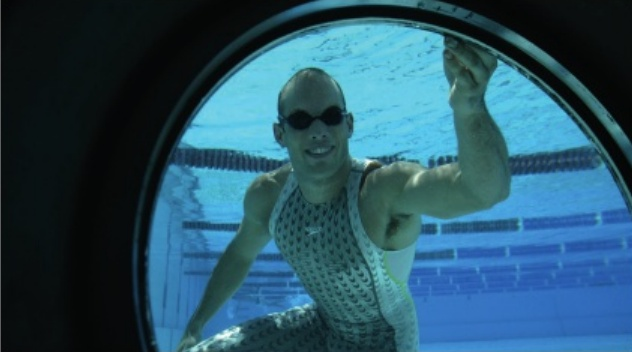

▲ fig A The 'sharkskin' suit helped break many swimming world records at the Beijing Olympics – it was later banned by swimming's governing body as 'technology doping'. Despite the manufacturer's claim that this was due to the material's extremely low viscous drag, scientists discovered this to be false and put the success down to its physiological benefits for athletes.

When you walk in a swimming pool, you find it much harder than walking through air. The friction acting against you is greater in water than it is in air. This frictional force in fluids is due to viscosity. If the frictional force caused by movement through the fluid is small, we say the viscosity is low.

Newton developed a formula for the friction in liquids that includes several factors. One of these factors relates to the particular liquid in question. It would be even harder to wade through a swimming pool of oil than one full of water. This fluid-dependent factor is called the coefficient of viscosity and has the symbol  $ \eta $, the Greek letter eta.

As viscosity determines the friction force acting within a fluid, it has a direct effect on the rate of flow of the fluid. Consider the differing rates of flow of a river of lava (see table A) compared with the viscosity of lava.

<table border=1 style='margin: auto; word-wrap: break-word;'><tr><td style='text-align: center; word-wrap: break-word;'>LAVA TYPE</td><td style='text-align: center; word-wrap: break-word;'>SILICA CONTENT</td><td style='text-align: center; word-wrap: break-word;'>VISCOSITY</td><td style='text-align: center; word-wrap: break-word;'>APPROXIMATE FLOW RATE / km h $ ^{-1} $</td></tr><tr><td style='text-align: center; word-wrap: break-word;'>basaltic</td><td style='text-align: center; word-wrap: break-word;'>least</td><td style='text-align: center; word-wrap: break-word;'>least</td><td style='text-align: center; word-wrap: break-word;'>30-60</td></tr><tr><td style='text-align: center; word-wrap: break-word;'>andesitic</td><td style='text-align: center; word-wrap: break-word;'>in between</td><td style='text-align: center; word-wrap: break-word;'>in between</td><td style='text-align: center; word-wrap: break-word;'>10</td></tr><tr><td style='text-align: center; word-wrap: break-word;'>rhyolitic</td><td style='text-align: center; word-wrap: break-word;'>most</td><td style='text-align: center; word-wrap: break-word;'>most</td><td style='text-align: center; word-wrap: break-word;'>1</td></tr></table>

table A How is the rate of flow related to the viscosity of the fluid?

The rate of flow of a fluid through a pipe is inversely proportional to the viscosity of the fluid. In 1838, Jean Poiseuille, a French doctor and physiologist, investigated the flow of fluids in pipes and proved the connection between flow rate and viscosity. Poiseuille was interested in blood flow through the body, but his law is very important in industrial design. For example, the rate of flow of liquid chocolate through pipes in the manufacture of sweets will vary with the chocolate's viscosity, which will vary depending on the exact recipe used to produce it. More sugar may mean greater viscosity and thus slower flow through the pipes, and so less chocolate per sweet.

## PRACTICAL SKILLS

## Investigating flow rates

You can investigate how fluid flow rate depends on the fluid's viscosity by doing an experiment very similar to those carried out by Poiseuille in the mid-nineteenth century. Using a constant pressure, water forced through a narrow pipe will flow at a certain rate, inversely proportional to its viscosity. By varying the height of the water tank, you can record measurements of this 'head of pressure', h, against the flow rate. The gradient of the best-fit line will allow you to calculate the viscosity of the water.

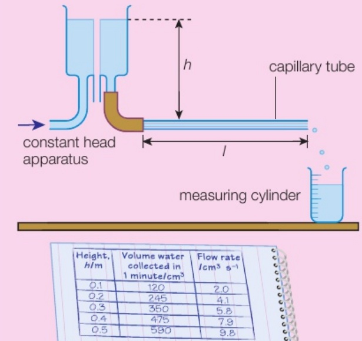

<table border=1 style='margin: auto; word-wrap: break-word;'><tr><td style='text-align: center; word-wrap: break-word;'>Height, h/m</td><td style='text-align: center; word-wrap: break-word;'>Volume water collected in 1 minute/cm $ ^{3} $</td><td style='text-align: center; word-wrap: break-word;'>Flow rate /cm $ ^{3} $ s $ ^{-1} $</td></tr><tr><td style='text-align: center; word-wrap: break-word;'>0.1</td><td style='text-align: center; word-wrap: break-word;'>120</td><td style='text-align: center; word-wrap: break-word;'>2.0</td></tr><tr><td style='text-align: center; word-wrap: break-word;'>0.2</td><td style='text-align: center; word-wrap: break-word;'>245</td><td style='text-align: center; word-wrap: break-word;'>4.1</td></tr><tr><td style='text-align: center; word-wrap: break-word;'>0.3</td><td style='text-align: center; word-wrap: break-word;'>350</td><td style='text-align: center; word-wrap: break-word;'>5.8</td></tr><tr><td style='text-align: center; word-wrap: break-word;'>0.4</td><td style='text-align: center; word-wrap: break-word;'>475</td><td style='text-align: center; word-wrap: break-word;'>7.9</td></tr><tr><td style='text-align: center; word-wrap: break-word;'>0.5</td><td style='text-align: center; word-wrap: break-word;'>590</td><td style='text-align: center; word-wrap: break-word;'>9.8</td></tr></table>

Tube internal diameter 2 r = 2 mm; tube length l = 20 cm

fig B Experimental set up and sample results for an investigation into Poiseuille flow.

You can plot a graph of the flow rate (F) against height (h) and hence calculate the viscosity of water ( $ \eta $).

Poiseuille's equations tell us that the gradient of the graph $=\frac{\pi\rho g r^{4}}{8\eta l}$

where $r$ is the internal radius of the capillary tube, $\rho$ is the density of water, and $g = 9.81\,\mathrm{N\,kg^{-1}}$.

Safety Note: Secure the constant head apparatus to a stand so that it cannot fall over even when filled with water.

An even greater variation in viscosity of liquid chocolate is caused by changes in its temperature. The sweet manufacturer can account for variation in a recipe (which might come from something as minor as a change in supplier of cocoa beans) by adjusting the flow rate by altering the temperature. Viscosity is directly related to fluid temperature. In general, liquids have a lower coefficient of viscosity at higher temperatures. For gases, viscosity increases with temperature.

<!-- page 77 -->

<table border=1 style='margin: auto; word-wrap: break-word;'><tr><td style='text-align: center; word-wrap: break-word;'>FLUID</td><td style='text-align: center; word-wrap: break-word;'>TEMPERATURE / °C</td><td style='text-align: center; word-wrap: break-word;'>VISCOSITY / PaS</td></tr><tr><td style='text-align: center; word-wrap: break-word;'>air</td><td style='text-align: center; word-wrap: break-word;'>0</td><td style='text-align: center; word-wrap: break-word;'>0.000017</td></tr><tr><td style='text-align: center; word-wrap: break-word;'>air</td><td style='text-align: center; word-wrap: break-word;'>20</td><td style='text-align: center; word-wrap: break-word;'>0.000018</td></tr><tr><td style='text-align: center; word-wrap: break-word;'>air</td><td style='text-align: center; word-wrap: break-word;'>100</td><td style='text-align: center; word-wrap: break-word;'>0.000022</td></tr><tr><td style='text-align: center; word-wrap: break-word;'>water</td><td style='text-align: center; word-wrap: break-word;'>0</td><td style='text-align: center; word-wrap: break-word;'>0.0018</td></tr><tr><td style='text-align: center; word-wrap: break-word;'>water</td><td style='text-align: center; word-wrap: break-word;'>20</td><td style='text-align: center; word-wrap: break-word;'>0.0010</td></tr><tr><td style='text-align: center; word-wrap: break-word;'>water</td><td style='text-align: center; word-wrap: break-word;'>100</td><td style='text-align: center; word-wrap: break-word;'>0.0003</td></tr><tr><td style='text-align: center; word-wrap: break-word;'>glycerine</td><td style='text-align: center; word-wrap: break-word;'>-40</td><td style='text-align: center; word-wrap: break-word;'>6700</td></tr><tr><td style='text-align: center; word-wrap: break-word;'>glycerine</td><td style='text-align: center; word-wrap: break-word;'>20</td><td style='text-align: center; word-wrap: break-word;'>1.5</td></tr><tr><td style='text-align: center; word-wrap: break-word;'>glycerine</td><td style='text-align: center; word-wrap: break-word;'>30</td><td style='text-align: center; word-wrap: break-word;'>0.63</td></tr><tr><td style='text-align: center; word-wrap: break-word;'>chocolate</td><td style='text-align: center; word-wrap: break-word;'>30</td><td style='text-align: center; word-wrap: break-word;'>100</td></tr><tr><td style='text-align: center; word-wrap: break-word;'>chocolate</td><td style='text-align: center; word-wrap: break-word;'>50</td><td style='text-align: center; word-wrap: break-word;'>60</td></tr></table>

table B The viscosities of different fluids at different temperatures.

SKILLS ANALYSIS

## PRACTICAL SKILLS

Investigating how viscosity changes with temperature

You can investigate how the viscosity of a liquid changes with temperature using a re-sealable tin or bottle half-full of a test fluid (such as syrup). The temperature of the liquid is varied using a water bath. The viscosity of the liquid will affect the rate at which the tin or bottle rolls down a fixed ramp.

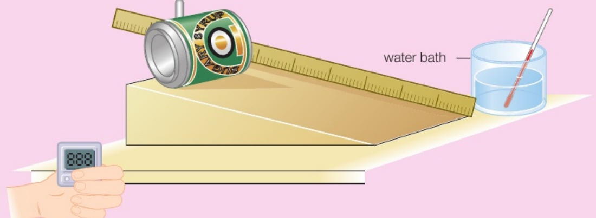

fig C How does the viscosity of syrup change with its temperature?

Safety Note: If edible syrup or oils are used, do not taste. Avoid skin contact with mineral oil or motor oil. If the liquid is very hot it will stick to skin and cause severe burns.

## CHECKPOINT

1. Why is the world record for 100 m swimming a longer time than that for 100 m sprinting?

2. Describe how temperature affects viscosity for liquids and gases.

3. How and why would holding a swimming competition in a warmer pool affect the times achieved by swimmers?

4. Why might a chocolate manufacturer alter their machinery so it functioned at a higher temperature?

5. ▶ Draw a graph of the experimental results shown in fig B in order to find the viscosity of water. How does your value compare with the figures in table B?

## SUBJECT VOCABULARY

viscosity how resistant a fluid is to flowing

coefficient of viscosity a numerical value given to a fluid to indicate how much it resists flow

<!-- page 78 -->

## 4 TERMINAL VELOCITY

CP2 LAB BOOK PAGE 11

## LEARNING OBJECTIVES

Use the equation for viscous drag.

Use a falling ball method to determine the viscosity of a liquid.

You have previously learned that acceleration due to gravity near the surface of the Earth is about  $ 9.81 \, m s^{-2} $. An object falling in a vacuum does accelerate at this rate. However, it is unusual for objects to be dropped near the surface of the Earth in a vacuum (in nearly all such cases a physics teacher is likely to be demonstrating to a class). In reality, in order to calculate an object's actual acceleration when falling, we need to take account of all the forces acting on it, combine these to find a resultant force, and then use Newton's second law ( $ a = \frac{\sum F}{m} $) to calculate the resulting acceleration.

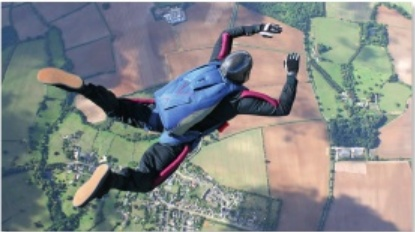

fig A A skydiver will fall at a constant speed if the forces acting on him are balanced.

For a falling object such as a skydiver, this means we need to include the weight, the upthrust caused by the object being in the fluid air, and the viscous drag force caused by the movement. The difficult part is that the viscous drag varies with speed through the fluid, and speed is constantly changing as a result of the acceleration. Usually, we consider the equilibrium situation, in which the weight exactly balances the sum of upthrust and drag, which means that the falling velocity remains constant. This constant velocity is the terminal velocity.

## EXAM HINT

The phrase ‘terminal velocity’ is only defined to be for objects falling under gravity with a constant weight. For a similar situation horizontally, for example a car using a constant thrust force, an alternative phrase such as ‘maximum velocity’ should be used.

## STOKES' LAW

In the mid-nineteenth century, Sir George Gabriel Stokes, an Irish mathematician and physicist at Cambridge University, investigated fluid dynamics and came up with an equation for the viscous drag  $ (F) $ on a small sphere at low speeds. This formula is now called Stokes' law:

##  $ F = 6\pi r\eta v $

where $r$ is the radius of sphere (m), $\pmb{v}$ is the velocity of sphere (m s$^{-1}$), and $\eta$ is the coefficient of viscosity of the fluid (Pa s). Thus, in such a simple situation, the drag force is directly proportional to the radius of the sphere, and directly proportional to the velocity.

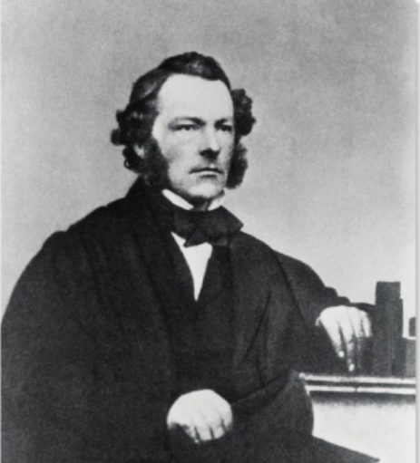

▲ fig B Along with Lord Kelvin and James Clerk Maxwell, Sir George Gabriel Stokes helped to build the reputation of Cambridge University in many areas of mathematical physics.

For simplicity, we will only consider simple situations, such as a solid sphere moving slowly in a fluid. Imagine a ball bearing dropping through a column of oil, for example. If you consider the terminal velocity of the sphere in terms of the forces in detail, then:

 $$ \mathrm{w e i g h t}=\mathrm{u p t h r u s t}+\mathrm{S t o k e s}^{\prime}\mathrm{f o r c e} $$ 

 $$ m_{s}\pmb{g}=weight~of~fluid~displaced~+6\pi r\eta\pmb{v}_{term} $$ 

where  $ m_s $ is the mass of the sphere and  $ \pmb{v}_{\text{term}} $ is its terminal velocity. For the sphere, the mass  $ m_s $ is given by:

 $$ m_{s}=volume\times density of sphere=\frac{4}{3}\pi r^{3}\times\rho_{s} $$ 

so the weight of the sphere  $ W_{s} $ is given by:

 $$ \boldsymbol{W}_{s}=m_{s}\boldsymbol{g}=\frac{4}{3}\pi r^{3}\rho_{s}\boldsymbol{g} $$ 

For the sphere, the upthrust is equal to the weight of fluid displaced. The mass  $ m_{f} $ of fluid displaced is given by:

 $$ m_f=volume\times density of fluid=\tfrac{4}{3}\pi r^3\times\rho_f $$ 

so the weight of fluid displaced  $ W_{f} $ is given by:

 $$ \boldsymbol{W}_{\mathrm{f}}=m_{\mathrm{f}}\boldsymbol{g}=\frac{4}{3}\pi r^{3}\rho_{\mathrm{f}}\boldsymbol{g} $$ 

Overall then:

 $$ \begin{array}{r}{\frac{4}{3}\pi r^{3}\rho_{\mathrm{s}}\pmb{g}=\frac{4}{3}\pi r^{3}\rho_{\mathrm{f}}\pmb{g}+6\pi r\eta\pmb{v}_{\mathrm{t e r m}}}\end{array} $$ 

We can rearrange the equation to find the terminal velocity:

 $$ v_{term}=\frac{\frac{4}{3}\pi r^{3}g(\rho_{s}-\rho_{f})}{6\pi r\eta} $$ 

Cancelling the  $ \pi $ and the radius term:

 $$ v_{term}=\frac{2r^{2}g(\rho_{s}-\rho_{f})}{9\eta} $$ 

So terminal velocity is proportional to the square of the radius. This means that a larger sphere falls faster. Furthermore, because the radius is squared, it falls much faster.

<!-- page 79 -->

## EXAM HINT

At a fixed temperature, viscosity is constant.

'Viscous drag' increases with velocity, but 'viscosity' does not change.

## EXAM HINT

Note that the steps and layout of the solution in this worked example are suitable for terminal velocity questions in the exam.

## WORKED EXAMPLE

Find the terminal velocity of (a) a steel ball bearing of radius 1 mm and (b) a steel ball bearing of radius 2 mm falling through glycerine in a measuring cylinder.
The viscosity of glycerine is highly temperature dependent: at  $ 20^{\circ} $C we can take  $ \eta = 1.5 $ Pa s
density of steel = 7800 kg m $ ^{-3} $
density of glycerine = 1200 kg m $ ^{-3} $
g = 9.81 m s $ ^{-2} $
(a) For a 1 mm radius ball bearing:
 $ v_{term} = \frac{2r^2g(\rho_s - \rho_f)}{9\eta} $
 $ v_{term} = \frac{2(1 \times 10^{-3})^2 \times 9.81 \times (7800 - 1200)}{9 \times 1.5} $
 $ v_{term} = 9.6 \times 10^{-3} m s^{-1} $
(b) For a 2 mm radius ball bearing:
 $ v_{term} = \frac{2r^2g(\rho_s - \rho_f)}{9\eta} $
 $ v_{term} = \frac{2(2 \times 10^{-3})^2 \times 9.81 \times (7800 - 1200)}{9 \times 1.5} $
 $ v_{term} = 3.8 \times 10^{-2} m s^{-1} $
Comparing the values, you can see that doubling the radius of the ball makes its terminal velocity four times as great.

## PRACTICAL SKILLS

## Investigating terminal velocity

You can investigate the viscosity of a liquid by allowing various differently sized spheres to fall through it and then measure their terminal velocity and radii.

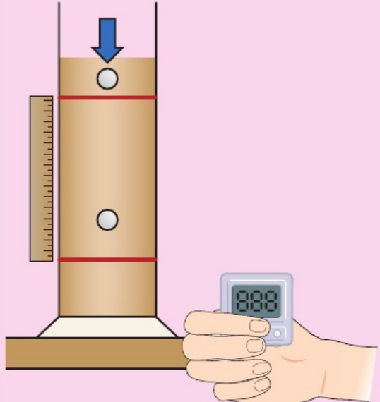

▲ fig C How does the terminal velocity of a falling sphere depend on its radius and the viscosity of the fluid?

You can plot a graph of the terminal velocity,  $ v_{term} $, against the square of the sphere radius,  $ r^{2} $, and hence calculate the viscosity of water,  $ \eta $.

Stokes' law tells us that the gradient of the graph =  $ \frac{2g(\rho_s - \rho_f)}{9\eta} $

where  $ \rho_s $ is the density of the material of the spheres and  $ \rho_f $ is the density of the fluid they fall through, and  $ \boldsymbol{g} = 9.81 \, \text{N kg}^{-1} $. You may need to do an additional experiment to find the two densities.

Water is usually not viscous enough to give measurably different terminal velocities in this experiment. However, if you do use water, you can then compare the answer for its viscosity with that found from the Poiseuille flow experiment in Section 2A.3.

<!-- page 80 -->

## VISCOUS DRAG

You would find it difficult to wade through a swimming pool filled with oil because of the oil's viscous drag. This is the friction force between a solid and a fluid. Calculating this fluid friction force can be relatively simple. On the other hand, it can be very complicated for large objects, fast objects and irregularly shaped objects, as the turbulent flow creates an unpredictable situation.

It must be remembered that the simple slow-falling sphere of Stokes' law is not a common situation and in most real applications the terminal velocity value is a result of more complex calculations. However, the principle that larger objects generally fall faster holds true for most objects without a parachute.

<table border=1 style='margin: auto; word-wrap: break-word;'><tr><td style='text-align: center; word-wrap: break-word;'>FALLING OBJECT</td><td style='text-align: center; word-wrap: break-word;'>TERMINAL VELOCITY / m  $ s^{-1} $</td></tr><tr><td style='text-align: center; word-wrap: break-word;'>skydiver</td><td style='text-align: center; word-wrap: break-word;'>60</td></tr><tr><td style='text-align: center; word-wrap: break-word;'>golf ball</td><td style='text-align: center; word-wrap: break-word;'>32</td></tr><tr><td style='text-align: center; word-wrap: break-word;'>hail stone (0.5 cm radius)</td><td style='text-align: center; word-wrap: break-word;'>14</td></tr><tr><td style='text-align: center; word-wrap: break-word;'>raindrop (0.2 cm radius)</td><td style='text-align: center; word-wrap: break-word;'>9</td></tr></table>

table A The terminal velocities of various objects falling in air. Note that the skydiver value varies greatly with the shape in which the body is held when falling.

## CHECKPOINT

1. Use Stokes' law to calculate the viscous drag on a ball bearing with a radius of 1 mm, falling at 1 mm s $ ^{-1} $ through liquid chocolate at 30°C.

2. Why is it difficult to calculate the terminal velocity for a cat falling from a high rooftop?

3. A spherical meteorite, of radius 2 m and made of pure iron, falls towards Earth.

(a) For its fall through the air, use Stokes' law to calculate the meteorite's terminal velocity.

(b) The meteorite lands in a tropical freshwater lake that is at  $ 20\,{}^{\circ} $C and continues sinking underwater. Use Stokes' law to calculate its new terminal velocity.

(c) What assumptions have you made in order to make these calculations?

(See tables of density data in Section 2A.1 and viscosities in Section 2A.3.)

4. Use table A to estimate the terminal velocity of the cat in question 2.

5. The experiment shown in fig C was carried out using glycerine as the liquid through which the sphere was dropped, but the experiment was repeated at different temperatures from  $ 10^{\circ} $C up to  $ 50^{\circ} $C.

(a) (i) In what way would the density of the glycerine change as the temperature increased for each experiment.

(ii) In what way would the density of the ball bearing change as the temperature increases for each experiment.

(b) In what way would the upthrust on the ball bearing change as the temperature of the glycerine was increased for each experiment.

(c) Explain how the viscosity of glycerine changes as the temperature increases (see table B in Section 2A.3).

(d) At each temperature, the student drew a graph of terminal velocity against the square of the radius of the ball bearing. Explain how the gradient of the graph would change with the temperature changes, and why.

(e) Why is this experiment likely to be inconclusive if water were used instead of glycerine?

## SUBJECT VOCABULARY

## SKILLS CRITICAL THINKING

## EXAM HINT

terminal velocity the velocity of a falling object when its weight is balanced by the sum of the drag and upthrust acting on it

Students often confuse the terms 'drag' and 'upthrust'. Make sure you are clear on their definitions, and use the right word for the right upward force, depending on what is causing the force.

<!-- page 81 -->

# 2A THINKING BIGGER

## THE PLIMSOLL LINE

## SKILLS

CRITICAL THINKING, PROBLEM SOLVING, REASONING/ARGUMENTATION, INTERPRETATION, ADAPTIVE LEARNING, INITIATIVE, PRODUCTIVITY, ETHICS, COMMUNICATION, ASSERTIVE COMMUNICATION

Load lines are painted on the side of ships to show how low they may safely sit in the water. Although usually associated with the British Member of Parliament Samuel Plimsoll (1824–1898), such lines have been in use for hundreds of years.

In this activity, we will look at how the 'Plimsoll line' came to be required by British law.

OCEAN SERVICE WEBSITE

## WHAT IS A PLIMSOLL LINE?

## A commercial ship is properly loaded when the ship's waterline is at the ship's Plimsoll line

The Plimsoll line is a reference mark located on a ship's hull that indicates the maximum depth to which the vessel may be safely immersed when loaded with cargo. This depth varies with a ship's dimensions, type of cargo, time of year, and the water densities encountered in port and at sea. Once these factors have been accounted for, a ship's captain can determine the appropriate Plimsoll line needed for the voyage (see fig B).

Samuel Plimsoll (1824–1898) was a member of the British Parliament and he was concerned with the loss of ships and crews due to overloading. In 1876, he persuaded Parliament to pass the Unseaworthy Ships Bill, which required marking a ship's sides with a line that would disappear below the waterline if the ship was overloaded. The line, also known as the Plimsoll mark, is found in the middle of the ship on both the port and starboard sides of cargo ships and is still used worldwide by the shipping industry.

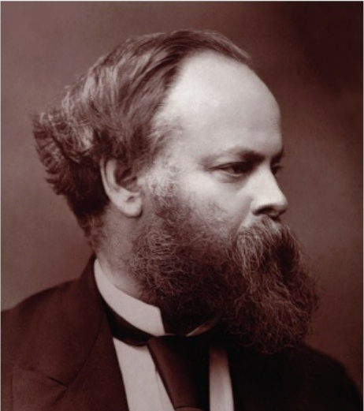

fig A Samuel Plimsoll.

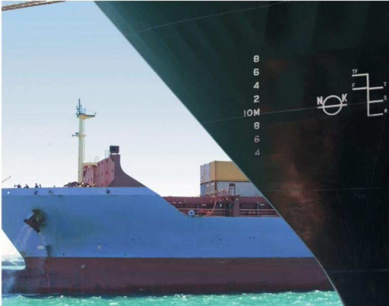

<table border=1 style='margin: auto; word-wrap: break-word;'><tr><td style='text-align: center; word-wrap: break-word;'>LTF - Timber Tropical Fresh Water</td><td style='text-align: center; word-wrap: break-word;'>TF - Tropical Fresh Water</td></tr><tr><td style='text-align: center; word-wrap: break-word;'>LF - Timber Fresh Water</td><td style='text-align: center; word-wrap: break-word;'>F - Fresh Water</td></tr><tr><td style='text-align: center; word-wrap: break-word;'>LT - Timber Tropical Seawater</td><td style='text-align: center; word-wrap: break-word;'>T - Tropical Seawater</td></tr><tr><td style='text-align: center; word-wrap: break-word;'>LS - Timber Summer Seawater</td><td style='text-align: center; word-wrap: break-word;'>S - Summer Temperate Seawater</td></tr><tr><td style='text-align: center; word-wrap: break-word;'>LW - Timber Winter Seawater</td><td style='text-align: center; word-wrap: break-word;'>W - Winter Temperate Seawater</td></tr><tr><td style='text-align: center; word-wrap: break-word;'>LWNA - Timber Winter North Atlantic</td><td style='text-align: center; word-wrap: break-word;'>WNA - Winter North Atlantic</td></tr></table>

fig B Plimsoll mark on the hull of a floating ship, and a chart indicating variables such as water density.

From the website of the National Ocean Service, an office of the U.S. National Oceanic and Atmospheric Administration, http://oceanservice.noaa.gov/facts/plimsoll-line.html

<!-- page 82 -->

## THINKING BIGGER

## SCIENCE COMMUNICATION

1 The text opposite is from the website of the National Ocean Service, an office of the U.S. National Oceanic and Atmospheric Administration. Consider the text and comment on the type of writing used. Try and answer the following questions:

(a) How has the author attempted to maintain the reader's interest?

(b) Discuss the level of the science presented, in relation to the intended audience.

## PHYSICS IN DETAIL

Now we will look at the physics in detail. Some of these questions link to topics earlier in this book, so you may need to combine concepts from different areas of physics to work out the answers.

2 Explain the information in the first paragraph of the text, with relation to the heights of the marks in fig B and the table of the codes shown on a typical load line.

3 The highest load lines are for timber. These allow for timber to be loaded on to the deck of the ship. This can easily be thrown overboard if needed. Explain why the marks are higher, and how and when it could help if this extra deck cargo were thrown off the ship.

4 Explain why the ships in fig B have the shape that they do. Why are they designed differently from large square barges that do not travel on the ocean? Justify your answer.

## INTERPRETATION NOTE

Think about the type of reader who is likely to visit the webpage. Also, think about why the National Ocean Service would include this webpage if it is 'a dull subject'.

## THINKING BIGGER TIP

Think about how the density of the water leads to the depth that the ship sinks into the water. Would saltier water be more or less dense than freshwater? And how would the temperature of the water affect its density?

## ACTIVITY

Write a comment piece for a magazine. Argue that although Plimsoll's campaign was 150 years ago, the capitalist approach to business has not changed very much. Include examples of at least one current business practice, anywhere in the world, where safety technology is not used enough because of its cost. Your article should include a paragraph explaining to a general audience the science behind the safety technology mentioned, and information on your sources of evidence.

## DID YOU KNOW?

In the year 1873–74, 411 ships sank off the coast of the United Kingdom, with the loss of 506 lives. Overloading and poor repair made some ships so dangerous that they became known as ‘coffin ships’.

<!-- page 83 -->

# 2A EXAM PRACTICE

1 Which is the correct expression for calculating density?

A Mass  $ \times $ volume

B Mass  $ \div $ volume

C Upthrust  $ \times $ volume

D Weight  $ \div $ volume

(Total for Question 1 = 1 mark)

2 What is the mass of a spherical stone with a diameter 25 mm, if the density of the stone is 2900 kg m^{-3}?

A  $ 2.82 \times 10^{-9} $ kg

B 24 g

C 190 g

D  $ 3.55 \times 10^{8} $ kg [1]

(Total for Question 2 = 1 mark)

3 Which is the correct definition of 'laminar flow'?

A At a given point in a flowing fluid, the velocity of flow varies uniformly over time.

B At a given point in a flowing fluid, the velocity of turbulent flow is proportional to the viscosity.

C At a given point in a flowing fluid, the velocity of flow does not vary over time.

D At a given point in a flowing fluid, the velocity of flow does not vary over the distance from the centre of flow. [1]

(Total for Question 3 = 1 mark)

4 Which row in the table is correct?

<table border=1 style='margin: auto; word-wrap: break-word;'><tr><td style='text-align: center; word-wrap: break-word;'>Gas viscosity</td><td style='text-align: center; word-wrap: break-word;'>Liquid viscosity</td></tr><tr><td style='text-align: center; word-wrap: break-word;'>increases at higher temperature</td><td style='text-align: center; word-wrap: break-word;'>increases at higher temperature</td></tr><tr><td style='text-align: center; word-wrap: break-word;'>increases at higher temperature</td><td style='text-align: center; word-wrap: break-word;'>decreases at higher temperature</td></tr><tr><td style='text-align: center; word-wrap: break-word;'>decreases at higher temperature</td><td style='text-align: center; word-wrap: break-word;'>increases at higher temperature</td></tr><tr><td style='text-align: center; word-wrap: break-word;'>decreases at higher temperature</td><td style='text-align: center; word-wrap: break-word;'>decreases at higher temperature</td></tr></table>

(Total for Question 4 = 1 mark)

5 A stone is dropped into water. It has a mass of 288 g and there is an upthrust force of 0.58 N when it is released in the water. What is the resultant force on the stone at that moment of release, when it is initially not moving?

A 287.4 N

B 2.83 N

C 2.25 N

D zero

(Total for Question 5 = 1 mark)

6 Blood clots can lead to heart attacks. Blood flow through arteries is normally laminar, but an obstruction may cause the blood flow to become turbulent. This can lead to the formation of blood clots.

(a) The diagram shows an artery containing an obstruction.

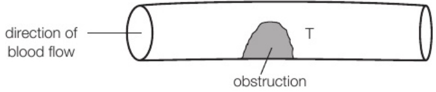

After passing the obstruction the laminar flow becomes turbulent in the area marked T.

(i) Add flow lines to the diagram to show laminar flow changing to turbulent flow after passing the obstruction.

(ii) Explain what is meant by laminar flow and turbulent flow. [2]

(b) In one experiment on blood flow, the viscosity of the blood and the velocity of blood flow were measured.

(i) Describe how you would expect the velocity of blood flow to vary with the viscosity. [1]

(ii) Suggest and explain how a rise in the temperature of the blood would affect the velocity of flow. [2]

(Total for Question 6 = 7 marks)

<!-- page 84 -->

## EXAM PRACTICE

7 The photograph shows oil being poured into a cold frying pan and spreading out.

Explain the difference that using a hot pan would make to how the oil spreads. [2]

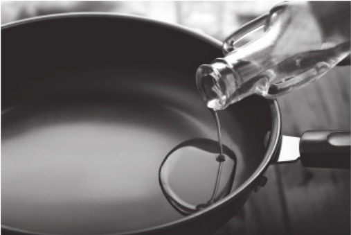

(Total for Question 7 = 2 marks)

8 In the game of table tennis, a ball is hit from one end of the table to the other over a small net.

(a) Making a table tennis ball spin when it is hit can affect its flight. The diagram shows the path of air around a spinning ball. It contains regions of laminar flow and turbulent flow. The flow changes from one to the other at points A and B.

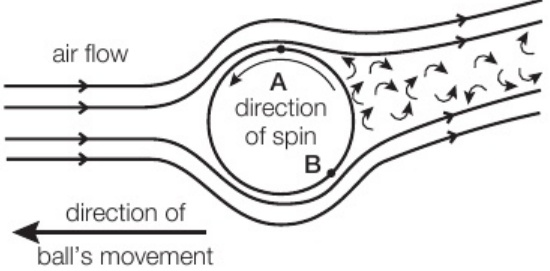

(i) With reference to the diagram, explain what is meant by laminar flow and turbulent flow. [2]

(ii) The ball is spinning in the direction shown in the diagram.

Suggest why there is a larger region of turbulent flow on the top of the ball than the bottom. [1]

(b) The diagram shows that the air is deflected upwards after passing the ball.

Explain why this means there must be a downwards component of force on the ball in addition to its weight. [2]

(c) Spinning a table tennis ball allows it to be hit harder and still hit the table on the other side of the net.

(i) A table tennis ball is hit, without any spin, from one end of a table so that it leaves the bat horizontally with a speed of  $ 31 \, m s^{-1} $. The length of the table is 2.7 m. Show that the ball falls a vertical distance of about 4 cm as it travels the length of the table. (3)

(ii) The net is 15 cm high. Explain how the spin helps the ball hit the table on the other side of the net. (3)

(Total for Question 8 = 11 marks)

9 Soil is usually made up of a variety of particles of different sizes. The photograph shows what happens when soil is mixed up with water and the particles are allowed to settle.

(a) The dot below represents a particle of the soil falling through water.

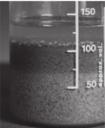

(i) Add labelled arrows to show the three

forces acting on the particle as it falls through the water.

(ii) Explain why a particle held stationary in water and then released accelerates downwards at first but then reaches a steady downwards speed. [4]

(iii) Write an expression showing the relationship for these forces when the particle is falling at a steady speed. [1]

(b) A typical particle of sand in the sample has the following properties:

 $$  diameter=1.6\times10^{-3}m $$ 

 $$ \mathrm{volume}=2.1\times10^{-9}\mathrm{m}^{3} $$ 

 $$  density=2.7\times10^{3}kg m^{-3} $$ 

 $$ \mathrm{w e i g h t}=5.7\times10^{-5}\mathrm{N} $$ 

(i) Show that the upthrust acting on the particle is about  $ 2 \times 10^{-5} $ N.

 $$ density~of~water=1.0\times10^{3}kg m^{-3} $$ 

(ii) Calculate the steady downwards speed this particle would achieve if allowed to fall through water. viscosity of water =  $ 1.2 \times 10^{-3} $ Pa s

(c) The different types of particles in soil can be defined according to their diameters, as in the following table.

<table border=1 style='margin: auto; word-wrap: break-word;'><tr><td style='text-align: center; word-wrap: break-word;'>Soil particle</td><td style='text-align: center; word-wrap: break-word;'>Particle diameter</td></tr><tr><td style='text-align: center; word-wrap: break-word;'>clay</td><td style='text-align: center; word-wrap: break-word;'>less than 0.002 mm</td></tr><tr><td style='text-align: center; word-wrap: break-word;'>silt</td><td style='text-align: center; word-wrap: break-word;'>0.002 mm - 0.05 mm</td></tr><tr><td style='text-align: center; word-wrap: break-word;'>sand</td><td style='text-align: center; word-wrap: break-word;'>0.05 mm - 2.00 mm</td></tr><tr><td style='text-align: center; word-wrap: break-word;'>fine pebbles</td><td style='text-align: center; word-wrap: break-word;'>2.00 mm - 5.00 mm</td></tr><tr><td style='text-align: center; word-wrap: break-word;'>medium pebbles</td><td style='text-align: center; word-wrap: break-word;'>5.00 mm - 20.00 mm</td></tr><tr><td style='text-align: center; word-wrap: break-word;'>coarse pebbles</td><td style='text-align: center; word-wrap: break-word;'>20.00 mm - 75.00 mm</td></tr></table>

The photograph shows that when soil is allowed to settle in water, the pebbles tend to be found towards the bottom, followed by sand, silt and clay in succession.

Explain why this happens. Assume that all particles have the same density.

(Total for Question 9 = 15 marks)

10 Explain how a stone dropped into a lake, from the surface, will reach a maximum velocity as it falls to the lake bottom, and how this will be different in summer and winter.

(Total for Question 10 = 6 marks)

