# 2B Solid material properties

<!-- edx_ial_phy1.pdf p85-98 -->

<!-- page 85 -->

# TOPIC 2 MATERIALS

# 2B SOLID MATERIAL PROPERTIES

You probably rarely consider the likelihood that a bridge will fail as you walk or drive over it. However, when designing the bridge, and selecting the materials to use in it, an engineer has to ensure that this likelihood is minimal.

Design processes for any new project need to include specifications indicating the extremes of conditions that may apply. A bridge needs to withstand an overloaded lorry that is not complying with weight restrictions; a snowboarding helmet might be used by a person on a snowmobile; or a motorist might try to use a climbing rope to tow their car. Some of these uses might be classed as unreasonable, and the designer would not expect to have to make their product strong enough to stand up to such extreme forces.

If you were designing a new harbour wall, what extreme weather conditions would you ensure that the wall could withstand? Would it be good enough to make sure it could withstand a storm with such strong winds and waves that only occurs once every 50 years? 100 years? 1000 years? And how do you achieve the strength required within budget?

In this chapter we will see how the strength of materials can be measured, and thus how to choose the right material for any given job.

## MATHS SKILLS FOR THIS CHAPTER

Units of measurement (e.g. the pascal, Pa)

• Calculating areas of circles (e.g. finding the cross-sectional area of a wire in order to find stress)

- Use of standard form and ordinary form (e.g. calculating Young modulus)

Making order of magnitude calculations (e.g. comparing Young modulus for different materials)

• Changing the subject of an equation (e.g. re-arranging the stress equation)

- Substituting numerical values into algebraic equations (e.g. calculating the strain)

Determining the slope of a linear graph (e.g. finding the Young modulus from experimental results)

• Estimating, by graphical methods as appropriate, the area between a curve and the x-axis, and realising the physical significance of the area that has been determined (e.g. finding the energy stored in a stretched material from graphical data)

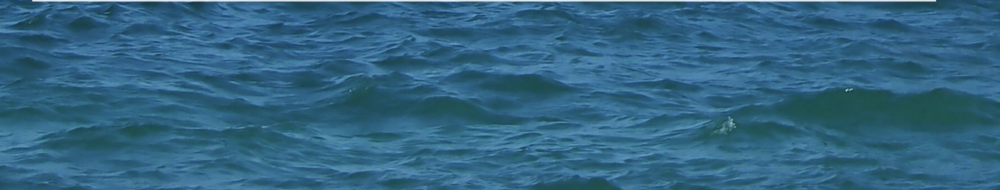

<!-- page 86 -->

## What prior knowledge do I need?

The deforming effects of forces

Experimental measurements on wires

The idea of general properties of materials, rather than properties of specific objects

How to calculate resultant forces

Topic 1A

Topic 1C

The testing of materials for use in hockey goalkeeping equipment

## What will I study in this chapter?

How an object deforms when a force is applied along its length

How to calculate stress and strain

The meaning of the Young modulus for a material, and how to calculate it

How to do an experiment to measure the Young modulus for a material

How to interpret stress-strain curves in order to analyse the strength of a solid material

How these ideas can be applied to materials in use in real applications

## What will I study later?

Non-conservation of momentum, and deformation in collisions

Topic 10A (Book 2: IAL)

Oscillations of springs, with calculations using the spring constant

How resonant vibration depends on the physical strength of an object

<!-- page 87 -->

## 1 HOOKE'S LAW

## LEARNING OBJECTIVES

Understand Hooke's law and be able to make calculations using it.

Calculate the elastic strain energy stored in a deformed material sample.

Estimate the elastic strain energy stored from a force-extension graph for a sample.

Whenever a force acts on a material sample, the sample will be deformed to a different size or shape. If it is made longer, the force is referred to as tension, and the extra length is known as the extension. For a material being squashed to a smaller size, both the force and the decrease in size are called compression, although the decrease in size could be referred to as a negative extension.

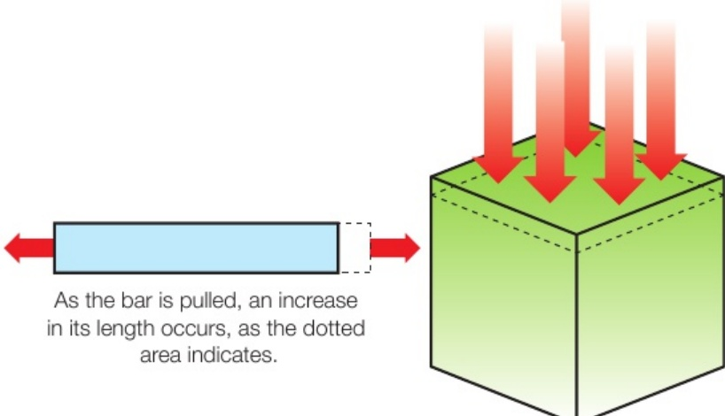

fig A A tensile force causes extension. A compressive force causes a negative extension.

## HOOKE'S LAW

Robert Hooke, a rival of Isaac Newton, was an exceptional experimental scientist. His interests were very diverse and he discovered many things that are more important than the rule called Hooke's law.

Hooke's law states that the force needed to extend a spring is proportional to the extension of the spring. A material only obeys Hooke's law if it has not passed what is called the limit of proportionality.

Up to a certain limit of proportionality, the force needed to extend a spring is proportional to the extension of the spring. If an object is subject to only a small force, it will deform elastically. When the force is removed, it returns to its original size and shape, as long as the elastic limit was not passed. We will look in much more detail at elastic and plastic deformation in Section 2B.3.

▲ fig B The middle spring is extended in proportion to the applied load, obeying Hooke's law. The right-hand spring has been stretched beyond its limit of proportionality, so no longer obeys Hooke's law.

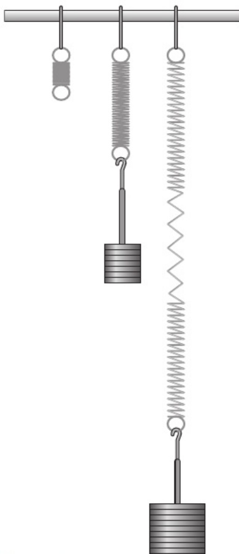

Hooke's law is best described mathematically with the equation:

force applied (N) = stiffness constant (N m $ ^{-1} $)  $ \times $ extension (m)

 $$ \Delta F=k\Delta x $$ 

## EXAM HINT

The stiffness constant for a spring is usually referred to as the spring constant. Either phrase refers to k in the Hooke's law equation.

## WORKED EXAMPLE

A spring has a stiffness constant of 50 N m $ ^{-1} $ and is 3.0 cm long. How long would it be if a 200 g mass were hung from it?

Weight force:

 $$ \begin{aligned}W=mg&=0.200\times9.81\\&=1.962N\end{aligned} $$ 

 $$ \Delta F=k\Delta x $$ 

## EXAM HINT

 $$ \begin{aligned}\therefore\quad\Delta x&=\frac{\Delta F}{k}=\frac{1.962}{50}=0.03924m\\&=3.924cm\end{aligned} $$ 

Note that the steps and layout of the solution in this worked example are suitable for questions about Hooke's law in the exam.

 $$ \begin{aligned}final~length&=original~length+extension\\L&=L_{0}+\Delta x=3.0+3.9\\L&=6.9cm\end{aligned} $$

<!-- page 88 -->

## PRACTICAL SKILLS

## Investigating Hooke's law

You can perform a simple experiment to measure the stiffness constant for a spring. By hanging various masses on a spring and measuring the corresponding extensions, you can gather a set of results for  $ \Delta F $ and  $ \Delta x $. In each case, you could calculate the spring constant from a pair of readings, but you will get a more accurate final answer for k if you plot a graph of the results and find its gradient.

<table border=1 style='margin: auto; word-wrap: break-word;'><tr><td style='text-align: center; word-wrap: break-word;'>MASS / g</td><td style='text-align: center; word-wrap: break-word;'>WEIGHT / N</td><td style='text-align: center; word-wrap: break-word;'>ORIGINAL LENGTH / cm</td><td style='text-align: center; word-wrap: break-word;'>LOADED LENGTH / cm</td><td style='text-align: center; word-wrap: break-word;'>EXTENSION / cm</td></tr><tr><td style='text-align: center; word-wrap: break-word;'>0</td><td style='text-align: center; word-wrap: break-word;'>0.000</td><td style='text-align: center; word-wrap: break-word;'>2.4</td><td style='text-align: center; word-wrap: break-word;'>2.4</td><td style='text-align: center; word-wrap: break-word;'>0.0</td></tr><tr><td style='text-align: center; word-wrap: break-word;'>100</td><td style='text-align: center; word-wrap: break-word;'>0.981</td><td style='text-align: center; word-wrap: break-word;'>2.4</td><td style='text-align: center; word-wrap: break-word;'>2.8</td><td style='text-align: center; word-wrap: break-word;'>0.4</td></tr><tr><td style='text-align: center; word-wrap: break-word;'>200</td><td style='text-align: center; word-wrap: break-word;'>1.962</td><td style='text-align: center; word-wrap: break-word;'>2.4</td><td style='text-align: center; word-wrap: break-word;'>3.1</td><td style='text-align: center; word-wrap: break-word;'>0.7</td></tr><tr><td style='text-align: center; word-wrap: break-word;'>300</td><td style='text-align: center; word-wrap: break-word;'>2.943</td><td style='text-align: center; word-wrap: break-word;'>2.4</td><td style='text-align: center; word-wrap: break-word;'>3.6</td><td style='text-align: center; word-wrap: break-word;'>1.2</td></tr><tr><td style='text-align: center; word-wrap: break-word;'>400</td><td style='text-align: center; word-wrap: break-word;'>3.924</td><td style='text-align: center; word-wrap: break-word;'>2.4</td><td style='text-align: center; word-wrap: break-word;'>3.9</td><td style='text-align: center; word-wrap: break-word;'>1.5</td></tr><tr><td style='text-align: center; word-wrap: break-word;'>500</td><td style='text-align: center; word-wrap: break-word;'>4.905</td><td style='text-align: center; word-wrap: break-word;'>2.4</td><td style='text-align: center; word-wrap: break-word;'>4.3</td><td style='text-align: center; word-wrap: break-word;'>1.9</td></tr><tr><td style='text-align: center; word-wrap: break-word;'>600</td><td style='text-align: center; word-wrap: break-word;'>5.886</td><td style='text-align: center; word-wrap: break-word;'>2.4</td><td style='text-align: center; word-wrap: break-word;'>4.8</td><td style='text-align: center; word-wrap: break-word;'>2.4</td></tr><tr><td style='text-align: center; word-wrap: break-word;'>800</td><td style='text-align: center; word-wrap: break-word;'>7.848</td><td style='text-align: center; word-wrap: break-word;'>2.4</td><td style='text-align: center; word-wrap: break-word;'>5.8</td><td style='text-align: center; word-wrap: break-word;'>3.4</td></tr><tr><td style='text-align: center; word-wrap: break-word;'>1000</td><td style='text-align: center; word-wrap: break-word;'>9.810</td><td style='text-align: center; word-wrap: break-word;'>2.4</td><td style='text-align: center; word-wrap: break-word;'>6.5</td><td style='text-align: center; word-wrap: break-word;'>4.1</td></tr></table>

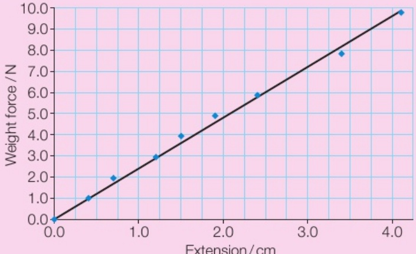

▲ fig C The results of a Hooke's law investigation of a spring before it reaches its elastic limit. The fact that the best-fit line is straight shows that the spring obeys Hooke's law.

The graph in fig C has been plotted with the dependent variable on the x-axis, so that when the gradient of the line is calculated, this will give you the value for the spring constant:

Gradient,  $ m = \frac{\Delta y}{\Delta x} = \frac{\Delta F}{\Delta x} = k $

Safety Note: Use eye protection in case the spring becomes detached and flies back. Keep hands and feet clear of the 'drop zone' if large masses are used.

## ELASTIC STRAIN ENERGY

The work done in deforming a material sample before it reaches its elastic limit will be stored within the material as elastic strain energy,  $ E_{el} $. We have previously seen that work done can be calculated by multiplying the force by the distance moved in the direction of the force. This is true in deforming materials too, but Hooke's law means that the force value varies for different extensions. If we plot the extension of a spring with increasingly large masses hanging on it, as in fig C, the graph will follow Hooke's law. To find the work done to extend the spring a certain amount, we must calculate using the average force over the distance of the extension.

 $$ \Delta E_{\mathrm{e l}}=\tfrac{1}{2}F\Delta x $$ 

## WORKED EXAMPLE

In fig C, how much elastic strain energy is stored in the spring when it is extended by 2.5 cm?

At  $ \Delta x = 2.5 $ cm, the corresponding force value is F = 6.0 N.

 $$ \Delta E_{el}=\tfrac{1}{2}F\Delta x $$ 

 $$ \Delta E_{el}=\frac{1}{2}\times6.0\times0.025 $$ 

 $$ \Delta E_{el}=0.075\,\mathrm{J} $$ 

## WORK FROM FORCE–EXTENSION AND FORCE–COMPRESSION GRAPHS

The work done in deforming a material is calculated by multiplying the extension or compression by an appropriate average force value. If the force is varying in a non-linear way, which is common for some materials, it might not be a straightforward process to find the average force. However, the area between the line on a force-extension  $ (F-\Delta x) $ graph and the extension axis will represent the work done. Finding the area under the line is easy with the linear type of relationship, shown in fig C. As the area under the line on fig C is a triangle, the formula for the area of a triangle gives us the same equation as was used above:

 $$ \Delta E_{\mathrm{e l}}=\tfrac{1}{2}F\Delta x $$ 

If the relationship is non-linear, as shown in the example of fig D, the work done can still be found from the area under the line.

## WORKED EXAMPLE

What is the elastic strain energy stored in the material shown in fig D if it is extended by 12 cm?

The area under the line, up to the value  $ \Delta x = 0.12 $ m, can be split into three sections:

• Triangle from origin to x = 0.04 m:

    area =  $ \frac{1}{2} \times $ base × height =  $ \frac{1}{2} \times 0.04 \times 4 = 0.08 $ J

• Rectangle from x = 0.04 m to x = 0.08 m:

area = base × height = 0.04 × 4 = 0.16 J

Trapezium from x = 0.08 m to x = 0.12 m:

area = base  $ \times $ average height = 0.04  $ \times $ (4 + 6)/2 = 0.20 J

total work = 0.08 + 0.16 + 0.20

elastic potential energy = 0.44 J

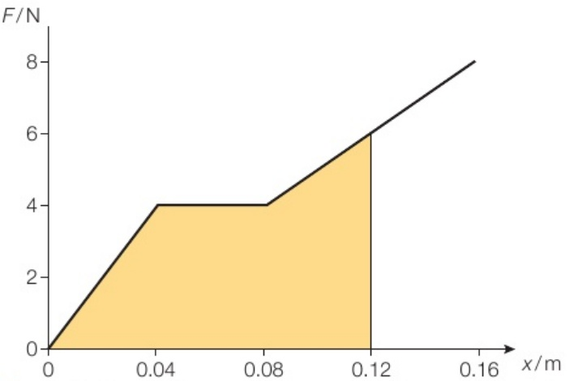

▲ fig D The elastic potential energy stored in a material can be found from a non-linear force-extension graph by working out the area under the line up to the required extension.

<!-- page 89 -->

If a non-linear force–extension or force–compression graph has a curved line, finding the area may involve estimating or counting the squares on the graph paper under the line. In this case, you will also need to multiply the number of squares by the elastic strain energy value  $ (F \times \Delta x) $ for each individual square.

SKILLS REASONING / INTERPRETATION

SKILLS ANALYSIS

## EXAM HINT

Be careful to distinguish between 'length' and 'extension'. You may be given a measurement for either length or extension. You should check carefully to see if you need to calculate the extension from information you have about lengths.

## CHECKPOINT

1. What is the spring constant for a spring that starts at a length of 25 cm and extends to a length of 32 cm when a mass of 50 g is added?

2. In fig C, how would the line appear different if it were for a spring of constant k = 280 N m $ ^{-1} $?

3. Explain how the elastic strain energy stored in a stretched spring could be calculated from the formula  $ \Delta E_{el} = \frac{1}{2} k (\Delta x)^2 $.

4. Fig E shows the results of a Hooke's law experiment loading and unloading a rubber band to an extension of 24 cm.

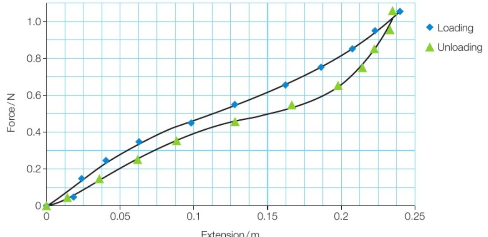

▲ fig E Different extensions during loading and unloading is an example of hysteresis.

(a) From the graph, estimate the work done in loading the rubber band.

(b) When unloading, the rubber band releases the stored elastic strain energy. Estimate, from the graph, the area underneath the unloading curve, which will be the elastic strain energy released.

(c) The difference and the answers to parts (a) and (b) represents energy lost in this process, which is mostly used in internal heating of the rubber band. How much thermal energy does the rubber gain from the complete cycle of loading and unloading?

## SUBJECT VOCABULARY

tension a force acting within a material in a direction that would extend the material extension an increase in size of a material sample caused by a tension force compression a force acting within a material in a direction that would squash the material. Also the decrease in size of a material sample under a compressive force limit of proportionality the maximum extension (or strain) that an object (or sample) can have, which is still proportional to the load (or stress) applied deformation the process of alteration of form or shape elastic limit the maximum extension or compression that a material can undergo and still return to its original dimensions when the force is removed spring constant the Hooke's law constant of proportionality, k, for a spring under tension hysteresis where the extension under a certain load will be different depending on its history of past load and extensions

thermal connected with heat

<!-- page 90 -->

# 2 STRESS, STRAIN AND THE YOUNG MODULUS

## LEARNING OBJECTIVES

Calculate tensile/compressive stress.

Calculate tensile/compressive strain.

Calculate the Young modulus.

If you pull on the two ends of a metal bar, you are unlikely to deform it at all. However, pulling with the same force on the two ends of a very thin piece of wire made from the same metal may have very different results: it will probably extend elastically, and may pass its elastic limit and start to experience permanent deformation. Depending on the specific metal and the exact dimensions, it is possible that your force may be strong enough to break the wire. This example demonstrates that engineers need more information about the forces that may be encountered within the structures they are building than just the numbers of newtons. You used the same force and the same metal, but in the case of the metal bar you made no impression on it, whilst the thin wire broke. To make fair comparisons between samples, we need to consider the forces on them and their sizes as well as the materials from which they are made.

## STRESS

Tensile (or compressive) stress is a measure of the force within a material sample, but it takes account of the cross-sectional area across the sample. This allows force comparisons to be made between samples of different sizes, so that they are measured under comparable conditions.

 $$ \begin{aligned}stress(pascals,Pa,or N m^{-2})&=\frac{force(N)}{cross-sectional area(m^{2})}\\\sigma&=\frac{F}{A}\end{aligned} $$ 

## WORKED EXAMPLE

A cylindrical stone column has a diameter of 60 cm and supports a weight of 2500 N (fig A). What is the compressive stress in the column?

 $$  Area=\pi r^{2}=3.14\times0.30^{2}=0.2826m^{2} $$ 

 $$ \sigma=\frac{F}{A}=\frac{2500}{0.2826} $$ 

 $$ \sigma=8850Pa $$ 

## EXAM HINT

Note that the steps and layout of the solution in this worked example are suitable for stress questions in the exam.

fig A This support column is under a compressive stress of 8850 Pa.

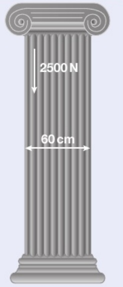

## STRAIN

Tensile (or compressive)  **strain** is a measure of the extension (or compression) of a material sample, but it takes account of the original length of the sample. This allows extension comparisons to be made between samples of different sizes, so that they are measured under comparable conditions.

 $$  strain(no units)=\frac{extension(m)}{original~length(m)} $$ 

 $$ \varepsilon=\frac{\Delta x}{x} $$ 

As strain is a ratio, it has no units. However, it is often expressed as a percentage by multiplying the ratio by 100%.

## WORKED EXAMPLE

A copper wire of length 1.76 m is stretched by a force to a length of 1.80 m. What is the tensile strain in the wire?

 $$ \varepsilon=\frac{\Delta x}{x}=\frac{(1.80-1.76)}{1.76}=\frac{0.04}{1.76} $$ 

## EXAM HINT

 $$ \varepsilon=0.023=2.3\% $$ 

Note that the steps and layout of the solution in this worked example are suitable for strain questions in the exam.

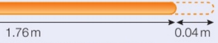

fig B This copper wire has a tensile strain of 2.3%.

## YOUNG MODULUS

If a material is deformed elastically, stress will be proportional to strain, with a constant of proportionality that is a measure of the stiffness of the material – how much it deforms under a certain stress. The stiffness constant is called the Young modulus. So, the Young modulus is a measure of the stiffness of a material, which takes account of the shape and size of the sample, so that different samples of the same material will all have the same value for the Young modulus. The idea of stiffness is a measure of how much the material deforms when forces are applied to it.

 $$ \begin{aligned}Young~modulus\left(Pa\right)&=\frac{stress\left(Pa\right)}{strain\left(no~units\right)}\\E&=\frac{\sigma}{\varepsilon}\end{aligned} $$ 

## LEARNING TIP

The stiffness constant, k, from Hooke's law relates to a particular object, such as a spring. For a material, the Young modulus, E, is the stiffness constant for the material in general, regardless of sample size.

The definition for the Young modulus also includes the fact that the material must be undergoing elastic deformation. Beyond the limit of proportionality, this equation will no longer work to calculate the stiffness of the material.

<!-- page 91 -->

## EXAM HINT

Note that the steps and layout of the solution in this worked example are suitable for Young modulus questions in the exam.

## LEARNING TIP

From the original definitions of stress and strain, the Young modulus can also be calculated from:  $ E = \frac{F x}{A \Delta x} $

## WORKED EXAMPLE

The copper wire from above has a diameter of 0.22 mm and was stretched using a force of 100 N. What is the Young modulus of copper?

 $$ A=\pi r^{2}=3.14\times(1.1\times10^{-4})^{2}=3.80\times10^{-8}m^{2} $$ 

 $$ \sigma=\frac{F}{A}=\frac{100}{3.8\times10^{-8}} $$ 

 $$ \therefore\quad\sigma=2.63\times10^{9}Pa $$ 

 $$ E=\frac{\sigma}{\varepsilon}=\frac{2.63\times10^{9}}{0.023} $$ 

 $$ E=1.16\times10^{11}Pa $$ 

(Note that the stress has been calculated from the original data and the unrounded value has been used in this calculation to give the value shown here.)

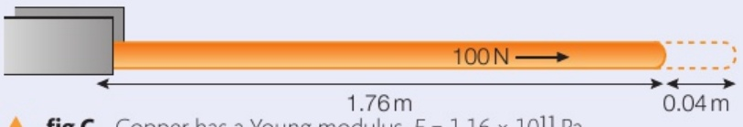

fig C Copper has a Young modulus,  $ E = 1.16 \times 10^{11} $ Pa.

## CHECKPOINT

1. What is the strain of an aluminium wire if it extends from 97 cm to 1.04 m?

2. What is the tensile stress in a vertical steel wire that has a diameter of 0.40 mm and a 1.0 kg mass hanging from it?

3. Use these data to find the Young modulus of human hair:  $ d = 0.1 \, \text{mm} $;  $ x = 12 \, \text{cm} $;  $ F = 0.60 \, \text{N} $;  $ \Delta x = 1.8 \, \text{mm} $.

4. (a) What is the compressive stress in each upper leg bone of a 7 tonne elephant if the bone is a vertical cylinder with a diameter 25 cm and the elephant is standing normally?

(b) If the Young modulus of elephant bone is 19 GPa, and the bones are originally 95 cm long, how much would they reduce in length if the elephant stood up on its back legs? What assumption do you need to make?

## SUBJECT VOCABULARY

stress a proportionate measure of the force on a sample:

 $$  stress(pascals~Pa,or N m^{-2})=\frac{force(N)}{cross-sectional area(m^{2})} $$ 

 $$ \sigma=\frac{F}{A} $$ 

strain a proportionate measure of the extension (or compression) of a sample:

 $$ \begin{aligned}strain(no units)&=\frac{extension(m)}{original~length(m)}\\&\varepsilon=\frac{\Delta x}{x}\end{aligned} $$ 

Young modulus the stiffness constant for a material, equal to the stress divided by its corresponding strain

<!-- page 92 -->

## 3 STRESS-STRAIN GRAPHs

## LEARNING OBJECTIVES

☑ Interpret stress-strain graphs.

Understand and apply the terms limit of proportionality, elastic limit, yield point, breaking stress, elastic deformation and plastic deformation in relation to stress-strain graphs.

## STRESS-STRAIN ANALYSIS

From the definition of the Young modulus, the stress should be proportional to the strain if a material is undergoing elastic deformation. Therefore we should get a straight-line graph if we plot stress against strain. When this is done, we do find a straight-line relationship for small stresses. Once the limit of proportionality is passed, the internal structure of the material starts to behave differently. This means that the graph starts to curve. Depending on the material under test, the graph will go through various phases as the molecular structure of each material determines its response to increasing stress. Eventually, the stress will become too great, and the material will fracture. At this point, the line on the graph must end, as no further data can be obtained about the material. It cannot withstand higher stresses, so the graph cannot be plotted any further.

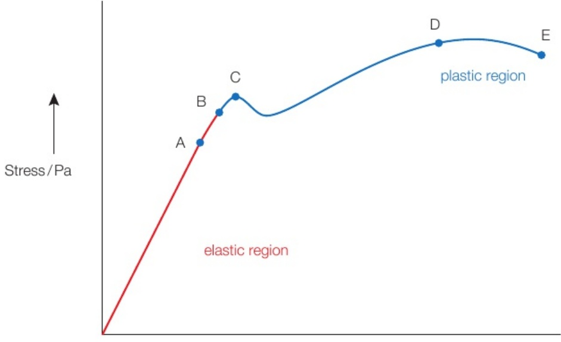

▲ fig A The stress-strain graph for a metal gives detailed information about how the material behaves under different levels of stress. The gradient of the straight-line portion of the graph will be equal to the value of the Young modulus.

## LEARNING TIP

It can be confusing to see the sections of a stress-strain graph where the line goes down. In reality, these graphs are generated from results of materials testing in which the strain is continuously increased on a machine that can measure the stress within a material. This stress can go down if there is a change in the arrangement of the molecular structure of the material.

Fig A is a generalised stress-strain graph for a metal, such as copper. Most metals will follow the shape shown here, and there are various areas of interest on the graph.

In the straight-line portion from the origin to point A, the metal extends elastically, and will return to its original size and shape when the force is removed. The gradient of the straight-line portion of the graph is equal to the Young modulus for the metal.

<!-- page 93 -->

Point A is the limit of proportionality. Slightly beyond this point, the metal may still behave elastically, but it cannot be relied upon to increase strain in proportion to the stress.

Point B is the elastic limit. Beyond this point, the material is permanently deformed and will not return to its original size and shape, even when the stress is completely released.

Point C is the yield point, beyond which the material undergoes a sudden increase in extension as its atomic substructure is significantly re-organised. The metal ‘gives’ just beyond its yield point as the metal’s atoms slip past each other to new positions where the stress is reduced.

## LEARNING TIP

It is quite common for the limit of proportionality, the elastic limit and the yield point to be in the same place on the graph. They have been separated here to explain the different ideas behind each.

Point D represents the highest possible stress within this material. It is called the Ultimate Tensile Stress, or UTS,  $ \sigma_{U} $.

Point E is the fracture stress, or breaking stress. It is the value that the stress will be in the material when the sample breaks.

## WORKED EXAMPLE

The European Space Agency (ESA) have tested a material known as 'IMPRESS intermetallic alloy'. Fig B illustrates a stress-strain graph for this material at two different temperatures, to see how it would stand up under different conditions.

Considering first the Young modulus, you can see that the ESA have drawn measurements on the graph to make the calculation of the gradient of the straight-line portions of the graphs for each temperature plot. For example, at  $ 15\ ^{\circ} $C:

 $$  gradient=E=\frac{\Delta y}{\Delta x}=\frac{\sigma}{\varepsilon}=\frac{400\ MPa}{0.3\%} $$ 

 $$ \therefore\quad E=\frac{400\times10^{6}}{0.003} $$ 

 $$ E=1.33\times10^{11}Pa $$ 

The values labelled as  $ \sigma_{0.2} $ are the stress values at each temperature, which will result in a permanent deformation strain of 0.2%. These are in the plastic region, and the permanent deformations are indicated by the dashed lines connected back to 0.2% on the x-axis.

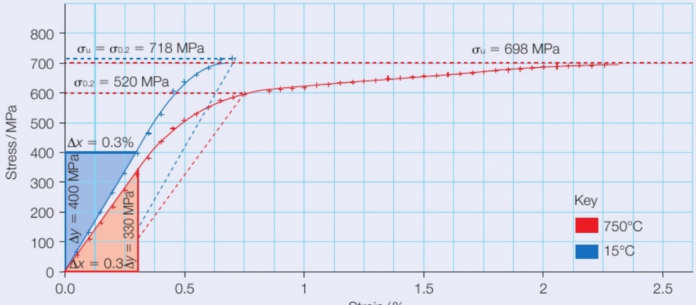

▲ fig B Stress-strain graphs, at two temperatures, for the IMPRESS intermetallic alloy, for use in the European space programme.

<!-- page 94 -->

# PRACTICAL SKILLS

CP3

Investigating stress-strain relationships for metals

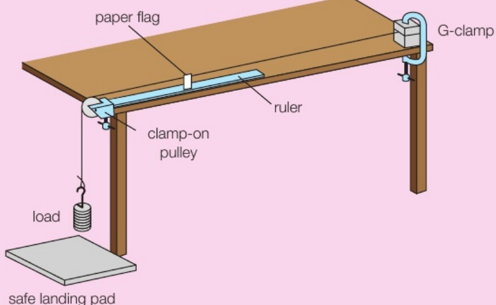

▲ fig C An experiment to find the stress-strain relationships when stretching a metal wire. With detailed analysis of the stress-strain graph of the metal, you can find the Young modulus.

You can perform a simple experiment to measure the stiffness constant – the Young modulus – for a metal by stretching a thin wire. The original length and diameter of the wire must be measured first. Then, using increasing forces as the independent variable, you will need to take measurements of the extension corresponding to each force. There will be some readings during the wire's elastic deformation region which will increase uniformly. Beyond the elastic limit, it will increase with greater extensions for each increase in the load force until, eventually, the fracture stress will be reached and the wire will snap. Safety goggles must be worn during this experiment, as wires that snap under tension are a hazard to the eyes.

The graph in fig B has been plotted with the strain on the x-axis, so that when the gradient of the line is calculated this will give you the value for the stiffness constant, or Young modulus:

 $$  gradient,m=\frac{\Delta y}{\Delta x}=\frac{\sigma}{\varepsilon}=E $$ 

Normal practice is to plot experimental results with the independent variable on the x-axis. Although your experiment will have the stress as the independent variable, it is usual to draw the curve of these results with stress on the y-axis. Plot this graph and find the Young modulus of the metal you used, by finding the gradient of the straight-line portion of the graph.

Safety Note: Use eye protection to prevent injury if the wire snaps. Use a ‘drop box’ on the landing pad to keep hands and feet out of the ‘drop zone’.

## CHECKPOINT

## SKILLS PROBLEM SOLVING, CREATIVITY

1. ▶ Estimate the limit of proportionality for the IMPRESS alloy at  $ 750\,{}^{\circ}\mathrm{C} $, as shown in fig B.

2. Searle's apparatus, as shown in fig D is is used in experiments to find the Young modulus for a metal wire. With this apparatus, the test wire hangs vertically, parallel to an identical control wire. Weights are added to load the test wire only, and its extension, measured as an excess over the length of the control wire rather than from its original length, is calculated. Explain how this setup will allow the experimenter to avoid possible error caused by variations in the room temperature.

## SUBJECT VOCABULARY

yield point a strain value beyond which a material undergoes a sudden and large plastic deformation

## EXAM HINT

You need to be able to describe all the steps in an experimental method for finding the Young modulus, including safety points, and how to use the measurements to calculate the Young modulus.

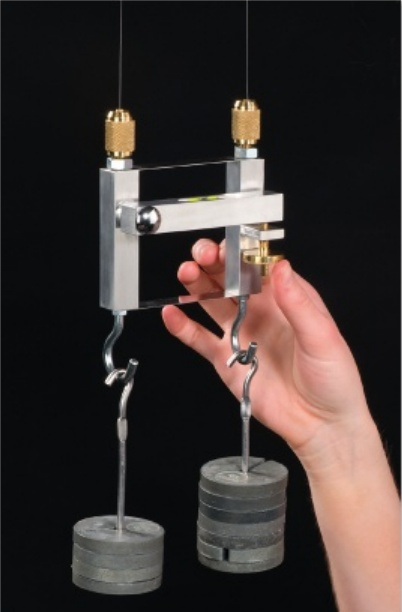

fig D Searle's apparatus.

<!-- page 95 -->

# 2B THINKING BIGGER

## GET ROPED IN

## SKILLS

## CRITICAL THINKING, PROBLEM SOLVING, ANALYSIS, REASONING/ARGUMENTATION, INTERPRETATION, ADAPTIVE LEARNING, INITIATIVE, PRODUCTIVITY, COMMUNICATION

If a manufacturer of climbing ropes is to choose a material for a new rope, what properties would they want the material to have? Apart from low cost, they will need to consider whether it will safely hold climbers, especially when they fall and the rope has to save them.

In this activity, we will look at some important aspects of the properties of some climbing ropes.

## VARIOUS SOURCES

<table border=1 style='margin: auto; word-wrap: break-word;'><tr><td style='text-align: center; word-wrap: break-word;'>PRODUCT</td><td style='text-align: center; word-wrap: break-word;'>COLOUR</td><td style='text-align: center; word-wrap: break-word;'>DIAMETER</td><td style='text-align: center; word-wrap: break-word;'>LENGTHS (m)</td><td style='text-align: center; word-wrap: break-word;'>WEIGHT (per m)</td><td style='text-align: center; word-wrap: break-word;'>NO OF FALLS (UIAA)</td><td style='text-align: center; word-wrap: break-word;'>IMPACT FORCE</td></tr><tr><td style='text-align: center; word-wrap: break-word;'>PITCH</td><td style='text-align: center; word-wrap: break-word;'>NAVY BLUE</td><td style='text-align: center; word-wrap: break-word;'>8.5 mm</td><td style='text-align: center; word-wrap: break-word;'>50, 60</td><td style='text-align: center; word-wrap: break-word;'>49 g</td><td style='text-align: center; word-wrap: break-word;'>13</td><td style='text-align: center; word-wrap: break-word;'>6.5 kN</td></tr><tr><td style='text-align: center; word-wrap: break-word;'>PITCH</td><td style='text-align: center; word-wrap: break-word;'>ORANGE</td><td style='text-align: center; word-wrap: break-word;'>8.5 mm</td><td style='text-align: center; word-wrap: break-word;'>50, 60</td><td style='text-align: center; word-wrap: break-word;'>49 g</td><td style='text-align: center; word-wrap: break-word;'>13</td><td style='text-align: center; word-wrap: break-word;'>6.5 kN</td></tr><tr><td style='text-align: center; word-wrap: break-word;'>ZONE</td><td style='text-align: center; word-wrap: break-word;'>SUNSET RED</td><td style='text-align: center; word-wrap: break-word;'>9.8 mm</td><td style='text-align: center; word-wrap: break-word;'>50, 60, 70, 80</td><td style='text-align: center; word-wrap: break-word;'>63 g</td><td style='text-align: center; word-wrap: break-word;'>6</td><td style='text-align: center; word-wrap: break-word;'>8.7 kN</td></tr><tr><td style='text-align: center; word-wrap: break-word;'>ORBIT</td><td style='text-align: center; word-wrap: break-word;'>COBALT BLUE</td><td style='text-align: center; word-wrap: break-word;'>9.6 mm</td><td style='text-align: center; word-wrap: break-word;'>50, 60, 70, 80</td><td style='text-align: center; word-wrap: break-word;'>61 g</td><td style='text-align: center; word-wrap: break-word;'>8</td><td style='text-align: center; word-wrap: break-word;'>8.7 kN</td></tr><tr><td style='text-align: center; word-wrap: break-word;'>COULOIR</td><td style='text-align: center; word-wrap: break-word;'>RED</td><td style='text-align: center; word-wrap: break-word;'>8.0 mm</td><td style='text-align: center; word-wrap: break-word;'>50, 60</td><td style='text-align: center; word-wrap: break-word;'>43 g</td><td style='text-align: center; word-wrap: break-word;'>7</td><td style='text-align: center; word-wrap: break-word;'>6.6 kN</td></tr><tr><td style='text-align: center; word-wrap: break-word;'>COULOIR</td><td style='text-align: center; word-wrap: break-word;'>BLUE</td><td style='text-align: center; word-wrap: break-word;'>8.0 mm</td><td style='text-align: center; word-wrap: break-word;'>50, 60</td><td style='text-align: center; word-wrap: break-word;'>43 g</td><td style='text-align: center; word-wrap: break-word;'>7</td><td style='text-align: center; word-wrap: break-word;'>6.6 kN</td></tr></table>

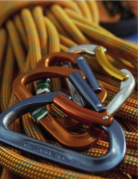

From the website of rope manufacturer DMM International, http://dmmclimbing.com/products/ropes-&-cord/

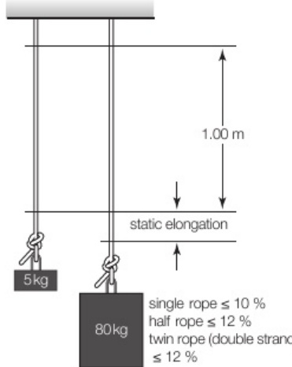

single rope  $ \leq 10\% $

half rope  $ \leq 12\% $

twin rope (double strand  $ \leq 12\% $

## SINGLE ROPE TESTING METHODS FOR UIAA 101

Above: Static elongation finds the standard strain for a rope, giving an indication of its stiffness.

Right: Fall tests indicate the maximum impact force felt by a climber during a fall.

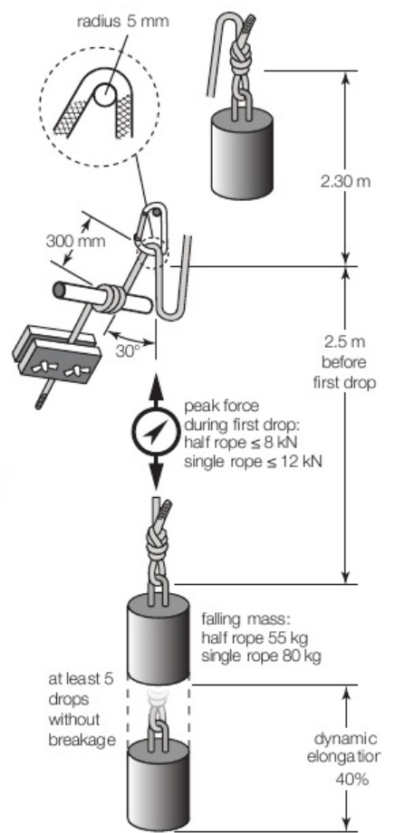

From the Safety Standards pages of UIAA, the International Climbing and Mountaineering Federation

ROPE ANCHORING

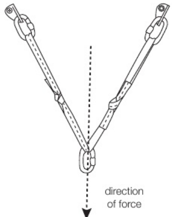

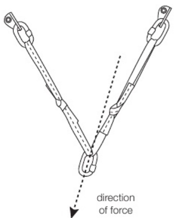

Fig 7–19 a, line representing direction of force bisects angle, thus load on the two anchors is equal; b, direction of force is to one side, thus load on right-hand anchor is greater than on left-hand anchor.

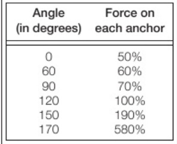

<!-- page 96 -->

## THINKING BIGGER

## SCIENCE COMMUNICATION

1 The extracts opposite are from three different sources relating to the use of ropes for rock climbing.

(a) Compare and contrast the style of presentation from each source.

(b) Discuss the safety considerations that the authors (and their insurers) will have had to think about before publishing the information in each case.

## PHYSICS IN DETAIL

Now we will look at the physics in detail. Some of these questions link to topics earlier in this book, so you may need to combine concepts from different areas of physics to work out the answers.

2 (a) Calculate the weight of a 50 m length of DMM's Couloir rope.

(b) Calculate the density of DMM's Orbit rope.

3 (a) Explain the physics behind the caption in fig 7-19 from the Mountaineering book.

(b) The table of angles from the Mountaineering book refers to the total angle between the slings (short support ropes) in the symmetrical situation shown in fig 7-19a. Explain why the force on each anchor would increase as suggested, and calculate how accurately the force percentages have been reported.

4 (a) Looking at the fall tests, explain why lower impact force ropes will stretch more.

(b) Considering part (a), explain why a larger percentage dynamic elongation, compared with the static elongation, minimises injuries from the rope stopping a fall.

5 A recent update of the UIAA rope testing standards includes a method for calculating the energy absorbed by a rope before failure. This is given by the equation:

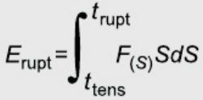

This equation is an integration which means it calculates the sum of all the  $ F \times S $ values over the range of tensions up to rupture. How could such calculations produce results for ropes as presented in the suggested picture below?

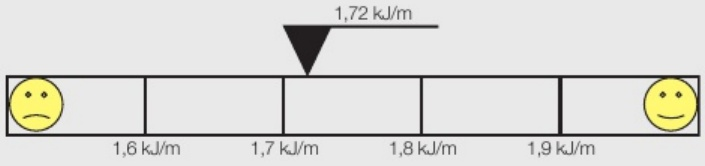

## ACTIVITY

## THINKING BIGGER TIP

Write a review comparing the DMM ropes listed in terms of physics properties. Include at least:

Include an explanation of what physics term should be used instead of the word ‘elongation’. Note that elongation is quoted as a percentage.

- calculations of density, and a commentary about which ropes would float in water.

calculations of stress in each rope under static elongation, when it must support an 80 kg mass, and assuming the maximum 8% elongation.

comparison of the Young modulus values for each rope, and compare these with their impact forces transferred in the UIAA fall tests. Is there a relationship?

## SUBJECT VOCABULARY

bisects to divide something into two, usually equal, parts

anchor an object, usually on a rope or chain, designed to give support

<!-- page 97 -->

# 2B EXAM PRACTICE

1 The pascal is the unit for the Young modulus. Which unit is equivalent?

A mm/m

B %

C Nm $ ^{-1} $

D Nm $ ^{-2} $ [1]

(Total for Question 1 = 1 mark)

2 A 200 g mass hung on a spring stretches it from 8.2 cm to 9.0 cm. What is the spring constant for this spring?

A 2.5 N m $ ^{-1} $

B  $ 25\ N\ m^{-1} $

C  $ 250\ N\ m^{-1} $

D  $ 250\,000\ N\ m^{-1} $ [1]

(Total for Question 2 = 1 mark)

3 The diagram shows the stress–strain curve for a metal. Which label corresponds to the Ultimate Tensile Stress for this metal?

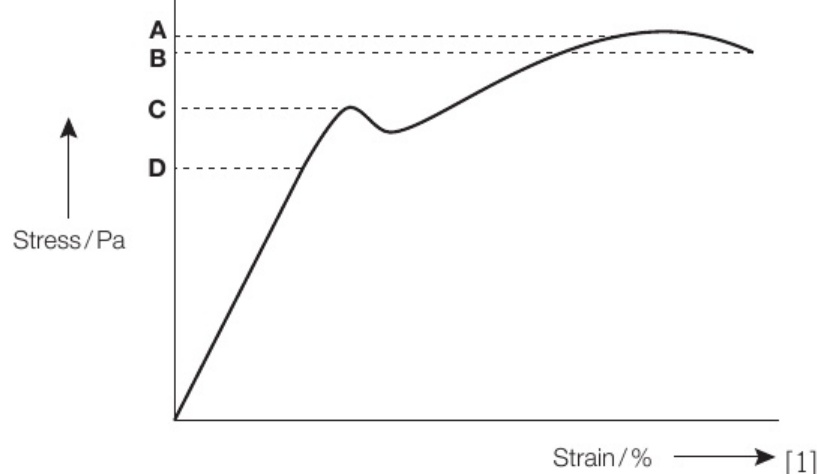

[1]

(Total for Question 3 = 1 mark)

4 Which is the correct definition for the ‘elastic limit’ for a metal wire?

A The maximum extension that the wire can have, which is still proportional to the load applied.

B The highest value that the stress can ever reach within this wire.

C The value that the stress will be in the wire when it breaks.

D The maximum extension or compression that the wire can undergo and still return to its original dimensions when the force is removed. [1]

(Total for Question 4 = 1 mark)

5 When a spring is extended by  $ \Delta x $, elastic strain energy,  $ E_{el} $, is stored in the spring. If the extension changes, then the elastic strain energy also changes.

Which row in the table correctly gives the new elastic strain energy for the change in extension given?

<table border=1 style='margin: auto; word-wrap: break-word;'><tr><td style='text-align: center; word-wrap: break-word;'></td><td style='text-align: center; word-wrap: break-word;'>New extension</td><td style='text-align: center; word-wrap: break-word;'>New elastic strain energy</td></tr><tr><td style='text-align: center; word-wrap: break-word;'>A</td><td style='text-align: center; word-wrap: break-word;'>$ 2\Delta x $</td><td style='text-align: center; word-wrap: break-word;'>$ 2E_{el} $</td></tr><tr><td style='text-align: center; word-wrap: break-word;'>B</td><td style='text-align: center; word-wrap: break-word;'>$ \frac{\Delta x}{2} $</td><td style='text-align: center; word-wrap: break-word;'>$ 2E_{el} $</td></tr><tr><td style='text-align: center; word-wrap: break-word;'>C</td><td style='text-align: center; word-wrap: break-word;'>$ 2\Delta x $</td><td style='text-align: center; word-wrap: break-word;'>$ 4E_{el} $</td></tr><tr><td style='text-align: center; word-wrap: break-word;'>D</td><td style='text-align: center; word-wrap: break-word;'>$ \frac{\Delta x}{2} $</td><td style='text-align: center; word-wrap: break-word;'>$ 4E_{el} $</td></tr></table>

[1]

(Total for Question 5 = 1 mark)

6 You are asked to find the Young modulus for a metal using a sample of wire.

(a) Describe the apparatus you would use, the measurements you would take and explain how you would use them to determine the Young modulus for the metal. [8]

(b) State one safety precaution you would take. [1]

(c) Explain one experimental precaution you would take to ensure you obtain accurate results. [2]

(Total for Question 6 = 11 marks)

7 The photograph shows a tin bought from a joke shop. When the lid is removed, a long spring, covered in fabric to resemble a snake, flies out of the tin.

The spring on its own is shown here.

mmmwww

The graph shows length against force for the spring.

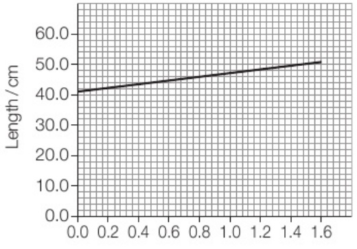

Force/N

<!-- page 98 -->

## EXAM PRACTICE

(a) Explain whether the spring obeys Hooke's law. [2]

(b) Show that the spring constant k of the spring is about  $ 20 \, N \, m^{-1} $. [3]

(c) The original length of the spring is 41.0 cm and the length of the tin is 9.0 cm.

(i) Calculate the force that must be applied to the spring to get it into the tin. [2]

(ii) Calculate the energy stored in the spring when it is compressed to fit into the tin. [2]

(d) In fact, the bottom of the tin contains a device that makes a squeak when the spring is released, making the internal length of the tin less than 9.0 cm.

Explain the effect this has on the speed at which the spring leaves the tin. [3]

(Total for Question 7 = 12 marks)

8 The diagram shows a submarine and one of the forces acting on it. The submarine moves at a constant depth and speed in the direction shown.

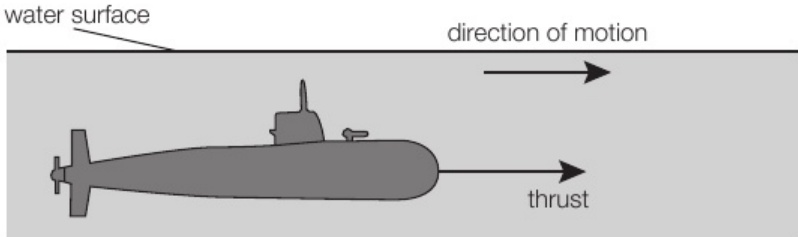

(a) State two equations that show the relationship between the forces acting on the submarine. [2]

(b) The submarine has a volume of 7100 m $ ^{3} $.

Show that the weight of the submarine is about  $ 7 \times 10^{7} $ N.

Density of seawater = 1030 kg m $ ^{-3} $ [2]

(c) The submarine can control its depth by changing its weight. This is done by adjusting the amount of water held in ballast tanks.

As the submarine dives to greater depths the increased pressure of the surrounding water produces a compressive strain.

(i) Explain what is meant by compressive strain. [1]

(ii) This decreases the volume of the submarine. Explain the action that should be taken to maintain a constant depth as the volume of the submarine is decreased. [2]

(iii) The submarine is made from steel. Suggest why a material, such as fibreglass, which has a much smaller Young modulus than steel would be unsuitable at greater depths. [2]

(Total for Question 8 = 9 marks)

9 The photograph shows a device for swatting flies.

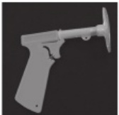

The device consists of a handle, a spring and a disc as shown in the photograph below.

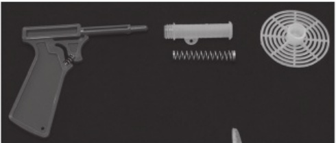

When the button is pushed, the compressed spring is released, launching the disc at the fly.

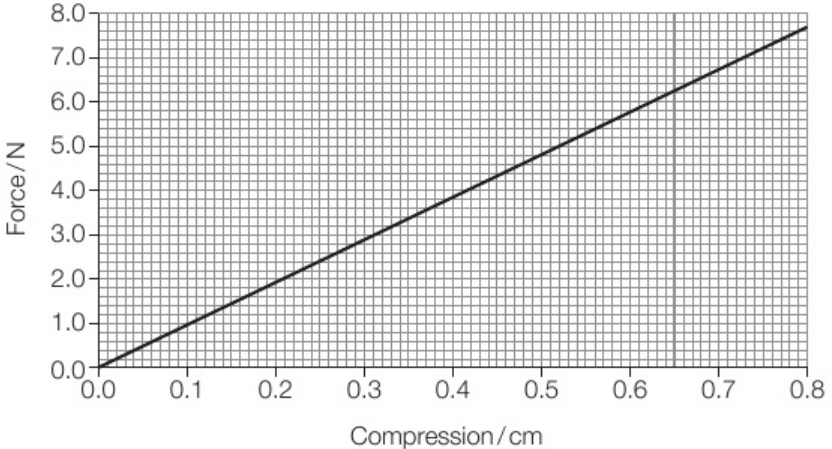

(a) Show that the force constant for the spring is about 1000 N m $ ^{-1} $. [2]

(b) The spring is 6.3 cm long. When it is compressed in the device, the length of the spring is reduced to 1.6 cm.

Assuming that the spring obeys Hooke's law throughout the compression, show that the energy stored in the spring before releasing the disc is about 1 J. [2]

(c) The disc and spring have a combined mass of 9.4 g.

(i) Show that the maximum speed at which they can be launched is about  $ 15 \, m s^{-1} $. [2]

(ii) State an assumption that you have made. [1]

(d) The disc is launched horizontally at a fly on the wall 3.0 m away.

(i) Calculate the velocity of the disc as it hits the wall. Ignore the effects of air resistance. [4]

(ii) The fly is 20 cm below the horizontal level at which the disc is launched. Show that the disc is close enough to hit the fly if it does not move. The disc has a radius of 3 cm. [3]

(e) Suggest an advantage of the disc used over a solid disc. [1]

(Total for Question 9 = 15 marks)

