# 3A Basic waves

<!-- edx_ial_phy1.pdf p99-110 -->

<!-- page 99 -->

# TOPIC 3 WAVES AND THE PARTICLE NATURE OF LIGHT

## 3 A BASIC WAVES

As waves are a means to transfer energy, they are very important in the world around us. From the destruction caused by earthquakes, to the determination of the chemical composition of distant stars, to whether or not it's worth taking your surfboard to the beach at the weekend, we study waves in virtually every part of human experience.

Topic 3 covers many aspects of the science behind waves, and in this chapter we will begin this study with some basic definitions and the wave equation. As waves and wave mathematics are relevant to many areas of future study, it is important to understand these basic definitions.

Even when scientists consider new areas of study, they often find that wave motions are the basis of what they are trying to understand. The fundamental causes of gravity have never been well understood. For example, experimental observations of gravitational waves in order to expand that understanding are currently being done by a number of universities around the world.

## MATHS SKILLS FOR THIS CHAPTER

Units of measurement (e.g. the hertz, Hz)

- Use of standard form and ordinary form (e.g. using the speed of light)

• Changing the subject of an equation (e.g. using the wave equation)

• Solving algebraic equations (e.g. comparing the two equations for wave speed)

• Substituting numerical values into algebraic equations (e.g. a radar calculation to find the distance to an aeroplane)

<!-- page 100 -->

## What prior knowledge do I need?

Using the terms frequency, wavelength, amplitude and speed to describe waves

Detailed knowledge of the parts of the electromagnetic spectrum – their uses, dangers and properties

Knowledge of sound waves and light waves

Models of waves and wave processes

Calculations of wave speed

Examples of transverse and longitudinal waves

## What will I study in this chapter?

Definitions of the properties of waves, such as frequency, wavelength, amplitude and speed

The definition of wave phase, and its relationship to frequency and time period

The difference between transverse and longitudinal waves

The transmission of waves, and graphical representations of them

The wave equation

The use of wave calculations, in pulse-echo techniques such as ultrasound scanning, and in seismology

## What will I study later?

## Topic 3B

How waves can combine when they meet

The development of standing waves, and what affects their properties

Applications of standing wave patterns, such as the interference or diffraction of light, and the development of musical instruments

Effects on the properties and movement of a wave due to changes in its medium

Topic 3D

The wave-particle duality of light and electrons

Topic 10A (Book 2: IAL)

Connections between simple harmonic motion and wave motion

Topic 11B (Book 2: IAL)

The implications of the Doppler effect in astronomy

<!-- page 101 -->

## 1 WAVE BASICS

## LEARNING OBJECTIVES

Understand the terms amplitude, frequency, period and wavelength.

Define wave speeds, measure the speed of sound in air, and use the wave equation  $ v = f\lambda $

Explain how pulse-echo techniques allow the measurement of distances.

## ENERGY TRANSFER

A wave is a means for transferring energy via oscillations. Whilst energy moves from one place to another, the waves cause no net movement of any matter.

A mechanical wave is one in which there needs to be some sort of material medium – a substance that oscillates to allow the transfer of the energy. For example, a sound wave of a human voice transfers energy from one person's vocal cords to another's eardrum by the repeated vibrations of air molecules.

Electromagnetic waves can transfer energy through repeated oscillations of electric and magnetic fields, but these fields do not need matter to support them. Indeed, the interaction between electromagnetic waves and matter generally slows their transfer of energy. For example, light travels more slowly in water than it does in a vacuum.

## GRAPHING WAVES

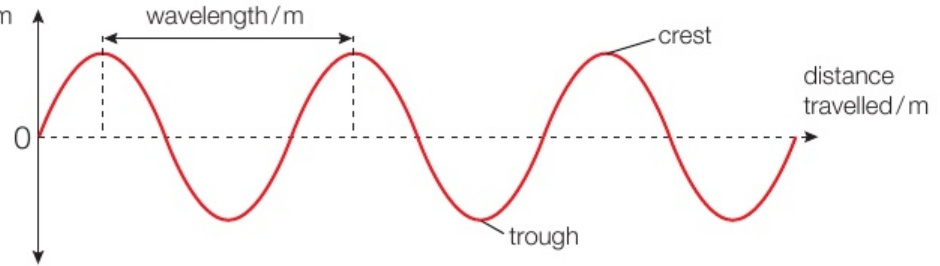

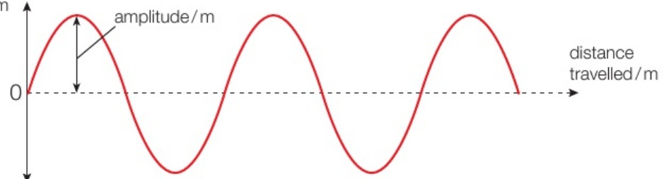

fig A The vibration of a wave over a certain distance, as if frozen at an instant in time.

Wave motions can be plotted on graphs. A plot of the displacement against distance travelled for a wave, as in fig A, shows the physical scale of the oscillations and the movement of the energy.

Alternatively, a plot of the displacement versus time, as in fig B, shows how the vibrations occur over time.

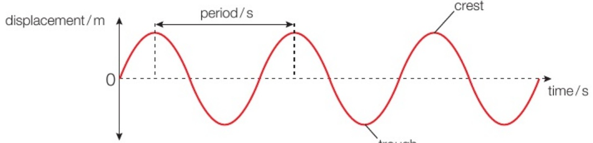

▲ fig B The oscillation of a single particle or point in a wave plotted against time.

<!-- page 102 -->

## WAVE MEASUREMENTS

There are a number of important properties of waves that scientists measure for various purposes. In most cases, you can determine these from the graphs shown in fig A and fig B.

Displacement: the position of a particular point on a wave, at a particular instant in time, measured from the mean (equilibrium) position. (Symbol: various, often x; SI units: m.)

Amplitude: the magnitude of the maximum displacement reached by an oscillation in the wave. (Symbol: A; SI units: m.)

Frequency: the number of complete wave cycles per second. This may sometimes be measured as the number of complete waves passing a point per second. (Symbol: f; SI units: hertz, Hz.)

Wavelength: the distance between a point on a wave and the same point on the next cycle of the wave, for example, the distance between adjacent wave peaks. (Symbol:  $ \lambda $; SI units: m.)

Period: the time taken for one complete oscillation at one point on the wave. This will also be the time taken for the wave to travel one wavelength. (Symbol: T; SI units: s.)

Phase: the stage a given point on a wave is through a complete cycle. Phase is measured in angle units, as a complete wave cycle is considered to be the same as travelling around a complete circle, that is  $ 360^{\circ} $ or  $ 2\pi $ radians. (No standard symbol; SI units: rad.)

Wave speed: the rate of movement of the wave – the same as speed in general. (Symbol: v, or c for speed of electromagnetic waves; SI units: m s^{-1}.)

You can find the speed of a wave from distance divided by time, as with the speed of anything. However, as each wave has a certain wavelength, and the frequency tells us how many of these wavelengths pass per second, you can also find the speed by multiplying frequency and wavelength together. This is often referred to as the wave equation:

 $$ \begin{aligned}wave~speed~(m s^{-1})&=frequency~(Hz)\times wavelength~(m)\\v&=f\lambda\end{aligned} $$ 

## PRACTICAL SKILLS

## Investigating the speed of sound

Using the simple definition of wave speed that is distance divided by time, we can use a twin beam oscilloscope to find the extra time a sound takes to travel a short extra distance. One beam trace shows a sound picked up by a microphone held 50 cm from the loudspeaker. The other trace shows the same sound, picked up by a second microphone held further from the loudspeaker. The difference in positions of the peaks on the two oscilloscope traces shows the time taken, t, for the sound to travel the extra distance, d. If we measure this carefully, then the speed will be given by:

 $$ v=\frac{d}{t} $$ 

It can be difficult to make accurate measurements from the screen of an oscilloscope, so we need to synchronise the traces to minimise the effect of random error in taking such a measurement. Firstly, with both microphones at the same distance from the loudspeaker, the two traces appear in identical phase positions (in phase). If we slide the second microphone slowly away from the loudspeaker, we will move the traces out of phase with each other until eventually they come back to exact synchronisation. At this point, the distance between the two microphones is exactly one wavelength,  $ \lambda $. We set the frequency on the signal generator, and so the wave equation can be used to find the speed:  $ v = f\lambda $.

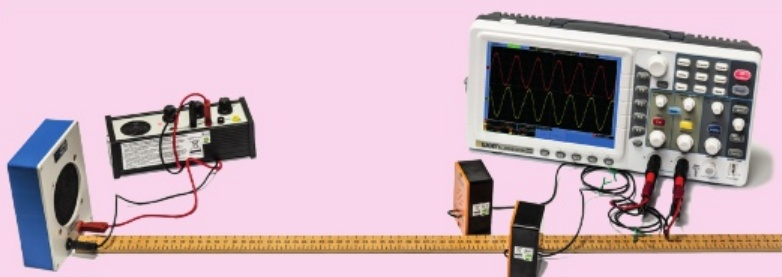

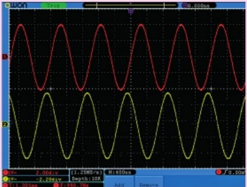

fig C Investigating the speed of sound in air.

Safety Note: If high volumes and certain frequencies are used, some may find them distressing or experience mild nausea. Anyone using a hearing aid may experience unpleasant interactions with the noise from the loudspeakers.

## PULSE-ECHO MEASUREMENTS

The natural habitat for some bats is woodland, and they fly through the trees at 10–15 km h $ ^{-1} $, depending on species. In order to catch insects, the bats need to be able to sense their location precisely. Their well-known echolocation system, using very high frequency (50–100 kHz – ultrasound) sound pulses, gives a detailed perception of the world at distances of less than 5 metres. At greater distances, the echo is too quiet for the bat to use. But how does it work? The bat will make a ‘chirp’ through its nose. This sound pulse will typically last 3 milliseconds. When the sound hits nearby objects, it will be reflected back to the bat’s sensitive ears and its brain can accurately measure the time between making the sound and hearing the echo. The bat’s brain has also evolved to calculate the distance to the reflecting object using the equation:

## distance = speed  $ \times $ time

Experiments with dolphins have shown that they use a similar echolocation system, but for them it is so good that dolphins can build up an image of the shapes of nearby objects. They can 'see' with sound. This is probably also true for bats, to ensure that they eat an insect and not an insect-sized leaf, but dolphins can respond to experimental scientists better than bats.

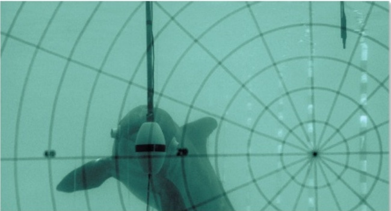

fig D Dolphin echolocation is good enough to make out the shapes of objects in murky waters.

<!-- page 103 -->

We have developed similar pulse-echo ranging and imaging systems in a very wide range of technological applications, from sonar on ships and submarines to air traffic control radar, medical imaging and the measurement of distance to asteroids and to the Moon. This is particularly useful in situations where other methods might be difficult or dangerous. For example, Venus has a very hot, high pressure, atmosphere with sulfuric acid clouds that block our view of the surface. Mapping the surface using a remote radar technique has avoided the need to land on the planet.

## WORKED EXAMPLE

An air traffic control system sends out a pulse of radio waves that are reflected by a jumbo jet. The reflection is picked up by the radio dish 0.007 seconds after the emission of the pulse. How far away is the plane?

 $$  speed=\frac{distance}{time} $$ 

distance = speed  $ \times $ time

 $$ s=v\times t\qquad v=speed~of~light=3.0\times10^{8}m s^{-1} $$ 

 $$ s=3.0\times10^{8}\times0.007=2.1\times10^{6}m $$ 

 $$ s=2100km $$ 

In that 0.007 seconds, the radio pulse has travelled to the plane and back again, so the actual distance to the plane is half that calculated:

distance = 0.5 × 2100 = 1050 km

## CHECKPOINT

## SKILLS PROBLEM SOLVING, CRITICAL THINKING

1. What are the amplitudes of the three waves shown in fig E? displacement/m

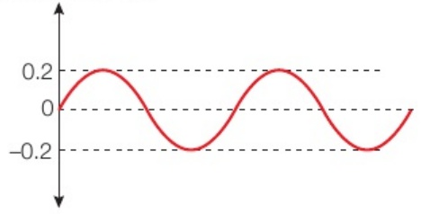

displacement/m

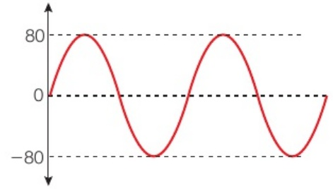

displacement/m

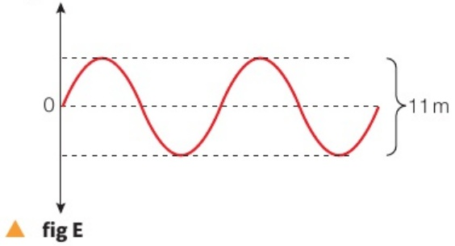

2. Sound travels at 330 m s $ ^{-1} $ in air. If the sound of thunder arrives 3.75 s after the lightning flash is seen, how far away was the lightning strike?

3. Ultraviolet light has a wavelength of 368 nm. What is the frequency of this light?

4. Explain why the two equations for wave speed are actually the same calculation.

5. Estimate the speed of the waves the last time you saw the sea.

## EXAM HINT

If you are asked to calculate wave speed, make sure the equation you use matches the information you have: frequency and wavelength are multiplied in the wave equation BUT distance is divided by time if distance and time are the measurements you are given.

## SUBJECT VOCABULARY

wave a means for transferring energy via oscillations displacement the position of a particular point on a wave, at a particular instant in time, measured from the mean (equilibrium) position

amplitude the magnitude of the maximum displacement reached by an oscillation in the wave

frequency the number of complete wave cycles per second:

 $$ \begin{aligned}frequency\left(Hz\right)&=\frac{1}{time\ period\ (s)}\\f&=\frac{1}{T}\end{aligned} $$ 

wavelength the distance between a point on a wave and the same point on the next cycle of the wave

period (also time period) the time taken for one complete oscillation at one point on the wave:

 $$ \begin{aligned}time~period\left(s\right)&=\frac{1}{frequency\left(Hz\right)}\\T&=\frac{1}{f}\end{aligned} $$ 

phase the stage a given point on a wave is through a complete cycle measured in angle units, rad

wave speed the rate of movement of the wave (not the rate of movement within oscillations)

wave equation:

wave speed  $ (\mathrm{m s}^{-1}) = \text{frequency } (\mathrm{Hz}) \times \text{wavelength } (\mathrm{m}) $

 $$ v=f\lambda $$ 

twin-beam oscilloscope an oscilloscope with two inputs. It displays each as a line on the screen, and both are shown at the same time to compare the inputs

<!-- page 104 -->

## 2 WAVE TYPES

## LEARNING OBJECTIVES

Explain the difference between longitudinal and transverse waves.

Describe longitudinal waves, particularly in terms of pressure variation and the displacement of molecules.

Describe transverse waves.

## TRANSVERSE WAVES

A transverse wave is one where the movements of the particles, or fields in an electromagnetic wave, are up and down, or left and right, whilst the energy travels forwards. This is illustrated in fig A, where one student is vibrating the rope up and down, but the energy travels along the rope towards the other student. As the first student moves the rope up and down, the particles pull their neighbours up and down. These then pass the vibration on to their neighbours, through their intermolecular forces, and the wave moves along the rope.

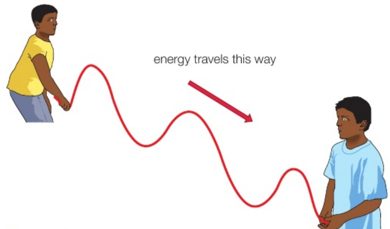

fig A A transverse wave on a skipping rope.

## LONGITUDINAL WAVES

A longitudinal wave in a fluid, such as air, is generated by squashing particles together and then stretching them apart from each other, repeatedly – thus vibrating them ‘longitudinally’. The areas of higher pressure cause the particles to push apart from each other, but this makes the particles move and squash their neighbours. This higher pressure – a compression – then pushes them away to squash their neighbours. Similarly, the areas where there are too few particles (compared with the uniform spread of the particles when the wave is not present) cause particles to move into the vacant space – this is known as the rarefaction – filling the vacant space up, but causing a vacancy behind these particles, and the wave moves along. An example of a longitudinal wave in a solid material can be seen by squashing and releasing a spring, as shown in fig B.

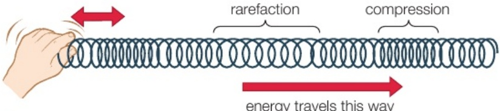

fig B A longitudinal wave generated in a long spring by repeatedly squashing and stretching one end. Areas of higher pressure are called compressions, and areas of lower pressure are called rarefactions.

## GRAPHing WAVES

In fig A of Section 3A.1 we saw how waves can be shown on a graph of displacement versus distance. This is relatively easy with a transverse wave, as the graph appears like a picture of the wave, so it is easy to understand. The wavelength can be found by measuring along the graph's x-axis from one point on a wave cycle to the same point on the next wave cycle. Amplitude is measured from the x-axis vertically to a maximum displacement point.

Longitudinal waves are less easy to visualise from their graph, and making measurements from them can be difficult. Fig C illustrates how a longitudinal wave can be represented on a graph of displacement versus distance along the wave. When a longitudinal wave is drawn like this, you can make measurements more easily. The wavelength and amplitude can be read from the graph just like for a transverse wave.

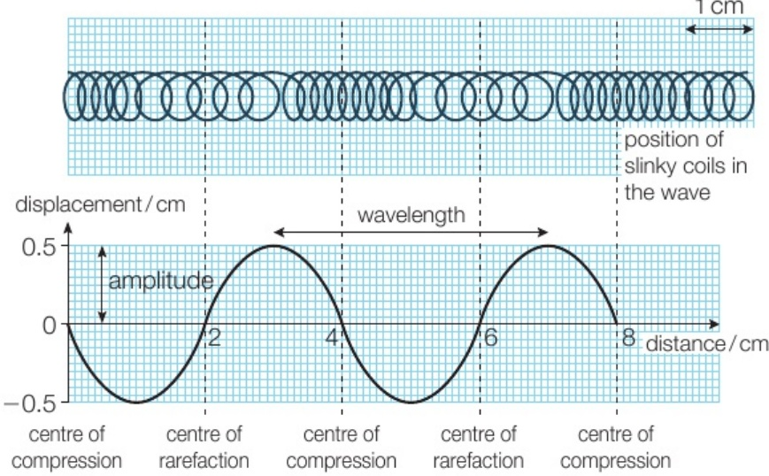

fig C A longitudinal wave can be easier to measure if it is drawn on a displacement-distance graph.

## LONGITUDINAL WAVES IN ACTION

Sound waves are caused by oscillations of particles of the medium (in fig D the medium is air), causing compressions and rarefactions along the line of movement of the wave. Areas of higher pressure and lower pressure in the air continue the movement of the vibrations. An area of higher pressure, a compression, will occur when the particles on either side are displaced towards it. This means particles are displaced in opposite directions towards each other to squash together and increase the pressure, as shown in fig E.

<!-- page 105 -->

## EXAM HINT

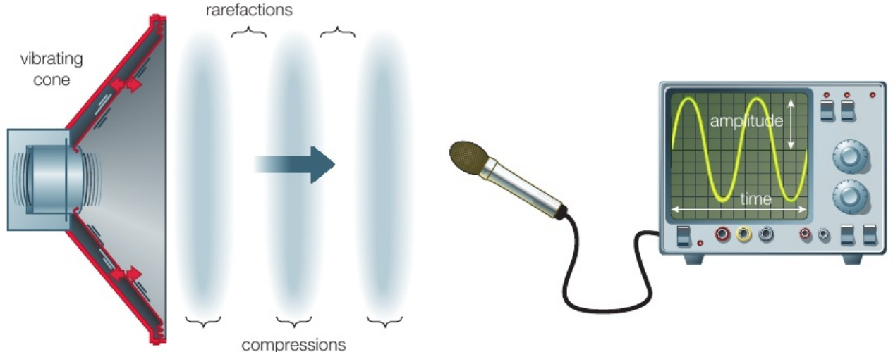

The details of seismic wave types are beyond the specification, but are good examples of longitudinal and transverse waves.

▲ fig D A loudspeaker produces sound waves by moving its cone back and forth to set up vibrations of air molecules in line with the direction of movement of the sound wave energy – the oscilloscope shows the vibrations over time.

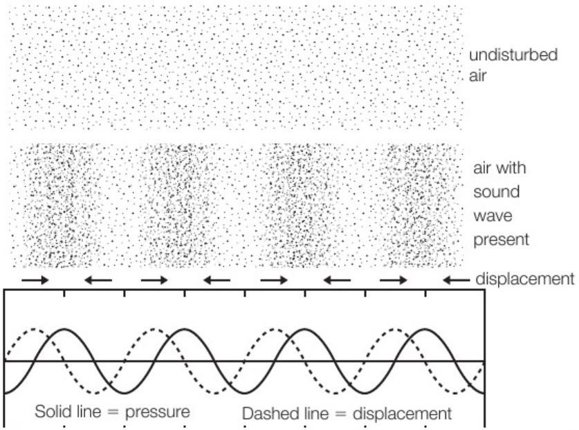

▲ fig E Sound waves are the result of areas of increased pressure moving through a body of particles by vibrating the particles back and forth.

Earthquake waves, also called seismic waves, come in different types. Fig F shows Primary, or 'P', waves and Secondary, or 'S', waves. These are the standard longitudinal and transverse seismic waves, with P-waves travelling faster, and arriving first, leading to their name.

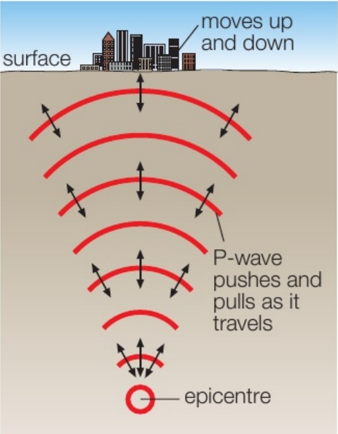

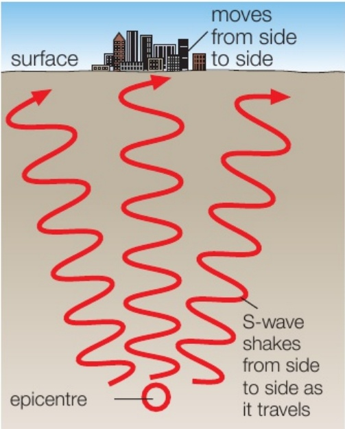

▲ fig F Seismic waves can vibrate the rock particles of the Earth's crust in different ways.

<!-- page 106 -->

## CHECKPOINT

1. What are the amplitudes and the wavelengths of the spring waves shown in fig C?

2. (a) Explain why a seismic S-wave should be classified as a transverse wave.

(b) Describe a seismic P-wave in terms of the pressure variations and displacement of the rock particles.

3. Referring to fig G, explain why sounds with a greater amplitude sound louder.

air at low pressure

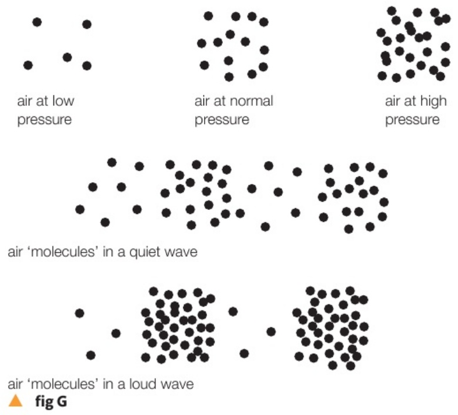

air at normal pressure

air at high pressure

air ‘molecules’ in a quiet wave

air 'molecules' in a loud wave

▲ fig G

## SUBJECT VOCABULARY

transverse wave a wave in which the oscillations occur perpendicular to the direction of movement of the wave energy

longitudinal wave a wave in which the oscillations occur parallel to the direction of movement of the wave energy

compression an area in a longitudinal wave in which the particle oscillations put them closer to each other than their equilibrium state

rarefaction an area in a longitudinal wave in which the particle oscillations put them further apart from each other than their equilibrium state

ANALYSIS, ADAPTIVE LEARNING

## EXAM HINT

When defining transverse and longitudinal waves, you must write both parts of the idea: oscillations direction and direction of wave travel.

<!-- page 107 -->

# 3A THINKING BIGGER

## EARTHQUAKE

Earthquakes are among the most deadly natural hazards. There are around 100 earthquakes each year of a size that could cause serious damage.

In this activity, we will look at some of the detail about the detection of earthquake waves.

USGS WEBSITE

## EARTHQUAKE FAQs

## What is an earthquake and what causes them to happen?

An earthquake is caused by a sudden slip on a fault. The tectonic plates are always slowly moving, but they get stuck at their edges due to friction. When the stress on the edge overcomes the friction, there is an earthquake that releases energy in waves that travel through the Earth’s crust and cause the shaking that we feel.

fig A

## What are P-waves? What are S-waves?

When an earthquake occurs, it releases energy in the form of seismic waves that radiate from the earthquake source in all directions. The different types of energy waves shake the ground in different ways and also travel through the earth at different velocities. The fastest wave, and therefore the first to arrive at a given location, is called the P-wave. The P-wave, or compressional wave, alternately compresses and expands material in the same direction it is travelling. The S-wave is slower than the P-wave and arrives next, shaking the ground up and down and back and forth perpendicular to the direction it is travelling. Surface waves follow the P- and S-waves.

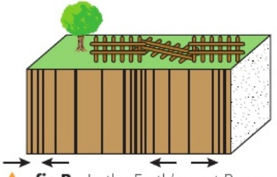

fig B In the Earth's crust P-waves travel at around 7 km per second.

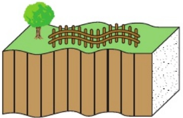

fig C S-waves travel at around 4 km per second.

## What are seismograms? How do you read them?

Seismograms are the records (paper copy) produced by seismographs used to calculate the location and magnitude of an earthquake. They show how the ground moves with the passage of time. On a seismogram, the HORIZONTAL axis = time (measured in seconds) and the VERTICAL axis = ground displacement (usually measured in millimetres). When there is NO EQ reading there is just a straight line except for small movements caused by local disturbance or ‘noise’ and the time markers.

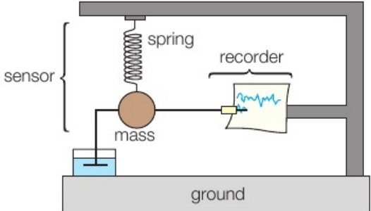

▲ fig D There are many different types of seismometers, but they all are based on a fundamental principle – that the differential motion between a free mass (which tends to remain at rest) and a supporting structure anchored in the ground (which moves with the vibrating Earth) can be used to record seismic waves.

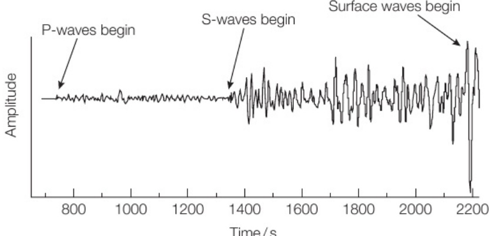

fig E A seismogram recorded in Göttingen, Germany.

<!-- page 108 -->

## THINKING BIGGER

## SCIENCE COMMUNICATION

1 The extract opposite is from educational webpages produced by the U.S. Geological Survey. The USGS is a United States government funded organisation that researches all geological matters. Consider the extract and comment on the type of writing that is used. Then answer the following questions:

(a) Why would the USGS spend time and money producing these and other webpages?

(b) Discuss the audience you think the USGS is aiming at. You need to consider the scientific depth in this extract, along with the style of presentation of the science.

## PHYSICS IN DETAIL

Now we will look at the physics in detail. Some of these questions link to topics earlier in this book, so you may need to combine concepts from different areas of physics to work out the answers.

2 Explain which wave type (transverse or longitudinal) is shown by each of the earthquake waves.

3 Why can't S-waves travel through air or liquids, including the liquid iron outer core inside the Earth?

4 Why would the waves travel faster the deeper they are in the Earth?

(a) Explain how the information on the seismogram in fig E could be used to work out the distance to the earthquake. Calculate this distance.

(b) Then explain why this distance alone cannot determine where the earthquake occurred.

## INTERPRETATION NOTE

On this page, we only have an extract: it is useful to visit the webpages and see all the different sections that it covers.

## THINKING BIGGER TIP

## ACTIVITY

Although you don’t know when the earthquake occurred, think about how the difference in the times they arrive could help find the time the earthquake occurred, and then answer this question.

Write a similar webpage, including any ideas you have for diagrams. Explain how three seismograms of the same earthquake, produced by seismometers in different places on Earth, would allow a seismologist to find the original location of the earthquake.

## THINKING BIGGER TIP

Consider your answers to question 4 - these should give you an idea as to how this is done.

<!-- page 109 -->

# 3A EXAM PRACTICE

1 Which of the following gives the correct values of the amplitude and wavelength for the wave shown?

A $A = 4\mathrm{~cm};\ \lambda = 20\mathrm{~cm}$

B $A = 4\mathrm{~cm};\ \lambda = 40\mathrm{~cm}$

C $A = 8\mathrm{~cm};\ \lambda = 20\mathrm{~cm}$

D $A = 8\mathrm{~cm};\ \lambda = 40\mathrm{~cm}$ [1]

(Total for Question 1 = 1 mark)

2 Which of the following has the lowest frequency?

A 256 Hz

B Ultrasound

C Red light ( $ \lambda = 700 \, nm $)

D Sea waves with a speed of  $ 2.8 \, m s^{-1} $ and a wavelength of  $ 4.4 \, m $ [1]

(Total for Question 2 = 1 mark)

3 Which of these is a correct equation connecting wave properties?

 $ \mathbf{A} \quad v = f\lambda $

 $ \mathbf{B} \quad v = \frac{f}{\lambda} $

 $ \mathbf{C} \quad \lambda = \frac{1}{f} $

 $ \mathbf{D} \quad f = \frac{\lambda}{v} $ [1]

(Total for Question 3 = 1 mark)

4 Sonar is a pulse-echo technique in which ships use sound pulses to measure the depth of the sea. In seawater, the speed of sound is 1500m s $ ^{-1} $. If the echo of a pulse is detected 0.87s after it is emitted, what is the depth of the sea at that point?

A 650m

B 850m

C 1300m

D 1700m [1]

(Total for Question 4 = 1 mark)

5 A sound wave pulse-echo technique can be used to find the thickness of old railway lines. A probe emitted a sound pulse into a steel rail and detected the echo. The pulse and its echo are shown on the oscilloscope trace below.

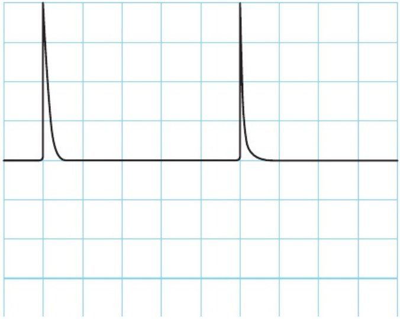

Time base

set at

10  $ \mu $s

per square

The sound waves used have a frequency of 3.8 MHz and the speed of sound in this steel is 5900 m s $ ^{-1} $.

(a) Explain why the echo has a smaller amplitude than the emitted pulse. [2]

(b) Calculate the thickness of this steel rail. [3]

(Total for Question 5 = 5 marks)

6 Frequencies below the audible range for humans are called infrasound. Infrasound is produced by earthquakes.

(a) Describe how sound waves travel through air. [3]

(b) State what is meant by frequency. [1]

(c) An infrasound wave has a wavelength of 1500 m and a frequency of 2.0 Hz.

Calculate the speed of infrasound in the ground. [2]

(d) In 2004, a huge earthquake produced a very large tidal wave which swept across the Indian Ocean towards Sri Lanka. Many large animals in Sri Lanka moved away from the coast before the tidal wave hit.

Suggest a reason for the animals behaving in this way. (2)

(Total for Question 5 = 8 marks)

7 A London radio station broadcasts at a frequency of 95.8 MHz. Calculate the wavelength in the air of these radio waves. [3]

(Total for Question 7 = 3 marks)

<!-- page 110 -->

## EXAM PRACTICE

8 (a) Ultrasound has a frequency above the limit of human hearing. Ultrasound scanning can be used by doctors to obtain information about the internal structures of the human body without the need for surgery. Pulses of ultrasound are sent into the body from a transmitter placed on the skin.

(i) The ultrasound used has a frequency of 4.5 MHz. State why waves of this frequency are called ultrasound. [1]

(ii) A pulse of ultrasound enters the body and its reflection returns to the transmitter after a total time of  $ 1.6 \times 10^{-4} $ s.

Calculate how far the reflecting surface is below the skin.

Average speed of ultrasound in the body = 1500 m s^{-1} [3]

(iii) State why the ultrasound is transmitted in pulses. [1]

(b) Another way of obtaining information about the internal structures of the human body is by the use of X-rays.

(i) Give one property of X-rays which makes them more hazardous to use than ultrasound. [1]

(ii) State two other differences between X-rays and ultrasound. [2]

(Total for Question 8 = 8 marks)

9 The diagram shows an experiment with sound waves.

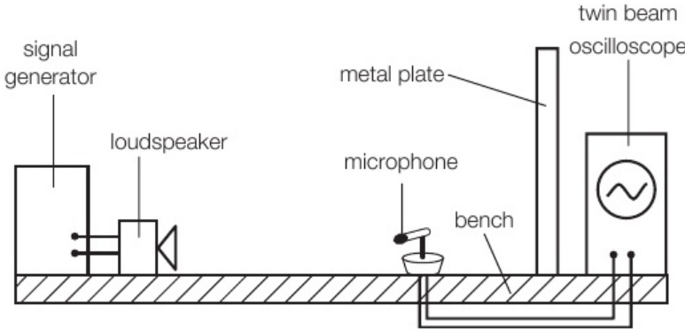

A loudspeaker is connected to a signal generator. A microphone is connected to a twin beam oscilloscope. Sound waves reach the microphone directly from the loudspeaker and after reflection from the metal plate.

A student set up the apparatus as shown in an attempt to measure the speed of sound by comparing the two traces on the oscilloscope screen. However, only one of the traces showed a sound wave whilst the other was a flat line.

(a) Describe and explain the difference in amplitude of the sound waves reaching the microphone directly, and those reaching it after reflection from the metal plate. [2]

(b) (i) Why does only one trace on the oscilloscope show the sound wave? [1]

(ii) Describe how the student should change the experimental set up in order to be able to measure the speed of sound. [1]

(iii) Explain how the student could use the new set up to find the speed of sound in air. Include measurements, experimental adjustments, how to analyse the results to find the speed of sound, and why they should also remove the metal plate. [6]

(c) With the frequency set at 3.7 kHz, the wavelength is measured as 9.0 cm. Calculate the speed of sound in air. [2]

(Total for Question 9 = 12 marks)

