# 3B The behaviour of waves

<!-- edx_ial_phy1.pdf p111-128 -->

<!-- page 111 -->

# TOPIC 3 WAVES AND THE PARTICLE NATURE OF LIGHT

CHAPTER 3B

# THE BEHAVIOUR OF WAVES

Some of the most interesting and beautiful phenomena are the product of two or more waves combining their effects. It is surprising that waves can pass through each other, creating some spectacular effects, and then continue on their way as if they had never met.

We will look at the ways in which different waves combine, along with the reasons why they might not combine, and learn how to predict and measure the outcomes of these combinations. The production of stationary wave patterns can be unexpected, but it is the basis for the functioning of musical instruments. The variety and beauty of musical instruments, along with the variation in the sounds they produce, is a result of their need to generate a stationary wave by combining multiple wave movements together.

Diffraction and interference can be explained with some simple mathematical ideas. When these relationships are repeated over and over again, in different places, it can lead to striking sights, such as the rainbow reflected from an oily puddle. Also it leads to the limits of scientific knowledge, such as the discovery of gravitational waves.

## MATHS SKILLS FOR THIS CHAPTER

- Units of measurement (e.g. the radian, rad)

- Translating information between graphical, numerical and algebraic forms (e.g. superposing wave displacements to discover a standing wave)

- Understanding the relationship between degrees and radians and translating from one to the other (e.g. comparing the phase relationship between waves)

• Plotting two variables from experimental data, and understanding that $y = mx + c$ represents a linear relationship (e.g. using a graph of experimental results to verify the standing wave properties in a string under tension)

• Solving algebraic equations (e.g. comparing the positions of interference maxima and minima)

Substituting numerical values into algebraic equations (e.g. finding the speed of waves in a string under tension)

<!-- page 112 -->

## What prior knowledge do I need? Topic 3A

The transmission of waves, and graphical representations of them

Definitions of the properties of waves, such as frequency, amplitude, wavelength and speed

Calculations of wave properties

The definition of wave phase, and its relationship to frequency and time period

The difference between, and examples of, transverse and longitudinal waves

## What will I study in this chapter?

How waves can combine when they meet

The development of standing waves, and what affects their properties

Diffraction and interference

Applications of standing wave patterns, such as the interference or diffraction of light, and the development of musical instruments

## What will I study later?

## Topic 3C

Effects on the properties and movement of a wave due to changes in its medium

## Topic 3D

Interference and diffraction of fast-moving particles such as electrons

Topic 10A (Book 2: IAL)

The connections between waves and simple harmonic motion

Topic 11B (Book 2: IAL)

The use of diffraction in studying the spectra of stars

<!-- page 113 -->

# 1 WAVE PHASE AND SUPERPOSITION

## LEARNING OBJECTIVES

Understand what is meant by the terms wavefront, superposition and phase.

Explain examples of wave superposition.

## PHASE

All points in a wave will be at some position through their cycle of oscillation. Some of these positions in the cycle have their own names, such as peak (or crest), trough, compression or rarefaction. The remaining points through a cycle are important, but there are too many to give them all names. We describe any position through a cycle by a number, referred to as the phase. A complete cycle is considered to be equivalent to rotating through a complete circle, so the phase position will be an angle measurement, where a complete cycle is equivalent to  $ 360^{\circ} $.

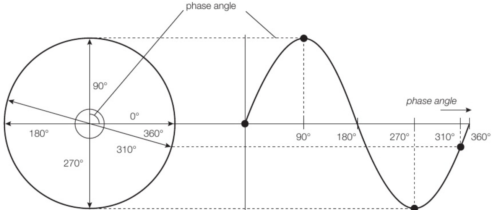

▲ fig A Wave phase represents the position through a complete cycle, measured in angle units.

It is quite common to measure phase in the alternative angle units of radians, where one complete cycle is  $ 2\pi $ rad. Table A shows common phase positions in the two equivalent angle units, along with the fraction of a complete wavelength that they represent. As waves are, by definition, a repetitive cyclic process, phases of more than  $ 360^\circ $ could be reduced to their equivalent value within a first cycle. For example, the wave peak after 1.25 cycles has exactly the same phase as the wave peak in the first cycle, so its phase could be quoted as either  $ 450^\circ $ or  $ 90^\circ $  $ \left(\frac{5\pi}{2}\text{ or }\frac{\pi}{2}\text{ rad}\right) $.

## EXAM HINT

If a question asks for a phase value, just give one answer. If you try to express the same answer in radians and in degrees, you must get it right both times or it is marked wrong.

<table border=1 style='margin: auto; word-wrap: break-word;'><tr><td style='text-align: center; word-wrap: break-word;'>WAVE CYCLE POSITION</td><td style='text-align: center; word-wrap: break-word;'>START</td><td style='text-align: center; word-wrap: break-word;'>$ \frac{1}{4} $ OF A CYCLE</td><td style='text-align: center; word-wrap: break-word;'>$ \frac{1}{2} $ OF A CYCLE</td><td style='text-align: center; word-wrap: break-word;'>$ \frac{3}{4} $ OF A CYCLE</td><td style='text-align: center; word-wrap: break-word;'>A WHOLE CYCLE</td><td style='text-align: center; word-wrap: break-word;'>1.5 CYCLES</td><td style='text-align: center; word-wrap: break-word;'>2 COMPLETE CYCLES</td></tr><tr><td style='text-align: center; word-wrap: break-word;'>PHASE / °</td><td style='text-align: center; word-wrap: break-word;'>0</td><td style='text-align: center; word-wrap: break-word;'>90</td><td style='text-align: center; word-wrap: break-word;'>180</td><td style='text-align: center; word-wrap: break-word;'>270</td><td style='text-align: center; word-wrap: break-word;'>360</td><td style='text-align: center; word-wrap: break-word;'>540</td><td style='text-align: center; word-wrap: break-word;'>720</td></tr><tr><td style='text-align: center; word-wrap: break-word;'>PHASE / RAD</td><td style='text-align: center; word-wrap: break-word;'>0</td><td style='text-align: center; word-wrap: break-word;'>$ \frac{\pi}{2} $</td><td style='text-align: center; word-wrap: break-word;'>$ \pi $</td><td style='text-align: center; word-wrap: break-word;'>$ \frac{3\pi}{2} $</td><td style='text-align: center; word-wrap: break-word;'>$ 2\pi $</td><td style='text-align: center; word-wrap: break-word;'>$ 3\pi $</td><td style='text-align: center; word-wrap: break-word;'>$ 4\pi $</td></tr><tr><td style='text-align: center; word-wrap: break-word;'>NUMBER OF WAVELENGTHS</td><td style='text-align: center; word-wrap: break-word;'>0</td><td style='text-align: center; word-wrap: break-word;'>$ \frac{\lambda}{4} $</td><td style='text-align: center; word-wrap: break-word;'>$ \frac{\lambda}{2} $</td><td style='text-align: center; word-wrap: break-word;'>$ \frac{3\lambda}{4} $</td><td style='text-align: center; word-wrap: break-word;'>$ \lambda $</td><td style='text-align: center; word-wrap: break-word;'>1.5 $ \lambda $</td><td style='text-align: center; word-wrap: break-word;'>2 $ \lambda $</td></tr></table>

table A Phase angles in degrees and radians, and also compared to wavelengths.

<!-- page 114 -->

## WAVEFRONTS

Diagrams of waves are often drawn as lines, as in fig B, where all the points on a line represent points on the wave that are at exactly the same phase position, perhaps a wave crest. These lines are called wavefronts. They are how the sea might look observed from a helicopter, where the troughs are all in shadow and so appear darker.

The waves are travelling in this direction.

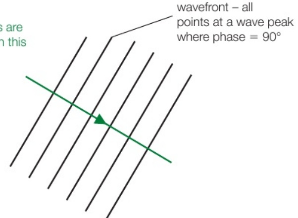

▲ fig B All points on each wavefront (black lines) are in the same phase position:  $ 90^{\circ} $, or  $ \pi/2 $. The green line showing direction of travel is called a ray. Rays must be perpendicular to wavefronts.

## WAVE SUPERPOSITION

When waves meet, each wave will be trying to cause a wave displacement according to its phase at that location. The overall displacement will be the vector sum of the displacements caused by the individual waves. This is called wave superposition. Afterwards, each wave will continue past each other, as the energy progresses in the same direction it was originally travelling. This can be most simply illustrated if we consider just wave pulses passing each other, as in fig D.

▲ fig C When waves meet, the displacements would add to each other to give the overall displacement for each location.

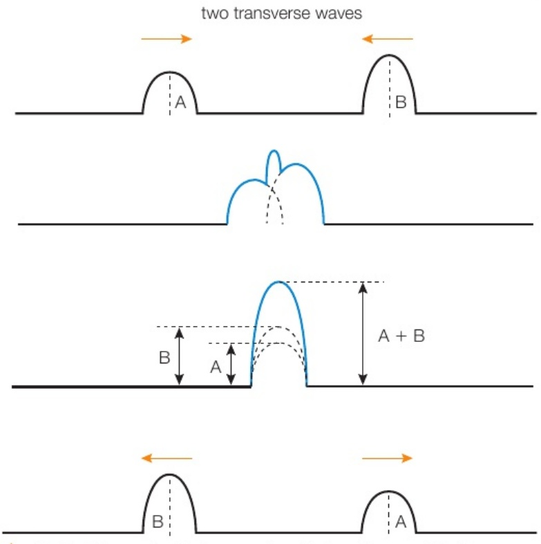

▲ fig D Wave pulse displacements add when they meet in the same location.

If the wave pulses in fig D are travelling on the surface of water, then each would be trying to displace the water molecules upwards briefly as it moves. When both meet at the same location, wave pulse A lifts the water a little, and then pulse B is also lifting up, so the water raises even higher – to the level of the two pulse displacements added together. This effect is thought to explain the tales from sailors that they saw a sudden very, very large wave which then disappeared as quickly as it had appeared. With many waves travelling in many different directions, they might be at the same point at the same time. Adding these together in wave superposition could cause a huge displacement at that moment. It then drops again as the waves continue past each other.

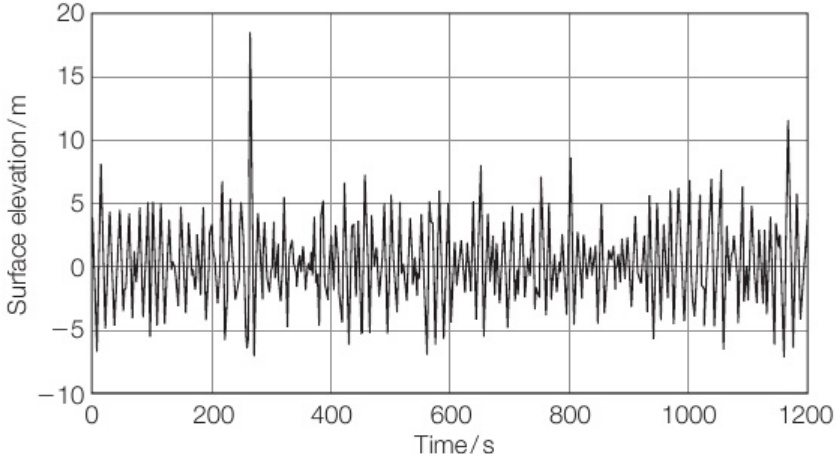

▲ fig E Multiple small waves coinciding in the same location can lead to a brief very large displacement. This graph is of sea surface height at the Draupner North Sea Oil Platform on 1st January 1995, showing a freak 18 m wave.

<!-- page 115 -->

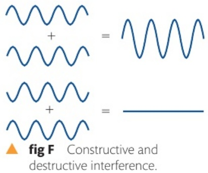

fig F Constructive and destructive interference.

SKILLS PROBLEM SOLVING

## SUPERPOSITION OF CONTINUOUS WAVES

If, rather than a single point along the path of the waves, we consider waves superposing over a large space, the outcome is a continuous wave that is the sum of the displacements over time in each location. If the two waves are in phase, their effect will be to produce a larger-amplitude resultant wave. This is known as constructive interference. If identical waves meet and are exactly out of phase – if their phase difference is  $ 180^{\circ} $ or  $ \pi $ radians – then the resultant is a zero-amplitude wave. This idea of complete destructive interference can be confusing: imagine shining two beams of light to the same place, and at that point you see blackness. In the right circumstances, as explained in Section 3B.4, this is exactly what happens.

It is important to know the phase difference between two waves, in order to determine what will happen as a result of their superposition. Waves that constructively interfere, as with the top pair in fig F, must be in phase, which means they have a phase difference of zero. As phase repeats every complete cycle, this could also be said to be a phase difference of  $ 360^\circ $ or  $ 2\pi $ radians.

## CHECKPOINT

1. What is the difference between a ray and a wavefront?

2. What is the phase difference between waves that completely destructively interfere?

3. ▶ Imagine waves on the surface of the sea. What are the phase differences between:

(a) two wave crests

(b) a crest and the next trough

(c) a trough and the crest three waves in front?

4. On graph paper, draw three diagrams of the wave pulses shown in fig G, at time = 1.0 s, 2.0 s and 3.0 s if fig G is at time = 0. Superpose the wave pulses as necessary to draw the correct overall displacements of the string.

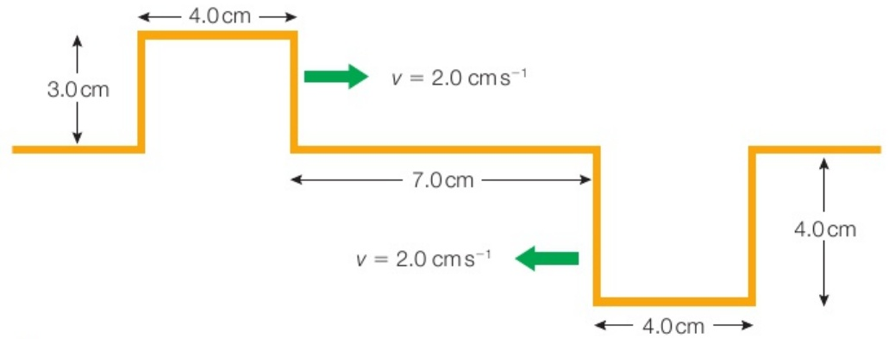

▲ fig G Two wave pulses moving along a string.

## SUBJECT VOCABULARY

wavefronts lines connecting points on the wave that are at exactly the same phase position

superposition when more than one wave is in the same location, the overall effect is the vector sum of their individual displacements at each point where they meet

constructive interference the superposition effect of two waves that are in phase, producing a larger amplitude resultant wave

destructive interference the superposition effect of two waves that are out of phase, producing a smaller amplitude resultant wave

<!-- page 116 -->

## 2 STATIONARY WAVES

## LEARNING OBJECTIVES

Explain what is meant by coherent waves.

Explain how a standing/stationary wave forms and identify nodes and antinodes.

Use the equation for the speed of transverse waves on a string.

Verify experimentally what factors affect the frequency of standing waves on a string.

## STANDING WAVES

Continuous waves travelling in opposite directions will superpose continuously, and this can set up a stationary wave pattern, also known as a  $ \underline{\text{standing wave}} $. The waves need to be of the same speed and frequency, with similar amplitudes, and have a constant phase relationship. Waves with the same frequency and a constant phase relationship are said to be coherent.

Stationary waves have this name because the profile of the wave does not move along, it only oscillates. This also means that wave energy does not pass along a standing wave, so they do not meet our strict definition of waves, which do transfer energy and are more precisely called progressive waves. A situation such as that in fig B can be set up when waves travel along a string and are reflected from a fixed end, which is how the wave in fig A was produced. In this situation, such as when a guitar string is played, the first wave will meet its own reflection. These two coherent waves set up a standing wave on the string. There are points where the resultant displacement is always zero. These points never move, and are called nodes. The points of maximum amplitude are called antinodes. Note that all points between one node and the next are in the same phase at all times, although their amplitude of vibration varies up to the antinode and back to zero at the next node.

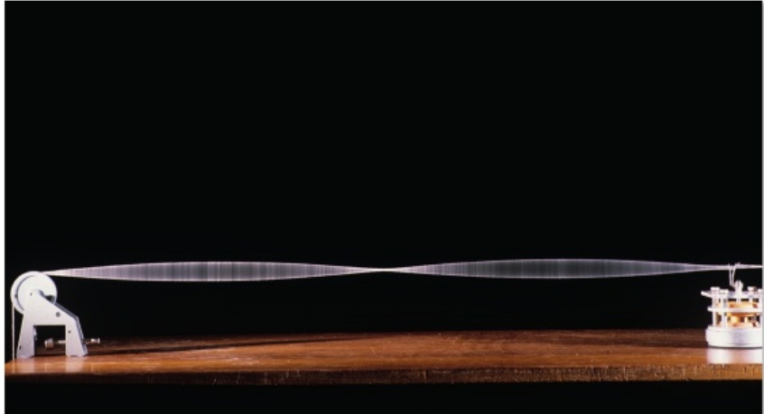

▲ fig A When coherent waves meet, a stationary wave is set up with points of zero amplitude (nodes) and points of maximum amplitude (antinodes). This can be demonstrated in the school laboratory with a vibration generator and a rubber cord.

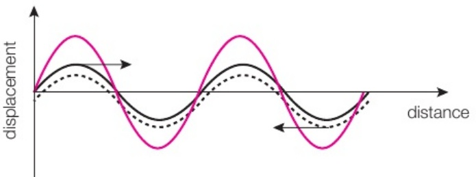

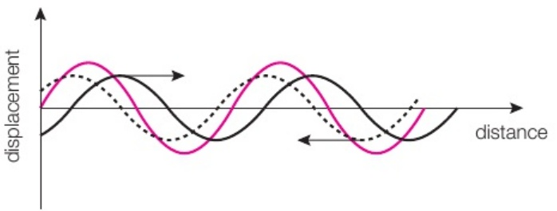

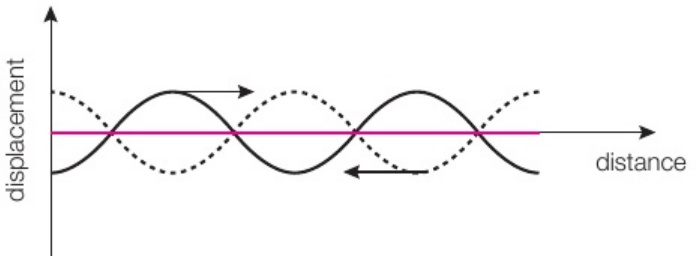

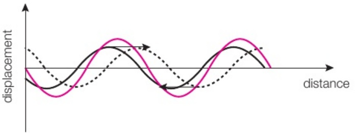

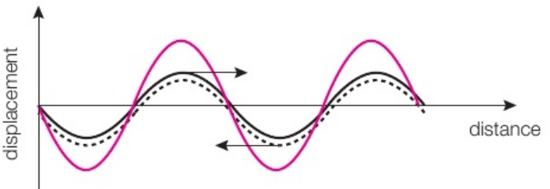

fig B As coherent waves pass through each other, the resultant wave (pink) will be stationary.

Depending on the frequency of the wave that produces the stationary wave by constructively interacting with its own reflection, the standing wave pattern that can be set up will have a corresponding wavelength, as the wave equation must still be satisfied. For example, in fig C, the first overtone exactly fits one complete wave in the length of the string:  $ \lambda = L $. In the third overtone, there are two complete waves in length L, so the wavelength is halved. The speed of waves on the string is the same in both situations, so the frequency in the third overtone must be double that of the first overtone. If a string is plucked and allowed to vibrate freely, all modes of vibration will be present at the same time, but the fundamental will be the most significant.

<!-- page 117 -->

Note that the steps and layout of the solution in this worked example are suitable for wave questions in the exam.

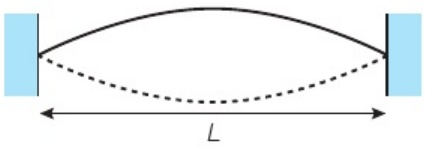

## EXAM HINT

fundamental

(1st harmonic)

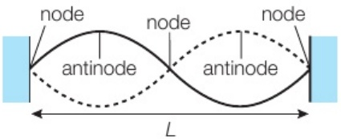

1st overtone

(2nd harmonic)

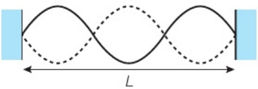

2nd overtone

(3rd harmonic)

 $$ \frac{2L}{3} $$ 

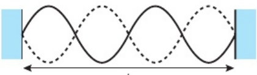

L

3rd overtone

(4th harmonic)

 $$ \frac{L}{2} $$ 

▲ fig C As the string is fixed at each end, these end points must always be nodes. The standing wave can only occur if its wavelength exactly allows a node at each end.

## WORKED EXAMPLE

A guitar string of length 65 cm vibrates in its fundamental mode. The speed of waves in the string is  $ 362 \, m \, s^{-1} $. What are the wavelength and frequency of this standing wave?

 $$ \lambda=2L=2\times0.65 $$ 

 $$ \lambda=1.30m $$ 

 $$ f=\frac{v}{\lambda}=\frac{v}{2L} $$ 

 $$ f=\frac{362}{1.30} $$ 

 $$ f=278\mathrm{H z} $$ 

## STRING WAVE SPEEDS

Waves on a stretched spring travel at a speed that is affected by the tension in the string,  $ T $ (in newtons) and the mass per unit length of the string,  $ \mu $ (in kg m $ ^{-1} $). The equation for the speed of a wave in a string is:

 $$ v=\sqrt{\frac{T}{\mu}} $$ 

If this equation is combined with the wave equation, we get an equation that tells us how the frequency of string vibrations is affected by other factors:

 $$ v=\sqrt{\frac{T}{\mu}}\quad and\quad v=f\times\lambda $$ 

 $$ f\times\lambda=\sqrt{\frac{T}{\mu}} $$ 

 $$ f=\frac{1}{\lambda}\sqrt{\frac{T}{\mu}} $$ 

In the fundamental mode of vibration, this means the fundamental frequency,  $ f_{0} $, depends on the length of the string, its tension and its mass per unit length from:

 $$ f_{0}=\frac{1}{2L}\sqrt{\frac{T}{\mu}} $$

<!-- page 118 -->

## WORKED EXAMPLE

How fast do waves travel in a string that is held under 75 N tension and has a mass per unit length of  $ 5.0 \times 10^{-4} \, \text{kg} \, \text{m}^{-1} $? What would be its fundamental frequency if the string was 75.5 cm long?

 $$ v=\sqrt{\frac{T}{\mu}} $$ 

 $$ v= {\sqrt{\frac{75}{5 \times 10^{-4}}}} $$ 

 $$ v=387~m s^{-1} $$ 

 $$ f_{0}=\frac{1}{2L}\sqrt{\frac{T}{\mu}} $$ 

 $$ f_{0}=\frac{1}{2\times0.755}\sqrt{\frac{75}{5\times10^{-4}}} $$ 

 $$ f_{0}=256\mathrm{~H z} $$ 

## EXAM HINT

Note that the steps and layout of the solution in this worked example are suitable for fundamental frequency questions in the exam.

## PRACTICAL SKILLS

CP5

Investigating the factors affecting the fundamental frequency of a string

We can verify the equation  $ f_0 = \frac{1}{2L} \sqrt{\frac{T}{\mu}} $ experimentally. In order to confirm it, we need to do three separate investigations to verify each part of the relationship, whilst keeping the other variables as control variables. So, we need to verify:  $ f_0 \propto \frac{1}{L} $;  $ f_0 \propto \sqrt{T} $; and  $ f_0 \propto \sqrt{\frac{1}{\mu}} $.

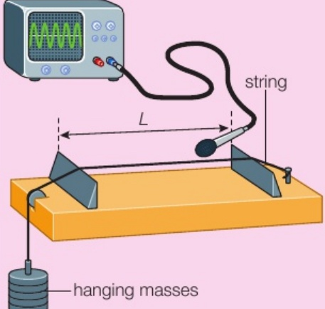

fig D Sonometer experiments to verify the factors affecting the fundamental frequency of a stretched string.

We can use a microphone connected to an oscilloscope to monitor the sounds produced by a sonometer string and to measure its frequency of vibration. This can be easier if a datalogging computer is used instead of an oscilloscope, so the screen can be frozen to look at in detail.

The string supports (called bridges) on a sonometer are moveable, so that we can find the frequency with varying lengths, L, whilst the same string (constant  $ \mu $) and the same hanging mass (constant T) keep the other variables controlled. We can plot a graph to verify  $ f_{0} $ on the y-axis is proportional to 1/L on the x-axis.

2 We can find the fundamental frequency using a fixed length of the same string throughout (constant L and constant  $ \mu $) for varying masses hung over the pulley, i.e. varying T. We can plot a graph to verify  $ f_0 $ on the y-axis is proportional to  $ \sqrt{T} $ on the x-axis.

3 The final experiment requires a set of different strings (varying diameter metal wires could be used). Maintaining the same length and the same hanging mass (constant L and T) keeps the other variables controlled. Measure the mass of each wire using a digital balance, and its full length, in order to calculate the mass per unit length for each wire or string used. We can plot a graph to verify $f_{0}$ on the y-axis is proportional to $\sqrt{\frac{1}{\mu}}$ on the x-axis.

Safety Note: Use eye protection if working close to the wire in case it snaps. Place a ‘drop box’ below the hanging masses if they are very large.

## CHECKPOINT

## SKILLS ANALYSIS

1. A guitar string of length 75 cm vibrates in its second harmonic. The speed of waves in the string is 420 m s $ ^{-1} $. What are the wavelength and frequency of this standing wave?

2. (a) How fast do waves travel in a string that is held under 90 N tension and has a mass per unit length of  $ 4.8 \times 10^{-4} $ kg m $ ^{-1} $?

(b) If the string is 74.0 cm long, calculate the fundamental frequency.

3. A sonometer experiment produced the following data (table A). Draw a suitable graph to find out what the mass per unit length of the vibrating string was.

<table border=1 style='margin: auto; word-wrap: break-word;'><tr><td style='text-align: center; word-wrap: break-word;'>LENGTH / M</td><td style='text-align: center; word-wrap: break-word;'>FREQUENCY / HZ</td></tr><tr><td style='text-align: center; word-wrap: break-word;'>0.60</td><td style='text-align: center; word-wrap: break-word;'>190</td></tr><tr><td style='text-align: center; word-wrap: break-word;'>0.65</td><td style='text-align: center; word-wrap: break-word;'>180</td></tr><tr><td style='text-align: center; word-wrap: break-word;'>0.70</td><td style='text-align: center; word-wrap: break-word;'>165</td></tr><tr><td style='text-align: center; word-wrap: break-word;'>0.75</td><td style='text-align: center; word-wrap: break-word;'>150</td></tr><tr><td style='text-align: center; word-wrap: break-word;'>0.80</td><td style='text-align: center; word-wrap: break-word;'>140</td></tr><tr><td style='text-align: center; word-wrap: break-word;'>0.85</td><td style='text-align: center; word-wrap: break-word;'>135</td></tr><tr><td style='text-align: center; word-wrap: break-word;'>0.90</td><td style='text-align: center; word-wrap: break-word;'>130</td></tr><tr><td style='text-align: center; word-wrap: break-word;'>0.95</td><td style='text-align: center; word-wrap: break-word;'>120</td></tr><tr><td style='text-align: center; word-wrap: break-word;'>1.00</td><td style='text-align: center; word-wrap: break-word;'>115</td></tr></table>

table A Data from a sonometer experiment.

The hanging mass used was 2.4 kg  $ \therefore $ T = 23.5 N.

4. Estimate the mass per unit length of piano wire.

## SUBJECT VOCABULARY

stationary or standing wave a wave which has oscillations in a fixed space, with regions of significant oscillation and regions with zero oscillation, which remain in the same locations at all times coherence waves which must have the same frequency and a constant phase relationship. Coherent waves are needed to form a stable standing wave

progressive wave a means for transferring energy via oscillations nodes regions on a stationary wave where the amplitude of oscillation is zero

antinodes regions on a stationary wave where the amplitude of oscillation is at its maximum

sonometer an apparatus for experimenting with the frequency relationships of a string under tension, usually consisting of a horizontal wooden sounding box and a metal wire stretched along the top of the box

<!-- page 119 -->

## 3B 3 DIFFRACTION

## LEARNING OBJECTIVES

■ Understand what is meant by the term diffraction.

Understand the factors that affect the amount of diffraction.

Describe an experiment to observe diffraction effects.

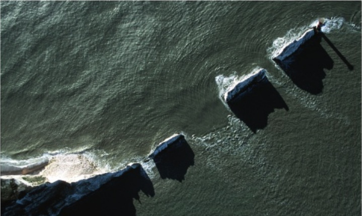

fig A Diffraction is a spreading of wave energy through a gap or around an obstacle.

## DIFFRACTION

When a wave passes the edge of an obstacle, the wave energy spreads into the space behind the obstacle. If the obstacle is relatively small, this can mean that the wave energy will pass around both sides of it and continue travelling past the obstacle, with no shadow, as if the obstacle were not there, as shown in fig B.

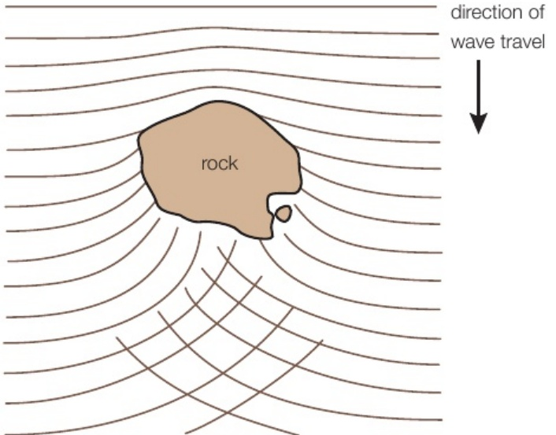

▲ fig B Wave energy spreads behind an obstacle.

If the obstacle is larger, then there may be a shadow region behind it, but there will still be diffraction around each edge. If there are two close obstacles forming a gap, then there will be diffraction from each edge of the gap, causing the waves to spread out through the gap. Also see Section 3D.1 for an explanation of why diffraction occurs.

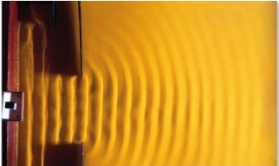

▲ fig C Water waves in a ripple tank diffract when passed through a gap.

## FACTORS AFFECTING DIFFRACTION

The amount of diffraction around an obstacle depends on the size comparison between the obstacle and the wavelength of the wave. As the resulting diffraction through a gap is caused by the diffraction at each end of the gap; there is an optimum size for maximum diffraction, or spreading, through the gap. Diffraction happens most when the gap size is the same size as the wavelength.

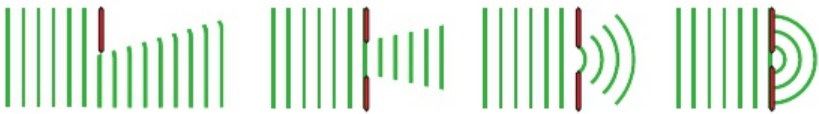

fig D The amount of diffraction depends on the size of the gap relative to the wavelength.

If the gap is too small, very little wave energy can pass through. If the gap is very large, there is little effect as the majority of the wave passes through undisturbed. However, when the wavelength matches the gap size, the wave energy is spread very effectively through the gap to fill the space behind, as shown in fig D. This is why we can hear around corners, but not see around them. The typical wavelength for an audible sound ranges from 15 centimetres to 15 metres, depending on the exact frequency. These are the same sort of size as common diffracting obstacles. For example, a doorway might be a metre wide, and a sound of this wavelength would have a frequency around 330 Hz, which is a typical speech frequency for humans. This means that a conversation in a room could be heard in the corridor outside the door, as the waves diffract from their original direction through the doorway to be heard out of line of sight. However, with visible frequencies of light being of the order of  $ 10^{-7} $ metres, these will not diffract through the doorway enough to see. So light from the speakers will only be visible in direct line of sight through the gap.

## DIFFRACTION PATTERNS

The diffraction pattern observed when light passes through a narrow slit, such as in fig E, shows a central maximum and then areas of darkness and then maxima of decreasing intensity. It can be confusing to see the areas where there is no light at all, when the diffraction through a gap suggests that the wave energy spreads out behind the gap. You might expect to see the screen behind the slit illuminated everywhere. We will look more carefully at interference in the next section, but the diffraction

<!-- page 120 -->

patterns we have seen with a laser are examples of an interference pattern. Considering the waves being diffracted from each end of the slit, gives us two waves that will meet at the screen. We saw in Section 3B.1 that if waves meet in phase they will superpose to give a larger amplitude resultant wave. This would appear as a light spot on the screen. At a slightly different place on the screen, these two waves will be completely out of phase and the sum of their displacements will always be zero, so it appears as a dark spot. The diffraction pattern is an example of a standing wave on the screen, where the dark spots are nodes and the light spots are antinodes.

## SINGLE SLIT DIFFRACTION

If we change the width of the diffraction slit, or the wavelength of the light, we will alter the diffraction pattern that we observe. A narrower slit widens the central maximum, as well as the further maxima and minima.

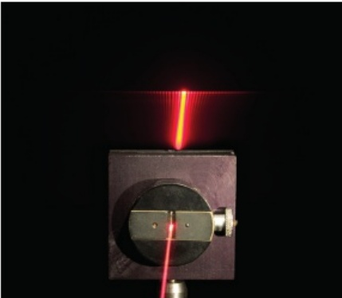

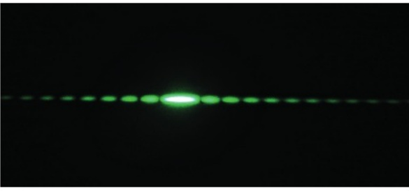

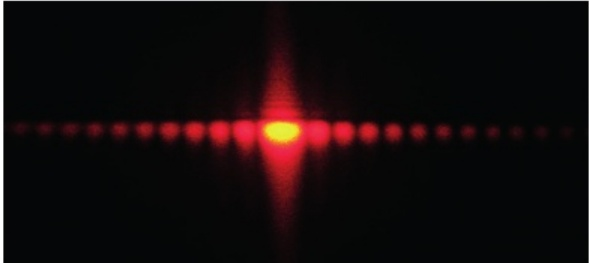

▲ fig E Diffraction patterns of light observed on a screen show a bright, wide central maximum, surrounded by areas of darkness, and further bright spots that have decreasing brightness from the centre.

## THE DIFFRACTION GRATING

A diffraction grating is a device that will cause multiple diffraction patterns, which then overlap. This creates an interference pattern with a mathematically well-defined spacing between bright and dark spots. It is a collection of a very large number of slits through which the waves can pass. These slits are parallel and have a fixed distance between each slit.

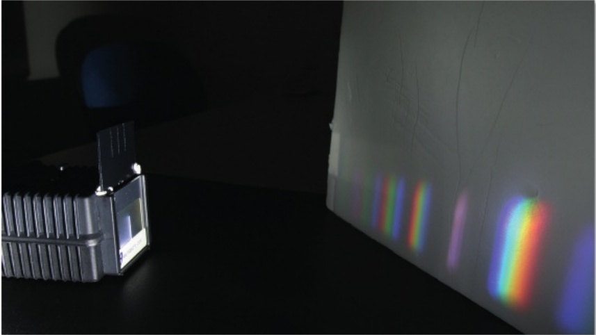

▲ fig F Diffraction gratings can be used to examine light spectra.

The pattern produced by each colour passing through a diffraction grating follows the equation:

 $ n\lambda = d\sin\theta $

where  $ \theta $ is the angle between the original direction of the waves and the direction of a bright spot,  $ \lambda $ is the wavelength of the light used, d is the spacing between the slits on the grating, and n is called the 'order'. The order is the bright spot number from the central maximum (which is n = 0).

## LEARNING TIP

If waves come to a boundary or obstacle we can say the waves are 'incident' on it.

## LEARNING TIP

'Monochromatic' light has only one colour, so only one wavelength.

## LEARNING TIP

The grating spacing is often quoted as a number of lines per metre (or per millimetre), which means that to find  $ d $ you will need to do an initial calculation in which:

$$d = \frac{1}{\text{number per metre}}$$

OR:

$$d = \frac{1\times10^{-3}}{\text{number per millimetre}}$$

<!-- page 121 -->

## PRACTICAL SKILLS

## Investigating diffraction with a laser

You can use a laser pointer or laboratory experimental laser to demonstrate diffraction. A diffraction grating investigation allows careful study of the light making up the spectrum from any light source. Astronomers use this to study the light spectra from stars.

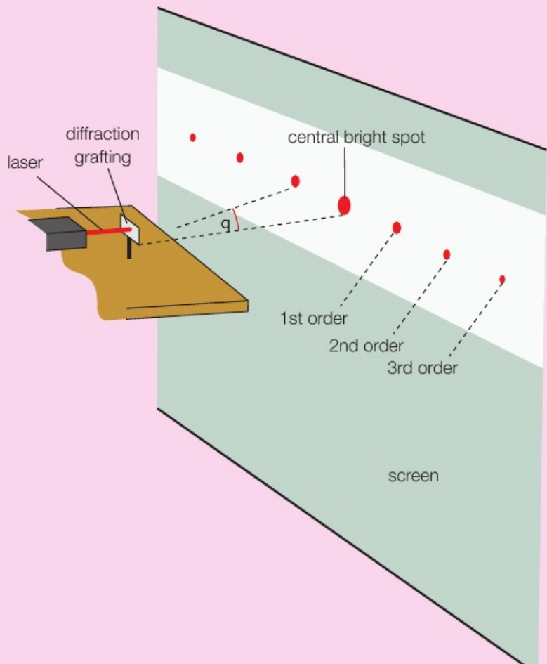

fig G A diffraction grating will produce a series of bright spots at increasing angles from the centre.

Diffraction gratings are manufactured to have a fixed spacing, d, between lines on the grating, and this will be printed on the grating. By measuring the angle to each maximum brightness spot created by a diffraction grating, you can calculate the wavelength of the light used from the diffraction grating equation.

fig H CDs have a series of very close lines marked on them and act as a diffraction grating that reflects. This causes the spectrum of colours that can be seen on them from white light that hits the surface.

## CHECKPOINT

1. In stormy seas, a sailor thought it would be a good idea to position his small boat behind a large oil tanker to avoid being hit by the waves that were coming from the other side of the tanker. Explain why this plan might not help.

2. (a) Explain why the radio waves from the two dishes in fig I spread out differently in each case.

(b) Suggest examples in which each situation in fig I might be useful for different purposes.

transmitter dish same size

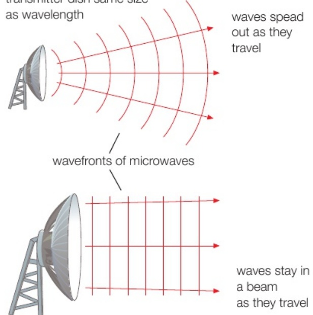

## dish larger than wavelength

fig I The size of a radio transmitter can be important depending on its purpose.

3. In an experiment to examine the colours of light produced by hot helium gas, a chemist used a diffraction grating, and found the first order maximum for each of three colours were at angles of  $ 26.6^{\circ} $,  $ 30.1^{\circ} $ and  $ 36.0^{\circ} $. If the grating he used had 1000 lines per mm, what were the wavelengths for these three colours?

4.  $ 90^{\circ} $ is the largest angle through which a bright spot maximum produced by a diffraction grating can be observed, but we can only observe a maximum for which n is an integer. For the experiment in question 3, calculate how many orders would be observed for each of the three colours.

## SUBJECT VOCABULARY

diffraction when a wave passes close by an object or through a gap, the wave energy spreads out.

maximum (plural maxima) in a diffraction or interference pattern, the bright spots

minimum (plural minima) in a diffraction or interference pattern, the dark spots

monochromatic containing or using only one colour. Light of a single wavelength

<!-- page 122 -->

## 4 WAVE INTERFERENCE

## LEARNING OBJECTIVES

Understand what is meant by the terms coherence, path difference and interference.

☑ Interpret the relationship between phase difference and path difference.

Explain examples of wave interference.

## TWO-SOURCE INTERFERENCE

In Section 3B.2 we saw that a wave meeting its own reflection would set up a standing wave pattern, also known as an interference pattern. Reflection is a convenient way to generate coherent waves that will produce a standing wave. However, any combination of waves that have the same frequency and a constant phase relationship will produce this result. For example, in fig A, the loudspeakers are connected to the same signal generator, so they simultaneously produce identical sound waves. Wherever the sound waves meet, they will superpose to produce a resultant displacement of air molecules. This means there will be points of maximum amplitude – antinodes – such as at position X, or points of zero amplitude – nodes – where there will be silence, such as position Y. The relative positions of nodes and antinodes will depend on the distance from the speakers, their separation and the wavelength of the waves.

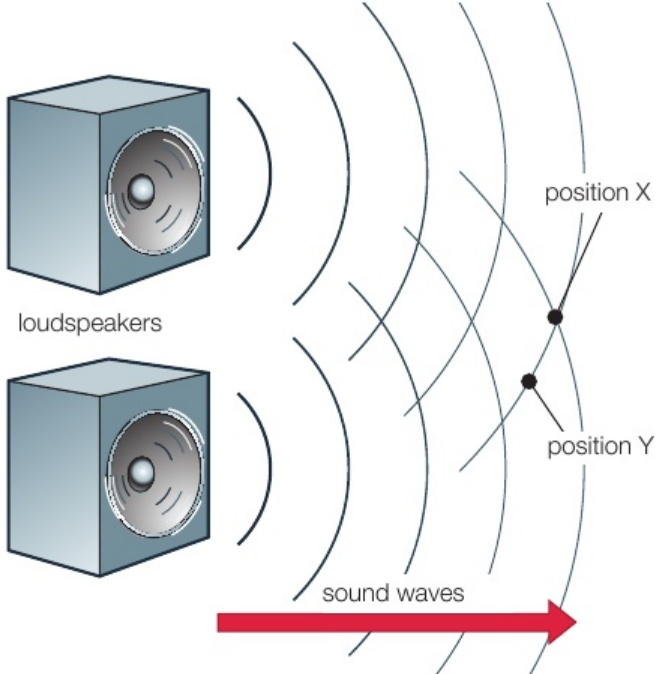

fig A Two loudspeakers generating the same frequency sounds.

## TWO-SLIT INTERFERENCE

Another interference pattern can be observed if light is shone into an experimental set-up that causes it to create two coherent wave sources that produce a standing wave pattern. This effect was first demonstrated by Thomas Young in 1803, using sunlight as the light source. A simple laboratory set-up using a torch, similar to that shown in fig B, would show a pattern of dark and light fringes that resembles the nodes and antinodes in a standing light wave.

Young explained his experiment using a theory that light behaves as a wave. In classical physics, interference is a phenomenon that can only occur with waves. Young's theory was highly controversial at the time, as he was contradicting Newton's theory that light behaved as a stream of particles. Despite the experimental evidence he demonstrated, most scientists at the time refused to believe Young's wave theory of light.

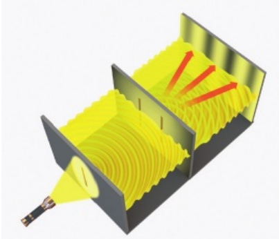

fig B Two-slit interference of torch light. An interference pattern of dark and light fringes is seen on the screen.

<!-- page 123 -->

## LEARNING TIP

The bright and dark spots in light interference experiments are often called 'fringes'.

## LEARNING TIP

Two-source interference and two-slit interference are the same thing. In both cases, two waves are brought together to produce an interference pattern. Two-slit interference is a form of two-source interference, where the slits diffract existing waves in order to act as new sources of waves.

## PRACTICAL SKILLS

Investigating two-source interference

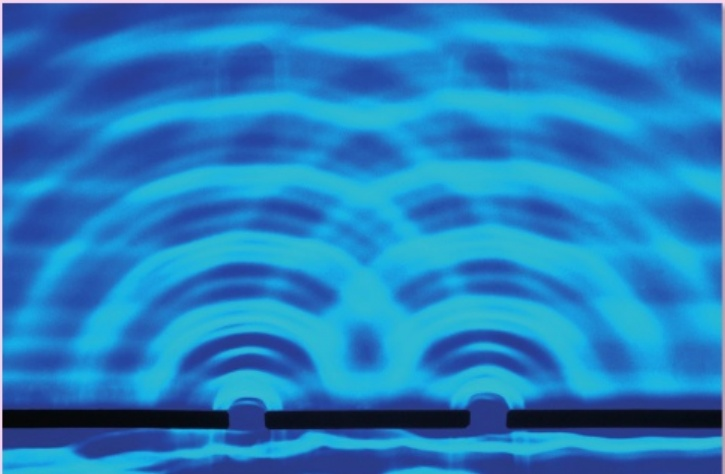

fig C Two-source interference demonstration in a ripple tank.

A ripple tank where waves are diffracted through two gaps will cause an interference pattern between the two water waves.

Another common experimental demonstration of two-slit interference is with laser light.

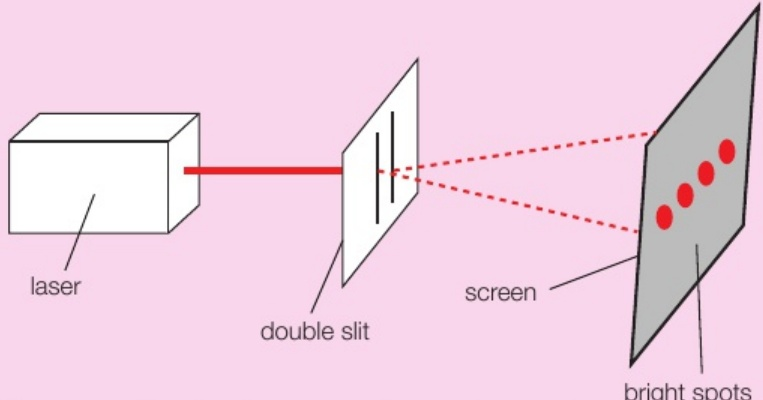

fig D Two-slit interference demonstration with a laser.

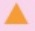

Safety Note: Ripple tank: do not handle electrical sockets, plugs and switches with wet hands or splash them with water. If a strobe light is used to freeze the wave action, persons with conditions adversely affected by flashing lights should be warned. Laser: do not view the laser beam directly or reflect it into eyes.

## EXPLAINING TWO-SOURCE INTERFERENCE

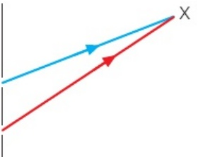

▲ fig E Different distances from each slit to point X determine the resultant amplitude of the standing wave at X.

Each point in a two-source interference pattern will have a superposition result that depends on the phase difference between the waves coming from each source to that point. That phase difference will, in turn, depend on the relative distances to the point from each of the slits compared with the wavelength. In fig E, imagine the distance from the slit to X along the blue line is 100 wavelengths, and the distance along the red line is 115 wavelengths. As the path difference is exactly 15 wavelengths, the waves will be in phase at point X, and will constructively interfere, to produce a maximum resultant, as in an antinode. If we passed laser light through the two slits, then point X would show a bright spot on a screen placed there.

<!-- page 124 -->

Alternatively, imagine the blue line distance to X is 97 wavelengths but the red line distance is 98.5 wavelengths. The path difference is 1.5 wavelengths. In this case, the waves will always be  $ 3\pi $ radians out of phase – always in antiphase – and so will always cancel. This would look like a standing wave node, and if it were the laser light two-slit experiment, there would be a dark spot at point X.

Note that these wavelength numbers are examples only. As light waves are so short, the numbers should be millions of wavelengths for standard laboratory distances for X.

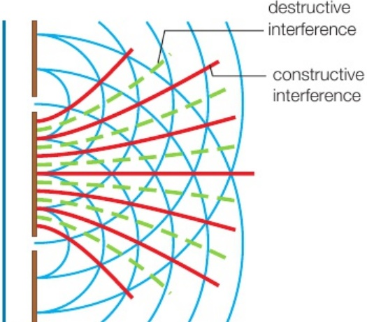

▲ fig F All points that are exactly in phase, where the path difference is a whole number of wavelengths, $n\lambda$, will produce constructive interference. Any points where the path difference is given by $\frac{(2n+1)\lambda}{2}$ will cause destructive interference.

The connection between the phase difference and the path difference comes if we remember that each complete cycle (or wavelength) corresponds to  $ 2\pi $ radians in phase. Waves from one slit meeting waves from the other slit at a point will each have had to travel to that point, cycling through wavelengths as they go. By comparing the path difference, this can be converted into phase differences.

Points where the path difference is equal to  $ n\lambda $ exactly, will have a phase difference of  $ 2n\pi $ exactly and will be in phase, producing constructive interference.

Points where the path difference is equal to  $ \frac{(2n+1)\lambda}{2} $ exactly, will have a phase difference of  $ (2n+1)\pi $ exactly and will be in antiphase, producing destructive interference.

## CHECKPOINT

1. What are coherent waves?

2. In a laser light two-slit interference experiment, a bright fringe was observed at a point on the screen exactly halfway between the two slits. A dark fringe was observed on either side of this, and then another bright fringe on either side.

(a) What is the phase difference between the waves arriving from each slit at the central maximum?

(b) What is the path difference, and the phase difference, between waves arriving from each slit to the first minimum on the left of the central maximum?

(c) What is the path difference, and the phase difference, between the waves arriving from each slit at the first maximum to the left of the central maximum?

(d) Describe what difference would be observed in the fringe pattern if the screen were moved further away from the two slits.

## SUBJECT VOCABULARY

interference the superposition outcome of a combination of waves. An interference pattern will only be observed under certain conditions, such as the waves being coherent

SKILLS REASONING / ARGUMENTATION

<!-- page 125 -->

# 3B THINKING BIGGER

## THE MARIMBA

## SKILLS

## CRITICAL THINKING, PROBLEM SOLVING, ANALYSIS, REASONING/ARGUMENTATION, INTERPRETATION, ADAPTIVE LEARNING, ADAPTABILITY, PRODUCTIVITY, COMMUNICATION

The marimba is a percussion instrument like a xylophone. A standing wave is set up in the wood when it is struck with a hammer. The wooden bars vibrate with frequencies related to their sizes.

In this activity, we will look at some of the detail about tuning the marimba bars.

## ONLINE ARTICLE

## THE MARIMBA BAR

The marimba bar vibrates in complex patterns that produce a sound unique to the instrument. You can get an understanding of the sound quality (timbre) by studying the vibrations. Each type of vibration is called a mode of vibration. In a scientific study of a C3 (C below middle C) marimba bar, Bork et al. (1999) identified 25 modes of vibration in the range of 0 to 8000 Hz.

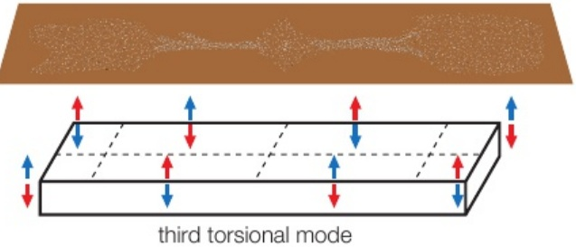

▲ fig A When the bar vibrates, the salt sprinkled all over it moves away from antinodes, leaving a pattern which identifies how the wood is vibrating. In this example, the bar is vibrating in a torsional mode, as well as the standard transverse vibration.

## Drilling the Holes for the Bar – Finding the Nodes of the Fundamental Mode

Sprinkle some salt on the bar and then tap very lightly with a mallet at the centre of the bar. Keep tapping until the salt collects over each node as illustrated below.

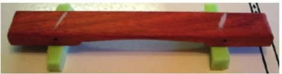

fig B Finding the nodes on a marimba bar, for the positions of mounting screws.

## Human Hearing at Different Frequencies and the Graduation of Bar Width

You will note that marimba bars have different widths, growing wider with lower notes. One of the challenges in designing an instrument which sounds in the bass region is to provide tones that can be easily heard. The human ear has a large range of sensitivity to sound at different frequencies. Sensitivity in the bass region is much less than in the range around 1000 to 4000 Hz. In order to overcome this problem, the bass bars are wider so that they generate sound at a higher energy level.

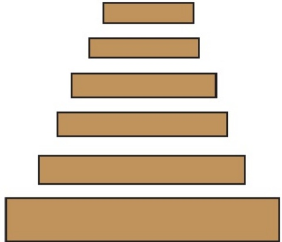

▲ fig C C-note marimba bars from five octaves.

The graph below shows the minimum levels of human hearing at different frequencies. Note that the human ear is most sensitive to frequencies in the range of 1000 to 4000 Hz. The energy level of the sound is graphed in decibels (dB), which is logarithmic. An increase of 10 dB represents a 10-fold increase in sound energy and an increase of 20 dB represents a 100-fold increase in sound energy.

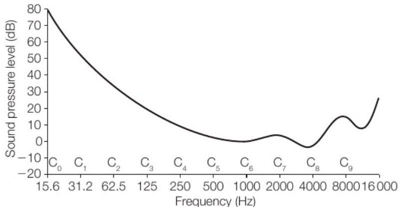

▲ fig D As the frequency of sound decreases, it must be played louder for us to hear it.

<!-- page 126 -->

## THINKING BIGGER

## SCIENCE COMMUNICATION

1 The extract opposite is from a webpage explaining the complex physics of the vibrations and sounds produced by a marimba. This is a hobby of the author who is a scientist in a teaching university. Consider the extract and comment on the type of writing that is used. Then answer the following questions:

(a) Discuss the level of the science presented in the extract. Who might want to read this webpage?

(b) Comment on the fact that this webpage is several thousand words, and has many images and diagrams relating to the science of stationary waves. However, there is no picture of a complete marimba instrument on it.

(c) What does the phrase 'Bork et al' mean?

## PHYSICS IN DETAIL

Now we will look at the physics in detail. Some of these questions link to topics earlier in this book, so you may need to combine concepts from different areas of physics to work out the answers.

2 Explain why the salt collects in the two places shown in fig B. Why would these be the best points to place the mounting screws for the bar?

3 What is the connection between frequency of the C-notes and the octave they are in, as shown on the x-axis in fig D?

4 Looking at fig C, estimate the ratios of the surface area of the bars. Compare these answers with the decibel values for each needed to hear each note on the graph in fig D. Why might these be linked?

## ACTIVITY

Write a report to a school Music department which explains how they could make marimba bars in lessons. Include some of the physics behind what will alter their sound properties, and include outline plans for manufacture by school students. Also include instructions for experimentally testing the frequency of each bar produced. Your report should be written for the teacher in charge of the subject, whilst their lessons will be for IGCSE students.

## INTERPRETATION NOTE

This is an extract of the article only. You may find it helpful to visit the webpage and browse its different sections.

## THINKING BIGGER TIP

Think about how the vibrations of the bar will generate sound waves.

<!-- page 127 -->

# 3B EXAM PRACTICE

1 What is the wavelength of the fundamental standing wave on a guitar string that is 74 cm long?

A  $ \lambda = 0.37 \, \text{m} $

B  $ \lambda = 0.74 \, \text{m} $

C  $ \lambda = 1.48 \, \text{m} $

D  $ \lambda = 2.96 \, \text{m} $ [1]

(Total for Question 1 = 1 mark)

2 Which of the following is not caused by wave superposition?

A The fundamental note produced on a guitar string.

B Seismic P-waves cause surface damage before S-waves.

C Occasionally a theatre seat can be in a ‘dead zone’ where little can be heard from the stage.

D CDs can have a rainbow appearance. [1]

(Total for Question 2 = 1 mark)

3 Which of these correctly represents the same phase position in different units?

A  $ 90^{\circ} $ and  $ \pi $ rad

B  $ 180^{\circ} $ and  $ \pi $ rad

C  $ 360^{\circ} $ and  $ \pi $ rad

D  $ 180^{\circ} $ and  $ 2\pi $ rad [1]

(Total for Question 3 = 1 mark)

4 A student did experiments to show the diffraction of different types of waves.

Which row in the table correctly shows the experiment that would show the greatest diffraction effect?

<table border=1 style='margin: auto; word-wrap: break-word;'><tr><td style='text-align: center; word-wrap: break-word;'>Type of wave</td><td style='text-align: center; word-wrap: break-word;'>Wavelength / m</td><td style='text-align: center; word-wrap: break-word;'>Gap size / m</td></tr><tr><td style='text-align: center; word-wrap: break-word;'>water</td><td style='text-align: center; word-wrap: break-word;'>0.02</td><td style='text-align: center; word-wrap: break-word;'>0.10</td></tr><tr><td style='text-align: center; word-wrap: break-word;'>light</td><td style='text-align: center; word-wrap: break-word;'>$ 5.5 \times 10^{-7} $</td><td style='text-align: center; word-wrap: break-word;'>$ 5.5 \times 10^{-3} $</td></tr><tr><td style='text-align: center; word-wrap: break-word;'>water</td><td style='text-align: center; word-wrap: break-word;'>0.05</td><td style='text-align: center; word-wrap: break-word;'>0.08</td></tr><tr><td style='text-align: center; word-wrap: break-word;'>sound</td><td style='text-align: center; word-wrap: break-word;'>3.0</td><td style='text-align: center; word-wrap: break-word;'>1.5</td></tr></table>

(Total for Question 4 = 1 mark)

5 In a two-slit interference of light experiment, dark and light fringes are observed on the screen in front of the two slits. What can you say about the light waves arriving from the two slits at any one of the dark fringes?

A The light waves are constructively interfering.

B The light waves are  $ 90^{\circ} $ out of phase.

C The light waves travel the same path length from each slit.

D The light waves are the same amplitude.

(Total for Question 5 = 1 mark)

6 When oil floats on water, coloured interference patterns are often seen. The interference patterns are formed because of the thin film of oil. A thin film of oil can also produce interference patterns with monochromatic light. The diagram shows light from a monochromatic source, incident on a film of oil.

Explain why interference patterns may be seen.

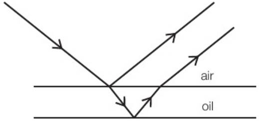

water

## (Total for Question 6 = 5 marks)

7 In a school experiment, a laser is shone at right angles onto a diffraction grating to produce a pattern of light and dark spots on a screen several metres away. The grating is marked '500 lines/mm'.

(a) What is the distance between slits on the diffraction grating?

(b) If the first bright spot from the centre is found to be at an angle of  $ 15^{\circ} $ from the original direction of the laser beam, what is the wavelength of the light? [2]

(c) The laser is changed for a different one which has a wavelength of 450 nm. How many orders of bright spot will be generated by the diffraction grating? [3]

(Total for Question 7 = 6 marks)

<!-- page 128 -->

## EXAM PRACTICE

8 (a) A transverse wave travelling along a wire under tension has a speed v given by

 $$ v=\sqrt{\frac{T}{\mu}} $$ 

where T is the tension in the wire and  $ \mu $ is the mass per unit length of the wire.

Show that the units on both sides of the equation are the same.

(b) The diagram shows a wire held under tension by hanging weights at one end and supported by a vibration generator at the other end. The frequency of the vibration generator is slowly increased from zero until a standing wave is formed.

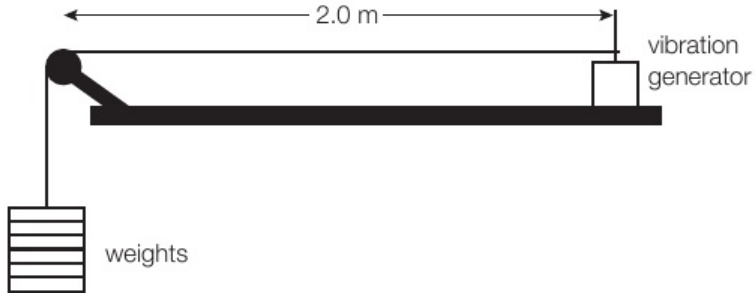

(i) Explain how the standing wave is produced. [3]

(ii) Calculate the wavelength of the standing wave.

(iii) The weight is 150 N and the mass per unit length of the wire is 0.0050 kg m $ ^{-1} $.

Using the equation given in (a), calculate the speed of the transverse wave along the wire. [2]

(iv) The wire is observed as the frequency of the vibration generator is steadily increased to several times the frequency that produced the first standing wave. Describe and explain what is seen as the frequency is increased. [4]

(Total for Question 8 = 13 marks)

9 (a) State what is meant by diffraction.

(b) State the principle of superposition of waves.

(c) The photograph shows a beach in England. Waves can be seen passing rocks on their way to the beach. The uneven surface of the sand has formed as a result of diffraction and superposition of these waves.

(d) Use the ideas of diffraction and superposition to explain why the sand surface becomes uneven. [5]

(Total for Question 9 = 9 marks)

10 The diagram shows a metal wire held between fixed points S and T.

S ● T

(a) Draw the wire vibrating in its fundamental mode.

(b) In part (a) the wire was vibrating at a frequency of 200 Hz. Draw the wire again, but now vibrating at a frequency of 600 Hz.

(c) Explain why the wire sets up a stationary wave when it is plucked.

(Total for Question 10 = 8 marks)

