# 3C More wave properties of light

<!-- edx_ial_phy1.pdf p129-140 -->

<!-- page 129 -->

# TOPIC 3 WAVES AND THE PARTICLE NATURE OF LIGHT

# 3C MORE WAVE PROPERTIES OF LIGHT

Humans have long wondered at the appearance of rainbows and other ways light can trick our eyes. Developing our understanding of the physics behind such natural phenomena has allowed us to develop more and more complex imaging techniques. Deep drilling for oil exploration often uses optical fibres to gain an image of the rock at hundreds of metres depth. The same imaging physics allows doctors to view inside their patients with an endoscope.

This chapter will explain the details of refraction in different materials and how this leads to the properties of different types of lenses, as well as total internal reflection in optical fibres. Broadband internet communications are made possible by applying this idea.

## MATHS SKILLS FOR THIS CHAPTER

• Substituting numerical values into algebraic equations (e.g. finding the refractive index)

• Changing the subject of an equation (e.g. finding the critical angle)

• Plotting two variables from experimental data (e.g. plotting a graph of experimental results of refraction in glass)

Determining the slope of a linear graph (e.g. using a graph of experimental results to find the refractive index of glass)

• Identifying uncertainties in measurements and using simple techniques to determine uncertainty (e.g. considering the uncertainty of experimental results in finding the refractive index of glass)

<!-- page 130 -->

## What prior knowledge do I need? Topic 2B

Stress in materials

## Topic 3A

Definitions of the properties of waves, such as frequency, wavelength and speed

Models of waves and wave processes

Calculations of wave speed

The transmission of waves

## What will I study in this chapter?

The definition of refraction, and how to find and calculate the refractive index

Effects on the properties and movement of a wave due to changes in its medium

The phenomenon of total internal reflection

The phenomenon of polarisation, and some of its implications and applications

## What will I study later?

## Topic 3D

The production of light of different wavelengths

Interactions of light with its medium at an atomic level

Intensity and power of a light source

Topic 11B (Book 2: IAL)

Luminosity of a star

Gravity 'refracting' light

<!-- page 131 -->

## 1 REFRACTION

## LEARNING OBJECTIVES

Understand what is meant by refraction.

Understand how to measure the refractive index of a solid material.

Use two equations relating to refraction.

## REFRACTION

When waves pass from one medium into another, there is a change in speed. The frequency remains constant, so the change in speed causes a change in wavelength. If the waves are approaching the interface between the two media at an angle then the change in speed causes a change in direction as well. This is called refraction.

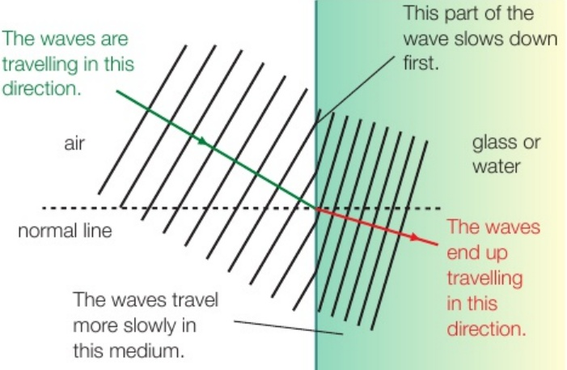

▲ fig A Wave speed depends on the medium, and refraction is caused by a change in medium changing the wave speed.

Any ray crossing an interface along the normal line does not change direction at all, as the wavefronts are parallel to the edge. Therefore their wavelength is equally changed along the length of the wavefront. If the wavefront is at an angle to the interface, then the part that hits first will change speed first. Then the wavefront becomes bent because different parts of it are travelling at different speeds.

The changes in direction caused by refraction are the basis for the functioning of lenses, and can lead to optical illusions.

A measure of the amount of refraction caused by different materials is called the refractive index, and its symbol is n. The refractive index, n, is equal to the ratio of the speed of light in a vacuum to the speed of light in the material:

 $$ n=\frac{c}{v} $$ 

Whilst it is difficult to measure the underlying change in the speed, at least for light waves, the effect on direction can be measured easily. The relationship between direction and refractive index is given by Snell's law:

 $$ n_{1}\sin\theta_{1}=n_{2}\sin\theta_{2} $$ 

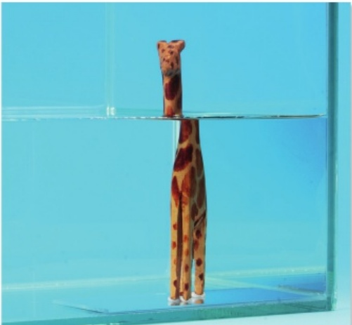

fig B Refraction can alter perspective.

The values of  $ n_1 $ and  $ n_2 $ are the refractive indices in each medium. The values of  $ \theta_1 $ and  $ \theta_2 $ are the angles that the ray of light makes to the normal to the interface between the two media at the point the ray meets that interface, as shown in fig C.

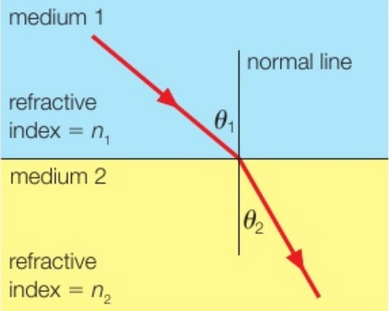

fig C Defining refraction.

## LEARNING TIP

In any optical system, light rays will follow exactly the same path if they are transmitted back from the end in the reverse direction. This means the angles involved in refraction are the same whether the light moves from the less dense medium into the more dense one and the opposite is also true. Remember though, apart from rays along the normal line, the angle to the normal will always be larger in the less dense medium.

## WORKED EXAMPLE

What is the angle of refraction when a light ray passes from water  $ (n_{1}=1.33) $ into glass  $ (n_{2}=1.50) $, hitting the interface between the two at an angle of  $ 48^{\circ} $ to the normal?

 $$ n_{1}\sin\theta_{1}=n_{2}\sin\theta_{2} $$ 

 $$ \sin\theta_{2}=\frac{n_{1}\sin\theta_{1}}{n_{2}} $$ 

 $$ \sin\theta_{2}=\frac{1.33\times\sin48^{\circ}}{1.50}=0.659 $$ 

 $$ \theta_{2}=\sin^{-1}0.659 $$ 

 $$ \theta_{2}=41.2^{\circ} $$ 

## EXAM HINT

Note that the steps and layout of the solution in this worked example are suitable for refraction questions in the exam.

<!-- page 132 -->

## PRACTICAL SKILLS

## Investigating refractive index

Using the equation for refractive index with experimental measurements will allow us to measure the refractive index of a material, as long as we know n for the other material. We usually do these experiments with air as the known material. As the speed of light in air is almost the same as in a vacuum, we take the refractive index of air to be  $ n_{air} = 1.00 $.

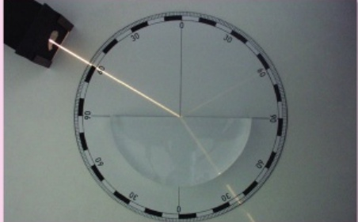

fig D Measuring angles of incidence and refraction in order to find the refractive index of a material.

Using a setup like that shown in fig D, we can take several different measurements of the angle of incidence ( $ \theta_{1} $) and the corresponding angle of refraction ( $ \theta_{2} $). The block used should be an exact semicircle, and we aim the ray to meet the glass at exactly the midpoint of the flat side. This means that the ray passing through the block will be travelling along a radius of the semicircle, and will leave the glass exactly along the normal to the circular edge. So the only change in direction occurs at the flat side of the block. Comparing the equation we have for refractive index with the equation for a straight line:

 $$ n_{1}\sin\theta_{1}=n_{2}\sin\theta_{2} $$ 

 $$ n_{1}=1.00 $$ 

 $$ \therefore\quad\sin\theta_{1}=n_{2}\sin\theta_{2} $$ 

 $$ \therefore\quad\sin\theta_{2}=\frac{\sin\theta_{1}}{n_{2}} $$ 

 $$ y=m x+c $$ 

A plot of $\sin\theta_{2}$ on the y-axis against $\sin\theta_{1}$ on the x-axis should produce a straight best-fit line that passes through the origin. The gradient, $m$, of this line will be equal to the reciprocal of the refractive index for glass.

 $$ n_{glass}=\frac{1}{m} $$ 

Safety Note: The raybox may get hot enough to burn skin. Do not knock glass blocks together as sharp chips may fly off and cause injury.

## DISPERSION

One of the most well known phenomena in physics is the splitting of white light into a rainbow of colours by a prism, as shown in fig E.

 $$ n_{1}\sin\theta_{1}=n_{2}\sin\theta_{2}\qquad n=\frac{c}{v}=\frac{c}{f\lambda} $$ 

If the ray enters a prism from air (n = 1.00) our equations become:

 $$ \sin\theta_{1}=\frac{c\sin\theta_{2}}{f\lambda}\qquad\sin\theta_{2}=\frac{f\lambda\sin\theta_{1}}{c} $$ 

As the frequency stays constant throughout refraction, and the speed of light in a vacuum must be constant, if we keep the same angle of incidence then the sine of the angle of refraction will be proportional to the wavelength. Smaller wavelengths (violet) will be closer to the normal in the glass (compare this with fig E).

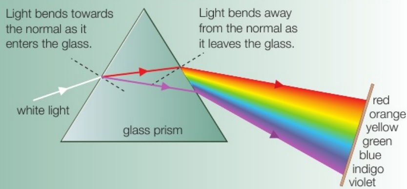

## ▲ fig E Refraction affects different wavelengths (colours) differently

On emergence from the glass prism, take care to continue with  $ \theta_{1} $ as the angle in air:

 $$ \sin\theta_{1}=\frac{c\sin\theta_{2}}{f\lambda} $$ 

The sine of the angle of refraction ( $ \theta_1 $ on emergence) will now be inversely proportional to the wavelength. Smaller wavelengths (violet) will be further from the normal in the air (compare this with fig E). As the angles of incidence on emergence are not all the same, due to the dispersion when they first entered the glass, the colour spreading effect is amplified, creating the familiar rainbow, or spectrum, of colours.

## CHECKPOINT

## SKILLS ADAPTIVE LEARNING, PROBLEM SOLVING

1. What happens to each of the following when a ray of light travels from air into clear plastic?

(a) speed

(b) wavelength

(c) frequency

2. Why does the head of the giraffe in fig B appear to be disconnected from the body?

3. When light travels from air into glass ($n_{\mathrm{glass}} = 1.50$) with an incident angle of $25^{\circ}$, what is the angle of refraction inside the glass?

## SUBJECT VOCABULARY

refraction a change in wave speed when the wave moves from one medium to another. There is a corresponding change in wave direction, governed by Snell's law

refractive index, n, the amount that a material changes the speed of waves when they pass through the material from a different material:

 $$ refractive~index=\frac{speed~of~light~in~vacuum}{speed~of~light~in~the~medium}\quad n=\frac{c}{v} $$ 

Snell's law the values of $n_{1}$ and $n_{2}$ are the refractive indices in each medium, and the values of $\theta_{1}$ and $\theta_{2}$ are the angles that the ray makes to the normal to the interface between the two media, at the point the ray meets that interface:

 $$ n_{1}\sin\theta_{1}=n_{2}\sin\theta_{2} $$

<!-- page 133 -->

# 2 TOTAL INTERNAL REFLECTION

## LEARNING OBJECTIVES

Understand that waves can be reflected and transmitted at an interface between media.

Understand the term critical angle.

Predict whether total internal reflection will occur at an interface.

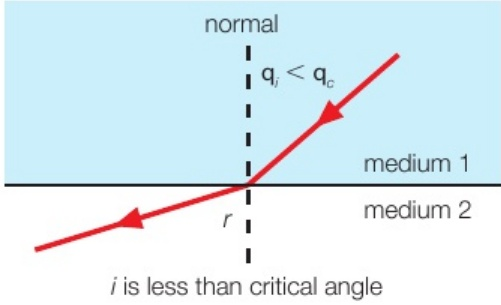

## PARTIAL REFRACTION

When waves pass from one medium into another, some wave energy will pass through and some will be reflected. The proportions will depend on the amount of refraction and the angle of incidence.

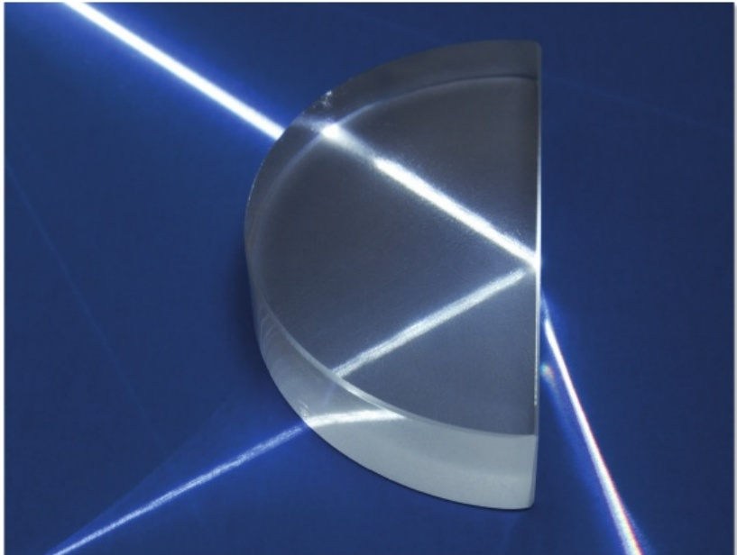

fig A Partial transmission and partial reflection of light at a media interface.

In the diagrams of fig B we can see a ray of light trying to leave an optically more dense medium. In these examples, the partial reflection is not drawn. The first diagram shows simple refraction, for which we could use Snell's law to make some calculations. The angle in the less dense medium is greater than the incident angle inside the more dense medium. In the second diagram, the incident angle has been increased. From Snell's law, we find that at this critical angle, the ray would emerge in the less dense medium at an angle of  $ 90^{\circ} $ – it would emerge exactly along the interface. If the angle within the more dense medium is increased further, the emergent angle should increase also, but this would then be greater than  $ 90^{\circ} $. This means the ray emerges within the more dense medium. This is not refraction, as that requires a change in medium. This means that Snell's law cannot apply. In this case, what happens is that all the wave energy is reflected inside the more dense medium, and the angles follow the law of reflection. This is total internal reflection (TIR).

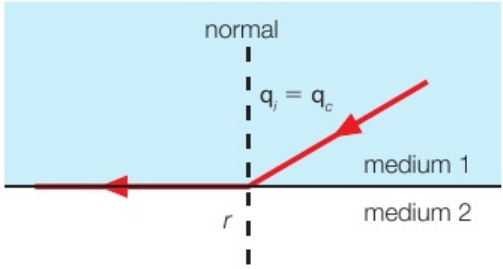

i equals critical angle

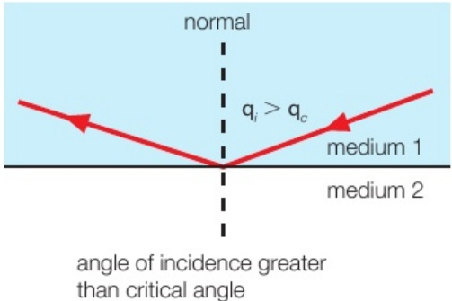

angle of incidence greater than critical angle

▲ fig B Moving from refraction to total internal reflection.

## CRITICAL ANGLE CALCULATIONS

From Snell's law, we could find the critical angle for a material:

 $ n_{1}\sin\theta_{1}=n_{2}\sin\theta_{2} $

If we take medium 1 to be the optically more dense material then  $ \theta_{2} $ must be  $ 90^{\circ} $ when the light is at the critical angle,  $ \theta_{c} $, in medium 1.

 $$ n_{1}\sin\theta_{1}=n_{2}\sin\theta_{2} $$ 

 $$ n_{1}\sin\theta_{c}=n_{2}\sin90^{\circ} $$ 

 $$ \sin90^{\circ}=1 $$ 

 $$ \therefore\quad n_{1}\sin\theta_{c}=n_{2}\quad\sin\theta_{c}=\frac{n_{2}}{n_{1}} $$ 

If the situation involves a light ray emerging into air, then the equation becomes:

 $$ \sin\theta_{c}=\frac{1}{n_{1}} $$ 

If we know the critical angle, then that will give us the refractive index for the material:

 $$ n_{1}=\frac{1}{\sin\theta_{c}} $$ 

## APPLICATIONS OF TIR

Fig C shows the movement of light through  $ 45^{\circ} $ prisms. The left-hand example is commonly used in periscopes, and the right-hand diagram is the fundamental basis for reflective signs.

<!-- page 134 -->

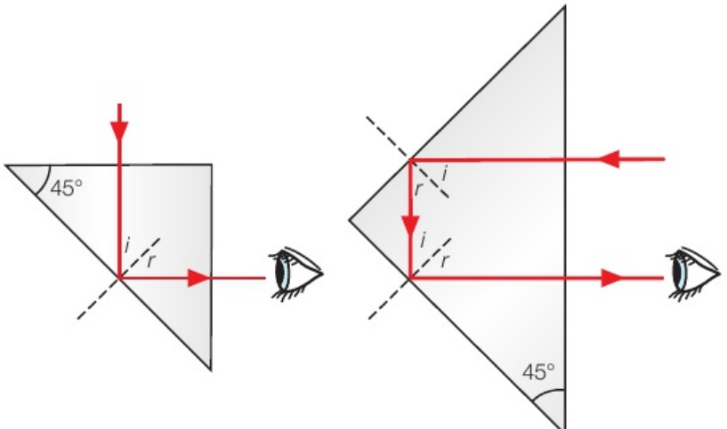

A more complex use for TIR is in fibre optics. A thin glass fibre can guide light along its length by the repeated TIR at the internal edges. This may just be used for decorative lighting, Fibre optics can be used to guide sunlight to the interior of large buildings. Alternatively, optical fibres can be used to carry information as light pulses (as in fibre broadband) or as actual images (in uses such as a medical endoscope – see fig E).

▲ fig C Total internal reflection helps us direct light usefully.

## PRACTICAL SKILLS

## Investigating total internal reflection

Using a setup like that shown in fig D, we can steadily increase the angle of incidence ( $ \theta_{1} $) within the more dense glass and observe the emerging angle of refraction ( $ \theta_{2} $) in the air. As the angle inside the glass increases, we will see a partial reflection of the ray within the glass growing stronger in intensity, until the critical angle is reached inside the glass.

▲ fig D Measuring angles of incidence and refraction in order to find the critical angle and refractive index for glass.

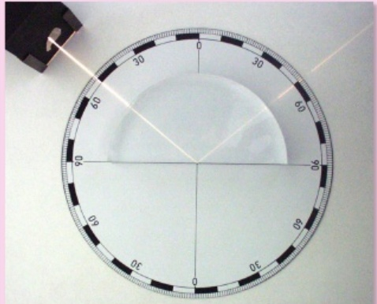

The block used should be an exact semicircle, and we aim the ray to travel through the glass and hit exactly the midpoint of the flat side. This means that the ray passing through the glass will be travelling along a radius of the semicircle and will have entered the glass exactly along the normal to the circular edge. So the only change in direction occurs at the flat side of the block. By carefully recording the critical angle, when the light emerges, we can calculate the refractive index for the glass.

 $$ n_{glass}=\frac{1}{\sin\theta_{c}} $$ 

Safety Note: The raybox may get hot enough to burn skin. Do not knock glass blocks together as sharp chips may fly off and cause injury.

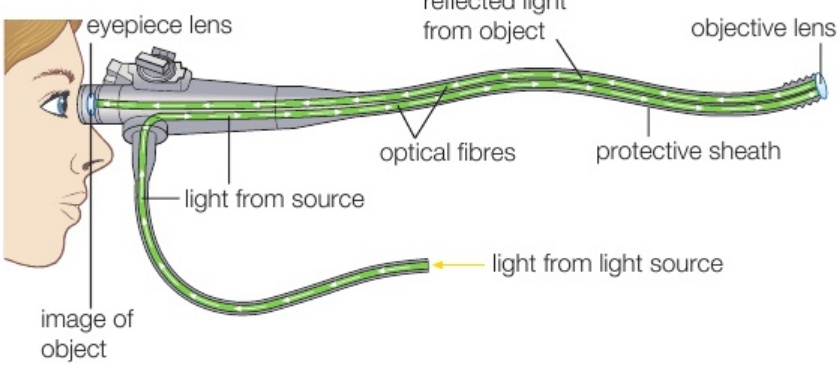

▲ fig E A medical endoscope is used to view the body's internal organs without cutting the patient open. Light is sent in along one optic fibre, and the reflection is carried away along the other for viewing by medical staff.

## CHECKPOINT

## SKILLS INTERPRETATION, ADAPTIVE LEARNING

1. What is the meaning of the term critical angle?

2. Explain how the reflections shown in fig D are possible.

3. Water has a refractive index of 1.33. What is the critical angle for water?

4. Explain why fish can observe predator birds in any part of the sky by only viewing a cone above them, as shown in fig F.

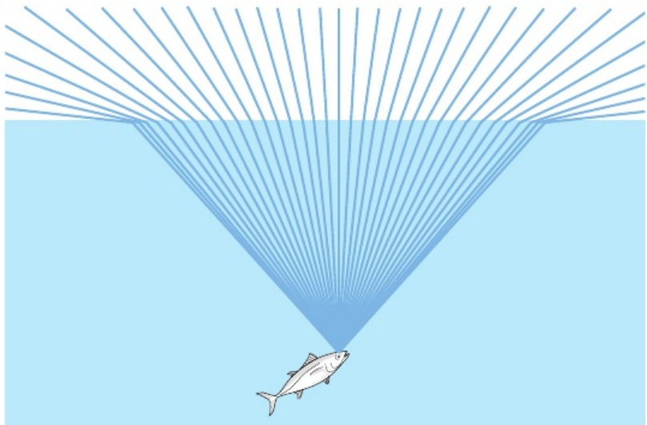

▲ fig F Fish can easily see all of the world above the water.

## SUBJECT VOCABULARY

critical angle the largest angle of incidence that a ray in a more optically dense medium can have and still emerge into a less dense medium. Beyond this angle, the ray will be totally internally reflected total internal reflection (TIR) waves reflect back into the same medium at a boundary between two media. This requires two conditions to be met:

- the ray is attempting to emerge from the more dense medium

- the angle between the ray and the normal to the interface is greater than the critical angle

<!-- page 135 -->

## 3 POLARISATION

## LEARNING OBJECTIVES

Understand what is meant by plane polarisation.

Describe how polarisation can be used with models to investigate stresses in structures.

## PLANE POLARISATION

Transverse waves have oscillations at right angles to the direction of motion. In many cases, the plane of these oscillations might be in one fixed orientation. Fig A shows the electric (red) and magnetic (blue) fields in an electromagnetic wave. In this example of a light wave, the electric fields only oscillate in the vertical plane. The wave is said to be plane polarised or, more precisely, vertically plane polarised. For electromagnetic waves, the plane of the electric field's oscillations is the one that defines its plane of polarisation.

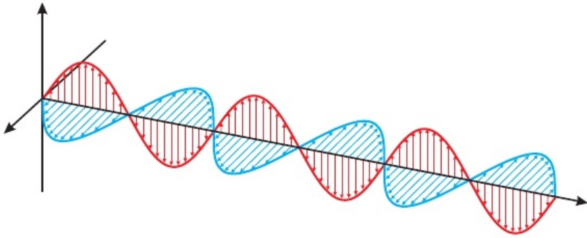

## fig A A polarised electromagnetic wave

Often, many waves travel together, with oscillations in a variety of planes. In this case, light from this source is said to be unpolarised. This is how light emerges from a light bulb, a candle and the sun.

## LEARNING TIP

Polarisation is only possible with transverse waves. If a wave is polarised, it must be a transverse wave.

## POLARISING FILTERS

Unpolarised radiation can be passed through a filter that will transmit only those waves that are polarised in a particular plane. Waves on a string could be polarised simply by passing the string through a card with a slit in it, which will then only allow oscillations to pass through if they are in line with the slit. For light waves, the polariser is a piece of plastic soaked with chemicals with long chain molecules, called a Polaroid sheet. The Polaroid filter will only allow light waves to pass if their electric field oscillations are orientated in one direction.

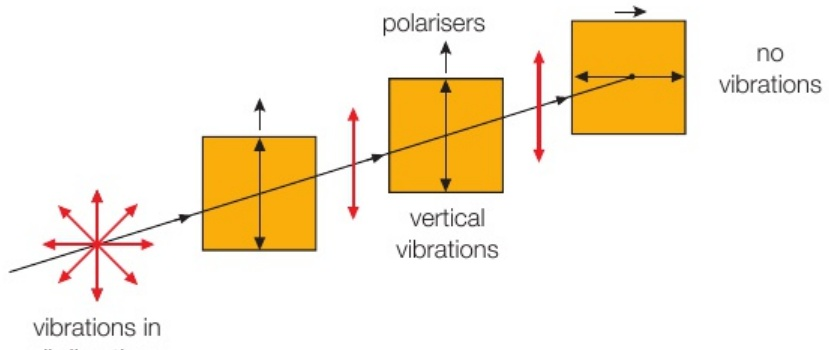

▲ fig B Polaroid filters transmit light waves if their plane of polarisation matches with the orientation of the filter.

Fig B illustrates the effects of Polaroid filters on light from a bulb. It starts unpolarised, with vibrations in all directions. The first filter only permits vertical vibrations, so they are selected, and the light is transmitted vertically plane polarised. The second filter is oriented in the same vertical direction, and the light will pass through this without change. The third Polaroid filter is oriented horizontally. This blocks vertically polarised light, and so no waves are transmitted beyond it. The second and third filters are referred to as 'crossed Polaroids', as their orientations are at right angles and, together, they will always block all light.

## PRACTICAL SKILLS

## Investigating structural stresses

We can use crossed Polaroids to observe stress concentrations in clear plastic samples.

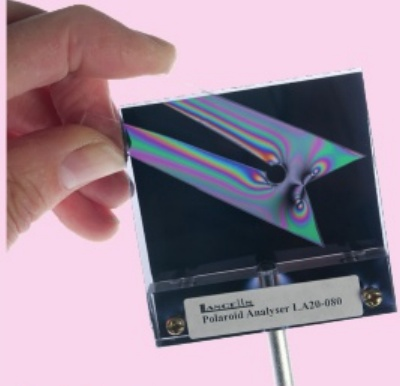

## ▲ fig C Stress analysis using crossed Polaroids

The first Polaroid produces polarised light, which passes into the plastic sample. Stressed areas have their molecules in slightly different orientations, and this will affect the passage of the light through the plastic. This effect varies with the colour of the light. When the second Polaroid acts on the emerging light, some of the light will have travelled slightly more slowly through the plastic and will destructively interfere with other light waves of the same colour. Thus, depending on the degree of stress in the plastic, the colours that emerge will vary. Differently stressed areas appear as different colours through the second Polaroid. Changing the stresses on the plastic will alter the internal stresses, and the interference pattern will change. Engineers use this to see stress concentrations in models of

<!-- page 136 -->

structures, and to observe how the stress concentrations change when the amount of stress changes. This allows them to alter the design to strengthen a structure in regions of highest stress.

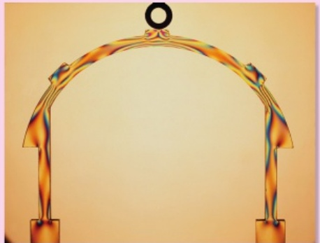

fig D Engineering stress analysis using crossed Polaroids.

## POLARISATION BY REFLECTION AND REFRACTION

When unpolarised light reflects from a surface, such as a road, the waves will become polarised. The degree of polarisation depends on the angle of incidence, but it is always tending towards horizontal plane polarisation, as shown in fig E. Sunglasses often have lenses with Polaroid filters. The Polaroid filters will block light that is horizontally polarised. If a driver has these, then they will block polarised light reflected from the road. This makes it easier for a driver to see clearly. unpolarised incident light

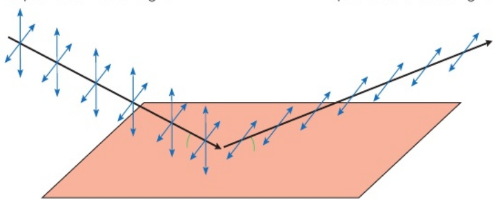

▲ fig E Reflection can polarise waves.

Light waves incident on a surface into which they can refract (see Section 3C.1), such as a pond, will reflect partially horizontally polarised light as in fig E, but will also transmit partially vertically polarised light into the new medium, as in fig F.

unpolarised light

partially polarised light

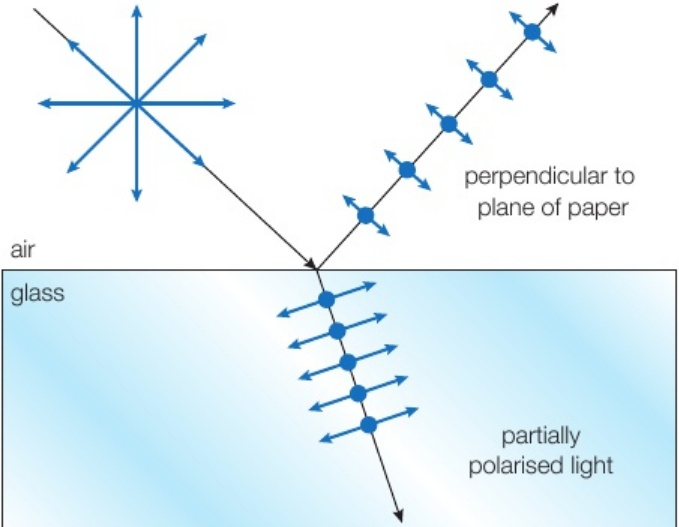

fig F Refraction can polarise waves.

## POLARISATION BY CHEMICAL SOLUTIONS

The analysis of stress concentrations investigated above works because different parts of the plastic model have different effects on polarised light. This is also the case with some chemicals, such as sugar solution. The amount of the concentration of the sugar solution varies the angle to which it rotates the polarisation of the light. We can use Polaroid filters to analyse the strength of the sugar solution, by measuring the angle at which the light polarisation emerges after passing through the solution.

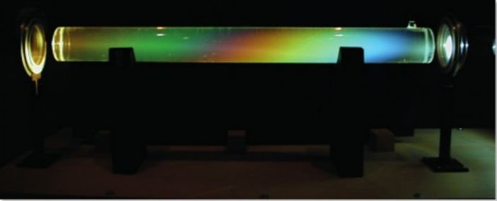

▲ fig G Sugar solutions can rotate the plane of polarisation. The degree of polarisation on a particular wavelength (colour) depends on the concentration of the solution, and how far the light has had to pass through it. This gives rise to the changing colours seen along the length of this tube of sugar solution.

## CHECKPOINT

## SKILLS CRITICAL THINKING

1. Silbab says that he has a 'sound wave polariser' on his new music system. Explain why his claim is incorrect.

2. What does it mean to say that a wave is unpolarised?

3. Why do ski goggles often have Polaroid filters with a vertical orientation?

4. Explain the benefits of being able to use polarisation to analyse stress concentrations in engineering models.

## EXAM HINT

When asked about the orientation of polarising filters, think carefully about whether you want to block the light, or for the filter to transmit it.

## SUBJECT VOCABULARY

polarisation the orientation of the plane of oscillation of a transverse wave. If the wave is (plane) polarised, all its oscillations occur in one single plane

<!-- page 137 -->

# 3C THINKING BIGGER

# GLASS FORENSICS

Refractive indices can be determined to several decimal places, and tiny variations can highlight very small differences in the compositions of materials like glass.

In this activity, we will look at some ideas about identifying glass in crime scene investigations.

SCIENTIFIC JOURNAL PAPER

## FORENSIC GLASS COMPARISON

## Introduction

Glass can be found in most places. It is produced in a wide variety of forms and compositions, and these affect the properties of this material. It can occur as evidence when it is broken during a crime. Broken glass fragments ranging in size from large pieces to tiny fragments may be transferred to and retained by nearby persons or objects. The presence of fragments of glass on the clothing of an alleged burglar in a case involving entry through a broken window may be important evidence if fragments are found. The importance of such evidence will be enhanced if the fragments are found to have the same properties as the broken window. However, if the recovered fragments are different in their measured properties from the glass from the broken window, then that window can be eliminated as a possible source of the glass on the subject's clothing (Koons et al. 2002).

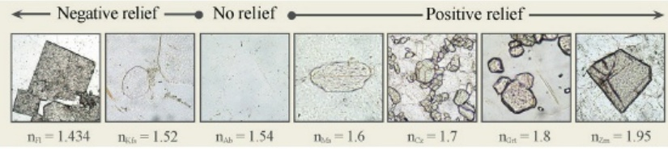

▲ fig A Crystals with differing refractive indices viewed within an oil bath with refractive index, n = 1.54. Those with higher or lower refractive index are easily visible, whereas the quartz with the same refractive index is virtually invisible.

## Optical Properties

Refractive index is a function of chemical composition and atomic arrangement (Stoiber and Morse 1981). Refractive index is the most commonly measured property in the forensic examination of glass fragments (Koons et al. 2002), because:

• It can be measured quickly from small pieces.

• It can aid in the characterization of glass.

• It provides a good chance to identify the glass exactly. (Koons et al. 2002)

Immersion methods are used to measure refractive index in some laboratories. These methods take advantage of the fact that when using monochromatic light, a particle immersed in a liquid of identical refractive index will become invisible (Bloss 1961).

In this method, a video camera captures the image of the particle edge, and a computer calculates the point of minimum contrast – the match point – across the particle edge while automatically varying the temperature. The temperature is adjusted so that the refractive index of the liquid is higher than that of the glass sample. The instrument lowers the temperature of the preparation through the match point for the glass. The contrast between the fragment and the liquid is monitored, and the match point is noted automatically. The refractive index of the sample is calculated automatically from temperature calibration data.

## Interpretations/Conclusions

The variations of the properties of glass within a single source are usually small (Bottrell et al. 2007), typically below the resolving power of the techniques used to measure them. The variation among glass objects from different sources can be observed and measured (Hickman 1983; Koons et al. 1988; Koons and Buscaglia 1999; Koons and Buscaglia 2002) and are usually much greater than the variation within a single object.

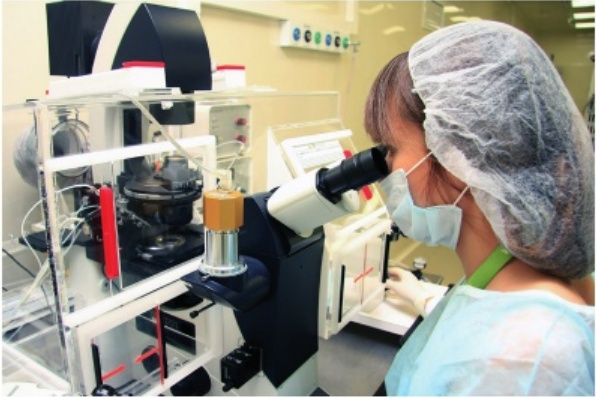

fig B A forensic lab refractometer.

<!-- page 138 -->

## THINKING BIGGER

## SCIENCE COMMUNICATION

The extract opposite is from a paper in a scientific journal on the forensic lab investigations that can be done on glass.

(a) The paper quoted is a type of scientific paper known as a 'review paper', in which the author does not present new research, but summarises other scientists' primary research in order to present a large amount of current knowledge. How does the way the paper is written tell you that this is a review paper?

(b) Is there any bias present in the report? Explain how you decided on your answer to this.

## PHYSICS IN DETAIL

Now we will look at the physics in detail. Some of these questions link to topics earlier in this book, so you may need to combine concepts from different areas of physics to work out the answers.

2 Explain why a crystal in oil will become invisible if the two have identical refractive indices.

3 Why will a change in the temperature of oil change its refractive index?

4 Why does a refractometer need a powerful microscope system as part of its set up?

5 Glass or plastic from different sunglasses lenses can often have identical refractive indices. Suggest another method by which two large (>1 cm²) pieces of glass from different sunglasses could be identified to match up with their original owners.

## ACTIVITY

The Young modulus can be affected by the atomic impurities in a material. Prepare a set of experimental instructions for use by a forensic lab technician. These are to help the technician to identify the Young modulus of a sample of glass in order to compare a sample found on a suspect with a sample from a broken window. Explain what quantities should be measured, how to analyse the measurements to determine the Young modulus, and what level of accuracy should be expected in the comparisons. Include instructions for the preparation of the sample, including cutting to the best size and shape.

## WRITING SCIENTIFICALLY

As you read these articles, identify everything that contributes to writing a scientific article. For example, the vocabulary, sources, the way information is presented. Make sure your own answers are written scientifically.

## THINKING BIGGER TIP

Remember that the Young modulus can be determined as the stiffness constant for a material in compression as well as for one in tension.

<!-- page 139 -->

# 3C EXAM PRACTICE

1 Which of these is the correct unit for refractive index?

A  $ ^{\circ} $ B m $ s^{-1} $

C m D no units [1]

(Total for Question 1 = 1 mark)

2 What is the critical angle for Perspex which has a refractive index of 1.48?

A  $ 0.026^{\circ} $ B  $ 0.74^{\circ} $ C  $ 42.5^{\circ} $ D  $ 47.5^{\circ} $ [1]

(Total for Question 2 = 1 mark)

3 A student did an experiment to measure the critical angle in a glass block.

Which row in the table correctly shows the readings for which he could find the critical angle.

<table border=1 style='margin: auto; word-wrap: break-word;'><tr><td style='text-align: center; word-wrap: break-word;'></td><td style='text-align: center; word-wrap: break-word;'>Angle of incident ray / °</td><td style='text-align: center; word-wrap: break-word;'>Angle of resulting ray / °</td></tr><tr><td style='text-align: center; word-wrap: break-word;'>A</td><td style='text-align: center; word-wrap: break-word;'>10</td><td style='text-align: center; word-wrap: break-word;'>15</td></tr><tr><td style='text-align: center; word-wrap: break-word;'>B</td><td style='text-align: center; word-wrap: break-word;'>24</td><td style='text-align: center; word-wrap: break-word;'>45</td></tr><tr><td style='text-align: center; word-wrap: break-word;'>C</td><td style='text-align: center; word-wrap: break-word;'>42</td><td style='text-align: center; word-wrap: break-word;'>90</td></tr><tr><td style='text-align: center; word-wrap: break-word;'>D</td><td style='text-align: center; word-wrap: break-word;'>57</td><td style='text-align: center; word-wrap: break-word;'>57</td></tr></table>

(Total for Question 3 = 1 mark)

4 Which of the following cannot be experimentally demonstrated with sound waves?

A Diffraction

B Polarisation

C Two source interference

D Ultrasound [1]

(Total for Question 4 = 1 mark)

5 Two parallel rays of light, one blue, one red, are travelling in air and are incident on one side of a glass prism. The blue light passes into the prism and meets the second face at the critical angle as shown in the diagram.

(a) Add to the diagram the path of the blue light after it meets the second face. Label this path X. [1]

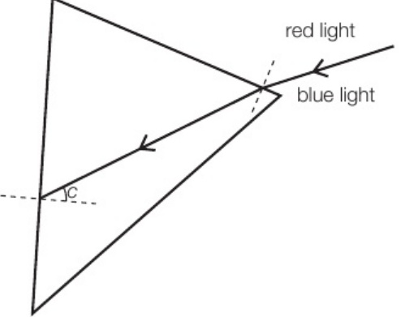

(b) (i) The speed of blue light in the glass prism is  $ 1.96 \times 10^{8} \, m s^{-1} $.

Calculate the refractive index of this glass for blue light. [2]

(ii) Calculate the critical angle for blue light in this glass prism. [2]

(c) The refractive index of this glass for red light is less than for blue light. Add to the diagram to complete the path of the red light through the prism. Label this path Y. [2]

(Total for Question 5 = 7 marks)

6 If you look into a fish pond on a bright sunny day, you sometimes cannot see the fish because of the glare of light reflected off the surface. When the sunlight is reflected off the surface of the water it is plane-polarised.

(a) State the difference between plane-polarised and unpolarised light. [1]

(b) Explain how Polaroid sunglasses can enable the fish to be seen. [3]

(c) State why sound waves cannot be polarised. [1]

(Total for Question 6 = 5 marks)

7 A student carries out an experiment to measure the refractive index of glass. He does this by shining a ray of light through a semicircular glass block and into the air as shown.

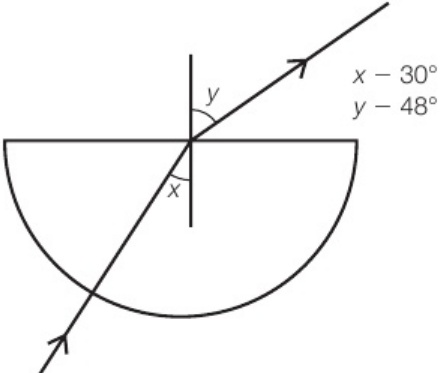

(a) Calculate the refractive index from air to glass,  $ a n_{g} $

(b) (i) The student steadily increases the angle x in glass and finds that eventually the light does not pass into the air. Explain this observation. [3]

(ii) Calculate the largest value of angle x that allows the light to pass out of the block into the air. [2]

(Total for Question 7 = 7 marks)

<!-- page 140 -->

## EXAM PRACTICE

8 Optical fibres have many uses in medicine and communications. They can also be incorporated into materials such as fabrics. Some optical fibres are made from a central core of transparent material surrounded by a material of a different refractive index as a cladding.

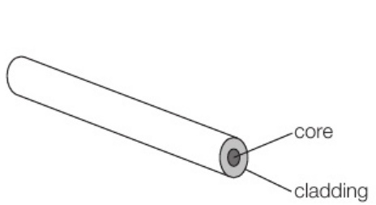

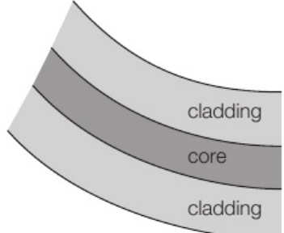

speed of light in the core =  $ 1.96 \times 10^8 \, \text{m} \, \text{s}^{-1} $

speed of light in the cladding =  $ 2.03 \times 10^8 \, \text{m} \, \text{s}^{-1} $

(a) Calculate the critical angle for the core-cladding boundary.

(b) The diagram below shows a ray of light inside the core of a fibre. The ray is incident on the core-cladding boundary at an angle of  $ 80^{\circ} $.

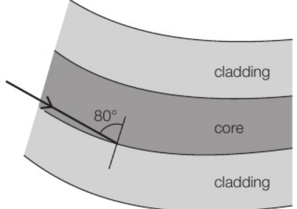

State what happens to this ray of light when it is incident on the core-cladding boundary as shown. [1]

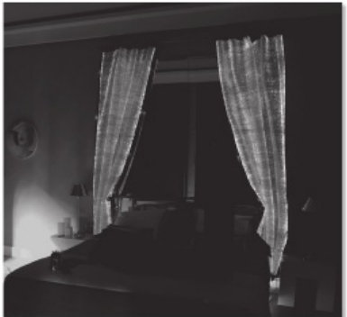

(c) The light source for these curtains is at the top.

Suggest why the bottom of the curtain is much brighter than the rest of the curtain. [2]

(Total for Question 8 = 6 marks)

9 Rainbows are seen when sunlight is dispersed by raindrops. The light is separated into different colours because they each take different paths through raindrops.

A ray of white light is incident on a raindrop. The diagram shows the subsequent path of the red light.

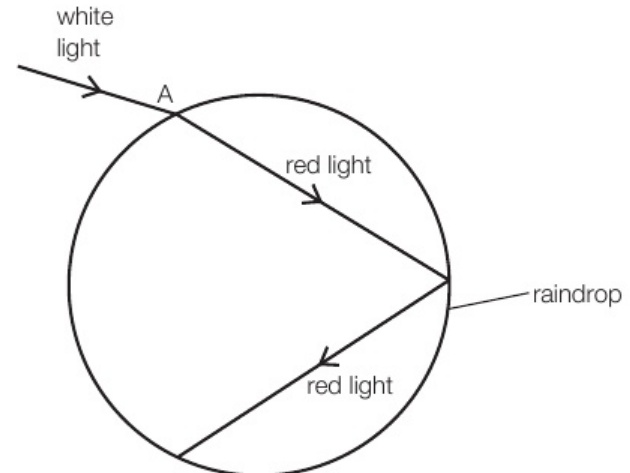

(a) Name the effect that is experienced by the red light at A.

(b) (i) On the diagram, label an angle of incidence with an i and an angle of refraction with an r. [2]

(ii) On the diagram, draw the path that a violet ray of light would take, through the raindrop and into the air.

(c) (i) State what is meant by the critical angle.

(ii) Calculate the critical angle for red light in the raindrop.

refractive index for red light in water = 1.3

(d) Red light has a frequency of  $ 4.2 \times 10^{14} $ Hz and travels at a speed of  $ 2.2 \times 10^{8} $ m s $ ^{-1} $ in the raindrop.

Calculate the wavelength of the red light in the raindrop. [2]

(Total for Question 9 = 10 marks)

10 Explain how infrared radiation can travel the length of an optical fibre, and describe and explain applications of this.

(Total for Question 10 = 6 marks)

