# 3D Quantum physics

<!-- edx_ial_phy1.pdf p141-158 -->

<!-- page 141 -->

# TOPIC 3 WAVES AND THE PARTICLE NATURE OF LIGHT

# 3D QUANTUM PHYSICS

Albert Einstein is one of the world's most famous physicists. So what did a mainly self-educated office worker in the Swiss patent office produce that could make him so important? In 1905, Einstein had what is often referred to as his Annus Mirabilis – year of miracles – in which he published scientific papers on four separate topics. All four papers made significant breakthroughs in the topics they were concerned with, and were diverse, not directly related to each other. His paper on the photoelectric effect won the 1921 Nobel Prize for Physics.

In this chapter, we will be dealing with the ideas that electromagnetic radiation, such as light, and particles, such as electrons, can behave as both waves and particles. Usually we only observe one aspect or the other, such as the photoelectric effect demonstrating that light can be a particle. Scientists are still not clear on an explanation for both light and electrons that can universally describe their behaviour under all circumstances. Einstein helped us along the way, but he did not solve the puzzle. Maybe someday you will.

## MATHS SKILLS FOR THIS CHAPTER

Units of measurement (e.g. the electronvolt, eV)

- Use of standard form and ordinary form (e.g. using a wavelength of light)

• Changing the subject of an equation (e.g. using the photon energy equation)

• Solving algebraic equations (e.g. finding the colour of light emitted by an excited atom)

Substituting numerical values into algebraic equations (e.g. a photoelectric effect calculation)

Determining the slope and intercept of a linear graph (e.g. analysing photoelectric cell data)

<!-- page 142 -->

What prior knowledge do I need?

Topic 3A

Models of waves and wave processes

The existence and properties of the electron

The electronic structure of atoms

Macroscopic emission and absorption of light

Diffraction and interference of light

Topic 3B

Detailed knowledge of the parts of the electromagnetic spectrum, and the frequencies of electromagnetic radiations

What will I study in this chapter?

The idea of wave-particle duality, and the nature of light

Photon energy

The photoelectric effect

Electron diffraction and interference

How light is created

What will I study later?

Topic 7 (Book 2: iAL)

Experimental investigations of the structure of subatomic particles

Topic 7A (Book 2: IAL)

How to calculate the wavelength of an electron

Topic 7B (Book 2: IAL)

The process of thermionic emission, and its similarities to and differences from the photoelectric effect

Topic 7C (Book 2: IAL)

Details about the smallest fundamental particles yet found

Topic 11B (Book 2: IAL)

Blackbody radiation of all wavelengths of electromagnetic radiation, and the colours of stars

<!-- page 143 -->

# 1 WAVE-PARTICLE DUALITY

## LEARNING OBJECTIVES

Understand how the behaviour of electromagnetic radiation can be described in terms of both waves and photons.

Use the equation  $ E = h f $ for the energy of a photon of electromagnetic radiation.

## HUYGENS' PRINCIPLE

The Dutch scientist Christiaan Huygens came up with a principle for predicting the future movement of waves if we know the current position of a wavefront. The basic idea is to consider that any and every point on the wavefront is a new source of circular waves travelling forwards from that point. When the movement of these numerous circular waves is plotted, and then their superposition considered, the resultant wave will be the new position of the original wavefront.

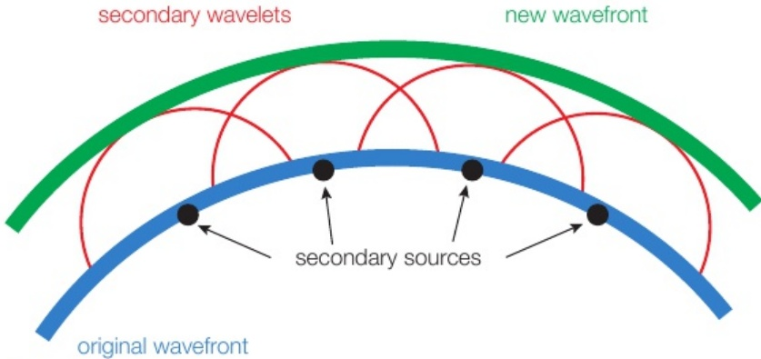

fig A Huygens' construction for explaining the movement of waves.

Huygens' geometrical system exactly explains all the basic phenomena that we see with light waves. We can make drawings like  $ \mathbf{fig} $  $ \mathbf{A} $ to correctly predict the movement of wavefronts in reflection, refraction, diffraction (fig B), interference and straight-line propagation of light.

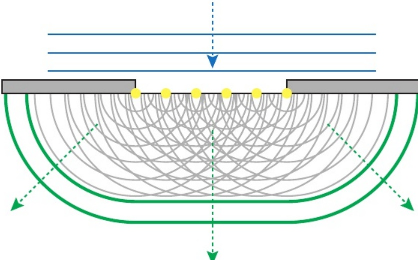

▲ fig B Huygen's construction correctly predicts diffraction through a gap.

## LIGHT IS A WAVE

We have seen numerous instances of light undergoing wave-like activities.

## EVIDENCE THAT LIGHT IS A WAVE

The interference pattern produced by diffraction and Young's two-slit experiment both require the superposition of wave displacements to generate the standing wave pattern seen. This is only possible if light is behaving as a wave. It must have repeating cycles of displacement that cause this superposition. The constructive and destructive interference gives a pattern of antinodes and nodes (maxima and minima). Particles cannot superpose in this way.

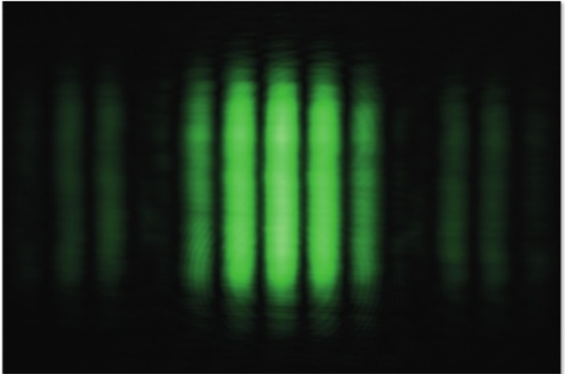

fig C Superposition effects, such as standing wave interference patterns, are only possible if light behaves as a wave.

Polarisation is another phenomenon exhibited by electromagnetic waves, including light, that can only be explained in classical physics by using the ideas of waves.

## LIGHT IS A PARTICLE

In some cases, the examples of light acting as a wave are phenomena that can only occur for waves. In Section 3D.2 we will look in detail at the photoelectric effect. This was first observed in 1887 by Heinrich Hertz (after whom the unit for frequency is named). However, it was not until the beginning of the twentieth century that an adequate explanation of the phenomenon was made. Working on the basis of Max Planck's 1901 suggestion that light could exist as quantised packets of energy called photons, Einstein produced a paper called, in English, Concerning an Heuristic Point of View Toward the Emission and Transformation of Light. Einstein wrote four important papers in 1905, including one on relativity and one regarding  $ E = mc^{2} $, but it was the explanation of the photoelectric effect for which he was awarded the 1921 Nobel Prize in Physics. Crucially, the photoelectric effect cannot be explained using a wave theory for light. However, the idea that light travels as particles, or photons, whose energy is proportional to the frequency it would have when considered as a wave, fits all the observations exactly.

<!-- page 144 -->

## PHOTON ENERGY

For electromagnetic radiation, the energy of the photon can be calculated by multiplying the frequency by Planck's constant,  $ h $. This constant has an extremely small value because it represents the fundamental minimum possible step in energy. In SI units,  $ h = 6.63 \times 10^{-34} $ J s. If we work on very small scales, photons cannot have energy values that differ by less than the Planck constant. This means that there are some energy values that are impossible in our universe. Such a system of minimum sized steps is called quantisation.

The energy of a photon is given by the equation:

 $$ \mathrm{photon~energy~(J)=Planck^{\prime}s~constant~(J~s)\times~frequency~(Hz)} $$ 

 $$ E=h f $$ 

## WORKED EXAMPLE

Calculate the energy of a photon of yellow light that has a wavelength of 550 nm.

 $$ E=h f $$ 

 $$ c=f\lambda $$ 

 $$ \therefore f=\frac{c}{\lambda}=\frac{3\times10^{8}}{550\times10^{-9}}=5.45\times10^{14}Hz $$ 

 $$ E=6.63\times10^{-34}\times5.45\times10^{14} $$ 

 $$ E=3.6\times10^{-19}J $$ 

Calculate the frequency of a gamma ray photon that has  $ 2.24 \times 10^{-14} $ joules of energy.

 $$ E=h f $$ 

 $$ \therefore f=\frac{E}{h}=\frac{2.24\times10^{-14}}{6.63\times10^{-34}} $$ 

 $$ f=3.38\times10^{19}Hz $$ 

## ELECTRONS ARE PARTICLES

Experiments that produce ions can demonstrate electrons behaving as particles because a fixed lump of mass and charge is removed from the atom in order to change the atom into an ion. The charge to mass ratio is a unique identifying property of particles, and was first demonstrated for the electron by J.J. Thomson in 1897. Robert Millikan, in an experiment finally published in 1913, took this one step further to find the electron charge itself. The fact that electrons hold a fixed amount of charge and a fixed mass indicates they are localised particles.

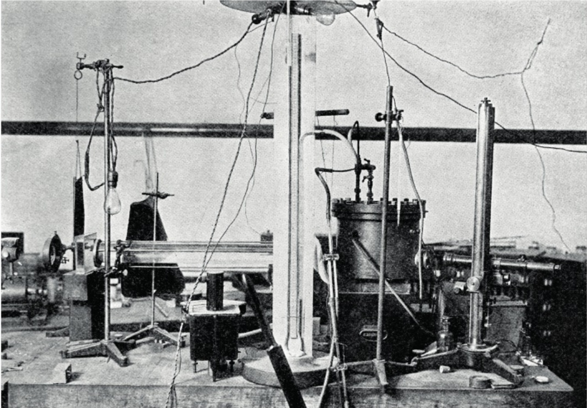

▲ Fig D Robert Millikan's oil drop apparatus showed that electrons have a fixed charge of  $ 1.5924 \times 10^{-19} $ coulombs. The difference with the currently accepted value is caused by a mistake in Millikan's calculations, because he used a slightly incorrect value for the viscosity of air.

## EXAM HINT

Note that the steps and layout of the solution in this worked example are suitable for questions on photon energy and frequency in the exam.

<!-- page 145 -->

## ELECTRONS ARE WAVES

If electrons are made to travel at very high speeds, they will pass through gaps and produce a diffraction pattern. They will also interact with a double-slit apparatus to produce the interference pattern seen when waves pass through two slits. Diffraction and interference are not expected by classical particles, as they should simply travel straight through the slits. Observation of these experimental results proves that electrons can behave as waves.

The experimental observations highlighted in this section have suggested that both electrons and electromagnetic radiation seem to contradict our explanations of them. Physicists have good theoretical descriptions of the wave and particle natures for electrons and also for electromagnetic radiation. However, we do not have a complete and perfect single theory that explains both correctly for either electrons or EM radiation.

## WAVES OR PARTICLES?

SKILLS INNOVATION

SKILLS DECISION MAKING

<table border=1 style='margin: auto; word-wrap: break-word;'><tr><td style='text-align: center; word-wrap: break-word;'>PHENOMENON</td><td style='text-align: center; word-wrap: break-word;'>EVIDENCE FOR WAVES</td><td style='text-align: center; word-wrap: break-word;'>EVIDENCE FOR PARTICLES</td></tr><tr><td style='text-align: center; word-wrap: break-word;'>light</td><td style='text-align: center; word-wrap: break-word;'>diffraction, interference, polarisation</td><td style='text-align: center; word-wrap: break-word;'>photoelectric effect</td></tr><tr><td style='text-align: center; word-wrap: break-word;'>electron</td><td style='text-align: center; word-wrap: break-word;'>diffraction, interference</td><td style='text-align: center; word-wrap: break-word;'>ionisation</td></tr></table>

table A Summary of the evidence for light and electrons behaving as waves or particles.

The idea that these things behave as waves under certain circumstances and as particles under other circumstances is known as wave-particle duality.

## CHECKPOINT

1. ▶ Suggest an experiment that demonstrates:

(a) light behaving as a wave

(b) electrons behaving as waves.

2. What is the energy of a photon of UV light that has a wavelength of  $ 2 \times 10^{-7} $ m?

3. Demonstrating the polarisation of a beam of electrons requires a complex experiment. If electrons were shown to be travelling like polarised light, explain whether this would confirm that the electrons were particles or waves.

4. Is light a wave or a particle? Explain your answer.

5. Draw a picture illustrating how Huygens' construction could explain diffraction of sea waves around a large rock.

## SUBJECT VOCABULARY

photons' packets' of electromagnetic radiation energy where the amount of energy E = hf, which is Planck's constant multiplied by the frequency of the radiation: the quantum unit that is being considered when electromagnetic radiation is understood using a particle model

quantisation the concept that there is a minimum smallest amount by which a quantity can change: infinitesimal changes are not permitted in a quantum universe. The quantisation of a quantity is like the idea of the precision of an instrument measuring it.

wave-particle duality the principle that the behaviour of electromagnetic radiation can be described in terms of both waves and photons

<!-- page 146 -->

# 2 THE PHOTOELECTRIC EFFECT

## LEARNING OBJECTIVES

Explain the photoelectric effect and experimental observations of it.

Understand how the photoelectric effect provides evidence for the photon model of light.

Use the photoelectric effect equation.

## PHOTOELECTRONS

If ultraviolet light is shone onto a negatively charged zinc plate, the plate loses its charge. The explanation for this is that the light causes electrons to leave the metal, removing the negative charge. The electrons that are released are called photoelectrons. However, variations on this experiment produce some surprising observations. There is a certain minimum amount of energy that an electron needs in order to escape the surface of the metal. This energy is called the work function, and has the symbol,  $ \phi $.

The wave theory of light would allow some of the wave energy to be passed to the electrons to enable them to gain the work function and escape. In the wave theory, the energy carried by a wave depends on its amplitude, which for light means its brightness. So the wave theory would predict that any colour of light, if made sufficiently bright, should enable the release of photoelectrons. Alternatively, if the wave were of smaller amplitude, it could shine for longer and slowly pass energy to the electrons, until they had gained as much as the work function and escape. However, this is not what is observed. The same negatively charged zinc plate cannot be discharged by red light, no matter how bright or how long the illumination. No photoelectrons are emitted under red light. There is a maximum wavelength for the light, above which no photoelectrons are ever emitted. This can be thought of equivalently as a minimum frequency for the light, known as the threshold frequency.

## PRACTICAL SKILLS

## Investigating photoelectrons

If you charge a gold leaf electroscope then it will show a deflection on the gold leaf. If you place a zinc plate on top of the electroscope, the photoelectric effect will allow the electroscope to be discharged if it held a negative charge. If you shine UV light onto the zinc plate, the gold leaf will fall immediately. This observation shows that electrons on the zinc plate have escaped. Those electrons remaining on the gold leaf and electroscope stalk spread out more, so that there is no longer enough mutual repulsion to hold up the gold leaf. You may need to clean the surface of the zinc, as it oxidises quite easily in air. As such, there may be a layer of oxide on top of the pure metal, stopping the light absorption.

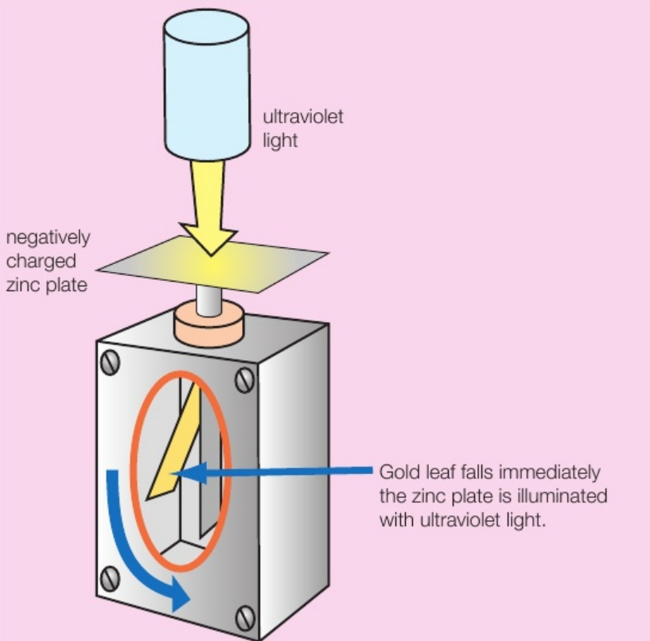

Gold leaf falls immediately the zinc plate is illuminated with ultraviolet light.

## fig A Demonstrating the photoelectric effect

If you attempt to discharge the electroscope with an ordinary desk lamp, or sunlight, there will be very little effect. This is because these sources provide little UV light intensity, and longer wavelengths will not cause the photoelectric effect with zinc. Even if you left the electroscope in front of the desk lamp for several hours, it would not discharge. However, the UV light need not be very bright, and it will still immediately cause discharge.

Safety Note: Do not view ultraviolet light directly or by reflection to avoid retinal damage. If electroscope is charged with a high voltage connection, use a safe connection method to avoid electric shock.

The explanation for these experimental observations can be summarised as:

- Light travels as photons, with a photon's energy proportional to the frequency.

- When a photon encounters an electron, it transfers all its energy to the electron (the photon ceases to exist).

- If an electron gains sufficient energy – more than the work function – it can escape the surface of the metal as a photoelectron.

- Brighter illumination means more photons per second, which will mean a greater number of photoelectrons emitted per second.

- If an electron does not gain sufficient energy from an encounter with a photon to escape the metal surface, it will transfer the energy gained from the photon to the metal as a whole before it can interact with another photon. Thus, if the photon energy is too low, no photoelectrons are observed.

<!-- page 147 -->

## LEARNING TIP

The SI units for the terms in the photoelectric effect equation are all joules (J), but it is often used in units of electronvolts (eV).

The electronvolt is the amount of energy an electron gains by passing through a voltage of 1 V.

 $$ 1\ \mathrm{eV}=1.6\times10^{-19}\mathrm{J} $$ 

1 mega electronvolt = 1 MeV

= 1.6 × 10⁻¹³ J

Einstein developed an equation to explain the photoelectric effect, which is based on the conservation of energy. We have previously seen that the energy of a photon can be found from  $ E = hf $. During the photoelectric effect, the energy of a photon is transferred to an electron. To escape a metal surface, an electron requires at least an amount of energy equal to the work function. It may also lose energy before escaping the metal due to other physical processes. Only the remaining energy will be available for the electron emission kinetic energy to be emitted from the surface. Therefore, the kinetic energy that the electron can have on emission from the metal surface is less than or equal to the difference between the photon energy and the work function. This maximum possible kinetic energy  $ \frac{1}{2}mv_{\max}^{2} $ determines the maximum initial velocity  $ v_{\max} $ of the photoelectron. Einstein's photoelectric effect equation then is:

## THE PHOTOELECTRIC EFFECT EQUATION

 $$ \frac{1}{2}mv^{2}_{max}=hf-\phi $$ 

Or, stated in terms of the conservation of energy, the photon energy transferred to the electron is used partly to escape the metal surface and partly for its kinetic energy on leaving the metal. So, a rearrangement of the equation is:

## EXAM HINT

Note that the steps and layout of the solution in this worked example are suitable for questions on the photoelectric effect equation in the exam.

 $$ h f=\phi+\frac{1}{2}m v^{2}_{max} $$ 

## WORKED EXAMPLE

What is the work function of potassium if green light with a wavelength of 510 nm shining on it produces photoelectrons that have a maximum kinetic energy of 0.14 eV?

 $$ \frac{1}{2}mv^{2}_{max}=hf-\phi $$ 

 $$ \therefore\quad\phi=h f-\frac{1}{2}m v^{2}_{max} $$ 

 $$ \mathrm{\frac{1}{2}}mv^{2}_{max}=0.14\mathrm{eV}=0.14\times1.6\times10^{-19}=2.24\times10^{-20}\mathrm{J} $$ 

 $$ hf=\frac{hc}{\lambda}=\frac{6.63\times10^{-34}\times3\times10^{8}}{510\times10^{-9}}=3.9\times10^{-19}J $$ 

 $$ \phi=h f-\frac{1}{2}m v^{2}_{\max}=3.9\times10^{-19}-2.24\times10^{-20} $$ 

 $$ \phi=3.68\times10^{-19}J $$ 

## THE PHOTOELECTRIC CELL EXPERIMENT

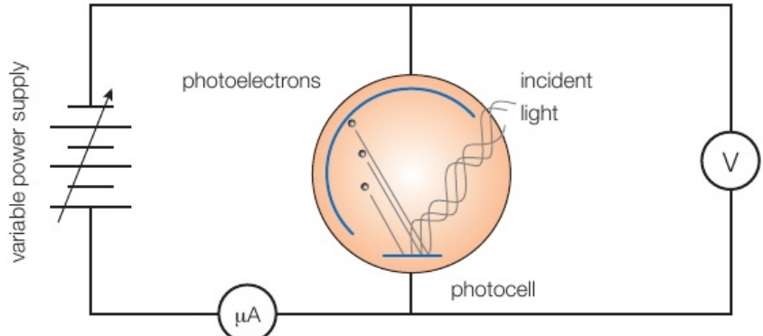

fig B A photoelectric effect cell experiment circuit.

We could use the photoelectric effect equation to measure Planck's constant and the work function for a metal. In a vacuum, we place the metal as the anode in a cell that has a gap to the cathode – see fig B. When we shine light of a known frequency onto the anode, photoelectrons will be emitted and the current registered on the ammeter. If we slowly increase the pd across the photoelectric cell, eventually the anode will become sufficiently positive that all photoelectrons will be stopped and attracted back to it, so the photoelectric current will be zero. This stopping voltage,  $ V_{s} $, will give us the maximum kinetic energy of the photoelectrons, from the definition of voltage:

 $$ \frac{1}{2}m v^{2}_{\max}=e\times V_{s} $$ 

If we use a range of light frequencies and find the stopping voltage for each, we can plot a graph of the photoelectron maximum kinetic energy, on the y-axis, against frequency, on the x-axis. Comparison with the equation for a straight line shows us that the graph should produce a straight best-fit line and the gradient will be equal to Planck's constant.

 $$ \frac{1}{2}mv^{2}_{max}=hf-\phi $$

<!-- page 148 -->

$$ y=m x+c $$ 

The y-intercept will represent the value of the work function,  $ \phi $. Also, when the value of y is zero (the x-intercept) then the photon energy must equal the work function.

 $$ \frac{1}{2}m v^{2}_{\max}=hf-\phi $$ 

 $$ 0=h f-\phi $$ 

 $$ \therefore\quad hf=\phi $$ 

This means that the value of the x-intercept will give the threshold frequency for the anode metal.

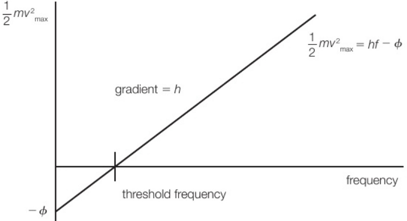

▲ fig C Graphical analysis of results from a photoelectric cell experiment can determine Planck's constant and the work function for the anode metal.

When you have a graph with plotted data points, start by drawing a best-fit line. The question may not ask you to do this, but it will be expected.

<table border=1 style='margin: auto; word-wrap: break-word;'><tr><td style='text-align: center; word-wrap: break-word;'>METAL</td><td style='text-align: center; word-wrap: break-word;'>WORK FUNCTION / eV</td></tr><tr><td style='text-align: center; word-wrap: break-word;'>cadmium</td><td style='text-align: center; word-wrap: break-word;'>4.07</td></tr><tr><td style='text-align: center; word-wrap: break-word;'>caesium</td><td style='text-align: center; word-wrap: break-word;'>2.10</td></tr><tr><td style='text-align: center; word-wrap: break-word;'>iron</td><td style='text-align: center; word-wrap: break-word;'>4.50</td></tr><tr><td style='text-align: center; word-wrap: break-word;'>nickel</td><td style='text-align: center; word-wrap: break-word;'>5.01</td></tr><tr><td style='text-align: center; word-wrap: break-word;'>zinc</td><td style='text-align: center; word-wrap: break-word;'>4.30</td></tr></table>

table A Examples of photoelectric work function values.

## EXAM HINT

## CHECKPOINT

1. What is the work function of potassium in electronvolts?

2. (a) Why would iron not release photoelectrons if red light were shone on it?

(b) How would this result change if the red light were turned up to double brightness?

3. How does the photoelectric cell experiment described above get over the problem that the electrons released will have a variety of kinetic energies, depending on how deep in the metal they start?

4. What is the threshold frequency of caesium?

## SUBJECT VOCABULARY

photoelectrons electrons released from a metal surface as a result of its exposure to electromagnetic radiation

work function the minimum energy needed by an electron at the surface of a metal to escape from the metal

threshold frequency the minimum frequency of electromagnetic radiation that can cause the emission of photoelectrons from the metal

stopping voltage the minimum voltage needed to reduce the photoelectric current to zero, when illuminated with a particular frequency of light

SKILLS CRITICAL THINKING, INNOVATION

<!-- page 149 -->

# 3 ELECTRON DIFFRACTION AND INTERFERENCE

## LEARNING OBJECTIVES

Explain how diffraction experiments provide evidence for the wave nature of electrons.

Describe other evidence for the wave nature of electrons.

Be able to use the de Broglie equation  $ \lambda = \frac{h}{p} $.

We have seen that waves passing through a gap will produce a diffraction pattern with bright and dark fringes as the diffracted waves from each side of the gap superpose to produce the interference pattern.

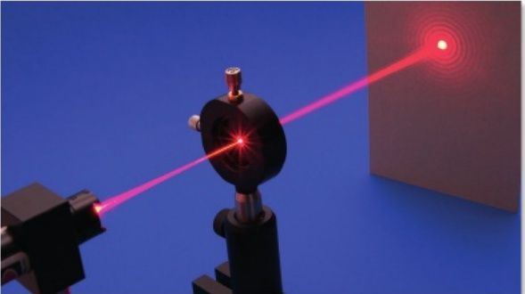

fig A Circular diffraction pattern caused by a laser passing through a pinhole.

## ELECTRON DIFFRACTION

As a diffraction pattern is a wave phenomenon, to observe this from a beam of electrons means that they must be behaving as waves. This is true whether we are passing waves through a gap, as in fig A, or reflecting waves from a grating, as we saw in fig H of Section 3B.3.

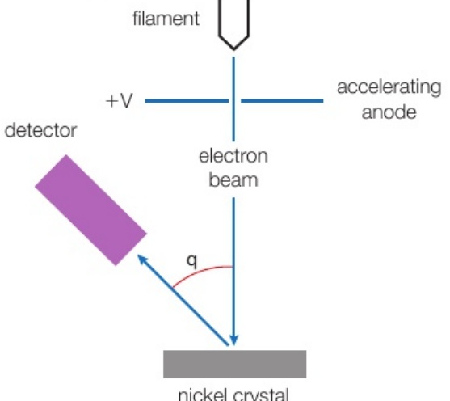

▲ fig B Davisson and Germer reflected a beam of electrons from a nickel crystal and measured the intensity of the reflection at different angles.

In 1927, Davisson and Germer tried to detect diffraction of electron ‘waves’ when they reflected from a crystal of nickel. Fig B illustrates the experimental setup. They measured the intensity of the beam at different angles for various accelerating voltages, and plotted a graph of their results. Fig C shows the graph for a beam accelerated through 54 volts.

## Scattering intensity

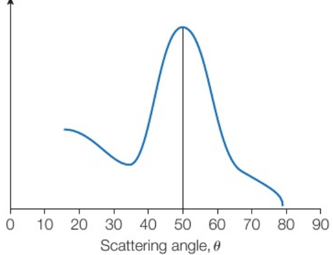

fig C Davisson and Germer's electron beam reflection from a surface of atoms, acting as a reflection grating, showed variable intensity at different angles, exactly as is observed with waves.

Not only did Davisson and Germer prove experimentally that electrons can behave as waves, but their results also allow calculation of the distance between atoms in the nickel crystal. This has given rise to advances in the study of atomic structures using electron beam crystallography.

## DE BROGLIE EQUATION

In 1924, a French prince called Louis de Broglie suggested electrons could behave as waves and proposed an equation to calculate their wavelength. Their wavelength is inversely proportional to the momentum they have when considered as particles.

 $$ \begin{aligned}electron\text{wavelength}(m)&=\frac{Planck^{\prime}s\text{constant}(J s)}{momentum(kg m s^{-1})}\\\lambda&=\frac{h}{p}\end{aligned} $$ 

## WORKED EXAMPLE

Calculate the wavelength of electrons travelling at 10% of the speed of light.

 $$ \lambda=\frac{h}{\pmb{p}}=\frac{6.63\times10^{-34}}{9.11\times10^{-31}\times0.1\times3\times10^{8}} $$ 

 $$ =2.43\times10^{-11}m $$ 

## EXAM HINT

Note that the steps and layout of the solution in this worked example are suitable for questions requiring the de Broglie equation in the exam.

## PRACTICAL SKILLS

## Investigating electron diffraction

Although they are quite expensive, some school laboratories have an electron beam diffraction tube. This accelerates a beam of electrons through a high voltage, and then passes the beam through a thin piece of graphite. The carbon atoms in the graphite acts as a diffraction grating in two dimensions, which produces a circular diffraction pattern. The front end of the tube has a phosphorescent screen that will show up the diffraction pattern.

<!-- page 150 -->

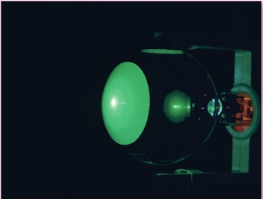

Fig D An electron beam diffraction tube demonstrates the wave nature of electrons.

If we make careful measurements of the dimensions of the tube and the diffraction pattern produced with different accelerating voltages, we can carry out an approximate calculation of the atom spacing in graphite.

Safety Note: Electron beam tubes operate at a hazardous voltage. Operate with shrouded connections to minimise the risk of electric shock.

## TWO-SLIT ELECTRON INTERFERENCE

In 1965, Richard Feynman suggested that electrons should also be able to produce the two-slit interference pattern seen with light, as they can behave as waves. Recently, this has been shown to be the case, giving further evidence for the wave nature of electrons.

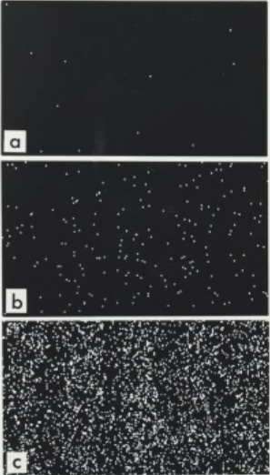

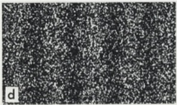

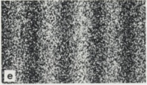

▲Fig E Recent experiments have been able to demonstrate electrons producing an interference pattern when passed through a two-slit-type experiment. The five images here show the same image after different amounts of time. The particle electrons hit the screen in places that slowly build up the wave interference pattern.

However, the latest research has allowed scientists to observe that the interference pattern is built up by the movement through the apparatus of the individual electrons. They are behaving as both individual particles and waves at the same time. They are showing wave-particle duality.

## ELECTRON MICROSCOPY

One of the most important applications of the wave nature of electrons is its use to study objects at very small scales. An electron beam can work like a beam of light, but with some different properties that can make the electron beam much more useful for microscopy. The main advantage is that the wavelength of an electron beam can be controlled by altering the voltage applied to accelerate the electrons. In some instances, this can mean the wavelength of electrons in the beam can be  $ 10^{-10} \, m $ – the same size as atoms. Approximately, the minimum-sized object that can be imaged by any wave is about the same size as the wavelength. In this example, the electron waves are 1000 times shorter than light waves, and so they can produce images of objects 1000 times smaller than visible light.

▲ fig F Electron microscopes can have a magnification up to 10 million times. These bacteria are about 1 micrometre long.

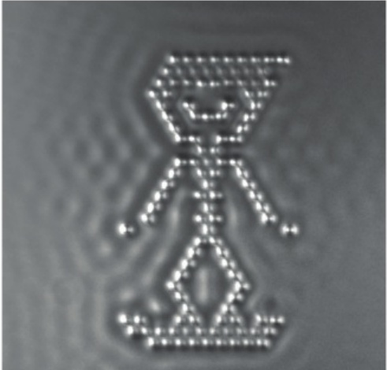

▲ fig G Electron microscopes have sufficient magnification to see the results of manipulation of individual atoms. This Atom Boy image was made by researchers at IBM who moved individual carbon monoxide molecules on a surface of copper metal.

## CHECKPOINT

## SKILLS PROBLEM SOLVING

1. Give an example of electrons behaving as a wave, and explain why this can only occur for waves.

2. Why would an electron microscope beam need to be accelerated through a higher voltage in order to view a smaller object?

3. What would be the wavelength of electrons that had been accelerated through a 400 V pd?

4. ▶ Estimate the de Broglie wavelength of a football moving towards the goal.

<!-- page 151 -->

# 4 ATOMIC ELECTRON ENERGIES

## LEARNING OBJECTIVES

Understand atomic line spectra in terms of energy level transitions.

Calculate the frequency of radiation emitted or absorbed in an electron energy transition.

■ Calculate the intensity of a source of light.

## ELECTRON ENERGY LEVELS

In Section 4A.6 we will see that electrons in semiconductors can have varying amounts of energy, and that the energy they have can put them into the valence band or conduction band. These energy bands are wide in solids – there is a large range of values of energy that the electron could have and still be in that band. In free atoms, such as those in a gas, the energy values that the electrons could have are limited to a small number of exact values, often called energy levels.

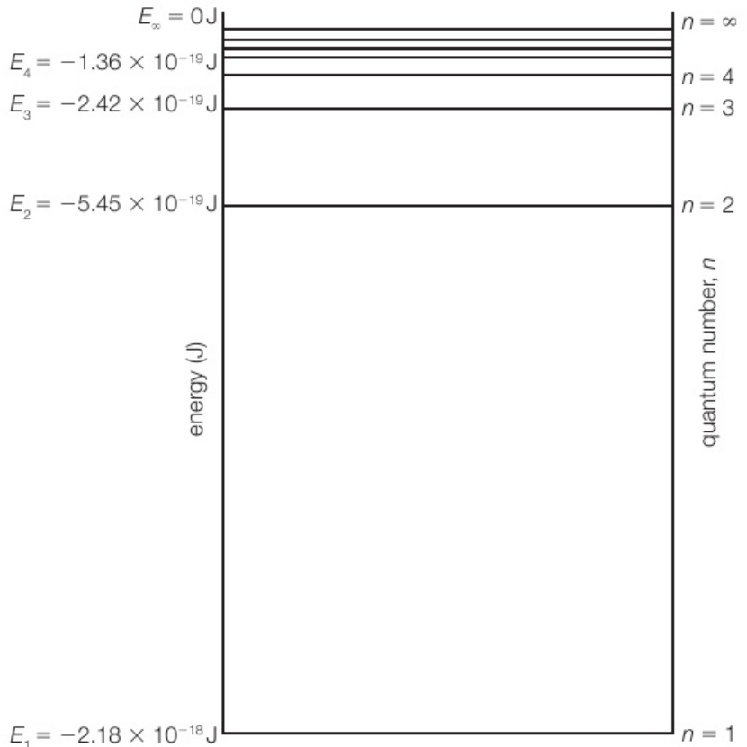

▲ fig A An energy level diagram for hydrogen. The energy values are negative, as we have to put energy in to lift the electron up from the ground state.

## EXCITATION AND DE-EXCITATION

Fig A illustrates the energy values that electrons of hydrogen could have. Under normal circumstances, an electron in an atom of hydrogen would be in its ground state. This is the lowest energy level, with a quantum number (or level) of n = 1. In order to move up energy levels, the electron must take in some energy. This is called excitation. Electrons can become excited if the atom collides with another particle. Alternatively, if the electron absorbs a photon that has exactly the correct amount of energy, the electron can jump to a higher energy level. For example, the difference in energy between the ground state  ($ -2.18 \times 10^{-18} $ J) and the n = 2 state  ($ -5.45 \times 10^{-19} $ J) is  $ 1.635 \times 10^{-18} $ J.

A photon with exactly this energy could be absorbed by an electron in the ground state of hydrogen, and this would lift the electron up to the energy level above the ground state, n = 2, and the photon would no longer exist. This is illustrated in fig B.

<!-- page 152 -->

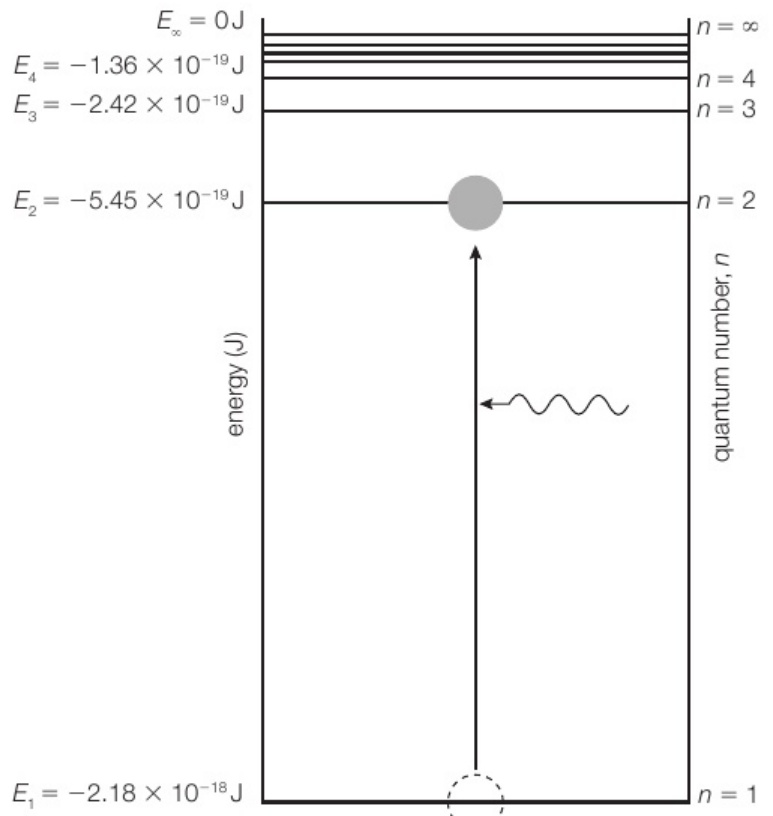

fig B Electron excitation in a hydrogen atom. For ease of reference, the energy levels are numbered with integers from n = 1 for the ground state, upwards.

An incident photon that does not have the energy exactly equivalent to a jump between the current position of the electron and one of the higher levels will not be absorbed – the photon and electron will not interact at all. If gas atoms are illuminated by a range of frequencies (colours), those with the correct frequency values will be absorbed, so there will be some colours missing from the light after it passes through the gas.

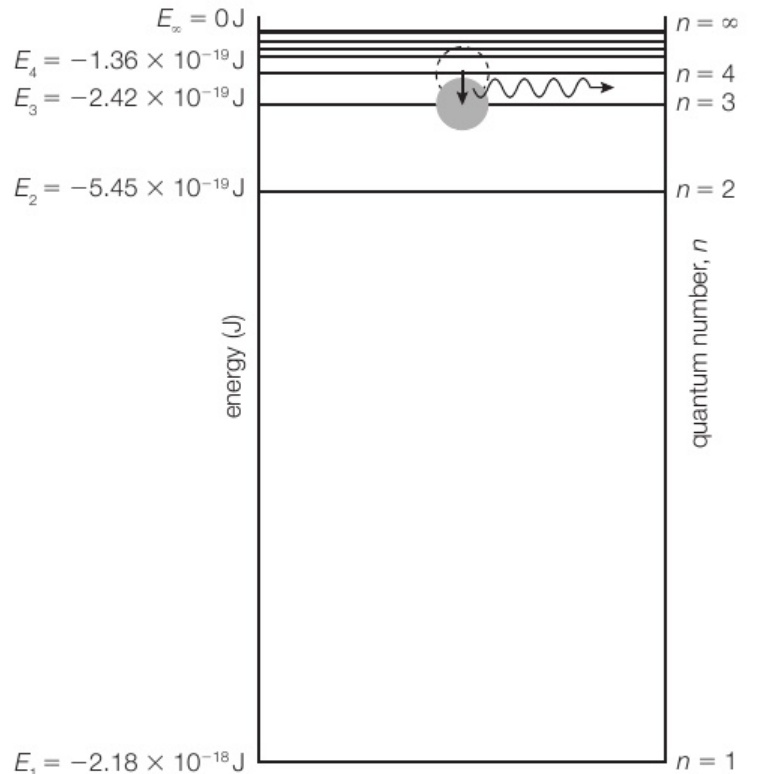

▲ fig C Electron de-excitation in a hydrogen atom.

If an electron is already excited, after a random amount of time it will de-excite. This may involve dropping straight down to the ground state, or it may drop to an intermediate level if there is one. Fig C shows an excited hydrogen electron dropping from energy level $n = 4$ down to $n = 3$. As the electron ends up with less energy than it had, the conservation of energy requires that this energy is emitted as a photon with exactly the energy difference between the levels. The frequency of the emitted photon can be calculated from the equation for photon energy, $E = h f$. So, a collection of gas atoms that are excited will emit light with a particular collection of frequencies, dependent on which element the gas atoms are.

## WORKED EXAMPLE

What are the frequencies of the photon absorbed in fig B and the photon emitted in fig C?

In fig B, the electron is raised from level n = 1 up to level n = 2. The energy difference between the levels – the energy gained by the electron – must equal the energy of the absorbed photon. From the diagram, the energy level difference is  $ 1.635 \times 10^{-18} $.

 $$ \begin{aligned}\Delta E&=E_{2}-E_{1}=1.635\times10^{-18}J\\\Delta E&=hf\\\therefore f&=\frac{\Delta E}{h}\\f&=\frac{1.635\times10^{-18}}{6.63\times10^{-34}}\\f&=2.47\times10^{15}Hz\end{aligned} $$ 

In fig C, the electron drops from level $n = 4$ down to level $n = 3$. The energy difference between the levels – the energy lost by the electron – must equal the energy of the emitted photon. From the diagram, the energy level difference is from $-1.36 \times 10^{-19}$ J down to $-2.42 \times 10^{-19}$ J.

 $$ \Delta E=E_{3}-E_{4}=-2.42\times10^{-19}--1.36\times10^{-19}=-1.06\times10^{-19}J $$ 

The fact that this energy value is negative indicates that energy is given out here.

 $$ f=\frac{\Delta E}{h} $$ 

 $$ f=\frac{1.06\times10^{-19}}{6.63\times10^{-34}} $$ 

 $$ f=1.60\times10^{14}Hz $$ 

## EXAM HINT

Note that the steps and layout of the solution in this worked example are suitable for exam questions requiring the calculation of frequencies of photons absorbed or emitted by a change in electron energy level.

## IONISATION

Fig A shows the ground state energy of a hydrogen atom is 2.18  $ \times $  $ 10^{-18} $ J, which is equivalent to 13.6 electronvolts. The  $ n = \infty $ level at the top of the diagram has an energy value of zero. At this level, the electron has left the atom – the hydrogen is ionised. This means that the energy required to ionise an atom of hydrogen in its ground state, its ionisation energy, is 13.6 eV.

## LEARNING TIP

Hydrogen has the simplest energy level system as it only has one electron, but everything explained here is applicable to an electron in any atom. All we need is the energy level diagram and we can calculate the frequencies of photons emitted and absorbed for a variety of energy level transitions.

<!-- page 153 -->

## LINE SPECTRA

Light made up of multiple wavelengths (colours) can be split up to show which colours are present. This could be done using a diffraction grating in which the amount of diffraction is dependent on the wavelength, and so the various colours will spread different amounts. The resulting spectrum will often be a series of individual lines, if the original light contained only a few wavelengths. Such a line spectrum is the typical result of exciting the atoms of a gas, perhaps by heating the gas.

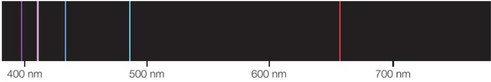

▲ fig D Hydrogen emission line spectrum.

## LEARNING TIP

Remember that $c = f\lambda$, so photons that all have the same frequency will also all have the same wavelength (colour).

For example, fig D shows the line spectrum from hydrogen gas. The gas has electricity passed through it, and this will excite the hydrogen atoms. Each coloured line is a wavelength of light given off as a result of an electron dropping between two energy levels. The different energy gaps cause the difference in wavelengths emitted. When viewed all together, the colours merge, and the gas glows a purple colour.

## PRACTICAL SKILLS

## Investigating gas discharge spectra

A high voltage will cause an electric current to pass through a gas in a discharge tube. The electrical energy excites the electrons in each atom of the gas, and they then drop energy levels at random times, giving off a photon for each energy level transition. As there are so many atoms, it appears as if the gas is continuously emitting light, and of all the possible colours – all the possible transitions within its energy level ladder. Using a diffraction grating, we can analyse the light emitted from the tube to detect the separate colours, or wavelengths, being emitted. We observe a line spectrum.

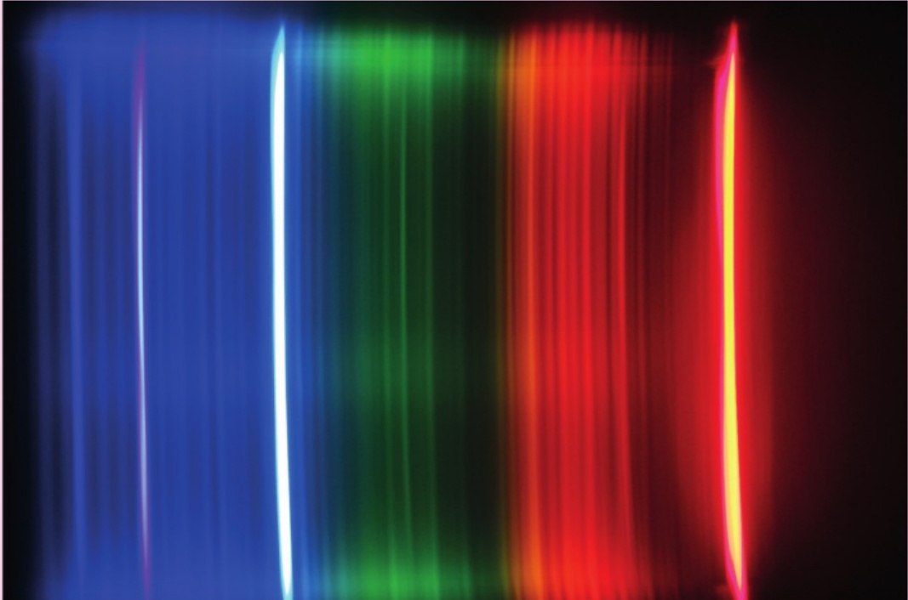

▲ fig E A gas discharge tube demonstrates the emission of photons by excited electrons of a gas. A diffraction grating shows the separate lines in the spectrum.

If we change the tube for one containing a different gas, we will observe a different line spectrum.

Safety Note: Gas discharge tubes operate at a hazardous voltage. Operate with shrouded connections to minimise the risk of electric shock.

<!-- page 154 -->

## INTENSITY OF RADIATION

When a lamp emits light, we could measure its intensity. This is the amount of energy it carries, per unit area, and per unit time. Power is the rate of transfer of energy, so this becomes:

 $$ \begin{aligned}intensity\left(W m^{-2}\right)&=\frac{power\left(W\right)}{area\left(m^{2}\right)}\\I&=\frac{P}{A}\end{aligned} $$ 

## WORKED EXAMPLE

On a particular day, sunlight lands on Earth with an intensity of 960 W m $ ^{-2} $. What is the power received by the solar cell on a calculator placed in this sunlight, if the cell is a rectangle 1 cm by 4 cm?

 $$ I=\frac{P}{A} $$ 

 $$ \therefore\quad P=I\times A $$ 

 $$ =960\times0.01\times0.04 $$ 

 $$ \therefore\quad P=0.38W $$ 

## EXAM HINT

Note that the steps and layout of the solution in this worked example are suitable for intensity of radiation questions in the exam.

## EXAM HINT

In questions about energy level diagrams, make sure you emphasise that electrons can only have the energy values of the levels shown, so the only possible energy transfers match exactly with the differences between the levels shown.

## CHECKPOINT

## SKILLS INTERPRETATION

1. What is the wavelength of light emitted when an excited hydrogen electron falls from energy level n = 2 down to its ground state?

2. Why couldn't a photon of light with an energy of  $ 1.43 \times 10^{-18} $ joules excite hydrogen from its ground state?

3. Fig F shows the two important energy levels (out of the large number of available levels) of a neon atom, inside a He-Ne laser. Calculate the energy of the photon emitted when a neon atom electron excited to the n = A level drops to level B. Give your answer in electronvolts.

4. Other than by absorbing photons, explain how a ground state atom of mercury could be excited if it were in the tube of a compact fluorescent light bulb.

5. Explain why the light from a compact fluorescent light bulb containing mercury gas will produce a spectrum of various colours when electricity passes through the gas.

6. Estimate the number of photons hitting your face each second when you stand in the sunshine.

## SUBJECT VOCABULARY

ground state the lowest energy level for a system, for example, when all the electrons in an atom are in the lowest energy levels they can occupy, the atom is said to be in its ground state

excitation an energy state for a system that is higher energy than the ground state, for example, in an atom if an electron is in a higher energy level than the ground state, the atom is said to be 'excited' ionisation energy the minimum energy required by an electron in an atom's ground state in order to remove the electron completely from the atom

line spectrum a series of individual lines of colour showing the frequencies present in a light source

▲ fig F Electron de-excitation in a neon atom.

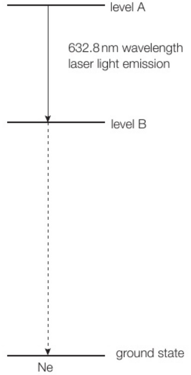

## EXAM HINT

In questions about photons and energy level diagrams, make sure you emphasise that the only possible photons have frequencies that match exactly with the differences between the energy levels shown, using  $ E = hf $

<!-- page 155 -->

## 3D THINKING BIGGER

SOLAR CELLS TO POWER THE USA?

SKILLS

CRITICAL THINKING, PROBLEM SOLVING, ANALYSIS, INTERPRETATION, ADAPTIVE LEARNING, PRODUCTIVITY, ETHICS, COMMUNICATION, ASSERTIVE COMMUNICATION

In this activity, you will consider the quantity of solar cells that might be needed to generate enough electricity for the USA, analyse the limitations on making such a calculation, and discuss the practical difficulties in implementing such a plan.

POPULAR BLOG

# AMAZING MAP: TOTAL SOLAR PANELS TO POWER THE UNITED STATES OF AMERICA

This map illustrates the total area of solar panels that would be needed to fulfill the electricity demands of the United States. The United States Energy Information Association (eia.gov) reveals in their December 2013 'Electrical Power Annual' report, in the table below, that the peak load for all interconnections of electricity during the summer of 2012 was 767 762 Megawatts within the mainland United States. It is also reported that total electricity consumption for the United States during 2012 was 3 694 650 million kWh (million kilowatt-hours).

<table border=1 style='margin: auto; word-wrap: break-word;'><tr><td style='text-align: center; word-wrap: break-word;'>3 694 650 000 000</td><td style='text-align: center; word-wrap: break-word;'>kWh</td><td style='text-align: center; word-wrap: break-word;'>Total 2012</td></tr><tr><td style='text-align: center; word-wrap: break-word;'>10 122 328 767 123</td><td style='text-align: center; word-wrap: break-word;'>Wh</td><td style='text-align: center; word-wrap: break-word;'>Daily Average</td></tr><tr><td style='text-align: center; word-wrap: break-word;'>421 763 698 630</td><td style='text-align: center; word-wrap: break-word;'>W</td><td style='text-align: center; word-wrap: break-word;'>Hourly Average</td></tr><tr><td style='text-align: center; word-wrap: break-word;'>767 762 000 000</td><td style='text-align: center; word-wrap: break-word;'>W</td><td style='text-align: center; word-wrap: break-word;'>Peak Load</td></tr></table>

I imagined using a 250-watt Sharp ND-250QCS solar panel (made in the USA)  $ 65'' \times 39'' $ each.

767 762 000 000 watts / 250 watts per panel

3 071 048 000 total panels

PER PANEL

TOTAL NEEDED

2535 sq."

54063 240 833 sq.

17.6 sq.

1939 sq. miles

44 miles per side of square

## PROBLEMS

That is a lot of solar panels! 3 billion of them. However it is interesting to consider the total approximate cost of these panels compared with what the United States government spends every year on everything else... If one approximates each panel to cost $\$$250, the total cost would be $\$$767 billion. To put it in perspective, the government spent $\$$3600 billion in 2012.

The raw materials and manufacturing capability would be enormous to build that many panels.

The infrastructure and additional equipment needed would be tremendous.

It's dark at night – no solar power generation... so traditional power would be required during those times. A battery storage bank would be huge for night storage at these power levels...

Solar panels and inverters are not 100% efficient. There will be cloudy days.

Less sun during the winter months unless this was built on the equator.

## A SOLUTION

While it may not be possible to build a central location for our nation’s electricity needs, it is possible to add to one’s own electricity needs with solar photovoltaic panels. Even building an off-grid system is a possibility for many people.

In any event, it was an interesting exercise to determine how much total area of solar panels would fulfill the nation's electricity demands. It's a smaller footprint than I initially thought it would be...

<!-- page 156 -->

## THINKING BIGGER

## SCIENCE COMMUNICATION

1 The article opposite was written for an American website blog. Consider the article and comment on the type of writing being used. Think about the following, for example. Is this a scientist reporting the results of their experiments, a scientific review of data, a newspaper or magazine style article for a specific audience? Then answer the following questions:

(a) Is there any bias present in the report? What parts of the article suggest any bias?

(b) How has the author adapted their use of language to suit their audience? Would the wording be different, for example, if they were trying to explain the same ideas to primary school children? Or to a US government committee for energy infrastructure?

(c) Discuss the extent to which the 'problems' highlighted by the author undermine the basic idea in the article.

## PHYSICS IN DETAIL

Now we will look at the physics in, or connected to, this article. Some of these questions link to topics in much earlier sections of this book, so you may need to combine concepts from different areas of physics to work out the answers.

2 Convert all the dimensions quoted in the article into SI units: (1 inch, 1" = 2.54 cm; 1 foot, 1' = 12 inches; 1 mile = 1.6 km)

3 The radiation from the sun lands on Earth with a power of approximately  $ 1000 \, W \, m^{-2} $. How much sunlight power would land on one of the solar panels considered in the article?

4 If the average wavelength of light from the sun landing at the surface of the Earth is 550 nm, how many photons will be landing on this one solar panel per second? Discuss whether it is reasonable to make this wavelength average for this calculation.

5 If the panel produces 250 W, what is the efficiency of one solar panel?

6 (a) If the density of air is 1 kg m $ ^{-3} $, and the average wind speed is 6.0 ms $ ^{-1} $, what area of wind turbines would be needed to transfer the equivalent kinetic energy from the wind as the power needed in the solar cells calculation in the blog article?

(b) A wind turbine manufacturer claims that their new 'super-turbines' are 80% efficient, have 100 m diameter rotors and need 1 square kilometre of land so as not to interfere with each other's wind. How much land would be needed for a giant wind farm to power the electricity needs of the USA?

## ACTIVITY

Many working environments require people to be able to communicate scientific ideas in persuasive ways. Imagine you work for a US electricity generating company that specialises in nuclear power stations. Prepare a critique of this blog article which could be used to persuade the public that the author's idea, for solar power to be used to generate all of America's electricity needs, is impractical and too expensive. You should not explain any benefits of using other means, such as nuclear power: your brief is simply to put the public off the idea of large solar power stations.

## THINKING BIGGER TIP

We have not yet considered the practicalities of connecting the giant solar power station to the national grid to transport the electricity all over the USA. Some calculations about quantity and cost of cabling and pylons could add some weight to your critique.

<!-- page 157 -->

# 3D EXAM PRACTICE

1 What is the energy of a photon of yellow light, with a wavelength of 550 nm?

A  $ 5.79 \times 10^{-38} $ J

B  $ 3.62 \times 10^{-21} $ J

C  $ 3.62 \times 10^{-19} $ J

D 2.26 J

(Total for Question 1 = 1 mark)

2 Use information in the diagram, showing energy levels for electrons in a hydrogen atom, to calculate the frequency of a photon of light emitted by an electron moving from the level n = 4 to the ground state.

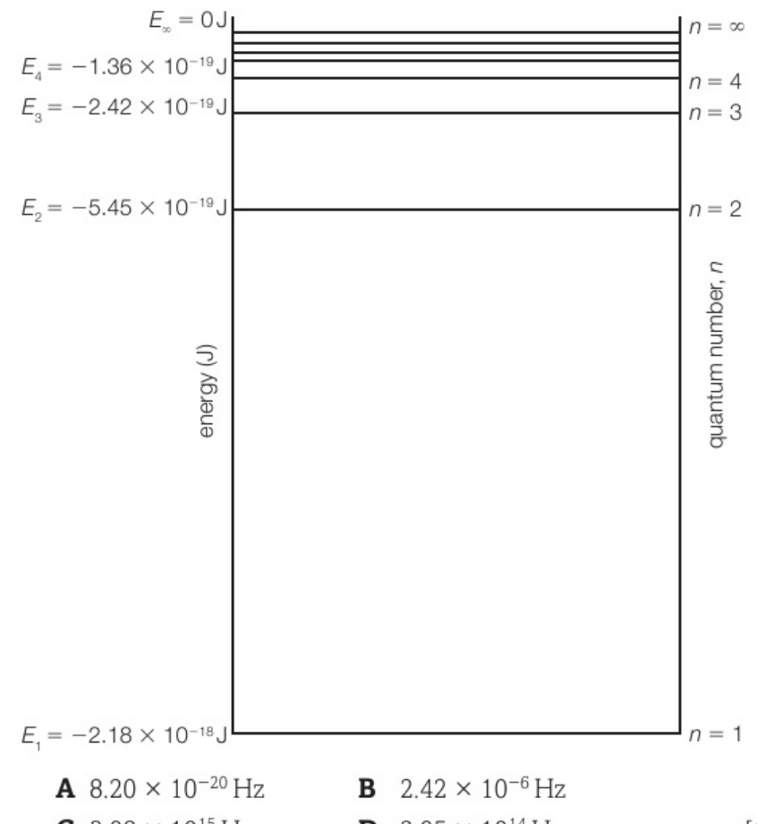

 $$ \mathbf{A}~8.20\times10^{-20}\mathrm{H z}\quad\mathbf{B}~2.42\times10^{-6}\mathrm{H z}\quad\mathbf{C}~3.08\times10^{15}\mathrm{H z}\quad\mathbf{D}~2.05\times10^{14}\mathrm{H z} $$ 

(Total for Question 2 = 1 mark)

3 A zinc plate illuminated by ultraviolet light will emit photoelectrons. Which of the following would not be observed using the same zinc plate?

A Photoelectrons would still be emitted using shorter wavelength UV light.

B More photoelectrons would be observed each second using brighter UV of the original wavelength.

C The stopping voltage for the photoelectrons would be decreased using UV light with a longer wavelength.

D The maximum kinetic energy of the photoelectrons would be increased using brighter UV of the original wavelength.

(Total for Question 3 = 1 mark)

4 Which row in the table correctly shows observed evidence for both light and electrons behaving as waves?

<table border=1 style='margin: auto; word-wrap: break-word;'><tr><td style='text-align: center; word-wrap: break-word;'>Light experimental evidence</td><td style='text-align: center; word-wrap: break-word;'>Electron experimental evidence</td></tr><tr><td style='text-align: center; word-wrap: break-word;'>gas discharge spectra</td><td style='text-align: center; word-wrap: break-word;'>electron diffraction patterns through graphite</td></tr><tr><td style='text-align: center; word-wrap: break-word;'>Millikan&#x27;s oil drop experiment</td><td style='text-align: center; word-wrap: break-word;'>ionisation</td></tr><tr><td style='text-align: center; word-wrap: break-word;'>solar eclipses demonstrate shadows</td><td style='text-align: center; word-wrap: break-word;'>gas discharge spectra</td></tr><tr><td style='text-align: center; word-wrap: break-word;'>two slit interference patterns</td><td style='text-align: center; word-wrap: break-word;'>electron diffraction patterns through graphite</td></tr></table>

(Total for Question 4 = 1 mark)

5 An electronics student is using light emitting diodes (LEDs) to make a traffic light model. He uses red, orange and green LEDs. The table gives information about these LEDs. They are identified as 1, 2 and 3.

<table border=1 style='margin: auto; word-wrap: break-word;'><tr><td style='text-align: center; word-wrap: break-word;'>LED</td><td style='text-align: center; word-wrap: break-word;'>Frequency /  $ 10^{{14}} $ Hz</td><td style='text-align: center; word-wrap: break-word;'>Wavelength /  $ 10^{-{9}} $ m</td><td style='text-align: center; word-wrap: break-word;'>Colour</td></tr><tr><td style='text-align: center; word-wrap: break-word;'>1</td><td style='text-align: center; word-wrap: break-word;'>5.66</td><td style='text-align: center; word-wrap: break-word;'>530</td><td style='text-align: center; word-wrap: break-word;'></td></tr><tr><td style='text-align: center; word-wrap: break-word;'>2</td><td style='text-align: center; word-wrap: break-word;'>5.00</td><td style='text-align: center; word-wrap: break-word;'>600</td><td style='text-align: center; word-wrap: break-word;'></td></tr><tr><td style='text-align: center; word-wrap: break-word;'>3</td><td style='text-align: center; word-wrap: break-word;'>4.41</td><td style='text-align: center; word-wrap: break-word;'>680</td><td style='text-align: center; word-wrap: break-word;'></td></tr></table>

(a) Complete the table by filling in the colour of light emitted by each LED. [1]

(b) Calculate the energy of the lowest energy photon emitted by this traffic light model. [3]

(Total for Question 5 = 4 marks)

6 In 1921, Albert Einstein won the Nobel Prize for his work on the photoelectric effect.

The results of experiments on the photoelectric effect show that:

• photoelectrons are not released when the incident radiation is below a certain threshold frequency

- the kinetic energy of the photoelectrons released depends on the frequency of the incident light and not its intensity.

Explain how these results support a particle theory, but not a wave theory of light. [6]

(Total for Question 6 = 6 marks)

<!-- page 158 -->

## EXAM PRACTICE

7 The graph shows how the maximum kinetic energy E of photoelectrons emitted from the surface of aluminium varies with the frequency f of the incident radiation.

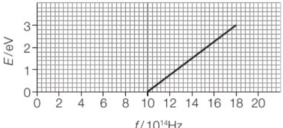

(a) Explain why no photoelectrons are emitted below a frequency of  $ 10 \times 10^{14} $ Hz.

(b) Calculate the work function of aluminium in electron volts.

(c) State the quantity represented by the gradient of the graph.

(d) Add a second line to the graph to show how E varies with f for a metal which has a work function less than aluminium.

(Total for Question 7 = 7 marks)

8 The diagram shows the lowest three energy levels of a hydrogen atom.

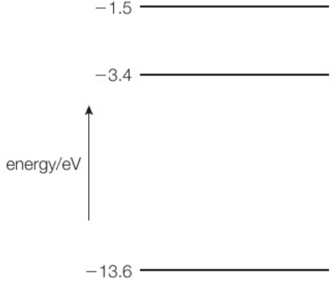

(a) Excited hydrogen atoms can emit light of wavelength  $ 6.56 \times 10^{-7} $ m.

(i) Calculate the frequency of this light.

(ii) The energy of a photon of this frequency is  $ 3.03 \times 10^{-19} $ J.

By means of a calculation determine which electron transition emits this photon.

(b) The spectrum of light from the sun has a dark line at a wavelength of 656 nm. Explain why this wavelength is missing from the spectrum.

(Total for Question 8 = 6 marks)

9 A gold leaf electroscope is used to detect very small amounts of charge. When the electroscope cap is negatively charged, electrons spread along the metal rod and the gold leaf so they both become negatively charged. The rod and leaf repel each other, so the gold leaf rises up.

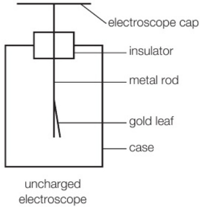

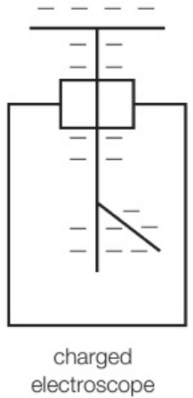

A gold leaf electroscope can be used to demonstrate the photoelectric effect. A clean zinc plate is placed onto the cap of the electroscope and the plate and the electroscope are charged negatively. Ultraviolet radiation is shone onto the zinc plate.

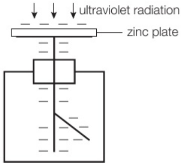

(a) The gold leaf slowly falls.

Explain, with reference to the work function of zinc, why this happens.

(b) Why is the effect not observed if the ultraviolet radiation is replaced by visible light? [1]

(c) Ultraviolet radiation of wavelength  $ 2.00 \times 10^{-7} $ m is shone onto the zinc plate.

Calculate the maximum speed of the electrons emitted from the plate.

work function of zinc = 6.88 × 10^{-19} J

(d) The source of ultraviolet radiation is moved further away from the zinc plate.

State what will happen to the maximum speed of the electrons emitted from the plate. Justify your answer.

(Total for Question 9 = 11 marks)

