# 4A Electrical quantities

<!-- edx_ial_phy1.pdf p159-182 -->

<!-- page 159 -->

# TOPIC 4 ELECTRIC CIRCUITS CHAPTER 4A ELECTRICAL QUANTITIES

In 1881, the streets of Godalming, a town in England, were the first in the world to be lit by a public electricity service. The power was generated from a water wheel in a nearby river. Electricity has revolutionised the way people live, but we have only been using it so widely for about 100 years. Today, it is difficult to imagine what life would have been like when the night was not artificially lit and music could only be heard if the instruments were played live.

It is extraordinary how influential the use of electricity has become in such a short time, and just how difficult it might be for us today to adapt to life without electricity. Arguably, the first electrical battery was built by Alessandro Volta in 1800. A little over 200 years later, almost everything around you will either use electricity directly or would have been impossible to manufacture without electricity.

In this chapter, you will learn about the fundamental electrical quantities that can be measured and how they are related to each other, along with the essential material structures that allow, or restrict, the flow of electricity.

## MATHS SKILLS FOR THIS CHAPTER

Units of measurement (e.g. the coulomb, C)

• Calculating areas of circles (e.g. finding the cross-sectional area of a wire in order to find resistivity)

- Use of standard form and ordinary form (e.g. representing the charge on an electron)

• Changing the subject of an equation (e.g. finding the resistivity of a material from an object's resistance)

• Substituting numerical values into algebraic equations (e.g. using the transport equation)

• Determining the slope of a linear graph (e.g. finding the resistivity from experimental results)

<!-- page 160 -->

## What prior knowledge do I need?

Atomic structure, and electrical conduction by electrons

When electrical charges attract or repel

Conservation of electrical charge

What we mean by 'current' and by 'voltage', and how these are measured

The Ohm's law equation

Electrical resistance and its effects

The variation in current with changing potential difference, for various components

## What will I study in this chapter?

- Atomic structure, and the structure of solid materials, especially metals

Numerical quantities of electrical charge, and the movement of quantities of charge

Conservation of electrical charge implications for currents

Mathematical definitions of current, voltage and resistance

Ohm's law in general and when it is, and is not, relevant

What affects resistance in different objects and materials, including resistivity and superconductivity

Why there is the variation we see in current with changing potential difference, for various components

## What will I study later? Topic 4B

How electrical properties are affected by the design of the circuit in which they are measured

How the conservation of charge, and the conservation of energy affect the distribution of currents and voltages around circuits

How resistances can be combined and separated in series and parallel circuits

How internal resistance can affect the usefulness of an electrical supply

How to calculate the transfer of electrical energy, power, and the efficiency of an electrical device or circuit

## Topic 6A (Book 2: IAL)

The causes of forces on electrically charged particles

The structures and effects of electrical fields

<!-- page 161 -->

## 1 ELECTRIC CURRENT

## LEARNING OBJECTIVES

Describe electric current as the rate of flow of charged particles.

Make calculations of electric current.

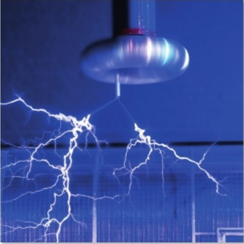

▲ fig A Electric current is a measure of the rate of movement of electric charge. Lightning strikes can have currents of 10 000 amperes.

## ELECTRIC CHARGE

Some particles have an electric charge. For example, the electron has a negative charge. In SI units, electric charge is measured in coulombs (C) and the amount of charge on a single electron in these units is  $ -1.6 \times 10^{-19} $ C.

 $$ e=-1.6\times10^{-19}C $$ 

This means that you would have one coulomb of negative charge if you collected together  $ 6.25 \times 10^{18} $ electrons, as shown in this calculation:

 $$ total~charge,Q=ne=6.25\times10^{18}\times-1.6\times10^{-19}=-1C $$ 

The charges on fundamental particles such as electrons are fixed properties of these particles. It is impossible to create or destroy charge – the total charge must always be conserved.

## ELECTRIC CURRENT

If electric charge moves, this is referred to as an electric current, and the definition of current is the rate of movement of charge. As it is usually a physical movement of billions of tiny charged particles, such charge movements are often said to flow. Thinking of the flow of charge like the current in a river can be useful, and we will see later how current splits and recombines at circuit junctions in a manner that is like water flow. Also, as the total amount of water in a river at a given time does not change, even if the river splits, this again shows the conservation of charge.

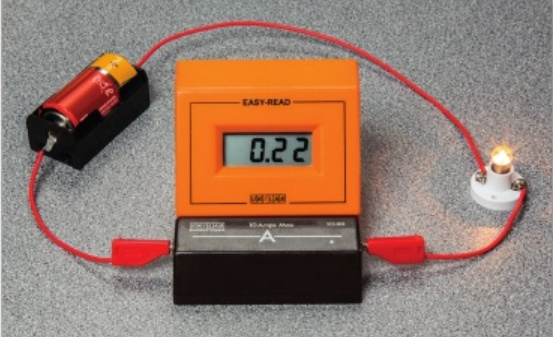

▲ fig B We can measure electric current through a component using an ammeter connected in series.

Electric current occurs when a charged particle, which is free to move, experiences an electric force. If it can move it will be accelerated by the force. This movement of charge forms the electric current. Most electric circuits are made from metal wiring in which there are electrons that are free to move. These conduction electrons then form the current.

Any source of electrical energy can create an electric force in order to produce a current. In fig C, the cell causes the electric force experienced by the negative conduction electrons so they move through the metal – they are attracted to the positive anode of the cell.

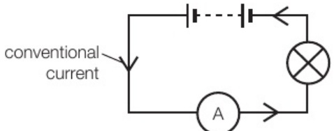

▲ fig C Conventional current flows from positive to negative. Negative electrons would move in the opposite direction.

<!-- page 162 -->

## CALCULATING CURRENT

The SI unit for electric current is the ampere. A. Current can be calculated from the equation:

 $$  current\left(A\right)=\frac{charge passing a point\left(C\right)}{time for~that~charge~to~pass\left(s\right)} $$ 

 $$ I=\frac{\Delta Q}{\Delta t} $$ 

Thus one ampere (1 A) is the movement of one coulomb (1 C) of charge per second (1 s). For example, if the lightning in fig A takes 0.1 seconds to transfer 1150 coulomb of charge, we could calculate the current in the lightning:

 $$ I=\frac{\Delta Q}{\Delta t}=\frac{1150}{0.1}=11500A $$ 

The equation that defines electric current is often used in a rearranged form to find  $ \Delta Q $, the amount of charge that has moved through a component in a given time,  $ \Delta t $.

 $$ \Delta Q=I\Delta t $$ 

## PRACTICAL SKILLS

## Observing charge flow

We can monitor small movements of charge, to see how they form a current, using a hanging ball that will conduct electricity.

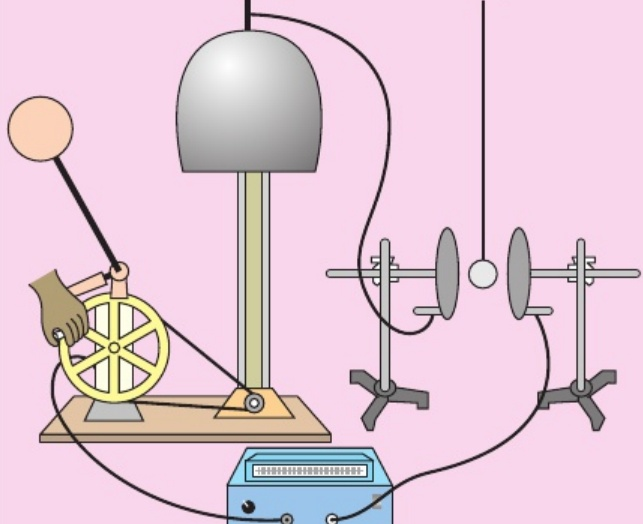

▲ fig D A ball on a string can carry small numbers of electrons across a high voltage gap, and this current is measured using a spot galvanometer.

The high voltage set up across the air gap between the metal plates encourages negative electrons to want to move towards the positive side. The hanging ball is painted with conducting paint and swings backwards and forwards across the gap. It carries a small quantity of electrons from one metal plate to the other each time. We can measure this small movement of charge on a very sensitive ammeter. If we time the period of oscillation of the moving ball and measure the tiny current, we can calculate how many electrons would pass across on each journey of the ball. If the ball is moving too fast to be timed by eye, then we can use a stroboscope to measure the frequency of oscillations.

## Example calculation:

If the spot galvanometer registers 6.5 microamperes and the ball takes 2.0 milliseconds for one swing, how many electrons does it carry on each pass from the negative plate to the positive one?

 $$ \Delta Q=I\times\Delta t=6.5\times10^{-6}\times2\times10^{-3}=13\times10^{-9}C=13nC $$ 

∴ no of electrons per swing:

 $$ N=\frac{\Delta Q}{e}=\frac{-13\times10^{-9}}{-1.6\times10^{-19}} $$ 

 $$ N=8.1\times10^{10}\text{ electrons} $$ 

Note that on the ball's return journey it will be positively charged, having lost an excess of electrons when contacting the positively charged plate. However, positive charge moving in the opposite direction still is a current, and it will be at the same rate – the same current – because the ball speed is constant.

Safety Note: The Van de Graaff generator will give unpleasant electric shocks but these should not harm healthy individuals. Anyone with a cardiac condition must not receive electrical discharges as they may suffer ventricular fibrillation which could prove fatal. Persons with epilepsy may also be at risk of a seizure and should be advised accordingly.

<!-- page 163 -->

## EXAM HINT

It is useful if you can learn the value for the charge on an electron – you will need to use it so often that you will save a lot of time if you don't have to look it up.

 $$ e=-1.6\times10^{-19}C $$ 

Note that whilst this is a negative value as the electron is negative, we usually ignore the negative sign in calculations and give positive current values.

## EXAM HINT

Note that the steps and layout of the solution in this worked example are suitable for questions on calculating the net charge in the exam.

## IONIC CHARGE CARRIERS

If the circuit is more unusual, there may be other charged particles, charge carriers, which can move to form the electric current. For example, in the electrolytic processing of bauxite ore to produce aluminium metal, the bauxite is dissolved in cryolite – another aluminium compound – and this solution then has free aluminium ions (charge carriers) that can move through the liquid as an electric current. These ions are positively charged, and will move because of the electric force towards the negative cathode. This is still an electric circuit that must obey the rule of conservation of charge, and in which we can measure the current as the rate of flow of charge.

As the charge on an electron is a fixed negative amount, we can easily calculate the charge on any ion. This would be important in a situation where ions were moving as the charge carriers in an electric current, for example, in electrolysis.

## LEARNING TIP

The charge on a proton is the same magnitude as that on an electron, but is positive:  $ q_{p} = +1.6 \times 10^{-19} $ C.

## WORKED EXAMPLE

What would be the charge on an iron (III) ion,  $ Fe^{3+} $?

Three electrons have been lost, so the net charge is

that of the ion's three excess protons:

 $$ q_{\mathrm{Fe^{3+}}}=3\times1.6\times10^{-19}=+4.8\times10^{-19}C $$ 

## CHECKPOINT

1. (a) If  $ 12.5 \times 10^{18} $ electrons move through a lamp in 3.2 seconds, what current is flowing through the lamp?

(b) How many coulombs of charge move through an ammeter in 8 seconds if it is reading 0.95 A?

(c) How long would it take for a current of 0.68 A to move 100 billion electrons past a certain point?

2. In a shuttling ball experiment to demonstrate the movement of electrons as an electric current, the galvanometer showed a current of  $ 0.12\,\mu\text{A} $.

(a) If the ball carried 20 nC of charge on each swing, how long does one swing take?

(b) How many electrons does the ball carry in each swing?

3. In an electrolysis experiment, 0.01 moles of  $ Cu^{2+} $ ions moves through the copper sulfate solution in 23 minutes. How much current flows?

(One mole contains Avogadro's number of any particle, and this is  $ N_{A}=6.02\times10^{23} $.)

## SUBJECT VOCABULARY

charge a fundamental property of some particles. It is the cause of the electromagnetic force, and it is a basic aspect of describing electrical effects

coulomb, C the unit of measurement for charge: one coulomb is the quantity of charge that passes a point in a conductor per second when one ampere of current is flowing in the conductor. The amount of charge on a single electron in these units is  $ -1.6 \times 10^{-19} $ C

electric current the rate of flow of charge. Current can be calculated from the equation:

 $$ \begin{aligned}current\left(A\right)&=\frac{charge passing a point\left(C\right)}{time for that charge to pass\left(s\right)}\\I&=\frac{\Delta Q}{\Delta t}\end{aligned} $$ 

ampere the unit of measurement for electric current: one ampere (1 A) is the movement of one coulomb (1 C) of charge per second (1 s)

<!-- page 164 -->

# 2 ELECTRICAL ENERGY TRANSFER

## LEARNING OBJECTIVES

Define electromotive force and potential difference.

Make calculations of voltage and the energy transfer in components.

Evaluate a model of electrical circuits.

For any electrical circuit to be of use, it has to act as a means to transfer energy usefully. The circuit must have at least one component that can supply electrical energy. It will also have components that transfer this electrical energy to other stores, and at least one of these stores or transfers of energy will be useful to its purpose.

For example, in a bicycle light there will be a cell that transfers electrical energy from a chemical reaction, and there will be a lamp that transfers some of the electrical energy as light radiation.

## VOLTAGES

The electrical quantity voltage is a measure of the amount of energy a component transfers per unit of charge passing through it. It can be calculated from the equation:

 $$ \begin{aligned}voltage\left(V\right)&=\frac{energy transferred\left(J\right)}{charge passing\left(C\right)}\\V&=\frac{E}{Q}\end{aligned} $$ 

## ELECTROMOTIVE FORCE

For a supply voltage – a component which is putting electrical energy into a circuit – the correct term for the voltage is electromotive force, or emf. If a cell supplies one joule (1 J) of energy per coulomb of charge (1 C) that passes through it, it has an emf of 1 volt (1 V).

 $$ \begin{aligned}emf\left(V\right)&=\frac{energy transferred\left(J\right)}{charge passing\left(C\right)}\\ \varepsilon&=\frac{E}{Q}\end{aligned} $$ 

For example, if the bicycle lamp in fig A was powered by a cell with an emf of 1.5 V, then this cell would transfer 1.5 J of electrical energy to each coulomb of charge that passed through it.

## POTENTIAL DIFFERENCE

For a component which is using electrical energy in a circuit and transferring this energy, the correct term for the voltage is potential difference, or pd. If a component uses one joule (1 J) of energy per coulomb of charge (1 C) that passes through it, it has a pd of 1 volt (1 V). The energy being used by the component could be referred to as work done, W.

 $$ \begin{aligned}pd\left(V\right)&=\frac{energy transferred\left(J\right)}{charge passing\left(C\right)}\\V&=\frac{W}{Q}\end{aligned} $$ 

For example, if the bicycle light in fig A produced light from an LED with a pd of 1.5 V, then this LED would transfer 1.5 J of electrical energy from each coulomb of charge that passed through it to light energy and a little thermal energy.

## LEARNING TIP

Almost every aspect of the study of physics has connections with transfers of energy.

fig A Electric circuits transfer energy.

<!-- page 165 -->

## WORKED EXAMPLE

A cell transfers 40 J of chemical energy for every 15 C of electrons that pass through it, in order to power an electrical circuit. What is the cell's emf?

 $$ \varepsilon=\frac{E}{Q} $$ 

 $$ \varepsilon=\frac{40}{15} $$ 

## EXAM HINT

Note that the steps and layout of the solution in this worked example are suitable for questions on calculating the emf and pd in the exam.

 $$ \varepsilon=2.7V $$ 

For every 2000 C of charge passing through it, a loudspeaker transfers 18500J of electrical energy to sound and thermal energy. What is the loudspeaker's pd?

 $$ V=\frac{W}{Q} $$ 

 $$ V=\frac{18500}{2000} $$ 

 $$ V=9.25V $$ 

## THE ELECTRONVOLT

The electronvolt, eV, is a unit of energy that is generally used with sub-atomic particles. Its definition comes from the equation defining voltage:

 $$ V=\frac{E}{Q} $$ 

If an electron is accelerated by a potential difference of 1 V, the energy transferred to it will be:

 $$ \boldsymbol{E}=\boldsymbol{V}\times\boldsymbol{e} $$ 

 $$ \therefore\quad E=1\times1.6\times10^{-19}=1.6\times10^{-19}J $$ 

The amount of energy transferred to an electron by passing through a voltage of 1 V is an electronvolt. So 1 eV = 1.6 × 10^{-19} J.

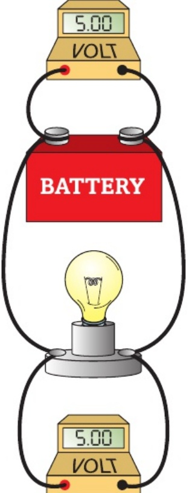

fig B We can measure voltage across a component with a voltmeter connected in parallel.

## ELECTRICAL MODELS

A model is a way of thinking about an idea or phenomenon in order to help us understand it better. For example, as the structure of an atom is too small to see, it is common for people to imagine it to be like that of planets orbiting the sun in the solar system. There are many aspects of this model that do not correctly represent an atom. However, there are some aspects that help people to think about atoms more clearly.

Electricity has many aspects that are not visible to us in everyday life, and physicists often use models to explain some of these. All models will have limitations, so it is important to evaluate the strengths and weaknesses of any model to make sure that you do not rely too heavily on it.

## MODELLING VOLTAGE

One model that could be used to try and understand the transfers of energy in an electric circuit could be to think of an electric circuit as a ski area. When people go skiing, they take a lift which carries them up to the top of the hill. From there, they then slide back down to the bottom. Some skiers may slide down different routes, but they all finish back at the same lower level they started at.

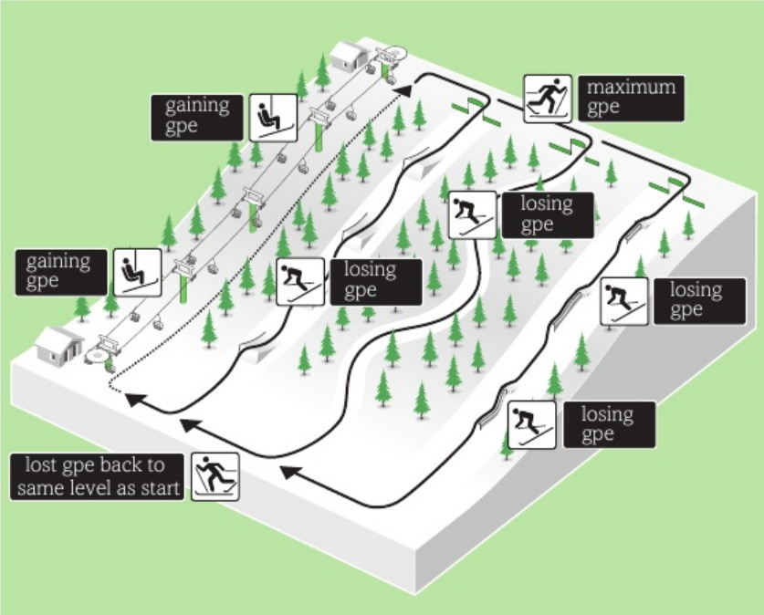

▲ fig C Modelling an electric circuit as a ski area.

The skiers on the lift gain gravitational potential energy, which is representing electrical energy in this analogy. By the time they have all skied back down through the runs and over the obstacles, they have lost all that gpe again and are back to the same level as before they started. This illustrates the principle of conservation of energy in an electric circuit. If moving charge is given energy by a source of emf, it will transfer all that energy on its journey around the circuit, through the various pds. Around the circuit, the total of all the emfs will be the same as the total of all the pds – total energy supplied will equal total energy used.

<!-- page 166 -->

The ski lift takes skiers to the top of the slope – it gives them potential energy like a battery transfers electrons electrical energy. From there, they can slide down a number of possible routes – like separate, parallel, loops in a circuit. If the skier does a trick off an obstacle, then we could imagine that he was passing through a component and transferring energy to the component. We could think about measuring the emf of the chairlift, and the pd of each obstacle on the run.

Notice that although the picture in fig D has skiers and snowboarders, for simplicity we only refer to 'skiers'. This is a weakness of the model, as both would represent charge carriers flowing in our circuit, but usually electric circuits have only one type of charge carrier that flows – the electrons.

## CHECKPOINT

## SKILLS INTERPRETATION, ADAPTIVE LEARNING

1. Explain how potential difference is different from electromotive force.

2. (a) A cell provides 76 C of charge with 120 J of energy. What is the cell's emf?

(b) When a lamp carries a current of 2.4 A for 5.4 s, it transfers 120 J of energy. What is the pd across the lamp?

3. Convert the following:

(a)  $ 9.6 \times 10^{-19} $ J into electronvolts

(b) 4.8 MeV into joules.

4. Write an evaluation of the strengths and weaknesses of the ski area model of an electric circuit. Include discussion of at least the following ideas:

- the representation of charge carriers

- a complete circuit is needed

- gravitational potential as the analogy for electrical energy

• the ski lift as a cell

- the snowpark obstacles as components using electrical energy

- differing speeds by different skiers.

5. Write a suggestion for a different model of an electric circuit, explaining what electrical aspect is represented by the various sections of your model.

## SUBJECT VOCABULARY

voltage a measure of the amount of energy a component transfers per unit of charge passing through it. It can be calculated by the equation:

 $$  voltage(V)=\frac{energy transferred(J)}{charge passing(C)} $$ 

 $$ V=\frac{E}{Q} $$ 

electromotive force, or emf a voltage as defined above, with the energy coming into the circuit potential difference or pd the correct term for the voltage of a component that is using electrical energy in a circuit and transferring this energy to other stores

electronvolt the amount of energy an electron gains by passing through a voltage of 1 V

 $$ 1eV=1.6\times10^{-19}J $$ 

 $$ 1\text{ mega electronvolt}=1\text{ MeV}=1.6\times10^{-13}\mathrm{J} $$ 

fig D Modelling charge carriers as skiers.

<!-- page 167 -->

# 3 CURRENT AND VOLTAGE RELATIONSHIPS

## LEARNING OBJECTIVES

State Ohm's law.

Calculate resistances.

Explain the I-V characteristics of components.

The movement of electrons through a circuit is caused by the electric force that an emf generates. Thus, an emf could be said to drive the current around a circuit. A higher voltage emf would be expected to do this more as it creates a stronger force on the charges so more of them are driven round the circuit faster – resulting in an increased current. The electric force is directly proportional to the voltage, so we would expect current to increase in direct proportion to voltage. In many cases this is true –  $ I \propto V $ – but in some situations other factors become important and alter the relationship.

## RESISTANCE CALCULATIONS

Electrical resistance is considered to be the opposition to the flow of current within a conductor. It can be calculated from the equation:

 $$  resistance\left(\Omega\right)=\frac{potential~difference\left(V\right)}{current\left(I\right)} $$ 

 $$ R=\frac{V}{I} $$ 

## OHM'S LAW

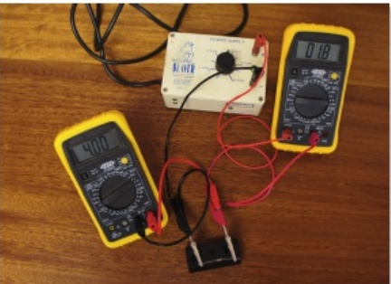

fig A Measuring the resistance of an ohmic conductor.

If the current is proportional to the voltage driving it through a component, this component is called an ohmic conductor, as this means it follows Ohm's law. The proportional relationship can be used to find the resistance of the component.

For example, what is the resistance of the resistor shown in fig A?

 $$ R=\frac{V}{I}=\frac{4.0}{0.18} $$ 

 $$ R=22\Omega $$ 

For an ohmic conductor, the answer to the calculation of resistance would be the same for all voltages and their corresponding current values (providing the temperature remains constant – see Section 4A.5).

## PRACTICAL SKILLS

## Investigating I-V relationships

We can do an experiment to investigate whether or not a component follows Ohm's law using the equipment in fig A. The component under test is the resistor, and we could replace this resistor to allow testing of other components.

Use various values of supply emf and measure the potential difference across and current through the resistor for each one. This should include reversing the terminals on the power supply in order to measure the effects of negative pds across the resistor. In the case of a resistor, negative pds correspond to negative currents – a voltage creating an electric force in the opposite direction in the wires will attract electrons in the opposite direction around the circuit.

In this example, the results would produce a graph like the one shown in fig B. The straight line illustrates that I is proportional to V for all tested values, telling us that the resistor is an ohmic conductor.

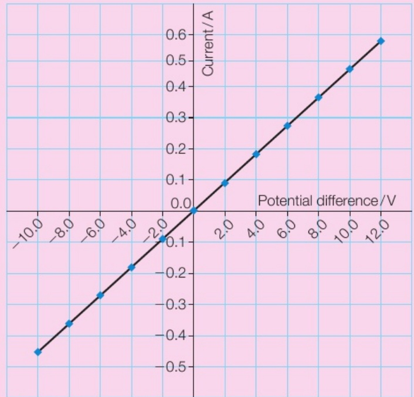

fig B I-V graph for a resistor.

You can calculate the resistance of the resistor from the graph in fig B. First calculate the gradient of the straight line from:

 $$ m=\frac{\Delta I}{\Delta V} $$ 

This calculation is the reciprocal of the one for resistance given above. So, you can find the resistance here by taking the reciprocal of the gradient:

 $$ R=\frac{1}{m} $$ 

Note that using the gradient is only effective for an ohmic conductor. If the line is not straight, the resistance changes and can be calculated using Ohm's law at each specific V/I value on the line.

Safety Note: Some components will get hot enough to cause burns especially if their normal  ‘working range’ is exceeded.

<!-- page 168 -->

## CURRENT-VOLTAGE CHARACTERISTICS

For an electric circuit design, we need to know how components will react when the pd across them changes, in order to ensure that the circuit performs its intended function under all circumstances. Part of the specification of any component is a graph of its I–V characteristics. We have already seen the graph for a simple resistor, and a metal at constant temperature would produce the same straight-line result. The only difference would be that the gradient will be different in each case, as it corresponds to the specific resistance of the resistor or wire.

## I-V GRAPH FOR A FILAMENT BULB

For the filament lamp $I-V$ graph in fig C, we can see that for a small voltage, the current is proportional to it, as shown by the straight-line portion of the graph through the origin. At higher voltages, a larger current is driven through the lamp filament wire, and this heats it up. At hotter temperatures, metals have higher resistance. The gradient of the graph in fig B was given as the reciprocal of the resistance, and so the gradient here becomes less towards higher voltages: higher resistance means a lower gradient. In Section 4A.5, we will see why the resistance increases with temperature and why this reduces current.

I-V GRAPH FOR A DIODE

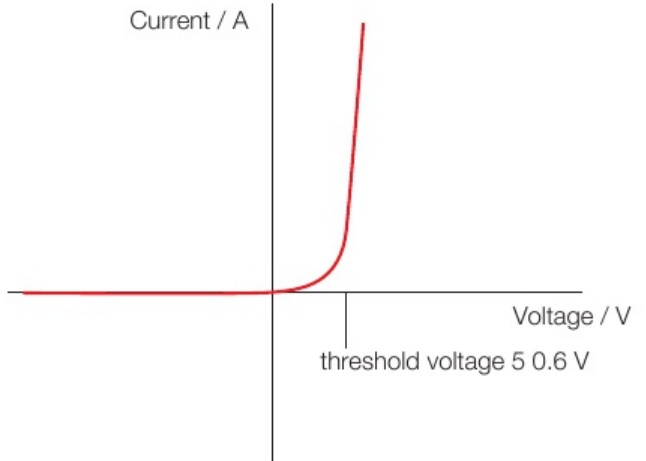

▲ fig D A semiconductor diode is designed to only pass current in one direction, so the line follows the x-axis, I = 0, for negative voltages.

For the diode in fig D, we can see the basic idea that a diode only conducts in the forwards direction, and so there is zero current for negative voltages. It also requires a minimum voltage in the forwards direction. This threshold voltage is typically around 0.6 V. The curve for a diode will be looked at in detail in Section 4A.6, which covers the ideas of electrical conduction in different materials.

I–V GRAPH FOR A THERMISTOR

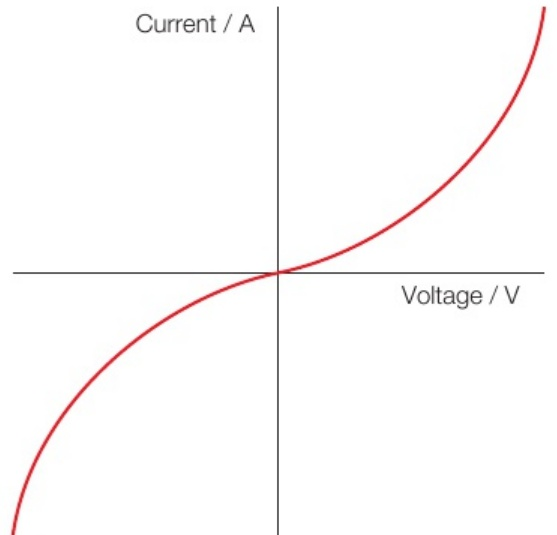

▲ fig E A thermistor is designed to alter its resistance with temperature; in the reverse manner to a filament bulb.

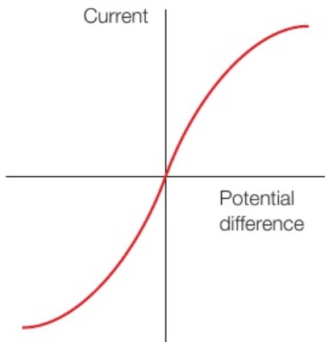

fig C A filament lamp is an example of a non-ohmic conductor. This is because the current through it affects its own temperature – higher current means a higher temperature – and controlling temperature is part of the definition of Ohm's law.

<!-- page 169 -->

## EXAM HINT

To explain why resistance in a metal increases with temperature, you must include both points:

- The metal atoms vibrate faster and further

- so, there are more collisions between electrons and atoms.

SKILLS PROBLEM SOLVING

SKILLS ANALYSIS

For the thermistor in fig E, its resistance reduces with the temperature. The gradient of the line increases with the heating effect of the increasing current. The gradient represents the reciprocal of the resistance: larger gradient value means lower resistance. This is a result of its manufacture from semiconductor materials, whose atoms release more conduction electrons as the temperature rises. This will be explained in detail in Section 4A.6.

## CHECKPOINT

1. State Ohm's law.

2. A loudspeaker in a circuit allows a current of 0.05 A to pass through it when the pd across it is 6 V. What is the loudspeaker's resistance?

3. What is the difference between an ohmic and a non-ohmic conductor?

4. Graphs of current against voltage are usually drawn with V on the x-axis, as the experimental data would be collected by having pd as the independent variable. This is just standard procedure. Considering the calculation of resistance, why might it be more useful to plot these data with pd on the y-axis?

5. What is the difference between component A and component B shown in the I-V plot of fig F? Explain your answer.

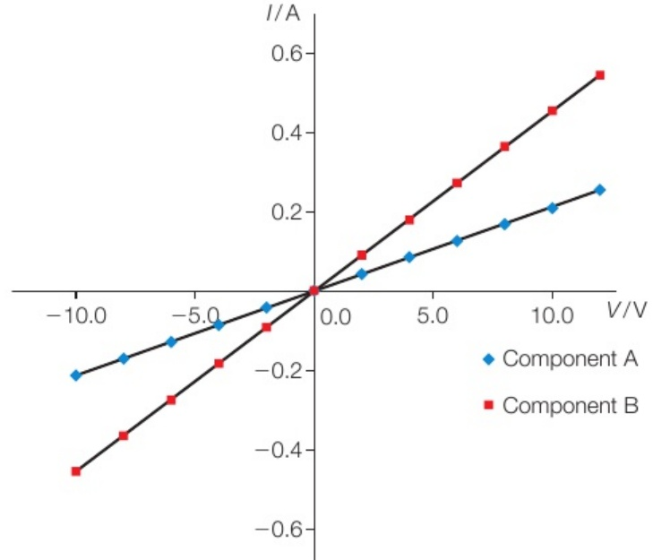

▲ fig F I-V graphs for two components.

## SUBJECT VOCABULARY

resistance the opposition to the flow of electrical current. It can be calculated from the equation:

 $$ \begin{aligned}\left(\Omega\right)&=\frac{potential~difference\left(V\right)}{current\left(A\right)}\\R&=\frac{V}{I}\end{aligned} $$ 

Ohm's law the current through a component is directly proportional to the voltage across it, providing the temperature remains the same. The equation for this is often expressed as:

voltage  $ V $ = current  $ A $  $ \times $ resistance  $ \Omega $

 $$ V=I\times R $$

<!-- page 170 -->

## 4 RESISTIVITY

## LEARNING OBJECTIVES

Define resistivity.

Explain how to measure resistivity experimentally.

Make calculations of resistance using resistivity.

Resistance is the result of collisions between charge carriers and atoms in the current's path. This effect will vary depending on the density of charge carriers and the density of fixed atoms, as well as the strength of the forces between them. So, pieces of different materials with identical dimensions will have differing resistances. The general property of a material to resist the flow of electric current is called resistivity, which has the symbol rho,  $ \rho $, and SI units ohm metres,  $ \Omega $ m.

## LEARNING TIP

Resistivity is a property of a material. All samples of the same material, regardless of their shape and size, will have the same resistivity, whilst their resistances may be very different.

The resistance of an object is dependent on its dimensions and the material from which it is made. This gives rise to an equation for calculating the resistance of a uniform sample of material if we know the resistivity of the material:

 $$  resistance\left(\Omega\right)=\frac{resistivity\left(\Omega m\right)\times sample~length\left(m\right)}{cross-sectional~area\left(m^{2}\right)} $$ 

 $$ R=\frac{\rho l}{A} $$ 

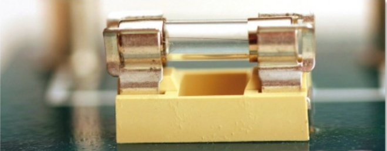

fig A With knowledge of the resistivity,  $ \rho $, of a material, we can calculate the resistance of objects made from it.

## RESISTIVITY EQUATION EXAMPLE

See fig A and table A. What is the resistance of a piece of copper fuse wire if it is 0.40 mm in diameter and 2 cm long?

 $$ \mathrm{wire~radius}=0.20\mathrm{~mm}=2.0\times10^{-4}\mathrm{~m} $$ 

cross-sectional area,  $ A = \pi r^2 = \pi \times (2.0 \times 10^{-4})^2 = 1.3 \times 10^{-7} \, \text{m}^2 $

 $$ R=\frac{\rho l}{A} $$ 

 $$ R=\frac{1.7\times10^{-8}\times0.02}{1.3\times10^{-7}} $$ 

 $$ R=2.6\times10^{-3}\Omega $$ 

<table border=1 style='margin: auto; word-wrap: break-word;'><tr><td style='text-align: center; word-wrap: break-word;'>MATERIAL</td><td style='text-align: center; word-wrap: break-word;'>RESISTIVITY,  $ \rho $ /  $ \Omega m $ AT 20°C</td><td style='text-align: center; word-wrap: break-word;'>$ \frac{\Delta \rho}{\Delta t} $ / %°C $ ^{-1} $</td></tr><tr><td style='text-align: center; word-wrap: break-word;'>silver</td><td style='text-align: center; word-wrap: break-word;'>$ 1.6 \times 10^{-8} $</td><td style='text-align: center; word-wrap: break-word;'>+0.38</td></tr><tr><td style='text-align: center; word-wrap: break-word;'>copper</td><td style='text-align: center; word-wrap: break-word;'>$ 1.7 \times 10^{-8} $</td><td style='text-align: center; word-wrap: break-word;'>+0.40</td></tr><tr><td style='text-align: center; word-wrap: break-word;'>aluminium</td><td style='text-align: center; word-wrap: break-word;'>$ 2.8 \times 10^{-8} $</td><td style='text-align: center; word-wrap: break-word;'>+0.38</td></tr><tr><td style='text-align: center; word-wrap: break-word;'>constantan</td><td style='text-align: center; word-wrap: break-word;'>$ 4.9 \times 10^{-7} $</td><td style='text-align: center; word-wrap: break-word;'>+0.003</td></tr><tr><td style='text-align: center; word-wrap: break-word;'>germanium</td><td style='text-align: center; word-wrap: break-word;'>$ 4.2 \times 10^{-1} $</td><td style='text-align: center; word-wrap: break-word;'>-5.0</td></tr><tr><td style='text-align: center; word-wrap: break-word;'>silicon</td><td style='text-align: center; word-wrap: break-word;'>$ 2.6 \times 10^{3} $</td><td style='text-align: center; word-wrap: break-word;'>-7.0</td></tr><tr><td style='text-align: center; word-wrap: break-word;'>polyethene</td><td style='text-align: center; word-wrap: break-word;'>$ 2 \times 10^{11} $</td><td style='text-align: center; word-wrap: break-word;'></td></tr><tr><td style='text-align: center; word-wrap: break-word;'>glass</td><td style='text-align: center; word-wrap: break-word;'>$ \sim 10^{12} $</td><td style='text-align: center; word-wrap: break-word;'></td></tr><tr><td style='text-align: center; word-wrap: break-word;'>epoxy resin</td><td style='text-align: center; word-wrap: break-word;'>$ \sim 10^{15} $</td><td style='text-align: center; word-wrap: break-word;'></td></tr></table>

table A Resistivity varies greatly between materials, and is also dependent on temperature. Note the small change in resistivity with temperature for constantan, an alloy of copper and nickel; this information is used where accurately known resistance is important.

## PRACTICAL SKILLS

## Investigating resistivity

You can investigate the resistivity for a metal in the school laboratory using a simple circuit.

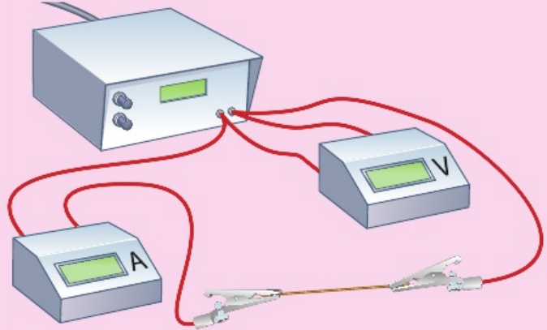

## fig B Measuring the resistance for various lengths of a wire will allow us to plot a graph to find its resistivity

We will need to use a micrometer screw gauge to measure the wire's diameter. For improved accuracy, this is done in right-angled pairs at several places along the length of the wire, and then we take the mean diameter measurement.

For several different lengths of the wire, the wire's resistance should be measured using the voltmeter-ammeter method ( $ R = \frac{V}{I} $). The resistance will be small, so care must be taken to ensure currents are safely low.

 $$ R=\frac{\rho l}{A} $$ 

The equation involving resistivity means that we could calculate a value for it by re-arranging the equation and taking one of the results and making the calculation. However, it is always more reliable to

<!-- page 171 -->

produce a straight-line graph of experimental results and calculate our answer from the gradient. In this case, plotting resistance on the y-axis against length on the x-axis will give the gradient as  $ \frac{\rho}{A} $, and from this we could calculate the resistivity with more confidence in our conclusion.

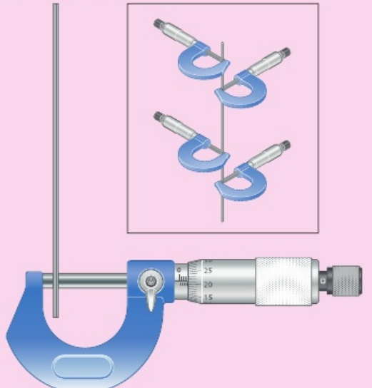

fig C Accurate measurement of the wire's diameter is vital.

Safety Note: The wire will get hot enough to cause burns especially if too large a voltage/current is applied.

## RESISTIVITY INVESTIGATION EXAMPLE

An investigation like the one explained above produced the results shown in fig D. This was for an aluminium wire with a measured diameter averaging 0.22 mm (giving  $ A = 3.8 \times 10^{-8} \, \text{m}^2 $). A single 1.5 V cell was used to drive a current, which was measured at each different length. These data were then used to calculate the resistances plotted on the graph for each length. From the graph, we can use its gradient to find the resistivity of aluminium.

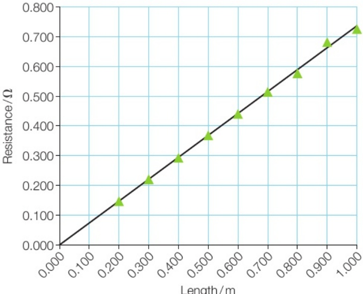

Fig D From the gradient of this graph, it is possible to calculate the resistivity of the aluminium wire in the investigation.

 $$ \begin{aligned}gradient&=\frac{\Delta y}{\Delta x}=\frac{\Delta R}{\Delta I}=\frac{0.730-0.000}{1.000-0.000}=0.730\\R&=\frac{\rho l}{A}\end{aligned} $$ 

As we have $R$ on the $y$-axis and $l$ on the $x$-axis, comparing the equation above with $y = mx + c$ shows that the gradient is equivalent to $\frac{\rho}{A}$, so we can find the resistivity by multiplying the gradient by the cross-sectional area.

 $$ \begin{aligned}&\therefore\quad\rho=\frac{RA}{l}\\&\therefore\quad\rho=0.730\times A=0.730\times3.8\times10^{-8}=2.8\times10^{-8}\Omega m\end{aligned} $$ 

Experimentally, we have found that the resistivity of aluminium is  $ 2.8 \times 10^{-8} \Omega \cdot m $.

## CHECKPOINT

## SKILLS CREATIVITY, INNOVATION

1. Calculate the resistance of a piece of constantan wire if it is 80 cm long and has a diameter of 0.84 mm.

2. Explain three ways of reducing uncertainties in an experimental investigation to find the resistivity of a metal wire.

3. Conductivity is the opposite of resistivity. It is calculated as the reciprocal of the resistivity and is measured in Siemens per metre (S m^{-1}). Calculate and compare the conductivity values for polyethylene and copper.

4. In a resistance experiment, a gold ring was connected into a circuit as a resistor. The connections touched on opposite points on the circular ring. Its diameter is 2 cm, and the metal's cross-section is a rectangle 3 mm by 0.5 mm. A voltmeter connected across the ring measured 4.2 mV, whilst the current through it was measured at 18 A.

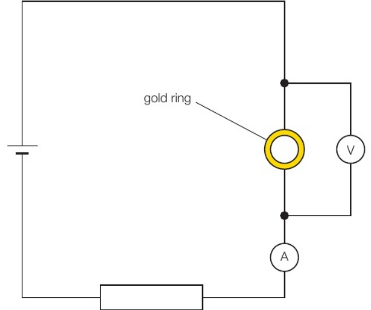

## fig E

(a) Calculate the resistivity of gold.

(b) Describe a practical difficulty with undertaking an experiment of this kind.

5. Estimate the volume of metal in the wire in a fuse.

## SUBJECT VOCABULARY

resistivity for a material, the same value as the resistance between opposite faces of a cubic metre of the material

<!-- page 172 -->

# 5 CONDUCTION AND RESISTANCE

## LEARNING OBJECTIVES

Explain conduction in metals.

Explain electrical resistance.

☑ Calculate the drift velocity of conduction electrons in metals.

In order to conduct electricity, solids need to have electrons that are delocalised from the solid's atoms, so that they can move through the solid causing an overall movement of charge – a current.

## CONDUCTION IN METALS

The structure of metals has a regular lattice of metal atoms. These are bonded together through the sharing of electrons, which act as if they were associated with more than one atom. Many of the atoms also have an outer electron that is not needed for bonding between the atoms. These free electrons have a random motion, which changes as they collide with atoms or other electrons, but on average the overall position of all the charge in the metal is stationary. However, if a source of emf is connected across the metal, the electric field it sets up in the metal will push the negative electrons towards the positive end of the field. The slow overall movement of the electrons is called their drift velocity.

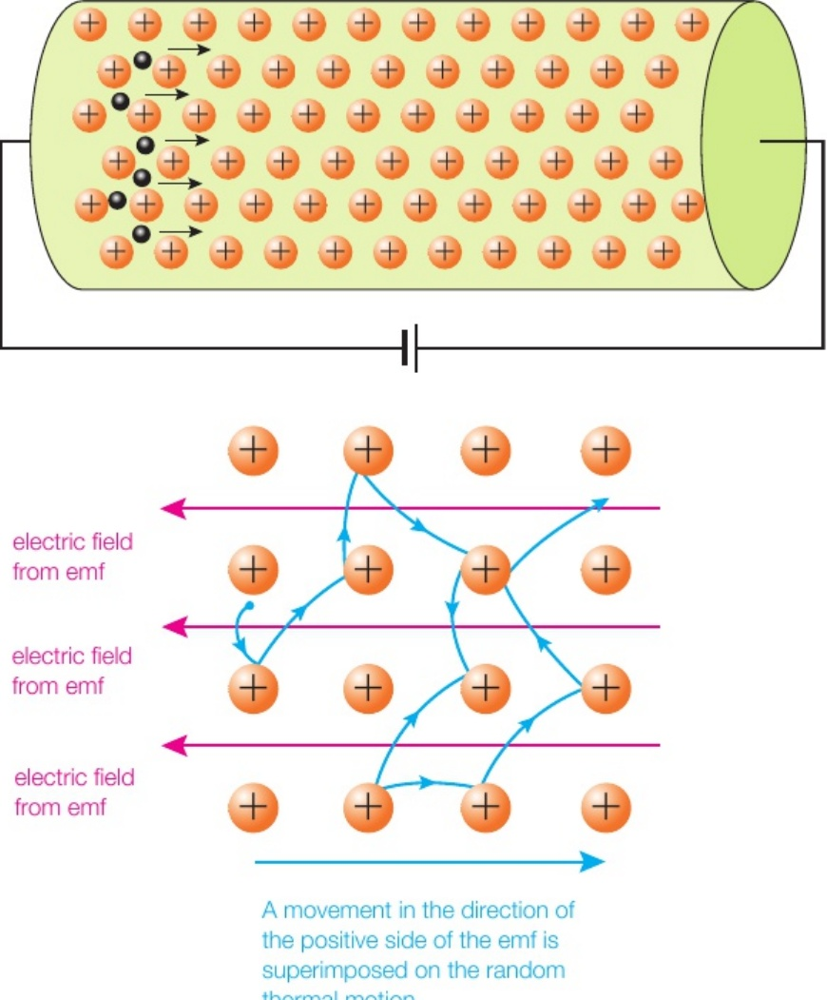

A movement in the direction of the positive side of the emf is superimposed on the random thermal motion.

fig A Conduction in metals happens as the free electrons add an overall movement along the direction of the voltage across the conductor (towards the positive anode) to their random collisions and vibrations.

## EXAM HINT

In exam answers, draw the direction of the electron movement changing sharply for each collision.

<!-- page 173 -->

# THE TRANSPORT EQUATION

## DID YOU KNOW?

For a metal, the random thermal motion of the free electrons will be at speeds of thousands of kilometres per second. However, the drift velocity during conduction is usually only millimetres per second.

The value of the electric current in a metal can be calculated from the fundamental movement of the electrons if we remember the definition that  $ I = \frac{\Delta Q}{\Delta t} $

If we consider the cylinder shaded on the diagram in fig B as the length of the wire that the charges move through in a time  $ \Delta t $, then we need to calculate how much charge flows through it in that time. There are  $ n $ electrons per cubic metre of this metal, and the wire has a cross-sectional area, A. Their movement is at a drift velocity,  $ v $, and the distance this takes them along the wire in that time is  $ \Delta x $. So:  $ \Delta x = v\Delta t $.

The total charge will be the number of electrons multiplied by the charge on each, e. The number of electrons will be their density, n, multiplied by the volume of the cylinder, V, that they travel through in  $ \Delta t $.

 $$ \begin{aligned}&\therefore\quad\Delta Q=n\times V\times e=n\times A\Delta x\times e=n\times Av\Delta t\times e\\&\therefore\quad I=\frac{\Delta Q}{\Delta t}=\frac{nAv\Delta te}{\Delta t}\\&\therefore\quad I=nAve\\ \end{aligned} $$ 

This is called the transport equation.

## EXAMPLE OF A TRANSPORT EQUATION

What is the drift velocity of the electrons in a copper wire which has a diameter of 0.22 mm and carries a current of 0.50 A? The number density of conduction electrons in copper,  $ n = 8.5 \times 10^{28} \, m^{-3} $

 $$ \mathrm{wire~radius}=0.11\mathrm{~mm}=1.1\times10^{-4}\mathrm{~m} $$

 $$ A=\pi r^{2}=\pi\times(1.1\times10^{-4})^{2}=3.8\times10^{-8}\mathrm{~m}^{2} $$

 $$ I=nAve $$

 $$ \begin{aligned}v&=\frac{I}{nAe}\\&=\frac{0.50}{8.5\times10^{28}\times3.8\times10^{-8}\times1.6\times10^{-19}}\end{aligned} $$ 

 $$ v=9.67\times10^{-4}m s^{-1} $$

 $$ v=0.97\,mm\,s^{-1} $$ 

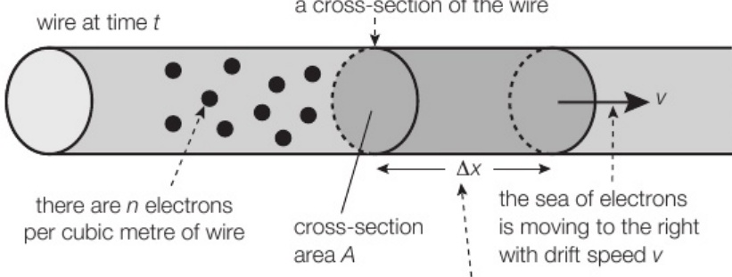

The sea of electrons has moved forward a distance  $ \Delta x = v\Delta t $. The shaded volume is  $ V = A\Delta x $.

fig B A section of metal wire with dimensions to show how to make calculations using the transport equation.

## PRACTICAL SKILLS

## Investigating conduction velocity of coloured ions

In this experiment, you can observe the movement of coloured ions as charge carrier particles on a piece of filter paper soaked in ammonium hydroxide solution. A crystal of copper sulfate and one of potassium manganate(VII) will each dissolve, producing positive blue copper ions and negative purple ions of manganate(VII). Connecting a pd of 30 V across the wet filter paper will cause the ions to flow slowly across it, in opposite directions, and their velocity can be measured using a ruler and stopclock. Expect a velocity of about 1 mm per minute.

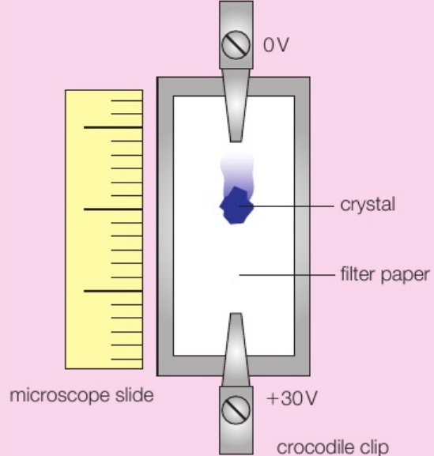

fig C Observing the slow speed of ion movement during current flow.

Safety Note: Avoid skin contact with the solution and crystals.

Everyone, especially persons with respiratory problems, must avoid inhaling ammonia vapour. Use eye protection when soaking the filter paper in the ammonia solution.

## RESISTANCE

We have seen that whilst the natural speed of electrons within a metal is very high, their progress through a metal's lattice of fixed atoms is very slow. They are constantly colliding with those atoms making their motion like taking 100 steps forward and 99 steps back. This is electrical resistance. The frequency of collisions is determined in part by the temperature, as this affects the vibration of the fixed atoms. The higher the metal's temperature, the more its atoms vibrate, and this means more collisions, further slowing the drift velocity of the electrons.

However, a higher current will cause more collisions, as more electrons move faster through the metal structure. This makes the metal atoms vibrate more – effectively increasing the temperature.

Looking back to the I–V graph for a filament lamp, fig C in Section 4A.3, we can now explain how increased current leads to higher temperature, which leads to greater resistance, causing the curve to flatten out when higher voltages try to drive higher currents.

<!-- page 174 -->

## RESISTIVITY

Table A in Section 4A.4 showed the resistivity of various materials, good conductors, semiconductors and insulators (which are discussed in detail in Section 4A.6). It also showed how the resistivity varies with temperature for metals and semiconductors. The resistivity of semiconductors was seen to fall as the temperature rises. Table A below shows how the density of conduction electrons, n in the transport equation, explains why the resistivity of metals is so much lower than for semiconductors. The negative temperature coefficients of resistivity for semiconductors show that their resistivity falls as the temperature goes up. The reason for this is that the value for n in the transport equation will be higher at higher temperatures (see also Section 4A.6). So the fact that the resistivity goes down is just a consequence of the fact that these materials, like silicon, conduct better at higher temperatures.

<table border=1 style='margin: auto; word-wrap: break-word;'><tr><td style='text-align: center; word-wrap: break-word;'>MATERIAL</td><td style='text-align: center; word-wrap: break-word;'>n/m^{-3} AT 20°C</td><td style='text-align: center; word-wrap: break-word;'>n/m^{-3} AT 50°C</td></tr><tr><td style='text-align: center; word-wrap: break-word;'>copper</td><td style='text-align: center; word-wrap: break-word;'>8.42 \times 10^{28}</td><td style='text-align: center; word-wrap: break-word;'>8.27 \times 10^{28}</td></tr><tr><td style='text-align: center; word-wrap: break-word;'>aluminium</td><td style='text-align: center; word-wrap: break-word;'>18.2 \times 10^{28}</td><td style='text-align: center; word-wrap: break-word;'>17.9 \times 10^{28}</td></tr><tr><td style='text-align: center; word-wrap: break-word;'>silicon</td><td style='text-align: center; word-wrap: break-word;'>8.49 \times 10^{15}</td><td style='text-align: center; word-wrap: break-word;'>7.42 \times 10^{17}</td></tr><tr><td style='text-align: center; word-wrap: break-word;'>germanium</td><td style='text-align: center; word-wrap: break-word;'>1.56 \times 10^{19}</td><td style='text-align: center; word-wrap: break-word;'>6.82 \times 10^{20}</td></tr></table>

table A The number of charge carriers for some common materials, at room temperature and at a higher temperature.

A slight decrease in n for metals at higher temperatures is due to their thermal expansion, rather than any change in the number of available conduction electrons. It is not as significant as the increase in collisions between metal atoms and conduction electrons caused by increased thermal vibrations.

## CHECKPOINT

1. What is the 'drift velocity' of conduction electrons in a metal?

2. For an aluminium wire at room temperature with a diameter of 0.40 mm, calculate the electrons' drift velocity when a current of 2.2 A passes through the wire.

3. Explain why the resistance of a wire is greater if the wire is longer.

4. Develop a model to explain conduction and resistance in metals. Your explanation should include reference to at least the following ideas:

movement of charge carriers

fixed lattice ions

- collisions between ions and charge carriers

• increased vibrations of fixed lattice ions with temperature

an evaluation of the strengths and weaknesses of your model.

5. Estimate the number of free conduction electrons in a coin.

## SUBJECT VOCABULARY

drift velocity the slow overall movement of the charges in a current

transport equation $I = nAvq$. This defines electric current, $I$, from a fundamental basis. It is the product of charge carriers, $n$; the charge on those carriers, $q$; the cross-sectional area of the conductor, $A$; and the drift velocity of the charge carriers in that conductor, $v$.

## EXAM HINT

Take care not to confuse resistance with resistivity.

<!-- page 175 -->

## 6 SEMICONDUCTORS

## LEARNING OBJECTIVES

Explain conduction in semiconductors.

Explain electrical insulation.

## CONDUCTION IN SEMICONDUCTORS

Semiconductors are generally solid materials that only have small numbers of delocalised electrons that are free to conduct. A typical example is silicon, one of the most common elements on Earth.

Free atoms have a series of discrete energy levels in which we can find their electrons, depending on the energy the electrons have received (see Section 3D.4). If the electron receives enough energy, it will leave the atom altogether, leaving behind an ion.

In solid materials, where there are many, many atoms close together, the allowed energy levels become much wider, forming energy bands. The electrons can have a large range of energies and still be within the same band. There are energy amounts which are forbidden for the electrons, but it is a very different situation from the highly limited energy levels of the isolated atom's electrons. As these energy bands are created by the collective grouping of the solid's atoms, the bands are attributed to the semiconductor as a whole rather than to individual atoms. There is an energy level called the valence band. Electrons with this amount of energy remain tied to atoms and do not form part of any electric current. Those that gain energy to jump up to the conduction band become delocalised and can move through the semiconductor as part of a current.

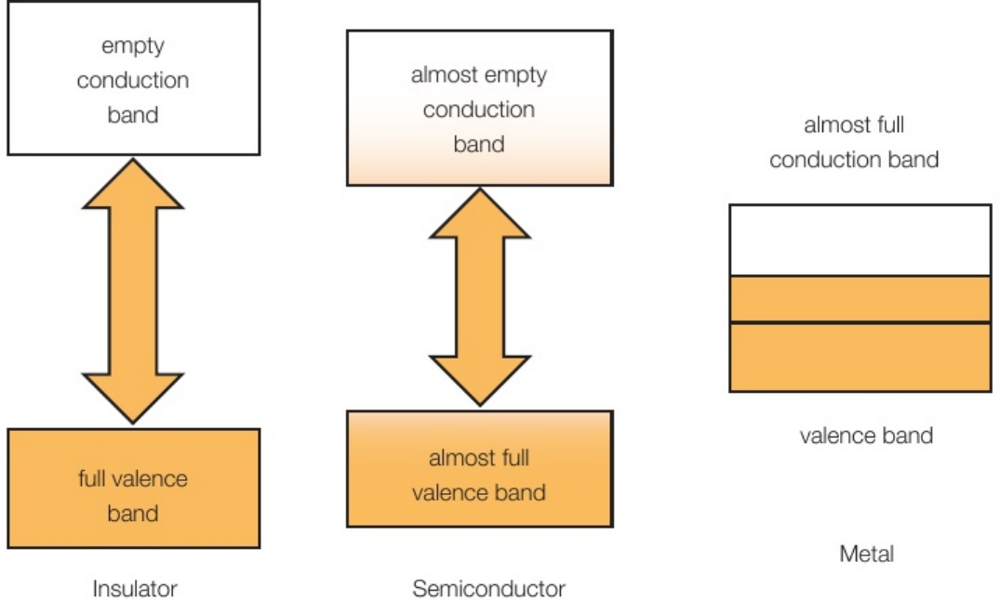

▲ fig A The gaps between energy bands within materials explain why they are conductors or insulators. If there is a large energy gap, electrons will need to gain a lot of energy to leave their atoms and conduct a current.

The number of delocalised electrons in a semiconductor is low compared with metals, and so the current they will carry is therefore lower than metals for the same applied voltage. At higher temperatures they have more conduction electrons, as more electrons are elevated into the conduction band. There will be a temperature-related reduction in current due to increased collisions with fixed atoms, but the increase in available conduction electrons is a much bigger effect. Overall, a semiconductor will carry more current as the temperature goes up – its resistivity effectively drops as the temperature rises.

<!-- page 176 -->

## CONDUCTION 'HOLES'

When an electron enters the conduction band and moves away, this leaves the atom with a positive charge. The empty space the electron has left is referred to as a (positive) hole. If an electron from another atom moves to fill the hole, leaving its original atom with a hole, the hole has then moved. As the electrons will be attracted to jump in the positive direction of an applied voltage, the hole will slowly appear to move in the opposite direction. A positive hole moving towards the negative cathode is like another charge carrier, adding to the current flow in a semiconductor. It is like the current flow in electrolysis, where positively and negatively charged particles are moving in opposite directions at the same time.

## LEARNING TIP

Note that conduction by holes does not mean there is overall movement of the positive metal ions. The holes are an absence of an electron, and it is this space that moves as electrons actually jump in the opposite direction.

## I–V CHARACTERISTICS OF A SEMICONDUCTOR DIODE

A diode is made by joining different types of semiconductors, which normally creates an energy barrier at the junction between them. This blocks the movement of charge carriers (holes and electrons) across the barrier. This barrier can be overcome in the forward direction if a small forward voltage is applied. In the reverse direction, only very few charge carriers can pass through at low voltages. They account for a tiny 'leakage current'. Once the reverse voltage becomes large enough, it can overcome the large reverse energy barrier and force the conduction process in the opposite direction.

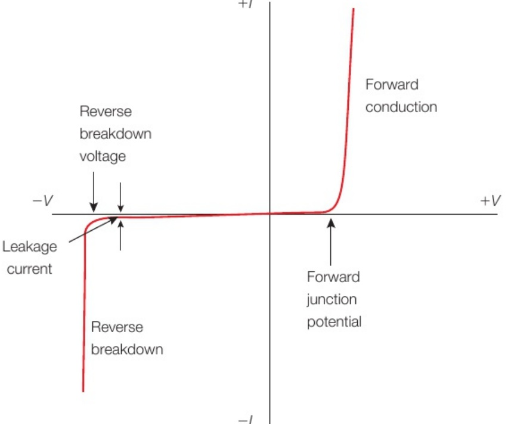

fig B The I-V characteristics for a semiconductor diode in detail.

## LIGHT DEPENDENT RESISTORS (LDRS) AND THERMISTORS

Light dependent resistors have the property that their resistance depends on the light level around them. In brighter conditions, the LDR will have a lower resistance. LDRs are made from semiconductor material, and light landing on the material can boost electrons from the valence energy band up to the conduction band, increasing the number of conduction electrons. The effect of this is to make the LDR conduct better – it has a lower resistance.

Thermistors work in exactly the same way, except that their resistance depends on thermal energy from the surroundings. The most common type of thermistors are referred to as negative temperature coefficient thermistors. These use thermal energy to boost their electrons into the conduction energy band, meaning their resistance falls as the temperature rises.

<!-- page 177 -->

## INSULATORS

Electrical insulators can be thought of as materials in which the energy gap between the valence band and the conduction band is so large that there are virtually zero electrons available for conduction. There will therefore be no conduction holes either. A very large input of energy is required in order to make the material conduct. Often this results in melting, or other damage, before the material becomes electrically conducting. For example, glass is normally an excellent electrical insulator, but a very high electric field, more than 10 million volts per metre, created across glass can cause it to become conducting.

## SUPERCONDUCTIVITY

Resistance increases with higher temperatures, because the higher level of internal energy in the material causes more vibration of the fixed ions. These ions collide more often with charge carriers to reduce their speed of movement through the material. Reducing the temperature therefore reduces resistance, allowing greater current flow.

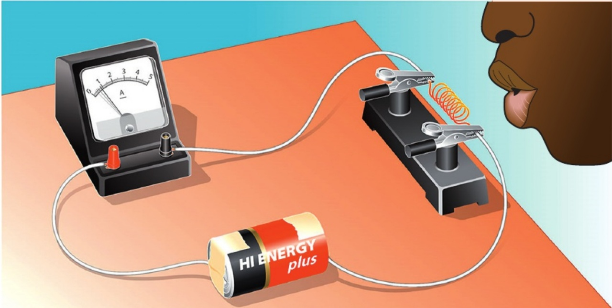

▲ fig C If we cool a conductor, the current through it is seen to increase because its resistance drops.

Cooling to ever lower temperatures continues this trend, until something quite unexpected happens. Below a certain critical temperature, the resistance suddenly drops to zero. This is called superconductivity. The critical temperature varies with material, but for most metals it will be below  $ -243^{\circ} $C. Complex ceramic superconductors have been created that have temperatures at which they conduct without any resistance as high as  $ -135^{\circ} $C.

Superconductors are especially useful in applications where a large current is needed, as a large current would normally waste too much energy or damage the surroundings with the heat dissipated. For example, the strong magnets needed in a particle accelerator will often be superconducting electromagnets, cooled to very low temperatures to maintain their superconductivity. The electromagnets in the Large Hadron Collider operate at about 1.9 K.

## DID YOU KNOW?

Low temperatures are often expressed on the Kelvin temperature scale, where 0 Kelvin (K) is referred to as Absolute Zero.

 $$ 0\mathsf{K}=-273.15\mathsf{^\circ C} $$ 

 $$ 0^{\circ}C=273.15K $$ 

We usually ignore the  $ 0.15^{\circ} $ and convert from Celsius to Kelvin by adding  $ 273^{\circ} $. Absolute Zero is the lowest temperature possible, as this represents a temperature where the particles have zero internal energy.

<!-- page 178 -->

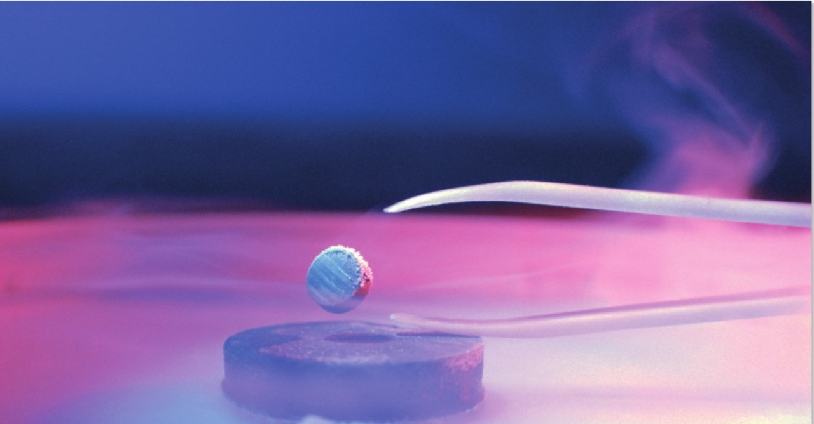

fig D Superconductors can levitate magnets, as they do not accept penetration by magnetic fields. This is the Meissner Effect.

## CHECKPOINT

1. Explain why a piece of silicon semiconductor will have a lower resistance at a higher temperature.

2. 'The critical temperature for superconductivity for lead is 7.2 K'. Explain what this statement means.

3. Some types of glass have been manufactured that do conduct electricity. Suggest and explain what properties impurities might have in these glasses to make them less insulating than standard glass.

## WORKED EXAMPLE

semiconductors materials with a lower resistivity than insulators, but higher than conductors. They usually only have small numbers of delocalised electrons that are free to conduct

valence band a range of energy amounts that electrons in a solid material can have which keeps them close to one particular atom

conduction band a range of energy amounts that electrons in a solid material can have which delocalises them to move more freely through the solid

critical temperature the temperature below which a material's resistivity instantly drops to zero

superconductivity the electrical property of a material having zero resistivity

SKILLS > CRITICAL THINKING

<!-- page 179 -->

# 4A THINKING BIGGER

## SHOCKING STUFF

## SKILLS CRITICAL THINKING, PROBLEM SOLVING, ANALYSIS, REASONING/ARGUMENTATION, INTERPRETATION, ADAPTIVE LEARNING, INITIATIVE, PRODUCTIVITY, COMMUNICATION

A defibrillator is a medical device which is designed to deliver an electric shock to a patient's heart. It will restart it if the heart has stopped, or reset it if the heart it is beating with a dangerously unpredictable rhythm.

In this activity, we will consider how the electrical and other characteristics of one type of defibrillator help it to perform its function.

## PRODUCT MANUALS

## Extract 1:

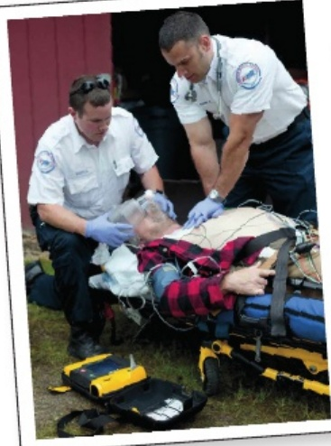

fig A The LIFEPAK

1000 can help paramedics with resuscitation by restarting the patient's heart using an electric shock through the heart.

## Extract 2:

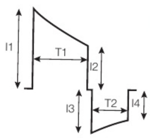

Note: Table values are nominal for a 200-joule shock.

<table border=1 style='margin: auto; word-wrap: break-word;'><tr><td style='text-align: center; word-wrap: break-word;'>Patient Impedance ( \Omega )</td><td style='text-align: center; word-wrap: break-word;'>I1 (A)</td><td style='text-align: center; word-wrap: break-word;'>I2 (A)</td><td style='text-align: center; word-wrap: break-word;'>I3 (A)</td><td style='text-align: center; word-wrap: break-word;'>I4 (A)</td><td style='text-align: center; word-wrap: break-word;'>T1 (ms)</td><td style='text-align: center; word-wrap: break-word;'>T2 (ms)</td></tr><tr><td style='text-align: center; word-wrap: break-word;'>25</td><td style='text-align: center; word-wrap: break-word;'>50.3</td><td style='text-align: center; word-wrap: break-word;'>20.1</td><td style='text-align: center; word-wrap: break-word;'>19.7</td><td style='text-align: center; word-wrap: break-word;'>10.7</td><td style='text-align: center; word-wrap: break-word;'>5.9</td><td style='text-align: center; word-wrap: break-word;'>3.9</td></tr><tr><td style='text-align: center; word-wrap: break-word;'>50</td><td style='text-align: center; word-wrap: break-word;'>28.2</td><td style='text-align: center; word-wrap: break-word;'>14.6</td><td style='text-align: center; word-wrap: break-word;'>14.5</td><td style='text-align: center; word-wrap: break-word;'>9.3</td><td style='text-align: center; word-wrap: break-word;'>7.5</td><td style='text-align: center; word-wrap: break-word;'>5.0</td></tr><tr><td style='text-align: center; word-wrap: break-word;'>75</td><td style='text-align: center; word-wrap: break-word;'>19.8</td><td style='text-align: center; word-wrap: break-word;'>11.7</td><td style='text-align: center; word-wrap: break-word;'>11.7</td><td style='text-align: center; word-wrap: break-word;'>8.2</td><td style='text-align: center; word-wrap: break-word;'>8.7</td><td style='text-align: center; word-wrap: break-word;'>5.8</td></tr><tr><td style='text-align: center; word-wrap: break-word;'>100</td><td style='text-align: center; word-wrap: break-word;'>15.5</td><td style='text-align: center; word-wrap: break-word;'>10.0</td><td style='text-align: center; word-wrap: break-word;'>9.9</td><td style='text-align: center; word-wrap: break-word;'>7.3</td><td style='text-align: center; word-wrap: break-word;'>9.7</td><td style='text-align: center; word-wrap: break-word;'>6.5</td></tr><tr><td style='text-align: center; word-wrap: break-word;'>125</td><td style='text-align: center; word-wrap: break-word;'>12.9</td><td style='text-align: center; word-wrap: break-word;'>8.7</td><td style='text-align: center; word-wrap: break-word;'>8.7</td><td style='text-align: center; word-wrap: break-word;'>6.6</td><td style='text-align: center; word-wrap: break-word;'>10.4</td><td style='text-align: center; word-wrap: break-word;'>7.0</td></tr><tr><td style='text-align: center; word-wrap: break-word;'>150</td><td style='text-align: center; word-wrap: break-word;'>11.1</td><td style='text-align: center; word-wrap: break-word;'>7.8</td><td style='text-align: center; word-wrap: break-word;'>7.7</td><td style='text-align: center; word-wrap: break-word;'>6.2</td><td style='text-align: center; word-wrap: break-word;'>11.1</td><td style='text-align: center; word-wrap: break-word;'>7.4</td></tr><tr><td style='text-align: center; word-wrap: break-word;'>175</td><td style='text-align: center; word-wrap: break-word;'>9.8</td><td style='text-align: center; word-wrap: break-word;'>7.1</td><td style='text-align: center; word-wrap: break-word;'>7.1</td><td style='text-align: center; word-wrap: break-word;'>5.7</td><td style='text-align: center; word-wrap: break-word;'>11.7</td><td style='text-align: center; word-wrap: break-word;'>7.8</td></tr></table>

## Extract 3:

Fig B Graph of the current against time during discharge. The defibrillator discharge has a large shock in one direction (T1) followed by a smaller shock in the reverse direction (T2) each of which follows a trapezium shape on the graph. The table shows the current values and times during the discharge, for various different resistance values of the patient.

## cprMAX Technology

The 1000 features our exclusive cprMAX technology, which gives you the flexibility to choose CPR settings that best accommodate your patient and CPR protocol requirements. The pre-shock CPR option allows adjustment of the CPR interval prior to the first shock, making the 1000 the only device that minimizes pre-shock pauses by allowing providers to continue compressions while the AED charges.

Recently published clinical data shows a relationship between increased compression fraction and survival to hospital discharge, and the 2010 AHA Guidelines place a strong emphasis on high-quality CPR. With the LIFEPAK 1000, you have more control over the CPR you provide in lifesaving settings than ever before.

## LIFEPAK TOUGH $ ^{™} $

Built for the harshest environments, the LIFEPAK 1000 is the toughest, most durable AED from Physio-Control. The device itself withstands rigorous drop-testing from any angle, and is enclosed in a highly protective case with bumpers. In addition, the 1000 has received an IP55 rating – the highest for any AED – signifying maximum protection from external elements.

## 360 Joules

Like every LIFEPAK defibrillator from Physio-Control, the 1000 can escalate energy up to 360J. Studies show that for difficult-to-defibrillate patients, repeating 200J shocks yields significantly lower VF termination rates. And the 2010 AHA Guidelines note that rescuers may consider using escalating energy up to 360J if initial shocks at a lower dose aren't working.

## Extract 4:

## ENVIRONMENTAL

One Hour Operating Temperature (from room temperature to temperature extreme, one hour duration): -20 to 60°C (-4 to +140°F).

Operating Temperature: 0° to 50°C (32° to 122°F).

Storage Temperature: -30° to 60°C (-22° to 144°F) with battery and electrodes (maximum exposure limited to 7 days).

Atmospheric Pressure: 575 hPa to 1060 hPa (4572 to -382 meters; 15,000 to -1253 feet).

Relative Humidity: 5 to 95% (non-condensing).

Dust/Water Resistance: IP55 with battery and REDI-PAK™ electrodes installed (IEC 60529/EN 60529).

Bump: 15 g, 1000 bumps (IEC 600-68-2-29).

Shock: 40 g peak, 15-23 ms, 45 Hz cross over frequency.

Drop: 1 meter drop on each corner, edge and surface (MIL-STD-810F, 516.5, Procedure IV).

## Extract 5:

## physical characteristics

Height: 8.7 cm (3.4 in).

Width: 23.4 cm (9.2 in).

Depth: 27.7 cm (10.9 in).

Weight: 3.2 kg (7.1 lbs) with one set of REDI-PAK electrodes and one nonrechargeable battery.

## Extract 6:

Picture the waiting room of a hospital or a corridor or a cafeteria. Now picture a visitor, patient or staff member struck down by sudden cardiac emergency. Who will respond first? It could be an ALS-trained member of the code team, but it's just as likely to be a nurse or a receptionist trained in the use of the 1000. The LIFEPAK 1000 defibrillator is ready for all these possibilities, combining the simplicity of one-push defibrillation with clear guidance, both onscreen and from audio prompts.

<!-- page 180 -->

## THINKING BIGGER

## SCIENCE COMMUNICATION

1 The extracts opposite come from a manufacturer's sales brochure, and also from the product user manual. Consider the extracts and comment on the type of writing that is used in each case. Then answer the following questions.

(a) Identify which extracts are from the sales brochure, and which are from the operations manual. Justify your choices.

(b) Discuss the science presented in each booklet, in relation to the intended audience.

## PHYSICS IN DETAIL

Now we will look at the physics in detail. Some of these questions link to topics elsewhere in this book, so you may need to combine concepts from different areas of physics to work out the answers.

2 (a) Using information from the discharge current waveform graph and table, calculate the average current for each of the two parts of the discharge. Then use this average current to calculate the charge transferred in the times given. Do these calculations for the  $ 50\Omega $,  $ 100\Omega $ and  $ 150\Omega $ entries in the table, and compare the variations in charge.

(b) For the same 50Ω, 100Ω and 150Ω entries in the table, use your charge values to calculate the voltage needed to cause each shock to deliver exactly 200J.

(c) Compare your answers to part (b) with the voltage values that Ohm's law gives you for the peak current in each case.

3 One of the Environmental specifications claims that the unit can survive a one metre drop onto its corner. Calculate the force that the unit would experience if it falls one metre and is stopped by the ground in 20 ms.

## ACTIVITY

The manufacturers of the LIFEPAK 1000 would like a brochure that its customers can leave in hospital waiting rooms for patients to read. Use the information above to design this leaflet.

## INTERPRETATION NOTE

Think about what you would expect to be the different purposes of the two booklets.

## THINKING BIGGER TIP

Impedance is a term used to mean ‘resistance’ when charge flow is in changing directions.

<!-- page 181 -->

# 4A EXAM PRACTICE

1 Which of the following is a unit equivalent to the volt?

A Ah

B  $ Cs^{-1} $

C  $ JC^{-1} $

D  $ Js^{-1} $

(Total for Question 1 = 1 mark)

2 An ammeter reads 1.42 A. How many electrons pass through the ammeter in one hour?

A  $ 5.1 \times 10^{3} $

B  $ 8.9 \times 10^{18} $

C  $ 5.3 \times 10^{20} $

D  $ 3.2 \times 10^{22} $

(Total for Question 2 = 1 mark)

3 Which of the following is a correct explanation for the shape of a current/voltage graph for a filament bulb?

A Below a certain temperature, the resistivity of the filament material suddenly reduces to zero.

B Above a certain temperature, the resistivity of the filament material suddenly reduces to zero.

C Increased voltage increases the current, which raises the temperature, increasing the resistance.

D As the voltage increases, the current increases, increasing the temperature of the filament, causing a release of more conduction electrons. [1]

(Total for Question 3 = 1 mark)

4 Two wires are made of the same material with resistivity,  $ \rho $.

Wire X has resistance R. Wire Y is twice as long and has twice the diameter of wire X.

Which row in the table correctly gives the resistances for both wires?

<table border=1 style='margin: auto; word-wrap: break-word;'><tr><td style='text-align: center; word-wrap: break-word;'></td><td style='text-align: center; word-wrap: break-word;'>Wire X resistance</td><td style='text-align: center; word-wrap: break-word;'>Wire Y resistance</td></tr><tr><td style='text-align: center; word-wrap: break-word;'>A</td><td style='text-align: center; word-wrap: break-word;'>R</td><td style='text-align: center; word-wrap: break-word;'>$ \frac{R}{2} $</td></tr><tr><td style='text-align: center; word-wrap: break-word;'>B</td><td style='text-align: center; word-wrap: break-word;'>R</td><td style='text-align: center; word-wrap: break-word;'>R</td></tr><tr><td style='text-align: center; word-wrap: break-word;'>C</td><td style='text-align: center; word-wrap: break-word;'>R</td><td style='text-align: center; word-wrap: break-word;'>2R</td></tr><tr><td style='text-align: center; word-wrap: break-word;'>D</td><td style='text-align: center; word-wrap: break-word;'>R</td><td style='text-align: center; word-wrap: break-word;'>4R</td></tr></table>

(Total for Question 4 = 1 mark)

5 Explain, in terms of energy, the difference between potential difference (pd) and electromotive force (emf). [2]

(Total for Question 5 = 2 marks)

6 The planet Jupiter has a moon Io. Volcanic activity on Io releases clouds of electrons which travel at high speeds towards Jupiter. During a 15 s time period,  $ 2.6 \times 10^{26} $ electrons reach Jupiter from Io.

Calculate the current. [3]

(Total for Question 6 = 3 marks)

7 An integrated circuit uses strips of gold as connectors and strips of silicon as resistors.

A strip of gold of cross-sectional area  $ 3.0 \times 10^{-6} \, \text{m}^2 $ carries a current of  $ 8.0 \, \text{mA} $. The charge carrier density  $ n $ is  $ 6.0 \times 10^{28} \, \text{m}^{-3} $.

(a) Show that the carrier drift velocity v for gold is approximately  $ 3 \times 10^{-7} \, \text{m} \, \text{s}^{-1} $

(b) An approximate value of  $ v $ for a sample of silicon of the same dimensions, carrying the same current, would be  $ 0.2 \, m \, s^{-1} $.

Compare this value with the one for gold and account for the difference in the values.

(c) State and explain what happens to the resistance of a sample of silicon as its temperature increases.

(Total for Question 7 = 6 marks)

8 (a) Explain the difference between resistance and resistivity. [2]

(b) The resistivity of copper is  $ 1.7 \times 10^{-8} \Omega \cdot \text{m} $. A copper wire is 0.50 m long and has a cross sectional area of  $ 1.0 \times 10^{-6} \text{m}^2 $. Calculate its resistance. [2]

(Total for Question 8 = 4 marks)

9 When tidying a prep room, a teacher discovers a tray of resistance wires that have lost their labels. He decides to ask his students to carry out experiments to determine the material that each wire is made of by measuring the resistivity of the wires.

(a) Explain why the teacher asks the students to measure the resistivity and not the resistance of the wires.

(b) Describe a method to determine accurately the resistivity of one of the metal wires.

Your description should include:

- the circuit diagram you would use

- the quantities you would measure

- the graph you would plot

how you would determine the resistivity.

(Total for Question 9 = 11 marks)

<!-- page 182 -->

## EXAM PRACTICE

## 10 (a) State Ohm's law

(b) Using the axes below sketch graphs to show how resistance varies with potential difference for a fixed resistor and a 1.5 V filament lamp.

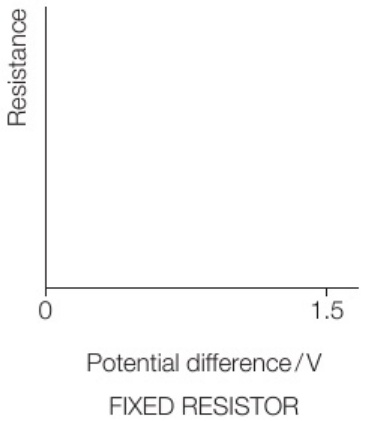

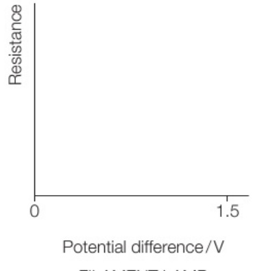

(c) The filament of a lamp is made of metal. Explain why the lamp does not demonstrate Ohm's law. [2] (Total for Question 10 = 6 marks)

11 The graph shows the current-potential difference characteristic for an electrical component.

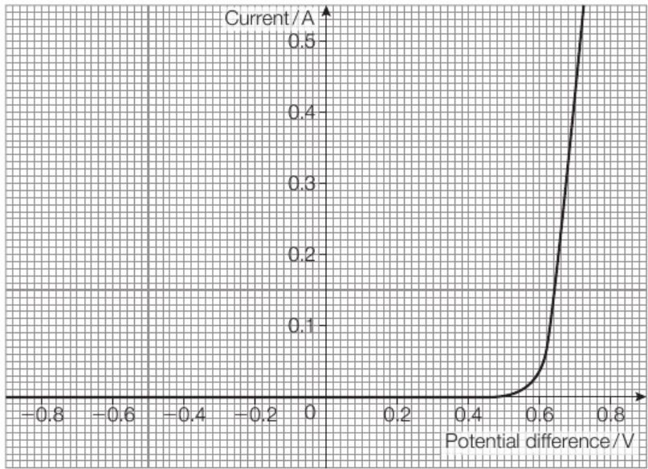

(a) State the name of the component.

(b) State the resistance of the component when the potential difference is -0.7 V. [1]

(c) Calculate the resistance of the component when the potential difference is +0.7 V. [2]

(d) State a practical use for this component.

(Total for Question 11 = 5 marks)

12 A pen which has ink that conducts electricity is used to draw a circle.

The diameter from point A to point B across the circle is 25.0 cm

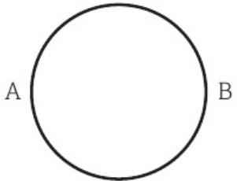

(a) Describe an experimental method to measure the resistance of the ink circle between points A and B.

(b) How would the resistance between points A and B change if the circle was redrawn with the ink line twice the width, but with the same size circle and the same depth of ink on the paper? [2]

(Total for Question 12 = 5 marks)

