# 4B Complete electrical circuits

<!-- edx_ial_phy1.pdf p183-204 -->

<!-- page 183 -->

# TOPIC 4 ELECTRIC CIRCUITS

# 4B COMPLETE ELECTRICAL CIRCUITS

For the complex machines we use every day, the individual components need particular currents and voltages in order to function properly. In order to ensure that they receive appropriate currents and voltages, we must connect them together in circuits of the correct design and with other components. The design of the overall circuit, and designs of parts of it, rely on the calculations of the electrical properties at each point in the circuit.

A smartphone uses over a billion tiny electrical circuits in order to perform a huge range of functions. However, it is basically powered by a DC battery that will supply a continuous voltage of approximately 4 volts. From this single electrical quantity, the billion or more circuits can each be powered separately to perform their individual function.

In this chapter, you will learn how the fundamental electrical quantities change around different parts of a circuit, and how they can be altered by the design of the circuit.

## MATHS SKILLS FOR THIS CHAPTER

Units of measurement (e.g. the ohm,  $ \Omega $)

• Changing the subject of an equation (e.g. finding a particular branch current from electric current rules)

- Substituting numerical values into algebraic equations (e.g. calculating the electrical energy transferred by a component)

• Solving algebraic equations (e.g. the potential divider equation)

• Using ratios, fractions and percentages (e.g. the efficiency equation)

• Determining the slope and intercept of a linear graph (e.g. finding the emf and internal resistance from experimental results)

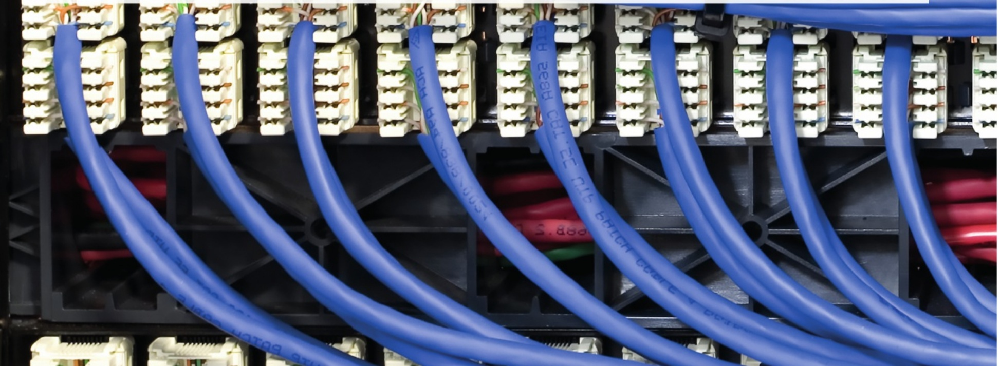

<!-- page 184 -->

## What prior knowledge do I need?

## Topic 4A

Energy transfers in electrical circuits

Calculations of electrical power and energy

Explanations of the movement of charged particles in terms of their material medium

Calculations of current, voltage, and resistance

Ohm's law in general and when it is, and is not, relevant

## What will I study in this chapter?

How the conservation of charge, and the conservation of energy, affect the distribution of currents and voltages around circuits

How resistances can be combined and separated in series and parallel circuits

How internal resistance can affect the usefulness of an electrical supply

How to calculate the transfer of electrical energy and power, and the efficiency of an electrical device or circuit

## What will I study later? Topic 6B (Book 2: IAL)

Analysis of changes in electrical circuits using datalogging and/or an oscilloscope

The use of circuits involving capacitors

Topic 6C (Book 2: IAL)

How electromagnetic induction will generate an electromotive force (emf)

How Faraday's Law can be used to calculate the

magnitude of an induced emf

35 m² 6016

<!-- page 185 -->

# 4B 1 SERIES AND PARALLEL CIRCUITS 2.4.67(a) 2.4.67(b)

2.4.68

## LEARNING OBJECTIVES

Calculate currents, voltages and resistances in series and parallel circuits.

Derive the equations for combining resistances in series and parallel.

The most important rules governing measurements in electrical circuits are the conservation of charge and conservation of energy. These determine how currents, voltages and resistances change around any particular circuit.

## CURRENT

The total amount of charge within a circuit cannot increase or decrease when the circuit is functioning.

## LEARNING TIP

Currents are measures of charge flow through a component, so they must be measured in the same line as the component, i.e. the ammeter must always be placed in series next to the component.

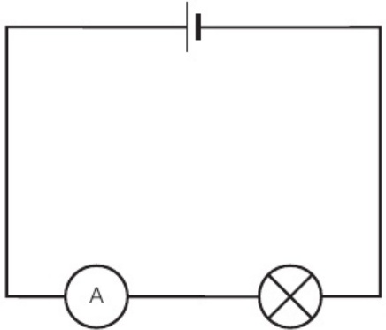

fig A Ammeters must always be in series with the component they are measuring.

## CURRENTS IN SERIES CIRCUITS

Any group of components that follow in series in a circuit, with no junctions in the circuit, must have the same current through them all.

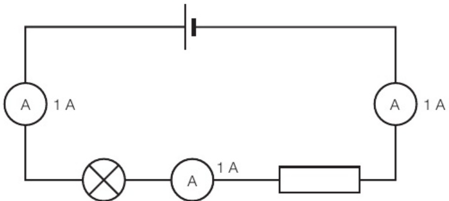

fig B The current is constant throughout a series loop in a circuit.

## CURRENTS IN PARALLEL CIRCUITS

Whenever a current encounters a junction in a circuit, the charges can only go one way or the other, so the current must split. The proportions that travel along each possible path will be in inverse proportion to the resistance along that path. If the path has high resistance, the current is less likely to go that way. However, the total along the branches must add up to the original total current.

<!-- page 186 -->

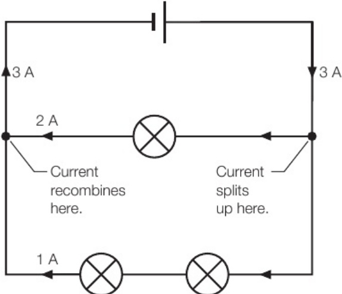

fig C Current splits at circuit junctions, but the total current will remain the same, in order to conserve charge.

## VOLTAGES AROUND CIRCUITS

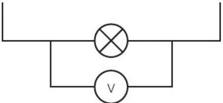

▲ fig D Voltmeters must always be in parallel across the component they are measuring.

## VOLTAGES IN SERIES CIRCUITS

Any group of emfs that follow in series in a circuit, with no junctions in the circuit, will have a total emf that is the sum of their individual values, that accounts for the direction of their positive and negative sides. For example, two 1.5 V cells in a TV remote control will be in series, so that they supply an emf of 3.0 V. This is also true for any string of potential differences in series.

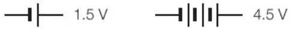

▲ fig E Emfs in series will add up. Take care to account for their direction, as cells in opposite directions oppose each other and cancel out the emf they would supply.

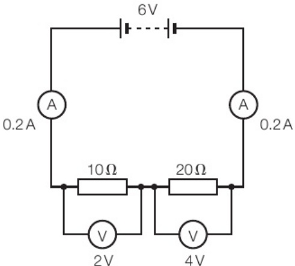

▲ fig F Potential differences in series will add up. What would be the total pd across the two resistors in this diagram?

## WORKED EXAMPLE

## LEARNING TIP

In the circuit diagram of fig F, the two voltmeters measure the potential differences in the circuit. The total pd across both resistors will be the sum of their individual pds, so the total is  $ 2V + 4V = 6V $.

Voltages are measures of energy change as charge passes through a component. As such, they must be measured from one side to the other, i.e. the voltmeter must always be placed in parallel across the component.

<!-- page 187 -->

## VOLTAGES IN PARALLEL CIRCUITS

If the total voltage across any branch of a circuit is known, then the voltage across any other branch in parallel with it will be identical.

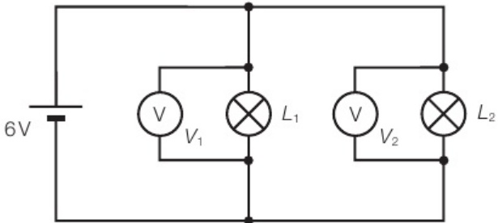

▲ fig G Both voltmeters here will read 6 V: the voltage is the same across all parallel branches within a circuit.

## RESISTANCE

Resistance can be calculated from Ohm's law as  $ \frac{V}{I} $. This can be done for any individual component or a whole branch of a circuit, as long as the voltage and current are known. This also means that if we follow the rules for current and voltage variations around series and parallel circuits, we come up with simple rules for the total resistance in series and parallel combinations.

## RESISTORS IN SERIES

Any group of resistances that follow in series in a circuit, with no junctions in the circuit, will have a total resistance that is the sum of their individual values. In fig F, we could use the total pd across both resistors and the current through them to calculate their total resistance:

 $$  total~R=\frac{total~V}{I}=\frac{6}{0.2}=30\Omega $$ 

You will see that this matches with our rule that

 $$ R_{total}=R_{1}+R_{2}=10+20=30\Omega $$ 

## LEARNING TIP

Ammeters in series, and voltmeters in parallel, do not affect resistance and can be ignored.

## DERIVATION

Resistors in series will have a total pd across them that is the sum of their individual pds. The current through them will be the same for each one. Take an example of three resistors in series:

potential difference:  $ V_{total} = V_1 + V_2 + V_3 $

and V = IR

 $$ \therefore\quad IR_{total}=IR_{1}+IR_{2}+IR_{3} $$ 

 $$ \therefore\quad R_{total}=R_{1}+R_{2}+R_{3} $$ 

## RESISTORS IN PARALLEL

The total resistance of a group of resistors in parallel can be calculated from the equation:

 $$ \frac{1}{R_{total}}=\frac{1}{R_{1}}+\frac{1}{R_{2}}+\frac{1}{R_{3}}+\ldots $$ 

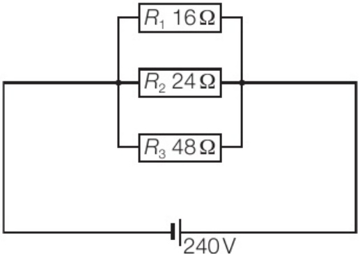

fig H Resistors in parallel follow a reciprocal sum rule to find their total resistance.

## WORKED EXAMPLE

In the circuit diagram of fig H, what is the overall resistance of the block of three resistors?

 $$ \frac{1}{R_{total}}=\frac{1}{R_{1}}+\frac{1}{R_{2}}+\frac{1}{R_{3}} $$ 

 $$ \frac{1}{R_{total}}=\frac{1}{16}+\frac{1}{24}+\frac{1}{48} $$ 

  

 $$ \frac{1}{R_{total}}=\frac{3}{48}+\frac{2}{48}+\frac{1}{48} $$ 

 $$ \therefore\quad\frac{1}{R_{total}}=\frac{6}{48} $$ 

 $$ \therefore\qquad\quad\frac{1}{R_{\mathrm{t o t a l}}}=\frac{1}{8} $$ 

 $$ R_{total}=8\Omega $$ 

## EXAM HINT

Note that the steps and layout of the solution in this worked example are suitable for questions on calculating the overall resistance of resistors in parallel in the exam.

## LEARNING TIP

Any combination of resistors in parallel will have a resistance that is smaller than the smallest individual resistance in the group.

## DERIVATION

Resistors in parallel will have a total current through them that is the sum of their individual currents. The pd across them will be the same for each branch. Take an example of three resistors in parallel:

 $$  current:I_{total}=I_{1}+I_{2}+I_{3} $$ 

 $$  and I=\frac{V}{R} $$ 

 $$ \therefore\quad\frac{V}{R_{total}}=\frac{V}{R_{1}}+\frac{V}{R_{2}}+\frac{V}{R_{3}} $$ 

 $$ \therefore\quad R_{total}=\frac{1}{R_{1}}+\frac{1}{R_{2}}+\frac{1}{R_{3}} $$

<!-- page 188 -->

## RESISTORS BRANCH COMBINATIONS

If a circuit has a mixture of series and parallel combinations, we must use the rules we have for each group of resistors. Then, we should use the rules again to combine these sub-totals.

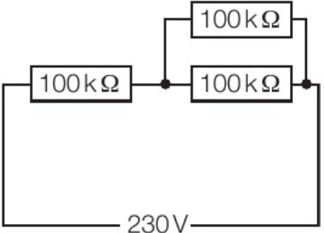

▲ fig I Calculate the total resistance of resistor groups separately, before using the appropriate rule to combine the sub-totals together.

In fig I, we must calculate the total resistance of the parallel pair first, and then add this total to the remaining 100 kΩ that is in series with the pair. The junction separating the single resistor from the parallel pair is the clue as to how to separate the calculations.

## WORKED EXAMPLE

Parallel pair:

 $$ \frac{1}{R_{para}}=\frac{1}{100}+\frac{1}{100}=\frac{2}{100}=\frac{1}{50} $$ 

 $$ \therefore\quad R_{\mathrm{p a r a}}=50\mathrm{k}\Omega $$ 

Total resistance:

 $$ R_{total}=100\mathrm{k}\Omega+R_{para}=100+50 $$ 

 $$ R_{total}=150k\Omega $$ 

## EXAM HINT

Note that the steps and layout of the solution in this worked example are suitable for questions on calculating the overall resistance of resistors in parallel and series in the exam.

<table border=1 style='margin: auto; word-wrap: break-word;'><tr><td style='text-align: center; word-wrap: break-word;'>QUANTITY</td><td style='text-align: center; word-wrap: break-word;'>SERIES CIRCUIT RULES</td><td style='text-align: center; word-wrap: break-word;'>PARALLEL CIRCUIT RULES</td></tr><tr><td style='text-align: center; word-wrap: break-word;'>current</td><td style='text-align: center; word-wrap: break-word;'>current is the same throughout</td><td style='text-align: center; word-wrap: break-word;'>$ I_{total} = I_{1} + I_{2} $</td></tr><tr><td style='text-align: center; word-wrap: break-word;'>voltage</td><td style='text-align: center; word-wrap: break-word;'>$ V_{total} = V_{1} + V_{2} $</td><td style='text-align: center; word-wrap: break-word;'>voltage is the same on each branch</td></tr><tr><td style='text-align: center; word-wrap: break-word;'>resistance</td><td style='text-align: center; word-wrap: break-word;'>$ R_{total} = R_{1} + R_{2} $</td><td style='text-align: center; word-wrap: break-word;'>$ \frac{1}{R_{total}} = \frac{1}{R_{1}} + \frac{1}{R_{2}} $</td></tr></table>

table A Summary of the electrical rules in series and parallel circuits.

## PRACTICAL SKILLS

## Investigating circuit rules

Make a complex circuit with various components in series and parallel combinations. By using only an ammeter and voltmeter, your partner should be able to prove the circuit rules explained in this section. If the resistances are large, the ammeter may need to be a multimeter set to read milliamp currents.

Join various resistors in various combinations of series and parallel connections. Your partner should calculate what they expect the overall resistance of the combination to be. Check whether they have calculated correctly by measuring the overall resistance of the resistor combination using an ohmmeter.

Safety Note: Short circuits and overloading components will cause overheating and burns on skin contact.

## CHECKPOINT

1. How does fig B illustrate the conservation of charge in a circuit?

2. If all four cell combinations in fig E were connected to each other in series, what would be the total emf?

3. If  $ R_3 $ has a resistance of 24  $ \Omega $, how much current flows in fig J?

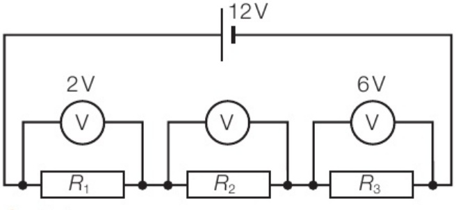

## ▲ fig J

4. Use Ohm's law on the resistors in fig K to verify that the voltage across parallel branches is always the same.

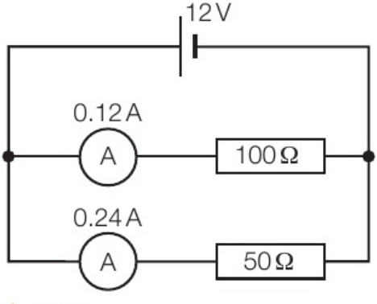

## fig K

5. What is the total current that flows in fig I?

6. (a) What is the total current flow through the cell in fig H?

(b) How much current flows in the 48 Ω resistor in fig H?

<!-- page 189 -->

# 4B 2 ELECTRICAL CIRCUIT RULES

2.4.75

## LEARNING OBJECTIVES

Understand how the distribution of current in a circuit is a consequence of charge conservation.

Understand how the distribution of potential differences in a circuit is a consequence of energy conservation.

Make calculations based on current and voltage circuit rules.

Gustav Kirchhoff was a Prussian physicist working in the middle of the nineteenth century. He made important contributions to several areas of physics, and there are also laws named after him in spectroscopy and thermochemistry. The electrical circuit rules presented here sometimes carry his name.

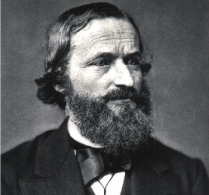

fig A Gustav Kirchhoff presented the conservation of charge and of electrical energy within a circuit as two laws of physics.

## ELECTRIC CURRENT RULE

Electric current rule: the algebraic sum of the currents entering a junction is equal to zero:

 $$ \Sigma I=0 $$ 

In order to conserve electric charge, the sum of all the currents arriving at any point (such as a junction) in a circuit is equal to the sum of all the currents leaving that point.

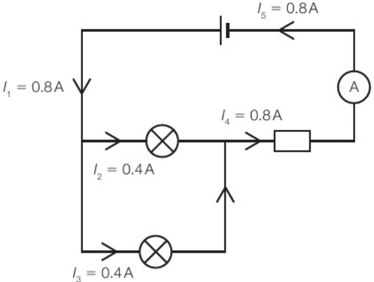

fig B Current rule example circuit.

In the circuit diagram of fig B, we could think about the current entering and leaving the resistor. This is 0.8 A entering and 0.8 A leaving. If we added these together, accounting for the direction:

 $$ I_{in}+I_{out}=I_{4}+\text{−}I_{5}=0.8{+}\text{−}0.8=0 $$ 

This simple example confirms the rule at work in the resistor.

 $$ I_{1}+-I_{2}+-I_{3}=0.8+-0.4+-0.4=0 $$ 

Similarly, consider the currents at the point where the circuit splits to send current through the two bulbs:

The same overall result would appear at any point in the circuit – charge must always be conserved.

## ELECTRICAL VOLTAGES RULE

In order to conserve electrical energy around any closed loop, Electrical voltages rule: the sum of emfs is equal to the sum of the pds around that loop.

Note that a loop being considered might not be the whole of a circuit – the only requirement is that the loop is complete. Note also that the potential differences referred to here are defined as being the products of component currents and resistances, as per Ohm's law. So, if we isolate a particular closed loop, it may have potential differences with positive values, and with negative values when the current flows in the opposite direction.

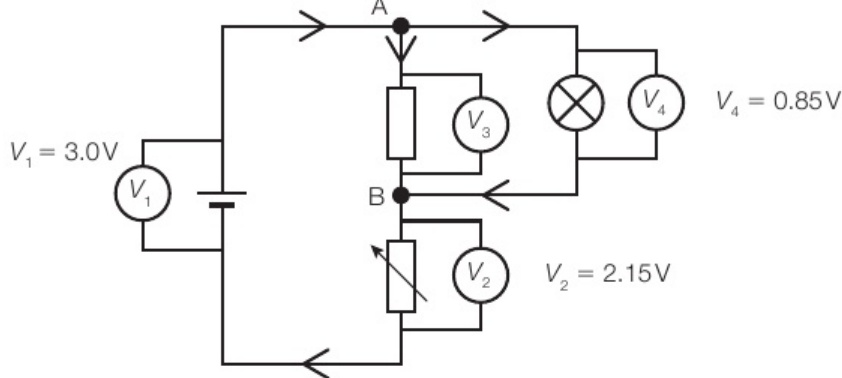

▲ fig C Voltages rule example circuit.

In fig C, consider the voltages around the closed loop that consists of the cell, variable resistor and fixed resistor. We know  $ V_3 $ must be 0.85 V, as all parallel branches must have the same voltage and it is parallel to  $ V_4 $. If you move clockwise around the loop, and start at the cell, the cell is the only emf, so the sum of all emfs is 3.0 V. Following the same route to sum the potential differences, we ignore the cell as it is an emf, not a pd. This means the sum of the pds will be:

 $$ \begin{aligned}\Sigma V=V_{3}+V_{4}=0.85+2.15=3.0V\end{aligned} $$ 

As the current is flowing in the same direction through the cell and both variable resistor and fixed resistor, these voltages are all in the same direction, and so:

 $$ \textstyle\sum\varepsilon=\sum V $$

<!-- page 190 -->

Next, consider just the closed loop containing the fixed resistor and the lamp. If  $ \Sigma \varepsilon = \Sigma V $, and there are no emfs, the pds must total zero. Starting at point A and moving clockwise around the loop, the current moves through the lamp, which is measured at  $ V_4 = 0.85 $ V. Continuing to point B and then back up to complete the loop at A means going through the fixed resistor against the flow of the current. This means the pd will be negative, although also 0.85 V. So in this consideration,  $ V_3 = -0.85 $ V.

 $$ \begin{aligned}\Sigma V=V_{3}+V_{4}=-0.85+0.85=0\end{aligned} $$ 

## VOLTAGES RULE WITH CALCULATED PDS

 $$ \therefore\quad\textstyle\sum\varepsilon=\sum V $$ 

Potential differences are the product of currents passing through resistances, thus transferring electrical energy. Each pd could be calculated from Ohm's law as  $ V = I R $. So this becomes:

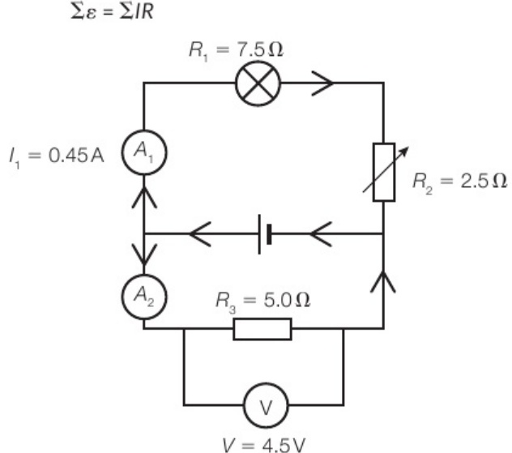

fig D Confirming  $ \Sigma\varepsilon = \Sigma IR $.

In fig D, we can confirm the voltages rule around the upper closed loop, through the cell, ammeter  $ A_{1} $, lamp and variable resistor. The only emf is the cell, and this will have an emf of 4.5 V, as shown on the voltmeter at the bottom of the diagram.

Ammeters have zero resistance, and so  $ A_{1} $ contributes nothing to the sum of pds. The current must be the same through the lamp and the variable resistor, so the sum of the potential differences will be calculated from:

 $$ \textstyle\boldsymbol{\Sigma}\varepsilon=4.5\mathrm{V} $$ 

 $$ \begin{array}{r}{\sum I R=I_{1}R_{1}+I_{1}R_{2}=\left(0.45\times7.5\right)+\left(0.45\times2.5\right)=3.375+1.125}\end{array} $$ 

 $$ \Sigma I R=4.5\mathrm{V} $$ 

 $$ \therefore\quad\textstyle\sum\varepsilon=\textstyle\sum IR $$ 

## CHECKPOINT

## SKILLS PROBLEM SOLVING

1. In fig D, use Ohm's law to find the current through ammeter $ A_{2} $.

2. The current through the cell in fig D is 1.35 A. Use your answer from question 1 to show that the circuit junction between the two ammeters in fig D conserves current.

3. Demonstrate by calculation that the lower loop (cell and resistor) in the circuit in fig D conserves energy.

4. Find the emf of the cell in fig E.

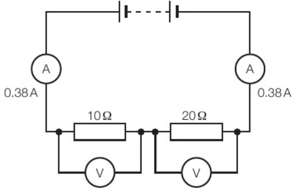

▲ fig E Using the voltages circuit rule.

## SUBJECT VOCABULARY

electric current rule the algebraic sum of the currents entering a junction is equal to zero:

 $$ \Sigma I=0 $$ 

voltages circuit rule around a closed loop, the algebraic sum of the emfs is equal to the algebraic sum of the pds:

 $$ \textstyle\sum\varepsilon=\sum I R $$

<!-- page 191 -->

## 4B 3 POTENTIAL DIVIDERS

## LEARNING OBJECTIVES

Describe and explain potential divider circuits.

Make calculations in potential divider circuits.

Explain uses for potential divider circuits.

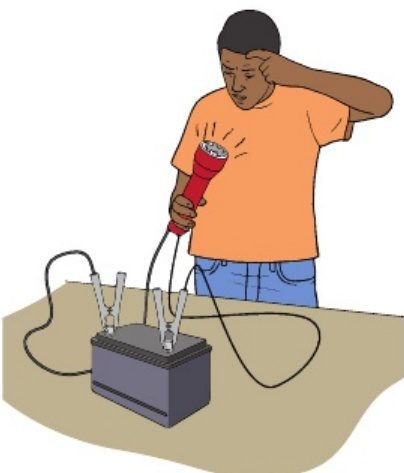

fig A Fixed emfs can be problematic when components require a lower voltage.

We have seen that all the voltage supplied by emfs in a circuit loop must be used by components as potential differences at other points around the circuit loop. The way that the voltage splits up is in proportion to the resistances of the components in the circuit loop, as shown in fig B. The voltages across the two resistors must add up to 6 V. The  $ 20\,\Omega $ resistor has twice the resistance, so takes twice the voltage of the  $ 10\,\Omega $ resistor. This is a potential divider circuit.

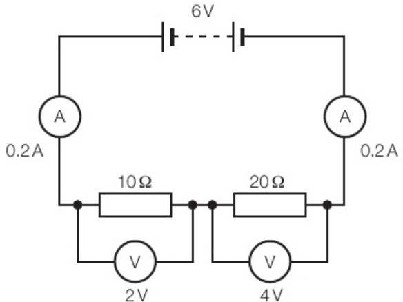

▲ fig B All of the 6 volts supplied by the battery must be used up by the resistors. The total pd of 6V is split into 2V and 4V in proportion to their resistances. Ammeters have zero resistance, so transfer zero energy and have zero pd.

Ohm's law explains why the voltage is split in proportion to the resistance. Consider the resistances and voltages in fig B in more general terms, as  $ R_1 $ (for the 10  $ \Omega $ resistor) and  $ R_2 $, and their corresponding pds  $ V_1 $ and  $ V_2 $. This will make the calculation valid for all values of resistances, and calculating the current through each one gives:

 $$ I_{1}=\frac{V_{1}}{R_{1}}\quad and\quad I_{2}=\frac{V_{2}}{R_{2}} $$ 

However, they both have the same current passing through them, so  $ I_{1} = I_{2} $.

 $$ \therefore\quad\frac{V_{1}}{R_{1}}=\frac{V_{2}}{R_{2}} $$ 

 $$ \therefore\quad\frac{V_{1}}{V_{2}}=\frac{R_{1}}{R_{2}} $$ 

So the voltage is split in the same proportion as the ratio of the resistances for any values of resistance.

This means that for a known emf supply voltage, we can use carefully chosen resistances to share the voltage and provide a specific value of pd on one component. If we then also remember that all parallel branches in a circuit must have the same voltage, then any branch we set up in parallel with that specific pd will also have the same voltage. So, we can set up a circuit to provide an exactly chosen value of voltage to the parallel branch. Using variable resistors, this set up can then be used to provide whatever voltage we choose. This can be particularly useful if our emf source is a fixed value, like a battery, which can only supply, say, 6 V.

<!-- page 192 -->

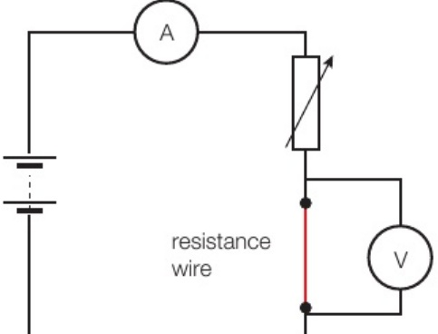

▲ fig C Adjusting the variable resistor alters the proportion of the voltage it takes, and so the pd that is left for the resistance wire can be varied to any value we choose.

In Section 4A.3, we saw graphs of current against potential difference for various components. In order to undertake the investigation to produce these data, a potential divider circuit could be used. Fig C shows a piece of resistance wire for which the current and voltage can be measured. If the variable resistor is set to a high resistance, then it will have a high potential difference, and only a small voltage will be left for the test wire. By decreasing the resistance of the variable resistor, the pd across the test wire will increase. We can then adjust the variable resistor to set the values of pd on the test wire to those we need for the I-V plot.

## THE POTENTIAL DIVIDER EQUATION

As the pd in a potential divider circuit is split in proportion to the resistances of the components, we can calculate the pd across them mathematically.

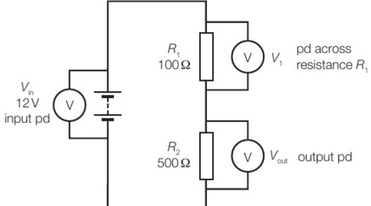

▲ fig D Generalised potential divider circuit.

In the circuit diagram of fig D, we have the general terminology for the values used in calculations of a potential divider circuit:  $ V_{out} $,  $ R_1 $,  $ R_2 $ and  $ V_{in} $. Using these, we can calculate the pd across the component of interest, which is usually drawn as the second resistance,  $ R_2 $, using the potential divider equation:

 $$ V_{out}=V_{in}\times\frac{R_{2}}{\left(R_{1}+R_{2}\right)} $$ 

## WORKED EXAMPLE

Using the values in fig D, we can find the pd across resistor  $ R_{2} $:

 $$ V_{out}=V_{in}\times\frac{R_{2}}{\left(R_{1}+R_{2}\right)} $$ 

 $$ V_{out}=12\times\frac{500}{\left(100+500\right)}=12\times\frac{5}{6} $$ 

 $$ V_{out}=10V $$ 

## EXAM HINT

Note that the steps and layout of the solution in this worked example are suitable for questions on finding the pd across a resistor in the exam.

<!-- page 193 -->

THE POTENTIOMETER

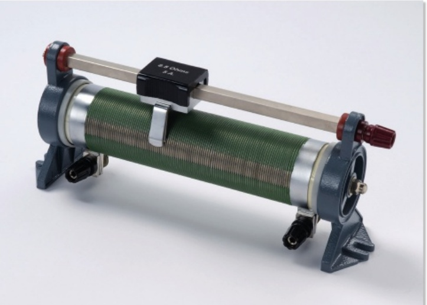

▲ fig E A potentiometer allows us to supply any voltage up to the maximum provided by our emf source.

The idea of using a potential divider to supply a variable voltage as required has been incorporated into an electrical component called the potentiometer. A moveable contact can slide over a fixed length of resistance wire which adjusts the length that is on either side of this 'wiper'. The two lengths of wire are the two resistors in our potential divider circuit. Adjusting their relative lengths alters their relative resistances and the voltage across each. If we want to power a separate circuit with a variable voltage, we connect it across one side of the potentiometer. This is shown in fig F, where we would connect the right-hand side connections across  $ R_2 $ to our main circuit. The blocks marked  $ R_1 $ and  $ R_2 $ are a continuous piece of resistance wire, which will be split into two resistances by the position of the wiper. Adjusting the wiper up and down allows us to have any desired voltage up to the maximum of  $ V_{\text{supply}} $.

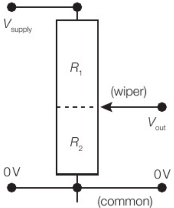

▲ fig F Adjusting the position of the slider (wiper) on the potentiometer changes its position on the resistance wire, so that the proportions of resistance on either side change, altering the potential differences on either side of the wiper.

## POTENTIAL DIVIDERS IN SENSOR CIRCUITS

If one of the resistors in a potential divider is a sensor component (such as thermistor or LDR) then we can use its changing resistance to control an external circuit.

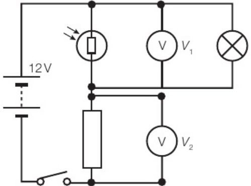

▲ fig G A sense and control circuit which makes the light brighter as the light level in the room drops.

<!-- page 194 -->

In fig G, the lamp is in parallel with the LDR, so will be powered by the same voltage as that across the LDR. The resistance of a LDR increases if the ambient light level drops (darker surroundings make its resistance go up). In bright conditions, the LDR has a very low resistance, so it takes a very small proportion of the 12 V supplied by the battery. This will make the lamp very dim, probably so much that it will appear to be off; it is not needed if the surroundings are bright. As conditions become darker, the LDR resistance goes up, increasing the proportion of the 12 V supplied that drop across it. This increases the voltage across the bulb, and makes it brighter. This circuit increases the brightness of the lamp as the surroundings become darker.

Many electronic components have a switch-on voltage of 5 V. These could be used with a sensor in a potential divider circuit, and would only switch on when the sensor's resistance reached a level where its pd was 5 V. Altering the resistor in this circuit would then control the sensor level at which the electronic component was switched on.

## CHECKPOINT

1. A potential divider circuit supplied by an emf of 8 V has two resistors,  $ R_1 = 125 \, \Omega $ and  $ R_2 = 135 \, \Omega $. What will be the output voltage across  $ R_2 $?

2. A potentiometer, as in fig F, is supplied by an emf of 15 V and has a 40 cm length of resistance wire. What voltage would  $ V_{out} $ be if the wiper was placed 10 cm from the top?

3. Draw a potential divider circuit, like that in fig G, which will drive a fan motor in a kitchen faster as it becomes hotter. (A standard thermistor has a higher resistance at lower temperatures.)

4. Fig H shows a length of resistance wire, with a contact that can rotate around a pivot to contact with more or less of the resistance wire. Explain how this represents a potential divider circuit and what will happen to the brightness of the lamp as the contact is rotated clockwise from the position shown.

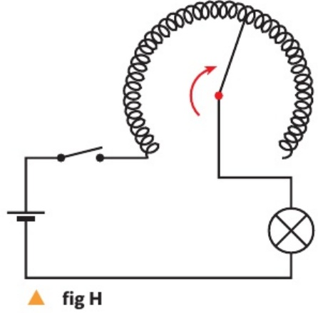

## SUBJECT VOCABULARY

potential divider a circuit designed to provide specific voltage values by splitting an emf across two resistors

potentiometer a version of the potential divider in which a single resistance wire is used in two parts to form the two resistances. A sliding connection on the wire can be adjusted to alter the comparative resistances and thus alter the output pd from the potentiometer

SKILLS DECISION MAKING, ADAPTIVE LEARNING

<!-- page 195 -->

## 4 EMF AND INTERNAL RESISTANCE

CP8 LAB BOOK PAGE 32

## LEARNING OBJECTIVES

Explain what is meant by internal resistance.

Describe an investigation to determine an emf's internal resistance.

Make calculations of internal resistance.

All components have some resistance. The best ammeters have such a small resistance that the effect on their current measurements can be ignored, but it is not actually zero. Sources of electromotive force (emf), such as batteries, will also have a small, but non-zero, resistance. The resistance of an emf source is called its internal resistance. In most situations, the internal resistance of an emf source will not affect the performance of a circuit. It may not even be noticeable. However, as the power lost – energy wasted as heat – through a component increases with the current through it (see Section 4B.5), there can be a significant power loss when large currents are used. The net effect of this energy transfer by the emf source itself will be for it to supply a smaller voltage to the rest of the circuit, which could affect the circuit's performance. A large current through the internal resistance could also damage the emf source as a result of ohmic (resistance) heating.

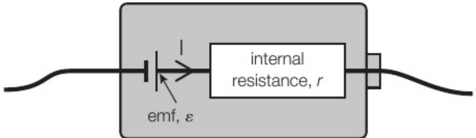

## EXAM HINT

▲ fig A Any emf source could be considered to be a pure emf with a small resistive potential difference acting in series with the emf.

The effect of having an internal resistance is that an emf will never be able to fully supply its maximum voltage. There will always be a small drop in voltage over the internal resistance and this drop will be bigger with a higher current. The pd over the internal resistance, r, can be found from Ohm's law:

 $$ V_{internal}=Ir $$ 

This pd is sometimes referred to as 'lost volts', as the circuit appears to have fewer volts in use by the load than the emf should be supplying. A measurement of voltage across the terminals of a cell powering a circuit would not measure the emf; it would measure the emf minus the lost volts. This 'terminal pd' would then be:

The internal resistance is an internal part of the emf, and cannot be accessed separately. Do not draw a voltmeter measuring across r, as this is impossible.

 $$ V_{terminal}=\varepsilon-Ir $$ 

As all parallel branches have the same voltage across them, the terminal pd would also equal the pd across the load resistance.

 $$ V_{terminal}=V_{load}=\varepsilon-Ir $$ 

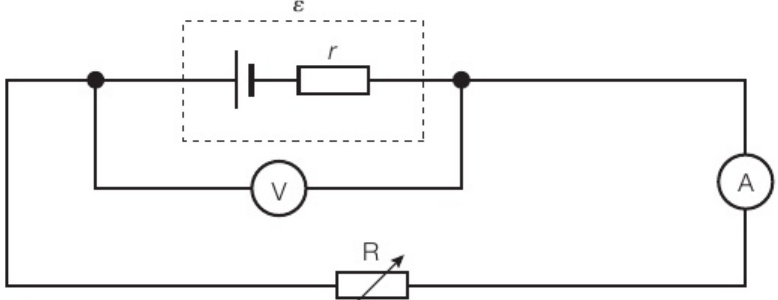

fig B Circuit for demonstrating the effect of internal resistance.

<!-- page 196 -->

By considering energy conservation, we can draw up an equation for the circuit that includes the internal resistance.

 $$ \textstyle\sum\varepsilon=\sum V $$ 

 $$ \varepsilon=V_{load}+V_{internal} $$ 

 $$ \therefore\quad\varepsilon=V_{load}+Ir=IR+Ir $$ 

The circuit shown in fig B demonstrates what the mathematics means practically. The voltmeter will be measuring the voltage actually supplied by the cell, so that will be its pure emf minus the pd across the internal resistance, or lost volts. However, as the ammeter should have zero pd, the voltmeter will also be reading the value of the potential difference across the variable resistor, R.

 $$ \varepsilon-V_{r}=V_{R} $$ 

Or, in terms of the ammeter reading, I, and the voltmeter reading, V:

 $$ \varepsilon-I r=V $$ 

 $$ \therefore\quad\varepsilon=V+Ir $$ 

which is, again, a statement of energy conservation in this circuit.

## PRACTICAL SKILLS

## Investigating internal resistance

We can find the internal resistance for a source of emf such as a cell in an experiment. Using a circuit like that shown in fig B, we adjust the variable resistor to change the current through the circuit, and at each current value we record the voltmeter reading.

The equation we have previously seen for the quantities in this circuit is:

 $$ \varepsilon-I r=V $$ 

or:

 $$ V=-r I+\varepsilon $$ 

Comparing this with the equation for a straight-line graph  $ y = mx + c $ shows us that a graph plotted with V on the y-axis and I on the x-axis will have a gradient equal in magnitude to the internal resistance, r. The y-intercept, c, here represents the voltmeter reading when no current flows. If there is no current in the circuit, the internal resistance can take no energy from the circuit, so there will be zero lost volts and the voltmeter will read the full value of the emf. So, the y-intercept is the value of the emf,  $ \varepsilon $.

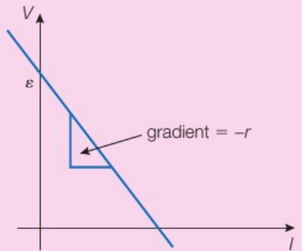

fig C Graph of internal resistance investigation results.

## SKILLS REASONING / ARGUMENTATION, ANALYSIS

## CHECKPOINT

1. What is the internal resistance of a 6V battery if it supplies 5.8V to a lamp when the current flowing is 0.40A?

2. What is the internal resistance of a 1.5 V dry cell, that delivers 1.3 V to a lamp which has a resistance of 5.0 Ω?

3. The starter motor for a car engine needs a very high current, for example 100 A.

(a) Explain why a car battery should have a very low internal resistance.

(b) Explain why the car's headlights are observed to dim if they are on when the car's starter motor is used.

4. A student investigating the emf and internal resistance of a dry cell used the circuit in fig B, with the cell in the place marked by the dashed lines. He collected the results in table A.

Plot a graph to find both the internal resistance and the emf of the cell that the student tested.

<table border=1 style='margin: auto; word-wrap: break-word;'><tr><td style='text-align: center; word-wrap: break-word;'>AMMETER READING, I/A</td><td style='text-align: center; word-wrap: break-word;'>VOLTMETER READING, V/V</td></tr><tr><td style='text-align: center; word-wrap: break-word;'>0.10</td><td style='text-align: center; word-wrap: break-word;'>1.45</td></tr><tr><td style='text-align: center; word-wrap: break-word;'>0.20</td><td style='text-align: center; word-wrap: break-word;'>1.42</td></tr><tr><td style='text-align: center; word-wrap: break-word;'>0.30</td><td style='text-align: center; word-wrap: break-word;'>1.39</td></tr><tr><td style='text-align: center; word-wrap: break-word;'>0.40</td><td style='text-align: center; word-wrap: break-word;'>1.31</td></tr><tr><td style='text-align: center; word-wrap: break-word;'>0.80</td><td style='text-align: center; word-wrap: break-word;'>1.18</td></tr><tr><td style='text-align: center; word-wrap: break-word;'>1.10</td><td style='text-align: center; word-wrap: break-word;'>1.09</td></tr></table>

table A Current and voltage readings from a student experiment to find internal resistance of a dry cell.

## SUBJECT VOCABULARY

internal resistance the resistance of an emf source

<!-- page 197 -->

# 4B 5 POWER IN ELECTRIC CIRCUITS

## LEARNING OBJECTIVES

Explain work done by electric circuits.

Make calculations of work and power in electric circuits.

Explain efficiency and make calculations of it within electric circuits.

The measurement of voltages in electric circuits has shown us that these deal with the transfer of energy by components. As we saw in Section 1B.2, energy must always be conserved, and electric circuits are no exception to this. When components transfer electrical energy to other useful stores, they can be considered to be doing work, as this is defined as a transfer of energy.

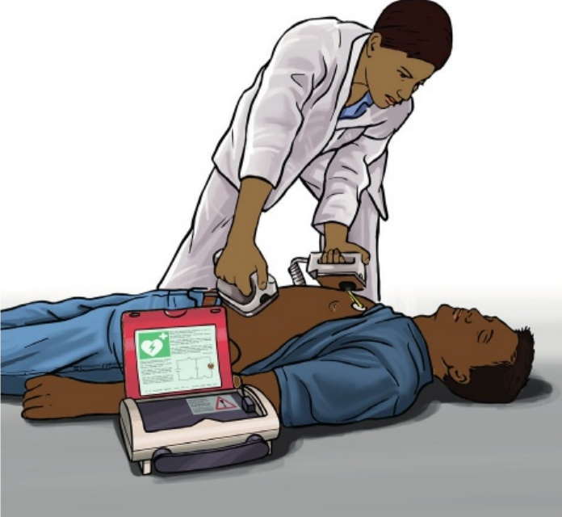

fig A As part of this circuit, the heart will transfer some electrical energy to kinetic energy. The circuit is doing work.

## ELECTRICAL WORK

Work done has the symbol W, and as the equation defining potential difference includes a term for the amount of energy transferred, E, these two will be the same.

 $$ W=E $$ 

The equation for pd, in rearranged form, gives us:

 $$ W=V\times Q $$ 

The definition of current, in rearranged form, is:

 $$ Q=I\times t $$ 

Combining these will give us the work done by a component in an electric circuit:

 $$ W=V\times I\times t $$ 

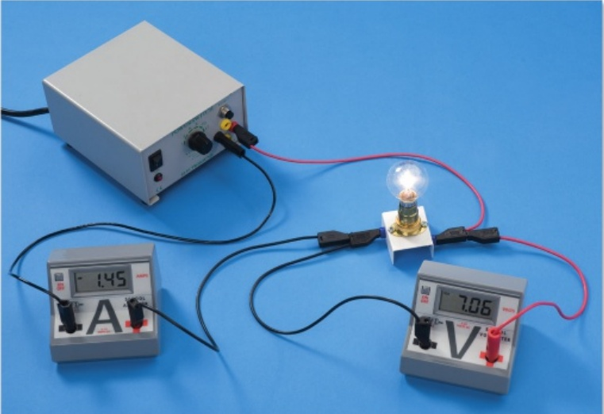

▲ fig B Electrical work done by a light bulb.

## WORKED EXAMPLE

In fig B, if the bulb lights up for 4.85 seconds, how much work has the bulb done?

 $$ W=VIt $$ 

 $$ W=7.06\times1.45\times4.85 $$ 

 $$ W=49.6\,\text{J} $$ 

## EXAM HINT

Note that the steps and layout of the solution in this worked example are suitable for questions on finding the work done in the exam.

## ELECTRICAL POWER

Power, P, is the rate of transfer of energy, or the rate of doing work. In an electrical circuit, the energy is dissipated by a component. The mathematical definition is:

 $$ P=\frac{E}{t} $$ 

OR

 $$ P=\frac{W}{t} $$ 

Incorporating the equation for work in a circuit from above:

 $$ P=\frac{VIt}{t} $$ 

 $$ P=VI $$ 

## LEARNING TIP

Electrical work and power equations for all components:

 $$ W=VIt $$ 

 $$ P=V I $$

<!-- page 198 -->

## WORKED EXAMPLE

In fig B, what is the power of the bulb?

P = VI

P = 7.06 × 1.45

P = 10.2 W

## POWER DISSIPATED BY RESISTORS

We can also write variations of the electrical power equation, substituting in terms from Ohm's law so that we can calculate the power dissipated by resistors in a circuit.

 $$ P=V I $$ 

and

 $$ V=IR $$ 

If we only know current and resistance:

 $$ P=IR\times I=I^{2}R $$ 

Or, if we only know pd and resistance:

 $$ P=V\times\frac{V}{R}=\frac{V^{2}}{R} $$ 

## LEARNING TIP

Resistance power dissipation equations:

 $$ \begin{aligned}P&=I^{2}R\\P&=\frac{V^{2}}{R}\end{aligned} $$ 

## EFFICIENCY

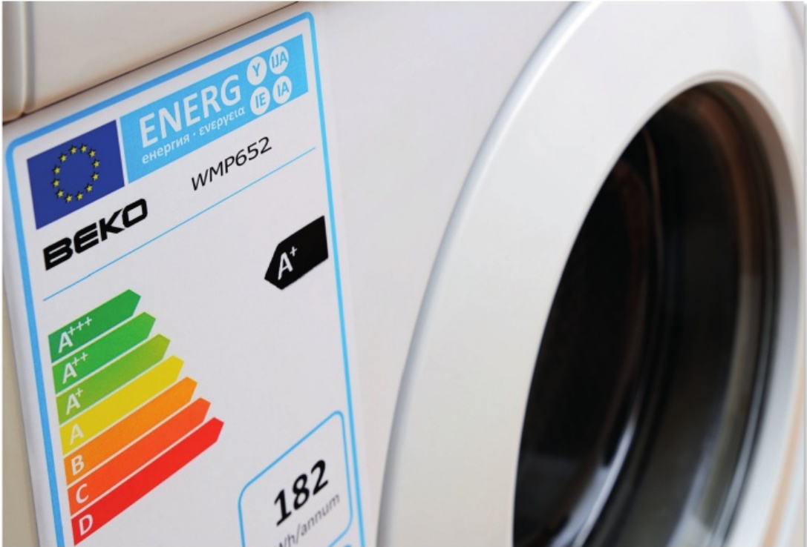

▲ fig C Modern electrical appliances come with a label indicating their efficiency, so that consumers can choose good value for running costs when making purchases.

## EXAM HINT

From the equations above, we can easily calculate the work and power of electrical devices. However, this calculation isn't meaningful if we do not also consider the purpose of the device. If most of the energy is not actually transferred to a store that is useful to us, then the cost of that electrical energy will be wasted. We saw in Section 1B.2 that the ability of a device to transfer energy usefully is called efficiency.

Note that the steps and layout of the solution in this worked example are suitable for questions on calculating electrical power in the exam.

<!-- page 199 -->

You will remember that efficiency is defined mathematically – and this applies to electrical energy transfers exactly as it did to mechanical energy transfers – as:

 $$  efficiency=\frac{useful~energy~output}{total~energy~input} $$ 

 $$  efficiency=\frac{useful~power~output}{total~power~input} $$ 

## EXAM HINT

The answer will be a decimal between zero and one. It is common to convert this to a percentage value (multiply the decimal by 100).

Remember, work done means the same as energy transferred.

## EXAM HINT

Note that the steps and layout of the solution in this worked example are suitable for questions on calculating efficiency in the exam.

## WORKED EXAMPLE

In fig B, what is the efficiency of the bulb if it transfers 3.57 joules of light energy per second?

 $$  efficiency=\frac{useful~power}{total~power~input} $$ 

 $$ efficiency=\frac{3.57}{10.2} $$ 

 $$  efficiency=0.35=35\% $$ 

## PRACTICAL SKILLS

## Investigating efficiency

We can find the efficiency of an electric motor by measuring the electrical energy it transfers, and by comparing this with its useful energy output in lifting a mass against its weight to give the mass gravitational potential energy.

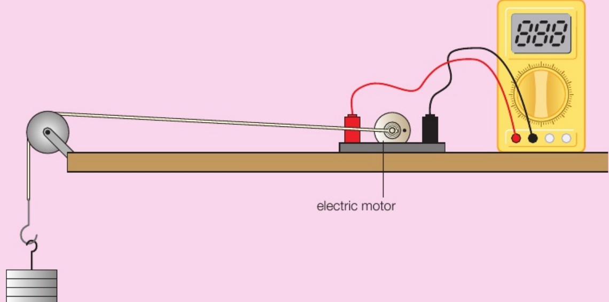

▲ fig D Finding the efficiency of an electric motor lifting a weight.

You switch on the motor and find the time (t) it takes to lift the known mass (m) through a fixed height ( $ \Delta h $). During the lifting process, you measure the average pd (V) across the motor and current through it (I) using an ammeter and a voltmeter. You use these measurements to calculate the total energy input and the useful energy output for use in the efficiency equation.

useful energy output = gravitational potential energy gained = mg $ \Delta h $

 $$ \mathrm{total~energy~input=electrical~energy~used=VIt} $$ 

 $$  motor~efficiency=\frac{useful~energy~output}{total~energy~input}=\frac{mg\Delta h}{VIt} $$ 

Safety Note: Secure the motor to a firm base. Only use low voltage motors and small masses.

<!-- page 200 -->

## CHECKPOINT

1. How much work is done by the resistor in the circuit in fig E if the circuit is switched on for 11 seconds?

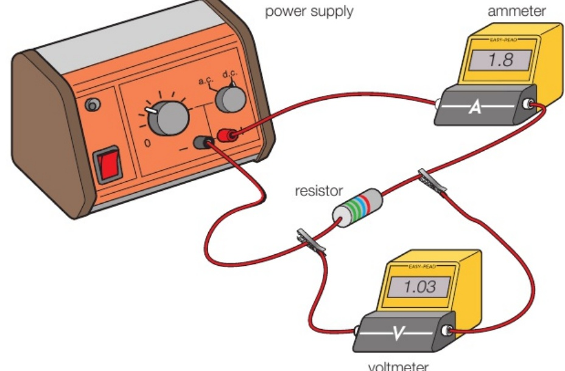

fig E A resistor circuit.

2. What is the power dissipated by the resistor in fig E?

3. What power is dissipated by a 470  $ \Omega $ resistor when:

(a) a current of 1.76 A passes through it?

(b) it is measured with a pd of 9.0 V?

4. (a) What is the efficiency of the electric heater in fig F?

(b) Why would your answer to part (a) be the same if you consider the heater switched on for one hour, and if you consider it switched on for two hours?

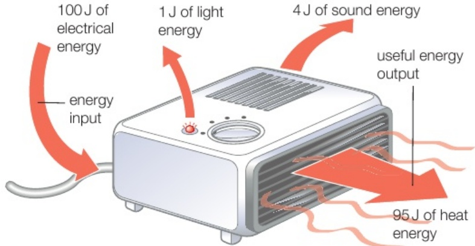

▲ fig F Energy flows through an electric heater.

## SUBJECT VOCABULARY

efficiency the ability of a machine to transfer energy usefully:

efficiency =  $ \frac{\text{useful work done}}{\text{total energy input}} $

efficiency =  $ \frac{useful\ energy\ output}{total\ energy\ input} $

<!-- page 201 -->

## 4B THINKING BIGGER

One of the most important components for robotic spacecraft is their electrical power supply. The electrical system on NASA's Mars explorer, Curiosity, is designed to function over a large range of voltages, in case of supply disruption.

ONLINE NEWS STORY

# ROVER TEAM WORKING TO DIAGNOSE ELECTRICAL ISSUE

This picture of NASA's Mars rover Curiosity combines 66 exposures taken by the rover's Mars Hand Lens Imager (MAHLI) during the 177th Martian day, or sol, of Curiosity's work on Mars.

Science observations by NASA's Mars rover Curiosity have been stopped for a few days while engineers run tests to check possible causes of a voltage change that was noticed on Nov. 17.

‘The vehicle is safe and stable and fully capable of operating in its present condition, but we are taking the precaution of investigating what may be a soft short,’ said Mars Science Laboratory Project Manager Jim Erickson at NASA’s Jet Propulsion Laboratory, Pasadena, Calif.

A ‘soft’ short is a leak through something that’s partially conductive of electricity, rather than a hard short such as one electrical wire contacting another.

From a news story on the website of NASA, www.jpl.nasa.gov/news The team noticed a change in the voltage difference between the chassis and the 32-volt power bus that distributes electricity to systems throughout the rover. Data indicating the change were received on Sunday, during Curiosity's 456th Martian day. The level had been about 11 volts since landing day, and is now about 4 volts. The rover's electrical system is designed with the flexibility to work properly throughout that range and more with a design feature called 'floating bus.'

A soft short can cause such a voltage change. Curiosity had already experienced one soft short on the day it landed on Mars. That one was linked to explosive-release devices used for deployments shortly before and after the landing. It lowered the bus-to-chassis voltage from about 16 volts to about 11 volts but has not affected rover operations since then.

The analysis work to find the cause of the voltage change has gained an advantage from an automated response by the rover's onboard software when it detected the voltage change on Nov. 17. The rover increased the rate at which it recorded electrical variables, to eight times per second from the usual once per minute, and sent that engineering data in its next communication with Earth. 'That data was quite helpful,' Zimmerman said.

The electrical issue did not cause the rover to enter a safe-mode status, in which most activities automatically stop until further instructions are given. Also, there is no indication the issue is related to a computer reboot that caused a 'safe-mode' earlier this month.

NASA’s Mars Science Laboratory Project is using Curiosity inside Gale Crater to assess ancient habitable environments and major changes in Martian environmental conditions. JPL, a division of the California Institute of Technology in Pasadena, built the rover and manages the project for NASA’s Science Mission Directorate in Washington.

<!-- page 202 -->

## THINKING BIGGER

## SCIENCE COMMUNICATION

1 The extract opposite consists of an article from the News section of the NASA website. Consider the extract and comment on the type of writing that is used. Try and answer the following questions:

(a) Discuss the level of scientific detail included in the article, particularly considering the intended audience.

(b) Explain three different reasons why NASA would post this news article.

## PHYSICS IN DETAIL

Now we will look at the physics in detail. Some of these questions link to topics elsewhere in this book, so you may need to combine concepts from different areas of physics to work out the answers.

2 Curiosity rover is powered by a radioisotope electricity generating unit, which has a power of 110 watts when functioning correctly. What would be the current through the main 32 volt power bus that distributes all of the electrical power?

3 The power bus uses potential dividers to provide the appropriate voltage to each separate electrical circuit from its basic 32V supply.

(a) The article refers to an earlier voltage drop incident from the standard of 16 V down to 11 V. Suggest two resistance values that could be used in a potential divider, from the main power bus supply, to give an output voltage equal to 16 V.

(b) If a 'soft short' had caused that drop down to 11 V, suggest what the resistance of the short circuiting object would be, based on your answer to part (a).

(c) What further resistance would another soft short object need to further reduce the voltage from 11 V down to 4 V?

4 NASA claim that the rover can function perfectly normally across these variations in supply voltage.

(a) Why would it be important that the plutonium cell generating emf has as low a resistance as possible, especially in the event of a short circuit reducing the overall resistance?

(b) Explain how an item of debris touching electrical circuitry could reduce the resistance of that circuit.

## ACTIVITY

Once the problem with Curiosity's voltage supply was determined and rectified, NASA had to produce another press release explaining this. Prepare a half page of text to be included in the second press release which explains how the materials used in the electric circuitry on the rover will be affected by the cold temperatures on Mars. Focus your explanation on the electrical properties of the materials.

## INTERPRETATION NOTE

Think about what NASA might gain from this being made public information. NASA is the American space agency – the National Aeronautics and Space Administration.

## THINKING BIGGER TIP

Choose any values of  $ R_{1} $ and  $ R_{2} $ for your potential divider that will share the voltage to give the correct output values. Use your initial suggested values as a basis for answering all parts of the question.

## THINKING BIGGER TIP

The ‘flying bus’ system uses a number of different available resistances to change how the voltage is divided, depending on the emf available. Some of the components will be made from metal, and some will be made from semi-conductors. The temperature on the surface of Mars ranges from  $ 20\ ^{\circ}C $ to  $ -150\ ^{\circ}C $, with  $ -55\ ^{\circ}C $ being a typical value.

<!-- page 203 -->

# 4B EXAM PRACTICE

1 Which of the following is an expression for calculating the power in an electrical circuit?

A  $ E \times t $

B  $ V \times I $

C  $ V \times I \times t $

D  $ Q \times I \times t $

(Total for Question 1 = 1 mark)

2 Three 12  $ \Omega $ resistors are connected together. Which value below could not be the total resistance of the combination?

A  $ 2\Omega $

B  $ 4\Omega $

C  $ 8\Omega $

D  $ 18\Omega $

(Total for Question 2 = 1 mark)

3 A 6 V emf cell lights a filament bulb. Current and potential difference readings on the filament bulb are:  $ V = 5.8 \, V $,  $ I = 0.44 \, A $. What is the internal resistance of the cell?

A 0.20 $ \Omega $

B 0.45 $ \Omega $

C 7.8 $ \Omega $

D 13.6 $ \Omega $

(Total for Question 3 = 1 mark)

4 A student drew this graph from an investigation of the pd across and current through a cell, which was connected in series to a variable resistor.

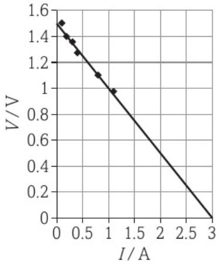

Which row in the table correctly shows the emf and internal resistance for this cell?

<table border=1 style='margin: auto; word-wrap: break-word;'><tr><td style='text-align: center; word-wrap: break-word;'>Emf / V</td><td style='text-align: center; word-wrap: break-word;'>Internal resistance / V</td></tr><tr><td style='text-align: center; word-wrap: break-word;'>0</td><td style='text-align: center; word-wrap: break-word;'>1.5</td></tr><tr><td style='text-align: center; word-wrap: break-word;'>0.5</td><td style='text-align: center; word-wrap: break-word;'>3.0</td></tr><tr><td style='text-align: center; word-wrap: break-word;'>1.5</td><td style='text-align: center; word-wrap: break-word;'>0.5</td></tr><tr><td style='text-align: center; word-wrap: break-word;'>3.0</td><td style='text-align: center; word-wrap: break-word;'>1.5</td></tr></table>

(Total for Question 4 = 1 mark)

5 Which of these is a correct definition of electromotive force (emf)?

A A supply voltage equal to the ratio of energy transferred per unit charge passing.

B The maximum voltage a component in a circuit may receive.

C A measure of the energy transferred by a component per unit charge passing through it.

D A measure of the energy transferred by a component per unit time it is connected to a power supply. [1]

(Total for Question 5 = 1 mark)

6 (a) Two lamps A and B are connected in series with a battery.

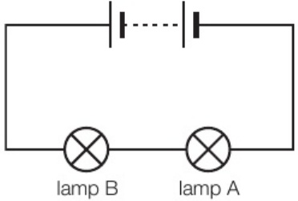

Lamp B glows more brightly than lamp A. Complete each of the sentences by choosing one of the phrases in the box.

<table border=1 style='margin: auto; word-wrap: break-word;'><tr><td style='text-align: center; word-wrap: break-word;'>equal to greater than less than</td></tr><tr><td style='text-align: center; word-wrap: break-word;'>The current in lamp A is the current in lamp B.</td></tr><tr><td style='text-align: center; word-wrap: break-word;'>The pd across lamp A is the pd across lamp B.</td></tr><tr><td style='text-align: center; word-wrap: break-word;'>The resistance of lamp A is the resistance of lamp B. [3]</td></tr></table>

(b) The same bulbs are now connected in parallel with the battery.

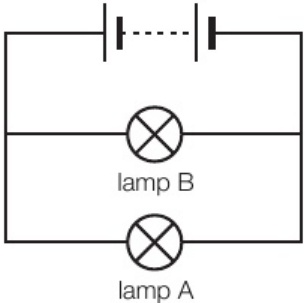

State which bulb will be brighter and explain your answer. [3]

(Total for Question 6 = 6 marks)

7 A student is asked to explain which of two filament lamps will be brighter when they are connected in parallel across a power supply. He is told that the resistance of lamp A is greater than the resistance of lamp B.

<!-- page 204 -->

## EXAM PRACTICE

The student wrote the following explanation that contains some mistakes:

‘The current is the same in both lamps. Because lamp A has a higher resistance, it is harder for the electrons to move through this lamp so they will lose more energy. Lamp A will therefore be brighter than lamp B.’

Write a correct explanation.

(Total for Question 7 = 5 marks)

8 A circuit is set up as shown in the diagram. The battery has negligible internal resistance.

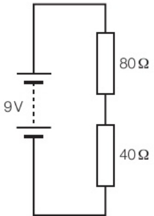

(a) Calculate the potential difference across the 40  $ \Omega $ resistor.

(b) A thermistor is connected in parallel with the 40 Ω resistor as shown.

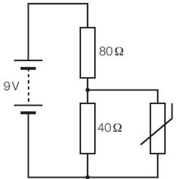

The thermistor is initially at a temperature of  $ 100^{\circ} $C and its resistance is 20  $ \Omega $. As the thermistor cools down, its resistance increases.

Explain what happens to the current through the battery as the temperature of the thermistor decreases. [3]

(Total for Question 8 = 5 marks)

9 (a) A kettle is rated at 1 kW, 220 V.

Calculate the working resistance of the kettle. [2]

(b) When connected to a 220 V supplied, it takes 3 minutes for the water in the kettle to reach boiling point.

Calculate how much energy has been supplied. [2]

(c) Different countries supply mains electricity at different voltages. Many hotels now offer a choice of voltage supplies as shown in the photograph.

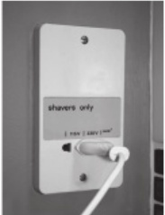

(i) By mistake, the kettle is connected to the 110V supply. Assuming that the working resistance of the kettle does not change, calculate the time it would take for the same amount of water to reach boiling point.

(ii) Explain what might happen if a kettle designed to operate at 110 V is connected to a 220 V supply. [2]

(Total for Question 9 = 9 marks)

10 Mobile phones have a rechargeable battery which is recharged by means of a mains adaptor. One such adaptor has an input power of 4.8 W at a voltage of 230 V.

(a) Calculate the input current to the adaptor when it is in use.

(b) The adaptor's output is labelled as 5 V 0.1 A 0.5 V A.

(i) Show that the unit VA is equivalent to the watt.

(ii) Calculate the efficiency of the adaptor.

(iii) Suggest a reason why the efficiency is less than 100%. [1]

(Total for Question 10 = 6 marks)

11 Electrically heated gloves are used by skiers and climbers to provide extra warmth for their hands.

Each glove has a heating element of resistance 3.6  $ \Omega $. Two cells each of e.m.f. 1.5 V and internal resistance 0.2  $ \Omega $ are used to operate each heating element.

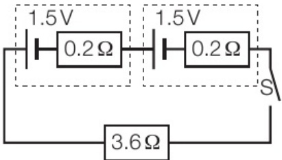

(a) When the switch is closed:

(i) Calculate the total resistance in the circuit. [1]

(ii) Calculate the current in the heating element.

(iii) Calculate the power output from the heating element. [2]

(b) When in use, the internal resistance of each cell gradually increases.

State and explain the effect this will have on the power output of the heating element. [3]

(Total for Question 11 = 8 marks)

12 Explain how the current and voltage rules for electrical circuits are expressions of the conservation of charge and the conservation of energy. [6]

(Total for Question 12 = 6 marks)

