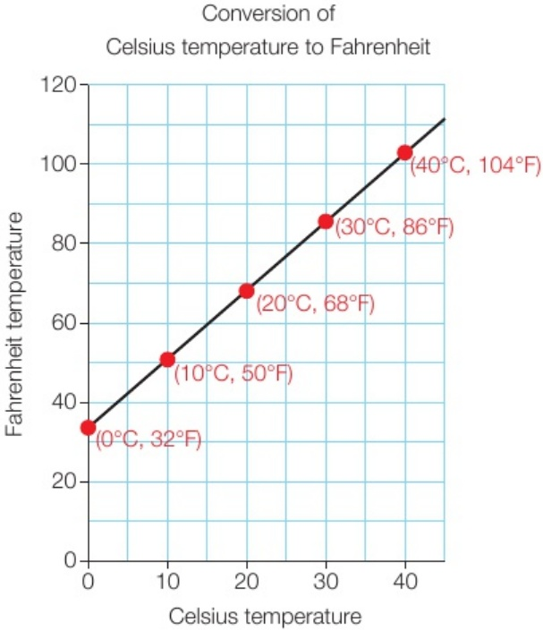
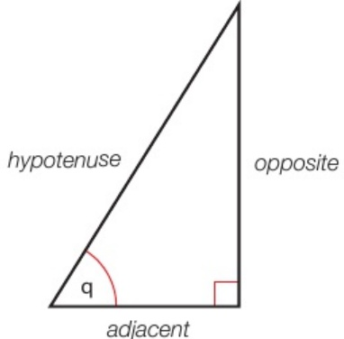
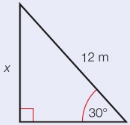
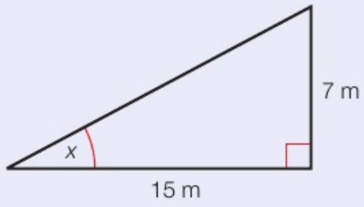
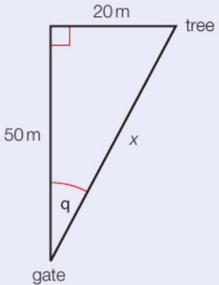
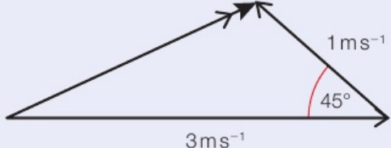
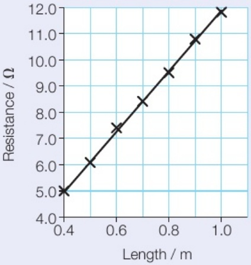
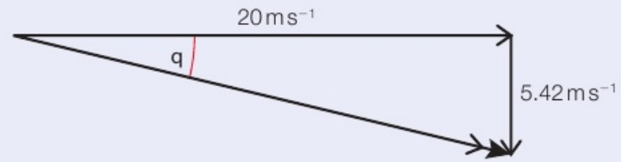

# Maths skills

<!-- edx_ial_phy1.pdf p205-210 -->

<!-- page 205 -->

## MATHS SKILLS

In order to be able to develop your skills, knowledge and understanding in Physics, you will need to have developed your mathematical skills in a number of key areas. This section gives more explanation and examples of some key mathematical concepts you need to understand. Further examples relevant to your International AS/A level Physics studies are given throughout the book. In particular, the Working as a Physicist section explores important ideas about units and estimation.

## ARITHMETIC AND NUMERICAL COMPUTATION

## USING STANDARD FORM

Dealing with very large or small numbers can be difficult. To make them easier to handle, you can write them in the format  $ a \times 10^b $. This is called standard form.

To change a number from decimal form to standard form:

Count the number of positions you need to move the decimal point by until it is directly to the right of the first number which is not zero.

This number is the index number that tells you how many multiples of 10 you need. If the original number was a decimal, your index number must be negative.

Here are some examples:

<table border=1 style='margin: auto; word-wrap: break-word;'><tr><td style='text-align: center; word-wrap: break-word;'>DECIMAL NOTATION</td><td style='text-align: center; word-wrap: break-word;'>STANDARD FORM NOTATION</td></tr><tr><td style='text-align: center; word-wrap: break-word;'>0.000 000 012</td><td style='text-align: center; word-wrap: break-word;'>$ 1.2 \times 10^{-8} $</td></tr><tr><td style='text-align: center; word-wrap: break-word;'>15</td><td style='text-align: center; word-wrap: break-word;'>$ 1.5 \times 10^{1} $</td></tr><tr><td style='text-align: center; word-wrap: break-word;'>1000</td><td style='text-align: center; word-wrap: break-word;'>$ 1.0 \times 10^{3} $</td></tr><tr><td style='text-align: center; word-wrap: break-word;'>3 700 000</td><td style='text-align: center; word-wrap: break-word;'>$ 3.7 \times 10^{6} $</td></tr></table>

## WORKED EXAMPLE

Calculate the momentum of a bullet of mass 5.2 grams fired at a speed of 825 m s $ ^{-1} $ in kg m s $ ^{-1} $. The momentum of this bullet would be:

 $$ p=m\times v $$ 

 $$ p=5.2\times10^{-3}\times825 $$ 

 $$ p=4290\times10^{-3} $$ 

 $$ p=4.29kg m s^{-1} $$ 

## ALGEBRA

## CHANGING THE SUBJECT OF AN EQUATION

It can be very helpful to rearrange an equation to express the variable that you are interested in in terms of the variables it is related to. Always remember that any operation that you apply to one side of the equation must also be applied to the other side.

## WORKED EXAMPLE

Consider the following equation which relates v = velocity, u = initial velocity, a = acceleration and s = displacement:

 $$ v^{2}=u^{2}+2as $$ 

If we wished to rearrange this equation to make u the subject, we would first subtract 2 as from each side to obtain:

 $$ v^{2}-2as=u^{2} $$

<!-- page 206 -->

Now to obtain the formula in terms of u, we have to 'undo' the square term by doing the opposite of squaring for each side. In essence, we have to take the square root of each side:

 $$ \sqrt{u^{2}}=\sqrt{v^{2}-2as} $$ 

 $$ u=\sqrt{v^{2}-2a s} $$ 

## HANDLING DATA

## USING SIGNIFICANT FIGURES

Often when you do a calculation, your answer will have many more figures than you need. Using an appropriate number of significant figures will help you to interpret results in a meaningful way.

Remember the ‘rules’ for significant figures:

The first significant figure is the first figure which is not zero.

Digits 1–9 are always significant.

- Zeros which come after the first significant figure are significant unless the number has already been rounded.

Here are some examples:

<table border=1 style='margin: auto; word-wrap: break-word;'><tr><td style='text-align: center; word-wrap: break-word;'>EXACT NUMBER</td><td style='text-align: center; word-wrap: break-word;'>TO ONE S.F.</td><td style='text-align: center; word-wrap: break-word;'>TO TWO S.F.</td><td style='text-align: center; word-wrap: break-word;'>TO THREE S.F.</td></tr><tr><td style='text-align: center; word-wrap: break-word;'>45 678</td><td style='text-align: center; word-wrap: break-word;'>50 000</td><td style='text-align: center; word-wrap: break-word;'>46 000</td><td style='text-align: center; word-wrap: break-word;'>45 700</td></tr><tr><td style='text-align: center; word-wrap: break-word;'>45 000</td><td style='text-align: center; word-wrap: break-word;'>50 000</td><td style='text-align: center; word-wrap: break-word;'>45 000</td><td style='text-align: center; word-wrap: break-word;'>45 000</td></tr><tr><td style='text-align: center; word-wrap: break-word;'>0.002 755</td><td style='text-align: center; word-wrap: break-word;'>0.003</td><td style='text-align: center; word-wrap: break-word;'>0.002 8</td><td style='text-align: center; word-wrap: break-word;'>0.002 76</td></tr></table>

## GRAPHS

## UNDERSTAND THAT  $ y = mx + c $ REPRESENTS A LINEAR RELATIONSHIP

Two variables are in a linear relationship if they increase at a constant rate in relation to one another. If you plotted a graph with one variable on the x-axis and the other variable on the y-axis, you would get a straight line. Any linear relationship can be represented by the equation  $ y = mx + c $ where the gradient of the line is m and the value at which the line crosses the y-axis is c. An example of a linear relationship is the relationship between degrees Celsius and degrees Fahrenheit, which can be represented by the equation  $ F = \frac{9}{5}C + 32 $ where C is temperature in degrees Celsius and F is temperature in degrees Fahrenheit.

<!-- page 207 -->

## DRAW AND USE THE SLOPE OF A TANGENT TO A CURVE AS A MEASURE OF A RATE OF CHANGE

Sir Isaac Newton was fascinated by rates of change. He drew tangents to curves at various points to find the rates of change of graphs as part of his journey towards discovering the calculus – an amazing branch of mathematics. He argued that the gradient of a curve at a given point is exactly equal to the gradient of the tangent of a curve at that point.

## Technique:

1 Use a ruler to draw a tangent to the curve.

2 Calculate the gradient of the tangent using the technique given for a linear relationship. This is equal to the gradient of the curve at the point of the tangent.

3 State the unit for your answer.

## GEOMETRY AND TRIGONOMETRY

## USING SIN, COS AND TAN WITH RIGHT-ANGLED TRIANGLES

For a right-angled triangle, Pythagoras' Theorem can be used to find the length of a side given the length of two other sides. For problems that involve angles as well as side lengths, we can use the ratios sine, cosine and tangent. These ratios are called trigonometric ratios.

 $$ \sin\theta=\frac{opposite}{hypotenuse} $$ 

 $$ \cos\theta=\frac{adjacent}{hypotenuse} $$ 

 $$ \tan\theta=\frac{opposite}{adjacent} $$ 

To help you to remember these rules, you can learn a mnemonic for the letters 'SOH CAH TOA'. For example:

## Some Old Horses

## Can Always Hear

Their Owners Approaching

## FINDING THE LENGTH OF AN UNKNOWN SIDE

Follow this four-step procedure:

## WORKED EXAMPLE

Calculate the length of side x.

## 1 Summary of data

First, write down all of the data involved:

 $$  Angle=30^{\circ} $$ 

Hypotenuse = 12 m

Opposite = x

<!-- page 208 -->

## 2 Selection

Next, select the appropriate trigonometric ratio using 'SOH CAH TOA'. It can be helpful to place a small tick above any variable involved.

In this case we see:

## 3 Substitution

Write out the trigonometric ratio that you have chosen. You may need to rearrange it to express the value you are interested in.

 $ \sin A = \frac{\text{opposite}}{\text{hypotenuse}} $
opposite =  $ \sin A \times \text{hypotenuse} $
opposite =  $ \sin 30 \times 12 \, \text{m} $

## 4 Calculate and check

Calculate your answer using the required function on your scientific calculator. Then perform three checks: check that your answer is sensible, check whether it needs to be rounded and check whether you have used the correct units.

$ x = 0.5 \times 12 \, m = 6 \, m $

## FINDING AN UNKNOWN ANGLE

Follow the same four-step procedure. The only difference is that you will need to use the inverse function on your calculator.

## WORKED EXAMPLE

Calculate the angle x.

1 Summary of data
    Opposite = 7 m
    Adjacent = 15 m
    Angle = x
2 Selection
    ✓ ✓ ✓ ✓
    SOH CAH TOA
The correct ratio to use is tangent.
3 Substitution
$\tan \theta = \frac{\text{opposite}}{\text{adjacent}}$
$\theta = \tan^{-1}\left(\frac{\text{opposite}}{\text{adjacent}}\right)$
$\theta = \tan^{-1}\left(\frac{7}{5}\right)$
4 Calculate and check
$x = 25.01689$
$x = 25.0^{\circ}$ (1 decimal place)

<!-- page 209 -->

## APPLYING YOUR SKILLS

You will often find that you need to use more than one maths technique to answer a question. In this section, we will look at four example questions and consider which maths skills are required and how to apply them.

## WORKED EXAMPLE

A tree stands in a field. The tree is 50 m north of the gate to the field and is 20 m east of the gate.

(a) Calculate the distance of the tree from the gate.

(b) Calculate the angle of the direction to the tree from north.

You recognise a right angle triangle. You need to use Pythagoras.

(a)

 $$ x^{2}=50^{2}+20^{2} $$ 

 $$ x^{2}=2500+400=2900 $$ 

 $$ x=\sqrt{2900} $$ 

 $$ x=54m(2s.f.) $$ 

(b)

 $$ \tan\theta=\frac{20}{50} $$ 

 $$ \mathrm{SO}\ \theta=22^{\circ} $$ 

## WORKED EXAMPLE

A boat sails due east (090°) at 3 m s $ ^{-1} $. The tide comes from the south-east (135°) at 1 m s $ ^{-1} $.

Draw a vector diagram to show the movement of the boat over the ground and calculate the speed.

You need to draw a diagram that represents the information in the question. If you draw a scale diagram, choose a simple scale like 1 cm:10 m.

Now we must split both of the vectors up into two components, one going north and one going east.

North The boat speed vector  $ 3 \, \text{m s}^{-1} $ has no component going north. The tide speed vector of  $ 1 \, \text{m s}^{-1} $ has a component  $ 1 \, \text{m s}^{-1} \times \sin 45 = 0.707 \, \text{m s}^{-1} $ going north.

East The boat speed vector 3 m s $ ^{-1} $ is going due east. The tide speed vector of 1 m s $ ^{-1} $ has a component 1 m s $ ^{-1} $  $ \times $ cos 45 = −0.707 m s $ ^{-1} $ going east; the minus sign means that the component is to the west and so we must subtract it since it reduces the boat speed to the east. So the boat speed to the east is (3 − 0.707) = 2.293 or 2.29 m s $ ^{-1} $ using 3 significant figures.

Now we must combine the north and east components to find the net speed. You recognise a right angle triangle. You need to use Pythagoras.

 $$ (speed)^{2}=0.707^{2}+2.29^{2}=0.500+5.24=5.74 $$ 

so speed =  $ \sqrt{5.74} $ = 2.40 m s $ ^{-1} $

<!-- page 210 -->

## WORKED EXAMPLE

A student measures the resistivity of some metal in the form of a wire. He starts by looking up the definition of resistivity which is

 $ \rho = \frac{R \times A}{l} $ where  $ R $ is the resistance of a length  $ l $ of a wire of cross-sectional area  $ A $

He measures the resistance of different lengths of the wire and plots a graph of his readings.

(a) Explain whether the readings should give a line of best fit that passes through the origin.

(b) He measures the diameter of the wire as 0.234 mm. Determine the cross-sectional area A.

(c) Take measurements from the graph to show that the gradient m of the line of best fit is about $ m = 11.7 \, \Omega \, m^{-1} $ and hence calculate a value for the resistivity of the metal of the wire.

(a) You need to recall the equation of a straight line  $ y = mx + c $ where the data is plotted on the x and y axes and m is the gradient and c is the intercept on the y-axis.

You must then compare this with the equation for resistivity where he has measured R and I.

Since  $ R = \rho \times \frac{l}{A} $ we can see that if R is plotted on the y-axis and l on the x-axis then the gradient of the line will be  $ \frac{\rho}{A} $ which is a constant so the line will be straight. There are no other terms in the resistivity equation so the value for c will be zero and the line should pass through the origin.

Note that the origin is not marked on this graph, it starts at  $ (0.4, 4.0) $

(b) You need to remember the formula for the area of a circle  $ A = \pi \times r^{2} $

Note you can only measure the diameter of a piece of wire so you must divide by 2 to get the radius r.

So  $ A = \left(0.234 \times \frac{10^{-2}}{2}\right)^{2} = 4.30 \times 10^{-8} \, m^{2} $

(c) Take measurements from the graph to show that the gradient m of the line of best fit is about  $ m = 11.7 \, \Omega \, m^{-1} $ and hence calculate a value for the resistivity of the metal of the wire.

Gradient = rise over run, so take measurements from the line of best fit – not the plots

 $$ Gradient=\frac{11.9-4.9}{1.0-0.4}=\frac{7}{0.6}=11.7=\frac{\rho}{A} $$ 

 $$  So\qquad\rho=11.7\Omega m^{-1}\times4.30\times10^{-8}m^{2}=5.03\times10^{-8}\Omega m $$ 

## WORKED EXAMPLE

A ball is dropped from a height of 1.50 m above the ground.

(a) Show that it hits the ground at about  $ 5.4 \, m \, s^{-1} $.

(b) The ball is now thrown horizontally at a height of 1.5 m with a horizontal velocity of 20 m s $ ^{-1} $. Calculate the angle at which it hits the ground.

(a) You need a kinematics equation. You know  $ u = 0 \, \text{m} \, \text{s}^{-1} $,  $ g = 9.81 \, \text{m} \, \text{s}^{-2} $ and  $ s = 1.50 \, \text{m} $. You need to find v.

The equation you need is  $ v^{2} = u^{2} + 2as $

 $$ So\ v^{2}=0+2\times9.81\times1.50=29.4so\ v=\sqrt{29.4}=5.42m s^{-1} $$ 

(b) Remember for projectiles that the horizontal velocity remains constant. While the ball is falling it is travelling horizontally at a constant velocity of  $ 20 \, m s^{-1} $

It hits the ground horizontally at 20 m s $ ^{-1} $ and vertically at 5.42 m s $ ^{-1} $.

 $ \tan \theta = \frac{5.42}{20} \text{ so } \theta = \tan^{-1} 0.271 = 15^\circ $

