# 5A Further momentum

<!-- edx_ial_phy2.pdf p12-23 -->

<!-- page 12 -->

# TOPIC 5 FURTHER MECHANICS 5A FURTHER MOMENTUM

Acceleration can be considered as a change in momentum per unit mass. It can often be more exciting than basic calculations such as calculating the changing speed of a car.

Curling is a game which originated in Scotland. It is now an established sport which is popular in Canada and Japan. The sport uses the ideas of conservation of momentum and elastic collisions. Players deliberately collide the stones to deflect their opponents' stones, and to ensure their own stone finishes in a winning position. Also, the friction with the ice causes a change in momentum to slow the stone to a stop.

In this chapter, you will learn about the way forces can change the momentum of an object over time. The chapter will also cover how kinetic energy changes in different types of collisions, whilst momentum is conserved. All of this will be extended to events happening in two dimensions, so vector addition and the resolving of vectors will be revisited in order to make the necessary calculations.

## MATHS SKILLS FOR THIS CHAPTER

- Use of trigonometric functions (e.g. finding components of momentum vectors)

- Use of Pythagoras' theorem (e.g. finding velocity as a vector sum)

• Changing the subject of an equation (e.g. rearranging the impulse equation)

Substituting numerical values into algebraic equations (e.g. finding the velocity after a collision)

Visualising and representing 2D forms (e.g. drawing a 2D momentum diagram for a collision between meteors)

<!-- page 13 -->

## What prior knowledge do I need? Topic 1A (Book 1: IAS)

How to add forces as vectors

How to resolve vectors

Newton's laws of motion

Topic 1B (Book 1: IAS)

How to calculate kinetic energy

Conservation of energy

How to calculate the momentum of an object

Topic 1C (Book 1: IAS)

Conservation of linear momentum in collisions

## What will I study in this chapter?

The impulse equation and its connection with Newton's second law of motion

The relationship between the force on an object and its change in momentum

Conservation of linear momentum in two dimensions

How to analyse collisions in 2D

The difference between an elastic and an inelastic collision

The equation for the kinetic energy of a non-relativistic particle, in terms of its momentum

## What will I study later? Topics 6A and 6B

How electrical and magnetic fields affect the momentum of charged particles

## Topic 7A

The de Broglie wavelength for a particle and its connection with the momentum of the particle

Large-angle alpha particle scattering indicating the structure of the atom, with the scattering dependent on momentum conservation

## Topic 7B

How the momentum affects the size of a circle in which a charged particle is trapped by a magnetic field

How conservation of momentum affects the creation and detection of new particles

<!-- page 14 -->

## 5A 1 ENERGY IN COLLISIONS

## LEARNING OBJECTIVES

Explain the difference between elastic and inelastic collisions.

Make calculations based on the conservation of linear momentum to determine energy changes in collisions.

Derive and use the equation for the kinetic energy of a non-relativistic particle.

We have seen in Book 1, Chapter 1C that linear momentum is always conserved in any collision between objects, and this is responsible for Newton's third law of motion. We also learned that Newton's second law of motion expresses the concept that a force is equivalent to the rate of change of momentum. Book 1, Chapter 1A explained how forces can do work, which results in energy transfer. So, does the kinetic energy change in a collision?

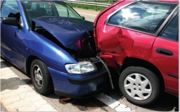

fig A Damaging a car uses energy. What can we say about the conservation of kinetic energy in a car crash?

## ELASTIC COLLISIONS

In a collision between one pool ball and another, the first one often stops completely and the second then moves away from the collision. As both pool balls have the same mass, the principle of conservation of momentum tells us that the velocity of the second ball must be identical to the initial velocity of the first. This means that the kinetic energy of this system of two balls before and after the collision must be the same. A collision in which kinetic energy is conserved is called an elastic collision. In general, these are rare. A Newton's cradle is an example that is nearly perfectly elastic (a tiny amount of energy is lost as heat and sound). A collision caused by non-contact forces, such as alpha particles being scattered by a nucleus (see Section 7A.1), is perfectly elastic.

▲ fig B Newton's cradle maintains kinetic energy, as well as conserving momentum in its collisions.

## INELASTIC COLLISIONS

In a crash between two bumper cars, the total momentum after the collision must be identical to the total momentum before the collision. However, if we calculate the total kinetic energy before and after, we find that the total is reduced by the collision. Some of the kinetic energy is transferred into other forms such as heat and sound. A collision in which total kinetic energy is not conserved is called an inelastic collision.

## INELASTIC COLLISION EXAMPLE

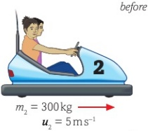

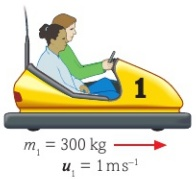

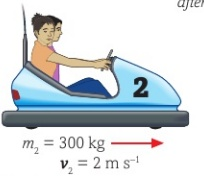

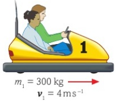

fig C The fun of inelastic collisions.

If you calculate the total momentum before and after the collision in fig C, you will see that it is conserved. However, what happens to the kinetic energy?

Before collision:

 $$ E_{k1}=\frac{1}{2}m_{1}\pmb{u}_{1}^{2}=\frac{1}{2}\times(300)\times1^{2}=150J $$ 

 $$ E_{k2}=\frac{1}{2}m_{2}\pmb{u}_{2}^{2}=\frac{1}{2}\times(300)\times5^{2}=3750J $$ 

Total kinetic energy = 3900 J

After collision:

 $$ E_{k1}=\frac{1}{2}m_{1}\mathbf{v}_{1}^{2}=\frac{1}{2}\times(300)\times4^{2}=2400J $$ 

 $$ E_{k2}=\frac{1}{2}m_{2}\mathbf{v}_{2}^{2}=\frac{1}{2}\times(300)\times2^{2}=600J $$ 

 $$ \mathrm{Total~kinetic~energy}=3000\mathrm{J} $$ 

Loss in kinetic energy = 900 J. This is an inelastic collision.

This 'lost' energy has been transferred to heat and sound energy.

## LEARNING TIP

When you are deciding whether a collision is elastic or inelastic, you must only consider the conservation of kinetic energy. Total energy in all forms must always be conserved.

<!-- page 15 -->

# PRACTICAL SKILLS

## Investigating elastic and inelastic collisions

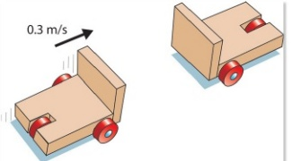

fig D Crash testing the elasticity of collisions.

You can investigate elastic and inelastic collisions in the school laboratory. If you cause head-on collisions, and record the mass and velocity of each trolley before and after the collisions, you then calculate the momentum at each stage. This should be conserved. You can also then calculate kinetic energy before and after the collisions. Real cars are designed with crumple zones to absorb as much kinetic energy as possible when they crash. This reduces the energy available to cause injury to the passengers. What is the best design for a crumple zone on your experimental trolleys which will absorb kinetic energy?

Safety Note: Carry and place heavy runways so they cannot fall. Use end-stops to prevent the trolleys falling off the ends of the runway.

## PARTICLE MOMENTUM

We know that the formula for calculating kinetic energy is  $ E_{k} = \frac{1}{2}mv^{2} $ and that the formula for momentum is p = mv. We can combine these to get an equation that gives kinetic energy in terms of the momentum and mass.

 $$ E_{k}=\frac{1}{2}m\mathbf{v}^{2}\quad and\quad\mathbf{v}=\frac{\boldsymbol{p}}{m} $$ 

 $$ E_{k}=\tfrac{1}{2}m\mathbf{v}^{2} $$ 

 $$ \therefore\quad E_{k}=\tfrac{1}{2}m\biggl(\frac{\pmb{p}}{m}\biggr)^{2} $$ 

 $$ \therefore\quad E_{k}=\frac{1}{2}\frac{\boldsymbol{p}^{2}}{m} $$ 

 $$ \therefore\quad E_{k}=\frac{\pmb{p}^{2}}{2m} $$ 

This formula is particularly useful for calculations involving the kinetic energy of subatomic particles travelling at non-relativistic speeds – that is, much slower than the speed of light.

## PARTICLE COLLISIONS

In experiments to determine the nature of fundamental particles, physicists detect the movements of many unknown particles. The Large Hadron Collider experiment at CERN, underground near Geneva in Switzerland, produces 600 million particle interactions in its detector every second. The conservation of momentum allows the mass of these particles to be calculated, which helps to identify them. This can be done by colliding the particles produced in the experiment with known particles in the detector.

For example, the detector registers an elastic collision with one of its neutrons which changes the neutron's velocity from stationary to  $ 3.4 \times 10^6 $ m s $ ^{-1} $. The collision was 'head-on' with an unknown particle, which was initially moving at 10% of the speed of light, and leaves the collision in the opposite direction at  $ 1.09 \times 10^3 $ m s $ ^{-1} $. What is the mass of the mystery particle? The mass of a neutron is  $ 1.67 \times 10^{-27} $ kg.

before

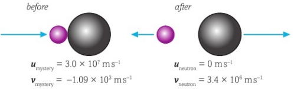

▲ fig E Discovering mystery particles from their momentum and collisions. Before collision:

Before collision:

 $$ p_{mystery}=m_{mystery}\times3\times10^{7}=p_{total before} $$ 

 $$ (p_n=zero) $$ 

After collision:

 $$ \begin{aligned}\boldsymbol{p}_{total after}&=\left(m_{mystery}\times\boldsymbol{v}_{mystery}\right)+\left(m_{n}\times\boldsymbol{v}_{n}\right)\\&=\left(m_{mystery}\times-1.09\times10^{3}\right)+\left(1.67\times10^{-27}\times3.4\times10^{6}\right)\\&=\boldsymbol{p}_{total before}=m_{mystery}\times3\times10^{7}\end{aligned} $$ 

So:

 $$ (m_{mystery}\times-1.09\times10^{3})+(1.67\times10^{-27}\times3.4\times10^{6})=m_{mystery}\times3\times10^{7} $$ 

 $$ (1.67\times10^{-27}\times3.4\times10^{6})=(m_{mystery}\times3\times10^{7})-(m_{mystery}\times-1.09\times10^{3}) $$ 

 $$ 5.678\times10^{-21}=(m_{mystery}\times30001090) $$ 

So:

 $$ m_{mystery}=\frac{5.678\times10^{-21}}{30001090}=1.89\times10^{-28}kg $$ 

This is approximately 207 times the mass of an electron, and so this can be identified as a particle called a muon, which is known to have this mass.

## CHECKPOINT

## SKILLS ANALYSIS

1. An alpha particle consists of two protons and two neutrons. Calculate the kinetic energy of an alpha particle which has a momentum of  $ 1.08 \times 10^{-19} $ kg m $ s^{-1} $:

(a) in joules (b) in electron volts (c) in MeV.

(mass of neutron = mass of proton =  $ 1.67 \times 10^{-27} $ kg)

2. A bowling ball travelling at 5 m s $ ^{-1} $ strikes the only standing pin straight on. The pin flies backward at 7 m s $ ^{-1} $. Calculate:

(a) the velocity of the bowling ball after the collision

(b) the loss of kinetic energy in this collision.

(mass of bowling ball = 6.35 kg; mass of pin = 1 kg)

3. In a particle collision experiment, a mystery particle collides with a stationary neutron and sets the neutron into motion with a velocity of  $ 1.5 \times 10^7 $ m s $ ^{-1} $. The mystery particle arrived at a velocity of 1% of the speed of light, and recoiled after collision with a velocity of  $ 7.5 \times 10^5 $ m s $ ^{-1} $ in the opposite direction. Calculate the mass of the mystery particle, and identify it.

## SUBJECT VOCABULARY

elastic collision in which total kinetic energy is conserved  

inelastic collision in which total kinetic energy is not conserved

<!-- page 16 -->

# 5A 2 MORE COLLISIONS

## LEARNING OBJECTIVES

Apply the conservation of linear momentum to situations in two dimensions.

Analyse collisions in two dimensions.

Calculate impulses and changes in momentum.

So far, we have only considered the conservation of linear momentum in one-dimensional collisions, where all objects move forwards and/or backwards along the same straight line. This is an unusual situation, and we need to be able to work with more complex movements. Helpfully, momentum is conserved in each dimension separately. So, we resolve vector movements entering a collision into components in each dimension and then calculate following the conservation of momentum in each dimension. After this, we can recombine component vectors to give us an overall vector after a collision. A real world example, as in fig B, will illustrate this best.

## PRACTICAL SKILLS

Investigating impulse

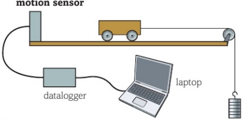

▲ fig A Measuring how impulse changes the momentum of a trolley

In Book 1, Section 1C.1, we saw how you can investigate the change in momentum over time for a trolley that is subject to a constant accelerating force. Using the same apparatus, you could again record how different forces acting over different time periods cause the trolley to accelerate to different velocities. From these results, you can calculate the impulse applied in each case. As  $ I = F \Delta t = \Delta p = \Delta m v $, a graph of impulse on the y-axis against change in velocity on the x-axis should give a straight best fit line through the origin. This straight line verifies the impulse equation, and the gradient of it will give the mass of the accelerating trolley and weights.

Safety Note: Put a ‘catch box’ full of soft material under the hanging masses to stop them falling on to feet and use an end stop to prevent the trolley falling off the runway.

## EXAM HINT

Make sure you have a good understanding of this practical as your understanding of the experimental method may be assessed in your exams.

## IMPULSE

The product of a force applied for a known time  $ (F \times \Delta t) $ is known as the impulse, and this is equal to the change in momentum:

impulse (Ns) = force (N) × time (s)

= change in momentum (kg m $ s^{-1} $)

impulse  $ = F \times \Delta t = \Delta p $

To stop something moving, we need to remove all of its momentum. This idea allows us to calculate the impulse needed to stop an object moving. If we know how long a force is applied, we could work out the size of that force.

## WORKED EXAMPLE 1

What is the impulse needed to accelerate a 1000 kg car from rest to 25 m s $ ^{-1} $?

 $$ \boldsymbol{p}=m\times\boldsymbol{v} $$ 

At the start, the car is at rest, so has no momentum. Therefore the change in momentum will equal its final momentum:

 $$ \Delta\boldsymbol{p}=1000\times25 $$ 

 $$ \mathrm{impulse}=\pmb{F}\times\Delta t=\Delta p $$ 

 $$ I=25000kg m s^{-1} $$ 

If the car needed to stop in 3.8 seconds, what force would the brakes need to apply?

At the end, the car is at rest, so has no momentum. Therefore the change in momentum will equal its initial momentum:

 $$ \pmb{F}t=m\Delta\pmb{v} $$ 

 $$ m\Delta\mathbf{v}=25000kg m s^{-1} $$ 

 $$ \mathbf{F}=\frac{m\Delta\mathbf{v}}{t} $$ 

 $$ \mathsf{F}=\frac{25\ 000}{3.8} $$ 

F = 6600 N to 2 significant figures (sf)

## COLLISION VECTORS

Momentum is a vector quantity. As with all vectors, we can resolve momentum into a right-angle pair of vector components. And we can add components together in two dimensions to find an overall vector. A spacecraft is moving through empty space at  $ 8 \, m \, s^{-1} $. A meteoroid, travelling at  $ 15 \, m \, s^{-1} $, comes from behind and at an angle of  $ 45^\circ $ to the line of movement of the rocket, crashes into the rocket and becomes embedded in it. The rocket has a mass of 350 kg and the meteorite mass is 20 kg. We can calculate the velocity of the rocket (fig B) after the collision.

<!-- page 17 -->

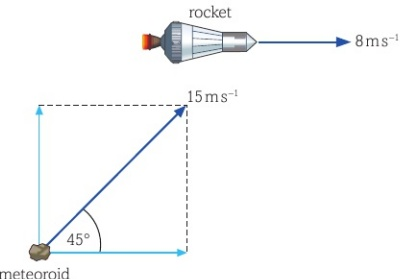

fig B A collision in two dimensions.

Parallel to rocket motion:

 $$ \mathbf{v}_{\mathrm{m e t e o r i t e}}=15\cos45^{\circ}=10.6\,\mathrm{m\,s^{-1}} $$ 

Before collision:

 $$ p_{meteorite}=20\times10.6=212kg m s^{-1} $$ 

 $$ p_{rocket}=350\times8=2800kg m s^{-1} $$ 

 $$ p_{parallel}=2800+212=3012kg m s^{-1} $$ 

Perpendicular to rocket motion:

After collision:

 $$ \pmb{v}_{\mathrm{m e t e o r i t e}}=15\sin45^{\circ}=10.6\,\mathrm{m\,s^{-1}} $$ 

 $$ p_{\mathrm{m e t e o r i t e}}=20\times10.6=212\mathrm{~k g m s^{-1}} $$ 

 $$ p_{rocket}=350\times0=0kg m s^{-1} $$ 

Vector sum of momenta (fig C):

 $$ p_{p e r p e n d i c u l a r}=0+212=212\mathrm{~k g m s^{-1}} $$ 

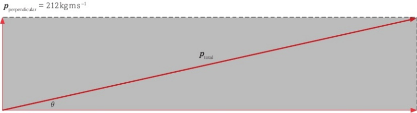

 $$ p_{parallel}=3012kgm s^{-1} $$ 

fig C Vector sum of total momentum in two dimensions.

 $$ p_{total}=\sqrt{(3012^{2}+212^{2})}=3019kg m s^{-1} $$ 

 $$ \begin{array}{c} \mathbf{v}_{after}~=~\frac{\mathbf{p}_{total}}{\left(m_{rocket}+m_{meteorite}\right)}=\frac{3019}{\left(350+20\right)}=8.16\,\mathrm{m\,s^{-1}}\end{array} $$ 

Angle of momentum (i.e. direction of velocity) after collision:

 $$ \theta~=~\tan^{-1}\left(\frac{212}{3012}\right)=4.0^{\circ} $$ 

So, the spacecraft with embedded meteorite carries on at  $ 8.16 \, m \, s^{-1} $ at an angle of  $ 4.0^\circ $ off the original direction of motion.

## PRACTICAL SKILLS

Investigating 2D collisions

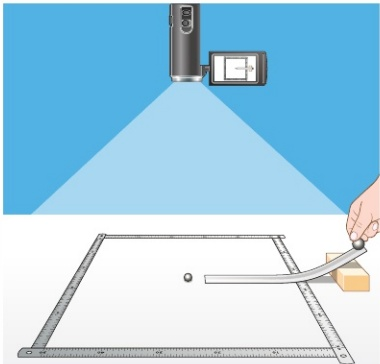

fig D Video analysis of collisions in 2D.

You can investigate two-dimensional collisions in the school laboratory. We saw in Book 1, Section 1A.2 that by analysing video footage of an object's movement, frame by frame, we can calculate any changes in velocity. With measurement scales in two dimensions, the components of velocity in each dimension can be isolated. This means that separate calculations can be made in each dimension, in order to verify the conservation of momentum in 2D.

Safety Note: Use a heavy stand and a clamp to secure the camera so that it cannot fall over.

## EXAM HINT

Collision and momentum exam questions often ask Show that ... In 'show that' questions, you must state the equations you use. Then substitute in values and calculate a final answer that rounds to the approximate value in the question. Give the answer to 1 significant figure more than given in the question to prove you have calculated it yourself, and that it matches with the number in the question.

For example, for the calculation on the left, an exam question could be ‘Show that the total momentum after the collision is 3020 kg  $ ms^{-1} $. Our calculations would show:

 $$ \mathrm{m o m e n t u m}=3019\mathrm{k g}\mathrm{m s}^{-1} $$ 

We should then conclude the answer with:

 $$ p_{total}=3019=3020kg m s^{-1}(3s f) $$ 

## EXAM HINT

Make sure you have a good understanding of this practical as your understanding of the experimental method may be assessed in your exams.

<!-- page 18 -->

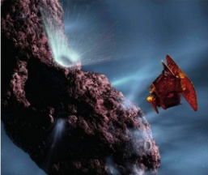

fig E The comet Tempel 1 was hit by NASA's Deep Impact probe.

## DEEP SPACE COLLISION

On 4 July 2005, NASA’s Deep Impact mission succeeded in crashing a spacecraft into a comet called Tempel 1 (fig E). For that mission, the impactor spacecraft had a mass of 370 kg compared with the comet’s mass of  $ 7.2 \times 10^{13} $ kg, so there would have been an insignificant change in the comet’s trajectory. Deep Impact was purely intended to study the comet’s composition. However, there is an asteroid named Apophis which has a small chance of colliding with Earth in 2035, 2036, or maybe 2037, and there have been some calls for a mission to crash a spacecraft into Apophis in order to move it out of the crash line. The mass of this asteroid is  $ 6.1 \times 10^{10} $ kg and it is travelling at  $ 12.6\text{km s}^{-1} $. It has been claimed that a collision by a 4000 kg impactor craft travelling at  $ 6\text{km s}^{-1} $ could change the path of this asteroid enough to ensure it would not hit Earth. If this impactor collided with Apophis at right angles, we can calculate the change in angle of the asteroid (fig F).

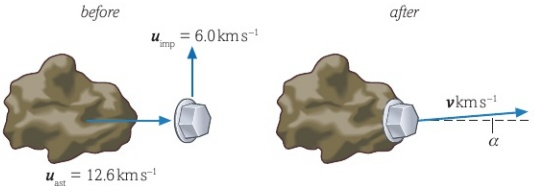

▲ fig F Could we hit an asteroid hard enough to save Earth from Asteroid Impact Hazards?

Before collision:

 $$ \begin{aligned}\boldsymbol{p}_{ast}&=m_{ast}\boldsymbol{u}_{ast}=6.1\times10^{10}\times12.6\times10^{3}=7.69\times10^{14}kg m s^{-1}\\\boldsymbol{p}_{imp}&=m_{imp}\boldsymbol{u}_{imp}=4\times10^{3}\times6\times10^{3}=2.4\times10^{7}kg m s^{-1}\end{aligned} $$ 

 $$ \text{total momentum}p_{after impact}/\alpha\quad\text{→}p_{imp}=2.4\times10^{7}\mathrm{kg}\mathrm{m}\mathrm{s}^{-1}\quad\text{→}p_{ast}=7.69\times10^{14}\mathrm{kg}\mathrm{m}\mathrm{s}^{-1} $$ 

fig G The vector sum of momentum components after asteroid impact.

The momentum of the combined object after the impactor embeds in the asteroid is the vector sum of the two initial momenta, which are at right angles to each other.

After collision:

 $$ \begin{array}{l} \displaystyle \mathcal{P}_{after} =\sqrt{\left(\mathcal{P}_{ast}\right)^{2} + \mathcal{P}_{imp}^{2}} = \sqrt{\left(\left(7.69 \times 10^{14}\right)^{2} + \left(2.4 \times 10^{7}\right)^{2}\right)} \\ \displaystyle \qquad =  7.69 \times 10^{14} \text{kg} \text{m} \text{s}^{-1} \end{array} $$ 

 $$ \begin{array}{l}\therefore\quad\mathbf{v}_{after}=\frac{\pmb{p}_{after}}{m_{total}}=\frac{7.69\times10^{14}}{(6.1\times10^{10}+4\times10^{3})}\\ \qquad =12.6\ km\ s^{-1}(3\ significant\ figures)\end{array} $$ 

There is no significant change in the magnitude of the asteroid's velocity. Is there a significant change in its direction?

Angle of momentum after:

 $$ \alpha=\tan^{-1}\left(\frac{2.4\times10^{7}}{7.69\times10^{14}}\right)=1.79\times10^{-6}{}^{\circ} $$ 

Although less than two microdegrees sounds like an insignificantly small angle, this would represent a change in position of nearly 30 km as Apophis crosses the Earth's orbit from one side of the Sun to the other. This might be just enough to prevent a collision with Earth that would have a hundred times more energy than all the explosives used in the Second World War.

## DID YOU KNOW?

Archer fish catch insect prey by squirting water droplets into the air to knock the insects off leaves above the surface.

Calculations of the mass and velocity of the water droplet, and its impact time, show that the impact force can be ten times stronger than the insect's grip on the leaf.

<!-- page 19 -->

## CHECKPOINT

1. (a) What is the impulse needed to stop a car that has a momentum of 22 000 kg m s $ ^{-1} $?

(b) If the car brakes could apply a force of 6800 N, how long would it take to bring the car to a stop?

2. In a pool shot, the cue ball has a mass of 0.17 kg. It travels at 6.00 m s $ ^{-1} $ and hits the stationary black ball in the middle of one end of the table. The black ball, also of mass 0.17 kg, travels away at 45° and 4.24 m s $ ^{-1} $, ending up in the corner pocket.

(a) By resolving the components of the black ball's momentum, find out what happens to the cue ball.

(b) Is this an elastic or inelastic collision?

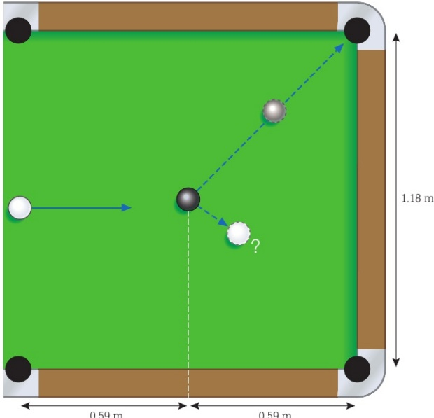

fig H 2D momentum calculations can be very important in winning at pool.

3. Calculate how fast the impactor spacecraft in fig F would have to be travelling if it is to alter the Apophis asteroid's trajectory by one degree. Comment on the answer.

4. For the experimental set up shown in fig D, suggest two improvements that could be made in order to improve the accuracy of the resolved vectors that would be observable on the video stills.

## SUBJECT VOCABULARY

impulse force acting for a certain time causing a change in an object's momentum

impulse =  $ F \times \Delta t $

SKILLS CRITICAL THINKING

SKILLS INNOVATION

<!-- page 20 -->

# 5A THINKING BIGGER

## ASTEROIDS

## SKILLS CRITICAL THINKING, PROBLEM SOLVING, ANALYSIS, INTERPRETATION, ADAPTIVE LEARNING

This poster from the Planetary Society explains the preparations needed for an asteroid impact with the Earth.

PUBLIC INFORMATION POSTER

## DEFENDING EARTH

With advanced planning and preparation, we could prevent a disastrous impact from an asteroid or comet. The Planetary Society breaks it down into these five steps for saving the world.

### 2. Track

### 1. Find

If we find a near-Earth object, how do we know if it will hit Earth? We need to map its orbit by taking repeated observations.

A number of missions, observatories, and systems track the orbits of NEOs, and more are in development.

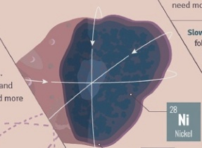

Astronomers use ground- and space-based telescopes to spot NEOs and have found 90% of the largest ones. Infrared imaging also helps find objects that are too dark to see from their reflected light.

### 4. Deflect

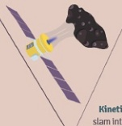

There is a variety of possible techniques for deflecting a potential impact, but all need more development and testing:

Slow gravity tractor: A massive spacecraft follows next to the near-Earth object and uses the spacecraft's gravity to pull the object off its collision course.

### 3. Characterize

By characterizing the spin rate, composition, and physical properties of potentially hazardous NEOs, we can better know how to deflect them. Awardees of The Planetary Society's Shoemaker NEO Grant Program are making tremendous contributions in this area.

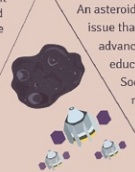

Kinetic impactor: A swarm of spacecraft slam into the object to knock it off course.

### 5. Coordinate and Educate

Laser adation: A spacecraft uses lasers to vaporize rock on the object, creating jets that push it off course. The Planetary Society is researching this technique with the University of Strathclyde through their Laser Bees project.

An asteroid impact is a worldwide issue that requires immense advance coordination and education. The Planetary Society is taking an active role by working with governments around the world, hosting conferences, doing public outreach, and supporting volunteer efforts.

## What about the

heir nuclear option?

Detonating nuclear devices on or beside an asteroid may be the only viable technique we have today for deflecting an asteroid. But this comes with challenges, including political opposition and the danger of fragment impacts.

From the Planetary Society http://www.planetary.org/explore/projects/planetary-defense/

<!-- page 21 -->

## THINKING BIGGER

## SCIENCE COMMUNICATION

The poster was produced by the Planetary Society. It aims to explain the issues connected with a possible asteroid collision with the Earth.

1 (a) Discuss the tone and level of vocabulary and level of scientific detail in the poster. Who is the intended audience?

(b) Discuss which of the images are the most useful to support the text, and which do not add so much.

2 Explain which of the five sections on the poster explains the most scientific ideas. Why do you think this section has the most scientific ideas?

## INTERPRETATION NOTE

Consider which sections of the poster describe science that has been tested the most. Which sections are well understood? Which need more research?

## PHYSICS IN DETAIL

Now we will look at the physics in detail. Some of these questions will link to topics elsewhere in this book, so you may need to combine concepts from different areas of physics to work out the answers.

3 (a) Look at section 1. Find in the poster. What is a NEO?

(b) Explain two of the difficulties in finding NEOs.

4 Consider an asteroid 1000km in diameter, with a structure of iron and rock. The overall density of such asteroids is about 2000kg m $ ^{-3} $.

(a) Estimate the volume of the asteroid. Why is your answer an estimate and not the exact answer?

(b) Calculate an estimate for its mass.

(c) Imagine the asteroid travelled directly towards the Earth at 10 000 m s $ ^{-1} $ and collided and embedded into the surface of the Earth. Calculate the change in speed of the Earth. The mass of the Earth is  $ 5.97 \times 10^{24} $ kg.

5 A Planetary Society scientist suggests we try to blow the asteroid apart with a nuclear explosion (as in 4. Deflect) before it hits the Earth. If the bomb can be set off 24 hours before collision with the Earth, and can split the asteroid into two equal pieces, calculate the force that the nuclear explosion, lasting for 2 seconds, would need to apply to send the two parts off course enough to save the Earth. The Earth's radius is 6400 km.

## PHYSICS TIP

Think about what would determine the motion of the broken pieces after the explosion. Consider conservation of momentum.

## ACTIVITY

Write a short talk for a member of the Planetary Society to give to a school age audience explaining the physics of the 'kinetic impactor' deflection method. This talk could be a part of the activities in 5. Coordinate and Educate.

## THINKING BIGGER TIP

You may need to do some further research about the 'kinetic impactor' idea. Concentrate on the conservation of momentum and the vector additions involved.

<!-- page 22 -->

# 5A EXAM PRACTICE

[Note: In questions marked with an asterisk (*), marks will be awarded for your ability to structure your answer logically, showing how the points that you make are related or follow on from each other.]

An inelastic collision:

A conserves momentum but not kinetic energy

B conserves momentum and kinetic energy

C need not conserve energy

D need not conserve momentum.

(Total for Question 1 = 1 mark)

2 A tennis ball travelling with the momentum of 4.2 kg m $ s^{-1} $ is hit by a tennis racquet. The force of 56 N from the racquet causes the tennis ball to travel back in the opposite direction with the momentum of 5.8 kg m $ s^{-1} $. How long is the ball in contact with the racquet?

A 0.029 s

B 0.10 s

C 0.18 s

D 5.6 s [1]

(Total for Question 2 = 1 mark)

3 In order to calculate the kinetic energy of a non-relativistic particle, we would need to know its:

A mass only

B mass and momentum

C acceleration and momentum

D velocity and acceleration. [1]

(Total for Question 3 = 1 mark)

4 In an experiment to accelerate a trolley along a runway, a light gate measured the time the trolley took to pass through it. There were five repeats of the same acceleration test and it took the following readings:

0.87 s, 0.89 s, 0.65 s, 0.76 s, 0.77 s

Which of these is the correct percentage error for this set of time readings?

A 0.12%

B 0.15%

C 15%

D 30%

(Total for Question 4 = 1 mark)

5 A spacecraft called Deep Space 1, mass 486 kg, uses an 'ion-drive' engine. This type of engine is designed to be used in deep space.

The following statement appeared in a website.

The ion propulsion system on Deep Space 1 expels 0.13 kg of xenon propellant each day. The xenon ions are expelled from the spacecraft at a speed of 30 km s $ ^{-1} $. The speed of the spacecraft is predicted to initially increase by about 8 m s $ ^{-1} $ each day.

Use a calculation to comment on the prediction made in this statement. [4]

(Total for Question 5 = 4 marks)

6 (a) Explain what is meant by the principle of conservation of momentum.

(b) The picture shows a toy car initially at rest with a piece of modelling clay attached to it.

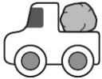

A student carries out an experiment to find the speed of a pellet fired from an air rifle. The pellet is fired horizontally into the modelling clay. The pellet remains in the modelling clay as the car moves forward. The motion of the car is filmed for analysis.

The car travels a distance of 69 cm before coming to rest after a time of 1.3 s.

(i) Show that the speed of the car immediately after being struck by the pellet was about  $ 1 \, m \, s^{-1} $.

(ii) State an assumption you made in order to apply the equation you used. [1]

(iii) Show that the speed of the pellet just before it collides with the car is about 120 m $ s^{-1} $

mass of car and modelling clay = 97.31 g

mass of pellet = 0.84 g [3]

(c) The modelling clay is removed and is replaced by a metal plate of the same mass. The metal plate is fixed to the back of the car. The experiment is repeated but this time the pellet bounces backwards.

 $ ^{*} $(i) Explain why the speed of the toy car will now be greater than in the original experiment.

(ii) The film of this experiment shows that the pellet bounces back at an angle of  $ 72^{\circ} $ to the horizontal. Explain why the car would move even faster if the pellet bounced directly backwards at the same speed.

<!-- page 23 -->

## EXAM PRACTICE

(d) The student tests the result of the first experiment by firing a pellet into a pendulum with a bob made of modelling clay. They calculate the energy transferred.

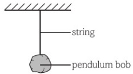

The student's data and calculations are shown:

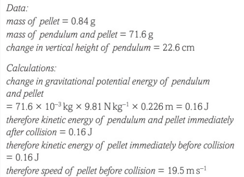

There are no mathematical errors but the student's answer for the speed is too small.

Explain which of the statements in the calculations are correct and which are not. [4]

(Total for Question 6 = 16 marks)

7 James Chadwick is credited with ‘discovering’ the neutron in 1932.

Beryllium was bombarded with alpha particles, knocking neutrons out of the beryllium atoms. Chadwick placed various targets between the beryllium and a detector. Hydrogen and nitrogen atoms were knocked out of the targets by the neutrons and the kinetic energies of these atoms were measured by the detector.

(a) The maximum energy of a nitrogen atom was found to be 1.2 MeV.

Show that the maximum velocity of the atom is about  $ 4 \times 10^{6} \, m s^{-1} $.

mass of nitrogen atom = 14u,

where $ u = 1.66 \times 10^{-27} $ kg

(b) The mass of a neutron is Nu (where N is the relative mass of the neutron) and its initial velocity is x. The nitrogen atom, mass 14u, is initially stationary and is then knocked out of the target with a velocity, y, by a collision with a neutron.

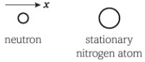

(i) Show that the velocity,  $ \mathbf{z} $, of the neutron after the collision can be written as

 $$ \mathbf{z}=\frac{\mathbf{N}\mathbf{x}-14\mathbf{y}}{\mathbf{N}} $$ 

(ii) The collision between this neutron and the nitrogen atom is elastic. What is meant by an elastic collision? [1]

(iii) Explain why the kinetic energy  $ E_{k} $ of the nitrogen atom is given by

 $$ E_{k}=\frac{\mathrm{N}u(\boldsymbol{x}^{2}-\boldsymbol{z}^{2})}{2} $$ 

(c) The two equations in (b) can be combined and z can be eliminated to give

 $$ \mathbf{y}=\frac{2\mathrm{N}\mathbf{x}}{\mathrm{N}+14} $$ 

(i) The maximum velocity of hydrogen atoms displaced by neutrons in the same experiment was  $ 3.0 \times 10^7 $ m s $ ^{-1} $. The mass of a hydrogen atom is 1u. Show that the relative mass N of the neutron is 1.

(ii) This equation cannot be applied to all collisions in this experiment. Explain why.

(Total for Question 7 = 13 marks)

