# 5B Circular motion

<!-- edx_ial_phy2.pdf p24-35 -->

<!-- page 24 -->

# TOPIC 5 FURTHER MECHANICS

# 5B CIRCULAR MOTION

What is it that makes the swing carousel so much fun? How do the engineers who build it have confidence that it will operate safely? The motion of objects in circles is very common in everyday life. We see the Moon orbiting the Earth, and the Earth orbiting the Sun, whilst the Earth itself is making us rotate in a circle every day. The mathematics of the forces causing this motion is simple, but applying this to real-life situations, like the amount of tension in the chains of a swing carousel, can often leave people feeling confused.

In this chapter, we will learn how simple trigonometry and basic mechanics can generate the mathematics that we need to be able to analyse and predict the circular motions of many things. This includes things from subatomic particles being accelerated in the Large Hadron Collider, to the routing of a spacecraft travelling to Mars. Indeed, very simple circular motion calculations on entire galaxies led scientists to the idea that there must be dark matter throughout the Universe.

## MATHS SKILLS FOR THIS CHAPTER

- Use of trigonometric functions (e.g. in deriving the equations for centripetal acceleration)

- Use of an appropriate number of significant figures (e.g. calculating angular velocities of planets)

- Use of small angle approximations (e.g. in deriving the equations for centripetal acceleration)

• Changing the subject of an equation (e.g. finding the time period of orbits from a known angular velocity)

- Translating information between numerical and graphical forms (e.g. finding the square of the angular velocity to plot a graph)

• Determining the slope of a linear graph (e.g. finding the gradient of the line in a centripetal force experiment analysis)

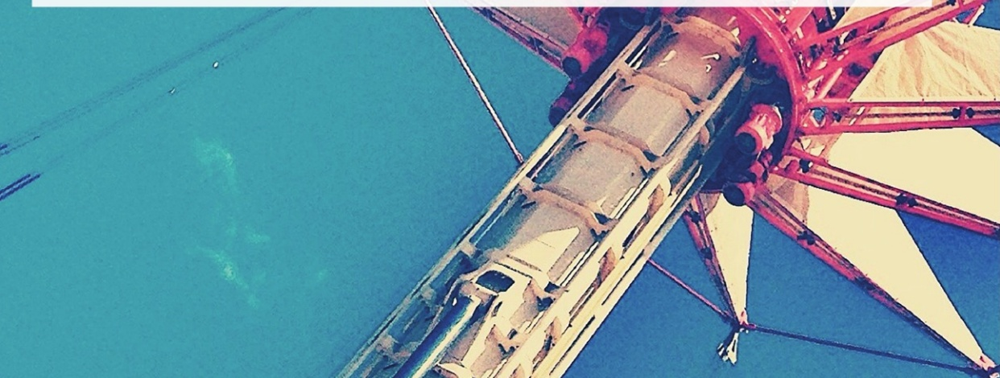

<!-- page 25 -->

## What prior knowledge do I need?

The radian

Tension forces

Topic 1A (Book 1: IAS)

Speed and acceleration

How to add vectors

How to resolve vectors

Newton's laws of motion

## What will I study in this chapter?

How to use both radians and degrees in angle measurements

The concept of angular velocity, and how to calculate it

• Centripetal acceleration and how to derive its equations

The need for a centripetal force to enable circular motion

Calculations of centripetal force

## What will I study later? Topic 7B

The circular motion of charged particles in magnetic fields

Particle accelerators

Particle detectors

The Large Hadron Collider

Topic 10A

Simple harmonic motion

Topic 11A

Gravitational fields and orbital motion

<!-- page 26 -->

# 5B 1 CIRCULAR MOTION BASICS

## LEARNING OBJECTIVES

Express angular displacement in radians and in degrees, and convert between these units.

Define angular velocity, and make calculations using it.

Define centripetal acceleration, and derive and use the equations for it.

In our study of wave phase in Book 1, Section 3B.1, we learned how angles can be measured in radians as well as in degrees, and how to convert between these two units. In this section, we will see how we can extend that to measure movements around a circle.

## GOING ROUND IN CIRCLES

For an object moving in a circle, we often need to measure where it is around that circle. For example, to consider the relative positions of planets in their orbits at a particular time, we need to be able to state where each one is (ignoring, in this example, the fact that planetary orbits are not perfect circles!).

Angles measured in degrees are used extensively in navigation to locate places. We also use them to describe the difference between moving from one starting point to two possible destinations. This is measuring angular displacement on the surface of the Earth. Each degree is subdivided into 60 ‘arcminutes’ and each of those arcminutes into 60 ‘arcseconds’.

fig A Measuring angles in degrees.

When we are measuring rotation, we often use the alternative unit to measure angles – the \textit{radian}. The circle itself defines this. Imagine an object moves around part of the circumference of a circle. The angle through which it moves, measured in radians, is defined as the distance it travels, divided by its distance from the centre of the circle (the radius). If the radius of the circle were one metre, then the distance the object travels around the circumference (also in metres) would be equal to the angle swept out in radians.

 $$ \begin{aligned}angle\left(in\ radians\right)&=\frac{length\ of\ arc}{radius\ of\ arc}\\\theta&=\frac{s}{r}\end{aligned} $$ 

So, for a complete circle, in which the circumference is equal to  $ 2\pi r $, the angle swept out would be:

 $$ \theta=\frac{2\pi r}{r}=2\pi radians $$ 

This means that the angle will be 1 radian (rad) if the distance moved around the circle is the same as the radius; just over  $ \frac{1}{6} $ of the distance around the circumference.

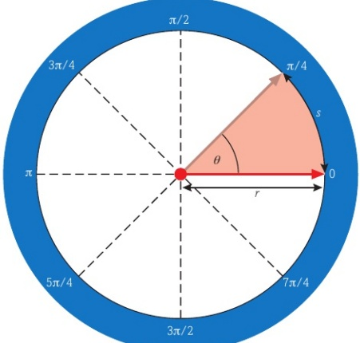

fig B Measuring angles in radians.

Angular displacement is the vector measurement of the angle through which something has moved. The standard convention is that anticlockwise rotation is a positive number and clockwise rotation is a negative number.

<table border=1 style='margin: auto; word-wrap: break-word;'><tr><td style='text-align: center; word-wrap: break-word;'>ANGLE IN RADIANS</td><td style='text-align: center; word-wrap: break-word;'>ANGLE IN DEGREES</td></tr><tr><td style='text-align: center; word-wrap: break-word;'>0</td><td style='text-align: center; word-wrap: break-word;'>0</td></tr><tr><td style='text-align: center; word-wrap: break-word;'>$ \pi/4 $</td><td style='text-align: center; word-wrap: break-word;'>45</td></tr><tr><td style='text-align: center; word-wrap: break-word;'>$ \pi/2 $</td><td style='text-align: center; word-wrap: break-word;'>90</td></tr><tr><td style='text-align: center; word-wrap: break-word;'>$ 3\pi/4 $</td><td style='text-align: center; word-wrap: break-word;'>135</td></tr><tr><td style='text-align: center; word-wrap: break-word;'>$ \pi $</td><td style='text-align: center; word-wrap: break-word;'>180</td></tr><tr><td style='text-align: center; word-wrap: break-word;'>$ 5\pi/4 $</td><td style='text-align: center; word-wrap: break-word;'>225</td></tr><tr><td style='text-align: center; word-wrap: break-word;'>$ 3\pi/2 $</td><td style='text-align: center; word-wrap: break-word;'>270</td></tr><tr><td style='text-align: center; word-wrap: break-word;'>$ 7\pi/4 $</td><td style='text-align: center; word-wrap: break-word;'>315</td></tr><tr><td style='text-align: center; word-wrap: break-word;'>$ 2\pi $</td><td style='text-align: center; word-wrap: break-word;'>360</td></tr></table>

table A Angles measured in degrees and radians.

<!-- page 27 -->

## DID YOU KNOW?

## MILITARY ANGLES

Many armies use a system for angle measurement in which a complete circle is divided into 6400 'mils'. This is an abbreviation for milliradian. They have rounded the numbers for easy use though, as there should be 6283 milliradians in a complete circle. The idea is that at 1 kilometre distance, an angle of 1 mil would represent a distance of 1 metre. So, when aiming artillery fire, a horizontal adjustment of 1 mil in angle of fire should move to a target 1 metre sideways for every kilometre distance away.

 $$ s=r\theta $$ 

∴ for 1 mil angle at 1 km distance:

 $$ s=1000\times0.001=1m $$ 

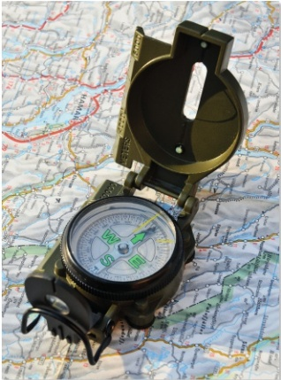

▲ fig C Measuring angles in mils.

## ANGULAR VELOCITY

An object moving in a circle sweeps out a particular angle in a particular time, depending upon how fast it is moving. The rate at which the angular displacement changes is called the angular velocity,  $ \omega $. So, angular velocity is measured in rad s $ ^{-1} $, and is defined mathematically by:

 $$ \omega=\frac{\Delta\theta}{\Delta t} $$ 

If the object completes a full circle  $ (2\pi\ \text{radians}) $ in a time period,  $ T $, then the angular velocity is given by:

 $$ \omega=\frac{2\pi}{T} $$ 

 $$ \therefore\quad T=\frac{2\pi}{\omega} $$ 

The frequency of rotation is the reciprocal of the time period.

 $$ f=\frac{1}{T} $$ 

 $$ \therefore\quad\omega=2\pi f $$ 

## INSTANTANEOUS VELOCITY

Instead of thinking about the angular movement, let us consider the actual velocity of the moving object (sometimes called the ‘instantaneous velocity’). We know that  $ v = \frac{s}{t} $ and from the definition of the angle in radians  $ \theta = \frac{s}{r} $, so that  $ s = r\theta $.

Thus:  $$ v=\frac{r\theta}{t} $$

 $$ v=r\omega $$ 

## WORKED EXAMPLE 1

In fig D we can see a geostationary satellite orbiting the Earth. What is its angular velocity?

To find the angular velocity, remember that it completes an orbit at the same rate as the Earth revolves, so one full circle every 24 hours.

 $$ \omega=\frac{2\pi}{T} $$ 

 $$ \omega=\frac{2\pi}{(24\times60\times60)}=\frac{2\pi}{86400} $$ 

 $$ \omega=7.27\times10^{-5}rad s^{-1} $$ 

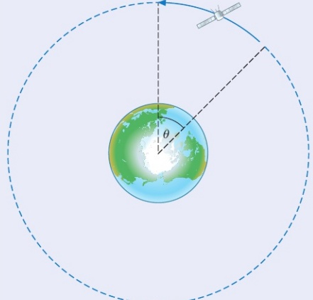

fig D How quickly does a satellite rotate through a certain angle?

If the radius of the Earth is 6400 km and the satellite in fig D is in orbit 35 600 km above the Earth's surface, what is the velocity of the satellite?

From before,  $ \omega = 7.27 \times 10^{-5} $ rad s $ ^{-1} $

 $$ v=r\omega=\left(6400+35600\right)\times10^{3}\times7.27\times10^{-5} $$ 

 $$ v=3050m s^{-1} $$ 

## CENTRIPETAL ACCELERATION

Velocity is a vector, and so it is correctly described by both its magnitude and direction. An acceleration can change either of these, or both. An object moving in a circle may travel at a constant speed (and a constant angular velocity) but the direction it is moving in must constantly change. This means it is constantly accelerating. As this acceleration represents the changes in direction around the circle, it is called the centripetal acceleration, a. To calculate the centripetal acceleration, we must consider how quickly the direction, and therefore the velocity, is changing.

<!-- page 28 -->

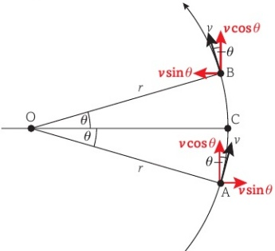

fig E Vector components of velocity lead us to the centripetal acceleration equation.

At the arbitrary positions of the rotating object, A, and at a time t later, B, we consider the components of the object's velocity, in the x and y directions.

As A and B are equal distances above and below point C, the vertical velocity component,  $ v_{y} $, is the same in both cases:

 $$ v_{y}=v\cos\theta $$ 

So the vertical acceleration is zero:

 $$ a_{y}=0 $$ 

Horizontally, the magnitude of the velocity is equal at both points, but in opposite directions:

at A:  $ v_{x} = v \sin \theta $

at B:

 $$ v_{x}=-v\sin\theta $$ 

So, the acceleration is just the horizontal acceleration, calculated as change in velocity divided by time:

 $$ a_{x}=\frac{2v\sin\theta}{t} $$ 

From the definition of angular velocity above:

 $$ v=\frac{r\theta}{t} $$ 

 $$ \therefore\quad t=\frac{r\theta}{v} $$ 

Here, the angle moved in time t is labelled as  $ 2\theta $, so:

 $$ t=\frac{r2\theta}{v} $$ 

 $$ \therefore\quad a_{x}=\frac{v2v\sin\theta}{r2\theta}=\frac{v^{2}}{r}\frac{\sin\theta}{\theta} $$ 

This must be true for all values of  $ \theta $, and as we want to find the instantaneous acceleration at any point on the circumference, we must consider the general answer as we reduce  $ \theta $ to zero. In the limit, as  $ \theta $ tends to zero:

 $$ \frac{\sin\theta}{\theta}=1 $$ 

 $ \therefore $ centripetal acceleration,  $ a=\frac{v^{2}}{r} $

From the definition of the instantaneous velocity above:

 $$ v=r\omega $$ 

 $$ \therefore\quad a=\frac{(r\omega)^{2}}{r} $$ 

 $ \therefore $ centripetal acceleration,  $ a = r\omega^{2} $

The centripetal acceleration in this case is just the horizontal acceleration, as we considered the object in a position along a horizontal radius. Following a similar derivation at any point around the circle will always have identical components of velocity that are perpendicular to the radius on either side of the point being considered. Thus, the centripetal acceleration is always directed towards the centre of the circle.

## WORKED EXAMPLE 2

What is the centripetal acceleration of the satellite in fig D?

 $$ a=\frac{v^{2}}{r}=\frac{(3050)^{2}}{(6400+35600)\times10^{3}} $$ 

 $$ a=0.22m s^{-2} $$ 

or:

 $$ \begin{aligned}&a=r\omega^{2}=(6400+35600)\times10^{3}\times(7.27\times10^{-5})^{2}\\ &a=0.22m s^{-2}\\ \end{aligned} $$ 

## CHECKPOINT

## SKILLS ANALYSIS

(a)  $ 4\pi $ radians into degrees

(b)  $ 36^{\circ} $ into radians.

2. What is the angular velocity of an athletics hammer if the athlete spins it at a rate of three revolutions per second?

3. Old vinyl records were played at one of three speeds. Calculate the angular velocity of each:

(a) (i) 33 revolutions per minute

(ii) 45 revolutions per minute

(iii) 78 revolutions per minute.

(b) Vinyl records played at the speeds in part (a) (i) were usually 12 inches (or 30 cm) in diameter. What would be the centripetal acceleration of a point on the outside circumference of a record such as this?

4. A man standing on the Equator will be moving due to the rotation of the Earth.

(a) What is his angular velocity?

(b) What is his instantaneous velocity?

(c) What is his centripetal acceleration?

5. What is the percentage error in the measurement system that uses 6400 mils for a complete circle?

## SUBJECT VOCABULARY

radian a unit of angle measurement, one radian is equivalent to 57.3 degrees

angular displacement the vector measurement of the angle through which something has moved

angular velocity,  $ \omega $ the rate at which the angular displacement changes; unit, radians per second

centripetal acceleration,  $ a $ the acceleration towards the centre of a circle that corresponds to the changes in direction to maintain an object's motion around that circle

<!-- page 29 -->

## 2 CENTRIPETAL FORCE

## LEARNING OBJECTIVES

Explain that a centripetal force is required to produce and maintain circular motion.

Use the equations for centripetal force.

In Section 5B.1, we saw how an object moving in a circle must be constantly accelerating towards the centre of the circle in order to maintain its motion around the circle.

## WHY CIRCULAR MOTION?

When a hammer thrower moves an athletics hammer around in a circle, the hammer has an angular velocity. When the thrower lets the hammer go, it will fly off, following the straight line in the direction that it was moving at the instant of release. This direction is always along the edge of the circle (a tangent) at the point when it was released.

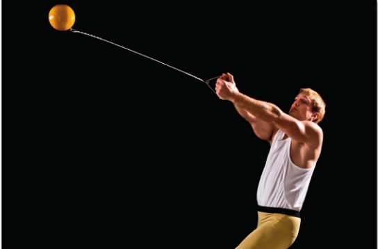

fig A The instantaneous velocity of an object moving in a circle is tangential to the circle. When there is no resultant force, velocity will be constant, so it moves in a straight line, as this hammer will do when the athlete lets go.

The hammer is moved in a circle at a constant speed and so the magnitude of the velocity is always the same. However, the direction of the velocity is constantly changing. This means that the vector of velocity is constantly changing, and a change in velocity is an acceleration. Newton's first law tells us that acceleration will only happen if there is a resultant force. The hammer is constantly being pulled towards the centre of the circle. In this example, the force providing this pull is the tension in the string (or chain). For any object moving in a circle, there must be a resultant force to cause this acceleration, and it is called the centripetal force.

## CENTRIPETAL FORCE

The mathematical formula for the centripetal force on an object moving in a circle can be found from Newton's second law, and the equation we already have for the centripetal acceleration:

 $$ F=m a\quad and\quad a=\frac{v^{2}}{r} $$ 

 $$ F=\frac{mv^{2}}{r} $$ 

## LEARNING TIP

There is no special centripetal force. Any resultant force that makes an object move in a circle is labelled as the centripetal force for that object and circle. For example, a satellite will move in a circular orbit around the Earth because its weight acts towards the centre of the Earth. The weight is the only force acting, so could be referred to as the centripetal force.

 $$  centripetal~force=\frac{mass\times(velocity)^{2}}{radius} $$ 

## EXAM HINT

Make sure that you know the differences between angular velocity and speed in circular motion, including the correct units for each.

<!-- page 30 -->

## EXAM HINT

A centrifuge is a machine for spinning things. There is no 'centrifugal' force - do not use the phrase 'centrifugal force'.

Without a centripetal force acting, Newton's 1st law will make an object continue in a straight line. This can confuse people into thinking that a force is pushing an object outwards. In fact, this shows a lack of force; if a force were present, this could keep it moving in a circle.

▲ fig B Astronauts are subject to extreme acceleration forces. These forces are simulated in training by the centripetal force in a giant centrifuge.

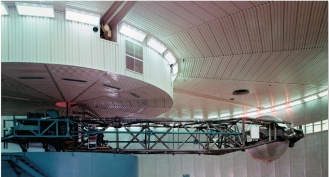

Noting that  $ v = r\omega $, there is an alternative equation for centripetal force in terms of angular velocity:

 $$ F=\frac{mv^{2}}{r}=\frac{m(r\omega)^{2}}{r} $$ 

 $$ F=m r\omega^{2} $$ 

The resultant centripetal force needed will be larger if:

- the rotating object has more mass

- the object rotates faster

- the object is closer to the centre of the circle.

## WORKED EXAMPLE 1

Estimate the centripetal force on an astronaut in the astronaut training centrifuge (see fig B) if his capsule rotated once every 2 seconds.

Estimate of radius of revolution: r = 6 m.

Estimate of astronaut's mass: m = 80 kg.

 $$  velocity,v=\frac{s}{t}=\frac{2\pi(6)}{2}=18.8m s^{-1} $$ 

centripetal force,  $ F = \frac{mv^{2}}{r} = \frac{(80) \times (18.8)^{2}}{6} = 4700 \, N $

This is about 6 times his weight.

If the operator of the centrifuge were to increase its rate of rotation to once every second, what would the astronaut's angular velocity, centripetal force and acceleration now be?

angular velocity,  $ \omega = 2\pi f = 6.28 \, rad \, s^{-1} $

centripetal force,  $ F = m r \omega^2 = (80) \times (6) \times (6.28)^2 = 18\,900\, N $

centripetal acceleration,  $ a = r \omega^2 = (6) \times (6.28)^2 = 237 \, \text{m} \, \text{s}^{-2} $

This is about 24 times the acceleration due to gravity and would probably kill the astronaut after a few seconds.

## LEARNING TIP

Here is a summary of the equations for circular motion:

angular displacement,  $ \theta $

 $$ \theta=\frac{s}{r} $$ 

angular velocity,  $ \omega $

 $$ \omega=2\pi f=\frac{2\pi}{T}=\frac{v}{r} $$ 

centripetal acceleration, a

 $$ a=r\omega^{2}=\frac{v^{2}}{r} $$ 

centripetal force, F

 $$ F=\frac{mv^{2}}{r} $$ 

 $$ F=m r\omega^{2} $$

<!-- page 31 -->

# PRACTICAL SKILLS

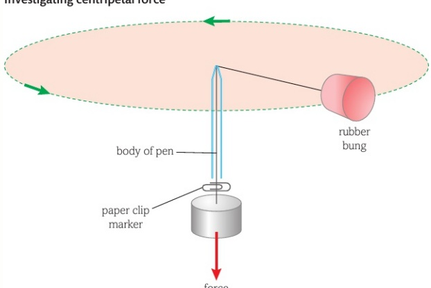

## fig C Experimental detail for centripetal force experiment

You can investigate the centripetal force equation by spinning a rubber bung on a string around in a circle. The tension in the string, which is the centripetal force, will be provided by the hanging masses at the bottom of the vertical string and will be known. Spin the rubber bung around in a circle at a speed that keeps a paperclip marker in a constant position near the handle. The paperclip marker allows you to maintain a fixed length of string (radius) which you can measure. You will also need to measure the mass of the rubber bung. Your partner can then time ten revolutions in order to give you the angular velocity. Take angular velocity measurements for different forces (different numbers of hanging masses).

 $$ F=m r\omega^{2} $$ 

 $$ \omega^{2}=\frac{F}{mr} $$ 

A graph of  $ \omega^{2} $ plotted against F should give a straight best-fit line.

The gradient of this line will be  $ \frac{1}{mr} $

Safety Note: Wear eye protection and only use rubber bungs for whirling. Work away from windows and walls, preferably outdoors or in a large clear space.

## CHECKPOINT

1. A roller coaster has a complete (circular) loop with a radius of 20 m. A 65 kg woman rides the roller coaster and the roller coaster car travels once round the loop in 4.5 seconds. What centripetal force does the woman experience?

2. A man with a mass of 75 kg standing on the Equator is moving because of the rotation of the Earth.

(a) What centripetal force is required to keep him moving in this circle?

(b) How does this compare with his weight?

(c) How would the reaction force with the ground be different if he went to the South Pole? (Assume the Earth is a perfect sphere.)

## SUBJECT VOCABULARY

centripetal force the resultant force towards the centre of the circle to maintain an object's circular motion

SKILLS

PROBLEM SOLVING

<!-- page 32 -->

# 5B THINKING BIGGER

# ARTIFICIAL GRAVITY

Astronauts on long-term space missions would benefit from the generation of artificial gravity within their ships. Common designs for this involve rotating the spaceship, but this movement can lead to motion sickness.

## GRAVITY CALCULATOR WEBSITE

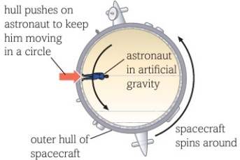

## fig A This is how artificial gravity is generated in a spacecraft

Artificial gravity, as it is usually conceived, is the inertial reaction to the centripetal acceleration that acts on a body in circular motion. Artificial-gravity environments are often characterized in terms of four parameters:

• radius from the centre of rotation (in metres)

• angular velocity or ‘spin rate’ (usually quoted in revolutions per minute)

• tangential velocity or ‘rim speed’ (in metres per second)

- centripetal acceleration or ‘gravity level’ (in multiples of the Earth’s surface gravity).

## Comfort criteria

Deliberate architectural design for the unusual conditions of artificial gravity ought to aid adaptation and improve the habitability of the environment (Hall).

Here is a summary of five research articles which consider the parameters leading to rotational discomfort:

Radius Because centripetal acceleration – the nominal artificial gravity – is directly proportional to radius, inhabitants will experience a head-to-foot ‘gravity gradient’. To minimize the gradient, maximize the radius.

<table border=1 style='margin: auto; word-wrap: break-word;'><tr><td style='text-align: center; word-wrap: break-word;'>AUTHOR</td><td style='text-align: center; word-wrap: break-word;'>YEAR</td><td style='text-align: center; word-wrap: break-word;'>RADIUS [M] MIN.</td><td style='text-align: center; word-wrap: break-word;'>ANGULAR VELOCITY [RPM] MAX.</td><td style='text-align: center; word-wrap: break-word;'>TANGENTIAL VELOCITY [M/S] MIN.</td><td style='text-align: center; word-wrap: break-word;'>CENTRIPETAL ACCELERATION [G] MIN.</td><td style='text-align: center; word-wrap: break-word;'>MAX.</td></tr><tr><td style='text-align: center; word-wrap: break-word;'>Hill &amp; Schnitzer</td><td style='text-align: center; word-wrap: break-word;'>1962</td><td style='text-align: center; word-wrap: break-word;'>not known</td><td style='text-align: center; word-wrap: break-word;'>4</td><td style='text-align: center; word-wrap: break-word;'>6</td><td style='text-align: center; word-wrap: break-word;'>0.035</td><td style='text-align: center; word-wrap: break-word;'>1.0</td></tr><tr><td style='text-align: center; word-wrap: break-word;'>Gilruth</td><td style='text-align: center; word-wrap: break-word;'>1969</td><td style='text-align: center; word-wrap: break-word;'>12</td><td style='text-align: center; word-wrap: break-word;'>6</td><td style='text-align: center; word-wrap: break-word;'>not known</td><td style='text-align: center; word-wrap: break-word;'>0.3</td><td style='text-align: center; word-wrap: break-word;'>0.9</td></tr><tr><td style='text-align: center; word-wrap: break-word;'>Gordon &amp; Gervais</td><td style='text-align: center; word-wrap: break-word;'>1969</td><td style='text-align: center; word-wrap: break-word;'>12</td><td style='text-align: center; word-wrap: break-word;'>6</td><td style='text-align: center; word-wrap: break-word;'>7</td><td style='text-align: center; word-wrap: break-word;'>0.2</td><td style='text-align: center; word-wrap: break-word;'>1.0</td></tr><tr><td style='text-align: center; word-wrap: break-word;'>Stone</td><td style='text-align: center; word-wrap: break-word;'>1973</td><td style='text-align: center; word-wrap: break-word;'>4</td><td style='text-align: center; word-wrap: break-word;'>6</td><td style='text-align: center; word-wrap: break-word;'>10</td><td style='text-align: center; word-wrap: break-word;'>0.2</td><td style='text-align: center; word-wrap: break-word;'>1.0</td></tr><tr><td style='text-align: center; word-wrap: break-word;'>Cramer</td><td style='text-align: center; word-wrap: break-word;'>1985</td><td style='text-align: center; word-wrap: break-word;'>not known</td><td style='text-align: center; word-wrap: break-word;'>3</td><td style='text-align: center; word-wrap: break-word;'>7</td><td style='text-align: center; word-wrap: break-word;'>0.1</td><td style='text-align: center; word-wrap: break-word;'>1.0</td></tr></table>

Angular velocity The cross-coupling of normal head rotations with the habitat rotation can lead to dizziness and motion sickness. To minimize this cross-coupling, minimize the habitat's angular velocity.

Graybiel conducted a series of experiments in a 15-foot-diameter 'slow rotation room' and observed:

In brief, at 1.0 rpm even highly susceptible subjects were symptom-free, or nearly so. At 3.0 rpm subjects experienced symptoms but were not significantly handicapped. At 5.4 rpm, only subjects with low susceptibility performed well and by the second day were almost free from symptoms. At 10 rpm, however, adaptation presented a challenging but interesting problem. Even pilots without a history of air sickness did not fully adapt in a period of twelve days.

## On the other hand, Lackner and DiZio found that:

Sensory-motor adaptation to 10 rpm can be achieved relatively easily and quickly if subjects make the same movement repeatedly. This repetition allows the nervous system to gauge how the Coriolis forces generated by movements in a rotating reference frame are deflecting movement paths and endpoints, and to institute corrective adaptations.

Tangential velocity When people or objects move within a rotating habitat, they're subjected to Coriolis accelerations that distort the apparent gravity. For relative motion in the plane of rotation, the ratio of Coriolis to centripetal acceleration is twice the ratio of the relative velocity to the habitat's tangential velocity. To minimize this ratio, maximize the habitat's tangential velocity.

Centripetal acceleration The centripetal acceleration must have some minimum value to offer any practical advantage over weightlessness. One common criterion is to provide adequate floor traction. The minimum required to preserve health remains unknown.

<!-- page 33 -->

## THINKING BIGGER

## SCIENCE COMMUNICATION

The extract above consists of information from an American space architect.

1 (a) Discuss the tone and level of vocabulary included in the article. Who is the intended audience?

(b) Discuss the level of scientific detail included in the article, particularly considering the intended audience.

(c) Compare the webpage of the extract with this more recent website http://spacearchitect.org/considering_style_and_presentation, in addition to content.

## INTERPRETATION NOTE

The main basis for the website is a calculator that calculates the artificial gravity for various different sizes and speeds of rotation. You may find it helpful to visit the website to view it and the list of references it provides.

## PHYSICS IN DETAIL

Now we will look at the physics in detail. Some of these questions will link to topics elsewhere in this book, so you may need to combine concepts from different areas of physics to work out the answers.

2 (a) Explain the author's suggestion that ‘artificial gravity … is proportional to radius’.

(b) What would a 'gravity gradient' be? Explain how it would come about and why it would be minimised by maximising the radius.

3 (a) Convert the angular velocity in Gilruth's data into SI units.

(b) Calculate the centripetal force on an 82 kg astronaut using Gilruth's data.

(c) If this astronaut tried to walk by providing a tangential force of 350 N, calculate the moment caused by his foot, acting on the floor about the spacecraft's central axis.

4 Do some research on the Coriolis force effect, and use your research to explain the final sentence in the section on angular velocity.

5 Explain how a spaceship, in space, could be made to start rotating.

## PHYSICS TIP

When you use the equations for centripetal acceleration, remember that the tangential velocity is dependent on radius.

## ACTIVITY

Imagine that Mr Hall, the space architect, has been invited to give a talk at your school about artificial gravity. You have been asked to prepare some demonstrations to illustrate how the data in the experiments referred to above could have been measured. Prepare instructions for two demonstrations.

## PHYSICS TIP

You should consider how to highlight where and how you will take measurements.

<!-- page 34 -->

# 5B EXAM PRACTICE

[Note: In questions marked with an asterisk (*), marks will be awarded for your ability to structure your answer logically, showing how the points that you make are related or follow on from each other.]

1 Which of the following is not a correct unit for angular velocity?

A rad min $ ^{-1} $

B degrees per minute

C rad s $ ^{-1} $

D  $ ^{\circ} $ s $ ^{-1} $

(Total for Question 1 = 1 mark)

2 Considering the centripetal force to make a car drive around a bend, it is more likely to skid outwards if:

A it has fewer passengers

B it has worn tyres

C it travels more slowly

D it drives further from the inside of the curve. [1]

(Total for Question 2 = 1 mark)

3 A particle moves in a circle, completing 14.5 complete revolutions in one minute. What is its angular velocity?

A  $ 0.24 \, rad s^{-1} $

B  $ 1.52 \, rad s^{-1} $

C  $ 14.5 \, rad s^{-1} $

D  $ 87 \, rad s^{-1} $

(Total for Question 3 = 1 mark)

4 A student did an experiment about the force on an object moving in a circle. The student spun a mass on a string in the air above his head so that the mass moved in a horizontal circle. Which force caused the mass to keep moving around in a circle?

A centrifugal

B gravity

C tension

D weight [1]

(Total for Question 4 = 1 mark)

5 Kingda Ka was the highest roller coaster in the world in 2007. A train is initially propelled along a horizontal track by a hydraulic system. It reaches a speed of  $ 57 \, m \, s^{-1} $ from rest in 3.5 s. It then climbs a vertical tower before falling back towards the ground.

(a) Calculate the average force used to accelerate a fully loaded train along the horizontal track.

Total mass of fully loaded train = 12000 kg

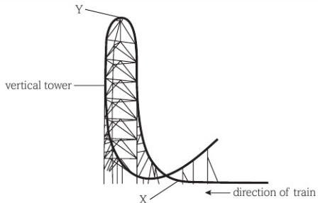

(b) Point X is just before the train leaves the horizontal track and moves into the first bend. Complete the free-body diagram below to show the two forces acting on a rider in the train at this point. [3]

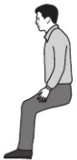

(c) The mass of the rider is m and g is the acceleration of free fall. Just after point X, the reaction force of the train on the rider is 4 mg and can be assumed to be vertical.

This is referred to as a g-force of 4g.

Show that the radius of curvature of the track at this point is about 100 m.

(d) Show that the speed of the train as it reaches the top of the vertical tower is about  $ 20 \, m s^{-1} $. Assume that resistance forces are negligible.

The height of the vertical tower is 139 m. [2]

(e) Riders will feel momentarily weightless if the vertical reaction force becomes zero.

The track is designed so that this happens at point Y.

Calculate the radius of the track at point Y.

(Total for Question 5 = 12 marks)

6 Astronauts can be weakened by the long-term effects of microgravity. To keep fit, it has been suggested that they can do some exercise using a Space Cycle: a horizontal beam from which an exercise bike and a cage are suspended. One astronaut sits on the exercise bike and pedals, which causes the

<!-- page 35 -->

## EXAM PRACTICE

whole Space Cycle to rotate around a pole. Another astronaut standing in the cage experiences artificial gravity. When rotated at 20 revolutions per minute, this is of similar strength to the gravitational field on Earth.

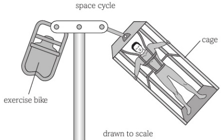

(a) Calculate the angular velocity, in rad s $ ^{-1} $, corresponding to 20 revolutions per minute. [2]

(b) Use the diagram to estimate the radius of the path followed by the cage's platform and use this estimate to calculate the platform's acceleration.

(Total for Question 6 = 5 marks)

7 The London Eye is a ferris wheel. It has a large vertical circle with 32 equally-spaced passenger cabins attached to it. The wheel rotates so that each cabin has a constant speed of  $ 0.26 \, m \, s^{-1} $ and moves around a circle of radius 61 m.

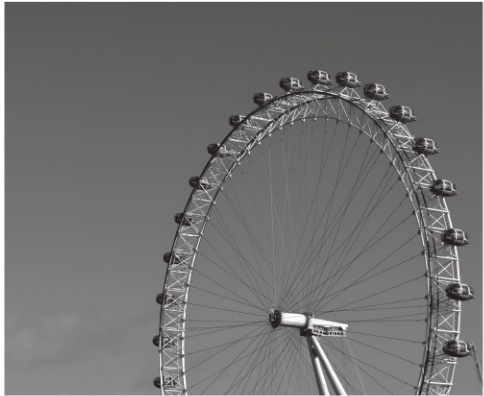

(a) Calculate the time taken for each cabin to make one complete revolution.

[2]

(b) Calculate the centripetal force acting on each cabin.

Mass of cabin =  $ 9.7 \times 10^{3} $kg

(c) (i) The diagram shows just the circle and the cabins. Draw arrows to show the direction of the centripetal force acting on a person in a cabin when the person is at each of positions A, B and C. [1]

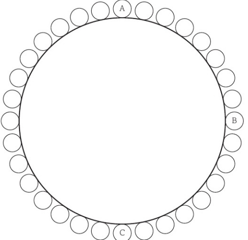

 $ ^{*} $(ii) As the person in a cabin moves around the circle, the normal contact force between the person and the cabin varies.

State the position at which this force will be a maximum and the position at which it will be a minimum. Explain your answers.

(Total for Question 7 = 9 marks)

8 Describe an experiment you could carry out in a school laboratory to verify the equation for the centripetal force:

 $$ F=\frac{mv^{2}}{r} $$ 

Include details of the measurements to be made, and the precautions that would minimise experimental errors. Also include explanations of the analysis of the experimental results that would confirm the verification. [6]

(Total for Question 8 = 6 marks)

