# 6A Electric fields

<!-- edx_ial_phy2.pdf p36-51 -->

<!-- page 36 -->

# TOPIC 6 ELECTRIC AND MAGNETIC FIELDS

# 6A ELECTRIC FIELDS

The usual explanation for the spiky hair caused by touching a Van de Graaff generator is that the excess charges it puts on the body all repel each other, so each hair experiences a force pushing it away from the others and from the head. Whilst this is true, the explanation is too simple. The hair shows us the existence of an electric field coming from the person's head, with the hair trying to follow the electric field lines. Gravity also affects the hair, so there is a resultant force effect. If your school has a Van de Graaff generator, you could try setting up an experiment where the person in contact with it is in different positions (i.e. lying down on a wooden bench, bending over at the waist, etc.), so that the electrical and gravitational forces are not working against each other quite so much!

In this chapter, we will see the difference between uniform and radial fields, and learn how to calculate the strength of both types of electric field. We will also explore the concept of electric potential, which relates to the storage and delivery of electrical energy.

## MATHS SKILLS FOR THIS CHAPTER

• Recognising and use of appropriate units in calculations (e.g. comparing NC $ ^{-1} $ and Vm $ ^{-1} $)

- Use of trigonometric functions (e.g. in verifying Coulomb's law from angled strings)

Identifying uncertainties in measurements (e.g. the error in the conclusions from Millikan's oil drop experiment)

- Substitute numerical values into algebraic equations using appropriate units for physical quantities (e.g. in calculations of radial electric field strength)

• Changing the subject of an equation (e.g. finding the separation of two charges from Coulomb's law)

Plotting two variables from experimental data (e.g. from a Coulomb's law experiment)

<!-- page 37 -->

## What prior knowledge do I need? Topic 1B (Book 1: IAS)

Gravitational potential energy

Topic 4A (Book 1: IAS)

Electric charges and their movement

Potential difference

Electrical energy

What will I study in this chapter?

• Electric fields causing forces on charges

Coulomb's law and how to calculate the forces caused by electric fields

Uniform electric fields expressed in terms of voltages

Radial electric fields generated by point charges or charged spheres

How to calculate field strength and electric potential

How to draw electric fields, including lines of equipotential

Electric fields in combination

Millikan's oil drop experiment to find the charge of an electron

## What will I study later? Topic 6B

Charging and discharging capacitors

Topic 6C

Generating electricity Topic 7A

Alpha particle scattering by nuclear electric fields

Topic 7B

Accelerating subatomic particles using electric fields

Topic 11A

Comparisons with gravitational fields

<!-- page 38 -->

# 1 ELECTRIC FIELDS

## LEARNING OBJECTIVES

Define electric field and electric potential.

Use the equation  $ E = \frac{F}{Q} $ for electric field strength.

Describe the concept of a uniform electric field.

Use the equation  $ E = \frac{v}{d} $ for uniform electric field strength between parallel plates.

## PUSHING CHARGES

Many machines work by using fast-moving charged particles. For example, in a hospital X-ray machine, high speed electrons are crashed into a metal target in order to produce the X-rays. So how do we cause the electrons to move at high speed? A space that will cause charged particles to accelerate is said to have an electric field.

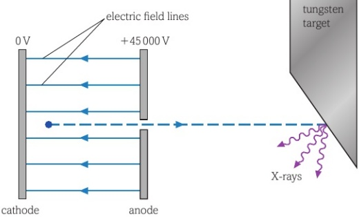

fig A An electric field accelerates electrons in an X-ray machine.

fig B An X-ray machine.

A force will act on a charged particle when it is in an electric field. To visualise the forces caused by the field, we draw electric field lines. These show the direction in which a positively charged particle will be pushed by the force that the field produces. Lines which are closer together show a stronger field. This is the same for all field patterns, including magnetic fields. A stronger field causes stronger forces.

The force,  $ F $, that acts on a charged particle is the electric field strength ( $ E $) multiplied by the amount of charge in coulombs ( $ Q $), as given by the equation:

 $$ \boldsymbol{F}=\boldsymbol{E}\boldsymbol{Q} $$ 

From this force equation, we can also see how quickly a charge would accelerate. Newton's second law is that  $ F = ma $, so we can equate the two equations:

 $$ F=EQ=ma $$ 

So:

 $$ a=\frac{EQ}{m} $$ 

## WORKED EXAMPLE 1

(a) What force will an electron experience when it is in an electric field generated by an X-ray machine's electric field which has a strength of  $ 4.5 \times 10^5 $ V m $ ^{-1} $?

 $$ \boldsymbol{F}=\boldsymbol{E}\boldsymbol{Q} $$ 

 $$ =4.5\times10^{5}\times-1.6\times10^{-19} $$ 

 $$ F=-7.2\times10^{-14}N $$ 

The minus sign indicates that the electron will feel a force trying to accelerate it towards the more positive end of the field. This is the opposite direction to the conventional field direction which, like electric current, goes from positive to negative.

(b) How fast will the electron be travelling if this field accelerates it from rest and it is within the field for a distance of 10 cm?

The kinematics equations of motion have  $ v^{2}=u^{2}+2as $. 'From rest' means that u=0, so:

 $$ \begin{aligned}v&=\sqrt{2as}=\sqrt{\frac{2EQs}{m}}\\ &=\sqrt{\frac{2\times(4.5\times10^{5})\times(-1.6\times10^{-19})\times(-0.1)}{(9.11\times10^{-31})}}\\ v&=-1.26\times10^{8}m s^{-1}\end{aligned} $$ 

Again, the minus sign indicates that the motion is in the opposite direction to the electric field, i.e. towards the more positive end of it. Relativistic effects are ignored in this example.

## ELECTRIC POTENTIAL

In the worked example above, the kinetic energy gained by the electron came from a transfer of electrical potential energy. The electron had this energy due to its location within the electric field. Every location within a field gives a charged particle a certain

<!-- page 39 -->

electric potential energy per unit of charge. This is called \textit{electric potential},  $ V = \frac{E_p}{Q} $. This is similar to the relationship between force and field strength: field strength is the force that a charged particle experiences per unit of charge, expressed by the equation  $ E = \frac{F}{Q} $.

The difference between that and a new location that the electron might move to is called the potential difference which the electron moves through. You may remember (Book 1, Section 4A.2) that we previously defined potential difference for a device in an electrical circuit as the energy transferred per coulomb of charge passing through the device. In an electric field, we can follow exactly the same idea to find out how much kinetic energy a charged particle will gain by moving within the field. This is given by the equation:

 $$ E_{k}=V Q $$ 

## WORKED EXAMPLE 2

(a) What is the kinetic energy of the electron in part (b) of the previous worked example above?

 $$ E_{k}=\frac{1}{2}mv^{2} $$ 

 $$ =\frac{1}{2}\times(9.11\times10^{-31})\times(1.26\times10^{8})^{2} $$ 

 $$ E_{k}=7.2\times10^{-15}J $$ 

(b) What is the kinetic energy gained by an electron as it is accelerated through a potential difference of 45 kV?

 $$ E_{k}=VQ=45\times10^{3}\times1.6\times10^{-19} $$ 

 $$ E_{k}=7.2\times10^{-15}J $$ 

These two answers are the same because they are actually calculations of the same thing.

## UNIFORM FIELDS

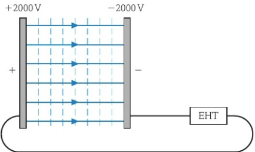

▲ fig C The blue arrows show the direction of the uniform electric field produced between parallel plates that have a potential difference between them. The dashed lines show where the potential is constant along equipotential lines.

An electric field exists between any objects which are at different electrical potentials. So, if we connect parallel metal plates to a power supply, we can set up a potential difference, and therefore an electric field, between them. This is shown in fig C. The field is uniform if its field lines are parallel across the whole field.

The strength of a uniform electric field is a measure of how rapidly it changes the potential over distance. The equation which describes this divides the potential difference, V, by the distance over which the potential difference exists, d:

 $$ E=\frac{V}{d} $$ 

## WORKED EXAMPLE 3

## EXAM HINT

In the X-ray machine shown in fig A, there is a potential difference of 45 000 V between a cathode and an anode. These electrode plates are 10 cm apart. What is the electrical field strength between the plates?

Be careful not to confuse E for energy, with E for electric field.

 $$ E=\frac{V}{d}=\frac{45000}{0.1} $$ 

 $$ E=4.5\times10^{5}Vm^{-1} $$ 

DID YOU KNOW?

Some medical X-ray machines can generate voltages up to 400 000 V.

<!-- page 40 -->

## LEARNING TIP

Uniform electric field strength can be defined in two ways:

 $$ E=\frac{F}{Q} $$ 

This gives rise to two equally valid SI units for electric field strength: NC $ ^{-1} $ and Vm $ ^{-1} $.

## Investigating electric fields

 $$ E=\frac{V}{d} $$ 

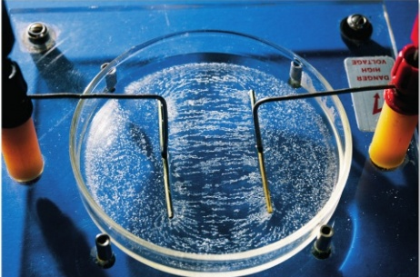

## PRACTICAL SKILLS

## ▲ fig D Finding electric field lines in the lab

Make sure you know how to use a high voltage power supply safely before conducting this experiment. Only use a high voltage power supply designed for school experiments.

Safety Note: High voltage power supplies can give a severe electric shock and should be used with shrouded connectors. Do not touch any switches or sockets with wet hands.

You can investigate the shapes of electric fields using a high voltage power supply to provide a potential difference, and any clear oil with floating small, dry seeds to show the field lines. The small, dry seeds become slightly charged, and the charges on the seeds cause them to line up. This shows the lines of action of the forces produced by the field. Try it with different shaped electrodes to see uniform and non-uniform fields.

## EQUIPOTENTIALS

As we move through an electric field, the electrical potential changes from place to place. Those locations that all have the same potential can be connected by lines called equipotentials. These are very much like the contours on a map, which are lines of equal height, but here they show lines of gravitational equipotential. The field will always be perpendicular to the equipotential lines, as a field is defined as a region which changes the potential. How close the equipotentials are indicates the strength of the electric field, as this shows how rapidly the electric potential is changing.

## LEARNING TIP

Field lines can never cross each other. Equipotentials can never cross other equipotential lines either.

## PRACTICAL SKILLS

## Investigating equipotentials

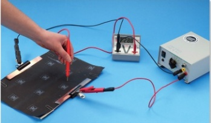

## fig E Apparatus for investigating equipotentials

You can investigate how electrical potential varies across an electric field by measuring the voltage between zero and the point within the field that you are interested in. A simple experiment allows you to show where equipotentials are and enables you to produce a picture of the electric field. In this you arrange conducting paper and a low voltage power supply to create an electric field. Try it with differently shaped electrodes to see how they change the field shape.

## EXAM HINT: EXTRA CONTENT

Millikan's oil drop experiment has been included to illustrate how different areas of physics can be brought together in one experiment to solve a problem. You will not need to write about it in the exam.

## MILLIKAN'S OIL DROP EXPERIMENT

Scientists are very interested to find out what the fundamental particles are and how they behave. They can use a mass spectrometer to investigate this and find the ratio of charge/mass for particles. This is a fundamental property of a charged particle and each one is different. However, it was not possible to find the mass of an electron until the value of its charge had been measured. In 1909, Robert Millikan developed an experiment (see fig F) which determined the charge on a single electron.

Although Millikan had a variety of extra equipment to make his experiment work successfully, the basic idea of the experiment is very simple. The weight of a charged droplet of oil is balanced by the force from a uniform electric field. (Millikan also did a variation in which there is no field and the terminal velocity is measured, and then one in which the field provides a stronger force than gravity and the terminal velocity upwards is measured.) When oil is squirted into the upper chamber from the vaporiser, friction gives the droplets an electrostatic charge. This will be some (unknown) multiple of the charge on an electron, because electrons have been added or removed due to friction. As the drops fall under gravity, some will go through the anode and enter the uniform field created between the charged plates. If the field is switched off, they will continue to fall at their terminal velocity (see fig G).

<!-- page 41 -->

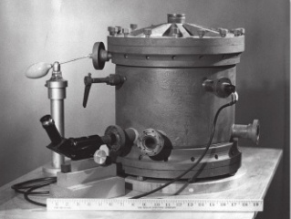

▲ fig F Millikan’s oil drop apparatus for finding the charge on an electron. The chamber shown was suspended in a trough of motor oil to reduce heat transfer within it, and so reduce any problems of convection currents affecting falling oil droplets within the chamber.

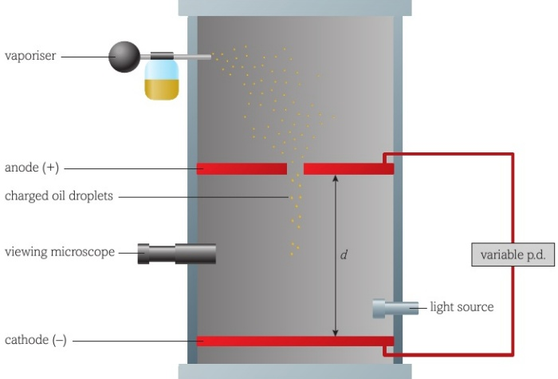

## fig G Millikan's oil drop chamber

For Millikan's oil drops, the density of air in the chamber is so low that its upthrust is generally insignificant (although we would have to consider it if we wanted to do really accurate calculations). Under terminal velocity, the weight equals the viscous drag force:

 $$ mg=6\pi\eta v_{term}r $$ 

where  $ \eta $ is the viscosity of air, and r is the radius of the drop.

When held stationary by switching on the electric field and adjusting the potential, V, until the drop stands still:

weight = electric force

 $$ mg=EQ=\frac{VQ}{d} $$ 

By eliminating the weight from the two situations, this means that:

 $$ 6\pi\eta v_{term}r=\frac{VQ}{d} $$ 

 $$  or:Q=\frac{6\pi\eta v_{term}rd}{V} $$ 

Millikan could not measure r directly, so he had to eliminate it from the equations. Further development of Stokes' law tells us that a small drop falling at a low terminal velocity will follow the equation:

 $$ v_{term}=\frac{2r^{2}g(\rho_{oil}-\rho_{air})}{9\eta} $$ 

## LEARNING TIP

## Stokes' law

Sir George Gabriel Stokes investigated fluid dynamics and derived an equation for the viscous drag (F) on a small sphere moving through a fluid at low speeds:

 $$ F=6\pi\eta v r $$ 

where $r$ is the radius of sphere, $v$ is the velocity of sphere, and $\eta$ is the coefficient of viscosity of the fluid.

<!-- page 42 -->

## DID YOU KNOW?

which, if we again ignore the low density of air, rearranges to:

Millikan was awarded the 1923 Nobel Prize for Physics for measurement of the elementary electric charge, and work on the photoelectric effect.

 $$ r=\left(\frac{9\eta v_{term}}{2g\rho_{oil}}\right)^{\frac{1}{2}} $$ 

Overall, then:

 $$ Q=\frac{6\pi\eta v_{term}d}{V}\times\left(\frac{9\eta v_{term}}{2g\rho_{oil}}\right)^{\frac{1}{2}} $$ 

Millikan did the experiment several hundred times, including repeated measurements on each drop. Many times he let the drop fall, before halting it with an electric field, and then lifting it up again with a stronger field, before letting it fall again. From this data, he found that the charges on the droplets were always a multiple of  $ 1.59 \times 10^{-19} $ C, which is less than 1% away from the currently accepted value of  $ 1.602 \times 10^{-19} $ C.

## CHECKPOINT

## SKILLS ADAPTIVE LEARNING

1. What is the force on an electron in an electric field of 300 V m $ ^{-1} $?

2. What is the strength of an electric field that will put a force of  $ 1.28 \times 10^{-15} $ N on a proton?

3. How much will an alpha particle accelerate while it is in an electric field of 10 kV m $ ^{-1} $?

4. In the electron beam of a cathode ray oscilloscope, electrons are accelerated through a potential difference of 3000 V. This potential difference is set up between parallel plate electrodes that are 3 cm apart.

(a) Calculate the electric field strength between these electrodes. Assume it is a uniform field.

(b) How much faster will the electrons be moving when they emerge from this field?

(c) Draw a diagram to illustrate the field produced by these plates.

(d) Explain how the effects of the field would be different if a proton were placed in it.

## SKILLS INTERPRETATION

5. Fig H shows a positively charged oil drop held at rest between two parallel conducting plates, A and B.

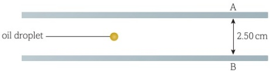

▲ fig H

(a) The oil drop has a mass of  $ 9.79 \times 10^{-15} $ kg. The potential difference between the plates is 5000 V and plate B is at a potential of 0 V. Is plate A positive or negative?

(b) Draw a labelled free-body force diagram which shows the forces acting on the drop.

(c) Calculate the electric field strength between the plates.

(d) Calculate the magnitude of the charge Q on the drop.

(e) How many electrons would have to be removed from a neutral oil drop for it to have this charge?

## SUBJECT VOCABULARY

electric field a region of space that will cause charged particles to experience a force

electric field lines imagined areas where the electric field has an effect

electric field strength the force-to-charge ratio for a charged particle experiencing a force due to an electric field

electric potential a measure of possible field energy in a given location within that field; the energy per unit charge at that location

potential difference the change in potential between two locations in a given field equipotentials positions within a field with zero potential difference between them

<!-- page 43 -->

# 2 RADIAL ELECTRIC FIELDS

## LEARNING OBJECTIVES

Define radial electric fields.

Draw and interpret diagrams of electric fields.

Describe the relationship between electric field strength and electric potential.

Use the equations relating to field strength and potential for radial electric fields.

## RADIAL FIELDS

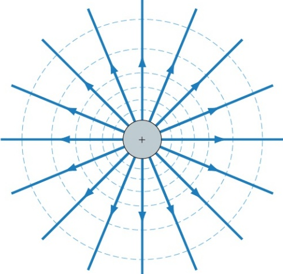

## fig A The radial electric field around a proton (or any positively charged sphere)

In the region around a positively charged sphere, or point charge such as a proton, the electric field will act outwards in all directions away from the centre of the sphere, as shown in fig A. You will see that the arrows in fig A get further apart as you move further away from the sphere. This indicates that the field strength reduces as you move away from the centre. The distance between equipotentials also increases as you move further away. The field is the means by which the potential changes, so if it is weaker, the potential changes less quickly.

A charged particle inside a charged sphere would experience no resultant force and so there is no electric field. The overall effect of all the charges on the sphere cancels out within the sphere itself. Distance measurements for use in calculations should always be considered from the centre of a charged sphere.

## RADIAL ELECTRIC FIELD STRENGTH

We have seen that the field lines for a radial field become further apart as you go away from the centre. This means that the equation for the field strength of a radial electric field must incorporate this weakening of the field with distance from the charge. The expression for radial field strength at a distance r from a charge Q is:

 $$ E=\frac{Q}{4\pi\varepsilon_{0}r^{2}} $$ 

This is only truly correct for a field that is produced in a vacuum. This is because the value  $ \varepsilon_0 $ – the permittivity of free space – is a constant which relates to the ability of the fabric of the Universe to support electric fields. Its value is  $ \varepsilon_0 = 8.85 \times 10^{-12} \, \text{F} \, \text{m}^{-1} $. Other substances, for example, water, may be better or worse at supporting electric fields, so an extra factor (the relative permittivity,  $ \varepsilon_r $) would appear in the equation to account for this. Air is considered to be near enough a vacuum that we use the equation given above for electric fields in air.

## WORKED EXAMPLE 1

What is the electric field strength at a distance of 1 angstrom ( $ 1 \times 10^{-10} $ m) from a proton?

 $$ \begin{aligned}E&=\frac{Q}{4\pi\varepsilon_{0}r^{2}}\\&=\frac{(1.6\times10^{-19})}{4\times3.14\times8.85\times10^{-12}\times(1\times10^{-10})^{2}}\end{aligned} $$ 

 $$ E=1.44\times10^{11}V m^{-1} $$ 

## POTENTIAL IN A RADIAL ELECTRIC FIELD

Electric field strength tells us how quickly the electric potential is changing. A stronger field will have the equipotentials closer together. This equation states that the electric field strength, E, is equal to the rate of change of potential, V, with distance, x.

 $$ E=-\frac{dV}{dx} $$ 

This leads to the expression for radial field potential at a distance r from a charge Q:

 $$ V=\frac{Q}{4\pi\varepsilon_{0}r} $$ 

You will see from the equation above that the position of zero potential can be considered to be at infinity.

## WORKED EXAMPLE 2

What is the electric potential at a distance of 1 angstrom ( $ 1 \times 10^{-10} $ m) from a proton?

 $$ \begin{aligned}V&=\frac{Q}{4\pi\varepsilon_{0}r}\\&=\frac{(1.6\times10^{-19})}{4\times3.14\times8.85\times10^{-12}\times(1\times10^{-10})}\\&V=14.4V\end{aligned} $$

<!-- page 44 -->

## LEARNING TIP

The constant expression $\frac{1}{4\pi\varepsilon_{0}}$ is sometimes written as the single letter, $k$ (Coulomb's constant). The value for $k$ is:

 $$ k=\frac{1}{4\pi\varepsilon_{0}}=8.99\times10^{9}N m^{2}C^{-2} $$ 

This means our expressions for radial field strength and potential can be written:

 $$ E=\frac{k Q}{r^{2}} $$ 

 $$ V=\frac{k Q}{r} $$ 

## COMBINING ELECTRIC FIELDS

When there are electric fields caused by more than one charged object, the overall field at any place is the vector sum of all the contributions from each field. The force effects of each contributing field combine to produce the overall field. At every point you have to work out the resultant force and so you know how a charged particle will be affected in that place. The sum of all of these individual force effects is the overall electric field.

Charge is particularly concentrated in regions around spikes or points on charged objects. This means that they have close field lines and the field will be strong around them. For this reason, lightning conductors are spiked: the concentrated charge will more strongly attract opposite charges, so lightning is more likely to hit the lightning conductor than the building being protected. In fact, the field around a spiked lightning conductor is often so strong that it can cause charge leakage through the conductor. This happens before charge builds up enough to produce a lightning strike. Therefore, the probability of lightning occurring is reduced, further protecting the building from these dangers.

(a)

(b)

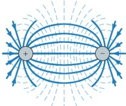

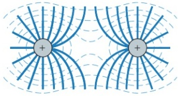

(c)

(d)

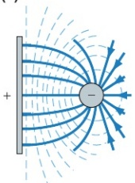

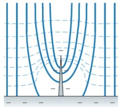

fig B Complex fields also always have their equipotentials perpendicular to the field lines at all points.

## CHECKPOINT

## SKILLS PROBLEM-SOLVING

1. A Van de Graaff generator is charged with  $ 2.5 \times 10^{-7} $ coulomb s in a school lab demonstration. The spherical metal dome has a diameter of 30 cm.

(a) Draw the electric field around the charged dome of the generator.

(b) Add at least three equipotential lines to your diagram. Label these with their potential values, following the correct scale of your diagram.

(c) What is the electric field strength at a distance of 5 cm from the surface of the charged dome?

(d) What is the electric potential at a distance of 35 cm from the surface of the charged dome?

2. Explain what would happen to an electron at the exact centre of the electric field shown in fig B(b).

3. Draw a pair of electrons 8 cm apart. On your diagram, add field lines to show the shape of the electric field produced by these two electrons. Also add in several equipotential lines.

4. Why is the electric field in fig B(d) strongest near the point of the spike?

5. If fig B(a) shows a hydrogen atom, then the separation of the charges would be  $ 5.3 \times 10^{-11} $ m.

## EXAM HINT

(a) What is the strength of the electric field caused by the proton, at the point where the electron is?

(b) Calculate the force on the electron caused by the proton's electric field at this distance.

When a question uses the command word Explain (see question 2 above), your answer must contain some reasoning or justification, which can include mathematical explanations.

<!-- page 45 -->

## 3 COULOMB'S LAW

## LEARNING OBJECTIVES

Make calculations of the electrostatic force between charged particles.

Verify Coulomb's law experimentally.

## CHARGED PARTICLE INTERACTIONS

The attraction between a proton and an electron can be imagined as the proton creating an electric field because of its positive charge, and the electron experiencing a force produced by the proton's field. (Note that it could also be thought of the other way round, with the proton experiencing a force caused by the electron's electric field.)

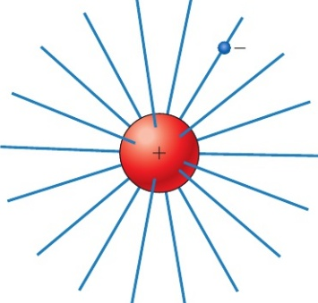

fig A A proton's field will cause a force on a negatively charged electron.

The force between two charged particles,  $ Q_{1} $ and  $ Q_{2} $, which are separated by a distance r, is described by Coulomb's law and is given by the expression:

 $$ F=\frac{Q_{1}Q_{2}}{4\pi\varepsilon_{0}r^{2}}=\frac{kQ_{1}Q_{2}}{r^{2}} $$ 

This can be seen as a logical consequence of the equations we have already seen for electric fields:

 $$ E=\frac{Q}{4\pi\varepsilon_{0}r^{2}} $$ 

So, for one charge  $ Q_{1} $ creating a radial field in which another charge  $ Q_{2} $ sits at a distance r from  $ Q_{1} $:

 $$ F=EQ=\frac{Q_{1}Q_{2}}{4\pi\varepsilon_{0}r^{2}} $$ 

Note that for charged spheres, the calculation of the force between them is also given by Coulomb's law, but the distance is measured between the centres of the spheres.

## WORKED EXAMPLE 1

What is the force of attraction between the electron and proton in a hydrogen atom?

 $$ \begin{aligned}r&=5.3\times10^{-11}m&Q_{1}=1.6\times10^{-19}C&Q_{2}=-1.6\times10^{-19}C\\ &F=\frac{Q_{1}Q_{2}}{4\pi\varepsilon_{0}r^{2}}\\ &=\frac{(8.99\times10^{9})\times(1.6\times10^{-19})\times(-1.6\times10^{-19})}{(5.3\times10^{-11})^{2}}\\ \end{aligned} $$ 

 $$ F=-8.2\times10^{-8}N $$ 

## LEARNING TIP

Take care to include the charge signs in the calculation of force between charges correctly, as the sign of the final answer will tell you whether they attract or repel. A negative force will be attractive, as the force is then in the opposite direction to that in which the separation was measured. You can refer to the Learning Tip on page 34 for a reminder about the value for Coulomb's constant.

<!-- page 46 -->

# PRACTICAL SKILLS

## Investigating Coulomb's law

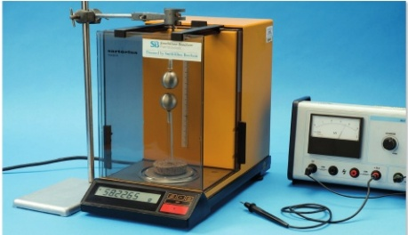

fig B Measuring the force between two charges.

A pair of insulated metal spheres can be charged using a Van de Graaff generator, or simply by induction using a charged plastic rod. Clamping the spheres close to each other will cause a force between them which can be measured using an electronic balance. By changing the distance of separation and measuring the force at each distance, this apparatus can be used to confirm that Coulomb's law follows an inverse square law. See also an alternative method for verifying Coulomb's law below.

Safety Note: A Van de Graaff generator will give an electric shock but not big enough to harm a normal healthy person. A person with a heart problem could be badly affected and even have a heart attack.

## EVERYDAY LEVITATION

All materials are made of atoms, and the outer part of atoms is believed to be electron orbits (negative charge). We can therefore imagine the top of any surface to consist of a sheet of negative charges. So, the surface of the floor and the bottom of a man's shoe will both be covered with negative charge. The repulsion between these two surfaces will cause the man to levitate ever so slightly above the floor, not actually touching it.

## WORKED EXAMPLE 2

Estimate the height at which a man levitates.
Estimate of man's weight = 800 N
Therefore each shoe supports 400 N.
Estimate of shoe surface area = 10 cm by 30 cm
Area of shoe surface = 0.1 × 0.3 = 0.03 m²
Estimate of average diameter of atoms in each surface,  $ d_{atom} = 1.2 \times 10^{-10} $ m
Cross-sectional area of each atom = πr²_atom
 $ A_{atom} = \pi (0.6 \times 10^{-10})^2 $
 $ A_{atom} = 1.13 \times 10^{-20} $ m²
Number of atoms in bottom surface of shoe =  $ \frac{\text{area of shoe}}{\text{area one atom}} $
 $ N = \frac{0.03}{1.13 \times 10^{-20}} = 2.65 \times 10^{18} $ atoms
Force supported by each shoe atom =  $ \frac{\text{force supported by shoe}}{N} $
 $ F_{atom} = \frac{400}{2.65 \times 10^{18}} = 1.51 \times 10^{-16} $ N

Assume each shoe atom electron repels a corresponding one in the floor surface, and oxygen, with eight electrons, is the most abundant element. So estimate the force per atom that is shared between four electrons (with the other four being on the opposite side of the atom at any given moment).

 $$ F_{electron}=\frac{F_{atom}}{4}=3.77\times10^{-17}N $$ 

 $$ \begin{aligned}F_{electron}&=coulomb~force~repelling~shoe~electron~and~floor~electron\\&=\frac{Q_{1}Q_{2}}{4\pi\varepsilon_{0}r^{2}}\end{aligned} $$ 

 $$ r=\sqrt{\frac{Q_{1}Q_{2}}{4\pi\varepsilon_{0}F_{electron}}}=\sqrt{\frac{(-1.6\times10^{-19})\times(-1.6\times10^{-19})}{4\times3.14\times(8.85\times10^{-12})\times(3.77\times10^{-17})}} $$ 

 $$  Levitation~height:r=2.5\times10^{-6}m $$ 

So the man will float a couple of micrometres above the floor surface; a distance equal to about a tenth of the size of a human red blood cell, or the size of a bacterium such as Escherichia coli. There are a number of assumptions in this calculation, especially that the positive charge of the nuclei of the atoms involved has not been considered. Also, the compression of atomic bonds within each material will mean that the force is supported across more atoms than just those considered. However, it is true that the repulsion of atomic electrons provides most of the contact forces that we experience in our lives. This force increases with the square of a decreasing separation and does mean that you can never actually touch anything.

## PRACTICAL SKILLS

## Verifying Coulomb's law

In 1785, Charles Augustine de Coulomb published a paper in which he provided experimental evidence for the equation to calculate the force between two charges. His experiments involved measuring the force between charged spheres on a torsion (rotating) balance and fixed charged spheres. A simplification of his method, which can be carried out in a school lab, is shown in fig C.

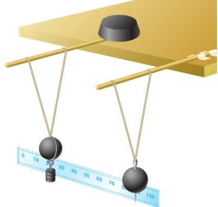

fig C A simple method to verify Coulomb's law.

<!-- page 47 -->

By reducing the separation of the spheres, you will see an increase in the angle of the lighter hanging ball. You can investigate the force between charged spheres and confirm that there is an inverse square law involved, and that the force is proportional to the product of the charges.

Fig D shows the forces on the hanging ball. By resolving and equating the horizontal and vertical components, we can develop a method for verifying Coulomb's law.

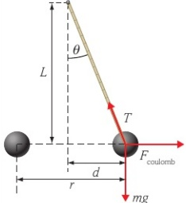

▲ fig D Forces on the hanging charged ball.

The horizontal component of the tension balances with the Coulomb force:

 $$ F_{\mathrm{c o u l o m b}}=~T\mathrm{s i n}\theta $$ 

And the weight balances the vertical component of tension:

 $$ mg=T\cos\theta $$ 

Dividing the two equations gives:

 $$ \frac{F_{coulomb}}{mg}=\frac{Tsin\theta}{Tcos\theta}=\tan\theta $$ 

 $$ \tan\theta\;=\frac{d}{L} $$ 

 $$ \mathrm{\frac{F_{coulomb}}{mg}}={\frac{d}{L}} $$ 

 $$ F_{coulomb}=\frac{mgd}{L} $$ 

 $$ \frac{Q_{1}Q_{2}}{4\pi\varepsilon_{0}r^{2}}=\frac{mgd}{L} $$ 

For a fixed amount of charge on the spheres, you could vary r and measure d, from which a plot of  $ \frac{1}{r^{2}} $ against d should produce a

straight line. It is very difficult to control the amount of charge placed on the spheres. However, if you charge them both and then touch one sphere with a third sphere which is uncharged, you will remove half of the charge on that one. Do this several times, and measure d in each case. This will enable you to confirm that  $ F_{coulomb} $ is proportional to the product of the two charges.

## CHECKPOINT

## SKILLS ANALYSIS

1. What is the force of attraction between a uranium nucleus (atomic number 92) and an electron at a distance of 0.1 nm?

2. (a) What is the strength of the electric field caused by a gold nucleus (atomic number 79) at a distance of  $ 1 \times 10^{-12} $ m (1 pm) from the centre of the nucleus?

(b) What is the force of repulsion between an alpha particle and a gold nucleus when the alpha passes by the nucleus at a distance of 1 pm?

3. Explain a potential problem with the experimental set-up in fig C when comparing with Coulomb's law that  $ F = \frac{Q_1 Q_2}{4 \pi \varepsilon_0 r^2} $ (Hint: what would your ruler be measuring?)

4. Estimate the distance that you float above your bed at night. Consider the Coulomb repulsion between the electrons in the bed and those in you.

5. Jamal and Izaac undertook an experiment to test Coulomb's law, following the method of fig C. The measurements they took are given in table A.

<table border=1 style='margin: auto; word-wrap: break-word;'><tr><td style='text-align: center; word-wrap: break-word;'>d/m</td><td style='text-align: center; word-wrap: break-word;'>r/m</td></tr><tr><td style='text-align: center; word-wrap: break-word;'>0.002</td><td style='text-align: center; word-wrap: break-word;'>0.036</td></tr><tr><td style='text-align: center; word-wrap: break-word;'>0.004</td><td style='text-align: center; word-wrap: break-word;'>0.028</td></tr><tr><td style='text-align: center; word-wrap: break-word;'>0.006</td><td style='text-align: center; word-wrap: break-word;'>0.024</td></tr><tr><td style='text-align: center; word-wrap: break-word;'>0.008</td><td style='text-align: center; word-wrap: break-word;'>0.021</td></tr><tr><td style='text-align: center; word-wrap: break-word;'>0.010</td><td style='text-align: center; word-wrap: break-word;'>0.019</td></tr><tr><td style='text-align: center; word-wrap: break-word;'>0.012</td><td style='text-align: center; word-wrap: break-word;'>0.018</td></tr><tr><td style='text-align: center; word-wrap: break-word;'>0.014</td><td style='text-align: center; word-wrap: break-word;'>0.016</td></tr><tr><td style='text-align: center; word-wrap: break-word;'>0.016</td><td style='text-align: center; word-wrap: break-word;'>0.014</td></tr></table>

table A Experimental results from a Coulomb's law experiment.

Draw an appropriate graph to analyse their results to show that the Coulomb force follows an inverse square relationship.

## EXAM HINT

When a question uses the command word Estimate (see question 4 above) there is no exact answer. You will usually need to make a calculation using reasonable guesses at the values needed to make that calculation. It is a good idea to start your answer by stating all the values you have chosen for the quantities needed for the calculation.

<!-- page 48 -->

## 6A THINKING BIGGER

## POWER LINE PROBLEMS

In 2010, a 500kV high voltage transmission line was proposed to carry electricity for 28 miles across Washington State in the USA. The Bonneville Power Administration commissioned various reports to investigate safety and other public interest issues related to the new power lines, to inform local government officers. Dan Bracken, an independent scientific consultant, wrote a substantial report on the impact of electric fields that might be generated by the power lines.

SCIENTIFIC REPORT

# ELECTRIC FIELDS AND LIVING TISSUE

An electric field is said to exist in a region of space if an electrical charge, at rest in that space, experiences a force of electrical origin (i.e. electric fields cause free charges to move). Electric field is a vector quantity: that is, it has both magnitude and direction. The direction corresponds to the direction that a positive charge would move in the field. Sources of electric fields are unbalanced electrical charges (positive or negative) and time-varying magnetic fields. Transmission lines, distribution lines, house wiring, and appliances generate electric fields in their vicinity because of the unbalanced electrical charges associated with voltage on the conductors. On the power system in North America, the voltage and charge on the energized conductors are cyclic (plus to minus to plus) at a rate of 60 times per second. This changing voltage results in electric fields near sources that are also time-varying at a frequency of 60 hertz (Hz; a frequency unit equivalent to cycles per second).

As noted earlier, electric fields are expressed in units of volts per metre (V/m) or kilovolts (thousands of volts) per metre (kV/m).

The spatial uniformity of an electric field depends on the source of the field and the distance from that source. On the ground, under a transmission line, the electric field is nearly constant in magnitude and direction over distances of several feet (1 metre). However, close to transmission- or distribution-line conductors, the field decreases rapidly with distance from the conductors. Similarly, near small sources such as appliances, the field is not uniform and falls off even more rapidly with distance from the device. If an energized conductor (source) is inside a grounded conducting enclosure, then the electric field outside the enclosure is zero, and the source is said to be shielded.

Electric fields interact with the charges in all matter, including living systems. When a conducting object, such as a vehicle or person, is located in a time-varying electric field near a transmission

fig A Transmission lines can carry very high voltages, generating significant electric fields.

line, the external electric field exerts forces on the charges in the object, and electric fields and currents are induced in the object. If the object is grounded, then the total current induced in the body (the ‘short-circuit current’) flows to earth. The distribution of the currents within, say, the human body, depends on the electrical conductivities of various parts of the body: for example, muscle and blood have higher conductivity than bone and would therefore experience higher currents.

At the boundary surface between air and the conducting object, the field in the air is perpendicular to the conductor surface and is much, much larger than the field in the conductor itself. For example, the average surface field on a human standing in a 10kV/m field is 27kV/m; the internal fields in the body are much smaller: approximately 0.008V/m in the torso and 0.45V/m in the ankles.

<!-- page 49 -->

## THINKING BIGGER

## SCIENCE COMMUNICATION

(a) Explain why the author has explained electric fields from first principles in this report.

(b) Why has he still used a significant amount of technical terminology and high level vocabulary?

2 The photograph shown here was not in the original report, but has been added for this textbook. Explain why there might be no pictures in the report produced by Mr Bracken.

3 What is the importance in this report of including references to the effects of electric fields on living things?

## PHYSICS IN DETAIL

Now we will look at the physics in detail. Some of these questions will link to topics elsewhere in this book, so you may need to combine concepts from different areas of physics to work out the answers.

4 (a) As described, the voltage changes from positive to negative and back again, like a wave cycle. What is the time period for a cycle of the voltage in the USA?

(b) Why would the author have chosen to express field values in units of  $ V\,m^{-1} $ rather than the other correct possibility of  $ N\,C^{-1} $?

5 (a) We have learned that the electric field around point charges is radial. Why could the field coming out of a long straight cable also be referred to as radial?

(b) Draw a diagram to show a high voltage power cable, 10 m above a human standing on the ground. Add electric field and equipotential lines to your diagram to show how it emerges from the cable, and connects to the ground. Assume a fixed instant in time, when the voltage in the cable is exactly 500 kV.

6 (a) What does this extract tell us about the comparative resistivities of blood and bone?

(b) Explain why you think this difference exists.

## INTERPRETATION NOTE

## ACTIVITY

Think about who is the intended audience for this information.

## PHYSICS TIP

The proposed 500 kV cable would be at a minimum height of 11 m.

## PHYSICS TIP

Consider the differences in the substances making up blood and bone.

The author has written that 'close to transmission- or distribution-line conductors, the field decreases rapidly with distance from the conductors.' Imagine that the senators from Washington State government have written a letter to ask for an explanation of this claim. Write a letter in response which explains the mathematics involved in radial electric fields. Include some example calculations to illustrate the values involved, for comparison with other values already given in the report.

<!-- page 50 -->

# 6A EXAM PRACTICE

1 A correct unit for electric field strength is:

A  $ Cm^{-1} $

B  $ kVm^{-1} $

C NC

D Vm [1]

(Total for Question 1 = 1 mark)

2 Which of these particles is not affected by an electric field?

A electron

B neutron

C proton

D  $ Cu^{2+} $ ion

(Total for Question 2 = 1 mark)

3 The electric field strength from a negative point charge:

A decreases in magnitude with the square of the charge

B decreases in magnitude with the square of the distance from the charge

C increases in magnitude with distance from the charge

D increases in magnitude with the square of the distance from the charge. [1]

(Total for Question 3 = 1 mark)

4 The force between two protons held 1 nm apart is:

A $2.6 \times 10^{-20}$ N

B $2.3 \times 10^{-19}$ N

C $2.3 \times 10^{-10}$ N

D $1.44 \times 10^{9}$ N [1]

(Total for Question 4 = 1 mark)

5 Which row in the table correctly shows the properties of both uniform and radial electric fields?

<table border=1 style='margin: auto; word-wrap: break-word;'><tr><td style='text-align: center; word-wrap: break-word;'>Uniform fields</td><td style='text-align: center; word-wrap: break-word;'>Radial fields</td></tr><tr><td style='text-align: center; word-wrap: break-word;'>Field lines + to –</td><td style='text-align: center; word-wrap: break-word;'>Equipotentials equally spaced</td></tr><tr><td style='text-align: center; word-wrap: break-word;'>Field lines + to –</td><td style='text-align: center; word-wrap: break-word;'>Field lines equally spaced</td></tr><tr><td style='text-align: center; word-wrap: break-word;'>Field lines equally spaced</td><td style='text-align: center; word-wrap: break-word;'>Equipotentials equally spaced</td></tr><tr><td style='text-align: center; word-wrap: break-word;'>Equipotentials equally spaced</td><td style='text-align: center; word-wrap: break-word;'>Field lines + to –</td></tr></table>

[1]

(Total for Question 5 = 1 mark)

6 (a) Explain what is meant by a uniform electric field. [2]

(b) Describe how a uniform electric field can be demonstrated in a laboratory. [3]

(Total for Question 6 = 5 marks)

7 Two identical table tennis balls, M and N, are attached to non-conducting threads and suspended from a point P. The balls are each given the same positive charge and they hang as shown in the diagram. The mass of each ball is 2.7 g.

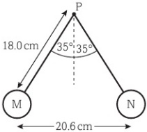

(a) Draw a free-body force diagram for ball M. Label your diagram with the names of the forces. [2]

(b)(i) Show that the tension in one of the threads is about  $ 3 \times 10^{-2} $ N. [3]

(ii) Show that the electrostatic force between the balls is about  $ 2 \times 10^{-2} $ N. [2]

(iii) Calculate the charge on each ball. [3]

(c) Explain what would have happened if the charge given to ball M was greater than the charge given to ball N. [2]

(Total for Question 7 = 12 marks)

<!-- page 51 -->

## EXAM PRACTICE

8 Liquid crystal displays (LCDs) are made from two parallel glass plates, 10  $ \mu $m apart, with liquid crystal molecules between them. The glass is coated with a conducting material.

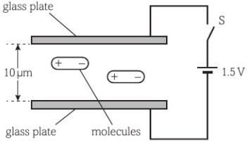

The molecules are positive at one end and negative at the other. They are normally aligned parallel with the glass plates, as shown.

The switch S is closed and 1.5 V is applied across the glass plates.

(a) Calculate the electric field strength between the plates. [2]

(b) Explain what happens to the liquid crystal molecules. [3] (Total for Question 8 = 5 marks)

9 A charged sphere with a radius of 10 cm is positively charged to an electric potential of +1200 V.

(a) Calculate the charge on the sphere. [2]

(b) (i) Calculate the electric potential 35 cm from the surface of this sphere. [1]

(ii) Calculate the electric potential 45 cm from the surface of this sphere. [1]

(c) An electron accelerates from rest at a position 45 cm from the surface of the sphere. Calculate the speed of the electron when it reaches a point 35 cm from the surface of the sphere. [3]

(Total for Question 9 = 7 marks)

10 The charge on an electron was originally measured in an experiment called the Millikan Oil Drop experiment.

In a simplified version of this experiment, an oil drop with a small electric charge is placed between two horizontal, parallel plates with a large potential difference (p.d.) across them. The p.d. is adjusted until the oil drop is stationary.

For a particular experiment, a p.d. of 5100 V was required to hold a drop of mass  $ 1.20 \times 10^{-14} $ kg stationary.

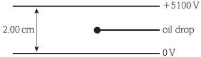

(a) Add to a copy of the diagram to show the electric field lines between the plates. [3]

(b) State whether the charge on the oil drop is positive or negative. [1]

(c) Complete the free-body force diagram to show the forces acting on the oil drop. You should ignore upthrust. [2]

(d) (i) Calculate the magnitude of the charge on the oil drop. [4]

(ii) Calculate the number of electrons that would have to be removed or added to a neutral oil drop for it to acquire this charge. [2]

(Total for Question 10 = 12 marks)

11 With the aid of a diagram, explain how the electrical potential varies within the space around a stationary electron. [5]

(Total for Question 11 = 5 marks)

