# 6B Capacitors

<!-- edx_ial_phy2.pdf p52-65 -->

<!-- page 52 -->

# TOPIC 6 ELECTRIC AND MAGNETIC FIELDS

## 6 B CAPACITORS

The touch screen on many smartphones works by measuring the capacitance of every point on a grid that covers the screen. Your finger conducts electricity, so when you touch the screen it changes the capacitance at that point. This is measured as a position on the grid of the screen so that the phone knows where you have touched and can follow your touch instruction. Capacitor-based touch screens cannot detect the touch if you wear non-conductive gloves, as the measurements are based on how well the points on the screen can store charge, and how charge can escape when you touch it.

The touch screen is one of the more interesting applications of the capacitor. However, as they can store energy, act as timing components, and smooth out varying currents, capacitors are found in almost all modern electronic devices.

In this chapter, we will see how electric fields drive electric charge to be stored on a capacitor, and how this simple process can lead to some complex but beautiful mathematics for the charge storage.

## MATHS SKILLS FOR THIS CHAPTER

• Recognising and use of appropriate units with prefixes (e.g. the microfarad)

- Use of calculators to work with exponential and logarithmic functions (e.g. charge remaining after a certain capacitor discharge time)

- Understanding the possible physical significance of the area between a curve and the x-axis and be able to calculate this area (e.g. finding the energy stored on a capacitor from a graph of voltage against charge)

• Changing the subject of an equation (e.g. finding the initial discharge current from the exponential equation)

• Interpreting logarithmic plots (e.g. plotting logarithmic data from a capacitor discharge experiment to find an unknown capacitance)

• Understanding that  $ y = mx + c $ represents a linear relationship (e.g. plotting logarithmic data from a capacitor discharge experiment to confirm the exponential relationship)

Use of spreadsheet modelling (e.g. using a spreadsheet to model how discharge current changes with time)

<!-- page 53 -->

## What prior knowledge do I need? Topic 4A (Book 1: IAS)

Electric current as the movement of charge

Voltage as a measure of energy transferred by charges

Topic 4B (Book 1: IAS)

Series and parallel circuits, and their rules for current and voltage

Potential dividers

Topic 6A

The effects of electric fields on charges

## What will I study in this chapter?

The role of capacitors, and how they charge and discharge

The energy stored by a capacitor

The significance of the time constant for charging and discharging a capacitor through a resistor

The exponential functions governing charge, voltage and current during capacitor discharge

The logarithmic functions governing charge, voltage and current during capacitor discharge

## What will I study later? Topic 9A

Radioactive decay as an exponential function

Radioactive half-life as analogous to the time constant in capacitor discharge

Further study

Capacitors in series and in parallel

Capacitor construction

Capacitors in AC circuits

Experimental investigation of capacitor-inductor circuits

<!-- page 54 -->

# 1 CAPACITOR BASICS

## LEARNING OBJECTIVES

Describe how capacitors can be used in a circuit to store charge.

Use the equation for capacitance,  $ C = \frac{Q}{V} $.

Use the equations for energy stored on a capacitor.

## STORING CHARGE

We saw in Section 6A.1 that an electric field can cause charges to move. Indeed, this is why a current flows through a circuit – an electric field is set up within the conducting material and this causes electrons to experience a force and thus move through the wires and components of the circuit. Where there is a gap in a circuit, the effect of the electric field can be experienced by charges across this empty space, but in general, conduction electrons are unable to escape their conductor and move across the empty space. This is why a complete conducting path is needed for a simple circuit to function.

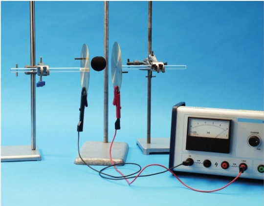

fig A An electric field will act across a space. You could test this by hanging a charged sphere near the plates and observing the field's force acting on the sphere.

However, charge can be made to flow in an incomplete circuit. This can be demonstrated by connecting two large metal plates in a circuit with an air gap between them, as in fig A. The circuit shown in fig B is similar to the situation shown by the photo in fig A. When the power supply is connected, the electric field created in the conducting wires causes electrons to flow from the negative terminal towards the positive terminal. Since the electrons cannot cross the gap between the plates, they collect on the plate connected to the negative terminal, which becomes negatively charged. Electrons in the plate connected to the positive terminal flow towards the positive of the cell, which results in positive charge being left on that plate. The attraction between the opposite charges across the gap creates an electric field between the plates, which increases until the potential difference across the gap is equal to the potential difference of the power supply.

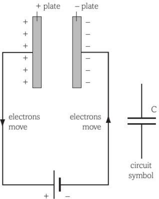

## fig B A simple capacitor circuit

A pair of plates such as this with an insulator between them is called a capacitor. As we have seen, charge will collect on a capacitor until the potential difference across the plates equals that provided by the power supply to which it is connected. It is then fully charged, and the capacitor is acting as a store of charge. The amount of charge a capacitor can store, per volt applied across it, is called its capacitance. C, and is measured in farads (F). The capacitance depends on the size of the plates, their separation and the nature of the insulator between them.

Capacitance can be calculated by the equation:

 $$ \begin{aligned}capacitance\left(\mathrm{F}\right)&=\frac{charge~stored\left(\mathrm{C}\right)}{potential~difference~across~capacitor\left(\mathrm{V}\right)}\\C&=\frac{Q}{V}\end{aligned} $$ 

## WORKED EXAMPLE 1

(a) What is the capacitance of a capacitor which can store 18 mC of charge when the p.d. across it is 6 V?

 $$ C=\frac{Q}{V}=\frac{18\times10^{-3}}{6}=3\times10^{-3} $$ 

 $$ C=3m F $$ 

(b) How much charge will be stored on this capacitor if the voltage is increased to 20 V?

 $$ Q=C V=3\times10^{-3}\times20=60\times10^{-3} $$ 

 $$ Q=0.06\ C $$

<!-- page 55 -->

## PRACTICAL SKILLS

## Investigating stored charge

A device that will measure the amount of charge directly is called a coulombmeter. By charging a capacitor to various different voltages, and discharging through the coulombmeter each time, you can

verify the basic capacitor equation that $C = \frac{Q}{V}$. A graph of charge

(on the y-axis) against p.d. (on the x-axis) should produce a straight line

through the origin. The gradient of this line will equal the capacitance.

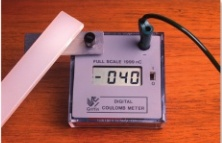

fig C A coulombmeter will measure how much charge is stored.

## ENERGY STORED ON A CHARGED CAPACITOR

A charged capacitor is a store of electrical potential energy. When the capacitor is discharged, this energy can be transferred into other forms. Our definition of voltage gives the energy involved as  $ E = QV $. However, the energy stored in a charged capacitor is given by  $ E = \frac{1}{2}QV $. So where has the missing half of the energy gone? This is a trick question, because our original equation assumes that the charge and voltage are constant. However, in order to charge a capacitor, it begins with zero charge stored on it and slowly fills up as the p.d. increases, until the charge at voltage V is given by Q. This can be seen on the graph in fig D.

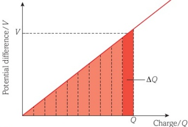

▲ fig D Graph of potential difference against charge for a capacitor.

Each time we add a little extra charge ( $ \Delta Q $) this has to be done by increasing the voltage and pushing the charge on, which takes some energy (we are doing work).

By finding the area of each nearly rectangular strip, we find  $ V\Delta Q $, which is the amount of extra energy needed for that extra charge. Therefore, the sum of all the strips, or the area under the line, will give us the total energy stored. This is the area of a triangle, so its area is  $ \frac{1}{2} $ base  $ \times $ height, which from the graph is  $ \frac{1}{2}QV $.

 $$ E=\frac{1}{2}Q V $$ 

Because Q = CV, you can also find two other versions of this equation for the stored energy.

 $$ E=\frac{1}{2}Q V=\frac{1}{2}\left(C V\right)V=\frac{1}{2}C V^{2} $$ 

Or:

 $$ E=\frac{1}{2}Q V=\frac{1}{2}Q\left(\frac{Q}{C}\right)=\frac{1}{2}\frac{Q^{2}}{C} $$ 

## WORKED EXAMPLE 2

What is the energy stored on a charged 100 µF capacitor which has 3 mC of charge?

 $$ E=\frac{1}{2}\frac{Q^{2}}{C}=\frac{1}{2}\times\frac{(3\times10^{-3})^{2}}{(100\times10^{-6})} $$ 

 $$ E=0.045\ J $$ 

## PRACTICAL SKILLS

## Investigating energy stored on a capacitor

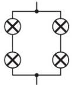

bulb resistance = R

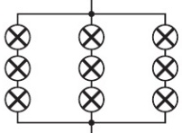

total resistance = R

## ▲ fig E Investigating how energy stored on a capacitor can be altered

You can investigate how the energy stored on a capacitor changes with the voltage which is used to charge it. Various combinations of identical series and parallel bulbs will have different overall resistances. If we add an extra parallel branch and increase the number of bulbs on each branch by one, we can keep the total resistance constant, but have more bulbs to light up. The three groups of bulbs in fig E all have the same resistance, R. By allowing our charged capacitor to discharge through these different groups of bulbs, and altering the voltage to keep the bulb brightness constant, we can confirm our equation  $ E = \frac{1}{2} C V^{2} $ for the energy stored on the capacitor.

Safety Note: High voltage power supplies can give a severe electric shock and should be used with shrouded connectors.

## CHECKPOINT

1. What is the capacitance of a capacitor which stores 2 coulomb's of charge for every 100 volts applied to it?

2. A 0.01 F capacitor is charged by and then isolated from an 8V power supply.

(a) Calculate the charge stored.

(b) The capacitor is then connected across another identical capacitor, which is uncharged. Describe and explain what will happen to the charge and voltage on each capacitor.

3. How much energy is stored on a 50 µF capacitor which is charged to 12 V?

4. A 1200 µF capacitor is connected to a voltage supply until fully charged with 10.8 mC. If this capacitor is then disconnected and reconnected across a 10 W light bulb, how long could it light the bulb for?

## SUBJECT VOCABULARY

capacitor an electrical circuit component that stores charge, and so can be used as an energy store

capacitance a measure of the capability of a capacitor; the amount of charge stored per unit voltage across the capacitor, measured in farads, F

<!-- page 56 -->

# 2 CHARGING AND DISCHARGING CAPACITORS

## LEARNING OBJECTIVES

Draw and interpret charge and discharge curves for capacitors.

Describe the significance of the time constant, RC.

## EXAM HINT

Make sure you know two or three reasons why using a data logger with a voltage sensor is better than having a human taking voltage readings.

## EXAM HINT

Make sure you have a good understanding of this practical as your understanding of the experimental method may be assessed in your exams.

## CAPACITOR DISCHARGE CURVES

## PRACTICAL SKILLS

## Investigating current flow through a capacitor

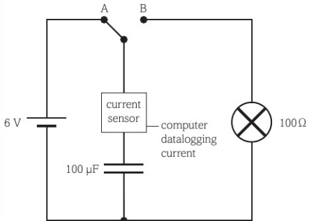

fig A Investigating how the current through a capacitor changes over time.

You can investigate how the current through a capacitor changes over time by connecting a datalogger, which senses current in series with the capacitor and then charge and discharge it. A suitable set-up for this is shown in fig A. This set-up could be altered to log the potential difference across the capacitor over time, using a voltage sensor in parallel across the capacitor.

Safety Note: Only use small capacitors as large charged capacitors can give a severe electric shock. Do not overcharge the capacitors as they may explode.

If, in fig A, the capacitor is fully charged, it will be at 6 V, and from Q = CV we know it will be storing 0.6 mC of charge. Recall that in Section 6B.1 we looked at how the electrons in the circuit are influenced by the electric field caused by the supply voltage, and their own mutual repulsion. If the two-way switch in fig A is moved to position B, the electrons on the capacitor will be able to move to the positive side of it by discharging via the lamp. As it has 100 Ω resistance, their progress will be slowed by the lamp, but they will still discharge, and the lamp will light for as long as some current flows through it.

At first, the rush of electrons as the capacitor discharges is as high as it can be – the current starts at a maximum. We can calculate this current using Ohm's law – it is 0.06 A. After some electrons have discharged, the p.d. across the capacitor is reduced and the electric field, and therefore the push on the remaining electrons, is weaker. The current  $ \left(\frac{V}{R}\right) $ is less and the light will be dimmer.

Some time later, the flow of electrons is so small that the current is down to a trickle, and the lamp will be so dim that it may look like it is off. Eventually, the capacitor will be fully discharged and there will be no more electrons moving from one side of the capacitor to the other – the current will be zero. If we put this story together over time, the discharging current, p.d. across the capacitor, and charge remaining on the capacitor will follow the patterns shown on the three graphs in fig B.

<!-- page 57 -->

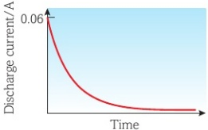

(a)

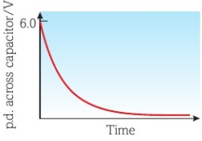

(b)

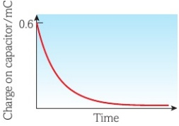

(c)

▲ fig B Discharge curves for a capacitor through a light bulb.

## THE TIME CONSTANT

How could we make the lamp light up for longer, given the same power supply? There are two possibilities:

1 store more charge on the capacitor

2 decrease the rate at which the capacitor discharges.

For the same maximum p.d., increasing the capacitance, C, will increase the charge stored, as Q = CV. Alternatively, the charge would flow more slowly if the bulb's resistance, R, was greater.

An overall impression of the rate of discharge of a capacitor can be gained by working out the time constant,  $ \tau $. This is calculated from  $ \tau = RC $, and with resistance in ohms and capacitance in farads, the answer is in seconds. In fact, the time constant tells you how many seconds it takes for the current to fall to 37% of its starting value. We will see the mathematics of how 37% comes about in the next section, but for now we just need to understand that RC indicates how quickly a charged capacitor will discharge.

## WORKED EXAMPLE 2

What is the time constant for the capacitor in the circuit shown in fig A?

 $$ \tau=R C=100\times100\times10^{-6} $$ 

 $$ \tau=0.01s $$ 

So the light bulb shown in fig A might flash on and off so quickly that we could not see it!

## CAR COURTESY LIGHTS

Modern cars often have a courtesy light that comes on when the door is opened, and remains on for a short time after the door is closed. This is useful in case it is dark, allowing the driver to see to put the key in the ignition. The light functions by having a capacitor discharge through the light bulb so that it dims and goes off as the charge runs out. In some cars, the length of time for which the light remains on after the door is closed is adjustable and can be set by the vehicle owner. This adjustable setting makes use of the idea of the time constant, RC. The owner will be able to adjust a switch connected to the courtesy light circuit, which connects more or less resistance to the discharging circuit. So, for the same fully charged capacitor, the time taken to discharge completely will change and the courtesy light illuminates the cabin for more or less time.

▲ fig C Capacitor discharge is used in a car courtesy light.

<!-- page 58 -->

## CAPACITOR CHARGING CURVES

By considering the charging process in the same way as we did the discharge of the capacitor in fig A, we can quickly work out that the charging process produces graphs such as those in fig D.

## EXAM HINT

## SKILLS ANALYSIS, REASONING/ ARGUMENTATION

From the time constant equation, if you calculate the capacitance, remember that the unit must be given as F.

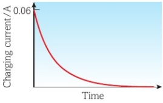

(a)

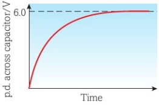

(b)

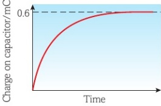

(c)

▲ fig D Charging curves for a capacitor connected to a 6V supply.

When charging a capacitor through a resistor, the time constant  $ RC $ has exactly the same effect. A greater resistance or a larger capacitance, or both, means the circuit will take longer to charge up the capacitor.

## CHECKPOINT

1. What is the time constant for a car's courtesy light in which a 2 mF capacitor discharges through a 15 kΩ resistor?

2. Look at the electric circuit of fig A and explain the shape of the charging graphs in fig D for the situation when the capacitor is initially uncharged and the two-way switch is then connected to point A. In your answer, refer to the movement of electrons within the electric circuit of fig A.

3. Draw an accurate sketch graph for the current discharging through a 50 µF capacitor, previously charged by a 6V supply, and discharged through a 10 kΩ resistance, over a period of 2 seconds.

## SUBJECT VOCABULARY

time constant (for a capacitor resistor circuit) the product of the capacitance and the resistance, giving a measure of the rate for charging and discharging the capacitor. This is the time taken for the current, voltage or charge of a discharging capacitor to fall to 37% of its initial value. Symbol: tau,  $ \tau $ (sometimes T is used instead)

<!-- page 59 -->

## 3 CAPACITOR MATHEMATICS

## LEARNING OBJECTIVES

Use the equations for exponential discharge in a capacitor resistor circuit.

■ Derive and use capacitor discharge equations in terms of current and voltage, and the corresponding logarithmic equations.

## DISCHARGING CAPACITOR MATHS

## CHARGE, Q

We have seen that the charging and discharging of a capacitor follows curving graphs in which the current is constantly changing. It follows that the rate of change of charge and p.d. are also constantly changing. These graphs are known as exponential curves. The shapes can be produced by plotting mathematical formulae which have power functions in them. In the case of discharging a capacitor, C, through a resistor, R, the function that describes the charge remaining on the capacitor, Q, at a time, t, is:

 $$ Q=Q_{0}e^{-t/RC} $$ 

where  $ Q_{0} $ is the initial charge on the capacitor at t = 0, and e is the special mathematical number which is used in the inverse function of natural logarithms (e  $ \approx $ 2.718).

## WORKED EXAMPLE 1

A 0.03 F capacitor is fully charged by a 12 V supply and is then connected to discharge through a 900 Ω resistor. How much charge remains on the capacitor after 20 seconds?

Initial charge,  $ Q_{0} = CV = 0.03 \times 12 = 0.36 \, C $

 $$ Q=Q_{0}e^{-t/R C} $$ 

 $$ Q=0.36\times e^{(-20/(900\times0.03))}=0.36\times e^{(-20/27)}=0.36\times0.477 $$ 

 $$ Q=0.17C $$ 

## VOLTAGE, V

The p.d. across a discharging capacitor will fall as the charge stored falls. By substituting the equation Q = CV into our exponential decay equation, we can show the formula that describes voltage on a discharging capacitor is in exactly the same form as for the charge itself:

 $$ Q=Q_{0}\mathrm{e}^{-t/R C}\mathrm{a n d}Q=C V $$ 

(which also means that initially,  $ Q_{0} = CV_{0} $)

 $$ CV=CV_{0}e^{-t/RC} $$ 

from which the capacitance term, C, can be cancelled, leaving:

 $$ V=V_{0}\mathrm{e}^{-t/R C} $$ 

## WORKED EXAMPLE 2

A 0.03 F capacitor is fully charged by a 12 V supply and is then connected to discharge through a 900 Ω resistor. What is the p.d. on the capacitor after 20 seconds?

Initial voltage is the same as the supply at 12V.

 $$ \begin{aligned}&V=V_{0}\mathrm{e}^{-t/RC}\\&V=12\times\mathrm{e}^{(-20/(900\times0.03))}=12\times\mathrm{e}^{(-20/27)}=12\times0.477\\&V=5.7V\\ \end{aligned} $$

<!-- page 60 -->

## CURRENT, I

As we saw in Section 6B.2, the discharging current also dies away following an exponential curve. Ohm's law tells us that  $ V = IR $, and so  $ V_0 = I_0 R $.

 $$ V=V_{0}\mathrm{e}^{-t/R C} $$ 

 $$ IR=I_{0}Re^{-t/RC} $$ 

from which the resistance term, R, will cancel on both sides:

 $$ I=I_{0}e^{-t/R C} $$ 

## WORKED EXAMPLE 3

A 0.03 F capacitor is fully charged by a 12 V supply and is then connected to discharge through a 900 Ω resistor. What is the discharge current after 20 seconds?

Initial voltage is the same as the supply at 12V, so the initial current is:

 $$ I_{0}=\frac{V_{0}}{R}=\frac{12}{900}=0.013A $$ 

 $$ I=I_{0}e^{-t/R C} $$ 

 $$ I=0.013\times e^{(-20/(900\times0.03))}=0.013\times e^{(-20/27)}=0.013\times0.477 $$ 

 $$ I=6.2 mA $$ 

## PRACTICAL SKILLS

## Using a spreadsheet to investigate the time constant

We can use a spreadsheet to model a timing circuit. This enables us to create a circuit that satisfies the needs of a specific situation (for example, a car courtesy light which needs to stay on for a desired length of time). We can type in different possible values for the circuit components and see what the outcome will be, before building the circuit. Fig A shows how such a spreadsheet might appear.

You can create the spreadsheet without doing any experimentation. Give the various cells formulae to calculate what capacitor theory tells us will happen, using the mathematics on these pages. For example, the cell giving the time constant,  $ \tau $, does not require input from the user – it is programmed to display the multiplication of the capacitance and the discharge resistance. This value is then used in the formula for calculating the values in the current column, using the equation,  $ I = I_0 e^{-t/RC} $, or  $ I = I_0 e^{-t/\tau} $.

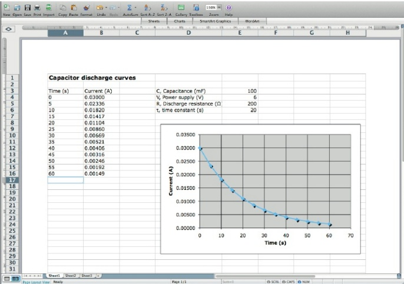

fig A A spreadsheet to calculate the discharge curve for a capacitor circuit

<!-- page 61 -->

## CAPACITOR CALCULUS

The mathematics used here, calculus (including integration) is not required in your exam specification in physics. However, for those studying high level mathematics, this will explain the source of the capacitor equations.

The equation for charge on a discharging capacitor is the solution to a differential equation based on considering the rules for voltages around the discharging circuit. With only the capacitor, C, and resistance, R, in the circuit, the e.m.f. is zero. So:

 $$ 0=V_{C}+V_{R} $$ 

 $$ V_{C}=\frac{Q}{C}and V_{R}=IR $$ 

 $$ \therefore\quad-IR=\frac{Q}{C} $$ 

The current is the rate of change of charge.

 $$ I=\frac{dQ}{dt} $$ 

So:

 $$ -\frac{R\mathrm{d}Q}{\mathrm{d}t}=\frac{Q}{C} $$ 

 $$ \frac{\mathrm{d}Q}{Q}=\frac{-\mathrm{d}t}{RC} $$ 

Integrating this from the start to time t, i.e. from capacitor charge  $ Q_{0} $ to Q:

 $$ \int_{Q_{0}}^{Q}\frac{\mathrm{d}Q}{Q}=\int_{0}^{t}\frac{-\mathrm{d}t}{RC} $$ 

gives:  $ \ln Q - \ln Q_{0} = \frac{-t}{RC} $

 $$ \ln Q=\ln Q_{0}-\frac{t}{RC} $$ 

applying the inverse function of natural logarithm gives:

 $$ Q=Q_{0}\mathrm{e}^{-t/R C} $$ 

## LOGARITHMIC EQUATIONS FOR VOLTAGE

We can take the log equation for charge and make substitutions to find equivalent equations for voltage and for current.

 $$ \ln Q=\ln Q_{0}-\frac{t}{RC} $$ 

 $$ \ln\left(CV\right)=\ln\left(CV_{0}\right)-\frac{t}{RC} $$ 

 $$ \therefore\quad\ln C+\ln V=\ln C+\ln V_{0}-\frac{t}{RC} $$ 

C is fixed, so  $ \ln C $ is the same on both sides.

 $$ \therefore\quad\ln V=\ln V_{0}-\frac{t}{RC} $$ 

Applying the inverse function of natural logarithm gives:

 $ V = V_{0} e^{-t/RC} $

## LOGARITHMIC EQUATIONS FOR CURRENT

Similarly, we can take the log equation for voltage and make substitutions to find equivalent equations for current.

 $$ \ln V=\ln V_{0}-\frac{t}{RC} $$ 

 $$ \therefore\quad\ln\left(IR\right)=\ln\left(I_{0}R\right)-\frac{t}{RC} $$ 

 $$ \therefore\quad\ln I+\ln R=\ln I_{0}+\ln R-\frac{t}{RC} $$ 

R is fixed, so  $ \ln R $ is the same on both sides.

 $$ \therefore\quad\ln I=\ln I_{0}-\frac{t}{RC} $$ 

Applying the inverse function of natural logarithm gives:

 $$ I=I_{0}\mathrm{e}^{-t/R C} $$ 

## THE '37% LIFE'

If we consider the charge at time  $ \tau $:

 $$ t=\tau=RC\ so-\frac{t}{RC}=-\frac{RC}{RC}=-1 $$ 

 $$ Q=Q_{0}\mathrm{e}^{-RC/RC} $$ 

 $$ Q=Q_{0}\mathrm{e}^{-1}\mathrm{a n d}\mathrm{e}^{-1}=0.37 $$ 

So:

 $$ Q=0.37Q_{0} $$ 

The charge is 37% of its original value.

This shows that the time constant describes the decay of charge on a discharging capacitor in exactly the same way as radioactive half-life describes the number of radioactive nuclei remaining (see Section 9A.2), except that instead of describing the time taken to reach half of the initial value,  $ \tau $ is the time taken to reach 37% of the initial value. This similarity comes from the fact that radioactive decay also follows an exponential equation:  $ N = N_0 e^{-\lambda t} $.

## CHECKPOINT

## SKILLS ADAPTABILITY

1. Use the data in fig A to produce a spreadsheet of data and plot a graph of current discharge over time for this capacitor and resistor.

(a) Use your graph to find the current through the capacitor after 30 s.

(b) If this were a model of an automatic hand dryer circuit that requires 4.0V to operate, use your graph to work out how long it will remain on.

(c) What would you change so that the dryer remains on for 30s?

2. A 200 mF capacitor is charged to 8 V. If it is then discharged through a 4.7 Ω resistor, what would the discharge current be after 3.5 s?

## SKILLS DECISION MAKING, INTERPRETATION

3.  $ \ln V = \ln V_0 - \frac{t}{RC} $

An experiment is conducted to find the value of an unknown capacitance discharging through a known resistor. Consider the equation  $ y = mx + c $ and explain why the log version of the capacitor voltage equation might be more useful than the exponential version of the equation.

## EXAM HINT

When reading from a graph, always check the values above and below the point you are looking at to be sure you apply the correct scale.

## SUBJECT VOCABULARY

exponential curves mathematical functions generated by each value being proportional to the value of one variable as the index of a fixed base:  $ f(x) = b^{x} $

<!-- page 62 -->

## 6B THINKING BIGGER

## ULTRACAPACITORS

## SKILLS CRITICAL THINKING, PROBLEM SOLVING, ADAPTIVE LEARNING, COMMUNICATION

Generally, we have not made the switch from petrol cars to electric cars very quickly. Most people think that they are not able to store enough energy, they have a limited range between charges and they take a long time to charge. Ultracapacitors have been suggested as a possible solution to these problems, as a replacement for electrochemical rechargeable batteries.

PAPER FOR SCIENTIFIC JOURNAL

# PAPER-BASED ULTRACAPACITORS WITH CARBON NANOTUBES-GRAPHENE COMPOSITES

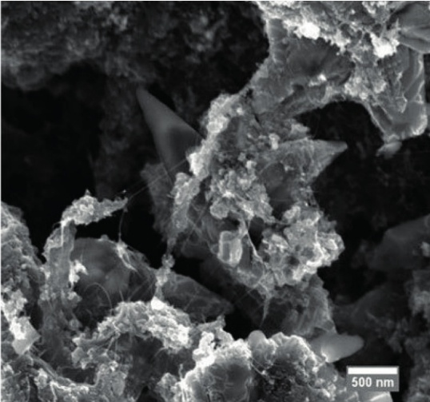

fig A Electron microscope image of graphene flakes showing exceptionally high surface area, due to extreme convolutions.

In this paper, paper-based ultracapacitors were fabricated by the rod-rolling method with the ink of carbon nanomaterials, which were synthesized by arc discharge under various magnetic conditions. Composites of carbon nanostructures, including high-purity single-walled carbon nanotubes (SWCNTs) and graphene flakes, were synthesized simultaneously in a magnetically enhanced arc. These two nanostructures have promising electrical properties and synergistic effects in the application of ultracapacitors. Scanning electron microscope, transmission electron microscope, and Raman spectroscopy were employed to characterize the properties of carbon nanostructures and their thin films. The sheet resistance of the SWCNT and composite thin films was also evaluated by four-point probe from room temperature to the cryogenic temperature as low as 90 K. In addition, measurements of cyclic voltammetry and galvanostatic charging/discharging showed the ultracapacitor based on composites possessed a superior specific capacitance of up to 100 F/g, which is around three times higher than the ultracapacitor entirely fabricated with SWCNT.

Reprinted with permission from 'Paper-based ultracapacitors with carbon nanotubes-graphene composites', Journal of Applied Physics, Vol. 115, Issue 16 (Li, J., Cheng, X., Sun, J., Brand, C., Shashurin, A., Reeves, M. and Keidar, M. 2014), Copyright 2014, AIP Publishing LLC

<!-- page 63 -->

## THINKING BIGGER

## SCIENCE COMMUNICATION

The extract opposite consists of information from a peer-reviewed scientific paper.

1 (a) Discuss the tone and level of vocabulary included in the article. Who is the intended audience?

(b) Discuss the level of scientific detail included in the extract, particularly considering the intended audience.

## INTERPRETATION NOTE

If you search online for 'graphene ultracapacitors' there are several articles in more everyday language that explain the main points of this scientific paper, for comparison.

## PHYSICS IN DETAIL

Now we will look at the physics in detail. Some of these questions will link to topics elsewhere in this book, so you may need to combine concepts from different areas of physics to work out the answers.

2 (a) Explain the meaning of the phrase 'specific capacitance' considering that it was quoted as being  $ 100\,F\,g^{-1} $.

(b) How does the specific capacitance affect the potential use of a capacitor as an energy store in an electric car?

3 Explain the importance of the resistance of a capacitor.

4 The fundamental purpose of a capacitor is to store charge. Graphene flakes have an exceptionally high surface area as shown in fig A. Explain why the incorporation of graphene flakes into capacitor construction could make very high capacitances possible.

## ACTIVITY

Draw a flowchart detailing the steps that the authors say their paper will explain to a reader. Your flowchart can use technical terms, but should be written in everyday language as much as is possible.

## DID YOU KNOW?

Isolated capacitors can hold their charge for years without losing much at all. It is important that any unfamiliar large capacitor is assumed to be fully charged, as it could give a shock if it discharges through you.

## PHYSICS TIP

Consider how we calculate the time constant,  $ \tau $, as well as the idea of internal resistance.

## THINKING BIGGER TIP

Your flowchart should be in the chronological order that the scientists would have had to work on building and testing the materials and then building their ultracapacitors.

<!-- page 64 -->

# 6B EXAM PRACTICE

[Note: In questions marked with an asterisk (*), marks will be awarded for your ability to structure your answer logically, showing how the points that you make are related or follow on from each other.]

1 A correct unit for the time constant in a capacitor discharge circuit is:

A  $ \Omega m $

B  $ s^{-1} $

C s

D F

(Total for Question 1 = 1 mark)

2 A 100 mF capacitor is charged by connecting to a 1.5 V cell and it stores 0.1125 J of energy. If the cell is replaced by a 3.0 V battery:

A the charge stored halves and the energy stored increases to 0.225 J

B the charge stored halves and the energy stored increases to 0.45 J

C the charge stored doubles and the energy stored increases to 0.225 J

D the charge stored doubles and the energy stored increases to 0.45 J. [1]

(Total for Question 2 = 1 mark)

3 Which of the following equations could correctly connect the discharge current, I, from a capacitor, C, through a resistor, R, at a time, t, if the initial discharge current was  $ I_{0} $?

A  $ I=\ln I_{0}-\frac{t}{RC} $

B  $ I=I_{0}-\frac{t}{RC} $

C  $ \ln I = \ln I_{0} - \frac{t}{RC} $

D  $ \ln I = \ln I_{0} - \ln \frac{t}{RC} $ [1]

(Total for Question 3 = 1 mark)

4 Which row in the table correctly shows how the charge on and voltage across a capacitor change over time as the capacitor discharges?

<table border=1 style='margin: auto; word-wrap: break-word;'><tr><td style='text-align: center; word-wrap: break-word;'></td><td style='text-align: center; word-wrap: break-word;'>Charge</td><td style='text-align: center; word-wrap: break-word;'>Voltage</td></tr><tr><td style='text-align: center; word-wrap: break-word;'>A</td><td style='text-align: center; word-wrap: break-word;'>Increases exponentially</td><td style='text-align: center; word-wrap: break-word;'>Increases exponentially</td></tr><tr><td style='text-align: center; word-wrap: break-word;'>B</td><td style='text-align: center; word-wrap: break-word;'>Increases exponentially</td><td style='text-align: center; word-wrap: break-word;'>Decreases exponentially</td></tr><tr><td style='text-align: center; word-wrap: break-word;'>C</td><td style='text-align: center; word-wrap: break-word;'>Decreases exponentially</td><td style='text-align: center; word-wrap: break-word;'>Increases exponentially</td></tr><tr><td style='text-align: center; word-wrap: break-word;'>D</td><td style='text-align: center; word-wrap: break-word;'>Decreases exponentially</td><td style='text-align: center; word-wrap: break-word;'>Decreases exponentially</td></tr></table>

5 The diagram shows a circuit that includes a capacitor.

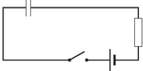

(a) (i) Explain what happens to the capacitor when the switch is closed. [2]

(ii) The potential difference (p.d.) across the resistor rises to a maximum as the switch is closed.

Explain why this p.d. subsequently decreases to zero. [2]

 $ ^{*} $(b) One type of microphone uses a capacitor. The capacitor consists of a flexible front plate (diaphragm) and a fixed back plate. The output signal is the potential difference across the resistor.

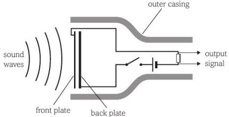

The sound waves cause the flexible front plate to vibrate and change the capacitance. Moving the plates closer together increases the capacitance. Moving the plates further apart decreases the capacitance.

Explain how the sound wave produces an alternating output signal.

(c) A microphone has a capacitor of capacitance 500 pF and a resistor of resistance 10 MΩ.

Explain why these values are suitable even for sounds of the lowest audible frequency of about 20 Hz. [4]

(Total for Question 5 = 12 marks)

<!-- page 65 -->

## EXAM PRACTICE

6 A student needs to order a capacitor for a project. He sees this picture on a website accompanied by this information: capacitance tolerance  $ \pm 20\% $.

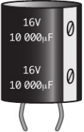

Taking the tolerance into account, calculate

(a) the maximum charge a capacitor of this type can hold [3]

(b) the maximum energy it can store. [2]

(Total for Question 6 = 5 marks)

7 A designer needs a circuit that will cause a delay in switching off the interior light in a car after the door is shut.

She uses a circuit with a resistor and a capacitor. She knows that the time constant  $ T $ is given by:

 $$ T=R C $$ 

where R is the resistance in ohms and C is the capacitance in farads.

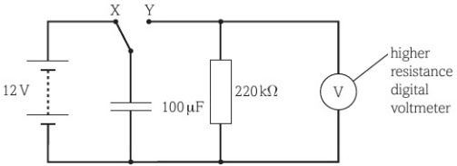

With the switch in position X, the capacitor is charged to 12 V. When the switch is moved to position Y, the capacitor discharges through the resistor and the potential difference (p.d.) across the resistor falls steadily from 12 V.

(a) (i) Calculate a theoretical value for the time constant for this circuit. [1]

(ii) What is the significance of the time constant for such a discharge? [1]

(b) The designer decides to check the theoretical value for the time constant  $ T $ using a stopwatch, with a precision of 0.01 s.

(i) State why the voltmeter needs to have a high resistance. [1]

(ii) State why a stopwatch is suitable for measuring the time in this context. [1]

(iii) State what she should do to make her value for T as reliable as possible. [1]

(c) For a capacitor discharging through a resistor, the potential difference V across the resistor at time t is given by

 $$ V=V_{0}\mathrm{e}^{-t/R C} $$ 

Explain why a graph of  $ \ln V $ against t should be a straight line. [2]

(d) The designer uses the circuit to obtain the following data.

<table border=1 style='margin: auto; word-wrap: break-word;'><tr><td style='text-align: center; word-wrap: break-word;'>t/s</td><td style='text-align: center; word-wrap: break-word;'>V/V</td><td style='text-align: center; word-wrap: break-word;'></td></tr><tr><td style='text-align: center; word-wrap: break-word;'>0</td><td style='text-align: center; word-wrap: break-word;'>12.00</td><td style='text-align: center; word-wrap: break-word;'></td></tr><tr><td style='text-align: center; word-wrap: break-word;'>5</td><td style='text-align: center; word-wrap: break-word;'>9.41</td><td style='text-align: center; word-wrap: break-word;'></td></tr><tr><td style='text-align: center; word-wrap: break-word;'>10</td><td style='text-align: center; word-wrap: break-word;'>7.16</td><td style='text-align: center; word-wrap: break-word;'></td></tr><tr><td style='text-align: center; word-wrap: break-word;'>15</td><td style='text-align: center; word-wrap: break-word;'>5.49</td><td style='text-align: center; word-wrap: break-word;'></td></tr><tr><td style='text-align: center; word-wrap: break-word;'>20</td><td style='text-align: center; word-wrap: break-word;'>4.55</td><td style='text-align: center; word-wrap: break-word;'></td></tr><tr><td style='text-align: center; word-wrap: break-word;'>25</td><td style='text-align: center; word-wrap: break-word;'>3.49</td><td style='text-align: center; word-wrap: break-word;'></td></tr><tr><td style='text-align: center; word-wrap: break-word;'>30</td><td style='text-align: center; word-wrap: break-word;'>2.68</td><td style='text-align: center; word-wrap: break-word;'></td></tr><tr><td style='text-align: center; word-wrap: break-word;'>35</td><td style='text-align: center; word-wrap: break-word;'>2.04</td><td style='text-align: center; word-wrap: break-word;'></td></tr></table>

Plot a graph to show that these data are consistent with  $ V = V_0 e^{-t/RC} $.

Use the extra column in a table like that above for your processed data. [4]

(e) (i) Use your graph to determine another value for time constant. [2]

(ii) Calculate the percentage difference between your value from the graph and the theoretical value from (a)(i). [1]

(f) (i) Use your graph to determine how long it takes for the p.d. to decrease to 5.0 V.

Add to your graph to show how you did this. [2]

(ii) The designer wants the p.d. to decrease to 5 V in about 12 s.

Choose the value of R she should use. [1]

A 47kΩ

B 100kΩ

C 150kΩ

D 330kΩ

(Total for Question 7 = 17 marks)

