# 6C Electromagnetic effects

<!-- edx_ial_phy2.pdf p66-81 -->

<!-- page 66 -->

# TOPIC 6 ELECTRIC AND MAGNETIC FIELDS

# 6C ELECTROMAGNETIC EFFECTS

Industrial electricity generation is vital in our technological world. Nearly every device is electrically powered now, so the physics behind generating electricity is very important. Electric and magnetic fields are connected; changing one either automatically generates or changes the other.

As with all things, the conservation of energy is very important and this affects the change of movement into electricity. However, electrical energy being transferred to kinetic energy is also very important in today's world. This is the opposite of the generation of electricity, and we will look at it in this chapter too. Other machines such as particle accelerators and mass spectrometers are also affected by the equations in this chapter.

Finally, we will see how these effects make electrical transformers work. The way transformers change energy from electric current into magnetic fields and back again is the closest people have come to creating a perfectly efficient machine.

## MATHS SKILLS FOR THIS CHAPTER

• Recognising and use of appropriate units (e.g. the tesla)

- Substituting numerical values into equations (e.g. calculate magnetic flux linkage)

• Understanding the slope of a tangent to a curve as a measure of the rate of change (e.g. induced e.m.f. as the rate of change of magnetic flux linkage)

- Use of angles in 2D and 3D structures (e.g. finding the magnetic flux linkage when a coil area is at an angle to the magnetic field direction)

Distinguishing between instantaneous and average rates of change (e.g. comparing the e.m.f. induced at different times as a magnet falls through a coil)

<!-- page 67 -->

## What prior knowledge do I need?

Magnetic field rules for attraction and repulsion

Topic 1A (Book 1: IAS)

Resolving vectors

Conservation of energy

Topic 4A (Book 1: IAS)

Electric current as the movement of charge Topic 5B

The centripetal force equation

Topic 6A

The effects of electric fields on charges

## What will I study in this chapter?

How to explain the strength of a magnetic field

How electricity can be generated

How to calculate the amount and direction of induced e.m.f.

How electrical transformers work

The effects of electric and magnetic fields on the movement of charged particles

## What will I study later? Topic 7A

Alpha particle deflections from nuclei Topic 7B

How particle accelerators work

The detection and identification of subatomic particles by magnetic deflection

Magnetic storage of charged particles, including anti-matter

## Topic 9A

Nuclear fusion requires magnetic particle containment

<!-- page 68 -->

# 1 MAGNETIC FIELDS

## LEARNING OBJECTIVES

Define the terms magnetic flux density, B, magnetic flux,  $ \Phi $, and flux linkage,  $ N\Phi $.

Calculate flux, flux density and flux linkage.

## MAGNETIC FLUX

In Section 6A.1 we saw how an electric field can be represented by lines that show how a charge will experience a force when placed in the field. You are probably more familiar with the everyday effects of magnetic fields such as attracting a fridge with a magnetic souvenir. Usually the fridge magnet moves towards the fridge rather than the other way around, but Newton's third and second laws of motion explain this outcome. Electric and magnetic fields are very similar (and utterly intertwined) as we saw in Book 1, Topic 3 with the nature of electromagnetic radiation.

Where an electric field affects charges, a magnetic field affects poles. A place that will cause a magnetic pole to experience a force is called a magnetic field.

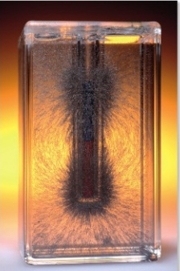

fig A A magnetic field around a permanent bar magnet.

When we draw a magnetic field in a diagram, the field lines show the direction in which a north pole will be pushed. Magnetic poles always exist in north and south pairs, but we take the field as acting from north to south, and this is the direction of arrows drawn onto magnetic field lines (also called lines of magnetic flux). Like electric field patterns, the closer the lines are together, the stronger the field is. The term referring to the strength of a magnetic field is the magnetic flux density. B, and the SI unit for it is the tesla (T).

Looking at fig B, you can see that the field lines all go in and out of the ends of the bar magnet. This forces them to be closer together at those points, which means that the field is stronger there. This is why a paperclip picked up by a bar magnet will jump to one of its ends – as the attraction is stronger at the end. The quantity of flux,  $ \Phi $ (measured in weber, Wb), through any given area indicates the strength of the effect of the field there. This can be calculated for a particular region by multiplying the area which is enclosed by the region by the component of flux density perpendicular to the area, A.

 $$ \Phi=B\sin\theta\times A $$ 

If the magnetic flux is in a uniform direction and lies perpendicular to A, then  $ \sin 90^{\circ} = 1 $, and the equation simplifies to:

 $$ \Phi=BA $$ 

## WORKED EXAMPLE 1

(a)

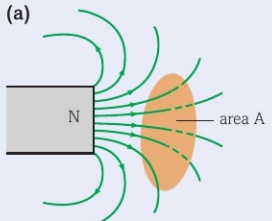

(b)

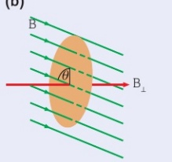

▲ fig B Magnetic flux contained in a small area, A.

(a) If the bar magnet in fig B(a) causes a magnetic field with a flux density of 20 mT perpendicular to area A, how much flux will be contained by this area if it is 10 cm $ ^{2} $?

 $$ A=10cm^{2}=10\times10^{-4}m^{2} $$ 

 $$ \Phi=B\times A=20\times10^{-3}\times10\times10^{-4} $$ 

 $$ \Phi=2.0\times10^{-5}Wb $$ 

(b) In fig B(b), the uniform magnetic field has a flux density of  $ 5 \times 10^{-5} $T and is at an angle of  $ 75^\circ $ to the region of area A. How much flux will be contained by this area if it is  $ 1\ cm^{2} $?

 $$ A=1cm^{2}=1\times10^{-4}m^{2} $$ 

 $$ \Phi=B\sin\theta\times A=5\times10^{-5}\times\sin75^{\circ}\times1\times10^{-4} $$ 

 $$ \Phi=4.8\times10^{-9}Wb $$ 

## MAGNETIC FLUX DENSITY

In the situation where the flux is perpendicular to the area, a rearrangement of the equation shows why the quantity B is known as the magnetic flux density.

 $$ B=\frac{\phi}{A} $$ 

By sharing the flux over the area,  $ B $ indicates how close together the magnetic field lines are – how dense they are. How dense field lines are indicates how strong the field is, so  $ B $ is also known as the magnetic field strength.

<!-- page 69 -->

## FLUX LINKAGE

The interaction between magnetic fields and charged particles, or conductors, allows motors to operate, and electricity to be generated. In most practical applications, magnetic flux is made to interact with a coil of wire, as the effect on a single strand of wire is too small to be useful. If the single wire is coiled up, then the magnetic field can interact with each turn on the coil, and so any effect is multiplied N times, where N is the number of turns on the coil.

The amount of magnetic flux interacting with a coil of wire is known as the flux linkage, and is the product of the number of turns of wire and the flux in that region:

flux linkage = N $ \Phi $ measured in weber-turns

Remembering that  $ \Phi = BA $ means that we also have:

flux linkage = BAN

## WORKED EXAMPLE 2

Zoran takes a wire and winds it into a coil of ten circular turns with a radius of 5 cm and then holds this in a magnetic field with a strength of 20 mT. What is the flux linkage?

area, A =  $ \pi \times (0.05)^2 = 7.85 \times 10^{-3} $ m $ ^2 $

flux linkage = BAN = 0.02  $ \times $ (7.85  $ \times $ 10 $ ^{-3} $)  $ \times $ 10

flux linkage =  $ 1.6 \times 10^{-3} $ Wb

## CHECKPOINT

1. The Earth acts as a giant bar magnet, and the geographic North Pole is at the magnetic south end of the field.

(a) Draw a sketch of the Earth with its magnetic field.

(b) Explain where you would expect the Earth's magnetic flux density to be the greatest.

2. In Britain, the Earth's magnetic flux density is 50 000 nT, with the field close to horizontal. Imagine you are in Britain.

(a) Estimate the flux passing through your body if you stand vertically and face north.

(b) A typical smartphone compass uses a small magnetometer chip to determine which way the phone is facing. Such chips are typically 2 mm by 2 mm squares. If you held a smartphone so the magnetometer chip was at an angle of  $ 20^{\circ} $ to the horizontal, what would be the flux passing through the chip for it to measure?

3. In an electric motor, a permanent magnet of flux density 18.4 mT has its field placed perpendicular to a coil of 250 turns of copper wire. The diameter of the coil is 8.50 cm. What is the flux linkage between the field and the coil?

## SUBJECT VOCABULARY

poles the magnetic equivalent of a charge on a particle: north pole or south pole magnetic field a region of space that will cause a magnetic pole to feel a force magnetic flux an alternative phrase referring to magnetic field lines magnetic flux density the ratio of magnetic flux to the area it is passing through tesla (T) the unit for magnetic flux density, or magnetic field strength weber, Wb the unit of measurement of magnetic flux,  $ \Phi $, (and magnetic flux linkage, N $ \Phi $) magnetic field strength an alternative phrase for magnetic flux density flux linkage the amount of magnetic flux interacting with a coil of wire

weber-turns the unit for magnetic flux linkage

SKILLS PROBLEM-SOLVING

<!-- page 70 -->

## 2 ELECTRIC MOTORS

## LEARNING OBJECTIVES

Apply Fleming's left hand rule to current-carrying conductors in a magnetic field.

## FLEMING'S LEFT HAND RULE

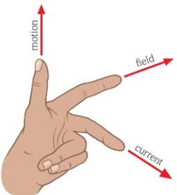

fig B Fleming's left hand rule gives the relative directions of the field, current and movement in the motor effect.

## LEARNING TIP

Magnetic fields can affect moving electric charges, as well as magnetic poles. If you place a wire in a magnetic field and pass a current through it, the wire will experience a force on it (fig A). This is called the motor effect. The effect is greatest when the wire and the magnetic field are at right angles. In this instance, the force will be at right angles to both, in the third dimension, as shown by Fleming's left hand rule in fig B.

If a current is parallel to a magnetic field, there is no force.

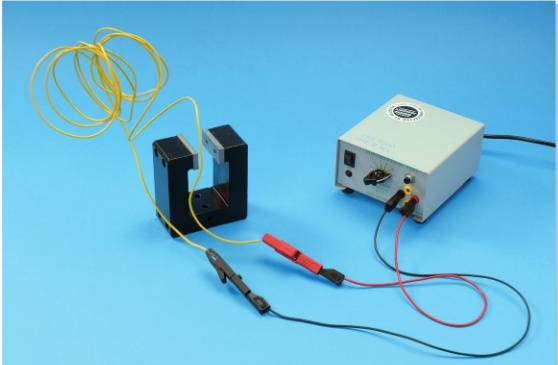

fig A The jumping wire experiment illustrates the motor effect in action.

## WORKED EXAMPLE 1

Look at the diagram in fig C in which a wire connected to a cell is placed in a magnetic field. In what direction will the wire experience a force?

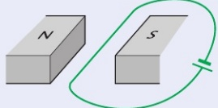

## fig C Fleming's left hand rule in action

The conventional current will flow from the positive end of the cell, so within the magnetic field, as observed in fig D, it will be moving away from us. With the magnetic field from north to south (towards the right in fig D), Fleming's left hand rule tells us that the wire will experience a force pushing it downwards.

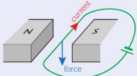

fig D This wire will feel a downwards force

<!-- page 71 -->

## PRACTICAL SKILLS

## Build your own motor

The forced movement of a current-carrying conductor within a magnetic field is the principle that causes motors to work. From Fleming's left hand rule, it is clear that a coil of wire experiences a turning force if the wire is carrying a current and is put in a magnetic field. This is because the current travels in opposite directions on opposite sides of the coil which causes forces in opposite directions and rotates the coil. If it is free to move, then the coil (or motor) will spin continuously. If you use the apparatus in fig E, remember to use a low power d.c. supply.

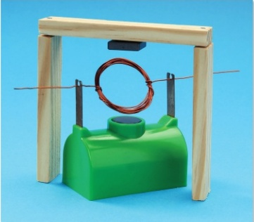

fig E Motors obey Fleming's left hand rule.

Safety Note: Use only a low voltage battery or d.c. power supply to power the electric motor.

## THE TINIEST MOTOR IN THE WORLD?

There was some amazement amongst scientists when the University of Berkeley in California produced an electric motor which was not much more than  $ 100\,\mu\mathrm{m} $ across. However, this 'micromotor' now seems like a giant, when compared with the Berkeley lab's 'nanomotor'. In 2003, the same Zettl Lab at Berkeley produced a motor which was less than 500 nanometres across. In 2014, the Cockrell School of Engineering at the University of Texas built a motor of similar tiny size, but rotated it faster and for longer than any previous nanomotor.

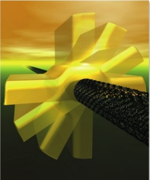

fig F Computer generated image of a nanomotor: a tiny gold rotor spins on a carbon nanotube axle. The entire set-up would fit within one wavelength of red light.

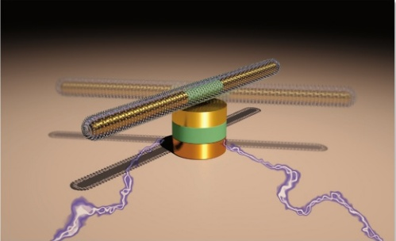

▲ fig G The tiniest motor possible? Built by researchers at the Cockrell School of Engineering at The University of Texas, this was the smallest, fastest and longest-running tiny synthetic motor in 2014.

Moving systems on a molecular scale have also been produced by other groups of scientists using chemical systems to generate the forces, but the motors shown in fig F and fig G are the smallest to use electromagnetic forces as explained in this section.

## CHECKPOINT

## SKILLS COMMUNICATION

1. Describe the use of Fleming's left hand rule.

2. Copy the diagrams in fig H and draw an arrow to show the direction of any force acting on the wire in each case.

(a)

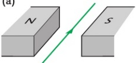

(b)

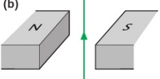

(c)

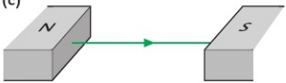

## fig H

## SKILLS INNOVATION

3. Many real motors use electromagnets to create the magnetic field that causes their rotor to spin. Give one advantage and one disadvantage of building a motor which uses electromagnets rather than permanent magnets.

## EXAM HINT

If a question asks you to  $ \underline{\text{Describe}} $ something, your description may have linked points, but does not need to include any justification or reasons.

## SUBJECT VOCABULARY

motor effect a wire carrying a current, held within a magnetic field, will experience a force

Fleming's left hand rule a rule for determining the direction of the force generated by the motor effect

<!-- page 72 -->

# 3 MAGNETIC FORCES

## LEARNING OBJECTIVES

Use the equation  $ F = BIL \sin \theta $, for a current-carrying conductor in a magnetic field.

Apply Fleming's left hand rule to charged particles moving in a magnetic field.

Use the equation  $ F = Bqv\sin\theta $, for a charged particle moving in a magnetic field.

## FORCES ON WIRES: F = BIL

## PRACTICAL SKILLS

Investigating the magnetic force on a current-carrying conductor You can investigate how much force will be on a wire experiencing the motor effect. In the experiment shown in fig A, it is easy to alter the current through the wire, the length that is within the magnetic field, and the angle it cuts across the field.

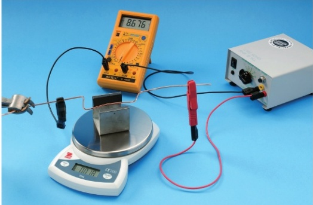

fig A Investigating the strength of the force on a current-carrying conductor in a magnetic field.

Safety Note: The wire will get hot enough to burn skin if left connected for too long.

The strength of the force, F, on a wire which has a current, I, through it whilst it is in a magnetic field, B, is given by the equation:

 $$ \boldsymbol{F}=\boldsymbol{B}\times\boldsymbol{I}\times\boldsymbol{L}\times\sin\theta $$ 

where L is the length of the wire within the field, and  $ \theta $ is the angle the current makes with the lines of the magnetic field. For simplicity, we will only consider uniform magnetic fields in which the field lines are all parallel.

It is common to set up situations in which the angle  $ \theta $ is  $ 90^{\circ} $ so that  $ \sin\theta $ is a maximum and equals 1. This reduces the formula to  $ F = BIL $.

## WORKED EXAMPLE 1

Hanul sets up a jumping wire demonstration. He uses a wire with a current of 2 A running through it, and a pair of magnets that have a magnetic field of 0.5 mT. He is not too careful in setting up and 5 cm of the wire actually hangs across the field at an angle of  $ 80^{\circ} $. How much force does Hanul's wire experience? And, if it has a mass of 9 grams, how fast will it initially accelerate?

 $$ F=BIL\sin\theta=0.5\times10^{-3}\times2\times0.05\times\sin80^{\circ} $$ 

 $$ F=4.92\times10^{-5}N $$ 

 $$ a=\frac{F}{m}=\frac{4.92\times10^{-5}}{0.009} $$ 

 $$ a=5.5\times10^{-3}m s^{-2} $$ 

A consequence of the expression F = BIL is that a motor can be made more powerful, or faster, by:

- increasing the current through the motor (I)

- increasing the number of turns of wire in the motor (L)

- increasing the magnetic field within the motor  $ (B) $

The magnetic field strength is usually maximised by making the coil's core out of soft iron. Some motors use electromagnets to provide the field, and these could be strengthened by increasing the current through them.

## FORCES ON PARTICLES: F = Bqv

The motor effect happens because a charged particle moving at right angles to a magnetic field experiences a force on it at right angles to its direction of motion and also at right angles to the field. If the charged particle is constrained – like an electron in a current in a wire – then the force will transfer to the wire itself. If the particle is flying freely, its direction will change and it will travel a circular path whilst in the magnetic field (fig B). The direction of the force acting on a charged particle moving in a magnetic field can be found using Fleming's left hand rule. We must be careful with the current direction though: a negative charge moving in one direction is a current flowing in the opposite direction.

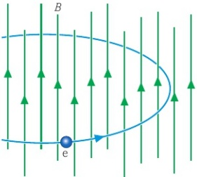

fig B Charged particles moving in a magnetic field follow a circular path as the motor effect provides a centripetal force.

<!-- page 73 -->

The strength of the force on a charged particle moving across a magnetic field is given by the equation:

 $$ \boldsymbol{F}=\boldsymbol{B}\times\boldsymbol{q}\times\boldsymbol{v}\times\sin\theta $$ 

where $q$ is the charge on the particle, $\nu$ is its velocity, and $\theta$ is the angle between the velocity and the magnetic field lines. A simplified situation that is often considered is that of an electron (charge 'e') moving at right angles to the field ($\sin 90^{\circ} = 1$). This reduces the formula to $F = Bev$.

## PRACTICAL SKILLS

## Investigating the magnetic force on a beam of charged particles

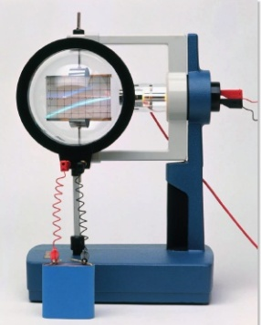

Fig C Investigating the force on charged particles moving in a magnetic field.

You can investigate how much force will be on an electron moving across a magnetic field using the equipment shown in fig C. The grid allows you to observe the path travelled by the electrons, and there is a standard formula for calculating the magnetic field strength provided by a pair of parallel electromagnetic coils, often referred to as Helmholtz coils.

Safety Note: The power supplies can give a severe electric shock and should be used with shrouded connectors. Do not remove or attach connectors with the power switched on.

As the force on the charged particle is always at right angles to the direction of its velocity, it acts as a centripetal force, and the particle follows a circular path. As the charged particle's velocity is constantly changing along a circular path, it is being accelerated by the magnetic field. This means that given the right combination of conditions, a moving charged particle could be held by a magnetic field, continuously orbiting a central point. This is the principle by which artificially generated anti-matter is contained, to save it from annihilation, for future use or study.

## THE MASS SPECTROMETER

## EXAM HINT: EXTRA CONTENT

The content in this section has been included to illustrate how different areas of physics can be brought together in one experiment to solve a problem. It is not required by the specification.

Scientists often need to identify unknown chemicals. This is particularly important, for example, in the field of forensic science, where a crime scene technician will take a sample of unknown material which they need to identify. A machine called a mass spectrometer (fig D) can separate chemicals according to their charge/mass ratio, which allows unique identification of each substance within a sample.

A chemical to be identified enters the machine and is ionised. This charge will then allow it to be accelerated in two different ways within the mass spectrometer. An electric field increases its speed. Then it experiences a force when it travels through the field of the electromagnet, which changes its direction.

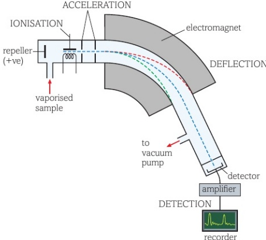

fig D Schematic of the basic parts of a mass spectrometer.

The force on a charged particle moving at right angles to a magnetic field is given by:

 $$ \boldsymbol{F}=\boldsymbol{B}\boldsymbol{q}\boldsymbol{v} $$ 

Centripetal force is given by:

 $$ F=\frac{mv^{2}}{r} $$ 

So for particles following the circular curve through the electromagnet on a path to the detector:

 $$ \begin{aligned}&Bqv=\frac{mv^{2}}{r}\\&which~rearranges~to:\frac{q}{m}=\frac{v}{Br}\\ \end{aligned} $$ 

The charge/mass ratio will identify the particles involved, so with B and r (the radius of the curvature of the particle through the mass spectrometer) known from the calibration of the machine, all we need to know is how fast the particles were moving when they entered the electromagnet. The electric field acts on their charge and accelerates them to this speed, and the kinetic energy gained comes from the potential difference, V, that they pass through according to:

 $$ \frac{1}{2}mv^{2}=qV $$ 

 $$  which~gives:v=\sqrt{\frac{2qV}{m}} $$ 

Substituting this into our equation for the charge/mass ratio:

 $$ \frac{q}{m}=\frac{\sqrt{2qV/m}}{Br} $$

<!-- page 74 -->

Squaring gives:

 $$ \frac{q^{2}}{m^{2}}=\frac{2qV/m}{B^{2}r^{2}} $$ 

 $$ \frac{m}{q}\times\frac{q^{2}}{m^{2}}=\frac{m}{q}\times\frac{2qV}{mB^{2}r^{2}} $$ 

 $$ \frac{q}{m}=\frac{2V}{B^{2}r^{2}} $$ 

By changing the accelerating voltage and the strength of the electromagnet (by changing the current through it) we can identify the various chemicals contained within a sample, as each is measured by the detector. The intensity of the current in the detector can indicate the proportion of a given chemical within the sample.

## WORKED EXAMPLE 2

A company selling sea salt for cooking wanted to find out if its ratio of chlorine isotopes was different from the usual ratio. In nature, the  $ {}^{35} $Cl isotope is more common than the  $ {}^{37} $Cl isotope by a factor of 3:1. The company analysed a sample of their product using a mass spectrometer that would ionise the chlorine atoms into single minus ions. What would be the difference between the radii of curvature caused for the chlorine isotopes, if the mass spectrometer operated at an accelerating potential of 3.0 kV and had a magnetic field strength of 3.0T?

 $$ \frac{q}{m}=\frac{2V}{B^{2}r^{2}} $$ 

 $$ r^{2}=\frac{2Vm}{B^{2}q} $$ 

 $$ r= {\sqrt{\frac{2 V m}{B^{2} q}} } $$ 

For  $ ^{35}Cl^{-} $:

SKILLS REASONING/ ARGUMENTATION

## EXAM HINT

 $$ r=\sqrt{\frac{2\times3000\times(35\times1.67\times10^{-27})}{(3.0)^{2}\times1.6\times10^{-19}}} $$ 

 $$ r=0.0156m $$ 

For  $ ^{37}Cl^{-} $:

If a question (as in question 1(c)) asks you to Comment on X, you will need to connect together at least two pieces of information to give a judgement about X.

 $$ \begin{aligned}&r=\sqrt{\frac{2\times3000\times(37\times1.67\times10^{-27})}{(3.0)^{2}\times1.6\times10^{-19}}}\\ &r=0.0160m\\ \end{aligned} $$ 

Therefore the difference in the radius of curvature of the path of these two ions is 0.4 mm.

SKILLS ADAPTIVE LEARNING

## CHECKPOINT

1. (a) How much force would be experienced by a 12 cm wire carrying 0.8 A perpendicular to the Earth's surface magnetic field of  $ 5 \times 10^{-5} $ T?

(b) How much force would be experienced by a proton travelling across the Earth's magnetic field at  $ 500 \, m s^{-1} $?

(c) How fast would a proton need to travel in order for the electromagnetic force on it to make it orbit the Earth at the surface? (Radius of Earth =  $ 6.4 \times 10^6 $ m.) Comment on your answer.

2. An electron beam travels across a 36 mT magnetic field at  $ 45^{\circ} $ to the field. If the electrons are travelling at 10% of the speed of light, what force does the field exert on each electron?

3. Speed =  $ \frac{\text{distance}}{\text{time}} $ and current =  $ \frac{\text{charge}}{\text{time}} $. Explain how F = BIL is actually the same equation as F = Bqv but considered for many charges in a group.

4. For the investigation on salt in the worked example on this page, calculate the difference in the radii of curvature that would be found if the company investigated the two isotopes of sodium: $ ^{23} $Na $ ^+ $ and  $ ^{22} $Na $ ^+ $. Explain why such small differences can be easily detected by a machine like that shown in fig D.

<!-- page 75 -->

# 4 GENERATING ELECTRICITY

## LEARNING OBJECTIVES

Explain the factors affecting the e.m.f. induced in a coil when there is relative motion between the coil and a permanent magnet.

Explain the factors affecting the e.m.f. induced in a coil when there is a change of current in another coil linked with this coil.

Define Faraday's law, and be able to use the equation

 $$ \varepsilon=-\frac{\mathrm{d}(N\Phi)}{\mathrm{d}t}. $$ 

## ELECTROMAGNETIC INDUCTION

We have seen that the movement of a charged particle in a magnetic field causes it to experience a force. Newton's third law of motion reminds us that this force must have a counterpart that acts equally in the opposite direction. This pair of electromagnetic forces is generated whenever there is relative motion between a charge and a magnetic field. So, a magnetic field moving past a stationary charge will create the same force. The velocity term in the expression  $ F = Bqv $ actually refers to the relative (perpendicular) velocity between the magnetic field lines and  $ q $. (Also remember that if the movement is not at right angles, then we need to work out the component of it that is at right angles by including the  $ \sin\theta $ term:  $ F = Bqv\sin\theta $.)

This means that if we move a magnet near a wire, the electrons in the wire will experience a force to make them move through the wire. This is an e.m.f.; if the wire is in a complete circuit, then the electrons will move, forming an electric current. We can use this principle to generate electricity. Reversing the direction of the magnetic field, or the direction of the relative motion, will reverse the direction of the force on the electrons, reversing the polarity of the e.m.f. Faraday's law states that the induced e.m.f. is proportional to the rate of change of flux linkage.

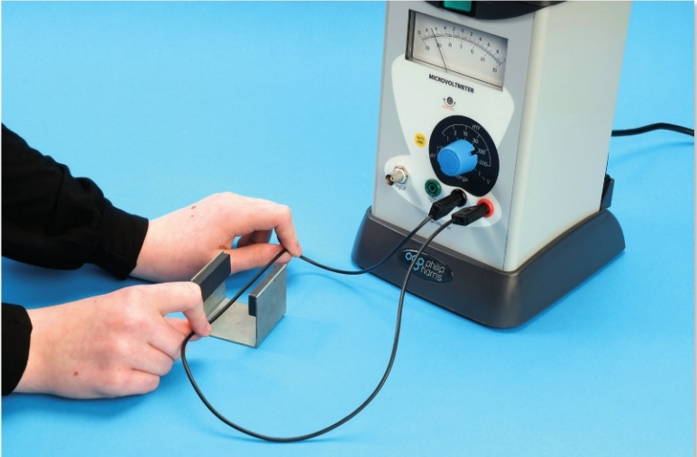

fig A Relative movement between a wire and a magnetic field will induce an e.m.f.

<!-- page 76 -->

## PRACTICAL SKILLS

## Investigating Faraday's law

You can investigate Faraday's law using a magnet and a coil of wire connected to a voltage datalogger, as shown in fig B, or more simply, using the set up in fig A.

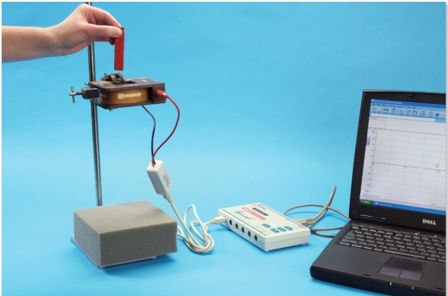

▲ fig B Measuring the induced e.m.f. as a magnet falls through a coil of wire.

Conservation of energy gives us Lenz's law, which says that 'the direction of an induced e.m.f. is such as to oppose the change creating it'.

## ELECTROMAGNETIC INDUCTION USING AN ELECTROMAGNET

In the previous section, the induction of e.m.f. was a result of the relative motion between a conductor, or coil, and a permanent magnet. The magnetic field which interacts with the coil could be produced electrically by another coil. This is the principle of operation of a transformer, and the coil producing the initial magnetic field is referred to as the primary coil.

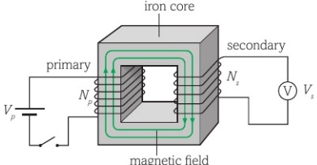

fig C Using an electromagnet to induce e.m.f. in a coil.

In fig C we have a pair of coils linked together by a soft iron core. Iron is extremely good at carrying magnetism and, in the set-up shown, nearly all the magnetic field generated by the primary coil on the left would interact with the secondary coil on the right. When the primary switch is first closed, the primary suddenly produces a magnetic field that was not previously there. This means that a changing magnetic field is now within the secondary coil. This sudden change of flux linkage will generate an e.m.f. in the secondary. However, once the electromagnetic field is stable there will no longer be any change in flux linkage over time, and so there will be no further induced e.m.f. in the secondary. The voltmeter needle will kick and then return to zero. If the primary circuit is switched off, the magnetic field it produces will suddenly disappear, and a brief e.m.f. will be induced in the opposite direction to the switch-on voltage. The voltmeter needle will kick in the opposite direction and then return to zero again.

<!-- page 77 -->

## TRANSFORMERS

The circuit and situation described in fig C is not really of much practical use. It can be responsible for current surges in circuitry, which can cause damage. The same principle is more usefully applied in the transformer, in which an alternating current is supplied to the primary. As alternating current constantly varies, the electromagnetic field produced by the primary coil alternates, which creates a varying induced e.m.f. in the secondary. This e.m.f. will vary at the same rate as the current supplied to the primary. It will also change constantly depending on the varying rate of change of flux linkage. This comes from the strength of the magnetic field (which in turn depends on the number of turns on the primary coil) and the number of turns on the secondary coil. It turns out that the ratio of voltages between primary and secondary is identical to the ratio of the number of turns on these coils:

 $$ \frac{V_{\text{primary}}}{V_{\text{secondary}}}=\frac{N_{\text{primary}}}{N_{\text{secondary}}} $$ 

This gives us the essential job of a transformer, which is to change voltage. More turns on the secondary means a step-up transformer in which the output voltage is higher than the input voltage and vice versa for a step-down transformer.

## EXAM HINT: EXTRA CONTENT

The transformer equation is not included in the exam specification, but it does show us factors that affect the induced e.m.f. in a set up like fig C.

##### CALCULATING INDUCED E.M.F.S

Putting Faraday's and Lenz's laws together gives us an expression for calculating an induced e.m.f.:

 $$ \varepsilon=-\frac{\mathrm{d}(N\varPhi)}{\mathrm{d}t}\qquad\mathrm{o r}\qquad\varepsilon=-\frac{\Delta(N\varPhi)}{\Delta t} $$ 

Faraday's law told us that the e.m.f. would be proportional to the rate of change of flux linkage, and the minus sign in the equation comes from Lenz's law, to indicate the opposing direction.

## WORKED EXAMPLE 1

The iron core in fig C has a square cross-section with each side 4 cm. The primary produces a magnetic field with a strength of 0.5 T. This takes 60 ms to generate, and to die away, when the primary circuit is switched on or off. The secondary coil has 120 turns. What e.m.f. would be induced in the secondary at the moments of switch-on and switch-off of the primary circuit?

 $$ \begin{aligned}\varepsilon&=-\frac{\mathrm{d}(N\varPhi)}{\mathrm{d}t}=-\frac{\Delta(N\varPhi)}{\Delta t}=-\frac{\Delta(BAN)}{\Delta t}\\&=-\frac{(0.5\times0.04^{2}\times120)}{60\times10^{-3}}\end{aligned} $$ 

 $$ \varepsilon=-1.6V $$ 

At switch-off, the e.m.f. induced would be the same amount but in the opposite direction, so  $ \varepsilon = 1.6 $ V.

## WORKED EXAMPLE 2

Zoran has a wire coil of 120 circular turns with a radius of 5 cm, held in a magnetic field with a strength of 20 mT. He removes it from within the magnetic field to a place completely outside the field in 0.02 s. What e.m.f. is induced in his coil?

 $$  Area,A=\pi\times(0.05)^{2}=7.85\times10^{-3}m^{2} $$ 

 $$ \Phi=BA=0.02\times(7.85\times10^{-3})=1.6\times10^{-4}Wb $$ 

Flux linkage =  $ N\Phi = 120 \times 1.6 \times 10^{-4} = 1.92 \times 10^{-2} $ Wb-turns

This is completely removed in 0.02 s.

 $$ \varepsilon=\frac{-\Delta(N\varPhi)}{\Delta t}=\frac{-(-1.92\times10^{-2})}{0.02} $$ 

 $$ \varepsilon=0.96V $$ 

## CHECKPOINT

1. (a) What is the flux linkage if a square coil with 10 cm sides and having 500 turns interacts with a magnetic field,  $ B = 0.33 \, mT $?

(b) The coil is turned through  $ 90^{\circ} $ within the 0.33 mT magnetic field, moving from a position perpendicular to the field (full flux linkage) to a position parallel to the field (zero flux linkage). This action takes 12 ms. What is the induced e.m.f. in the coil?

2. The graph shown in fig D is a graph of measurements of induced e.m.f. against time as a magnet is dropped through a coil of wire.

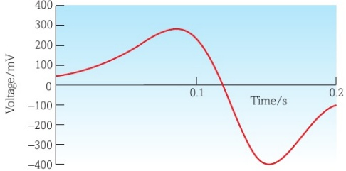

fig D

(a) Use the graph to describe how the induced e.m.f varies over time.

(b) If the coil were connected in series with a light bulb, explain how the current through the bulb would change over time.

## SUBJECT VOCABULARY

Faraday's law induced e.m.f. is proportional to the rate of change of flux linkage

Lenz's law the direction of an induced e.m.f. is such as to oppose the change creating it

primary coil the first coil in a transformer, through which the supply current passes

secondary coil the second coil in a transformer, through which the output current passes

<!-- page 78 -->

# 6C THINKING BIGGER

## METAL DETECTIVES

Using a process involving electromagnetic induction to detect metal objects was first proposed by Alexander Graham Bell, also the inventor of the telephone. Today, metal detectors are used by a variety of people in many different industries. For example, for finding underground water pipes, and by archaeologists looking for old metal objects.

SKILLS CRITICAL THINKING, PROBLEM SOLVING, INTERPRETATION, ADAPTIVE LEARNING, CONTINUOUS LEARNING, PRODUCTIVITY

fig A Archaeologists can find buried ancient objects using electromagnetic induction.

SCIENTIFIC PAPER

## METAL DETECTORS: BASICS AND THEORY

Metal detectors work on the principle of transmitting a magnetic field and analysing a return signal from the target and environment. The transmitted magnetic field varies in time, usually at rates of fairly high-pitched audio signals. The magnetic transmitter is in the form of a transmit coil with a varying electric current flowing through it produced by transmit electronics. The receiver is in the form of a receive coil connected to receive and signal processing electronics. The transmit coil and receive coil are sometimes the same coil. The coils are within a coil housing which is usually simply called 'the coil', and all the electronics are within the electronics housing attached to the coil via an electric cable and commonly called the 'control box'.

This changing transmitted magnetic field causes electric currents to flow in metal targets. These electric currents are called eddy currents, which in turn generate a weak magnetic field, but their generated magnetic field is different from the transmitted magnetic field in shape and strength. It is the altered shape of this regenerated magnetic field that metal detectors use to detect metal targets. (The different 'shape' may be in the form of a time delay.)

The regenerated magnetic field from the eddy currents causes an alternating voltage signal at the receive coil. This is amplified by the electronics because relatively deeply buried targets produce signals in the receive coil which can be millions of times weaker than the signal in the transmit coil, and so need to be amplified to a reasonable level for the electronics to be able to process.

In summary:

1 Transmit signal from the electronics causes transmit electrical current in transmit coil.

2 Electrical current in the transmit coil causes a transmitted magnetic field.

3 Transmitted magnetic field causes electrical currents to flow in metal targets (called eddy currents).

4 Eddy currents generate a magnetic field. This field is altered compared to the transmitted field.

5 Receive coil detects the magnetic field generated by eddy currents as a very small voltage.

6 Signal from receive coil is amplified by receive electronics, then processed to extract signal from the target, rather than signals from other environment magnetic sources such as Earth's magnetic field.

From a paper written by Bruce Candy, Chief Scientist,

Minelab Electronics, a manufacturer of metal detectors.

<!-- page 79 -->

## THINKING BIGGER

## SCIENCE COMMUNICATION

The extract consists of information from a technical paper written for a metal detector manufacturer's customers.

1 Why is there no obvious commercial bias in the text?

2 Discuss the level of scientific detail included in the extract, and the level of language used, particularly considering the intended audience.

## INTERPRETATION NOTE

Although this is a technical paper, it was presented in a brochure-style format for Minelab's customers.

## PHYSICS IN DETAIL

Now we will look at the physics in detail. Some of these questions will link to topics elsewhere in this book, so you may need to combine concepts from different areas of physics to work out the answers.

3 Explain how a metal detector functions, including references to Faraday's law and Lenz's law.

4 (a) Explain how the operation of the metal detector is similar to that of a transformer.

(b) Explain how the metal detector is different from a transformer.

5 Why does the signal from the receive coil need to be amplified electronically?

6 If the target metal has a lower resistivity, it produces a stronger detection signal. Explain why a gold wedding ring might be easier to detect than a naturally occurring gold nugget of a similar size.

## PHYSICS TIP

## ACTIVITY

Consider how a transformer manages to transmit nearly all the power from its primary coil to its secondary coil, and then compare with the structure of this device.

Imagine you work for Minelab, and have been asked to give a presentation about their portable metal detectors to a group of amateur treasure hunters. Prepare the part of the presentation which explains why some objects are more easily detected than others. You should cover size, shape, proximity and resistivity. Diagrams should be included in your presentation.

## THINKING BIGGER TIP

Do not attempt to teach International A Level Physics to the treasure hunters. Your presentation should explain the principles without overcomplicated detail.

<!-- page 80 -->

# 6C EXAM PRACTICE

[Note: In questions marked with an asterisk (*), marks will be awarded for your ability to structure your answer logically, showing how the points that you make are related or follow on from each other.]

1 Which of these is the correct SI unit for magnetic field strength?

A Wb

B weber-turns

C T

D Wbm^{-3} [1]

(Total for Question 1 = 1 mark)

2 A beam of electrons carries 100 billion electrons 18 centimetres per second. The beam enters a magnetic field of 40 mT at right angles to the field. How much force does each electron feel?

A  $ 1.15 \times 10^{-21} $ N

B  $ 1.15 \times 10^{-19} $ N

C  $ 1.15 \times 10^{-18} $ N

D  $ 1.15 \times 10^{-10} $ N [1]

(Total for Question 2 = 1 mark)

3 When a magnet is moved into a coil of 50 turns at 0.12 m s^{-1}, an e.m.f. of 3.60 V is generated in the coil. What will be the e.m.f. generated when the magnet is removed from the coil at 0.48 m s^{-1}?

A -0.90 V

B 0.90 V

C -14.4 V

D 14.4 V [1]

(Total for Question 3 = 1 mark)

4 The diagram shows a horizontal wire which is at right angles to a magnetic field. The magnetic field is produced by a horseshoe magnet, which is on a balance adjusted to read zero when the current in the wire is zero.

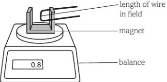

When the current is 4 A, the reading on the balance is 0.8 gram. The length of wire in the magnetic field is 0.05 m.

Calculate the average magnetic flux density along the length of the wire. [3]

(Total for Question 4 = 3 marks)

5 Faraday's and Lenz's laws are summarised in the list of formulae as

 $$ \epsilon=-\frac{\mathrm{d}(N\Phi)}{\mathrm{d}t} $$ 

(a) State the meaning of the term  $ N\Phi $. [2]

(b) Explain the significance of the minus sign. [3]

(Total for Question 5 = 5 marks)

6 A vinyl disc is used to store music. When the disc is played, a stylus (needle) moves along in a groove in the disc. The disc rotates, and bumps in the groove cause the stylus to vibrate.

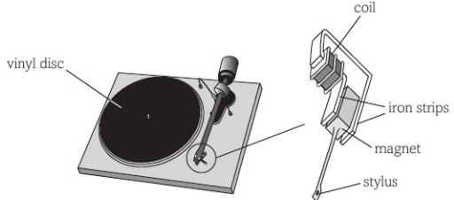

The stylus is attached to a small magnet, which is near to a coil of wire. When the stylus vibrates, there is a potential difference across the terminals of the coil.

(a) Explain the origin of this potential difference. [4]

(b) The potential difference is then amplified and sent to a loudspeaker. Long-playing vinyl discs (LPs) have to be rotated at 33 rpm (revolutions per minute) so that the encoded bumps in the groove lead to the correct sound frequencies.

(i) Calculate the angular velocity of an LP. [2]

(ii) As the stylus moves towards the centre of the LP the encoded bumps must be fitted into a shorter length of groove.

Explain why the encoding of bumps in the groove becomes more compressed as the stylus moves towards the centre. [3]

(Total for Question 6 = 9 marks)

<!-- page 81 -->

## EXAM PRACTICE

7 A teacher demonstrates electromagnetic induction by dropping a bar magnet through a flat coil of wire connected to a datalogger.

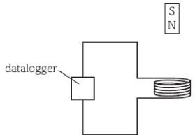

The data from the datalogger is used to produce a graph of induced e.m.f. across the coil against time.

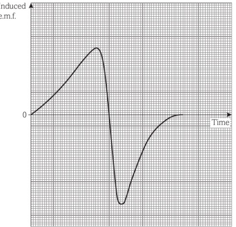

 $ ^{*} $(a) Explain the shape of the graph and the relative values on both axes. [6]

(b) The teacher then sets up another demonstration using a large U-shaped magnet and a very small coil of wire, which is again connected to a datalogger.

The north pole is vertically above the south pole and the coil is moved along the line AB, which is midway between the poles. The magnetic field due to the U-shaped magnet has been drawn. The plane of the coil is horizontal.

Sketch a graph to show how the e.m.f. induced across the coil varies as the coil moves from A to B at a constant speed. [4]

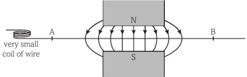

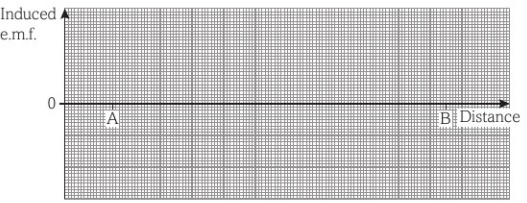

(Total for Question 7 = 10 marks)

8 Particle detectors often use magnetic fields to deflect particles so that properties of the particles can be measured.

(a) State what is meant by a magnetic field. [2]

(b) A moving charged particle of mass m, charge q and velocity v enters a uniform magnetic field of flux density B.

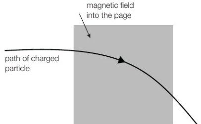

(i) State the charge on the particle. [1]

(ii) Describe and explain the shape of the particle's path in the magnetic field [2]

(iii) The radius of the path in the magnetic field is r. By considering the magnetic force acting on the particle show that the following equation is correct:

 $$ r=\frac{mv}{Bq} $$

[2] 

(Total for Question 8 = 7 marks)

