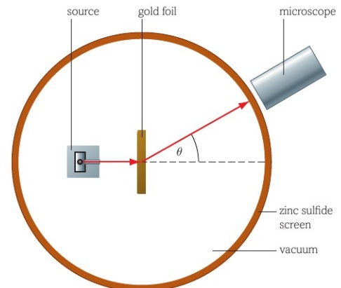
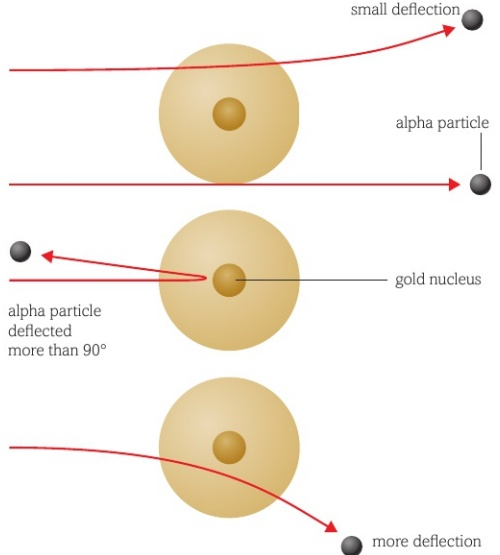
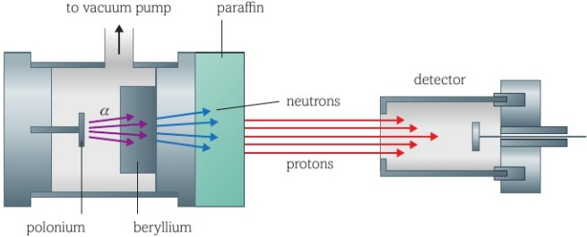
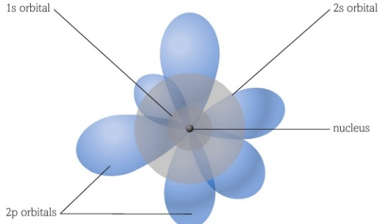
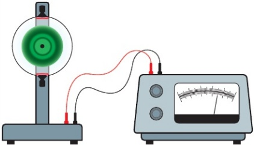
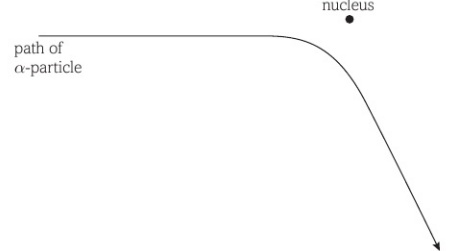

# 7A Probing matter

<!-- edx_ial_phy2.pdf p82-93 -->

<!-- page 82 -->

# TOPIC 7 NUCLEAR AND PARTICLE PHYSICS

## 7 A PROBING MATTER

Throughout history, people have been trying to work out what everything is made from. The ancient Greek philosopher Democritus wondered how many times a piece of cheese could be cut smaller and smaller, until we reach the point where the cheese remaining is a fundamental unit that will not split. This was the basis of the theory that everything is made from unbreakable fundamental particles.

In the late nineteenth century, the atom was thought to be the smallest possible particle, but then the English physicist J.J. Thomson demonstrated that electrons could be removed, so the atom must be made of smaller pieces. This led to some of the most important experiments of the twentieth century: Rutherford's alpha particle scattering experiments from 1909, which led to the development of the idea that an atom has a small central nucleus and outer orbiting electrons.

In this chapter, both the movement of free electrons in a beam, and the details of Rutherford's alpha particle scattering experiment will be explained. Using particle beams as probes to investigate the detailed structure of matter is one of the most important areas of physics study, and in future chapters we will see how these experiments led to the very latest developments in particle physics experimentation.

## MATHS SKILLS FOR THIS CHAPTER

• Recognising and use of appropriate units (e.g. the electronvolt)

- Use of standard form (e.g. calculating electron energies)

- Use of an appropriate number of significant figures (e.g. calculating electron velocities)

• Changing the subject of non-linear equations (e.g. calculating electron velocities)

- Substituting numerical values into equations using appropriate units (e.g. calculating de Broglie wavelengths)

<!-- page 83 -->

## What prior knowledge do I need? Topic 1B (Book 1: IAS)

Kinetic energy

Topic 3D (Book 1: IAS)

Wave-particle duality, including electron diffraction

The electronvolt

Topic 4A (Book 1: IAS)

Electric current as the movement of electrons

Voltage as a measure of the energy transferred by charges

Momentum conservation and elastic collisions

Topic 6A

## Topic 5A

The effects of electric fields on the movements of charged particles

Coulomb's law for electrostatic forces

## What will I study in this chapter? Alpha particle deflections from nuclei

The process of thermionic emission

Electron beam acceleration

Applications of electron diffraction and the de Broglie wavelength

## What will I study later? Topic 7B

The design of particle accelerators

The detection and identification of subatomic particles

## Topic 7C

Deeper matter probing experiments

Topic 9A

The processes in which alpha particles are emitted

<!-- page 84 -->

# 1 A NUCLEAR ATOM

## LEARNING OBJECTIVES

Describe what is meant by nucleon number (mass number) and proton number (atomic number).

Explain how large angle alpha particle scattering gives evidence for a nuclear atom.

Describe how our understanding of atomic structure has changed over time.

## ATOMIC THEORIES THROUGH HISTORY

People have always asked questions about what the materials around us consist of. There have been many philosophers and scientists, from Democritus in the fifth century BCE to Dalton in the early nineteenth century, who have suggested the idea of a tiny particle from which everything else is constructed. The basic model for one of these 'atoms' – which was published in a paper by Dalton in 1803 – is simply a hard solid sphere. When Thomson discovered that tiny negatively charged bits (electrons) could be removed from an atom, leaving behind a positively charged ion, he produced the 'plum pudding model'. This model suggested that the main body of the atom is composed of a positively charged material (the pudding 'dough') with electrons (the 'plums') randomly scattered through it. This model was successful at explaining the evidence available at that time. In 1911 came Rutherford's model of the atom, which has a tiny, charged nucleus carrying most of the mass of the atom, surrounded at some distance by the electrons, with most of the atom as empty space. Niels Bohr later refined the nuclear model to have the electrons located around the nucleus in fixed orbits, following the theory of quantised energy. Electrons could move from one fixed orbit to another depending on the energy they gained or lost. Apart from these fixed jumps, they were stuck in an orbit. Bohr's model generated the commonly used idea of the atom as being like a miniature Solar System. This idea is not a perfect model – it is incorrect in many ways – but most models have strengths and weaknesses. It is often necessary to use models in science and we must always be careful to work within the limitations of any model we use.

## LEARNING TIP

A plum pudding is a British dessert. You can imagine it like a chocolate chip muffin, where the muffin is the positive material and the chocolate chips are the electrons.

## ALPHA PARTICLE SCATTERING

Between 1909 and 1911, Geiger and Marsden, students of Lord Rutherford at Manchester University, did an experiment in which they aimed alpha particles at a very thin gold foil (fig B).

Their expectation was that all the alpha particles would pass through, possibly with a small change in direction. The results  $ \sim $400 BCE

1803

1911

Democritus was the first to suggest the existence of atoms.

1906

1913

Dalton's model of the atom.

Dalton found that different atoms have different masses and can be combined to produce compound molecules.

Thomson's plum pudding model of the atom. Negative electrons are scattered through a positive 'dough'.

Rutherford's nuclear model of the atom: a large amount of charge and most of the mass is concentrated in a tiny central nucleus. Most of the atom is empty space, and electrons orbit at the edge.

Bohr's model of the atom limited electrons to certain fixed energy orbits, which they could jump between.

## fig A Models of the atom through history

generally followed this pattern – the vast majority passed straight through. However, a few alpha particles had their direction changed by quite large angles. Some were even deflected back the way they had come. Rutherford commented, ‘It was almost as incredible as if you had fired a 15 inch [artillery] shell at a piece of tissue paper and it came back and hit you’. It was a shocking result based on the model of the atom at that time. They repeated the experiment hundreds of times, and Rutherford concluded that it was necessary to change the model of the atom to explain the results. He developed a model with a small nucleus in the centre of the atom which contained a large amount of charge and most of the mass of the atom (see fig C and table A).

<!-- page 85 -->

fig B Rutherford's alpha particle scattering apparatus.

## LEARNING TIP

When Rutherford published the results of the alpha particle scattering experiment in 1911, he could not be sure that the charge on the nucleus was positive or negative. Within two years, the English physicist Henry Moseley had published a law about X-ray spectra that implied the nucleus must be overall positive. Rutherford confirmed this in a letter to the scientific journal Nature in December 1913. Rutherford also did not use the word 'nucleus' in the 1911 paper but was using it by 1913.

▲ fig C Alpha particle paths in scattering from gold atoms. Approximately 1 in 8000 was deflected through more than 90°. Momentum conservation means that this is only possible if scattering is from something more massive than the alpha particle itself.

<table border=1 style='margin: auto; word-wrap: break-word;'><tr><td style='text-align: center; word-wrap: break-word;'>ANGLE OF DEFLECTION/ DEGREES</td><td style='text-align: center; word-wrap: break-word;'>EVIDENCE</td><td style='text-align: center; word-wrap: break-word;'>CONCLUSION</td></tr><tr><td style='text-align: center; word-wrap: break-word;'>0-10</td><td style='text-align: center; word-wrap: break-word;'>Most alpha particles pass straight through with little deviation.</td><td style='text-align: center; word-wrap: break-word;'>Most of the atom is empty space.</td></tr><tr><td style='text-align: center; word-wrap: break-word;'>10-90</td><td style='text-align: center; word-wrap: break-word;'>Some alpha particles deflected through a large angle.</td><td style='text-align: center; word-wrap: break-word;'>A large concentration of charge in one place.</td></tr><tr><td style='text-align: center; word-wrap: break-word;'>90-180</td><td style='text-align: center; word-wrap: break-word;'>A few alpha particles are deflected back towards the source side of the foil.</td><td style='text-align: center; word-wrap: break-word;'>Most of the mass of the atom and a large concentration of charge is in a tiny, central nucleus.</td></tr></table>

table A Alpha particle scattering observations and conclusions.

<!-- page 86 -->

## EXAM HINT: EXTRA CONTENT

## CHADWICK'S DISCOVERY OF THE NEUTRON

You will not be expected to know the details of Chadwick's experimental set-up in the exam. However, you will need to understand the idea that conservation of momentum can be applied to particles.

Rutherford determined that most of the atom's mass and all the positive charge was held in a very small nucleus in the centre, and that electrons were at the edge of the atom. The difference between the nuclear mass and the known number of protons in it caused a problem though. Nuclei were too massive considering the number of protons they contained. Rutherford suggested that additional proton–electron pairs, bound together, were the extra mass in the nucleus.

In 1930, Irene Joliot-Curie and her husband, Frederic, found that alpha particles hitting beryllium would cause it to give off an unknown radiation. Difficult to detect, this unknown, uncharged radiation could remove protons from paraffin and these were detected by a Geiger–Müller tube.

The Joliot-Curies tried to explain the unknown radiation as gamma rays, but as these rays have no mass, this was against the rules of the conservation of momentum. James Chadwick repeated the experiments (fig D) also using other target materials. Chadwick considered momentum transfer and conservation of kinetic energy in the collisions between the particles and he concluded that the beryllium radiation was a neutral particle which had a mass about 1% more than that of a proton. In 1932, he published a proposal for the existence of this new particle, which he called a neutron, and in 1935 he was awarded the Nobel prize for this discovery.

fig D Chadwick's experiment to determine the existence of the neutron relied on the conservation of momentum to work out the mass of this neutral particle.

## NUCLEAR STRUCTURE

As we have seen, the nucleus contains two types of particles: protons and neutrons. In the nucleus, these particles are all known as nucleons. The number of protons in a nucleus determines which element the atom will be. The periodic table is a list of the elements in the order of the number of protons in each atom's nucleus. This number is called the proton number or the atomic number (Z). The number of neutrons can be different, and we call atoms of the same element with different numbers of neutrons, isotopes. For small nuclei, up to about atomic number 20 (which is calcium), the number of neutrons in the nucleus is generally equal to the number of protons.

Above atomic number 20, to be stable, more neutrons than protons are needed in the nucleus. The neutrons help to bind the nucleus together as they exert a strong nuclear force on other nucleons, and they act as a space between the positive charges of the protons which all repel each other. This means that as we progress through the periodic table to larger and larger nuclei, proportionately more and more neutrons are needed. By the time we reach the very biggest nuclei, there can be over 50% more neutrons than protons.

To describe any nucleus, we must say how many protons and how many neutrons there are. So the chemical symbol written below refers to the isotope of radium, which has 88 protons and 138 neutrons:

The number 226, called the nucleon number or the mass number (A), refers to the total number of nucleons – neutrons and protons – in a nucleus of this isotope. So to find the number of neutrons, we must subtract the atomic number from the mass number:  $ 226 - 88 = 138 $.

<!-- page 87 -->

As radium must have 88 protons because that makes it radium, it is quite common not to write the 88. You might call this isotope ‘radium-226’ and this will be enough information to know its proton number and neutron number.

## A QUANTUM MECHANICAL ATOM

In the 1920s, Werner Heisenberg changed the model of the atom, which had electrons in orbits like planets in a Solar System. His uncertainty principle says that we cannot know the exact position and velocity of anything at a given moment. Instead of specific orbits, his new version of the atom has regions around the nucleus in which there is a high probability of finding an electron, and the shapes of these 'probability clouds' represent what we currently refer to as the electron 'orbitals'.

fig E A quantum mechanical model of an atom's structure.

## CHECKPOINT

1. Use a periodic table to pick five elements at random. List them using standard symbols and then explain how many protons and neutrons each one has.

2. ▶ Suggest why it has taken so long for scientists to develop the current model of the atom.

3. ▶ Give two strengths and two weaknesses of the analogy that an atom is like a mini Solar System.

4. Chadwick suggested that alpha particles colliding with beryllium produced neutrons according to the equation:

 $$ {}_{2}^{4}\alpha+{}_{\mathrm{B}}^{\mathrm{A}}\mathrm{B}\mathrm{e}={}_{6}^{12}\mathrm{C}+{}_{0}^{1}\mathrm{n} $$ 

What numbers are represented by A and B?

## SUBJECT VOCABULARY

plum pudding model a pre-1911 model of the atom, in which the main body of the atom is made of a positively charged material (the pudding 'dough') with electrons (the 'plums') randomly scattered through it

nucleons any of the protons and neutrons comprising a nucleus

proton number the number of protons in the nucleus of an atom

atomic number (Z) an alternative name for 'proton number'

isotopes atoms of the same element with different numbers of neutrons in the nuclei

strong nuclear force the extremely short-range force between hadrons (such as protons and neutrons) $ ^{*} $

nucleon number the total number of all neutrons and protons in a nucleus

mass number (A) an alternative name for the ‘nucleon number’

neutron number the total number of neutrons within a given nucleus

$ ^{*} $ You do not need to revise this term for your exam.

SKILLS INTERPRETATION

SKILLS PERSONAL AND SOCIAL RESPONSIBILITY

SKILLS SELF-EVALUATION

<!-- page 88 -->

# 7A 2 ELECTRONS FROM ATOMS

## LEARNING OBJECTIVES

Explain that electrons are released in thermionic emission.

Describe how electrons can be accelerated by electric and magnetic fields.

Explain why high energies are required to investigate the structure of nucleons.

## ELECTRON BEAMS

Free conduction electrons in metals need a particular amount of energy if they are to escape from the surface of the metal. This energy can be supplied by a beam of photons, as seen in the photoelectric effect. The electrons can also gain enough energy through heating of the metal. The release of electrons from the surface of a metal as it is heated is known as thermionic emission.

## LEARNING TIP

Students often confuse thermionic emission and the photoelectric effect. Whilst the two ideas have similarities, they are different and you must use the correct term with the correct situation.

If, when they escape, these electrons are in an electric field, they will be accelerated by the field, moving in the positive direction. The kinetic energy they gain will depend on the p.d., V, that they move through, according to the equation:

 $$ E_{k}=eV $$ 

where e is the charge on an electron.

## WORKED EXAMPLE 1

How fast would an electron be moving if it was accelerated from rest through a p.d. of 2500 V?

 $$ E_{k}=eV=-1.6\times10^{-19}\times-2500=4\times10^{-16}J $$ 

 $$ E_{k}=\frac{1}{2}mv^{2} $$ 

 $$ V= {\sqrt{\frac{2 E_{k}}{m}}} = {\sqrt{\frac{2 \times 4 \times 10^{-16}}{9.11 \times 10^{-31}}}} $$ 

 $$ v=2.96\times10^{7}m s^{-1} $$ 

Using thermionic emission to produce electrons, and applying an electric field to accelerate them, we can generate a beam of fast-moving electrons, known as a cathode ray. If this beam of electrons passes through a further electric field or magnetic field, then the force produced on the beam of electrons will cause it to deflect. If a fast-moving electron hits a screen that is painted with a particular chemical, the screen will fluoresce – it will emit light.

These are the principles by which cathode ray oscilloscopes (CROs) operate. The electron beam in a CRO is moved left and right, and up and down, by passing the beam through horizontal and vertical electric fields. These are generated by electric plates so the strength and direction can be altered. The point on the screen which is emitting light can be changed quickly and easily.

## AN ELECTRON PROBE

Electron beams fired at a crystal will produce scattering patterns that can tell us about the structure of the crystal (fig A). In 1927, Davisson and Germer showed that an electron beam can produce a diffraction pattern. This was different to the patterns found by Geiger and Marsden in Rutherford's alpha particle scattering experiments. Davisson and Germer provided the experimental evidence to prove a theory that had been suggested three years earlier by the French physicist, Louis de Broglie. Light could be shown to behave as a wave sometimes, and at other times as a particle. He hypothesised that this might also be the case for things which were traditionally thought to be particles. De Broglie had proposed that the wavelength,  $ \lambda $, of a particle could be calculated from its momentum (p) using the expression:

 $$ \lambda=\frac{h}{p} $$ 

where h is the Planck constant. So:

 $$ \lambda=\frac{h}{mv} $$ 

The Davisson–Germer experiment proved that the diffraction pattern obtained when a cathode ray hit a crystal could only be produced if the electrons in the beam had a wavelength that was the de Broglie wavelength. Because of this experimental confirmation, Louis de Broglie was awarded the 1929 Nobel Prize for Physics.

fig A Electron diffraction patterns can explore the molecular structure of crystals.

<!-- page 89 -->

## WORKED EXAMPLE 2

What is the wavelength of an electron in a beam which has been accelerated through 2000 V?

 $$ E_{k}=eV=-1.6\times10^{-19}\times-2000=3.2\times10^{-16}J $$ 

 $$ E_{k}=\frac{1}{2}m v^{2}=3.2\times10^{-16}J $$ 

 $$ v=\sqrt{\frac{2E_{k}}{m}}=\sqrt{\frac{2\times3.2\times10^{-16}}{9.11\times10^{-31}}}=2.65\times10^{7}m s^{-1} $$ 

 $$ \lambda=\frac{h}{mv}=\frac{6.63\times10^{-34}}{9.11\times10^{-31}\times2.65\times10^{7}} $$ 

 $$ \lambda=2.75\times10^{-11}m $$ 

## EXAM HINT

Many standard values, like the charge and mass of an electron and the Planck constant, are given in the data sheet in the exam.

## PRACTICAL SKILLS

## Investigating electron diffraction

You may have the equipment to observe electron diffraction. By measuring the radius of the circular pattern for each accelerating voltage, you can perform a calculation to confirm de Broglie's hypothesis.

▲ fig B Measuring electron diffraction caused by a very thin piece of carbon.

Safety Note: The power supplies can give a severe electric shock and should be used with shrouded connectors. Do not remove or attach connectors with the power switched on.

The idea of electrons acting as waves has enabled scientists to study the structure of crystals, the same way they do in X-ray crystallography. When waves pass through a gap which is about the same size as their wavelength, they are diffracted. In other words, they spread out. The degree of diffraction spreading depends on the ratio of the size of the gap to the wavelength of the wave. If a beam of electrons is aimed at a crystal, the gaps between atoms in the crystal can act as a diffraction grating and the electron waves produce a diffraction pattern on a screen. Measuring the pattern allows the spacings between the atoms to be calculated.

Electron diffraction and alpha particle scattering both show the idea that we can study the structure of matter by probing it with beams of high energy particles. The more detail (or smaller scale) the structure to be investigated has, the higher energy the beam of particles needs to be. This means that very high energies are needed to investigate the structure of nucleons, as they are very, very small. Accelerating larger and larger particles to higher and higher energies has been the aim of particle physicists ever since Thomson discovered the electron in 1897.

## CHECKPOINT

## SKILLS SELF-DIRECTION, ADAPTIVE LEARNING, INTERPRETATION, COMMUNICATION, ADAPTABILITY

1. Calculate the de Broglie wavelengths for the following:

(a) an electron travelling at 2% of the speed of light

(b) an electron which has been accelerated through 1200 V

(c) a proton with a momentum of  $ 5 \times 10^{-21} $ kg m $ s^{-1} $

(d) you running at  $ 5 \, m \, s^{-1} $.

2. Why would de Broglie not have been awarded the Nobel Prize before the Davisson-Germer experiment?

3. Calculate the speed at which an electron must travel if it is to be used to probe the structure of the nucleus. (It would need a de Broglie wavelength of about the size of the nucleus:  $ \lambda = 5 \times 10^{-15} $ m.) Comment on your answer.

4. Carry out some research to find out how the direction of the electron beam in a cathode ray oscilloscope (CRO) can be changed in order to make any point on the screen light up. Show this in a diagram. Explain how such a CRO could be set up in a hospital to display the electrical impulses of a patient's heart.

## SUBJECT VOCABULARY

photoelectric effect when electrons are released from a metal surface because the metal is hit by electromagnetic radiation

thermionic emission the release of electrons from a metal surface caused by heating of the metal

cathode ray a beam of electrons

<!-- page 90 -->

# 7A THINKING BIGGER

## XENON-XENON

CRITICAL THINKING, PROBLEM SOLVING, INTERPRETATION, ADAPTIVE LEARNING, CONTINUOUS LEARNING, INITIATIVE, PRODUCTIVITY

The Large Hadron Collider at CERN has undertaken some very high energy experiments, including the acceleration of whole atoms, as compared with individual particles, like protons, when it first started.

ONLINE NEWSPAPER ARTICLE

# A DAY OF XENON COLLISIONS AT CERN

The image to the right shows what happened in the CMS particle detector when xenon nuclei were circulated in the LHC and brought into head-on collision. The yellow is made up of tracks of electrically-charged particles, produced in such numbers that the whole of the centre of the picture is a yellow blur, with individual tracks only visible near the edges. The blue and green blocks indicate energy deposited by both charged and neutral particles in the CMS calorimeter.

Collisions between protons look significantly less busy than this, with fewer particles produced. But both xenon and lead nuclei are packed with protons and neutrons, and though lead has more of them, I don't think anyone could tell the difference between a xenon-xenon collision and a lead-lead one by eye.

There are however expected to be differences in detail, on average, in the shape and properties of the exotic ball of material produced in the heart of the collisions.

Before it flies apart, this material is a plasma of quarks and gluons, the basic constituents of all nuclear material. Measuring the differences between lead collisions and xenon collisions may teach us more about this strange stuff. If nothing else, it should allow us to make some “control” measurements, a good way of reducing systematic uncertainties. And measuring something new could always throw up a surprise. Time will tell, as the recorded data are carefully analysed.

In a coincidental aside, a xenon nucleus contains 54 protons, and about 77 neutrons on average, which makes its total mass quite close to the mass of the Higgs boson. This coincidence has caused confusion in some circles.

There should be no confusion really. According to the Standard Model, the Higgs boson is infinitely small. We can't measure “infinitely small”, of course, but from the way it behaves, we can set some kind of upper limit on the physical size of a Higgs. This tells us that if the xenon nucleus were the size of a beachball, the Higgs boson would be smaller than the finest grain of sand.

This would go some way toward explaining why the Higgs boson was not discovered until 2012, whereas xenon was discovered in 1898. Another reason would be that the Higgs boson rapidly and spontaneously decays into other particles, whilst xenon is stable.

Unless, of course, you treat xenon like we did in the LHC.

<!-- page 91 -->

## THINKING BIGGER

## SCIENCE COMMUNICATION

The article is from a UK-based newspaper. The Guardian.

1 (a) Describe the level of science presented in this article, and explain how scientific concepts are presented for the intended audience. Your answer should include commentary about the style of the text.

(b) Comment on the relevance of the picture accompanying the article.

2 The newspaper tries hard to have an international presence and make its website popular in many countries. Discuss how the level of English language used in the article would help this, or be a barrier to readers with English as an additional language.

## INTERPRETATION NOTE

The Guardian is published online as well as in hard copy. The stories sometimes include some variations in different international regions.

## PHYSICS IN DETAIL

Now we will look at the physics in detail. Some of these questions will link to topics elsewhere in this book, so you may need to combine concepts from different areas of physics to work out the answers.

3 Write a paragraph to explain the structure of the xenon nuclei being used, and how this compares with lead nuclei previously used.

4 How would xenon nuclei and lead nuclei be affected if they moved across a magnetic field? Explain the differences in effect on these two particles travelling through the same magnetic field.

5 Explain the physics behind the following phrases from the extract:

(a) 'Collisions between protons look significantly less busy than this'

(b) “control” measurements, a good way of reducing systematic uncertainties

6 Give an order of magnitude approximation of the ratio of the diameters of a xenon nucleus and a Higgs boson.

## PHYSICS TIP

Use a periodic table to include some numbers in your answers.

## ACTIVITY

Write a script for a Guardian podcast of this news story. You should include the same main basic information as the website article, and develop the depth of the scientific reporting for an adult audience who are likely to be well-educated but not experts in particle physics. You should also include some information about the results achieved so far. This task may require some further research.

## THINKING BIGGER TIP

Remember that the podcast will be available globally on the internet. Your report should be written in English, but you should consider that some listeners do not have English as their first language.

<!-- page 92 -->

# 7A EXAM PRACTICE

[Note: In questions marked with an asterisk (*), marks will be awarded for your ability to structure your answer logically, showing how the points that you make are related or follow on from each other.]

1 Electrons are accelerated from rest to a kinetic energy of 2.50 keV.

(a) Calculate the potential difference that the electrons were accelerated through.

A 2.50 V

B 2500 V

C  $ 1.56 \times 10^{19} $ V

D  $ 1.56 \times 10^{22} $ V [1]

(b) Calculate the energy of these electrons in joules.

A  $ 4.00 \times 10^{-19} $ J

B  $ 4.00 \times 10^{-16} $ J

C  $ 1.56 \times 10^{19} $ J

D  $ 1.56 \times 10^{22} $ J [1]

(Total for Question 1 = 2 marks)

2 Calculate the speed of electrons which have a kinetic energy of 3000 eV.

A  $ 7.39 \times 10^{-14} \, \text{m} \, \text{s}^{-1} $

B  $ 2.30 \times 10^{7} \, \text{m} \, \text{s}^{-1} $

C  $ 3.25 \times 10^{7} \, \text{m} \, \text{s}^{-1} $

D  $ 1.05 \times 10^{15} \, \text{m} \, \text{s}^{-1} $ [1]

(Total for Question 2 = 1 mark)

3 Heating a metal wire can cause electrons to escape from the metal. This process is called:

A electron excitation

B fluorescence

C the photoelectric effect

D thermionic emission. [1]

(Total for Question 3 = 1 mark)

 $ ^{*} $4 Rutherford designed an experiment to see what happened when alpha particles were directed at a piece of gold foil. Summarise the observations and state the conclusions that Rutherford reached about the structure of gold atoms. [5]

(Total for Question 4 = 5 marks)

5 The de Broglie wave equation can be written  $ \lambda = \sqrt{\frac{h^{2}}{2mE_{k}}} $, where  $ m $ is the mass of a particle and  $ E_{k} $ is its kinetic energy.

(a) Derive this equation. Use the list of equations provided on the formulae sheet (Appendix 7 of the specification). [2]

(b) An electron is accelerated through a potential difference of 2500 V.

Using the equation  $ \lambda=\sqrt{\frac{h^{2}}{2mE_{k}}} $, calculate the de Broglie wavelength of this electron. [3]

(Total for Question 5 = 5 marks)

6 In an experiment to investigate the structure of the atom,  $ \alpha $-particles are fired at a thin metal foil, which causes the  $ \alpha $-particles to scatter.

(a) (i) State the direction in which the number of  $ \alpha $-particles detected will be a maximum. [1]

(ii) State what this suggests about the structure of the atoms in the metal foil. [1]

(b) Some  $ \alpha $-particles are scattered through  $ 180^{\circ} $.

State what this suggests about the structure of the atoms in the metal foil. [2]

(c) The diagram shows the path of an  $ \alpha $-particle passing near to a single nucleus in the metal foil.

(i) Name the force that causes the deflection of the  $ \alpha $-particle. [1]

(ii) On a copy of the diagram, draw an arrow to show the direction of the force acting on the  $ \alpha $-particle at the point where the force is a maximum. Label the force F. [2]

(iii) The foil is replaced by a metal which has greater proton number.

Draw the path of an  $ \alpha $-particle that has the same initial starting point and velocity as the one which is drawn in the diagram. [2]

(Total for Question 6 = 9 marks)

<!-- page 93 -->

## EXAM PRACTICE

7 Draw a diagram and explain: (i) the structure of the atom that was proposed after the results from Rutherford's alpha particle scattering experiment were published, and (ii) the evidence for this model of the atom. [6]

(Total for Question 7 = 6 marks)

8 (a) 'Fast moving electrons with a de Broglie wavelength of 0.11 nm are sometimes used to investigate the atomic structure of solids, such as rubber.'

Describe and explain what you can conclude from this statement about the wavelength of the electrons used? [1]

(b) (i) Write the equation to calculate the de Broglie wavelength for a particle. [1]

(ii) Calculate the momentum of electrons with this de Broglie wavelength. [2]

(iii) Calculate the velocity of electrons with this momentum or wavelength. [1]

(iv) Calculate the potential difference through which the electrons would have to be accelerated to give them this momentum or wavelength. [2]

(c) 'A stream of neutrons could be used instead of the electrons.'

Explain how the speed of neutrons with a de Broglie wavelength of 0.11 nm would compare with that of the electrons used in part (b). [3]

(Total marks for question 8 = 10 marks)

9 The electron in a hydrogen atom can be described by a stationary wave which is confined within the atom. This means that the de Broglie wavelength associated with it must be similar to the size of the atom, which is of the order of  $ 10^{-10} $ m.

(a) (i) Calculate the speed of an electron whose de Broglie wavelength is  $ 1.00 \times 10^{-10} $ m. [3]

(ii) Calculate the kinetic energy of this electron in electronvolts. [3]

(b) When  $ \beta $ radiation was first discovered, it was suggested that there were electrons in the atomic nucleus, but it was soon realised that this was impossible because the energy of such an electron would be too great.

Explain why an electron confined within a nucleus would have a much greater energy than the energy calculated in part (a)(ii). [2]

(Total for Question 9 = 8 marks)

