# 7B Particle accelerators and detectors

<!-- edx_ial_phy2.pdf p94-109 -->

<!-- page 94 -->

# TOPIC 7 NUCLEAR AND PARTICLE PHYSICS

# PARTICLE ACCELERATORS AND DETECTORS

It is remarkable that scientists have managed to find out the nature of particles that measure just one femtometre across, that is the size of an atomic nucleus. To help you understand how small that is, imagine 1000 solar systems next to each other. Now compare your size to that of the thousand solar systems. That difference is the same as the size of the proton compared to you.

Developing both the theories and the technology to move subatomic particles so that we can do experiments with them is one of the great triumphs of modern science. The Large Hadron Collider, which is our greatest success story in such tiny-scale experiments, is actually the largest machine ever built!

In this chapter, we will look at how we can make tiny particles move in such a way that we can make them collide with each other, so they interact and produce other particles. To discover what particles these collisions generate, we will also learn how they can be detected and then identified.

## MATHS SKILLS FOR THIS CHAPTER

• Recognising and use of appropriate units (e.g. the electronvolt)

Making order of magnitude calculations (e.g. comparing cyclotron energies)

• Estimating results (e.g. comparing particle speeds in different accelerators)

• Changing the subject of non-linear equations (e.g. calculating relativistic synchroton frequency)

Substituting numerical values into equations using appropriate units (e.g. calculating particle path radii)

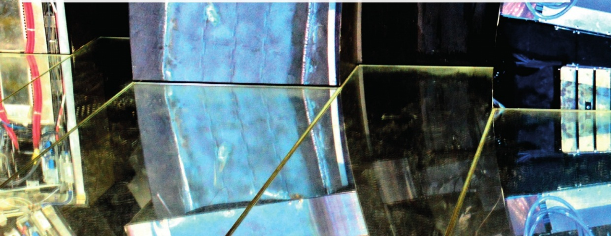

<!-- page 95 -->

## What prior knowledge do I need? Topic 4A (Book 1: IAS)

Voltage as a measure of the energy transferred by charges

Topic 5A

The conservation of momentum, charge and energy

Topic 5B

Circular motion and centripetal force

## Topic 6A

The effects of electric fields on the movement of charged particles

Coulomb's law for electrostatic forces

Topic 6C

The effects of magnetic fields on the movement of charged particles

NOT SOULO

DO NOT STEP!

What will I study in this chapter?

The structure and functioning of linear particle accelerators

The detection and identification of subatomic particles

The structure and functioning of circular particle accelerators

How to interpret particle tracks in particle detectors

Deeper matter probing experiments, including the Large Hadron Collider

The various fundamental particles that have been discovered

• Interactions between fundamental particles

The four fundamental forces of nature

## Topic 9A

Nuclear fission and nuclear fusion

## Topic 11B

The importance of particles in stars and between stars

<!-- page 96 -->

# 7B 1 PARTICLE ACCELERATORS

## LEARNING OBJECTIVES

Describe the use of electric and magnetic fields in particle accelerators.

Derive and use the equation  $ r = \frac{p}{BQ} $ for a charged particle in a magnetic field.

Explain why high energies are required to investigate the structure of the nucleus.

## PARTICLE ACCELERATORS

To investigate the internal structure of particles like nucleons – protons and neutrons – scientists collide them with other particles at very high speeds (very high energies). It is necessary to use high energy particles because at lower energies the particles just bounce off each other, keeping their internal structure secret. If we can collide particles together hard enough, they will disintegrate, and show their structure. In most cases, additional particles are created from the energy of the collision. Sometimes these extra particles uncover or confirm other new physics.

The challenge for scientists has been to accelerate particles to high enough speeds. Charged particles can be accelerated in straight lines using electric fields, and their direction changed along a curved path by a magnetic field.

## LINEAR ACCELERATORS

One of the simplest ways to produce energy high enough for these particle collisions is to accelerate a beam of charged particles along a straight path. However, the maximum achievable potential difference limits this. To overcome this problem, the particles are accelerated in stages (fig A). They are repeatedly accelerated through the maximum p.d., making the particle energies very high. Using this principle, the 3.2 km Stanford Linear Accelerator in the USA can accelerate electrons to an energy of 50 GeV, meaning that they have effectively passed through a potential difference of 50 billion volts. ‘GeV’ means gigaelectronvolts, or ‘ $ \times 10^9 $ eV’.

## DID YOU KNOW?

## LINAC FACTS

The Stanford Linear Accelerator in California is still the world's longest linear accelerator or LINAC, despite being 50 years old. However, plans for the International Linear Collider are far advanced. Most likely to be built in Japan, this would consist of two linear colliders, each over 15 km long, designed to collide electrons and positrons, initially with energies of 250 GeV, but with the design possibility of raising this to 1 TeV.

If the particles to be accelerated by the linear accelerator in fig A are electrons, they are generated by an electrostatic machine (like a Van de Graaff generator) and then put into the machine. Once inside the cylinder, the electrons move in a straight line, as the electrode is equally attracting in all directions. The alternating voltage supply is made to change as the electrons reach the middle of tube A, so it becomes negative. This repels the electrons out of the end of tube A and on towards tube B, which now has a positive potential. They accelerate towards it, and the whole process repeats as they pass through tube B and are then accelerated on towards tube C. This carries on until the electrons reach the end of the line, at which point they emerge to collide with a target.

In order to keep accelerating particles that are moving faster and faster, the acceleration tubes must be made longer and longer as the particles travel through each successive one at a higher speed. The time between potential difference flips is fixed as the alternating voltage has a uniform frequency of a few gigahertz (often referred to as radio frequency, RF). Using this type of accelerator is limited by how long you can afford to build it. The whole structure must be in a vacuum so that the particles do not collide with air atoms, and it must be perfectly straight.

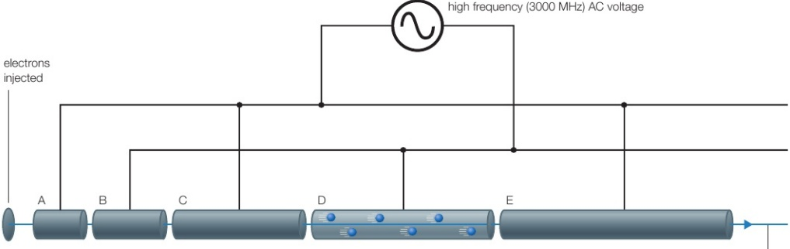

fig A The structure of a linear accelerator.

<!-- page 97 -->

## WAS EINSTEIN RIGHT?

One of Einstein's claims in his theory of special relativity is that nothing can accelerate beyond the speed of light. This means that particles in accelerators must have a problem when they are already travelling close to the speed of light and then pass through a p.d. which should accelerate them beyond it. In 1964, William Bertozzi demonstrated that at very high speeds, particles deviate from the equation  $ \frac{1}{2}mv^{2}=qV $ and never accelerate beyond the speed of light.

By measuring the actual speed of electrons accelerated from a Van de Graaff generator and then determining their actual kinetic energy by colliding them with a target and measuring the heat generated, Bertozzi was able to show that the energy added by the accelerating p.d. started to become more than the amount expected from  $ \frac{1}{2}mv^2 $.

This demonstration showed that whilst the kinetic energy and momentum of particles can continue to increase without limit, their speed does not. This can only happen if the mass of a particle seemingly increases with its speed. This apparent mass increase becomes significant at speeds approaching light speed – known as ‘relativistic speeds’.

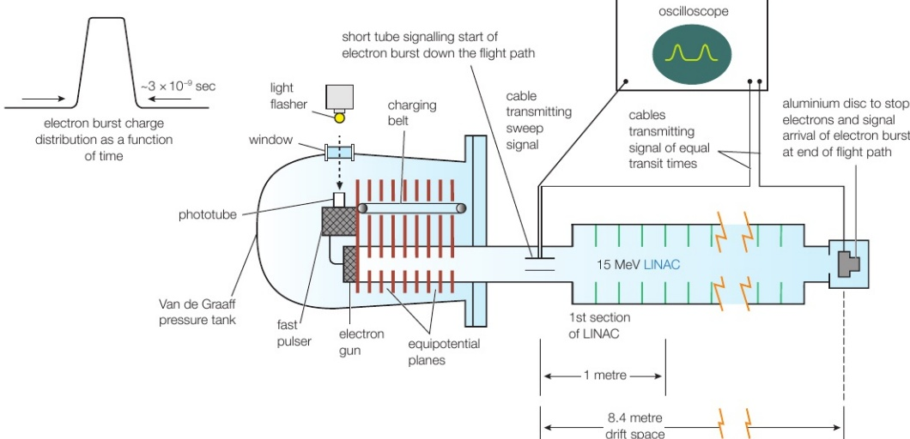

fig B Bertozzi's experiment to demonstrate that nothing can accelerate beyond the speed of light.

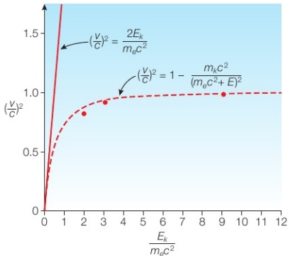

<table border=1 style='margin: auto; word-wrap: break-word;'><tr><td style='text-align: center; word-wrap: break-word;'>$ E_{{k}}(\text{{MeV}}) $</td><td style='text-align: center; word-wrap: break-word;'>$ \frac{E_{{k}}}{m_{{g}}C^{2}} $</td><td style='text-align: center; word-wrap: break-word;'>$ (\frac{v}{C})_{{obs}} $</td><td style='text-align: center; word-wrap: break-word;'>$ (\frac{v}{C})^{{2}}_{{obs}} $</td></tr><tr><td style='text-align: center; word-wrap: break-word;'>0.5</td><td style='text-align: center; word-wrap: break-word;'>1</td><td style='text-align: center; word-wrap: break-word;'>0.867</td><td style='text-align: center; word-wrap: break-word;'>0.752</td></tr><tr><td style='text-align: center; word-wrap: break-word;'>1.0</td><td style='text-align: center; word-wrap: break-word;'>2</td><td style='text-align: center; word-wrap: break-word;'>0.910</td><td style='text-align: center; word-wrap: break-word;'>0.828</td></tr><tr><td style='text-align: center; word-wrap: break-word;'>1.5</td><td style='text-align: center; word-wrap: break-word;'>3</td><td style='text-align: center; word-wrap: break-word;'>0.960</td><td style='text-align: center; word-wrap: break-word;'>0.922</td></tr><tr><td style='text-align: center; word-wrap: break-word;'>4.5</td><td style='text-align: center; word-wrap: break-word;'>9</td><td style='text-align: center; word-wrap: break-word;'>0.987</td><td style='text-align: center; word-wrap: break-word;'>0.974</td></tr><tr><td style='text-align: center; word-wrap: break-word;'>1.5</td><td style='text-align: center; word-wrap: break-word;'>30</td><td style='text-align: center; word-wrap: break-word;'>1.0</td><td style='text-align: center; word-wrap: break-word;'>1.0</td></tr></table>

fig C The solid curve represents the prediction for  $ \left(\frac{V}{C}\right)^2 $ according to Newtonian mechanics,

 $ \left(\frac{V}{C}\right)^2 = \frac{2E_k}{m_e c^2} $. The dashed curve represents the prediction of special relativity,  $ \left(\frac{V}{C}\right)^2 = 1 - \frac{m_e c^2}{(m_e c^2 + E_k)^2} $,

 $ m_e $ is the rest mass of an electron and c is the speed of light in a vacuum,  $ 3 \times 10^8 $ m s $ ^{-1} $. The solid circles are the data of Bertozzi's experiment. The table presents the observed values of  $ \left(\frac{V}{C}\right) $.

<!-- page 98 -->

## ACCELERATING PARTICLES IN CIRCLES

Scientists found it difficult to make linear accelerators which were longer and longer so they started to coil the accelerators up in a circle. This means that the particles could be accelerated in an electric field repeatedly in a smaller space. To do this, we use the fact that charged particles moving across a magnetic field will experience a centripetal force, and so will move in a circular path. We can work out the radius of this circular path, and use it to construct a circular accelerator of the right dimensions.

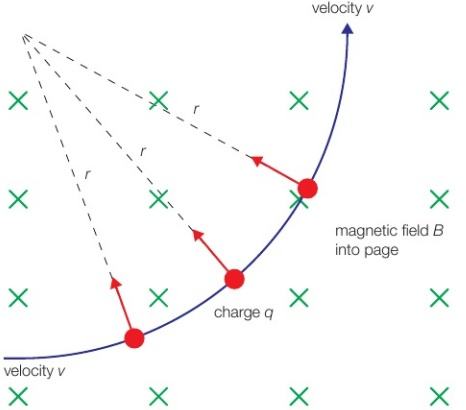

▲ fig D The circular trajectory of a charged particle moving across a magnetic field. Note that field lines can be shown coming out of a page by drawing a dot, and those going into a page (like the magnetic field here) can be shown by drawing a cross.

We have previously seen the equation for the force on a charged particle moving across a magnetic field (Section 6C.3):

 $$ \boldsymbol{F}=\boldsymbol{B}\boldsymbol{q}\boldsymbol{v} $$ 

This force acts at right angles to the velocity, v, meaning that the particle will follow a circular path. Remember that the equation for the centripetal force on anything moving in a circle (Section 5B.2) is:

 $$ F=\frac{mv^{2}}{r} $$ 

We can equate these two expressions:

 $$ Bqv=\frac{mv^{2}}{r} $$ 

Dividing out the velocity from each side, and rearranging to find an expression for the radius of the circle, gives:

 $$ r=\frac{mv}{Bq} $$ 

or:

 $$ r=\frac{p}{Bq} $$ 

This means that for a given magnetic field, the radius of the path of a charged particle is proportional to its momentum. At slow speeds, the radius is proportional to velocity (or the square root of the kinetic energy). However, these experiments generally send particles at speeds approaching the speed of light, so relativistic effects need to be accounted for. In particular, at these very high speeds the particle's mass appears to increase, which would also change its momentum. The overall result is that a particle increasing in speed would travel along an outwardly spiralling path.

## THE CYCLOTRON

In 1930, Ernest Lawrence developed the first cyclotron. This was a circular accelerator which could give protons about 1 MeV of energy.

In a cyclotron, there are two D-shaped electrodes (or dees), and the particles are accelerated in the electric field in the gap between them. Within the dees, the particle will travel along a semicircular path because of the magnetic field, before being accelerated across the gap again; then another semicircle, another acceleration across the gap, and so on. As each acceleration increases the momentum of the particle, the radius of its path within the dees increases, and so it steadily spirals outwards until it emerges from an exit hole and hits the target placed in a bombardment chamber in its path.

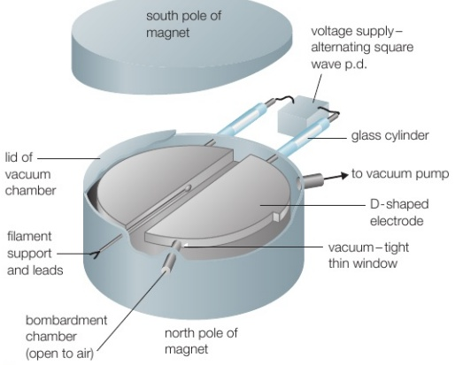

▲ fig E The structure of a cyclotron.

## CYCLOTRON FREQUENCY

In order to maintain the accelerations at exactly the correct time, the p.d. needs to switch direction exactly when the particle exits from one dee to move across the gap between them. This means the voltage supply has to follow a square wave pattern so that it flips polarity instantaneously.

The frequency of these polarity switches only depends on the particle being used and the strength of the magnetic field applied:

 $$ \begin{aligned}&f=\frac{1}{T}\\&T=\frac{2\pi r}{v}\\ \end{aligned} $$ 

During one complete period of the alternating voltage the particle will pass through both dees, thus completing a full circle at that radius.

However:

 $$ \begin{array}{c}r=\displaystyle\frac{mv}{Bq}\\ \therefore\quad T=\displaystyle\frac{2\pi mv}{Bqv}\\ T=\displaystyle\frac{2\pi m}{Bq}\end{array} $$

<!-- page 99 -->

$$ \therefore\quad f=\frac{Bq}{2\pi m} $$ 

So the frequency needed is independent of the radius. This means that a constant frequency can be used and the particle will complete each semicircle through a dee in the same time. That is, until the speed becomes so fast that mass changes through relativistic effects!

## THE SYNCHROTRON

Once the relativistic effects of mass increase are included in the equation for cyclotron frequency, it becomes:

 $$ f=\frac{Bq}{2\pi m_{0}}\times\sqrt{1-\frac{v^{2}}{c^{2}}} $$ 

Note that  $ m_0 $ is the particle's rest mass. This shows that the frequency of the applied accelerating potential difference depends on the velocity of the particles. So a cyclotron needs very complex circuitry which produces accurately timed polarity switches to enable it to generate high energy particle beams. The necessary electronics were first developed in 1945 and the 'synchronocyclotron' can accelerate particles to as much as 700 MeV.

With the development of varying frequency for the accelerating p.d., the next step was to vary the strength of the magnetic field using an electromagnet. This means that the radius of the particle beam's path could be kept constant by increasing the magnetic field strength in line with the increasing momentum. A single ring accelerator like this is called a synchrotron.

Alternate accelerating tubes and bending magnets can generate very high energy particle beams. For example, the Tevatron at Fermilab near Chicago, in the USA, could give particles 1 TeV of energy (Tera =  $ 10^{12} $). Alternatively, these rings can be used to store charged particles by making them circulate endlessly at a constant energy. This is a particularly important use when trying to store anti-matter, which will annihilate if it comes into contact with normal matter (see Section 7C.1).

## NINOVIUM: SCIENTISTS SOMETIMES CHEAT TOO

In 1999, the Lawrence Berkeley Laboratory in California published a paper claiming that they had produced an isotope of an element with atomic number 118. The paper claimed that they had succeeded in observing a chain of alpha decays following their collision of 449 MeV krypton-86 ions into a target of lead-208. The radioactive decay sequence was indicative of having started from element 118 – initially named ‘ninovium’ after the Bulgarian team leader Victor Ninov. No other lab in the world was able to reproduce the results, and after a two-year inquiry, it was found that Ninov had falsified the results. The Berkeley Lab retracted the paper, and Victor Ninov, who has continually maintained his innocence, was sacked.

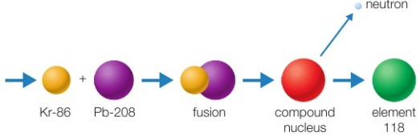

fig F The fusion reaction which was claimed to produce element 118.

In 2006, an accelerator facility in Dubna, Russia, working jointly with an American group from the Lawrence Livermore National Laboratory, claimed to have fused calcium-48 and californium-249 to produce Oganesson, element 118, with a mass number of 294.

The team used a particle accelerator to hit Cf-249 with high energy ions of Ca-48. With the previous problems surrounding this heavy element 118, the research team were very careful about the accuracy of their data, but it took ten years before the results were accepted as valid by the International Unions of Pure and Applied Chemistry, and of Pure and Applied Physics (IUPAC and IUPAP). Mark Stoyer, a nuclear chemist at Lawrence Livermore National Laboratory, who was part of the research team, said:

'We saw something interesting, and the way we've interpreted it, it's element 118. But you need someone else to duplicate it. A fundamental tenet of science is reproducibility.'

## CHECKPOINT

## SKILLS PROBLEM SOLVING

1. Why do the electrodes in a linear accelerator get progressively longer?

2. Lawrence's second cyclotron was 25 cm in diameter and accelerated protons to 1 MeV.

(a) Calculate the speed of these protons.

(b) Calculate the momentum of these protons

(c) Calculate the magnetic field strength Lawrence used in this cyclotron, assuming the protons move in a circle around the very edge of the machine.

(d) Calculate the frequency of the voltage that Lawrence had to apply to achieve this proton acceleration.

3. The Large Hadron Collider (LHC) is a giant circular accelerator near Geneva in Switzerland. The LHC website has some facts about it:

· the circular ring has a circumference of 27 km

each proton goes around over 11 000 times a second

• each proton has  $ 7 \times 10^{12} $ eV of kinetic energy.

(a) Calculate the speed of these protons.

(b) Calculate  $ \frac{1}{2}mv^2 $ for these protons using  $ mp = 1.67 \times 10^{-27} $ kg.

(c) How does your answer to (b) compare with the 7 TeV of kinetic energy the protons are given through p.d. acceleration?

(d) Explain the difference.

## SUBJECT VOCABULARY

linear accelerator a machine which accelerates charged particles along a straight line

cyclotron a circular machine that accelerates charged particles, usually following a spiral path

synchrotron a machine that accelerates charged particles around a fixed circular path

## EXAM HINT: EXTRA CONTENT

For the exam, you are only required to know about the linear accelerator and the cyclotron. You will not be asked questions about the synchrotron in the exam.

<!-- page 100 -->

## 7B 2 PARTICLE DETECTORS

## LEARNING OBJECTIVES

Describe the roles of electric and magnetic fields in particle detectors.

Apply conservation of charge, energy and momentum to interactions between particles and interpret particle tracks.

## PRINCIPLES OF DETECTION

## EXAM HINT: EXTRA CONTENT

Both school laboratory electron diffraction and Geiger and Marsden's alpha scattering experiment rely on observing light given off from a fluorescent screen when it is hit by a particle. In their alpha particle scattering experiment, Geiger and Marsden sat for two years in a dark room, for eight hours at a time, counting the flashes of light they saw through a microscope. Geiger found this so frustrating that he jointly invented the Geiger–Müller (GM) tube to detect particles, which could then be counted electronically.

For the exam, you are only required to know the general principles of the ionisation and electric fields used in such detectors. You do not have to know the details of the design for a GM tube.

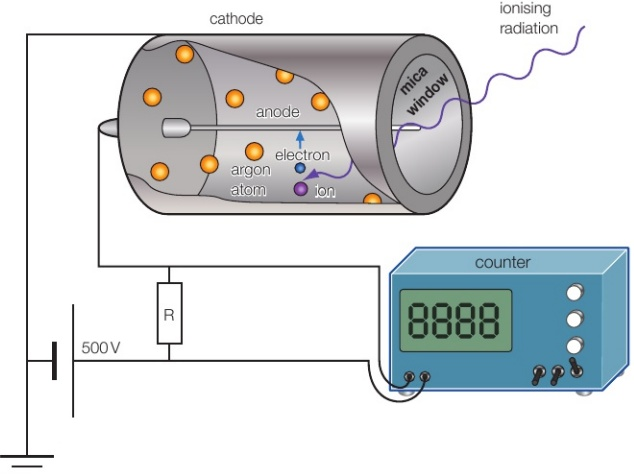

fig A The design of a Geiger-Müller detector.

The GM tube works on the principle that is common to most particle detectors: ionisation. As the particle to be detected passes through the tube, it ionises atoms of a gas (typically argon) which fills the tube. The ions and electrons produced are accelerated by an electric field between electrodes in the tube and then discharged when they reach the electrodes. This produces a pulse of electricity, which is counted by a counter connected to the tube. Many different types of detector have been invented by particle physicists, but the majority detect ionisation caused by the particles to be detected.

## ANALYSING DETECTIONS

Particle-counting detectors are useful, but they cannot distinguish between different types of particles. This is becoming very important in detectors. Modern particle physics experiments are carried out using such high energies that they can produce hundreds of different types of particles. Unless the detectors used in these experiments can identify properties of the particles, such as their energy, charge or mass, then the experimental results will be useless. In Section 6C.3 we saw how the mass spectrometer deflects an ion using a magnetic field. The ion can then be identified by the amount of deflection, since this is dependent on the mass and charge of the ion, and the strength and direction of the magnetic field used.

<!-- page 101 -->

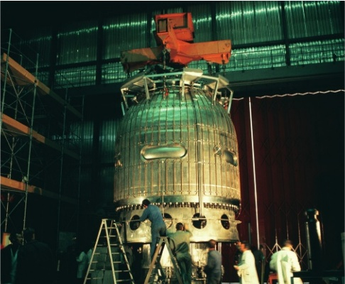

fig B A hydrogen bubble chamber.

Particle physics experiments took a major leap forward with the invention of the bubble chamber detector (fig B). Professor Siegbahn of the Swedish Academy of Sciences commented when presenting the 1960 Nobel Prize in Physics:

“Dr. Glaser, your invention of the ‘bubble chamber’ has opened up a new world for nuclear science. We can now observe with our own eyes all the strange processes which occur when high-energy beams from [particle accelerators] are directed into your chamber.”

Professor Siegbahn went on to explain that the bubble chamber acts like a combination of jet-plane vapour trails and the bubbles that suddenly appear when you open a bottle of fizzy drink. Superheated liquid hydrogen changes into bubbles of gas at any place where ions are generated within it. These bubbles can be observed within the liquid and the trails of bubbles show the paths of moving particles.

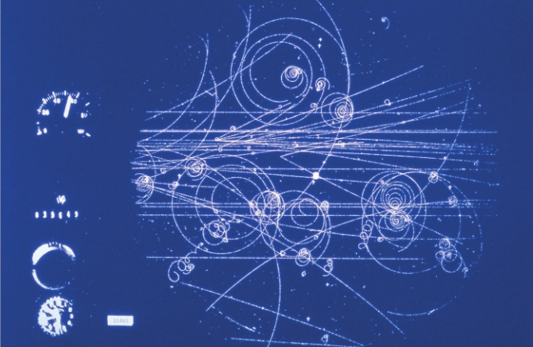

▲ fig C An image of particle tracks detected by a hydrogen bubble chamber.

The particle tracks in fig C show how particles can be tracked as they progress through a bubble chamber. Those affected by the magnetic field across it follow curved paths. The radius of curvature of the tracks will tell us the mass and charge of the particles in the same way that it does in the mass spectrometer. In addition, the picture allows us to analyse interactions as they happened, as the tracks sometimes end abruptly or have sharp changes in direction when they collide. In some cases, particle tracks appear to start from nothing. These show instances where particles have been created from uncharged particles that do not show.

<!-- page 102 -->

## WORKED EXAMPLE 1

Look at track A in fig D. If the magnetic field in the bubble chamber went at right angles to this picture and into the page, would the particle shown by track A be an electron or a positron (positively charged anti-electron)?

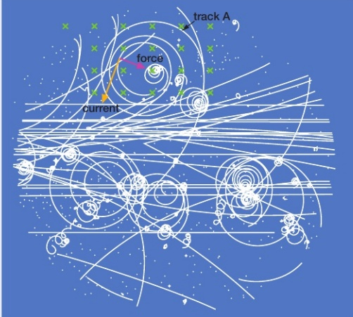

## fig D Fleming's left hand rule acting on the particle of track A

Using Fleming's left hand rule, with the index finger pointing into the page (magnetic field), the centripetal force shown by the thumb leaves the middle finger, indicating a current flowing, along the spiral inwards from the larger outside loops. The particle would be slowing down as it loses kinetic energy by ionising other particles in its path. The radius of curvature for these tracks is proportional to the velocity of the particle  $ \left(r = \frac{mv}{Bq}\right) $ so deceleration would cause the particle to spiral inwards. This means the particle must be travelling in the same direction along the track as the flow of conventional current, as defined in Fleming's left hand rule, so the particle must be positive – a positron.

## CHECKPOINT

## SKILLS PRODUCTIVITY, REASONING/ARGUMENTATION

1. Explain why ionisation is important in the operation of the Geiger-Müller tube.

2. In fig E, the red and yellow tracks show the creation of an electron and positron. Identify which track is the electron. The magnetic field goes into the page.

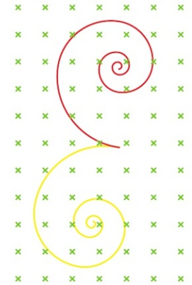

fig E The creation of an electron-positron pair.

3. Fig F was taken by Carl Anderson and published in Physical Review in March 1933 as evidence for a positively charged particle with the mass of an electron. He had discovered the positron.

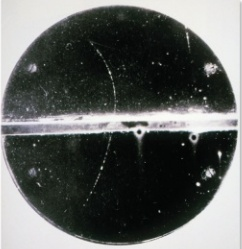

▲ fig F Anderson's positron track is the thin curving grey line.

The dark grey bar across the middle of the picture is a lead absorber that removes about two thirds of the particle's energy. Explain how you can tell that the particle is moving upwards in the picture.

## SUBJECT VOCABULARY

bubble chamber a particle detection system in which the particles cause bubbles to be created in a superheated liquid, typically hydrogen

<!-- page 103 -->

# 3 THE LARGE HADRON COLLIDER

## LEARNING OBJECTIVES

Discuss the role of the Large Hadron Collider in particle physics research.

Explain why high energies are required to investigate the structure of the nucleus.

## CERN'S BIG SYNCHROTRON

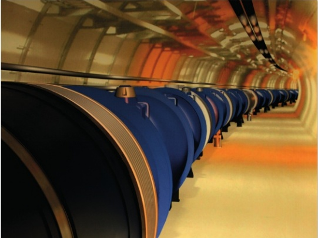

fig A Inside the Large Hadron Collider.

At the Organisation Européenne pour la Recherche Nucléaire (known by its older acronym CERN), or European Organisation for Nuclear Research, they have constructed the biggest machine in the history of planet Earth. This is the Large Hadron Collider (LHC) – a giant synchrotron over 8 km in diameter, built 100 metres underground on the border between Switzerland and France. At a total building cost of just under 4 billion euros, with staff from 111 nations involved in its building and operation, it is the largest experiment ever undertaken. When operating, its temperature is 1.9 K, making the LHC the coldest place in the Solar System (excluding colder experiments).

## FOUR SMASHING EXPERIMENTS

The machine is designed to collide protons into each other at energies of  $ 14\,TeV $ ( $ 14 \times 10^{12}\,eV $), travelling at  $ 99.9999991\% $ of the speed of light. These conditions are like those in the Universe 1 billionth of a second after the Big Bang. LHC scientists are hoping that this will then produce particles and interactions not seen since the Big Bang. In its first three years of operation, each collision had a total energy of up to 8 TeV. In 2015, collisions were made at energy levels of  $ 13\,TeV $. Such high energies can probe the structure of the nucleons themselves.

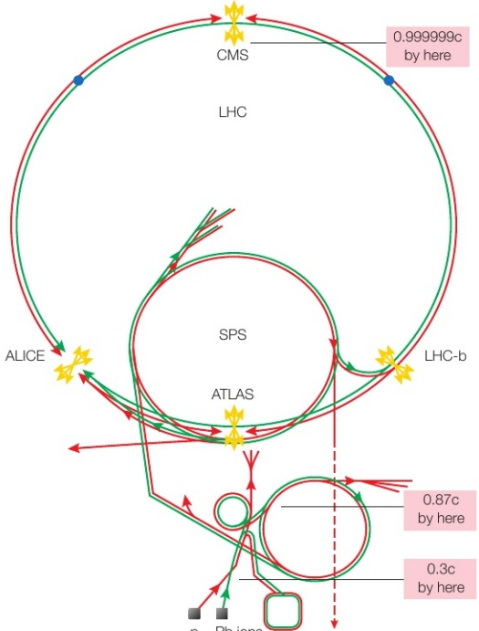

fig B An overview of the Large Hadron Collider.

At such high energies, the beams of protons moving in opposite directions around the 27 km ring will cross each other's paths 30 million times every second, resulting in 600 million collisions per second. There are four critical experiments in the LHC, each named by an acronym: CMS, LHCb, ATLAS and ALICE. Each of these experiments has an incredibly complex detector built around the accelerator, and one of the beam-crossing points is at the centre of each detector. Each one is designed to detect particular products from the collisions. Each is searching in several different ways for specific undiscovered, but theoretical, particles.

The detectors include strong magnetic fields and will detect and show the movements of particles through the space that the detector occupies. Mass-energy and momentum are always conserved in particle interactions, together with charge. This means that the records of particle tracks can be interpreted to identify the particles in the detector and any reactions that happen.

## THE COMPACT MUON SOLENOID (CMS)

One of the two teams that jointly announced discovery of the Higgs boson in July 2012 was from the CMS experiment

<!-- page 104 -->

(fig C). If the LHC achieves further exciting discoveries, they may come from this detector. There are several hypotheses in different areas of theoretical physics that may get confirmation evidence from the LHC. Some of these sound strange. For example, it is hoped that the CMS will observe mini black holes, dark matter, supersymmetric particles and gravitons.

The CMS is set up with various detecting chambers for different types of particle, and has 100 million individual detectors. These are in a 3D barrel containing as much iron as the Eiffel Tower in Paris. The charges and masses of particles can be calculated by monitoring the tracks of particles. The energies and momenta can also be measured and they must be conserved. This conservation means that all this information analysed together can identify all the particles and reactions in each collision.

## THE LARGE HADRON COLLIDER BEAUTY EXPERIMENT (LHCB)

This detector looks out for the decays of both the bottom quark (sometimes called beauty) and the charm quark by looking for mesons containing these. This is to work out why our Universe contains mostly matter and very little anti-matter. Theoretically the two should appear in equal amounts.

## A LARGE ION COLLIDER EXPERIMENT (ALICE)

Although ALICE initially observed the proton–proton collisions that the LHC started with, this detector is particularly intended to study the collisions of heavy ions, such as lead, accelerated to almost the speed of light. These collisions started in the second phase of LHC operation, and it is hoped they will create a quark-gluon plasma, which has been predicted by quantum mechanics theory.

## ATLAS

The ATLAS detector (fig D) is 45 m long and 25 m high. It was the other experiment to provide experimental data verifying a new particle that is likely to be the Higgs boson. Among its potential further discoveries to come are extra dimensions of space, microscopic black holes, and evidence for dark matter particles in the Universe. Originally, ATLAS was an acronym for A Toroidal Lhc Apparatus, but this has now been dropped and it is simply the name of the experiment.

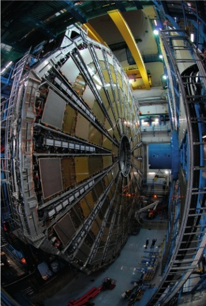

fig D The ATLAS experiment detector in the LHC.

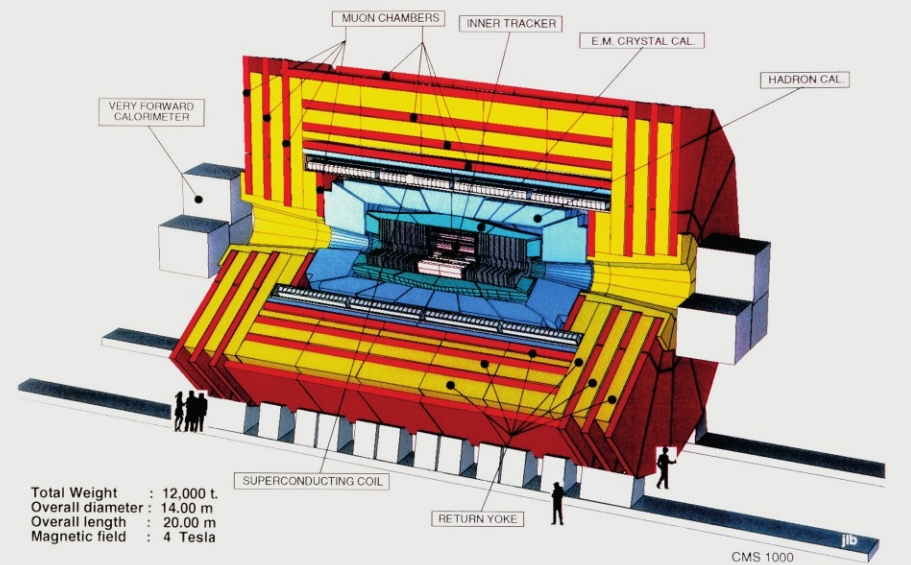

fig C Particle detection in the Compact Muon Solenoid (CMS).

<!-- page 105 -->

## WHAT MUST A DETECTOR BE CAPABLE OF DOING?

In developing the LHC experiments, the scientists had to work out what they needed the detectors to be able to do. The following nine points are listed on the ATLAS website as their aims.

1 Measure the directions, momenta and signs of charged particles.

2 Measure the energy carried by electrons and photons in each direction from the collision.

3 Measure the energy carried by hadrons (protons, pions, neutrons, etc.) in each direction.

4 Identify which charged particles from the collision, if any, are electrons.

5 Identify which charged particles from the collision, if any, are muons.

6 Identify whether some of the charged particles originate at points a few millimetres from the collision point rather than at the collision point itself (signaling a particle's decay a few millimetres from the collision point).

7 Infer (through momentum conservation) the presence of undetectable neutral particles such as neutrinos.

8 Have the capability to process the above information fast enough to permit flagging about 10–100 potentially interesting events per second out of the billion collisions per second that occur, and recording the measured information.

9 The detector must also be capable of long and reliable operation in a very hostile radiation environment.

## DID YOU KNOW?

When it is running, the Large Hadron Collider contains half of the helium on Earth.

## DATA ANALYSIS

In planning, CERN estimated the LHC would produce approximately 10% of the data produced through all human activities across the world. In 2017, the CERN data had stored 200 petabytes of data ( $ 2 \times 10^{17} $ bytes). To analyse the data from the complex detectors, a system of computer analysis called the Grid was developed. This enables thousands of computers across the world to be linked together via the internet in order that their combined computing power can be used to study the experimental results and search out any which indicate the new discoveries it is hoped the LHC will produce. Of every 10 billion collision results, only about 10–100 are ‘interesting’ reactions. The ones that show things we already know need to be quickly filtered out of the data so that computing power is not wasted.

## CHECKPOINT

1. What can the curvature of a particle's track tell us about its charge and mass?

2. How could momentum conservation help us to 'infer the presence of undetectable neutral particles such as neutrinos'?

## SKILLS ADAPTABILITY

3. Why do we need four separate detector machines to undertake the various different particle searches at the LHC?

## SKILLS PRODUCTIVITY, ETHICS, COMMUNICATION, NEGOTIATION

4. Do you think the cost of the LHC is justified? Explain your reasons for this answer.

## EXAM HINT: EXTRA CONTENT

You are not expected to know any details about the Large Hadron Collider in the exam. You are expected to know the principles that make any accelerator or detector work.

<!-- page 106 -->

## 7B THINKING BIGGER

# MEDICAL PARTICLE ACCELERATORS

SKILLS CRITICAL THINKING, PROBLEM SOLVING, INTERPRETATION, ADAPTIVE LEARNING, ADAPTABILITY, PRODUCTIVITY, COMMUNICATION

Particle accelerators can be used in medical applications. One of the most exciting possibilities is in cancer treatment, where a tumour is bombarded with high-energy particles, which can deliver energy to kill the cancerous cells. They can target a very small volume, so damage to surrounding tissue is less than with comparative treatments.

ONLINE ARTICLE

# CERN INTENSIFIES MEDICAL PHYSICS RESEARCH

CERN has transferred a great deal of technology into the field of medical physics over the years, from adaptation of its high-energy particle detectors for PET scanning to the design and development of dedicated accelerators for particle therapy. Now, CERN is consolidating all of its diverse activities in the medical physics arena, with the creation of a new office for medical applications, to be headed up by Steve Myers.

The LEIR conversion

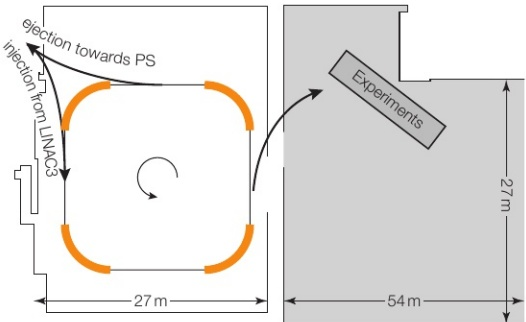

▲ fig A Redesign of the Low Energy Ion Ring at CERN for medical use.

One of the first projects that Myers will oversee is the transformation of CERN’s Low Energy Ion Ring (LEIR) into a biomedical facility. LEIR is a small accelerator currently used to pre-accelerate lead ions for injection into the Large Hadron Collider (LHC). But it only does this for several weeks each year, leaving a lot of spare beam time. Importantly, the ring also has an energy range that matches that of medical accelerators (440 MeV/u for carbon ions).

CERN has now confirmed that LEIR can be converted into a dedicated facility for biomedical research. This ‘BioLEIR’ facility will provide particle beams of different types at various energies for use by external researchers. Conveniently, there’s also a  $ 54 \times 27 $ m hall next to LEIR, currently used for storage, which could be developed into laboratory space.

Myers explained the rationale for developing such a facility. He pointed out that although protons and carbon ions are already in extensive clinical use for treating tumours, and other species such as oxygen and helium ions are under investigation, there's still a lack of controlled experiments that directly compare the effect of different ions on cancer cells under identical conditions.

And while existing clinical centres may well intend to perform such studies, once patient treatments begin, free accelerator time for research becomes extremely limited. 'The big advantage here is that we don't treat patients', said Myers. 'Our aim is to provide a service, so researchers don't have to do experiments at a clinical site, they can come here instead.'

As well as radiobiology experiments, LEIR is lined up for use in detector development, dosimetry studies and basic physics investigations such as ion beam fragmentation. The facility would work in the same way as particle physics experiments are carried out at CERN: researchers propose experiments, which are peer reviewed by a panel of experts who select suitable projects, and CERN controls the beam time allocation.

Before this can happen, however, LEIR needs some hardware modifications. These include a dedicated front-end that can accelerate many types of ion species, as well as a new extraction system and beamlines.

<!-- page 107 -->

## THINKING BIGGER

## SCIENCE COMMUNICATION

The article is from medicalphysicsweb, which is a community website hosted by the Institute of Physics through their publishing division.

1 Explain why the Institute of Physics would spend time and money developing a website that is about medical matters.

2 Describe what level of fundamental research is in this article, and how that affects the style of the writing here.

3 (a) Describe the level of language used in the article, in particular the scientific terminology used.

(b) Who do you think the intended audience is for this website, and how does that match with your answer to part (a)?

## INTERPRETATION NOTE

Consider information you might find on the Institute of Physics website's 'About Us' section. Also consider aims that you can find described in the Institute's charter: to promote the advancement and dissemination of a knowledge of and education in the science of physics, pure and applied, for the benefit of the public and the members of the Institute.

## PHYSICS IN DETAIL

Now we will look at the physics in detail. Some of these questions will link to topics elsewhere in this book, so you may need to combine concepts from different areas of physics to work out the answers.

4 (a) Explain how the various ions that are mentioned would be accelerated in the LEIR.

(b) What would be the difference in the motion of helium  $ 2^{+} $ ions compared with oxygen  $ 2^{+} $ ions, if each was accelerated through the same voltage in the LEIR?

5 (a) Explain why the LEIR was designed as a ring.

(b) How can accelerating ions be made to continually travel around a ring of constant radius?

6 One of the most exciting aspects of this kind of cancer treatment is that, unlike X-ray or gamma ray treatment, the delivery of energy increases as the ion reaches the target tumour. As the particle slows down, it can interact with many more nearby particles, losing energy more quickly.

Explain how this could be better for the patient than the more uniform delivery of energy along the entire path in X-ray treatment.

## PHYSICS TIP

Consider the equation for calculating kinetic energy.

## ACTIVITY

Imagine a similar website aimed at a younger audience. Rewrite this article for a readership under 16 years old.

## THINKING BIGGER TIP

Consider how the level of science must be lowered. What facts will you therefore need to leave out? How can you do this, but keep the interesting references to cancer treatment?

<!-- page 108 -->

# 7B EXAM PRACTICE

1 An electron moving at  $ 2.05 \times 10^4 \, \text{km} \, \text{s}^{-1} $ is made to move in a circular path by a  $ 0.98 \, \text{T} $ magnetic field applied perpendicular to its velocity. The radius of the circle that the electron travels in is:

A  $ 1.19 \times 10^{-7} $ m

B 0.119mm

C 8400m

D  $ 1.31 \times 10^{26} $ m.

(Total for Question 1 = 1 mark)

2 The diagram shows the track of a charged particle travelling in a bubble chamber detector, in which the magnetic field goes into the page.

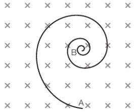

The particle:

A is negative and moves from A to B

B is positive and moves from A to B

C is negative and moves from B to A

D is positive and moves from B to A.

(Total for Question 2 = 1 mark)

3 In order to investigate the structure of the nucleus, high energies are needed. One reason for this is that:

A The radius of circular motion of a particle in a cyclotron is proportional to the kinetic energy.

B The nucleus can only be ionised by high energy particles.

C The nucleus will absorb low energy particles.

D The de Broglie wavelength is inversely proportional to a particle's velocity. [1]

(Total for Question 3 = 1 mark)

4 A strong magnetic field of flux density B can be used to trap a positive ion by making it follow a circular orbit, as shown.

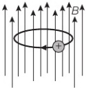

(a) Explain how the magnetic field maintains the ion in a circular orbit. You may add to a copy of the diagram above if you wish.

(b) Show that the mass $m$ of the ion will be given by $m=\frac{Bq}{2\pi f}$

where q is the charge on the ion and f is the number of revolutions per second.

(c) The above arrangement will not prevent a positive ion from moving vertically. To do this, a weak electric field is applied using the arrangement shown below.

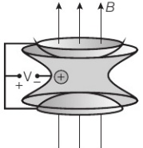

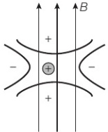

(i) Explain how the electric field prevents the ion moving vertically.

(ii) This device is known as a Penning Trap. It can be used to determine the mass of an ion to an accuracy of 3 parts in 10 million.

Show that the mass of a sulfur ion can be measured to the nearest 0.00001 u.

mass of sulfur ion = 32.0645 u

'u' is an abbreviation for the atomic mass unit. 1 u is equivalent to 931.5 MeV. [2]

(iii) Under certain conditions, nuclei of sulfur emit a gamma ray with a known energy of 2.2 MeV. Calculate the resulting loss in mass of a sulfur ion in u and show that this value could be determined by the Penning Trap technique.

(Total for Question 4 = 11 marks)

<!-- page 109 -->

## EXAM PRACTICE

## 5 (a) A cyclotron can be used to accelerate charged particles

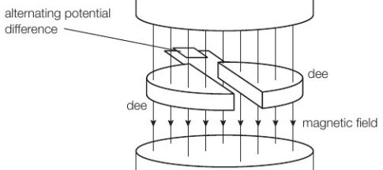

Explain the purpose of the magnetic field in the cyclotron. You may add to a copy of the diagram if you wish. [2]

(b) A beam of low-speed protons are introduced into a cyclotron.

(i) Show that the number of revolutions per second, f, completed by the protons is given by

 $$ f=\frac{eB}{2\pi m} $$ 

where e is the electronic charge

B is the uniform magnetic flux density within the cyclotron

m is the mass of the proton.

(ii) An alternating potential difference is placed across the two dees to increase the energy of the protons. Explain why the potential difference that is used is alternating. [2]

(iii) Initially, whilst the proton speeds are low, the frequency at which the potential difference has to alternate is constant.

Explain how the frequency must change as the protons gain more and more energy.

(c) In the Large Hadron Collider at CERN, protons follow a circular path with speeds close to the speed of light. X-rays can be produced by free protons which are accelerating. Explain why this provides a source of X-rays, despite the speeds of the protons being constant. [2]

(Total for Question 5 = 11 marks)

6 Explain the structure of linear particle accelerators and cyclotron accelerators, including the role of electric and magnetic fields in each.

(Total for Question 6 = 6 marks)

