# 7C The particle zoo

<!-- edx_ial_phy2.pdf p110-125 -->

<!-- page 110 -->

# TOPIC 7 NUCLEAR AND PARTICLE PHYSICS

# 7C THE PARTICLE ZOO

On 4 July 2012, there was a press conference at CERN, the particle physics experiments lab near Geneva, when the discovery of a particle believed to be the Higgs boson was announced. This particle was predicted in the 1960s as the final component in the Standard Model. Physicists were excited by CERN's discovery, as this is experimental confirmation of the only piece of the Standard Model that had not yet been confirmed to exist. And its mass was very close to a theoretically predicted value. The scientific system of subatomic particles was completed. Experimental evidence of previous predictions is the foundation for the strongest scientific conclusions. This means that the Standard Model is a strong theory, and any corrections or alterations are now likely to be very minor.

In this chapter, we will show the Standard Model, so that you can see how the few particles you already know fit into the overall theory. These particles are the fundamental building blocks of our Universe. How they interact is what determines the development and structure of everything there is. Everything you will ever see is a consequence of the ideas in this chapter!

## MATHS SKILLS FOR THIS CHAPTER

• Recognising and use of appropriate units (e.g. converting joules and electronvolts)

Considering orders of magnitude (e.g. comparing the different generations of particles)

• Changing the subject of an equation (e.g. calculating photon frequencies)

Use of standard form (e.g. using photon frequencies)

- Substituting numerical values into equations using appropriate units (e.g. calculating matter conversions into energy)

<!-- page 111 -->

## What prior knowledge do I need? Topics 1B, 4B and 5A

The conservation of momentum, charge and energy

## Topic 7B

The structure and functioning of linear particle accelerators

The structure and functioning of circular particle accelerators

The detection and identification of subatomic particles

How to interpret particle tracks in particle detectors

Deeper matter probing experiments, including the Large Hadron Collider

## What will I study in this chapter?

The different fundamental particles that have been discovered

What anti-matter is

Interactions between fundamental particles

Further conservation laws for particle interactions

The Standard Model

## What will I study later? Topic 9A

The types of nuclear radiation and the reactions creating them

Nuclear fission

Nuclear fusion

## Topic 11B

The importance of particles in stars and between stars

The interactions of dark matter

<!-- page 112 -->

## 1 PARTICLE INTERACTIONS

## LEARNING OBJECTIVES

Use the equation  $ \Delta E = c^2 \Delta m $ in situations involving the creation and annihilation of matter and anti-matter particles. Use and convert between MeV, GeV and  $ \frac{\text{MeV}}{c^2} $,  $ \frac{\text{GeV}}{c^2} $.

## CREATION

The implication from most creation stories is that, from nothing, the material of the Earth was brought into being by an unexplained entity. However, one of Einstein's most important theories suggests exactly this – matter can appear where previously there was nothing but energy. Matter and energy are regularly interchanged in the Universe according to his well-known equation,  $ E = mc^{2} $. In this equation, multiplying the mass of an object by the square of the speed of light gives the equivalent amount of energy:

 $$ \Delta E=c^{2}\times\Delta m $$ 

Given a suitable quantity of energy, such as that in a gamma ray photon, particles can spontaneously appear and the energy disappears from existence. This is so common in the Universe that it should not surprise us. The reason it does is that these events only happen on a sub-atomic scale, so we cannot detect them without complex machines.

## WORKED EXAMPLE 1

A gamma ray photon converts into an electron and a positron (an anti-electron that has an identical mass to the electron). Calculate the frequency of the gamma photon.

Mass of an electron:  $ m_e = 9.11 \times 10^{-31} $ kg.

 $$ \Delta E=c^{2}\times\Delta m=(3\times10^{8})^{2}\times9.11\times10^{-31} $$ 

 $$ \Delta E=8.2\times10^{-14}\,\text{J} $$ 

This is the amount of energy needed to produce an electron or a positron so, to produce both, the energy of the photon must be double this:  $ 16.4 \times 10^{-14} $ J.

 $$ E=h f $$ 

 $$ f=\frac{E}{h}=\frac{16.4\times10^{-14}}{6.63\times10^{-34}} $$ 

 $$ f=2.47\times10^{20}Hz $$ 

This reaction is known as electron–positron pair production. In momentum terms, it is just like an explosion. Initially only the photon existed so there was some linear momentum. Along this initial direction, their components of momentum must sum to the same total as the photon had. Perpendicular to the initial momentum, the electron and positron that were produced must have equal and opposite components of momentum so that in this direction it will still total zero afterwards.

In any reaction, the total combination of matter-energy must be conserved. If we add the energy equivalent of all matter particles with the energies, before and after the reaction, the numbers must be equal.

## LEARNING TIP

All matter particles have an anti-matter equivalent. Anti-particles have the same mass, but all their other properties are opposite to those of the normal matter particle.

## ANNIHILATION

Matter can appear spontaneously through a conversion from energy. In the same way, energy can appear through the disappearance of mass. This is the source of energy in nuclear fission and fusion. In both reactions, the sum of the masses of all matter involved before the reaction is greater than the sum of all mass afterwards. This mass difference is converted into energy (see Section 9A.3). In a nuclear power station we extract this energy as heat and use it to drive turbines to generate electricity.

If a particle and its anti-particle meet (anti-particles are the anti-matter versions of regular particles – see Section 7C.2), they will disappear to be replaced by the equivalent energy: we call this interaction annihilation. This reaction was supposedly the main power source to drive the starship Enterprise in the science fiction series Star Trek (fig A). Annihilation reactors could not be used as a power source on Earth, as anti-matter exists so rarely. Also, if we could find a supply of anti-matter, it would annihilate on contact with matter. This would most likely be before it reached the reaction chamber we had set up to use the energy for conversion into electricity.

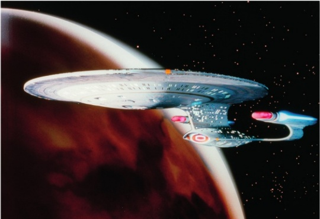

fig A The fictional starship Enterprise was said to be powered by a matter-anti-matter annihilation reaction.

<!-- page 113 -->

## ELECTRONVOLT UNITS

We have seen (in Book 1 Section 4A.2) the electronvolt (eV) as a unit for very small amounts of energy. Remember that one electronvolt is the amount of energy gained by an electron when it is accelerated through a potential difference of one volt. This is equivalent to  $ 1.6 \times 10^{-19} $ joules, so it is a very small amount of energy, even in particle physics terms. It is common for particles to have millions or even billions of electronvolts. For this reason we often use MeV and GeV as units of energy in particle interactions.

The atomic mass unit, u, is not an SI unit but is often used in particle interactions, as it is usually easier to understand. 1 u = 1.66 × 10^{-27} kg. As we know that energy and mass are connected by the equation  $ \Delta E = c^2 \Delta m $, we can also have mass units which are measures of  $ E/c^2 $, such as MeV/c^2 and GeV/c^2. 1 u of mass is equivalent to about 931.5 MeV/c^2.

## CHECKPOINT

## SKILLS INTERPRETATION, ADAPTIVE LEARNING

1. A positron with kinetic energy 2.2 MeV collides with an electron at rest, and they annihilate each other.

(a) Calculate the energy of each of the two identical gamma photons produced as a result of the annihilation.

(b) Calculate the frequency of these gamma photons.

2. In 1977, in an accelerator at Fermilab, the upsilon particle was discovered. Its mass was determined as 9.46 GeV/c $ ^{2} $. What is the mass of the upsilon particle in kilograms?

3. A gamma ray photon travelling through space spontaneously converts into an electron and a positron.

(a) Explain why the two new particles must move in opposite directions to each other.

(b) A scientist observes a similar event in a detector and the incoming photon had a frequency of  $ 4.89 \times 10^{20} $ Hz. He sees that the tracks of the electron and positron from the reaction are  $ 160^\circ $ apart and hypothesises that a third particle must be produced. Calculate the mass of this third particle in MeV/c $ ^2 $.

4. Look at fig B, which shows tracks in a hydrogen bubble chamber. One anti-proton hits a proton in the chamber. The resulting tracks show the tracks of various pairs of particles ( $ \pi^+\pi^- $,  $ e^+/e^- $) which are created in the collision.

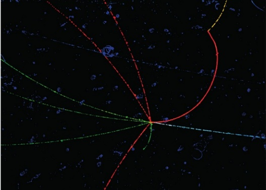

▲ fig B Tracks in a hydrogen bubble chamber that has been bombarded with anti-protons.

(a) Identify the incoming anti-proton track.

(b) How did you identify the incoming anti-proton? What does this tell you about its kinetic energy compared to the resulting particles?

(c) How does the picture illustrate the conservation of matter/energy?

(d) Identify any pair of particles (e.g.,  $ e^{+}/e^{-} $). How do you know that the tracks show you a pair of identical but opposite particles?

(e) How does the picture illustrate conservation of charge?

(f) How does the picture illustrate the conservation of momentum in two dimensions?

## WORKED EXAMPLE 2

Calculate the mass in kilograms of 1 MeV/c^{2}.

 $$ \begin{aligned}1\ MeV&=1\times10^{6}\times1.6\times10^{-19}\\&=1.6\times10^{-13}J\end{aligned} $$ 

In SI units,  $ c = 3 \times 10^8 \, \text{m} \, \text{s}^{-1} $

 $$ 1MeV/c^{2}=\frac{1.6\times10^{-13}}{(3\times10^{8})^{2}} $$ 

 $$ 1\ M e V/c^{2}=1.78\times10^{-30}k g $$ 

This is about twice the mass of an electron.

## LEARNING TIP

No particle interactions can occur if they break any of these conservation rules:

• momentum

• mass-energy

• charge.

There are also other rules that must be obeyed, but these three are critical, as all particles involved will have some of each property.

## SUBJECT VOCABULARY

## pair production the

pair production the phenomenon in which a particle and its anti-matter equivalent are both created simultaneously in a conversion from energy

annihilation the phenomenon

in which a particle and its

anti-matter equivalent are both

destroyed simultaneously in a

conversion into energy which

is carried away by force carrier

particles, such as photons

electronvolt the amount of

energy an electron gains by

passing through a voltage of 1 V;

1 eV = 1.6 × 10⁻¹⁹ J, 1 mega

electronvolt = 1 MeV = 1.6 × 10⁻¹³ J

<!-- page 114 -->

# 7C 2 THE PARTICLE ZOO

## LEARNING OBJECTIVES

Define leptons and quarks in the Standard Model.

Describe how the symmetry of the Standard Model predicted the existence of top quark.

Explain that every particle has an anti-particle.

☑ Deduce the properties of particles and their anti-particles.

## THE STANDARD MODEL

After a century in which scientists rapidly discovered many sub-atomic particles, they have now established a theory for how these come together to construct the things we see around us. This theory is known as the Standard Model. The idea of the atom as indivisible was swept aside by Rutherford and Thomson, and the idea of the proton and neutron as being fundamental has also been overturned. We have probed inside these two nucleons and discovered that each is constructed from smaller particles known as quarks. The electron is still considered fundamental. However, it has two partners – similar types of particles – and each has a neutrino associated with it, forming a group of six fundamental particles, known as leptons.

Scientists like to see the Universe as balanced, or symmetrical, and we have now found that quarks are also a group of six, although only the lightest two are found in protons and neutrons. The heavier quarks are found in rarer particles. The two groups are different because quarks can undergo interactions via the strong nuclear force, but leptons do not experience the strong force. It is the strong nuclear force that binds nucleons together in the nucleus. In each group of six, there are three pairs with a similar order of magnitude for mass, and these are known as the three generations of matter (fig A).

<table border=1 style='margin: auto; word-wrap: break-word;'><tr><td style='text-align: center; word-wrap: break-word;'>GENERATION</td><td style='text-align: center; word-wrap: break-word;'>NAME</td><td style='text-align: center; word-wrap: break-word;'>SYMBOL</td><td style='text-align: center; word-wrap: break-word;'>CHARGE</td><td style='text-align: center; word-wrap: break-word;'>MASS ( $ MeV/c^{2} $)</td></tr><tr><td style='text-align: center; word-wrap: break-word;'>I</td><td style='text-align: center; word-wrap: break-word;'>electron</td><td style='text-align: center; word-wrap: break-word;'>$ e^{-} $</td><td style='text-align: center; word-wrap: break-word;'>-1</td><td style='text-align: center; word-wrap: break-word;'>0.511</td></tr><tr><td style='text-align: center; word-wrap: break-word;'>I</td><td style='text-align: center; word-wrap: break-word;'>electron neutrino</td><td style='text-align: center; word-wrap: break-word;'>$ v_{e} $</td><td style='text-align: center; word-wrap: break-word;'>0</td><td style='text-align: center; word-wrap: break-word;'>0 (&lt;2.2  $ \times $ 10 $ ^{-6} $)</td></tr><tr><td style='text-align: center; word-wrap: break-word;'>II</td><td style='text-align: center; word-wrap: break-word;'>muon</td><td style='text-align: center; word-wrap: break-word;'>$ \mu $</td><td style='text-align: center; word-wrap: break-word;'>-1</td><td style='text-align: center; word-wrap: break-word;'>106</td></tr><tr><td style='text-align: center; word-wrap: break-word;'>II</td><td style='text-align: center; word-wrap: break-word;'>muon neutrino</td><td style='text-align: center; word-wrap: break-word;'>$ v_{\mu} $</td><td style='text-align: center; word-wrap: break-word;'>0</td><td style='text-align: center; word-wrap: break-word;'>0 (&lt;0.17)</td></tr><tr><td style='text-align: center; word-wrap: break-word;'>III</td><td style='text-align: center; word-wrap: break-word;'>tau</td><td style='text-align: center; word-wrap: break-word;'>$ \tau $</td><td style='text-align: center; word-wrap: break-word;'>-1</td><td style='text-align: center; word-wrap: break-word;'>1780</td></tr><tr><td style='text-align: center; word-wrap: break-word;'>III</td><td style='text-align: center; word-wrap: break-word;'>tau neutrino</td><td style='text-align: center; word-wrap: break-word;'>$ v_{\tau} $</td><td style='text-align: center; word-wrap: break-word;'>0</td><td style='text-align: center; word-wrap: break-word;'>0 (&lt;20)</td></tr></table>

table A The family of leptons. These do not experience the strong nuclear force.

## EXAM HINT: EXTRA CONTENT

The strong nuclear force will not be in your exams.

<table border=1 style='margin: auto; word-wrap: break-word;'><tr><td style='text-align: center; word-wrap: break-word;'>GENERATION</td><td style='text-align: center; word-wrap: break-word;'>NAME</td><td style='text-align: center; word-wrap: break-word;'>SYMBOL</td><td style='text-align: center; word-wrap: break-word;'>CHARGE</td><td style='text-align: center; word-wrap: break-word;'>MASS  $ GeV/c^{2} $</td></tr><tr><td style='text-align: center; word-wrap: break-word;'>I</td><td style='text-align: center; word-wrap: break-word;'>up</td><td style='text-align: center; word-wrap: break-word;'>u</td><td style='text-align: center; word-wrap: break-word;'>$ \frac{2}{3} $</td><td style='text-align: center; word-wrap: break-word;'>0.0023</td></tr><tr><td style='text-align: center; word-wrap: break-word;'>I</td><td style='text-align: center; word-wrap: break-word;'>down</td><td style='text-align: center; word-wrap: break-word;'>d</td><td style='text-align: center; word-wrap: break-word;'>$ -\frac{1}{3} $</td><td style='text-align: center; word-wrap: break-word;'>0.0048</td></tr><tr><td style='text-align: center; word-wrap: break-word;'>II</td><td style='text-align: center; word-wrap: break-word;'>strange</td><td style='text-align: center; word-wrap: break-word;'>s</td><td style='text-align: center; word-wrap: break-word;'>$ -\frac{1}{3} $</td><td style='text-align: center; word-wrap: break-word;'>0.095</td></tr><tr><td style='text-align: center; word-wrap: break-word;'>II</td><td style='text-align: center; word-wrap: break-word;'>charm</td><td style='text-align: center; word-wrap: break-word;'>c</td><td style='text-align: center; word-wrap: break-word;'>$ \frac{2}{3} $</td><td style='text-align: center; word-wrap: break-word;'>1.275</td></tr><tr><td style='text-align: center; word-wrap: break-word;'>III</td><td style='text-align: center; word-wrap: break-word;'>bottom</td><td style='text-align: center; word-wrap: break-word;'>b</td><td style='text-align: center; word-wrap: break-word;'>$ -\frac{1}{3} $</td><td style='text-align: center; word-wrap: break-word;'>4.19</td></tr><tr><td style='text-align: center; word-wrap: break-word;'>III</td><td style='text-align: center; word-wrap: break-word;'>top</td><td style='text-align: center; word-wrap: break-word;'>t</td><td style='text-align: center; word-wrap: break-word;'>$ \frac{2}{3} $</td><td style='text-align: center; word-wrap: break-word;'>173</td></tr></table>

table B The family of quarks. These are subject to the strong nuclear force.

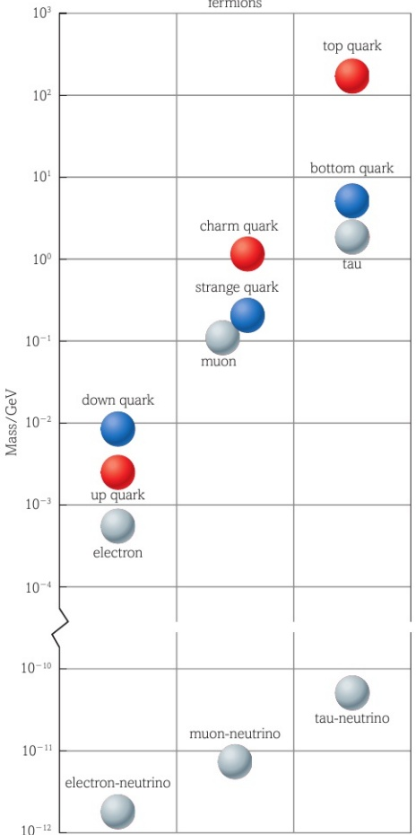

fig A The masses of particles in the Standard Model increase over generations.

<!-- page 115 -->

Only the first three quarks – up, down and strange – were known from the middle part of the twentieth century, and the charm quark was discovered in 1974. The symmetry of the Standard Model indicated to scientists that there were other particles they had never observed, which should exist – the bottom and top quark. Experiments were carried out to find these and the accelerator experiments at Fermilab discovered bottom in 1977 and top in 1995.

Current particle theory believes that all matter in the Universe is constructed from combinations of some of these 12 particles, and no others. Each of the 12 particles listed in tables A and B also has an anti-particle. The anti-particles have the same mass but all their other properties are opposite to those of the normal matter particle. To write the symbol for an anti-particle, it is the same as the normal particle, with a bar above the symbol. For example, the charge on an anti-down quark is  $ + \frac{1}{3} $ and its symbol is  $ \bar{d} $. In a few cases, the anti-particle notation treats it as a different particle in its own right and the bar may not be used. The positron (anti-electron) does not use a bar but is written as  $ e^{+} $.

## DID YOU KNOW?

## THE HIGGS BOSON

One of the aims for CERN's Large Hadron Collider (LHC) experiment was that it would discover the Higgs boson. This was theoretically suggested independently by both Peter Higgs and the team of Francois Englert and Robert Brout, in 1964. Itself very massive, the Higgs particle is the means by which particles get mass. Remember that one of the key points about mass is that it gives objects inertia – the reluctance to change velocity. So an electron suffers less of this effect from the Higgs field than a proton, and so it has less mass. The Higgs mechanism (how this field imparts mass) is not easy to describe in everyday terms.

On 4 July 2012, two LHC experiment teams, ATLAS and CMS, jointly announced that they had discovered a particle which matched the predicted interactions of the Higgs boson, and the mass of this new particle was approximately 125 GeV/c $ ^{2} $. Whilst the LHC scientists were reluctant to confirm it as the Higgs boson at the time, the new particle discovery was good enough for Higgs and Englert to be jointly awarded the 2013 Nobel Prize in Physics. Brout had unfortunately died a year before the experimental discovery was confirmed.

## CHECKPOINT

## SKILLS PROBLEM SOLVING

1. An anti-electron is called a positron. Why is it usually written with the symbol  $ e^{+} $?

2. What is the difference between:

(a) a quark and a lepton?

(b) a quark and an anti-quark?

(c) an electron and a muon?

3. ▶ (a) Having discovered up, down, strange, charm and bottom quarks, why did scientists undertake similar experiments using higher and higher energies?

(b) The properties of the top quark that they discovered are shown in table B. What properties would an anti-top quark have?

4. Look at fig A and consider the three generations of neutrino, compared with the other fundamental particles in the Standard Model.

(a) Why are the masses of the neutrinos surprising?

(b) How do the neutrinos' masses follow the same trends as the other particles in the three generations?

## SUBJECT VOCABULARY

Standard Model the name given to the theory of all the fundamental particles and how they interact. This is the theory that currently has the strongest experimental evidence

quarks the six fundamental particles that interact with each other using the strong nuclear force (as well as all other forces)

fundamental particles the most basic particles that are not made from anything smaller. These can be combined to create larger particles

leptons the six fundamental particles which do not interact using the strong nuclear force, only the other three fundamental forces

anti-particle has the same mass but all their other properties are opposite to those of the normal matter particle

<!-- page 116 -->

# 7C 3 PARTICLES AND FORCES

## LEARNING OBJECTIVES

Define baryons, mesons and photons in the Standard Model.

Explain why high energies are required to investigate fundamental particles.

## BARYONS

If three quarks are combined together, the resulting particle is a baryon (fig A). Protons and neutrons are baryons. A proton consists of two up quarks and a down quark, whilst a neutron is two down quarks combined with an up quark. Other baryons are more obscure and have very short lives, as they decay through a strong nuclear force reaction that makes them highly unstable. Yet other baryons, like the sigma, omega and lambda particles, decay via the weak nuclear force and are longer lived, with lives as long as  $ 10^{-10} $ seconds!

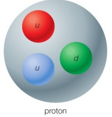

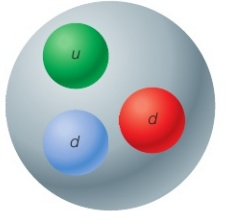

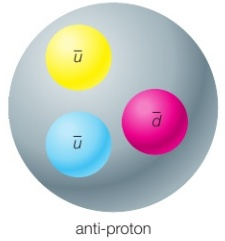

neutron

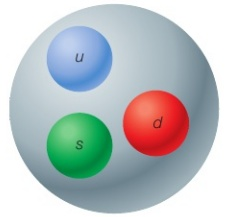

fig A Three-quark baryons. Three anti-quarks in the anti-proton make it an anti-baryon.

## MESONS

If a quark and an anti-quark are combined together, the resulting particle is known as a meson (fig B). The pion and the kaon are the most common examples of mesons. A  $ \pi^+ $ meson ( $ u\bar{d} $) consists of an up quark (u) combined with an anti-down ( $ \bar{d} $) quark. If a meson is a combination of a quark and its anti-quark, then the meson's charge must be zero. This is the case for the J/ $ \psi $ particle, which was first discovered in 1974 by two independent researchers at separate laboratories. Its slow decay, with a lifetime of  $ 7.2 \times 10^{-21} $ s, occurred when it was not travelling at relativistic speeds, so was a genuine and unexpected long lifetime. This did not fit the pattern generated by up, down and strange quarks, and it is thought to be a charm–anti-charm combination ( $ c\bar{c} $). The two independent discoverers of this, Richter and Ting, shared the 1976 Nobel Prize for their discovery of the fourth quark.

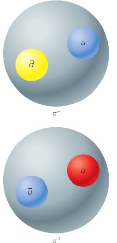

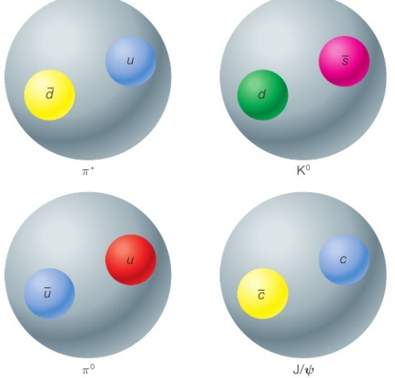

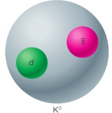

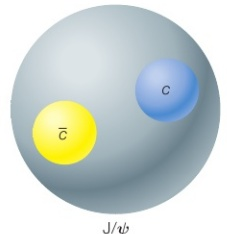

fig B Mesons are formed from quark-anti-quark combinations.

## HADRONS

Quarks can interact via the strong nuclear force. Thus baryons and mesons can interact via the strong nuclear force. Any particle which experiences the strong force is called a hadron. So, baryons and mesons are both hadrons. Leptons do not experience the strong force and so are in a separate class of particle from the hadrons.

## THE FOUR FORCES OF NATURE

There are four other particles that we have not yet mentioned here, because they are not matter particles. These are known together as  **exchange** bosons. The matter particles interact by the four forces of nature, which are gravity, the electromagnetic force, the strong nuclear force and the weak nuclear force. Each force acts on particles which have a specific property, such as mass in the case of gravity, or electric charge for the electromagnetic force. The process by which these forces act has been modelled by scientists as an exchange of another type of particles – the exchange bosons. For example, for a proton and an electron to attract each other's opposite charge, they pass photons backwards and forwards between each other.

<!-- page 117 -->

# EXAM HINT: EXTRA CONTENT

The exam specification does not include all the exchange bosons, but you do have to know about photons.

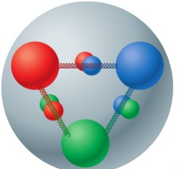

fig C Gluons 'in combination with virtual quark anti-quark pairs' are exchanged between quarks to hold the quarks together. In this example, the three quarks form a proton.

This has been shown experimentally to be an appropriate model for the electromagnetic, strong and weak forces. In the case of gravity, the so-called graviton has been theoretically invented to complete the model, but gravitons are yet to be discovered. Many experiments have been set up recently to try and detect gravitons.

<table border=1 style='margin: auto; word-wrap: break-word;'><tr><td style='text-align: center; word-wrap: break-word;'>FORCE</td><td style='text-align: center; word-wrap: break-word;'>EXCHANGE BOSON</td><td style='text-align: center; word-wrap: break-word;'>BOSON SYMBOL</td><td style='text-align: center; word-wrap: break-word;'>BOSON CHARGE</td><td style='text-align: center; word-wrap: break-word;'>BOSON MASS ( $ GeV/c^{2} $)</td></tr><tr><td style='text-align: center; word-wrap: break-word;'>electromagnetic</td><td style='text-align: center; word-wrap: break-word;'>photon</td><td style='text-align: center; word-wrap: break-word;'>$ \gamma $</td><td style='text-align: center; word-wrap: break-word;'>0</td><td style='text-align: center; word-wrap: break-word;'>0</td></tr><tr><td rowspan="3">weak nuclear</td><td rowspan="3">W or Z boson</td><td style='text-align: center; word-wrap: break-word;'>$ W^{-} $</td><td style='text-align: center; word-wrap: break-word;'>-1</td><td style='text-align: center; word-wrap: break-word;'>80.4</td></tr><tr><td style='text-align: center; word-wrap: break-word;'>$ W^{+} $</td><td style='text-align: center; word-wrap: break-word;'>+1</td><td style='text-align: center; word-wrap: break-word;'>80.4</td></tr><tr><td style='text-align: center; word-wrap: break-word;'>$ Z^{0} $</td><td style='text-align: center; word-wrap: break-word;'>0</td><td style='text-align: center; word-wrap: break-word;'>91.2</td></tr><tr><td style='text-align: center; word-wrap: break-word;'>strong nuclear</td><td style='text-align: center; word-wrap: break-word;'>gluon</td><td style='text-align: center; word-wrap: break-word;'>g</td><td style='text-align: center; word-wrap: break-word;'>0</td><td style='text-align: center; word-wrap: break-word;'>0</td></tr><tr><td style='text-align: center; word-wrap: break-word;'>gravity</td><td style='text-align: center; word-wrap: break-word;'>graviton</td><td colspan="3">undetermined</td></tr></table>

table A The four forces of nature and their exchange bosons.

## EVIDENCE FOR EXCHANGE BOSONS

Gravity is the force that we experience most obviously, but it is the one scientists know the least detail about. The electromagnetic force is well understood, and the exchange of photons to make it work has also led to an understanding of the generation of photons such as light. The weak nuclear force is also fairly well understood, as the W and Z bosons that were predicted by theory were later detected in accelerator experiments in which protons are crashed together. This is particularly strong science, as the existence of the weak nuclear force bosons had been theoretically predicted and then they were detected in later experiments. Many particle decays where other particles are formed, such as beta decay, occur via a weak nuclear force interaction.

## CHECKPOINT

## SKILLS ADAPTABILITY

1. What is the difference in the quark composition of a proton and a neutron? Explain what you think happens to the quarks when a neutron undergoes beta minus decay.

2. What is the difference between:

(a) a meson and a baryon?

(b) a hadron and a lepton?

3. What is an exchange boson, like the photon?

4. Describe what happens to make a proton repel another proton.

## SUBJECT VOCABULARY

baryon a particle made of a combination of three quarks meson a particle made of a combination of a quark and an anti-quark pion a meson created from any combination of up and down quark/anti-quark pairings

kaon a meson created from any combination of an up or down quark/anti-quark and a strange or anti-strange quark

hadron a particle which can interact via the strong nuclear force exchange bosons particles that enable the transfer of force. Each of the four fundamental forces has its own exchange boson

gravity the weakest of the four fundamental forces, affecting all objects

electromagnetic force one of the four fundamental forces, transmitted by photons, acting between objects with charges

weak nuclear force one of the four fundamental forces, transmitted by W or Z bosons, acting at extremely short ranges ( $ 10^{-18} $ m); it can affect all matter particles $ ^{*} $

photons the quantum of electromagnetic radiation, and force carrier for the electromagnetic force

graviton the force carrier particle (or exchange boson) for gravity $ ^{*} $

 $ ^{*} $You do not need to revise these terms for your exam.

## EXAM HINT: EXTRA CONTENT

W and Z bosons, gluons and gravitons will not be in your exams. The strong and weak nuclear forces are also beyond the exam requirements.

<!-- page 118 -->

## 4 PARTICLE REACTIONS

## LEARNING OBJECTIVES

Use the laws of conservation of charge, baryon number and lepton number to determine whether a particle interaction is possible.

Write and interpret particle equations given the relevant particle symbols.

Describe situations in which the relativistic increase in particle lifetime is significant.

## REACTIONS CONSERVE PROPERTIES

For any particle reaction to occur, the overall reaction must conserve various properties of the particles involved. The total combination of mass/energy must be the same before and after the reaction. Furthermore, momentum and charge must also be conserved. Momentum and mass/energy are difficult to check. In a reaction, particles can begin or end with more kinetic energy to balance any apparent mass difference. This is how accelerator collision experiments can create large mass particles: particles with high kinetic energies can have the energy converted into mass to generate many particles with less energy. Reactions can also have similar flexibility to ensure momentum conservation. We will see later that particles are also assigned values called baryon number and lepton number, and these must also be conserved in reactions.

## CHARGE CONSERVATION

Charge must be conserved for any particle interaction to be possible. We can quickly see if charge is conserved by checking the reaction's equation. Consider two common nuclear reactions: alpha decay and beta-minus decay (fig A).

alpha decay

 $$ \mathrm{^{235}_{92}U}\;\Rightarrow\;\mathrm{^{231}_{90}Th}\;+\;\mathrm{^{4}_{2}\alpha} $$ 

charge:

 $$ +92 \quad \Rightarrow \quad +90 \quad + \quad +2 \quad \checkmark $$ 

beta-minus decay

 $$ \begin{array}{r l r l r l}{{}^{14}_{6}\mathrm{C}}&{\Rightarrow{}^{14}_{7}\mathrm{N}}&{+}&{{}^{0}_{-1}\mathrm{\beta}}&{+}&{{}^{0}_{0}\overline{{\mathrm{\nu}}}_{\mathrm{e}}}\end{array} $$ 

charge:

 $$ +6\ \Rightarrow\ +7\ \ +-1\ \ +0\ \ \checkmark $$ 

The reaction for beta-minus decay led to the development of the theory that neutrinos and anti-neutrinos exist. They are almost massless and have no charge, so are almost impossible to detect.

Alpha decay

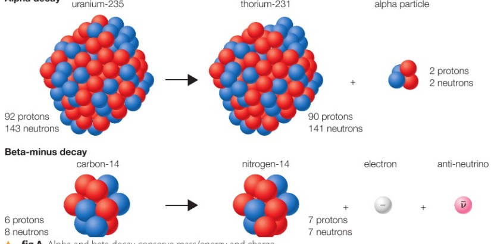

fig A Alpha and beta decay conserve mass/energy and charge.

<!-- page 119 -->

If the same nuclear change produces the same single particle every time, then for mass–energy to be conserved, the beta particles would need to have the same energy every time. This is the case for alpha particles. However, scientists found that beta particles from nuclei of the same isotope have a range of kinetic energies. This suggested that another particle was flying away with some kinetic energy, so that the total kinetic energy produced was always the same.

## WORKED EXAMPLE 1

For each of these reactions, confirm whether or not they can occur through conservation of charge:

(a) Beta-plus decay:

 $$ \begin{aligned}_{7}^{13}\mathrm{N}&\Rightarrow_{6}^{13}\mathrm{C}+_{+1}^{0}\beta^{+}+_{0}^{0}\nu_{e}\\ Answer:&+7\Rightarrow+6++1+0\quad\checkmark\end{aligned} $$ 

This reaction is permitted as it conserves charge. It would need to also conserve mass/energy and momentum.

(b) Positive pion decay:

 $$ \pi^{+}\quad\Rightarrow\mu^{-}+{}^{0}_{0}\nu_{\mu} $$

Answer: $ +1 \Rightarrow -1 + 0 $ ✗ 

This reaction is not permitted as it does not conserve charge. (NB: In fact, a positive pion decays into an anti-muon,  $ \mu^+ $, and a muon neutrino with a lifetime of some 26 nanoseconds.)

## LEARNING TIP

The products from beta decay processes include either an electron (beta minus) or a positron (beta plus). This means that you may see either symbol for each used in beta decay equations:

 $$ {}^{0}_{-1}\beta^{-} \qquad {}^{0}_{+1}\beta^{+} $$ 

## CONSERVATION OF BARYON AND LEPTON NUMBERS

We can also check on the possibility of a reaction occurring, as the reaction must conserve baryon number and lepton number. Each quark has a baryon number, $B$, of $+\frac{1}{3}$, and so a baryon has a value of $B = +1$. Each lepton has a lepton number, $L$, of +1. Anti-particles have the opposite number. As mesons are quark/anti-quark combinations, their total baryon number is zero ($+\frac{1}{3} + -\frac{1}{3} = 0$).

Particle reactions can also only occur if they conserve baryon and lepton numbers overall. This means the total for each property must be the same before and after any reaction, or else it cannot occur.

Let us revisit alpha and beta decay and check on conservation of these numbers.

alpha decay

charge:

baryon number:

 $$ \begin{array}{ccc} {}^{235}_{92}\text{U}&\Rightarrow\quad{}^{231}_{90}\text{Th} &+ \quad {}^{4}_{2}\alpha \\ +92 \quad \Rightarrow \quad +90 & + \quad +2 & \checkmark \\ +235 \quad \Rightarrow \quad +231 & + \quad +4 & \checkmark \\ 0 \quad \Rightarrow \quad 0 & + \quad 0 & \checkmark \end{array} $$ 

lepton number:

beta-minus decay

charge:

baryon number:

lepton number:

 $$ \begin{array}{lllllllll} {}^{14}_{6}\mathsf{C}&\Rightarrow&{}^{14}_{7}\mathsf{N}&+&{}^{0}_{-1}\beta&+&{}^{0}_{0}\overline{\nu}_{e}& & & & \\ +6& \Rightarrow &+7&+&-1&+&0& &\checkmark& \\ +14&\Rightarrow&+14&+&0&+&0& &\checkmark& \\ 0&\Rightarrow&0&+&+1&+&-1& &\checkmark& \end{array} $$ 

If we isolate the individual neutron decay reaction in beta decay, we can check again:

beta-minus decay

charge:

baryon number:

lepton number:

 $$ \begin{array}{ccc} {}^{1}_{0}\mathsf{n}&\Rightarrow\ {}^{1}_{1}\mathsf{p}&+_{-1}^{0}\beta\quad+\quad {}_{0}^{0}\overline{\nu}_{e}\\0&\Rightarrow+1&+ -1\quad+\quad0&\checkmark\\+1&\Rightarrow+1&+0&+0&\checkmark\\0&\Rightarrow0&+ +1&+ -1&\checkmark\end{array} $$ 

<table border=1 style='margin: auto; word-wrap: break-word;'><tr><td style='text-align: center; word-wrap: break-word;'>PARTICLE</td><td style='text-align: center; word-wrap: break-word;'>SYMBOL</td><td style='text-align: center; word-wrap: break-word;'>CHARGE</td><td style='text-align: center; word-wrap: break-word;'>LEPTON NUMBER, L</td><td style='text-align: center; word-wrap: break-word;'>BARYON NUMBER, B</td><td style='text-align: center; word-wrap: break-word;'>ANTI-PARTICLE</td><td style='text-align: center; word-wrap: break-word;'>SYMBOL</td><td style='text-align: center; word-wrap: break-word;'>CHARGE</td><td style='text-align: center; word-wrap: break-word;'>LEPTON NUMBER, L</td><td style='text-align: center; word-wrap: break-word;'>BARYON NUMBER, B</td></tr><tr><td style='text-align: center; word-wrap: break-word;'>electron</td><td style='text-align: center; word-wrap: break-word;'>e^{-}</td><td style='text-align: center; word-wrap: break-word;'>-1</td><td style='text-align: center; word-wrap: break-word;'>1</td><td style='text-align: center; word-wrap: break-word;'>0</td><td style='text-align: center; word-wrap: break-word;'>positron</td><td style='text-align: center; word-wrap: break-word;'>e^{+}</td><td style='text-align: center; word-wrap: break-word;'>+1</td><td style='text-align: center; word-wrap: break-word;'>-1</td><td style='text-align: center; word-wrap: break-word;'>0</td></tr><tr><td style='text-align: center; word-wrap: break-word;'>electron neutrino</td><td style='text-align: center; word-wrap: break-word;'>$ \nu_{e} $</td><td style='text-align: center; word-wrap: break-word;'>0</td><td style='text-align: center; word-wrap: break-word;'>1</td><td style='text-align: center; word-wrap: break-word;'>0</td><td style='text-align: center; word-wrap: break-word;'>anti-electron neutrino</td><td style='text-align: center; word-wrap: break-word;'>$ \bar{\nu}_{e} $</td><td style='text-align: center; word-wrap: break-word;'>0</td><td style='text-align: center; word-wrap: break-word;'>-1</td><td style='text-align: center; word-wrap: break-word;'>0</td></tr><tr><td style='text-align: center; word-wrap: break-word;'>muon</td><td style='text-align: center; word-wrap: break-word;'>$ \mu $</td><td style='text-align: center; word-wrap: break-word;'>-1</td><td style='text-align: center; word-wrap: break-word;'>1</td><td style='text-align: center; word-wrap: break-word;'>0</td><td style='text-align: center; word-wrap: break-word;'>anti-muon</td><td style='text-align: center; word-wrap: break-word;'>$ \bar{\mu} $</td><td style='text-align: center; word-wrap: break-word;'>+1</td><td style='text-align: center; word-wrap: break-word;'>-1</td><td style='text-align: center; word-wrap: break-word;'>0</td></tr><tr><td style='text-align: center; word-wrap: break-word;'>muon neutrino</td><td style='text-align: center; word-wrap: break-word;'>$ \nu_{\mu} $</td><td style='text-align: center; word-wrap: break-word;'>0</td><td style='text-align: center; word-wrap: break-word;'>1</td><td style='text-align: center; word-wrap: break-word;'>0</td><td style='text-align: center; word-wrap: break-word;'>anti-muon neutrino</td><td style='text-align: center; word-wrap: break-word;'>$ \bar{\nu}_{\mu} $</td><td style='text-align: center; word-wrap: break-word;'>0</td><td style='text-align: center; word-wrap: break-word;'>-1</td><td style='text-align: center; word-wrap: break-word;'>0</td></tr><tr><td style='text-align: center; word-wrap: break-word;'>tau</td><td style='text-align: center; word-wrap: break-word;'>$ \tau $</td><td style='text-align: center; word-wrap: break-word;'>-1</td><td style='text-align: center; word-wrap: break-word;'>1</td><td style='text-align: center; word-wrap: break-word;'>0</td><td style='text-align: center; word-wrap: break-word;'>anti-tau</td><td style='text-align: center; word-wrap: break-word;'>$ \bar{\tau} $</td><td style='text-align: center; word-wrap: break-word;'>+1</td><td style='text-align: center; word-wrap: break-word;'>-1</td><td style='text-align: center; word-wrap: break-word;'>0</td></tr><tr><td style='text-align: center; word-wrap: break-word;'>tau neutrino</td><td style='text-align: center; word-wrap: break-word;'>$ \nu_{\tau} $</td><td style='text-align: center; word-wrap: break-word;'>0</td><td style='text-align: center; word-wrap: break-word;'>1</td><td style='text-align: center; word-wrap: break-word;'>0</td><td style='text-align: center; word-wrap: break-word;'>anti-tau neutrino</td><td style='text-align: center; word-wrap: break-word;'>$ \bar{\nu}_{\tau} $</td><td style='text-align: center; word-wrap: break-word;'>0</td><td style='text-align: center; word-wrap: break-word;'>-1</td><td style='text-align: center; word-wrap: break-word;'>0</td></tr></table>

table A Leptons and anti-leptons and their properties.

<table border=1 style='margin: auto; word-wrap: break-word;'><tr><td style='text-align: center; word-wrap: break-word;'>PARTICLE</td><td style='text-align: center; word-wrap: break-word;'>SYMBOL</td><td style='text-align: center; word-wrap: break-word;'>CHARGE</td><td style='text-align: center; word-wrap: break-word;'>LEPTON NUMBER, L</td><td style='text-align: center; word-wrap: break-word;'>BARYON NUMBER, B</td><td style='text-align: center; word-wrap: break-word;'>ANTI-PARTICLE</td><td style='text-align: center; word-wrap: break-word;'>SYMBOL</td><td style='text-align: center; word-wrap: break-word;'>CHARGE</td><td style='text-align: center; word-wrap: break-word;'>LEPTON NUMBER, L</td><td style='text-align: center; word-wrap: break-word;'>BARYON NUMBER, B</td></tr><tr><td style='text-align: center; word-wrap: break-word;'>proton</td><td style='text-align: center; word-wrap: break-word;'>p</td><td style='text-align: center; word-wrap: break-word;'>+1</td><td style='text-align: center; word-wrap: break-word;'>0</td><td style='text-align: center; word-wrap: break-word;'>+1</td><td style='text-align: center; word-wrap: break-word;'>anti-proton</td><td style='text-align: center; word-wrap: break-word;'>p̄</td><td style='text-align: center; word-wrap: break-word;'>-1</td><td style='text-align: center; word-wrap: break-word;'>0</td><td style='text-align: center; word-wrap: break-word;'>-1</td></tr><tr><td style='text-align: center; word-wrap: break-word;'>neutron</td><td style='text-align: center; word-wrap: break-word;'>n</td><td style='text-align: center; word-wrap: break-word;'>0</td><td style='text-align: center; word-wrap: break-word;'>0</td><td style='text-align: center; word-wrap: break-word;'>+1</td><td style='text-align: center; word-wrap: break-word;'>anti-neutron</td><td style='text-align: center; word-wrap: break-word;'>$ \bar{n} $</td><td style='text-align: center; word-wrap: break-word;'>0</td><td style='text-align: center; word-wrap: break-word;'>0</td><td style='text-align: center; word-wrap: break-word;'>-1</td></tr><tr><td style='text-align: center; word-wrap: break-word;'>neutral pion</td><td style='text-align: center; word-wrap: break-word;'>$ \pi^{0} $</td><td style='text-align: center; word-wrap: break-word;'>0</td><td style='text-align: center; word-wrap: break-word;'>0</td><td style='text-align: center; word-wrap: break-word;'>0</td><td style='text-align: center; word-wrap: break-word;'>neutral pion</td><td style='text-align: center; word-wrap: break-word;'>$ \bar{\pi}^{0} $</td><td style='text-align: center; word-wrap: break-word;'>0</td><td style='text-align: center; word-wrap: break-word;'>0</td><td style='text-align: center; word-wrap: break-word;'>0</td></tr><tr><td style='text-align: center; word-wrap: break-word;'>pi-plus</td><td style='text-align: center; word-wrap: break-word;'>$ \pi^{+} $</td><td style='text-align: center; word-wrap: break-word;'>+1</td><td style='text-align: center; word-wrap: break-word;'>0</td><td style='text-align: center; word-wrap: break-word;'>0</td><td style='text-align: center; word-wrap: break-word;'>anti-pi-plus</td><td style='text-align: center; word-wrap: break-word;'>$ \bar{\pi}^{+} $</td><td style='text-align: center; word-wrap: break-word;'>0</td><td style='text-align: center; word-wrap: break-word;'>0</td><td style='text-align: center; word-wrap: break-word;'>0</td></tr><tr><td style='text-align: center; word-wrap: break-word;'>down quark</td><td style='text-align: center; word-wrap: break-word;'>d</td><td style='text-align: center; word-wrap: break-word;'>$ -\frac{1}{3} $</td><td style='text-align: center; word-wrap: break-word;'>0</td><td style='text-align: center; word-wrap: break-word;'>$ +\frac{1}{3} $</td><td style='text-align: center; word-wrap: break-word;'>anti-down</td><td style='text-align: center; word-wrap: break-word;'>$ \bar{d} $</td><td style='text-align: center; word-wrap: break-word;'>$ +\frac{1}{3} $</td><td style='text-align: center; word-wrap: break-word;'>0</td><td style='text-align: center; word-wrap: break-word;'>$ -\frac{1}{3} $</td></tr><tr><td style='text-align: center; word-wrap: break-word;'>xi-minus</td><td style='text-align: center; word-wrap: break-word;'>$ \Xi^{-} $</td><td style='text-align: center; word-wrap: break-word;'>-1</td><td style='text-align: center; word-wrap: break-word;'>0</td><td style='text-align: center; word-wrap: break-word;'>+1</td><td style='text-align: center; word-wrap: break-word;'>xi-plus</td><td style='text-align: center; word-wrap: break-word;'>$ \Xi^{+} $</td><td style='text-align: center; word-wrap: break-word;'>+1</td><td style='text-align: center; word-wrap: break-word;'>0</td><td style='text-align: center; word-wrap: break-word;'>-1</td></tr></table>

table B Various particles and anti-particles, and their properties.

<!-- page 120 -->

This provides further evidence that this reaction produces an anti-neutrino because the reaction must have an anti-lepton on the right-hand side to balance the electron.

If we zoom in further and isolate the individual quark decay reaction in beta decay, we can check again:

beta-minus decay

charge:

baryon number:

lepton number:

\[\begin{array}{ccccccc} \mathcal{d} & \Rightarrow &  \mathcal{u} &+& \mathcal{^{-1}} \mathcal{\beta } &+& \mathcal{^{0}} \overline{\nu}_{e} \\ -\frac{1}{3} & \Rightarrow &  +\frac{2}{3} &- & 1 &+ & 0 \\ +\frac{1}{3} & \Rightarrow &  +\frac{1}{3} &+ & 0 &+ & 0 \\ 0 & \Rightarrow &  0 &+ & + 1 &+ & - 1 \end{array}

Again, everything is conserved.

## STRANGENESS

The strange quark adds an additional property to reactions, which must usually also be conserved. This is called **strangeness**, S. Each strange quark has a strangeness of -1, each anti-strange quark has  $ S = +1 $, and all other particles have zero strangeness. Strong and electromagnetic force interactions must conserve strangeness.

## WORKED EXAMPLE 2

The lambda-plus particle is a baryon and consists of two up quarks and a strange quark (uus). It commonly decays via the strong force into a proton (uud) and a neutral pion (which can be uū or dd̄). True or false?

proposed decay charge:

baryon number:

lepton number:

strangeness:

 $$ \begin{array}{ccc} {}^{\mathrm{I}}\Lambda&\Rightarrow&{}^{1}\mathsf{P}~+~{}^{0}_{0}\pi\\+&1&\Rightarrow&+1~+~0\\&+1&\Rightarrow&+1~+~0\\0&\Rightarrow&0~+&0\\-&1&\Rightarrow&0~+~0\\\end{array}\quad\checkmark\quad\checkmark $$ 

This reaction cannot occur via a strong force as it does not conserve strangeness.

## RELATIVISTIC LIFETIMES

We have seen previously (Section 7B.1) that when a particle is accelerated close to the speed of light, its mass appears to increase. Einstein also predicted that, at these speeds, time would be slower than it is for an external observer. This suggests that when we monitor very fast-moving particles, their lifetimes before they decay are longer than the theoretical predictions.

One early piece of evidence of these extended particle lifetimes came with the detection of muons at sea level. High energy cosmic rays interact with the nuclei of atoms high in the atmosphere to create muons, which have a lifetime of about  $ 2\,\mu\mathrm{s} $. These should all decay in much less than the time to travel down to the Earth's surface, and we should detect very few at sea level. However, they are detected at low altitudes in large numbers. The reason is that they are travelling very fast (for example 0.98c). As far as the muons are concerned, they still decay in the same short time; but for us as external observers, their time moves slowly enough for them to travel tens of kilometres down to our experiments on the ground. This phenomenon was first confirmed experimentally by Rossi and Hall in 1940.

This principle also affects the particle interactions observed in accelerator collision experiments. The particles live longer, and travel further, than we might expect because they are moving so fast. This allows many additional interactions to happen because they meet particles they might not otherwise have had time to come into contact with. Also, the fast-moving particles that will travel much further through the detectors than non-relativistic lifetimes would allow, and so can be more easily observed. If the exotic particles produced in the LHC collision chamber decayed within the chamber before escaping it, none would be detectable, as the detector cannot be placed right at the collision point.

<!-- page 121 -->

## CHECKPOINT

## SKILLS ANALYSIS, PROBLEM SOLVING

1. For each of these reactions, confirm whether or not they can occur considering only conservation of charge:

(a) phosphorus beta-plus decay.

The phosphorus isotope is converted into a sulfur isotope and emits a positron and an electron neutrino:

 $$ \mathrm{^{32}_{15}P}\Rightarrow\mathrm{^{32}_{16}S}+{}^{0}_{+1}\beta^{+}+{}^{0}_{0}\nu_{e} $$ 

(b) neutral pion decay.

A neutral pion becomes an electron, a positron and a gamma photon:

 $$ \pi^{0}\Rightarrow\mathrm{e}^{-}+\mathrm{e}^{+}+\gamma $$ 

2. A muon is generated in the atmosphere at a height of 10 km. Calculate how far it would travel down towards the ground if it was moving at 0.98 c and it decays after  $ 2.2 \times 10^{-6} $ s.

3. Beta plus decay is similar to the better known beta-minus decay. In beta-plus decay, a proton is converted into a neutron, with the emission of a positron and an electron neutrino.

Write the fundamental reaction for beta-plus decay and confirm that it is permitted by the conservation rules you have seen.

4. One theoretical physicist at CERN has proposed that the LHC may see a neutron decay reaction in which a lambda zero particle (up, down, strange baryon) and a kaon (down/anti-strange meson) are produced:

proposed reaction 1  $ ^1_0\text{n} \Rightarrow {}^1_0\text{Λ} + {}^0_0\text{K} $

A second theoretical physicist at CERN has argued that the reaction will have to produce two kaons as well as a positron and an anti-neutrino:

proposed reaction  $ {}^1_0n \Rightarrow {}^1_0\Lambda + 2\,{}^0_0K + {}^0_{+1}e^+ + {}^0_0\overline{\nu}_e $

Work out which reaction, if any, is possible.

## SUBJECT VOCABULARY

alpha decay the radioactive process in which a particle combination of two protons and two neutrons is ejected from a nucleus

beta-minus decay the radioactive process in which a nuclear neutron changes into a proton, and an electron is ejected from the nucleus

baryon number the quantum number for baryons, whereby each proton or neutron (or other baryon) has a value of B = 1

lepton number the quantum number for leptons, whereby each lepton has a value of L = 1

strangeness the quantum number for strange quarks, whereby each one has a value of S = -1

<!-- page 122 -->

# 7C THINKING BIGGER

# ANTI-MATTER MATTERS

Anti-matter was first proposed by Paul Dirac in 1928. It is very interesting for both science fiction writers and scientists because it is such a strange idea. Here, NASA's website explains the progress that has been made towards using the energy of anti-matter.

NASA WEBSITE

## STATUS OF ANTI-MATTER

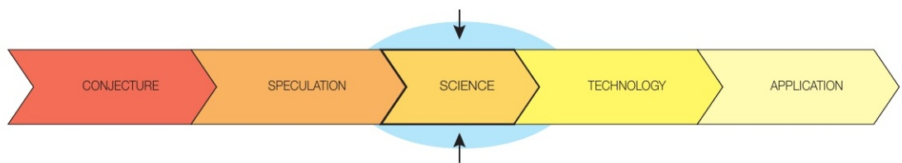

## fig A The maturity of a scientific concept changes over time

Anti-matter is  **real stuff**, not just science fiction. Anti-matter is firmly in the realm of science with some aspects even entering the technology realm. There is also a lot of speculation about what one might do with anti-matter.

## What is anti-matter?

Anti-matter is matter with its electrical charge reversed. Anti-electrons, called ‘positrons’, are like an electron but with a positive charge. Antiprotons are like protons with a negative charge. Positrons, antiprotons and other antiparticles can be routinely created at particle accelerator labs, such as CERN in Europe, and can even be trapped and stored for days or weeks at a time. And just last year, they made antihydrogen for the first time. It didn’t last long, but they did it. Also, anti-matter is NOT antigravity. Although it has not been experimentally confirmed, existing theory predicts that anti-matter behaves the same to gravity as does normal matter.

## The catch?

Right now it would cost about one-hundred-billion dollars to create one milligram of anti-matter. One milligram is way beyond what is needed for research purposes, but that amount would be needed for large scale applications. To be commercially viable, this price would have to drop by about a factor of ten-thousand.

Technology is now being explored to make anti-matter carrying cases, to consider using anti-matter for medical purposes, and to consider how to make anti-matter rockets.

And what about using anti-matter for power generation? – not promising.

It costs far more energy to create anti-matter than the energy one could get back from an anti-matter reaction. Right now standard nuclear reactors, which take advantage of the decay of radioactive substances, are far more promising as power generating technology than anti-matter. Something to keep in mind, too, is that anti-matter reactions – where anti-matter and normal matter collide and release energy, require the same safety precautions as needed with nuclear reactions.

Extract from the NASA website, at http://www.nasa.gov/centers/glenn/technology/warp/antistat.html posted on 2 May 2008. The article has since been updated with a focus on warp-drive technology.

<!-- page 123 -->

## THINKING BIGGER

## SCIENCE COMMUNICATION

1 (a) What sort of people do you think might visit this webpage?

(b) How has the author ensured that the level of scientific terminology, and the depth of explanations, are right for their audience?

2 What is NASA's motivation for including this page on its website?

Consider NASA's general purposes and aims. You may find it helpful to visit the original webpage and explore any links provided.

## PHYSICS IN DETAIL

Now we will look at the physics in detail. Some of these questions will link to topics elsewhere in this book, so you may need to combine concepts from different areas of physics to work out the answers.

## INTERPRETATION NOTE

3 What would be the structure of anti-hydrogen?

4 (a) How could a particle physics lab trap, or store, a charged particle like a proton for a long time?

(b) How would CERN store the positrons they create?

(c) Why would it be much more difficult to store anti-hydrogen than an anti-proton?

5 (a) What are the differences between an electron and a positron?

(b) What differences are there between an anti-baryon and an anti-lepton?

(c) Why is it generally unnecessary to define a group of particles we would call anti-mesons?

6 Using the data given in the extract (and assuming ordinary matter is free) calculate the cost per joule of energy created if anti-matter annihilation were to be used for power generation.

7 (a) If a positron beam were to be used as an annihilation cutting tool, calculate the beam current that would deliver 100 kW.

(b) What voltage would be needed to accelerate a beam of electrons so that, at the same beam current, it could deliver the same power from mechanical collisions with the target?

## PHYSICS TIP

Think of the movement of positrons in a beam as an electric current, which undergo annihilation when interacting with the target.

## ACTIVITY

The webpage was published in 2008 and the study of anti-matter is progressing quickly. Write an updated version of the webpage for your nearest university physics department to include on their site. The purpose of the webpage, is to explain anti-matter to students who may be considering applying to study physics there. You do not need to mention any activities that the department are involved with, the page should simply inspire and interest students into the possibilities that a career in physics could offer. The level of scientific explanation should be a little deeper than the NASA original shown.

## THINKING BIGGER TIP

Your webpage should be fully up-to-date.

You will therefore need to do some further research in order to find out the latest developments and areas of research. For example, has the cost of making one milligram of anti-matter changed since 2008?

<!-- page 124 -->

# 7C EXAM PRACTICE

1 Which of these is a force exchange particle?

A photon

B muon

C kaon

D meson [1]

(Total for Question 1 = 1 mark)

2 Which of the following is NOT a possible value for the charge on a meson?

A -1

B 0

C  $ \frac{1}{3} $

D 1 [1]

(Total for Question 2 = 1 mark)

3 Which of the following is a lepton?

A A baryon

B An electron neutrino

C A neutral  $ \pi $ meson

D A proton

(Total for Question 3 = 1 mark)

4 'Positron' is the name for an anti-electron. The properties of the positron are:

<table border=1 style='margin: auto; word-wrap: break-word;'><tr><td style='text-align: center; word-wrap: break-word;'>Mass/kg</td><td style='text-align: center; word-wrap: break-word;'>Lepton number</td><td style='text-align: center; word-wrap: break-word;'>Charge</td></tr><tr><td style='text-align: center; word-wrap: break-word;'>$ -9.11 \times 10^{-31} $</td><td style='text-align: center; word-wrap: break-word;'>0</td><td style='text-align: center; word-wrap: break-word;'>-1</td></tr><tr><td style='text-align: center; word-wrap: break-word;'>$ -9.11 \times 10^{-31} $</td><td style='text-align: center; word-wrap: break-word;'>+1</td><td style='text-align: center; word-wrap: break-word;'>+1</td></tr><tr><td style='text-align: center; word-wrap: break-word;'>$ 9.11 \times 10^{-31} $</td><td style='text-align: center; word-wrap: break-word;'>0</td><td style='text-align: center; word-wrap: break-word;'>-1</td></tr><tr><td style='text-align: center; word-wrap: break-word;'>$ 9.11 \times 10^{-31} $</td><td style='text-align: center; word-wrap: break-word;'>-1</td><td style='text-align: center; word-wrap: break-word;'>+1</td></tr></table>

[1]

5 Which of these is a baryon?

A electron

B kaon

C meson

D proton

(Total for Question 5 = 1 mark)

6 The diagram shows tracks produced by charged particles in a bubble chamber.

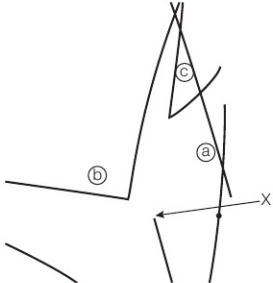

At X, an incoming charged particle interacts with a stationary proton to produce a neutral lambda particle and a neutral kaon particle. Both these particles later decay into other particles.

With reference to the diagram, explain the evidence provided for this event. [4]

(Total for Question 6 = 4 marks)

<!-- page 125 -->

## EXAM PRACTICE

7 In 1961 Murray Gell-Mann predicted the existence of a new particle called an omega ( $ \Omega $) minus. It was subsequently discovered in 1964.

At this time the quark model consisted of three particles, the properties of which are given in the table.

<table border=1 style='margin: auto; word-wrap: break-word;'><tr><td style='text-align: center; word-wrap: break-word;'>Quark</td><td style='text-align: center; word-wrap: break-word;'>Charge</td><td style='text-align: center; word-wrap: break-word;'>Predicted mass in MeV/c $ ^{{2}} $</td></tr><tr><td style='text-align: center; word-wrap: break-word;'>up (u)</td><td style='text-align: center; word-wrap: break-word;'>+  $ \frac{{2}}{{3}} $</td><td style='text-align: center; word-wrap: break-word;'>4</td></tr><tr><td style='text-align: center; word-wrap: break-word;'>down (d)</td><td style='text-align: center; word-wrap: break-word;'>-  $ \frac{{1}}{{3}} $</td><td style='text-align: center; word-wrap: break-word;'>4</td></tr><tr><td style='text-align: center; word-wrap: break-word;'>strange (s)</td><td style='text-align: center; word-wrap: break-word;'>-  $ \frac{{1}}{{3}} $</td><td style='text-align: center; word-wrap: break-word;'>80</td></tr></table>

(a) Explain what a charge of  $ + \frac{2}{3} $ means. [1]

(b) State the predicted mass of, and the charge on, an  $ \bar{s} $ particle. [2]

(c) Convert 4 MeV/c $ ^{2} $ to kg. [3]

(d) The event that led to the discovery of the omega minus particle can be summarised as follows. A negative kaon collided with a stationary proton and produced a positive kaon, a neutral kaon and the omega minus.

(i) Kaons consist of either an up or down quark plus a strange quark. The omega minus consists of three strange quarks.

Copy and complete the following table by ticking the appropriate boxes. [2]

<table border=1 style='margin: auto; word-wrap: break-word;'><tr><td style='text-align: center; word-wrap: break-word;'></td><td style='text-align: center; word-wrap: break-word;'>Meson</td><td style='text-align: center; word-wrap: break-word;'>Baryon</td><td style='text-align: center; word-wrap: break-word;'>Nucleon</td><td style='text-align: center; word-wrap: break-word;'>Lepton</td></tr><tr><td style='text-align: center; word-wrap: break-word;'>negative kaon</td><td style='text-align: center; word-wrap: break-word;'></td><td style='text-align: center; word-wrap: break-word;'></td><td style='text-align: center; word-wrap: break-word;'></td><td style='text-align: center; word-wrap: break-word;'></td></tr><tr><td style='text-align: center; word-wrap: break-word;'>omega minus</td><td style='text-align: center; word-wrap: break-word;'></td><td style='text-align: center; word-wrap: break-word;'></td><td style='text-align: center; word-wrap: break-word;'></td><td style='text-align: center; word-wrap: break-word;'></td></tr></table>

(ii) Write an equation using standard particle symbols to summarise this event. [2]

(iii) The negative kaon consists of  $ \bar{u}s $. Deduce the quark structure of two other kaons involved in this event. [2]

(iv) The total mass of the three particles created after this event is larger than the total mass of the two particles before. Discuss the quantities that must be conserved in interactions between particles and use an appropriate conservation law to explain this increase in mass. [5]

(Total for Question 7 = 17 marks)

8 (a) Physicists were able to confidently predict the existence of a sixth quark. State why. [1]

(b) The mass of the top quark was determined by an experiment. Collisions between protons and anti-protons occasionally produce two top quarks.

(i) How do the properties of a proton and an anti-proton compare? [2]

(ii) After the collision the two top quarks move in opposite directions with the same speed.

Explain why. [2]

(c) The two top quarks decay rapidly into two muons and four jets of particles. These can be detected and their momenta measured.

The diagram shows an end-on view of the directions of the four jets (J1 to J4) of particles. The two muons are shown as $\mu_1$ and $\mu_2$. A muon neutrino is also produced but cannot be detected, so is not shown. Each momentum is measured in GeV/c.

The magnitude of the momentum for each particle or ‘jet’ is shown by the number printed at the end of each arrow.

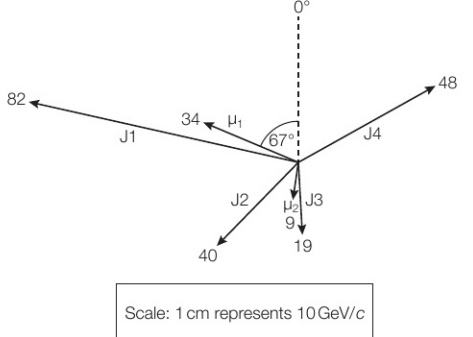

(i) Explain why GeV/c is a valid unit for momentum. [2]

(ii) The vector diagram shown below is not complete. Copy the diagram and add arrows to represent the momenta of J3 and J4. [2]

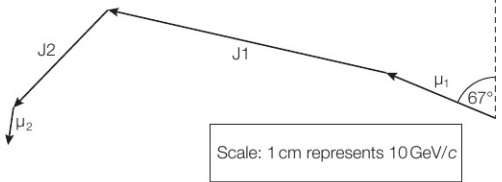

(iii) Complete the diagram to determine the magnitude of the momentum of the muon neutrino. [1]

(iv) Show that the total energy of all the products of this event is about 300 GeV. [1]

(v) Deduce the mass of a top quark in GeV/c^{2}. [1]

(vi) Explain why it took a long time to find experimental evidence for the top quark. [2]

(Total for Question 8 = 14 marks)

