# 8A Heat and temperature

<!-- edx_ial_phy2.pdf p126-141 -->

<!-- page 126 -->

# TOPIC 8 THERMODYNAMICS

# 8A HEAT AND TEMPERATURE

When scuba divers need to return to the surface of the water in an emergency, they are trained to scream all the way up. This may sound a little strange, but the training is designed to ensure that they do not have to think about expelling the gas in their lungs, as this happens automatically when they scream. As the pressure decreases on their way to the surface, the air in their lungs expands. This could be very dangerous to their internal organs, particularly their lungs, and so the air must be expelled at least as fast as it expands. This is illustrated in a similar, although less extreme, scenario: the bubbles from a diver's normal exhaled breath will slowly get larger as they rise to the surface.

This chapter is all about the energy held by individual molecules, and how, on a large scale, this energy is responsible for many macroscopic effects, such as the pressure exerted by a gas on a diver's lungs. We will learn about a large number of rules governing the properties of gases, including their pressure, temperature, volume and quantity. These will be explained from first principles in terms of the molecules that make up the gas. In a more general sense, we will see how the energy possessed by a group of molecules leads to the temperature of a sample and the transfer of heat energy.

## MATHS SKILLS FOR THIS CHAPTER

• Recognising and use of appropriate units (e.g. converting between temperature scales)

• Finding arithmetic means (e.g. mean square speeds of gas molecules)

Use of ratios (e.g. illustrating the gas laws)

• Estimating results (e.g. predicting the outcome on a gas of changes in its properties)

- Substituting numerical values into equations (e.g. calculations using the ideal gas equation)

<!-- page 127 -->

## What prior knowledge do I need?

The pressure on a solid

Topic 1B (Book 1: IAS)

The kinetic energy equation Topics 1B and 1C (Book 1: IAS)

The conservation of momentum and energy

Collisions and Newton's laws of motion

Topic 2A (Book 1: IAS)

Density

Topic 4B (Book 1: IAS)

The potential divider

Topic 5A

Impulse and momentum change

## What will I study in this chapter?

The ideal gas equation

The difference between heat and temperature

Scales of temperature

Basic gas laws

Internal energy and the distribution of energy through a gas sample

## What will I study later?

## Topic 9A

Nuclear fission energy release Topic 10A

Simple harmonic motion

Resonance and damping in molecular energy transfer

## Topic 11B

The importance of heat pressure in stars and stellar development

The emission of stellar radiation following black body curves

<!-- page 128 -->

## 1 HEAT AND TEMPERATURE

CP12 LAB BOOK PAGE 51

## LEARNING OBJECTIVES

Define the concept of absolute zero and explain how the average kinetic energy of molecules is related to the absolute temperature.

Identify the differences between scales of temperature measurement.

Explain how a thermistor can be calibrated in a potential divider circuit to act as a thermostat.

## TEMPERATURE

Heating an object causes its temperature to rise. This seems a very obvious statement, based on our everyday experience, but what is really happening when we heat an object, and what do we mean by 'temperature'?

To understand the concept of temperature, we need to think about materials in terms of the molecules from which they are made. According to the kinetic theory, when energy is supplied to an object the molecules in that object receive the energy as kinetic energy, and move faster. In solids, this is usually in the form of vibrations, whereas if we are considering a gas, we imagine the molecules whizzing around their container at a greater speed. It is this kinetic energy that determines the temperature. If the average kinetic energy of the molecules of a substance is greater, then it is at a higher temperature.

It is important to remember that the internal kinetic energy on the atomic scale is separate from the idea of overall movement of the object. For example, as a cricket ball flies through the air, it has kinetic energy due to its overall movement. In addition to this, its molecules will be vibrating within it. It is this internal aspect of the energy that determines the temperature.

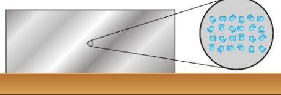

▲ fig A A stationary piece of metal has no kinetic energy. Yet all its atoms are vibrating all the time. Although overall these tiny velocities must sum to zero (or else it would be moving), their kinetic energies give the object its temperature.

## ABSOLUTE TEMPERATURE

Taking energy away from the molecules of a substance causes its temperature to become lower. If you imagine a situation in which energy is continuously being taken away from a collection of molecules, then there will come a moment when all the kinetic energy has been removed from the substance. The molecules will no longer be moving at all. At this point, the temperature is said to be absolute zero.

Different scales of temperature have historically placed zero in arbitrary places compared with the average internal kinetic energy of the molecules. For example, Anders Celsius chose the freezing point of pure water as the zero on his temperature scale, but Daniel Gabriel Fahrenheit placed zero at 32 degrees below the freezing point of water on the Fahrenheit scale (in the expectation that there would never be a temperature colder than 0 °F to measure!). On these scales, absolute zero is at -273.15 °C and -459.67 °F. In 1848, Lord Kelvin defined an absolute temperature scale which started with zero at absolute zero. For convenience, he made the gaps in his scale identical to those on the Celsius scale. This is known as the Kelvin scale of temperature, or sometimes as absolute temperature. As the units begin from a definite zero and go up as we add even amounts of energy to the particles of the substance being measured, the various temperatures are not compared to something else (such as the freezing point of water). This is why the term absolute temperature is used. We do not use the word or symbol for ‘degrees’ when quoting values on the Kelvin scale. For example, the temperature at which lead becomes superconducting is 7.19 kelvin, or 7.19 K.

The Scottish engineer William Rankine proposed a similar absolute temperature scale, with degrees separated by the same amount as in the Fahrenheit scale. The Rankine scale is not used today.

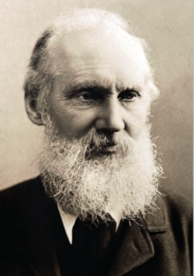

fig B William Thomson, who was made Baron Kelvin of Largs in 1892, was one of Britain's most prolific and important scientists. He is buried next to Isaac Newton in Westminster Abbey.

<!-- page 129 -->

<table border=1 style='margin: auto; word-wrap: break-word;'><tr><td style='text-align: center; word-wrap: break-word;'>TEMPERATURE SCALE</td><td style='text-align: center; word-wrap: break-word;'>Celsius</td><td style='text-align: center; word-wrap: break-word;'>Fahrenheit</td><td style='text-align: center; word-wrap: break-word;'>Kelvin</td><td style='text-align: center; word-wrap: break-word;'>Rankine</td></tr><tr><td style='text-align: center; word-wrap: break-word;'>SYMBOL</td><td style='text-align: center; word-wrap: break-word;'>°C</td><td style='text-align: center; word-wrap: break-word;'>°F</td><td style='text-align: center; word-wrap: break-word;'>K</td><td style='text-align: center; word-wrap: break-word;'>R</td></tr><tr><td style='text-align: center; word-wrap: break-word;'>BOILING POINT OF WATER (AT 1 ATM = 101 325 PA)</td><td style='text-align: center; word-wrap: break-word;'>100</td><td style='text-align: center; word-wrap: break-word;'>212</td><td style='text-align: center; word-wrap: break-word;'>373.15</td><td style='text-align: center; word-wrap: break-word;'>671.67</td></tr><tr><td style='text-align: center; word-wrap: break-word;'>FREEZING POINT OF WATER (AT 1 ATM = 101 325 PA)</td><td style='text-align: center; word-wrap: break-word;'>0</td><td style='text-align: center; word-wrap: break-word;'>32</td><td style='text-align: center; word-wrap: break-word;'>273.15</td><td style='text-align: center; word-wrap: break-word;'>491.67</td></tr><tr><td style='text-align: center; word-wrap: break-word;'>ABSOLUTE ZERO</td><td style='text-align: center; word-wrap: break-word;'>-273.15</td><td style='text-align: center; word-wrap: break-word;'>-459.67</td><td style='text-align: center; word-wrap: break-word;'>0</td><td style='text-align: center; word-wrap: break-word;'>0</td></tr></table>

Converting kelvin to degrees celsius, subtract 273.15.

table A Comparing four scales of temperature.

Converting degrees celsius to kelvin, add 273.15.

## LEARNING TIP

You can remember this by thinking that C is nearer the beginning of the alphabet to K. Therefore, to go back from K to  $ ^{\circ} $C, we need to subtract.

## Investigating thermostats

## PRACTICAL SKILLS

CP12

In Book 1, Section 4B.3, we saw how a potential divider circuit can be used with a sensor component to control a second circuit. This can be useful, for example, if we want to control a heating or cooling circuit, such as with the circuit shown in fig C.

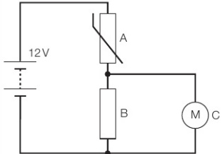

▲ fig C Investigate how the motor (C) speed adjusts as the thermistor (A) temperature is altered. This circuit could be used to control a cooling fan.

Many electronic components have a switch on voltage of 5 V. For example, the control circuit to switch on a large air conditioner could be used with a thermistor in a potential divider circuit and would only switch on when the p.d. across it is 5 V. Altering the value of the other resistor in the potential divider circuit would then control the temperature level at which the air conditioner was switched on.

You can use a circuit like that shown in fig C to find the output voltage at different temperatures to calibrate the thermistor. This calibration should then allow you to replace the fixed resistor with a variable resistor that you can set, so that the output exceeds 5 volts only when a particular temperature is reached.

Safety Note: Be careful not to overload the components in the circuit as they may get hot enough to burn skin.

## EXAM HINT

Make sure you have a good understanding of this practical as your understanding of the experimental method may be assessed in your exams.

## EXAM HINT: EXTRA CONTENT

The Fahrenheit and Rankine scales of temperature are not on the exam specification.

## CHECKPOINT

## SKILLS CONTINUOUS LEARNING, INNOVATION, ADAPTABILITY

1. Convert the following temperatures:

(a)  $ 27^{\circ} $C into kelvin

(b) -173  $ ^{\circ} $C into kelvin

(c)  $ 100^{\circ} $C into kelvin

(d) 288 K into degrees celsius.

2. Explain what will happen in the circuit in fig C as the temperature rises.

3. What changes need to be made to the circuit in fig C in order to allow the thermistor to be calibrated for use as a thermostat?

## SUBJECT VOCABULARY

kinetic theory the idea that consideration of the microscopic movements of particles will predict the macroscopic behaviour of a substance

absolute zero the theoretical temperature at which molecules will no longer be moving, all kinetic energy has been removed

Celsius scale a scale of temperature with zero degrees at the freezing point of water, and 100 degrees at the boiling point of water

Kelvin scale an absolute temperature scale with each degree the same size as those on the Celsius scale

absolute temperature a temperature scale that starts at absolute zero

<!-- page 130 -->

## 2 HEAT TRANSFER

## LEARNING OBJECTIVES

Define the concepts of specific heat capacity and specific latent heat for phase changes.

Use the equations  $ \Delta E = mc\Delta\theta $ and  $ \Delta E = L\Delta m $.

## LEARNING TIP

Heat is only referred to when energy is moved from one object or material to another. It is incorrect to suggest that an object has heat energy. We refer to its 'internal energy'.

We have seen that the temperature of a substance depends on the kinetic energy of the molecules within it. As the molecules move, their bonds can pull on neighbouring molecules. This means that lattice vibrations in the solid can pass energy through the solid.

## DID YOU KNOW?

The element with the highest specific heat capacity is hydrogen gas. 14 300 joules are needed to raise the temperature of one kilogram by one kelvin.

Imagine that one end of a long rod is being heated. In the hotter parts of the metal, the molecules are vibrating faster and further. In the cooler parts of the rod, further from the heat source, the molecules are moving slower. When a molecule with more energy pulls on one with less energy, they share the energy more evenly, with the faster one slowing down and the slower one speeding up. The effect of these transfers is that the increase in the internal kinetic energy which is caused by heating moves throughout a substance, with the heat passing from hotter areas to colder ones.

## SPECIFIC HEAT CAPACITY

Transferring the same amount of heat energy to two different objects will increase their internal energy by the same amount. However, this will not necessarily cause the same rise in temperature in both. How transferred heat energy affects the temperature of an object depends on three things:

1 the amount of heat energy transferred

2 the mass of the object

3 the specific heat capacity of the material from which the object is made.

How much the temperature rises depends on the material, and is given by a property known as its specific heat capacity, c. Different materials, and different phases of the same substance, have different specific heat capacities because their molecular structures are different. This means that their molecules will be affected to different degrees by additional heat energy.

For a certain amount of energy,  $ \Delta E $, transferred to a material, the change in temperature,  $ \Delta\theta $, is related to the mass of material, m, and the specific heat capacity, c, by the expression:

 $$ \Delta E=m c\Delta\theta $$ 

With each quantity measured in SI units, this means that the specific heat capacity has units of  $ J kg^{-1} K^{-1} $. The change in temperature,  $ \Delta\theta $, is the same whether measured in degrees celsius or kelvin, as the intervals are the same on both scales.

## WORKED EXAMPLE 1

How long will a 2 kW kettle take to raise the temperature of 800 grams of water from  $ 20^{\circ} $C to  $ 100^{\circ} $C? The specific heat capacity of water is  $ 4200 \, J \, kg^{-1} \, K^{-1} $.

 $$ \Delta\theta=100-20=80^{\circ}C=80K $$ 

 $$ \Delta E=m c\Delta\theta=0.8\times4200\times80=268800J $$ 

 $$ t=\frac{E}{P}=\frac{268800}{2000}=134.4s $$ 

Therefore the kettle takes 2 minutes and 14 seconds to heat this water to boiling temperature. We assume that no energy is wasted in heating the surroundings.

<!-- page 131 -->

## PRACTICAL SKILLS

## Investigating specific heat capacity

It is quite straightforward to measure the specific heat capacity of most materials (some values are given in table A). You can make a close measurement if you can measure the heat energy put into a known mass of the material and if you can insulate the material so that almost all of this heat is used to raise the temperature. To gain very accurate measurements requires significantly more complex insulation. The inaccuracy in this rough experiment can usually be kept to under 5% with careful experimentation.

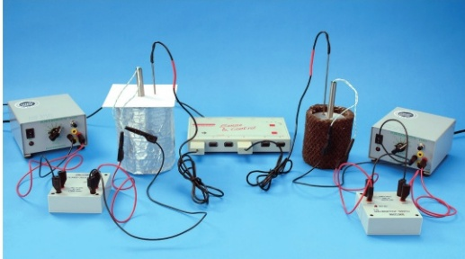

fig A Investigating specific heat capacity experimentally.

<table border=1 style='margin: auto; word-wrap: break-word;'><tr><td style='text-align: center; word-wrap: break-word;'>SUBSTANCE</td><td style='text-align: center; word-wrap: break-word;'>SPECIFIC HEAT CAPACITY/J kg $ ^{-1} $ K $ ^{-1} $</td></tr><tr><td style='text-align: center; word-wrap: break-word;'>water</td><td style='text-align: center; word-wrap: break-word;'>4200</td></tr><tr><td style='text-align: center; word-wrap: break-word;'>ice</td><td style='text-align: center; word-wrap: break-word;'>2100</td></tr><tr><td style='text-align: center; word-wrap: break-word;'>steam</td><td style='text-align: center; word-wrap: break-word;'>1996</td></tr><tr><td style='text-align: center; word-wrap: break-word;'>wood</td><td style='text-align: center; word-wrap: break-word;'>1670</td></tr><tr><td style='text-align: center; word-wrap: break-word;'>air (50 °C)</td><td style='text-align: center; word-wrap: break-word;'>1020</td></tr><tr><td style='text-align: center; word-wrap: break-word;'>aluminium</td><td style='text-align: center; word-wrap: break-word;'>900</td></tr><tr><td style='text-align: center; word-wrap: break-word;'>marble</td><td style='text-align: center; word-wrap: break-word;'>860</td></tr><tr><td style='text-align: center; word-wrap: break-word;'>iron/steel</td><td style='text-align: center; word-wrap: break-word;'>450</td></tr><tr><td style='text-align: center; word-wrap: break-word;'>copper</td><td style='text-align: center; word-wrap: break-word;'>390</td></tr><tr><td style='text-align: center; word-wrap: break-word;'>silver</td><td style='text-align: center; word-wrap: break-word;'>240</td></tr><tr><td style='text-align: center; word-wrap: break-word;'>mercury</td><td style='text-align: center; word-wrap: break-word;'>140</td></tr></table>

table A Some typical specific heat capacities.

Safety Note: The heaters and metal blocks being tested will get hot enough to burn skin. The immersion heaters must never have their tops under water as steam may be produced inside the heater which makes it explode.

## SPECIFIC LATENT HEAT

To melt a solid that is already at the temperature at which it melts requires an input of additional energy. This energy input does not raise the temperature, but is only used in breaking the bonds between molecules to change the state of the material. The amount of additional energy needed to melt it is determined by two things:

1 the mass of the solid substance

2 the specific latent heat of fusion of the substance.

How much energy is needed to alter the molecular configuration depends on the material, and is given by a property known as its specific latent heat, L. Different materials, and different phase changes of the same substance, have different specific latent heat values because their molecular structures are different. This means that their molecules will be affected differently by additional heat energy.

## LEARNING TIP

For melting, L is known as the specific latent heat of fusion.

For boiling, L is known as the specific latent heat of vaporisation.

For a certain mass of material, m, the amount of additional energy,  $ \Delta E $, needed to make the phase change is related to the specific latent heat, L, by the expression:

 $$ \Delta E=L\Delta m $$ 

With each quantity measured in SI units, this means that the specific latent heat has units of  $ J kg^{-1} $. The change in temperature is zero for any phase change, so the specific heat capacity need not be considered if the temperature is constant and only the state of matter changes.

## WORKED EXAMPLE 2

How long will a 150 W freezer take to freeze 650 grams of water which is already at  $ 0^{\circ} $C? The specific latent heat of fusion of water is 334 000 J kg $ ^{-1} $.

 $$ \Delta E=L\Delta m=334\,000\times0.65=217\,100 $$ 

 $$ t=\frac{E}{P}=\frac{217100}{150}=1447s $$ 

Therefore the freezer takes a little over 24 minutes to freeze this water. We assume that no energy is gained from the surroundings.

<!-- page 132 -->

## PRACTICAL SKILLS

CP13

## Investigating specific latent heat of fusion

It is quite straightforward to measure the specific latent heat of fusion of water. You can make a close measurement if you can measure the heat energy put into a known mass of ice, and if you set up the experiment well enough that almost all of the heat goes towards melting the ice. A control funnel of crushed ice can also be used in which the heater is off, so we can see how much ice would have melted without the extra heating. The difference in mass of water collected between the heated funnel and the control gives us the mass to use in the calculation.

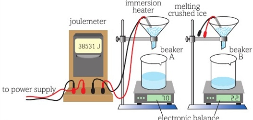

fig B Investigating the specific latent heat of fusion of ice.

Safety Note: The heaters and metal blocks being tested will get hot enough to burn skin. The immersion heaters must never have their tops under water as steam may be produced inside the heater which makes it explode.

## EXAM HINT

Make sure you have a good understanding of this practical as your understanding of the experimental method may be assessed in your exams.

## LEARNING TIP

To change state, molecules gain potential energy, as this is associated with the forces between the molecules. As the potential energy is negative, increasing it means it gets closer to zero.

## CHECKPOINT

1. (a) How much heat energy must be supplied to raise the temperature of 1200 ml of water from  $ 20^{\circ} $C to  $ 65^{\circ} $C?

(b) How long would a 2200 W heater take to boil 3 litres of water initially at  $ 100^{\circ} $C?

(1 litre of water has a mass of 1 kilogram. Specific latent heat of vaporisation of water = 2260 kJ kg $ ^{-1} $.)

## SKILLS ANALYSIS

2. Heating up half a kilogram of ice at  $ -8\ ^{\circ}\mathrm{C} $ until it is water at  $ 8\ ^{\circ}\mathrm{C} $ requires 192 200 joules of energy. Show the separate calculations necessary to determine this value.

## SKILLS ADAPTIVE LEARNING

3. Table A shows that the specific heat capacity of copper is  $ 390 \, \text{J kg}^{-1} \, \text{K}^{-1} $.

A student read part of a chemistry textbook. The book said that copper at  $ 1085^{\circ} $C had been supplied with 4000 J of energy, but its temperature remained at  $ 1085^{\circ} $C. Explain how this could be possible.

## SUBJECT VOCABULARY

specific heat capacity the energy required to raise the temperature of one kilogram of a substance by one degree kelvin

specific latent heat the energy required to change the state of one kilogram of a substance at a constant temperature

<!-- page 133 -->

## 3 INTERNAL ENERGY

## LEARNING OBJECTIVES

Define the concept of internal energy as the random distribution of potential and kinetic energies amongst molecules. Use the equation  $ \frac{1}{2}m<c^{2}>=\frac{3}{2}kT $.

The average kinetic energy of the particles in a material gives the material its temperature. However, in addition to this kinetic energy, each molecule will have some potential energy which is as a result of its position within the structure of the material, or in relation to other molecules in the substance. This potential energy is due to the bonds between the molecules. If we sum the kinetic and potential energies of all the molecules within a given mass of a substance, we have measured its internal energy.

It is important to note that the molecules do not all have the same amount of kinetic and potential energies. This internal energy is randomly distributed across all the molecules, according to the Maxwell–Boltzmann distribution.

## THE MAXWELL-BOLTZMANN DISTRIBUTION

If we identify the individual velocity of each molecule in a particular sample, the values will range from a few moving very slowly to a few moving very fast, with the majority moving at close to the average speed. As they all have the same mass, their differences in kinetic energies are directly dependent on the speeds. If we plot the kinetic energy against the number of molecules that have that energy, we obtain a curved graph called the Maxwell–Boltzmann distribution, as in fig A.

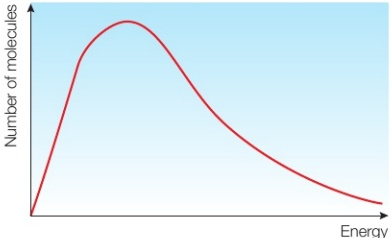

## LEARNING TIP

fig A The Maxwell–Boltzmann distribution of the speeds of a mixture of particles at one particular temperature.

The characteristic shape of the graph in fig A shows that:

there are no molecules with zero energy

In kinetic theory, we use the word 'molecules' to describe any particles. For example, if we have a collection of helium gas particles, we can refer to them as molecules even though we know that they normally exist in a monatomic state.

only a few molecules have high energy

- there is no maximum value for the energy a molecule can have.

A Maxwell–Boltzmann distribution graph is for one specific temperature. As the temperature changes, so the graph changes. The peak on the graph moves towards higher energies (and therefore higher speeds) as the temperature increases.

## ROOT-MEAN-SQUARE CALCULATIONS

There are two different ways of determining the average speeds of molecules in a material which are of interest to physicists. The peak of the graph represents the kinetic energy value with the greatest number of molecules that have that energy. Therefore the speed corresponding to this kinetic energy is the most probable speed,  $ c_0 $, if we were to select a molecule at random. The second and more useful average is the root-mean-square speed, which has the symbol  $ \sqrt{c^2} $. This is the speed associated with the average kinetic energy,  $ \frac{1}{2}m < c^2 > $, where  $ c $ is the speed of the particle, and  $ m $ is its mass.

<!-- page 134 -->

The root-mean-square speed, often abbreviated to rms speed, is found by squaring the individual speeds of a set of molecules, finding the mean of the squares, and then taking the square root of that mean.

## WORKED EXAMPLE 1

Find the rms speed of the following group of five molecules of atmospheric nitrogen, as shown in fig B:

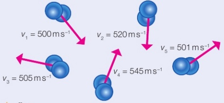

## fig B

First find the square of each value:

 $$ v_{1}{}^{2}=250\ 000;v_{2}{}^{2}=270\ 400;v_{3}{}^{2}=255\ 025;v_{4}{}^{2}=297\ 025; $$ 

 $$ v_{5}^{2}=251\ 001 $$ 

The mean of the square values is:

 $$ \begin{aligned}\langle c^{2}\rangle&=\frac{\left(v_{1}^{2}+v_{2}^{2}+v_{3}^{2}+v_{4}^{2}+v_{5}^{2}\right)}{5}\\&=\frac{(250\ 000+270\ 400+255\ 025+297\ 025+251\ 001)}{5}\\&=\frac{1323\ 451}{5}\\&=264\ 690.2\end{aligned} $$ 

Finally, take the square root to get the rms speed:

 $$ \sqrt{<c^{2}>}=\sqrt{264690.2}=514m s^{-1} $$ 

## MOLECULAR KINETIC ENERGY

The average kinetic energy of any molecule in a gaseous sample is proportional to the absolute temperature of the gas. They are related by the expression:

 $$ \frac{1}{2}m<c^{2}>=\frac{3}{2}k T $$ 

where  $ k $ is the Boltzmann constant,  $ 1.38 \times 10^{-23} $ J K $ ^{-1} $. Here the unit of temperature,  $ T $, is absolute temperature and must be in kelvin.

From this equation, relating kinetic energy and absolute temperature, we can see that zero on the absolute scale of temperature must indicate a situation where the molecules are stationary. Their mass cannot change, so for the kinetic energy to be zero at absolute zero, their rms speed must decrease to zero.

## EXAM HINT

The idea that the molecules' average kinetic energy is proportional to the absolute temperature is an assumption within kinetic theory. This follows consistently from the ideal gas laws (see Section 8A.4), but these are also founded on a set of assumptions which we must accept before undertaking calculations using the equation:

 $$ \frac{1}{2}m<c^{2}>=\frac{3}{2}kT $$ 

## WORKED EXAMPLE 2

What is the rms speed of helium molecules in a child's balloon at  $ 20^{\circ} $C?

(Atomic mass of helium,  $ m = 6.65 \times 10^{-27} $ kg)

 $$ T=20+273=293K $$ 

 $$ \begin{aligned}\frac{1}{2}m<c^{2}>&=\frac{3}{2}kT\\&=\frac{3}{2}\times1.38\times10^{-23}\times293\\&=6.0651\times10^{-21}J\end{aligned} $$ 

 $$ \begin{aligned}<c^{2}>&=\frac{\frac{3}{2}kT}{\frac{1}{2}m}\\&=\frac{6.0651\times10^{-21}}{\frac{1}{2}(6.65\times10^{-27})}\\&=1\ 820000\end{aligned} $$ 

 $$ \begin{array}{l} \text{rms speed} =\sqrt{<c^{2}>} \\ =\sqrt{1\ 820\ 000} \\ =1350\ m\ s^{-1} \end{array} $$ 

The rms speed of helium molecules at  $ 20^{\circ} $C is  $ 1350 \, m \, s^{-1} $.

## CHECKPOINT

1. (a) What is the rms speed of four hydrogen molecules with speeds of 890, 755, 902 and 866 m s $ ^{-1} $?

(b) At what temperature would these hydrogen molecules be?

(Mass of H atom =  $ 1.67 \times 10^{-27} $ kg)

2. Estimate the rms speed of molecules in the air in this room.

## SKILLS PROBLEM SOLVING

3. What would be represented by the area underneath the Maxwell-Boltzmann curve?

## SKILLS INTERPRETATION

4. Copy a sketch graph of the Maxwell-Boltzmann distribution labelling the x-axis 'speed'.

(a) Mark a vertical line on your graph to show the energy corresponding to the most probable speed of molecules. Label this line  $ c_{0} $.

(b) From Maxwell–Boltzmann statistics, the most probable speed  $ (c_0) $, the mean speed  $ (<c>) $, and the rms speed  $ (\sqrt{<c^2>}) $ are in the ratio:

 $$ 1:1.13:1.23 $$ 

Mark two more vertical lines on your graph and label these <c> and  $ \sqrt{<c^{2}>} $.

## SUBJECT VOCABULARY

internal energy the sum of the kinetic and potential energies of all the molecules within a given mass of a substance

Maxwell-Boltzmann distribution a mathematical function that describes the distribution of energies amongst particles at a given temperature

root-mean-square speed the square root of the arithmetic mean value of the squares of the speeds of particles in an ideal gas

<!-- page 135 -->

## 4 IDEAL GAS BEHAVIOUR

## LEARNING OBJECTIVES

Define the concept of an ideal gas and explain the relationships between its pressure, temperature and volume.

Use the equation  $ pV = NkT $ for an ideal gas.

☐ Derive and use the equation  $ \frac{1}{2} m < c^2 > = \frac{3}{2} kT $.

## BOYLE'S LAW

During the last 400 years, scientists investigating the physics of gases have determined a number of laws governing their behaviour. The first of these was discovered by Robert Boyle, an Irish physicist working at Oxford University. Boyle's law states that:

For a constant mass of gas at a constant temperature, the pressure exerted by the gas is inversely proportional to the volume it occupies.

If you imagine lying on an air mattress, after you sink slightly, it provides a force to hold you up. Your body squashes the volume of the mattress, making it smaller. This increases the pressure exerted by the gas inside, until the force applied by the gas pressure equals your weight. This is Boyle's law in action.

## PRACTICAL SKILLS

## Investigating Boyle's law

Boyle's law can be demonstrated using the apparatus shown in fig A. Measurements of the length of air which is trapped in the vertical glass column represent the volume of the gas, and the pressure is measured using the barometer. A graph of pressure against 1/volume will give a straight best-fit line indicating that:

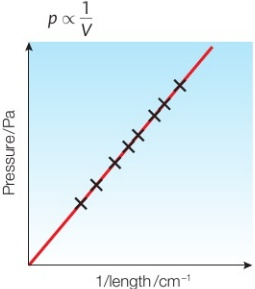

fig B Graph of data from a Boyle's law experiment.

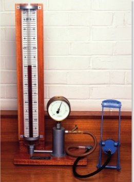

fig A Apparatus to demonstrate Boyle's law.

Safety Note: Wear eye protection and make sure all the connections are secure to avoid high pressure leaks. Reduce the pressure before disconnecting the pump.

## EXAM HINT

Make sure you have a good understanding of this practical as your understanding of the experimental method may be assessed in your exams.

<!-- page 136 -->

## CHARLES'S LAW

About 140 years after Boyle published his law, the French scientist Joseph Louis Gay-Lussac published two further gas laws. One was based on unpublished data from experiments undertaken by Jacques Charles. Charles's law states that:

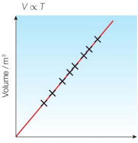

For a constant mass of gas at a constant pressure, the volume occupied by the gas is proportional to its absolute temperature.

This law can be shown in symbols as:

Absolute temperature/K

fig C Graph of data from Charles's law experiment.

## THE PRESSURE LAW

Gay-Lussac's other gas law sometimes bears his name, and sometimes is simply referred to as the pressure law:

For a constant mass of gas at a constant volume, the pressure exerted by the gas is proportional to its absolute temperature.

This law can be shown in symbols as:

PRACTICAL SKILLS

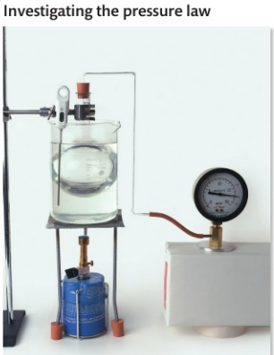

fig D Apparatus to demonstrate the pressure law. The temperature and pressure readings could be taken by electronic sensors and the data logged by an attached computer.

Safety Note: Wear eye protection and do not let the water level get too low in the beaker.

The pressure law can be demonstrated using the apparatus shown in fig D. Measurements of the gas pressure and temperature can be datalogged to produce a graph of pressure against absolute temperature, which will give a straight best-fit line indicating that:

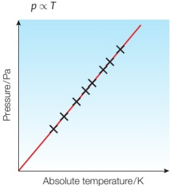

fig E Graph of data from pressure law experiment.

## IDEAL GASES

The three gas laws above were worked out from graphs of experimental results which showed distinct, straight best-fit lines, allowing scientists to claim them as empirical laws (laws worked out from experimental data). However, if very accurate experiments are undertaken with a variety of different gases, we find that the laws are not perfectly accurate. For example, Charles's law suggests that if we reduce the temperature to zero kelvin, the gas has zero volume – it would disappear. This does not happen, as the gas volume cannot reduce to less than the combined volume of its molecules.

The three gas laws are idealised, and would work perfectly if we could find a gas that did not suffer from the real world difficulties that real gases have. An ideal gas would have the following properties:

1 The molecules have negligible size.

2 The molecules are identical.

3 All collisions are perfectly elastic and the time of a collision is significantly smaller than the time between collisions.

4 The molecules exert no forces on each other, except during collisions.

5 There are enough molecules so that statistics can be applied.

6 The motion of the molecules is random.

Assuming an ideal gas, we can combine the three gas laws to produce a single equation relating the pressure, volume, temperature and amount of a gas:

 $$ p V=N k T $$ 

where N is the number of molecules of the gas, and k is the Boltzmann constant. The temperature must be absolute temperature in kelvin.

This is known as the equation of state for an ideal gas, expressed in terms of the number of molecules present. Sometimes, a more practically useful version can be used which refers to large quantities of gases, as we may find in a balloon, for example. If we change from the Boltzmann constant, k, to using the gas constant for entire moles:

 $$ p V=n R T $$

<!-- page 137 -->

where $n$ is the number of moles of the gas, and $R$ is the universal gas constant, $R = 8.31 \, \text{J kg}^{-1} \, \text{mol}^{-1}$.

## THE MOLE

The mole (abbreviated to mol) is an SI unit used to measure the amount of a substance. One mole of a substance is defined to consist of Avogadro's number of molecules of that substance.  $ N_{\mathrm{A}} $ is the symbol for Avogadro's number:  $ 6.02 \times 10^{23} $.

For one mole of an ideal gas:

 $$ p V=R T $$ 

Comparing this with the equation of state:

 $$ p V=N_{A}k T $$ 

 $$ \therefore\quad N_{A}\times k=R $$ 

 $$ 6.02\times10^{23}\times1.38\times10^{-23}=8.31 $$ 

## WORKED EXAMPLE 1

What would be the pressure in a child's helium balloon at 20°C, if it is a sphere of radius 20 cm, containing three moles of helium gas?

 $ V = \frac{4}{3}\pi r^3 = \frac{4}{3}\pi(0.2)^3 = 3.35 \times 10^{-2} \, \text{m}^3 $

 $ N = 3 \times N_A $

 $ = 3 \times 6.02 \times 10^{23} $

 $ = 18.06 \times 10^{23} $

 $ p = \frac{NkT}{V} $

 $ = \frac{18.06 \times 10^{23} \times 1.38 \times 10^{-23} \times 293}{3.35 \times 10^{-2}} $

= 217 981 Pa

= 218 000 Pa (3 sf)

Or use  $ pV = nRT $:

 $ p = \frac{nRT}{V} $

 $ = \frac{3 \times 8.31 \times 293}{3.35 \times 10^{-2}} $

= 218 000 Pa

## AVERAGE MOLECULAR KINETIC ENERGY

The ideal gas equation is:

 $$ p V=N k T $$ 

and there's an alternative equation from the kinetic theory of gases:

 $$ p V=\frac{1}{3}N m<c^{2}> $$ 

Putting these together:

 $$ \frac{1}{3}Nm<c^{2}>=NkT $$ 

 $$ \therefore\quad\frac{1}{3}m<c^{2}>=kT $$ 

Multiply both sides by  $ \frac{3}{2} $:

 $$ \frac{3}{2}\frac{1}{3}m<c^{2}>=\frac{3}{2}kT $$ 

 $$ \therefore\quad\begin{array}{r}{\frac{1}{2}m<c^{2}>}=\frac{3}{2}k T\end{array} $$ 

We saw the above equation in use in Section 8A.3, and this derivation shows that it is a consistent consequence of the kinetic theory of gases.

## CHECKPOINT

The molar mass of air is 29 g mol $ ^{-1} $.

## SKILLS PRODUCTIVITY

1. (a) Draw a labelled diagram of the apparatus you would use to verify that the pressure exerted by a fixed mass of gas at constant temperature is inversely proportional to its volume.

(b) State the readings you would take. Explain how you would use your measurements to verify this relationship between pressure and volume. You may be awarded a mark for the clarity of your answer.

(c) State one precaution that you would take in order to ensure accurate results.

2. Explain why a sample of air will not behave exactly as an ideal gas.

3. (a) Assuming air to be an ideal gas, calculate the number of moles of air left in a scuba diver's tank if it has a volume of 12 litres and, when in 15 °C water, the pressure is  $ 2 \times 10^7 $ Pa.

(b) What would be the new rms speed of the molecules in the scuba tank when it is immersed in water so its temperature becomes  $ 12^{\circ} $C?

## SKILLS COLLABORATION, ADAPTABILITY

4. Devise an experiment to verify Charles's law. Using a diagram, explain the measurements that you would make, how you would keep the control variables constant, and how your results could be analysed to show that you had 'proven' Charles's law.

## EXAM HINT

The command word Devise means that you have to plan or invent a procedure based on the physics and experimental principles that you know.

## SUBJECT VOCABULARY

Boyle's law for a constant mass of gas at a constant temperature, the pressure exerted by the gas is inversely proportional to the volume it occupies

Charles's law for a constant mass of gas at a constant pressure, the volume occupied by the gas is proportional to its absolute temperature

pressure law for a constant mass of gas at a constant volume, the pressure exerted by the gas is proportional to its absolute temperature

ideal gas a theoretical gas which does not suffer from the real world difficulties that mean real gases do not perfectly follow the gas laws equation of state the single equation that defines a gas in terms of its pressure, volume, temperature and quantity:  $ pV = NkT $

mole the SI unit for amount of substance. One mole contains  $ 6.02 \times 10^{23} $ molecules of that substance

<!-- page 138 -->

## 8A THINKING BIGGER

In 2015, two pilots made the second Pacific crossing in a helium-filled balloon and achieved new world records for distance and duration.

NATIONAL GEOGRAPHIC NEWS

# RECORD-SETTING BALLOONISTS LAND OFF BAJA COAST

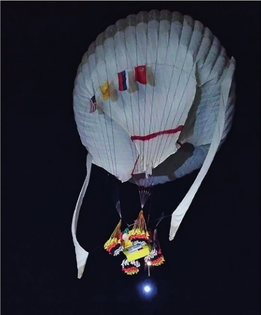

fig A The Two Eagles capsule, where the pilots spend most of their time, is about as big as a king-size bed.

The Two Eagles helium-filled balloon took off from Saga, Japan, on January 25 2015 and landed safely about a week later off the coast of the Baja Peninsula, Mexico. It was the second vessel of its kind to successfully cross the Pacific Ocean.

“They didn’t just break the records,” said Steven Shope, director of the Two Eagles mission control in Albuquerque, New Mexico. “They shattered the distance record by 27 percent and the duration record by 17 percent. Those previous records had stood for over 30 years.”

Moving at the speed and caprice of wind, it took them 160 hours and 37 minutes to cover the 10 712 kilometres.

Prior to the Two Eagles' flight, the distance record for a gas-filled balloon was 8 383 kilometres, set in 1981 during the first trans-Pacific balloon flight. Gas-filled balloons are distinct from hot-air balloons, which have never made that trip.

## What is the difference between a hot-air balloon and a gas balloon?

Balloons, whether filled with gas (typically helium), hot air, or a mixture of gas and air, operate only by their capability to gain or lose altitude. Otherwise, it's up to the wind to propel the balloon forward. Charting a course and reaching a destination in a balloon is a challenge that brings together aeronautical science and adventure.

Both types of balloons rely on buoyancy to gain altitude. That buoyancy is created by filling the “envelope” of the balloon with a substance that is less dense than the surrounding air. Helium and hydrogen, for instance, are naturally less dense than our atmosphere. When heated, air loses density because it expands and therefore contains less mass per volume.

## When did people start ballooning?

Joseph-Michel Montgolfier was supposedly sitting by his fire in his home of Avignon in 1782, watching embers rise off the flames. He theorized that this rising smoke contained a special property, which he dubbed "levity," and wondered if it could be harnessed. (Another parallel theory described the rising property of smoke as "phlogiston," an element released only through burning. Both theories are now obsolete.) Montgolfier and his brother, Jacques-Étienne, both paper-makers, began experimenting with capturing this heated gas within paper and cotton sacks, and the brothers are credited with inventing the hot-air balloon.

In a demonstration at Versailles before King Louis XVI and Queen Marie Antoinette on September 19, 1783, the brothers tested their invention by sending a sheep, a duck, and a chicken into the air. The flight lasted about eight minutes, covered a distance of nearly three kilometres, and reached an altitude of 500 metres. When the animals returned to the ground unscathed, the next obvious step was to send up a human.

<!-- page 139 -->

## THINKING BIGGER

## SCIENCE COMMUNICATION

The extract consists of an article from National Geographic newsfeed.

1 (a) Comment on the style of the writing, in particular the length of the article and level of scientific vocabulary used.

(b) Give two reasons why the level of physics detail about the theories behind balloon flight is relatively low.

2 Explain the meaning of this quote from the text: 'Both theories are now obsolete'.

## PHYSICS IN DETAIL

Now we will look at the physics in detail. Some of these questions will link to topics elsewhere in this book, so you may need to combine concepts from different areas of physics to work out the answers.

4 (a) Draw a free-body force diagram of the balloon at the moment of release at the ground.

3 Explain why a detailed understanding of the gas laws governing the flight of the balloon is likely to be less important to these pilots than their knowledge of weather systems.

(b) Explain how the forces in your diagram in (a) have magnitudes that mean there is a resultant upward force.

5 This type of balloon has a fixed volume.

(a) With reference to any relevant gas laws, explain why the pressure of the air outside the balloon falls as the balloon rises.

(b) (i) This balloon, filled with helium, lifts off with a volume of 6200 m³ at ground level (20°C and a pressure of 101 000 Pa) and rises to a maximum altitude of 9 100 m (-44°C and a pressure of 30 100 Pa). If no helium gas escapes, calculate the volume of the gas in the balloon at this new altitude.

(ii) In fact, the maximum volume of the balloon at the altitude of 9100m is 9900m $ ^{3} $. Explain why it does not expand to the volume you calculated in (b)(i).

(c) Compare the average kinetic energy of air molecules at 9100 m altitude with those at ground level.

Consider who is the intended audience. What do they most want to learn about extreme ballooning? This extract is only a small part of a much longer article online.

6 As the air in a hot air balloon is heated, the balloon rises. Why did the smoke in Montgolfier's fireplace rise up the chimney?

## INTERPRETATION NOTE

## PHYSICS TIP

Consider the ideal gas equation. Which quantities in the equation will remain constant during the flight?

## ACTIVITY

Write a proposal for the extracurricular budget holder in your school outlining plans to set up a High Altitude Balloon Club in the school. The proposal should explain the basic idea of the formation of the club, and include an experimental purpose for your launch. You should include details of the timescale required for developing the equipment, a price list of the apparatus required, and information about how you will obtain necessary national and local permissions.

## THINKING BIGGER TIP

Your proposal should encourage the budget holder to pay for the club and at least one balloon launch. Explain to the budget holder what benefits this project could bring for the school, for example, good publicity and an activity for as many students as possible. Note that a strong proposal will probably show evidence of minimised and well-controlled costs.

<!-- page 140 -->

# 8A EXAM PRACTICE

[Note: In questions marked with an asterisk (*), marks will be awarded for your ability to structure your answer logically, showing how the points that you make are related or follow on from each other.]

1 If a fixed mass of gas in a weather balloon moves to a new situation where the temperature is halved, and the pressure is also halved, what would happen to the volume of the balloon?

A It would stay the same.

B It would become a quarter of its original value.

C It would halve.

D It would double. [1]

(Total for Question 1 = 1 mark)

2 How much energy is needed to melt 100 g of lead at 600 K?

Specific latent heat of fusion of lead = 23 kJ kg $ ^{-1} $

Melting point of lead = 327 °C

A 2.3 J

B 23 J

C 2300 kJ

D 2300 J [1]

(Total for Question 2 = 1 mark)

3 The molar mass of oxygen molecules is 16 g. Assuming oxygen behaves as an ideal gas, what is the root-mean-square speed of oxygen molecules in a sample kept at  $ 15\,{}^{\circ}\mathrm{C} $?

A  $ 21 \, m \, s^{-1} $

B  $ 150 \, m \, s^{-1} $

C  $ 670 \, m \, s^{-1} $

D  $ 440\,000\,m\,s^{-1} $ [1]

(Total for Question 3 = 1 mark)

4 (a) A typical aerosol can is able to withstand pressures up to 12 atmospheres before exploding. A  $ 3.0 \times 10^{-4} \, m^3 $ aerosol contains  $ 3.0 \times 10^{22} $ molecules of gas as a propellant. Show that the pressure would reach 12 atmospheres at a temperature of about 900 K.

1 atmosphere =  $ 1.0 \times 10^{5} $ Pa [2]

 $ ^{*} $(b) Some aerosol cans contain a liquid propellant. The propellant exists inside the can as a liquid and a vapour. Explain what happens when such an aerosol can is heated to about 900 K. [3]

(Total for Question 4 = 5 marks)

5 When your diaphragm contracts, the pressure in the chest cavity is lowered below atmospheric pressure and air is forced into your lungs.

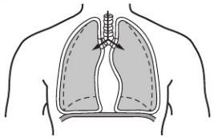

(a) The diaphragm contracts and the lung capacity increases by 20%. State two assumptions you would need to make to calculate the new pressure in the lungs if the initial pressure is known. [2]

(b)(i) The volume of air inhaled in a typical breath is  $ 2.5 \times 10^{-4} \, \text{m}^3 $ and an adult takes about 25 breaths per minute. Show that the mass of air taken into the lungs each second is about  $ 1 \times 10^{-4} \, \text{kg} $.

Density of air = 1.2 kg m $ ^{-3} $ [2]

(ii) Body temperature is 37.6 °C and the temperature outside the body is 20.0 °C. Calculate the rate at which energy is used to warm air up to body temperature. Specific heat capacity of air = 1000 J kg⁻¹ K⁻¹ [2]

(Total for Question 5 = 6 marks)

6 A student uses the apparatus shown to investigate the relationship between pressure and volume of a gas.

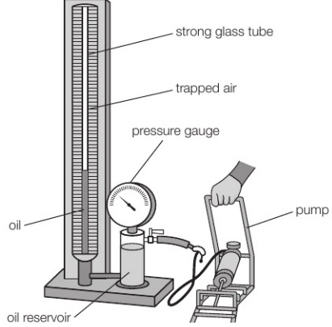

<!-- page 141 -->

## EXAM PRACTICE

Air is trapped in a glass tube of uniform cross-sectional area. As the pressure of the trapped air is increased, the length of trapped air decreases. The student collects data and plots the following graph.

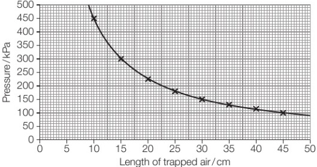

(a) State the variables that should be controlled in this investigation. [2]

(b) Theory suggests that, for the air trapped in the tube, the pressure p is inversely proportional to the volume V.

Use the graph to show that this relationship is correct.

State an assumption that you are making. [4]

(c) On the day that the investigation was carried out, the temperature in the laboratory was  $ 20\ °C $.

Calculate the number of air molecules trapped in the tube.

cross-sectional area of tube =  $ 7.5 \times 10^{-5} \, m^{2} $ [3]

(d) State how the graph would change if

(i) the air molecules in the tube were replaced by the same number of molecules of hydrogen gas. [1]

(ii) the temperature of the laboratory was much higher. [2]

(Total for Question 6 = 12 marks)

7 A student wants to determine the specific heat capacity of aluminium. He heats a block of aluminium by supplying electrical energy to a heater that is inserted into the block as shown.

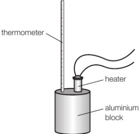

(a) Draw the electrical circuit he should use. [1]

(b) He writes the following plan:

## ～～～～～～～～～～

Measure the temperature of the block at the start

Turn on the electric current

Determine the energy flowing for a certain time

Turn off the current and measure the temperature

This will give me the specific heat capacity if I divide

the total energy by the mass and temperature rise

Write an improved plan that includes details of the method to be used and any precautions needed to produce an accurate value for the specific heat capacity of aluminium. [6]

(Total for Question 7 = 7 marks)

8 The picture shows an inflatable globe. This is a flexible plastic sphere on which a map of the world is printed. It is inflated by blowing into it like a balloon.

When fully inflated the globe has a volume of  $ 6.55 \times 10^{-2} \, \text{m}^3 $. At a temperature of  $ 22^\circ\text{C} $ the pressure exerted by the air in the globe is  $ 1.05 \times 10^5 \, \text{Pa} $.

(a) On average there are  $ 1.25 \times 10^{22} $ molecules in each breath of air that we take. Show that the number of breaths needed to fully inflate the globe is about 140. [3]

(b) The fully inflated globe is left outside and its temperature rises from  $ 22^{\circ} $C to  $ 30^{\circ} $C. The volume of the globe remains constant.

Calculate the new pressure exerted by the air in the globe. [2]

(c) Including ideas of momentum, explain why the pressure exerted by the air in the globe increases. [4]

(Total for Question 8 = 9 marks)

