# 9A Radioactivity

<!-- edx_ial_phy2.pdf p142-159 -->

<!-- page 142 -->

# TOPIC 9 NUCLEAR DECAY 9A RADIOACTIVITY CHAPTER

Radiation is scary. At least, that is what most people believe. When the USA dropped nuclear bombs on Japan in 1945, the Japanese suffered so many casualties that they surrendered within days. However, there is radioactivity naturally all around us. Having a picnic on a rock in a national park could easily expose you to more radioactivity than undertaking experiments in school using radioactive sources. Coal-fired power stations release more radioactivity to the environment, but nuclear power stations emit more radioactivity from their fuel. It is important to understand the evidence which relates to hazards in all areas of life. However, nuclear physics is poorly understood by the public and its hazards are often overstated.

In this chapter, we will learn what radioactivity is, how it can be dangerous, and how these hazards can be reduced. We will also see how the energy stored in the nuclei of atoms can be measured, where it comes from, and how it can be used as a power source.

## MATHS SKILLS FOR THIS CHAPTER

• Changing the subject of an equation (e.g. finding the mass in  $ E = mc^{2} $)

- Use of the principles of calculus (e.g. solving the rate of decay differential equation)

Use of exponential and logarithmic functions (e.g. solving for unknowns in the radioactive decay equation)

Use of logarithmic graph plots (e.g. finding the half-life from experimental data from a linear log plot)

• Calculating surface areas (e.g. verifying the inverse square law for gamma ray intensity)

<!-- page 143 -->

## What prior knowledge do I need? Topics 1B (Book 1: IAS) and 7B

The conservation of energy

Topic 3D (Book 1: IAS)

Ionisation

• Photon emission from excited electrons

Topic 7A

Rutherford's alpha particle scattering experiment

The structure of an atom

Topic 7C

Particle energies

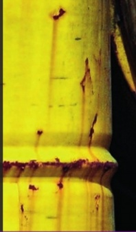

## What will I study in this chapter?

The different types of radioactive emissions

Mass defect and binding energy

Nuclear reactions

The importance of binding energy per nucleon

Nuclear fission and nuclear fusion

The random nature of radioactive decay, and radioactive half-life

## What will I study later?

## Topic 11A

How gravitational forces follow an inverse square relationship

## Topic 11B

How nuclear fusion reactions power stars

Gamma ray bursts from supernova explosions

The production of the heaviest elements in supernovae

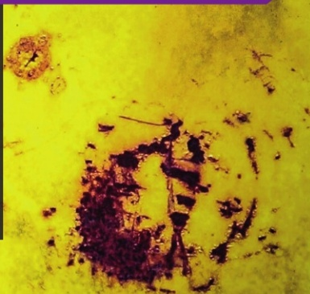

<!-- page 144 -->

## 1 NUCLEAR RADIATION

## LEARNING OBJECTIVES

Describe what is meant by background radiation and explain how to take appropriate account of it.

Explain the relationship between the structure of alpha, beta and gamma radiations, and their penetrating and ionising abilities.

Write and interpret nuclear equations.

## BACKGROUND RADIATION

Human beings can survive small doses of nuclear radiation. This has been important in our evolution, as the natural environment has low levels of radiation from natural sources. This is called background radiation. The level varies from place to place around the world. For example, in the UK it averages to less than one radioactive particle every two seconds in any given place (fig A). If we measure background radiation using a Geiger–Müller (G–M) tube, the number of counts per second usually ranges from 0.2–0.5 depending on exact location. Radiation levels are often reported in counts per second, and this unit is called the becquerel (Bq). Henri Becquerel was the French physicist who discovered spontaneous radiation in 1896.

(a)

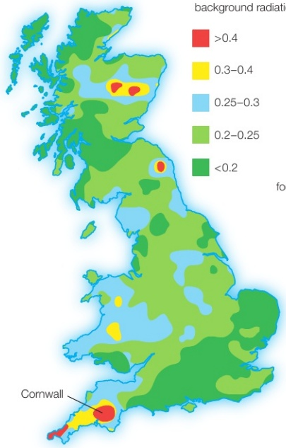

(b)

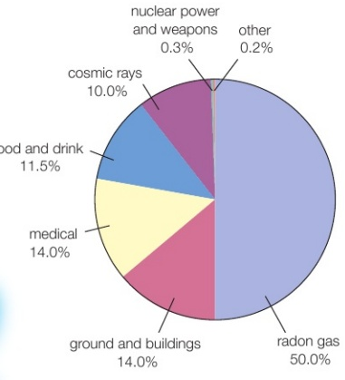

fig A The environment continually exposes us to low levels of nuclear radiation. (a) Levels of background radiation in Great Britain (measured in Bq); (b) Sources of background radiation.

<!-- page 145 -->

The exact exposure to nuclear radiations that any individual will receive from their environment will depend on where they are and how long they are there. This is because different environmental factors contribute to the local level of background radiation. On Earth, approximately half of the background radiation is from naturally radioactive gases which are in the atmosphere, particularly radon. Radon is produced in the decay of uranium ore present in certain rocks (especially granite) and so is found more in certain parts of the world than others. In Cornwall in the UK, some houses are fitted with radon detectors and special ventilation systems to remove excess radon gas from the household atmosphere.

## DID YOU KNOW?

The most naturally radioactive place on Earth is Ramsar, in Iran, where the dosage can be more than 200 times the global average.

## PRACTICAL SKILLS

## Investigating background radiation

It is easy to determine the average background radiation in your area using a Geiger-Müller tube and counter. As radioactive decay is a random and spontaneous process, the activity in your lab must be measured over a long period of time (30 minutes or more) and then an average calculated. Otherwise, you may find that the measurement is, by chance, particularly high or particularly low and so does not truly indicate the average over time. For example, a good approximation to the average will be achieved if the G-M tube and counter are set to counting for two hours. The final count is then divided by 7200 (seconds), which is long compared with the average count of about 0.5 Bq. Measurements of radioactivity that have had the background radiation deducted, so that they only represent activity by a radioactive source under test, are known as corrected counts.

## WORKED EXAMPLE 1

In a school experiment, Ricardo measured the background radiation using a G-M tube and counter for half an hour. The final reading was 747 counts. What is the average background radiation?

 $$ time=30\times60=1800s $$ 

 $$  activity=\frac{747}{1800}=0.415Bq $$ 

The background count will skew the results of investigations into nuclear radiations. Whenever such an investigation is undertaken, the background radiation must also be measured separately and then deducted from each count measured in the main part of the investigation.

## TYPES OF NUCLEAR RADIATION

Many nuclei are slightly unstable and there is a small probability that, each second, they may **decay**. This means that a nucleon may change from one type to another, or the composition or energy state of the nucleus as a whole may change. When a nuclear decay occurs, the radiation particle emitted will leave the nucleus carrying kinetic energy. As the particle travels, it will ionise particles in its path, losing some of that kinetic energy at each ionisation. When all the kinetic energy is transferred, the radiation particle stops and is absorbed by the substance that it is in at that moment.

The three main types of nuclear radiation are called **alpha** ( $ \alpha $), **beta** ( $ \beta $) and **gamma** ( $ \gamma $) radiation. Each one comes about through a different process within the nucleus, each one is composed of different particles, and each one has different properties.

## PRACTICAL SKILLS

## Investigating radiation penetration

You can investigate the penetrating power of alpha, beta and gamma radiation using a Geiger-Müller tube to detect them. Between the source and the G-M tube, place absorber sheets that progressively increase in density, and measure the average count rate. This investigation is often simulated using computer software. This removes all risk of exposure to radiological hazards (see below).

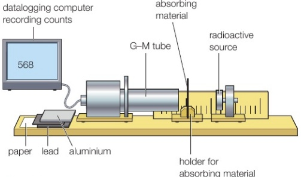

fig B Investigating nuclear radiations.

Safety Note: Handle the radioactive sources with a long pair of tongs and do not point the open end of the source at any part of the body. Return each source to its secure box after use.

## ALPHA DECAY

Alpha particles are composed of two protons and two neutrons, the same as a helium nucleus. This is a relatively large particle with a significant positive charge (+2e), so it is highly ionising. An alpha particle moving through air typically causes 10 000 ionisations per millimetre. As it ionises so much, it quickly loses its kinetic energy and is easily absorbed. A few centimetres travel in air is enough to absorb an alpha particle, and they are also blocked by paper or skin.

Example alpha decay equation:  $ ^{241}_{95}\text{Am} \rightarrow ^{237}_{93}\text{Np} + ^{4}_{2}\text{α} $

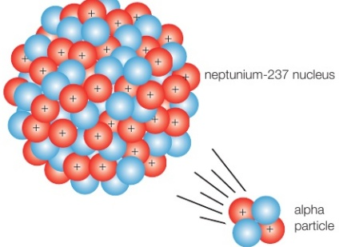

fig C Alpha particle emission.

<!-- page 146 -->

## EXAM HINT

Remember that in any nuclear equation, the total charge, and the total nucleon number must both be conserved from before to after the reaction.

## LEARNING TIP

As we saw in Section 7C, beta particles are emitted with a range of kinetic energies. This means that their range in air can be anything from a few centimetres to a few metres depending on that initial energy.

## BETA DECAY

A beta particle is an electron emitted at high speed from the nucleus when a neutron decays into a proton. With its single negative charge and much smaller size, the beta particle is much less ionising than an alpha particle, and thus can penetrate much further. Several metres of air, or a thin sheet of aluminium, are needed to absorb beta particles.

Example beta decay equation:

 $$ {}^{14}_{6}\mathrm{C}\rightarrow{}^{14}_{7}\mathrm{N}+{}^{0}_{-1}\mathrm{\beta}+{}^{0}_{0}\overline{\nu} $$ 

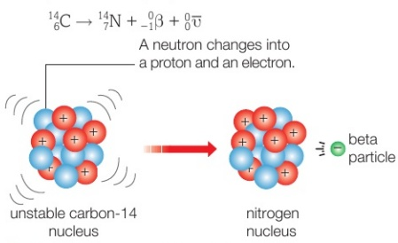

▲ fig D Beta-minus particle emission.

## GAMMA DECAY

Gamma rays are high energy, high frequency, electromagnetic radiation. These photons have no charge and no mass and so will rarely interact with particles in their path, which means they are the least ionising nuclear radiation. They are never completely absorbed, although their energy can be significantly reduced by several centimetres of lead or several metres of concrete. If the energy of gamma rays is reduced to a safe level, we often describe them as being absorbed.

Example gamma decay equation:

 $$ \mathrm{^{60}_{28}Ni-m}\rightarrow\mathrm{^{60}_{28}Ni}+\mathrm{^{0}_{0}\gamma} $$ 

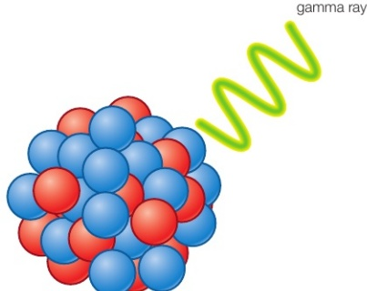

fig E Gamma ray emission. The image shows only the gamma emission from an excited nickel nucleus. Ni-m a moment after a beta particle was emitted from a cobalt-60 nucleus.

Gamma ray emission does not change the structure of a nucleus emitting it, but carries away energy, so the nucleus must drop energy level in order to emit the gamma ray. This most commonly happens immediately after alpha or beta decay, which leaves the nucleus in an excited state. The emission of the gamma ray photon and associated de-excitation of the nucleus is exactly the same as we saw in Book 1, Section 3D.4 for the production of visible light, but involves nuclear energy states and not electrons. The difference is that the amount of energy involved is many times higher, so this produces much higher frequency gamma radiation.

<!-- page 147 -->

## PRACTICAL SKILLS

## Investigating lead absorption of gamma radiation

Using the same experimental set-up as shown in fig B, we can find out how much lead is needed to reduce the intensity of gamma radiation by a particular amount. Using a radioactive source that emits alpha and gamma only, we can select to study the gamma radiation by placing a sheet of paper in front of the source to absorb all the alpha particles. This will have no measurable effect on the gamma emissions.

Keeping the distance from the source to the G-M tube constant, we can place different thicknesses of lead plate in the gap between them. For each thickness, record the count over a fixed time period and determine the corrected count rate. There is a mathematical relationship between the corrected count rate (which represents intensity of the radiation, I) and the thickness, x, of lead. Work out what graph to draw to prove that  $ I \propto e^{-\mu x} $.

Safety Note: Handle the gamma source with a long pair of tongs and do not point the open end at any part of the body. Be careful not to put fingers and hands in front of the source when changing the lead blocks.

## EXAM HINT

## DANGERS FROM NUCLEAR RADIATIONS

Make sure you have a good understanding of this practical as your understanding of the experimental method may be assessed in your exams.

Ionising radiations can interact with the particles that human cells consist of. There may be so much ionisation that it causes the cells to die. Where there is less ionisation, the molecules of DNA in the cells may change slightly. These DNA mutations can cause cells to have an increased tendency to become cancerous. As the different types of nuclear radiation ionise to different extents, the hazard to humans is different for each type. The hazard levels are given in table A.

<table border=1 style='margin: auto; word-wrap: break-word;'><tr><td style='text-align: center; word-wrap: break-word;'>TYPE OF RADIATION</td><td style='text-align: center; word-wrap: break-word;'>INSIDE BODY</td><td style='text-align: center; word-wrap: break-word;'>OUTSIDE BODY</td></tr><tr><td style='text-align: center; word-wrap: break-word;'>alpha,  $ \alpha $</td><td style='text-align: center; word-wrap: break-word;'>Highly ionising – very dangerous:\nradiation poisoning and cancer possible.</td><td style='text-align: center; word-wrap: break-word;'>Absorbed by surface layer of dead skin cells – no danger.</td></tr><tr><td style='text-align: center; word-wrap: break-word;'>beta,  $ \beta $</td><td style='text-align: center; word-wrap: break-word;'>Moderate ionisation and danger:\nexposure should be minimised.</td><td style='text-align: center; word-wrap: break-word;'>Moderate ionisation and danger:\nclose exposure should be minimised.</td></tr><tr><td style='text-align: center; word-wrap: break-word;'>gamma,  $ \gamma $</td><td style='text-align: center; word-wrap: break-word;'>Minimal ionisation – cancer danger from long-term exposure.</td><td style='text-align: center; word-wrap: break-word;'>Minimal ionisation – cancer danger from long-term exposure.</td></tr></table>

Table A Hazards from nuclear radiations. Not considered here is the fact that different tissue types can be more or less affected by these dangers.

## CHECKPOINT

## SKILLS INNOVATION

1. Create a table summarising everything you know about alpha, beta and gamma radiations.

2. In preparation for an experiment using a radioactive sample, Xian measured the radioactivity in the laboratory without the sample present. In one hour, the Geiger-Müller tube measured 1645 counts. What was the background count in becquerel?

3. Why is it theoretically safe to hold a sample which emits only alpha radiation? Why should you still never do so?

4. Why might the UK government list 'living in Cornwall' as one of the most (radiologically) hazardous activities that the public can undertake?

5. It is thought that some soil could be contaminated with a radioisotope. You have a sample of this soil. Describe an experiment to determine what types of radiation are emitted.

## SUBJECT VOCABULARY

background radiation low levels of radiation from environmental sources, always present around us decay ('nuclear' or 'radioactive') a process in which a nucleus' structure is changed, usually accompanied by the emission of a particle alpha composed of two protons and two neutrons, the same as a helium nucleus beta an electron emitted at high speed from the nucleus when a neutron decays into a proton gamma high energy, high frequency, electromagnetic radiation, emitted from a nuclear radioactive decay

<!-- page 148 -->

# 2 RATE OF RADIOACTIVE DECAY

## LEARNING OBJECTIVES

Describe the spontaneous and random nature of radioactive decay.

Determine half-lives of isotopes graphically.

Use the equations for rate of radioactive decay, and their logarithmic equivalents.

## PROBABILITY AND DECAY

Radioactive decay is a spontaneous and random process and so any radioactive nucleus may decay at any moment. For each second that it exists, there is a particular probability that the nucleus will decay. This probability is called the \textit{decay constant},  $ \lambda $. However, just like guessing which number will come up next in a lottery, it is not possible to predict when any given nucleus will decay. The chance that a particular nucleus will decay is not affected by factors outside the nucleus, such as temperature or pressure, or by the behaviour of neighbouring nuclei – each nucleus decays entirely independently.

If we have a large sample of the nuclei, the probability of decay will determine the fraction of these nuclei that will decay each second. Naturally, if the sample is larger, then the number that decay in a second will be greater. So the number decaying per second, called the activity, $A\left(\text{or}\frac{\mathrm{d}N}{\mathrm{d}t}\right)$, is proportional to the number of nuclei in the sample, $N$. Mathematically, this is expressed as:

 $$ \boldsymbol{A}=-\lambda\boldsymbol{N} $$ 

 $$ \frac{\mathrm{d}N}{\mathrm{d}t}=-\lambda N $$ 

The minus sign in this formula occurs because the number of nuclei in the sample, N, decreases with time. In practice we ignore the negative sign when using the formula.

## WORKED EXAMPLE 1

The decay constant for carbon-14 is  $ \lambda = 3.84 \times 10^{-12} \, s^{-1} $. What is the activity of a sample of 100 billion atoms of carbon-14?

 $$ \frac{\mathrm{d}N}{\mathrm{d}t}=-\lambda N $$ 

 $$ \frac{\mathrm{d}N}{\mathrm{d}t}=-\left(3.84\times10^{-12}\right)\times\left(100\times10^{9}\right)=0.384\ \mathrm{Bq} $$ 

The formula for the rate of decay of nuclei in a sample is a differential equation. We have previously met this type of equation when studying the discharge of a capacitor. The equation  $ \frac{dN}{dt} = -\lambda N $ can be solved to give a formula for the number of nuclei remaining in a sample, N, after a certain time, t

 $$ N=N_{0}e^{-\lambda t} $$ 

where  $ N_{0} $ is the initial number of nuclei within a sample.

## WORKED EXAMPLE 2

If our sample of 100 billion carbon-14 atoms were left for 300 years, how many carbon-14 atoms would remain?

 $$ time,t=300\times365\times24\times60\times60=9.46\times10^{9}s $$ 

 $$ N=N_{0}e^{-\lambda t} $$ 

 $$ \lambda t=\left(3.84\times10^{-12}\right)\left(9.46\times10^{9}\right)=0.0363 $$ 

 $$ N=(100\times10^{9})\times e^{-0.0363} $$ 

 

 $$ N=9.64\times10^{10}atoms $$ 

## LEARNING TIP

The exponential mathematics that govern radioactive decay is identical in structure to those for the discharge of capacitors, which we saw in Section 6B.3.

## HALF-LIFE

As we have seen, the activity of a radioactive sample decreases over time as the radioactive nuclei decay, leaving fewer radioactive nuclei available to decay. While the activity of a sample depends on the number of nuclei present, the rate at which the activity decreases depends only on the particular isotope. A measure of this rate of decrease of activity is the half-life,  $ t_{\frac{1}{2}} $. This is the time taken for half of the nuclei of that nuclide within a sample to decay.

Mathematically, the half-life can be found by putting  $ N = \frac{1}{2}N_{0} $ into the decay equation:

 $$ N=N_{0}e^{-\lambda t} $$ 

 $$ \frac{N_{0}}{2}=N_{0}\mathrm{e}^{-\lambda t} $$ 

 $$ \frac{1}{2}=e^{-\lambda t_{\frac{1}{2}}} $$ 

 $$ \begin{array}{r l}{\therefore\quad}&{{}\ln\left(\frac{1}{2}\right)=-\lambda t_{\frac{1}{2}}}\\ {}&{{}}\\ {}&{{}-\ln2=-\lambda t_{\frac{1}{2}}}\\ \end{array} $$ 

 $$ t_{\frac{1}{2}}=\frac{\ln2}{\lambda} $$ 

Rearranging this also gives us:

 $$ \lambda=\frac{\ln2}{t_{\frac{1}{2}}} $$ 

## WORKED EXAMPLE 3

What is the half-life of carbon-14?

 $$ \lambda=3.84\times10^{-12}s^{-1} $$ 

 $$ t_{\frac{1}{2}}=\frac{\ln2}{\lambda} $$ 

 $$ t_{\frac{1}{2}}=\frac{\ln2}{3.84\times10^{-12}} $$ 

 $$ t_{\frac{1}{2}}=1.81\times10^{11}s=5720years $$

<!-- page 149 -->

## PRACTICAL SKILLS

## Investigating radioactive decay rates

You may have the equipment to measure the half-life for a radioactive sample, as shown in fig A. If you do not, a simulation in which dice represent the radioactive nuclei can demonstrate the exponential decay of a sample (fig B).

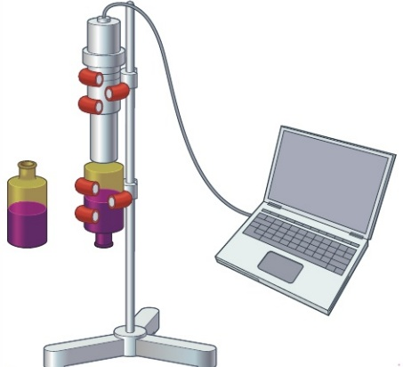

fig A Measuring the half-life of protactinium-234m.

Safety Note: Before use, check that the bottle is not leaking and never remove the cap. Put a tray under the bottle in case it does leak when in use. Store it in a larger plastic container with a lid.

fig B Measuring the half-life of dice.

## HALF-LIFE GRAPHS

An experiment to determine the half-life of a substance will usually measure its activity over time. Activity is proportional to the number of nuclei present, so when the activity is plotted against time, the shape of the curve is exponential decay (fig C). The activity, A, follows the equation:

 $$ A=A_{0}\mathrm{e}^{-\lambda t} $$ 

We can use the graph of activity against time to determine the half-life of the substance by finding the time taken for the activity to halve.

To find the half-life from such a graph, find a useful start point on the curve. In the example shown in fig C, this could be the start point where the activity is 800 Bq. As the half-life is defined as the time taken for the activity to fall to half of its original value, we use the graph to find the time taken for the count to drop to 400 Bq, which is 70 seconds. Doing this a second time, from a count rate of 400 Bq to a count rate of 200 Bq, gives a time of 80 seconds. Notice that the time interval is not identical each time. This is due to the random nature of radioactive decay, plus experimental and graphing errors. The best-fit curve will be a matter of the drawer's judgement. Thus, to get the best answer for the half-life, we must undertake the analysis on the graph several times in different parts of the graph and average the results. From the two half-lives shown in fig C, the average half-life for protactinium-234m would be 75 seconds.

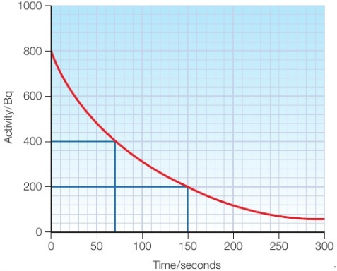

fig C Determining half-life graphically.

## LOGARITHMIC HALF-LIFE ANALYSIS

As we have seen in fig C, there are many graphical uncertainties which could mean that our conclusion of the half-life for a sample under test is unreliable. To improve on the curving graph, we can analyse the experimental data to generate a straight-line graph so our best-fit line will be less uncertain. Using either of our decay equations, taking the logarithm of the equation will give us a new equation for the data that is in the form  $ y = mx + c $.

Considering data from measuring the activity of a sample over time:

 $$ A=A_{0}\mathrm{e}^{-\lambda t} $$ 

 $$ \ln A=\ln A_{0}-\lambda t $$ 

 $$ \therefore\quad\ln A=-\lambda t+\ln A_{0} $$ 

So a plot of  $ \ln A $ on the y-axis against  $ t $ on the x-axis (fig D) will be a straight line with a negative gradient equal in magnitude to the decay constant,  $ \lambda $. The y-intercept will be the natural logarithm value of the initial activity.

Alternatively, if the experimental data is measuring number of nuclei (often actually measured as mass):

 $$ N=N_{0}e^{-\lambda t} $$ 

 $$ \ln N=\ln N_{0}-\lambda t $$ 

 $$ \therefore\quad\ln N=-\lambda t+\ln N_{0} $$

<!-- page 150 -->

Here, a plot of  $ \ln N $ on the y-axis against t on the x-axis will also be a straight line with a negative gradient, which is equal in magnitude to the decay constant,  $ \lambda $. The y-intercept in this case will be the natural logarithm value of the initial number of nuclei.

In either case, the gradient gives the decay constant, from which we can find the half-life from:

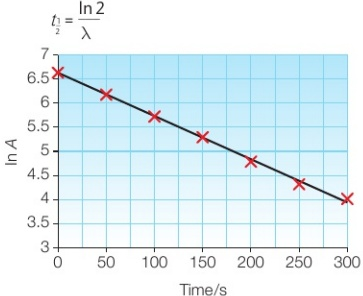

## EXAM HINT

▲ fig D Logarithmic graphical analysis of protactinium-234m decay data.

Spontaneous decay means we cannot influence when a nucleus will decay.

Random decay means we cannot predict when a given nucleus will decay. We can only predict the fraction of a sample that will decay in a certain time.

## CHECKPOINT

## SKILLS ANALYSIS

1. Calculate the decay constants for the following isotopes that are commonly used in school laboratories:

(a) radium-226: half-life = 1602 years

(b) strontium-90: half-life = 28.8 years

(c) cobalt-60: half-life = 5.3 years.

2. If the cellar in a house in Nova Scotia, Canada contained 6.5 billion atoms of radon-222 gas, with a decay constant  $ \lambda = 2.10 \times 10^{-6} \, s^{-1} $, how many radon gas atoms would there be one day later?

3. Technetium-99m is a gamma emitter which is often used as a medical tracer to monitor lymph node activity. Use the graph of experimental results shown in fig E to work out the half-life of technetium-99m.

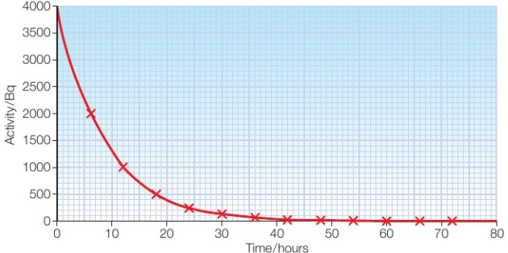

▲ fig E Radioactive decay of technetium-99m.

4. Explain why a radioactive isotope with a very small decay constant will have a long half-life.

5. ▶ Find the half-life of protactinium from the logarithmic graph in fig D.

## SUBJECT VOCABULARY

decay constant the probability, per second, that a given nucleus will decay

activity the number of radioactive decays in unit time

half-life the time taken for half of the nuclei within a sample to decay. Alternatively, the time taken for the activity of a sample of a radioactive nuclide to reduce to half its initial value

<!-- page 151 -->

## 3 FISSION AND FUSION

## LEARNING OBJECTIVES

Define the concepts of nuclear binding energy and binding energy per nucleon.

Make calculations of nuclear mass, mass deficit and binding energy, including use of the atomic mass unit.

Describe the processes of nuclear fission and nuclear fusion, including the conditions needed to maintain nuclear fusion.

## ENERGY-MASS EQUIVALENCE

A nucleon has a mass which is approximately equal to 1 unified atomic mass unit, u (  $ = 1.66 \times 10^{-27} \, \text{kg} $). The exact masses of a proton, a neutron and an electron are given in table A.

<table border=1 style='margin: auto; word-wrap: break-word;'><tr><td style='text-align: center; word-wrap: break-word;'>PARTICLE</td><td style='text-align: center; word-wrap: break-word;'>MASS/ATOMIC MASS UNITS/U</td><td style='text-align: center; word-wrap: break-word;'>MASS/SI UNITS/KG</td></tr><tr><td style='text-align: center; word-wrap: break-word;'>proton</td><td style='text-align: center; word-wrap: break-word;'>1.007 276</td><td style='text-align: center; word-wrap: break-word;'>$ 1.672623 \times 10^{-27} $</td></tr><tr><td style='text-align: center; word-wrap: break-word;'>neutron</td><td style='text-align: center; word-wrap: break-word;'>1.008 665</td><td style='text-align: center; word-wrap: break-word;'>$ 1.674929 \times 10^{-27} $</td></tr><tr><td style='text-align: center; word-wrap: break-word;'>electron</td><td style='text-align: center; word-wrap: break-word;'>0.000 548 58</td><td style='text-align: center; word-wrap: break-word;'>$ 9.109390 \times 10^{-31} $</td></tr></table>

table A Masses of sub-atomic particles.

We might expect that if we know the constituent parts of any nucleus, we can calculate its mass by finding the total mass of its nucleons. However, in practice we find that the actual, measured mass of a nucleus is always less than the total mass of its constituent nucleons. This difference is called the mass deficit,  $ \Delta m $, or sometimes the mass defect,  $ \Delta m $.

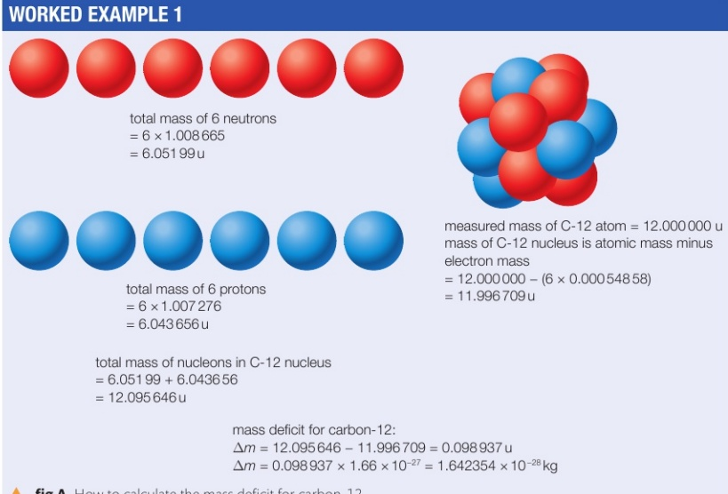

fig A How to calculate the mass deficit for carbon-12.

<!-- page 152 -->

## NUCLEAR BINDING ENERGY

The mass deficit comes about because a small amount of the mass of the nucleons is converted into the energy needed to hold the nucleus together. This is called binding energy,  $ \Delta E $. It is calculated using Einstein's mass–energy relationship:

 $$ \Delta E=c^{2}\Delta m $$ 

where c is the speed of light.

There are two common systems of units for calculating binding energy. If you have calculated the mass deficit in kilograms

(SI units) then using  $ c = 3.00 \times 10^8 \, \text{m} \, \text{s}^{-1} $ will give the binding energy in joules. Alternatively, if you have calculated the mass deficit in atomic mass units, then you convert this into binding energy in mega-electronvolts (MeV) using:

1 u = 931.5 MeV

## WORKED EXAMPLE 2

Calculate the binding energy for a carbon-12 nucleus in both joules and electronvolts.
Working in kilograms, from fig A:
 $ \Delta m = 1.642\,354 \times 10^{-28}\,kg $
 $ \Delta E = c^{2}\Delta m $
 $ (3 \times 10^{8})^{2} \times (1.642\,354 \times 10^{-28}) $
 $ = 1.478 \times 10^{-11}\,J $
Converting to electronvolts:
 $ \Delta E = \frac{1.478 \times 10^{-11}}{1.6 \times 10^{-19}} $
 $ = 9.226 \times 10^{7}\,eV $
 $ = 92.3\,MeV $
Alternatively, working in atomic mass units, from fig A:
 $ \Delta m = 0.098\,937\,u $
 $ \Delta E = 931.5 \times \Delta m $
 $ = 931.5 \times 0.098\,937 $
 $ = 92.2\,MeV $
Note that in calculations of both mass deficit and binding energy, you need to use as many significant figures as possible, only rounding off at the very end of the calculation. The difference in our two answers here has come from rounding off the binding energy answer in joules.

## BINDING ENERGY PER NUCLEON

How much energy would be needed to remove one nucleon from a nucleus? To work this out we need to know both the binding energy of a nucleus, and the number of nucleons within it. This gives us the binding energy per nucleon in a nucleus in MeV, and from this we can determine how strongly different nuclei are held together.

## WORKED EXAMPLE 3

Does helium-4 or carbon-12 have the higher binding energy per nucleon?
The binding energy of helium-4 is 28.3 MeV, and it contains 4 nucleons:
binding energy per nucleon =  $ \frac{28.3}{4} = 7.08 $ MeV
The binding energy for carbon-12 is 92.2 MeV, and it contains 12 nucleons:
binding energy per nucleon =  $ \frac{92.2}{12} = 7.68 $ MeV
So, carbon-12 nuclei are more tightly bound together than those of helium-4.

<!-- page 153 -->

Drawing a graph of binding energy per nucleon against mass number for the nuclei gives us a useful way of comparing how tightly different nuclides are bound together.

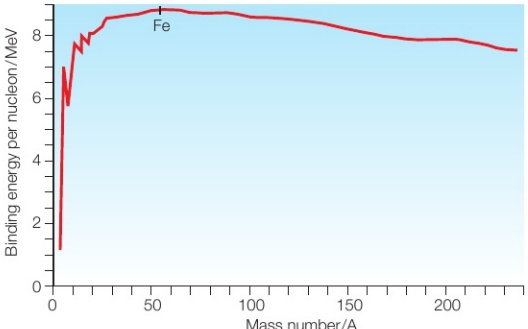

▲ fig B Graph of binding energy per nucleon against mass number, A.

Looking at fig B, you will see that the isotope with the highest binding energy per nucleon is iron-56 at 8.8 MeV per nucleon. Any nuclear reaction which increases the binding energy per nucleon will give out energy.

The graph shows us that small nuclides can combine together to make larger nuclei (up to Fe-56) with a greater binding energy per nucleon. This process is called nuclear fusion. Similarly, larger nuclei can break up into smaller pieces which have a greater binding energy per nucleon than the original nucleus. Reactions like this are called nuclear fission. Both of these types of nuclear reaction will give out energy, and could be used as power sources.

## NUCLEAR FUSION

If we take some light nuclei and force them to join together, the mass of the new heavier nucleus will be less than the mass of the constituent parts, as some mass is converted into energy. However, not all of this energy is used as binding energy for the new larger nucleus, so energy will be released from this reaction. The binding energy per nucleon afterwards is higher than at the start. This is the process of nuclear fusion and is what provides the energy to make stars shine (fig C).

Stage 1: two protons fuse.

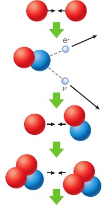

Stage 2: one proton changes into a neutron, as in beta-plus decay, to leave a deuterium nucleus.

Stage 3: another proton joins on making a nucleus of He-3.

Stage 4: two He-3 nuclei fuse.

Stage 5: two protons break off leaving an He-4 nucleus.

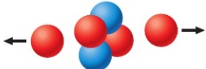

fig C The proton-proton nuclear fusion reaction, typical in small cool stars such as our Sun, where the core temperature is about  $ 15 \times 10^{6} $ K.

<!-- page 154 -->

## WORKED EXAMPLE 4

The proton-proton chain nuclear fusion reaction effectively takes four protons and converts them into a helium-4 nucleus and two positrons (which have the same mass as electrons). Calculate the energy released in this reaction.

The measured atomic mass of  $ {}^{4}He $ is 4.002 602 u.

 $$ \begin{array}{l} \text{Mass of 4 protons} = 4 \times1.007276\ \text{u} \\ \qquad = 4.029104\ \text{u} \end{array} $$ 

 $$ \begin{aligned}Mass~of~^{4}He~nucleus~+&~2~positrons\\=&\left(4.002~602-2\times0.000~548~58\right)u+\left(2\times0.000~548~58\right)u\\=&~4.002~602~u\end{aligned} $$ 

 $$ \begin{aligned}Mass~deficit&=4.029104u-4.002602u\\&=0.0265u\\&=24.7MeV\end{aligned} $$ 

These reactions which occur in enormous numbers provide the energy which causes the Sun to emit heat and light in all directions in great quantities.

Converting hydrogen into helium with the release of energy could be an excellent way of supplying the planet's energy needs. The seas are full of hydrogen in water molecules, and the helium produced would be an inert gas which could simply be allowed to go up into the upper atmosphere. However, scientists have not yet successfully maintained a controlled nuclear fusion reaction. The problem lies in forcing two positively charged, mutually repelling, protons to fuse together. The kinetic energy which they need to collide forcefully enough to overcome this electrostatic repulsion requires temperatures of many million kelvin. Moreover, to ensure enough colliding protons for the reaction to be sustained requires a very high density of them. Comparing the energy output with nuclear fission below, 235 grammes of hydrogen undergoing nuclear fusion would produce an energy output of  $ 1.40 \times 10^{14} $ J.

## FUSION REACTIONS

Nuclear fusion as an energy source for us to generate electricity is currently only at a research stage. Fusion would have the advantage that its fuel source is abundant, and no radioactive waste would be produced. It is difficult to achieve though, because the high temperature and density needed make confining the 'burning plasma' difficult. This confinement would need very strong magnetic fields. The ITER project (International Thermonuclear Experimental Reactor) is a research experiment for nuclear fusion to produce electricity. This is an international project, ITER will be sited in France, and the EU and six other large nations (India, China, Russia, USA, Korea and Japan) will also contribute towards the 15 billion Euros construction cost. An estimated 10 years of construction began in 2010. By 2025, the aim is to generate temperatures of 150 million kelvin in a plasma volume of 840 cubic metres.

## NUCLEAR FISSION

We have seen that nuclear fusion is not yet an option for electricity generation, as we have not been able to create the high densities and temperatures needed to sustain a fusion reaction. However, another process which releases binding energy from nuclei is called nuclear fission. In this process a large nucleus breaks up into two smaller nuclei, with the release of some neutrons and energy (fig D). Fission reactions can be started when the nucleus absorbs another particle which makes it unstable. Uranium-235 can absorb slow-moving neutrons to become the unstable isotope U-236.

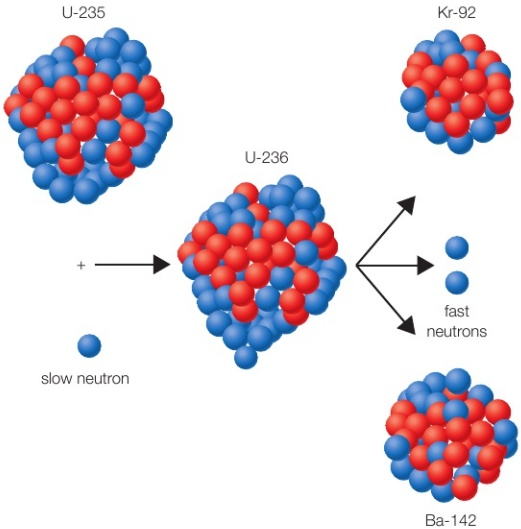

fig D Nuclear fission of uranium-235.

## WORKED EXAMPLE 5

Although there are many different possible products from nuclear fission reactions, the amount of energy released in each one is about the same at about 200 MeV.

Calculate the energy released in the following fission reaction:

 $$ \mathrm{^{235}U}+\mathrm{n}\rightarrow\mathrm{^{141}Ba}+\mathrm{^{92}Kr}+\mathrm{3n}+\mathrm{energy} $$ 

(Data: mass of U-235 = 235.0439 u; mass of Ba-141 = 140.9144 u; mass of Kr-92 = 91.9262 u.)

 $$ \begin{aligned}Mass~difference:&\Delta m\\&=235.0439+1.008665-140.9144-91.9262-3(1.008665)\\&=0.1860u\end{aligned} $$ 

 $$ \begin{aligned}Energy~released:~E&=0.1860\times931.5\\&=173MeV\\&=2.77\times10^{-11}J\\ \end{aligned} $$ 

This is the energy per fission. If one mole of these were to occur, using 235 g of U-235, then the total energy produced would be:

 $$ \begin{aligned}E&=6.02\times10^{23}\times2.77\times10^{-11}\\&=1.67\times10^{13}J\end{aligned} $$ 

However, U-235 is a small proportion ( $ \approx $ 0.7%) of all the uranium found, and thus a larger amount of uranium fuel would be needed in order to provide enough U-235 atoms to produce this much energy. What are the changes in binding energy per nucleon in the above reaction?

<!-- page 155 -->

(Data: binding energy of U-235 = 1786 MeV; binding energy of Ba-141 = 1170 MeV; binding energy of Kr-92 = 782 MeV.)

Find the binding energies per nucleon:

U-235:

 $$ \frac{1786}{235}=7.6MeV $$ 

Ba-141:

 $$ \frac{1170}{141}=8.3MeV $$ 

Kr-92:

 $$ \frac{782}{92}=8.5MeV $$ 

Therefore the two fission products each have a higher binding energy per nucleon than the original uranium nuclide.

## DID YOU KNOW?

## NUCLEAR BOMBS

The neutrons in controlled nuclear fission reactions are slowed to speeds needed to sustain fission using a moderator. However, some nuclear fission reactions, such as those using plutonium, will progress by reacting with high speed neutrons, meaning that a moderator is not required. If such a reaction is allowed to run uncontrolled, it produces energy continuously, at an ever-increasing rate, until all the fuel is used up. This is the essential concept behind the design of nuclear bombs. A lump of plutonium-239 about the size of a tennis ball can completely react in less than a microsecond, releasing energy equivalent of 20 kilotonnes of TNT, about  $ 90 \times 10^{12} $ J.

This type of bomb (fig E) was dropped on the city of Nagasaki in Japan during the Second World War. It killed 40,000 people immediately, and a similar number had died from after-effects by the end of 1945. The atomic bombings in Japan were so devastating that the country surrendered to the allies just six days after the Nagasaki bomb, and since the 1960s the Japanese government has resolved never to allow Japan to hold nuclear weapons.

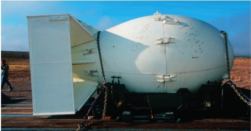

## CHECKPOINT

fig E A Fat Man plutonium fission bomb.

## SKILLS INTERPRETATION, ANALYSIS

1. Use the data in table A to work out how much energy could be produced if a proton, neutron and electron were each completely converted into energy.

2. The atomic mass unit was different between physics and chemistry until the system was unified in the 1960s. Previously, in Physics, it was based on the mass of an atom of oxygen-16, which is 15.994 915 u (now). Using the modern values, calculate the binding energy of a nucleus of oxygen-16.

## SKILLS CRITICAL THINKING

3. Inside large mass stars, fusion of heavier elements than in the proton-proton cycle can occur. At about  $ 10^8 $ K, helium-4 nuclei will fuse into carbon-12 nuclei according to the equation:

 $$ {}^{4}\mathrm{He}^{2+}+{}^{4}\mathrm{He}^{2+}+{}^{4}\mathrm{He}^{2+}={}^{12}\mathrm{C}^{6+} $$ 

(a) Calculate the energy released in this reaction.

(b) How does the binding energy per nucleon change in the reaction?

(c) What is the average kinetic energy and rms speed of the helium nuclei in the star?

4. Complete the following nuclear fission reaction to determine X:

 $$ \mathrm{^{235}U+n \longrightarrow ^{X}\mathrm{Rb} +^{139}\mathrm{Cs} +2n+\mathrm{energy}} $$ 

5. Calculate the amount of energy, in joules, generated from 2 kg of uranium fuel, if the U-235 represents 0.7% of the metal and every fission reaction produces 200 MeV.

6. Calculate the energy released in one fission in the following reaction:

 $$ \mathrm{235U +n \longrightarrow ^{94}Zr +^{139}Te +3n +energy } $$ 

(Data: mass of Zr-94 = 93.9063 u; mass of Te-139 = 138.9347 u.)

7. Explain, in terms of binding energy per nucleon, why nuclear fusion and nuclear fission can release energy.

## SUBJECT VOCABULARY

mass deficit,  $ \Delta m $ the difference between the measured mass of a nucleus and the sum total of the masses of its constituent nucleons

mass defect,  $ \Delta m $ an alternative phrase for 'mass deficit'

binding energy,  $ \Delta E $ the energy used to hold the nucleus together,

converted from the mass deficit, following  $ E = mc^{2} $. So, it is also the

energy needed to break a nucleus apart into its individual nucleons

fusion small nuclides combine together to make larger nuclei,

releasing energy

fission larger nuclei are broken up into smaller nuclides, releasing energy nuclear fission a large nucleus breaks up into two smaller nuclei, with the release of some neutrons and energy

<!-- page 156 -->

## 9A THINKING BIGGER

Some medical diagnosis procedures use radioactive isotopes. The radiation emitted from them can be detected by a special camera which allows doctors to find out what is happening inside a patient without surgery.

ONLINE SCIENCE MAGAZINE

# MEDICAL IMAGING FACES SHORTAGE OF KEY RADIOACTIVE MATERIAL

The shutdown of a Canadian nuclear reactor creates a greater than 50 percent chance of a shortage of an important medical testing marker.

Doctors use radioactive isotopes in a range of diagnostic procedures. They are chemically attached to other compounds that accumulate in a target organ. Once there, the isotopes emit radiation that specialized camera equipment picks up. The procedure is fast and, unlike biopsies and surgical procedures, non-invasive. The radiation dose is generally low and does not pose a significant health risk.

Created by the radioactive decay of molybdenum-99, technetium-99m (Tc-99m) is the most popular medical isotope, used in about 80 percent of the imaging procedures that rely on radioactive tracers. It is an unstable form of technetium-99, an isotope of the radioactive element technetium whose nucleus contains 99 protons plus neutrons.

## A Complex Supply Chain

Tc-99m has a half-life – the time it takes for half of it to decay radioactively – of only six hours once it's produced. So it can't be shipped over long distances. Instead, most hospitals receive the parent isotope molybdenum-99 and let it decay into Tc-99m on site.

Complicating the situation, Mo-99 itself has a half-life of only 66 hours. That means that it can't be stockpiled. As a result, the process of transport from reactor to patient is complicated and filled with logistical, security and economic concerns.

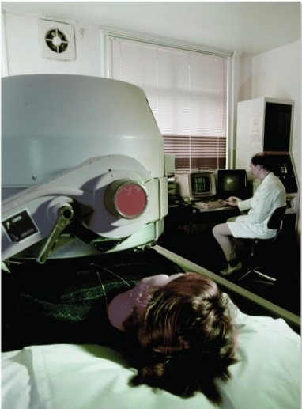

fig A: Radioactive tracer Tc-99m is used in medical diagnosis.

<!-- page 157 -->

## THINKING BIGGER

## SCIENCE COMMUNICATION

The text is from a web-based news service connected with the American Institute of Physics.

1 (a) Discuss the tone and level of vocabulary and level of scientific detail in the story. Who is the intended audience?

(b) The full website article only had one image, and approximately four times the amount of text than in the extract shown here. How does this information alter your answer to part (a)?

2 How can you tell this article is not intended for professional physicists?

## INTERPRETATION NOTE

Consider how much explanation a professional physicist would need about this topic. Compare this with the level of explanation in the article.

## PHYSICS IN DETAIL

Now we will look at the physics in detail. Some of these questions will link to topics elsewhere in this book, so you may need to combine concepts from different areas of physics to work out the answers.

3 (a) What will be the difference between molybdenum-99 and technetium-99?

(b) What kind of radioactive decay must molybdenum-99 undergo to become technetium-99?

(c) The atomic number of molybdenum is 42. Write a nuclear equation for the radioactive decay that will transform molybdenum-99 into technetium-99.

4 The letter 'm' in technetium-99m means 'metastable'. This tells us that it will decay by gamma emission only.

(a) Explain why a medical tracer should be a gamma emitter for detection purposes.

(b) Explain why a medical tracer should be a gamma emitter for patient health reasons.

5 The article says that the half-life for molybdenum-99 is 66 hours, and for technetium-99m it is 6 hours.

(a) How much technetium-99m would be produced in one week by a sample of 200 g of molybdenum-99?

(b) From a dose of 47 mg of technetium-99m, how much would be left undecayed after 24 hours?

(c) Explain why the half-life of 6 hours for Tc-99m is considered to be both usefully long, and also safely short.

## PHYSICS TIP

## ACTIVITY

Write a summary of five points that explain the possible impact on patients and hospitals of this shortage of technetium-99m. You should include some short-term problems, and some longer term problems.

Think about what the doctors need from the tracer, and also how to minimise the exposure for the patient.

## THINKING BIGGER TIP

Think about how delays in diagnosis might affect the treatment of patients. Also think about how these delays and their effects on treatment might then affect the way the hospital works.

<!-- page 158 -->

# 9A EXAM PRACTICE

[Note: In questions marked with an asterisk (*), marks will be awarded for your ability to structure your answer logically, showing how the points that you make are related or follow on from each other.]

1 In an experiment to test the penetrating power of alpha particles, a Geiger–Müller counter was placed in front of the source and registered 234 counts in three minutes. A 4 cm thick block of lead was placed between the source and the GM counter and the count reduced to 26 counts in one minute. What was the background radiation level?

A 0.433 Bq

B 0.866 Bq

C 1.30 Bq

D 1.73 Bq [1]

(Total for Question 1 = 1 mark)

2 One definition of the unified atomic mass unit has the value of 1 u as being equivalent to that of 1820 electrons. Using this definition, if an electron's mass is converted entirely into energy, how much energy would this be?

A  $ 7.91 \times 10^{-6} $ eV

B 0.513 MeV

C 281 eV

D 1700 000 MeV [1]

(Total for Question 2 = 1 mark)

3 The half-life of carbon-14 is 5730 years. What is the decay constant for a nucleus of carbon-14?

A  $ 3.84 \times 10^{-12} $ s $ ^{-1} $

B  $ 1.21 \times 10^{-4} $ s $ ^{-1} $

C  $ 2.52 \times 10^{-4} $ s $ ^{-1} $

D  $ 8268 y^{-1} $ [1]

(Total for Question 3 = 1 mark)

4 The diagram shows typical sources of background radiation.

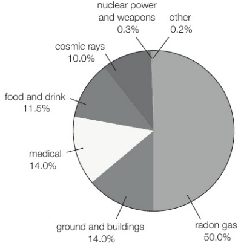

Which human-made source of radiation is less significant than ‘medical’ sources?

A ground and buildings

B cosmic rays

C radon gas

D nuclear power and nuclear weapons [1]

(Total for Question 4 = 1 mark)

5 All living organisms contain  $ {}^{12} $C and radioactive  $ {}^{14} $C. The concentration of  $ {}^{14} $C in the organism is maintained while the organism is alive, but starts to fall once death has occurred.

(a) The count rate obtained from wood from an old Viking ship is  $ 14.7 \, \text{min}^{-1} $ per gram of wood, after being corrected for background radiation. The corrected count rate from similar living wood is  $ 16.5 \, \text{min}^{-1} $ per gram of wood. Calculate the age of the ship in years.

 $ ^{14} $C has a half-life of 5700 years. [4]

(b) The concentration of  $ {}^{14} $C in living organisms might have been greater in the past.

Explain how this would affect the age that you have calculated. [2]

(Total for Question 5 = 6 marks)

<!-- page 159 -->

## EXAM PRACTICE

6 Fission and fusion are both nuclear processes that release energy. About 20% of the UK's energy need is currently provided by the controlled fission of uranium. Intensive research continues to capture the energy released from the fusion of hydrogen.

(a) (i)Fission of uranium-235 takes place after the absorption of a thermal neutron.

Assume such neutrons behave as an ideal gas at a temperature of 310 K.

Show that the square root of the mean square speed of the neutrons is about 3000 m s $ ^{-1} $.

mass of neutron = 1.0087 u [3]

(ii) Complete the equation for the fission of uranium-235.

 $$ \mathrm{^{235}_{92}U}+\mathrm{^{1}_{0}n}\longrightarrow\mathrm{^{236}_{92}U}\longrightarrow\mathrm{^{138}_{55}Cs}+\mathrm{^{96}_{37}Rb}+2\mathrm{^{1}_{0}n} $$ 

(iii) Calculate the energy released in a single fission. Then determine the rate of fission necessary to maintain a power output of 2.5 GW.

<table border=1 style='margin: auto; word-wrap: break-word;'><tr><td style='text-align: center; word-wrap: break-word;'></td><td style='text-align: center; word-wrap: break-word;'>Mass/u</td></tr><tr><td style='text-align: center; word-wrap: break-word;'>$ ^{{235}}U $</td><td style='text-align: center; word-wrap: break-word;'>235.0439</td></tr><tr><td style='text-align: center; word-wrap: break-word;'>$ ^{{138}}Cs $</td><td style='text-align: center; word-wrap: break-word;'>137.9110</td></tr><tr><td style='text-align: center; word-wrap: break-word;'>$ ^{{96}}Rb $</td><td style='text-align: center; word-wrap: break-word;'>95.9343</td></tr></table>

(b) *(i) State the conditions for fusion and go on to explain why it has proved difficult to maintain a sustainable reaction in a practical fusion reactor.

(ii) The nuclear reaction below represents the fusion of two deuterium nuclei.

Complete the equation and identify particle X. [1]

 $ ^{2}D + ^{2}D \rightarrow ^{3}H + \underline{\quad}X $

(iii) Despite the difficulties, the search for a practical fusion reactor continues.

State two advantages that fusion power might have compared to fission power.

(Total for Question 6 = 16 marks)

7 You are planning an experiment to investigate the ability of gamma rays to penetrate lead. You are then going to analyse a set of data from such an experiment.

(a) You have a source of radiation and a detector and counter. Describe briefly a simple experiment to confirm that the source emits gamma radiation. [3]

(b) You are provided with sheets of lead and apparatus to support them safely between the source and the detector. The thickness of lead affects the count rate. Describe the measurements you would make to investigate this. Your description should include:

- a variable you will control to make it a fair investigation

• how you will make your results as accurate as possible

• one safety precaution.

(c) For gamma rays passing through lead of thickness x, the count rate A is given by:

 $$ A=A_{0}e^{-\mu x} $$ 

where $A_{0}$ is the count rate when there is no lead between source and detector, and $\mu$ is a constant.

Explain why a graph of $\ln A$ against $x$ should be a straight line.

(d) The following data were obtained in such an investigation.

The background count was 40 minute $ ^{-1} $.

<table border=1 style='margin: auto; word-wrap: break-word;'><tr><td style='text-align: center; word-wrap: break-word;'>x/mm</td><td style='text-align: center; word-wrap: break-word;'>Measured count rate/minute $ ^{-1} $</td></tr><tr><td style='text-align: center; word-wrap: break-word;'>0</td><td style='text-align: center; word-wrap: break-word;'>1002</td></tr><tr><td style='text-align: center; word-wrap: break-word;'>6.30</td><td style='text-align: center; word-wrap: break-word;'>739</td></tr><tr><td style='text-align: center; word-wrap: break-word;'>12.74</td><td style='text-align: center; word-wrap: break-word;'>553</td></tr><tr><td style='text-align: center; word-wrap: break-word;'>19.04</td><td style='text-align: center; word-wrap: break-word;'>394</td></tr><tr><td style='text-align: center; word-wrap: break-word;'>25.44</td><td style='text-align: center; word-wrap: break-word;'>304</td></tr><tr><td style='text-align: center; word-wrap: break-word;'>31.74</td><td style='text-align: center; word-wrap: break-word;'>232</td></tr></table>

Process the data as appropriate and then plot a suitable graph to show that these data are consistent with  $ A = A_0 e^{-\mu x} $.

(e) Use your graph to determine a value for the constant  $ \mu $. [2] (Total for Question 7 = 17 marks)

8 The graph shows how the binding energy per nucleon varies with nucleon number for a range of isotopes.

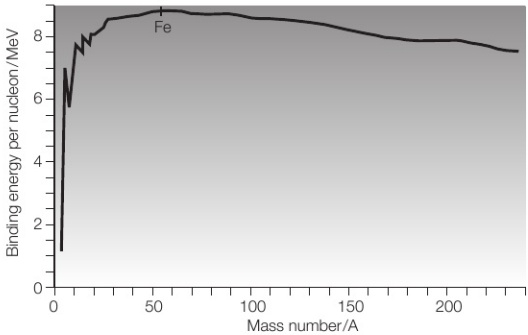

(a) Explain why an alpha particle (He⁴) is more likely than any other small nucleus to be emitted from a large unstable nucleus.

(b) Explain why fission reactors use isotopes such as U-235 as fuel. Your answer should include reference to the graph. [3]

(Total for Question 8 = 5 marks)

