# 10A Oscillations

<!-- edx_ial_phy2.pdf p160-177 -->

<!-- page 160 -->

# TOPIC 10 OSCILLATIONS

# CHAPTER 10A OSCILLATIONS

Oscillations are common in everyday life, and studying them can be fun! The mathematics governing these

oscillations could be considered less fun, but actually is much easier than it may look when all the equations are

written out together.

In this chapter we will concentrate on simple harmonic oscillations, as these are the most common and help to find useful solutions to engineering problems. We will look at how oscillations can be used for fun in everyday life, from playground toys to nightclub music.

Oscillations can also get out of control, which can be damaging or dangerous. In Angers, France, in 1850, over 220 soldiers died as the bridge they were crossing collapsed into the cold river below. It is believed that the rhythmic marching of the soldiers caused the bridge to oscillate too much and this broke the corroded cables that supported it. Following this disaster, and some other similar bridge collapses, soldiers are now trained to march out of step across bridges so as to avoid generating excessive oscillations.

We will see how such large oscillations develop and what can be done to reduce the problems they cause. These solutions range from car suspension systems to earthquake protection systems in skyscrapers.

## MATHS SKILLS FOR THIS CHAPTER

Draw and use the slope of a tangent to a curve as a measure of rate of change (e.g. drawing a velocity-time graph from a displacement-time graph)

Use of small angle approximations (e.g. in pendulum motion)

• Changing the subject of a non-linear equation (e.g. finding the gravitational field strength from a pendulum)

• Sketching and interpreting relationships shown graphically (e.g. sine and cosine functions for displacement, velocity and acceleration of an oscillator)

• Applying the principles of calculus (e.g. the connections between acceleration, velocity and displacement)

<!-- page 161 -->

## What prior knowledge do I need? Topic 1A (Book 1: IAS)

Speed and acceleration

Newton's laws of motion

Topics 1B and 1C (Book 1: IAS)

Conservation of energy and momentum

Topic 2B (Book 1: IAS)

Elastic and plastic deformation

Topic 3A (Book 1: IAS)

Basic wave properties

Topic 3B (Book 1: IAS)

Wave phase

Topic 5B

Circular motion and its connection with wave movements

## What will I study in this chapter?

The basics of oscillatory motion

Simple harmonic motion (SHM)

How to calculate simple harmonic motion

How to represent SHM graphically

Free and forced oscillations

Resonance and damping

## What will I study later? Topic 11B

Variable stars

Study beyond International A Level

Asymmetric oscillations

Coupled oscillators

Experimental research into resonance problems and solutions

Experimental research into useful and nuisance damping

The conical pendulum as a simple harmonic oscillator

<!-- page 162 -->

# 10A 1 SIMPLE HARMONIC MOTION (SHM)

## LEARNING OBJECTIVES

Describe simple harmonic motion situations, and state that the condition for simple harmonic motion is  $ F = -kx $.

☑ Interpret a displacement-time graph for a simple harmonic oscillator.

Use the equations for a simple harmonic oscillator and a simple pendulum.

## BOUNCING AND SWINGING

There are many things around us which oscillate (figs A and B). This means they have continuously repeated movements. For example, a child's swing goes backwards and forwards through the same positions over and over again. If it swings freely, it will always take the same time to complete one full swing. This is known as its time period. T. It follows a system of movements known as simple harmonic motion (SHM). When a system is moving in SHM, a force, known as a restoring force, F, is trying to return the object to its equilibrium position, and this force is proportional to the displacement, x, from that equilibrium position.

 $$ F=-kx $$ 

where k is a constant dependent on the oscillating system in question. The negative sign in the equation shows us that the acceleration will always be towards the centre of oscillation.

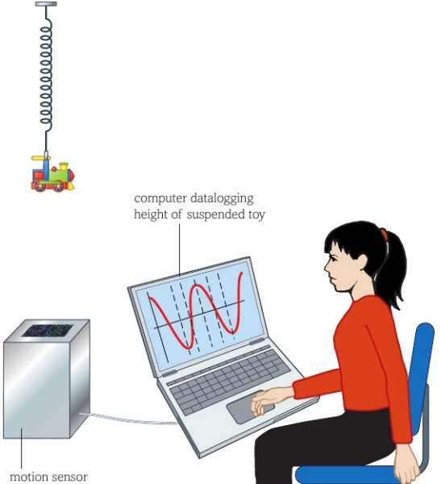

fig A How quickly does a bouncing spring toy move?

You will notice that the SHM definition is the same equation as in Hooke's law, and the oscillation of a mass attached to a spring is an example of SHM. We can find the equation for the period of the oscillations of a mass, m, subject to a Hooke's law restoring force:

 $$ T=2\pi\sqrt{\frac{m}{k}} $$ 

Look at Section 10A.2 and see if you can use the mathematics presented there to derive this equation.

<!-- page 163 -->

## WORKED EXAMPLE 1

(a) Look at fig B. A 500 g toy train is attached to a pole by a spring, with a spring constant of 100 N m $ ^{-1} $, and made to oscillate horizontally. What force will act on the train when it is at its amplitude position of 8 cm from equilibrium?

 $$ F=-kx=-(100)\times(0.08)=-8\,\mathrm{N} $$ 

A force of 8 newtons will act on the train, trying to pull it back towards the equilibrium position.

(b) How fast will the train accelerate whilst at this amplitude position?

From Newton's second law:

 $$ a=\frac{F}{m}=\frac{-8}{0.5}=-16m s^{-2} $$ 

(c) What is the period of SHM oscillations for the train?

 $$ \mathrm{T}=2\pi\sqrt{\frac{m}{k}}=2\pi\sqrt{\frac{0.5}{100}}=0.44\mathrm{~s} $$ 

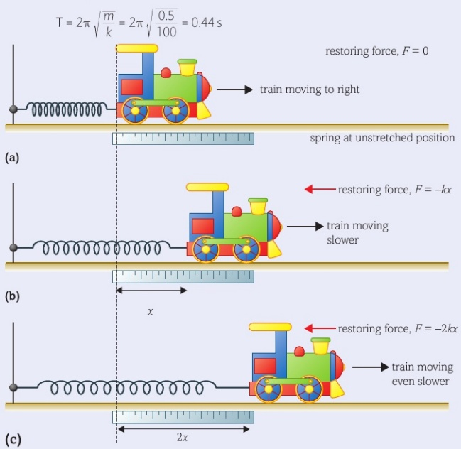

fig B The restoring force in a mass-spring system.

## PENDULUM DYNAMICS

Apparently, when Galileo was just 17, he was watching a hanging lantern in the cathedral in Pisa and he observed that a pendulum's time period is independent of the size of the oscillations. In fact, the period for a pendulum is given by the expression:

 $$ T=2\pi\sqrt{\frac{l}{g}} $$ 

Therefore, the period is only dependent on the length, l, of the pendulum string, and the strength of gravity on the planet on which it has been set up.

## WORKED EXAMPLE 2

The pendulum which operates a grandfather clock is 100 cm long. What is the period of oscillation?

 $$ T=2\pi\sqrt{\frac{l}{g}}=2\pi\sqrt{\frac{1.00}{9.81}}=2.01s $$

<!-- page 164 -->

## PRACTICAL SKILLS

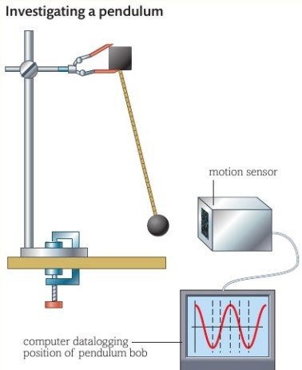

▲ fig C For small oscillations, the component of a pendulum's weight force pushing it back to equilibrium is proportional to its horizontal displacement from equilibrium, so it will execute SHM.

Using the set-up in fig C, it is easy to find out a lot of detail about the oscillation of a pendulum. An ultrasonic position sensor can take hundreds of readings every second to produce an extremely detailed displacement-time graph for the pendulum bob. The ultrasonic datalogging sensor can also measure the velocity at each reading by making a calculation of the change in position divided by the time between readings. This will allow a velocity-time graph to be drawn. However, you should remember from simple mechanics that the gradient of a displacement-time graph at any point gives the velocity at that moment. Thus the v-t graph could be generated mathematically from the d-t graph.

To make the pendulum oscillate, you would hold it to one side, to a small maximum displacement, and release it. This maximum displacement from the equilibrium position is the amplitude, A. It will always be stationary, zero velocity, at the amplitude displacement, and at the same position on the other side of the swing. As it swings from one stationary position to the other, it accelerates to a maximum velocity and then slows down again to a stop. This all happens symmetrically, with the maximum velocity occurring in the middle, at zero displacement. As the restoring force is proportional to the displacement, this means that acceleration will be maximum at amplitude and zero when the displacement is zero in the middle (more details on the mathematics involved in this experiment are given in Section 10A.2).

You may notice that the amplitude reduces slightly over time, but this should not affect the time period for your pendulum. If the period is independent of the amplitude, such oscillations are known as isochronous.

Safety Note: Make sure the stand is clamped securely to the bench. Use a small pendulum bob and small swings.

## CHECKPOINT

## SKILLS CREATIVITY

1. (a) Draw three free-body force diagrams showing the forces acting on the toy in fig A. The diagrams should show the situations when the toy is at its equilibrium position, and above and below the equilibrium position.

(b) Why might this toy not follow simple harmonic motion?

2. (a) If the lantern which Galileo observed in Pisa cathedral had a mass of 5 kg hanging on a chain 4.4 m long, what was its time period?

(b) Galileo used his own heartbeat as a stop clock when measuring the time period. How could he have reduced any experimental error in the time measurement?

3. (a) What is meant by simple harmonic motion?

(b) Calculate the length of a simple pendulum with a period of 2.5 s.

The graph in fig D shows the variation of displacement with time for a particle moving with simple harmonic motion.

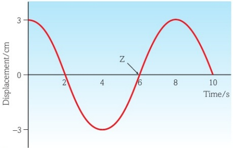

## fig D

(c) What is the amplitude of the oscillation?

(d) Estimate the speed of the particle at the point labelled Z.

(e) Draw a graph of the variation of velocity, v, with time for this particle over the same period. Add a scale to the velocity axis.

## SUBJECT VOCABULARY

oscillate to undertake continuously repeated movements period the time taken for one complete oscillation

simple harmonic motion (SHM) the oscillation of a system in which a force is continually trying to return the object to its centre position and this force is proportional to the displacement from that centre position

amplitude the maximum displacement from the equilibrium position

<!-- page 165 -->

# 10A 2 SHM MATHEMATICS

## LEARNING OBJECTIVES

Use the equations for simple harmonic oscillators:

 $ a = -\omega^2 x $,  $ x = A \cos \omega t $,  $ v = -A \omega \sin \omega t $,

 $ a = -A \omega^2 \cos \omega t $,  $ \omega = 2\pi f $, and  $ T = \frac{1}{f} = \frac{2\pi}{\omega} $.

Draw and interpret displacement–time and velocity–time graphs for simple harmonic oscillators, including understanding what the gradient represents in each case.

## ANGULAR VELOCITY AND SHM

For objects moving in a circle, the relationship that gave us the angular velocity is:

 $$ \omega=\frac{\theta}{t} $$ 

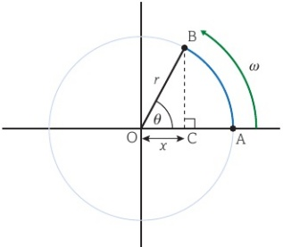

fig A Relationships in circular motion.

In Section 5B.1, we also saw the relationships:

 $$ T=\frac{1}{f} $$ 

 $$ T=\frac{2\pi}{\omega} $$ 

Therefore, for an object moving in a circle:

 $$ \omega=2\pi f $$ 

The movement of an oscillating object follows a similar pattern to that of circular motion, so all of these equations are valid in SHM. For an object performing SHM, we can determine its angular velocity, despite the fact that it may not actually be moving in a circle. Its motion is the projection of motion in a circle.

In fig A, consider the horizontally projected distance to the object from the vertical axis, and how this changes over time as the object rotates around the circle. When the object is at A, this projected distance is equal to the radius of the circle, r, but at position B this distance is shown by OC. You could calculate OC from:

 $$ x=r\cos\theta $$ 

As the object moves around the circle, its angular displacement changes according to its angular velocity,  $ \omega = \frac{\theta}{t} $. Rearranging this as  $ \theta = \omega t $, the displacement can be rewritten as:

 $$ x=r\cos(\omega t) $$ 

The motion of all simple harmonic oscillators can be described by an equation of this form. Indeed, all simple harmonic oscillators can be described by a sine or cosine function which gives their displacement, velocity and acceleration over time. In the case of a pendulum bob, the radius of the circle is replaced by the amplitude of the pendulum's swing. The expression for the displacement becomes:

 $$ x=A\cos\omega t\qquad\text{because at}t=0\ x=A $$ 

## WORKED EXAMPLE 1

The pendulum that operates a grandfather clock is released from its amplitude position which is 10 cm from the middle. It swings completely through one cycle every two seconds. What is its angular velocity, and where will it be after 174.5 seconds?

 $ A = 10 \, \text{cm} = 0.1 \, \text{m}; T = 2 \, \text{s} $

 $ \omega = \frac{2\pi}{T} = \frac{2\pi}{2} $

 $ \therefore \omega = 3.14 \, \text{rad} \, \text{s}^{-1} $

Releasing from maximum displacement means

 $ x = A \cos \omega t $

 $ x = 0.1 \cos(3.14 \times 174.5) $

 $ = 0.1 \cos(547.93) $

 $ = 0.1 \times 0.274 $

 $ \therefore x = 0.027 \, \text{m} $

## SHM GRAPHS

When an object is moving with SHM the restoring force is proportional to the displacement,  $ F = -kx $. As we can describe the position using  $ x = A \cos \omega t $, this gives the equation for the force over time as:

 $$ F=-k A\cos\omega t $$ 

Not all SHM oscillations involve a spring, so here k refers to some constant relevant to the oscillator set-up. From Newton's second law, we can also show that:

 $$ \begin{aligned}ma&=-kx\\a&=-\frac{kx}{m}=-\frac{k}{m}A\cos\omega t\end{aligned} $$ 

From this we can see that the acceleration and displacement in SHM have the same form, but the acceleration acts in the opposite direction to the displacement. When the displacement is zero, so is the acceleration. And when x is at its maximum value, the acceleration is also at its maximum value (fig B).

<!-- page 166 -->

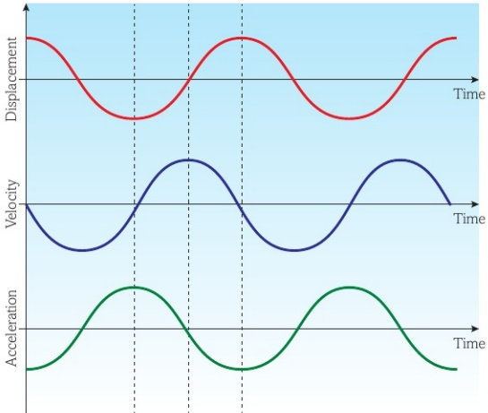

fig B The changes in position, velocity and acceleration over time for a simple harmonic oscillator. The displacement can be described using either sine or cosine (depending upon whether the oscillations are taken to start from the centre or at amplitude). Velocity and acceleration are then also sine or cosine as appropriate.

We can calculate the velocity of an oscillator at any moment from the gradient of the displacement–time graph. For a function,  $ x = \sin\theta $, the derivative function,  $ \frac{dx}{dt} $, which tells us the gradient at each point, is  $ \frac{dx}{dt} = \cos\theta $. For  $ x = \cos\theta $, the derivative function is  $ \frac{dx}{dt} = -\sin\theta $. (Remember,  $ \theta $ is a function of time.)

If  $ x = A \cos\omega t $, then the change in displacement with time is given by:  $ \frac{dx}{dt} = v = -A\omega\sin\omega t $

 $$ \frac{dx}{dt}=v=-A\omega\sin\omega t $$ 

The change in velocity with time, the acceleration is:

 $$ \frac{\mathrm{d}^{2}x}{\mathrm{d}t^{2}}=\frac{\mathrm{d}v}{\mathrm{d}t}=a=-A\omega^{2}\cos\omega t $$ 

 $$ or:\quad a=-\omega^{2}x $$ 

If we know the mass of the oscillating object, and the angular velocity of the oscillation, we can work out the restoring force constant, k, in any SHM.

 $$ a=-\frac{kx}{m}=-\omega^{2}x $$ 

 $$ \therefore\quad k=\omega^{2}m $$ 

## LEARNING TIP

The maximum values of  $ \sin $ and cos are both 1. So, the maximum values of velocity and acceleration are:

 $$ \mathbf{v}_{max}=-A\boldsymbol{\omega}_{amax} $$ 

 $$ a_{max}=-A\omega^{2} $$ 

## WORKED EXAMPLE 2

A science museum has a giant demonstration tuning fork. The end of each prong vibrates in simple harmonic motion with a time period of 1.20 s and starts vibrating from an amplitude of 80 cm. Calculate the displacement, velocity and acceleration of a prong after 5.0 seconds.

 $$ A=0.8m;T=1.20s $$ 

 $$ \omega=\frac{2\pi}{T}=\frac{2\pi}{1.20}=5.24rad s^{-1} $$ 

 $$ x=A\cos\omega t=0.80\times\cos(5.24\times5.0)=0.386m $$ 

 $$ v=-A\omega\sin\omega t=-0.8\times5.24\times\sin(5.24\times5.0)=-3.67m s^{-1} $$ 

 $$ a=-A\omega^{2}\cos\omega t=-\omega^{2}x=-(5.24)^{2}\times(0.386)=-10.6m s^{-2} $$ 

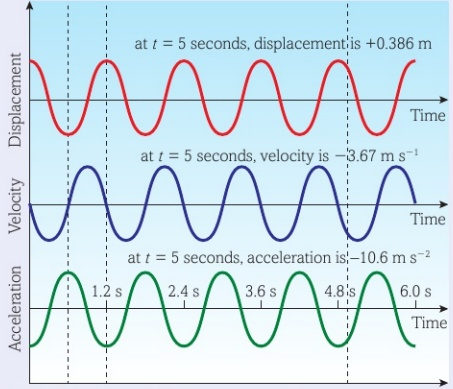

fig C SHM graphs for a giant tuning fork.

## CHECKPOINT

1. What is the angular velocity of a child's swing which completes 42 swings every minute?

## SKILLS CREATIVITY

2. Comment on the rounding errors in the worked example about the giant tuning fork above. Estimate the percentage errors generated.

## SKILLS ANALYSIS

3. The toy train in fig B of Section 10A.1 is released from an amplitude position of 5 cm. Calculate its position, velocity and acceleration after 2.8 seconds.

4. A grandfather clock has a 2-metre-long pendulum to keep time. The owner set it at noon by setting the hands and starting the pendulum from an amplitude of 10 cm. Calculate the position, velocity and acceleration of the pendulum bob at 6 seconds after noon.

<!-- page 167 -->

## 10A 3 SHM ENERGY

## LEARNING OBJECTIVES

Apply the conservation of energy to undamped oscillating systems.

## CONSERVATION OF ENERGY

An oscillator is a closed system which means that it cannot gain or lose energy, unless there is an external influence. For example, a pendulum under water will not continue to swing for very long. This is because the viscous drag on the pendulum from the water provides an external force, which can do work to remove energy from the pendulum system. A child on a swing can continue to oscillate, despite air resistance removing energy, if there is also a parent pushing repeatedly (doing work) to put energy back into the system. Such damped or forced oscillations will be dealt with in the next sections. Here we will only consider a closed system in which no energy moves in or out of the system during its oscillations.

## ENERGY TRANSFERS DURING OSCILLATION

The kinetic energy of a pendulum varies during its swinging motion. At each end of the swing, the bob is stationary for an instant, meaning that it has zero kinetic energy at these points. The kinetic energy then increases steadily until it reaches a maximum, when the bob passes through the central position and is moving with its maximum speed. The kinetic energy then decreases to reach zero at the other amplitude position. This cycle repeats continuously. However, once swinging, the pendulum system cannot gain or lose energy. The varying kinetic energy must be transferring back and forth into another store. In this example, the other store is gravitational potential energy as the pendulum rises to a maximum height, where it has maximum GPE at each end of the swing and drops to minimum GPE as it passes through the lowest point (the central position). These energy changes are shown in fig A.

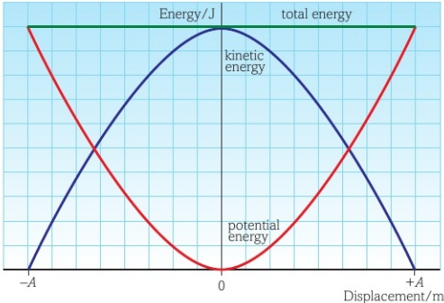

fig A The energy in a simple harmonic oscillator is constantly being transferred from kinetic to potential and back again, whilst the total remains constant as the sum of the kinetic and potential energies at each moment.

Fig A could also apply to a mass bouncing on a spring. When stretched a little before release, the spring has stored elastic potential energy. On release, the spring accelerates the mass back towards the equilibrium position, where it has maximum kinetic energy and zero potential. This kinetic energy is then transferred into elastic potential as the spring squashes in the other displacement direction. The transfers of potential and kinetic energies continues, and if no energy can be lost from the system it would oscillate with the same amplitude forever.

The above discussions are exclusively for a system that cannot lose any energy. The closest we can get to this system would be a pendulum, or mass on a spring, in a vacuum. These would be almost free from energy losses, but air resistance will act in most real situations.

<!-- page 168 -->

fig B Converting potential energy into kinetic energy can be fun!

## EXAM HINT

When working through a long multi-step calculation, always keep using the exact figures and only round off the final answer.

## WORKED EXAMPLE 1

A forest playground has a tyre hanging from a tree branch. The tyre behaves like a pendulum, with a rope of 4.0 metres length, and its mass is 15 kg. A child of mass 45 kg swings on the tyre by pulling it 3.0 metres to one side (amplitude) and leaping on. What is the maximum height that the tyre reaches above its equilibrium position?

 $$ T=2\pi\sqrt{\frac{l}{g}}=2\pi\sqrt{\frac{4.0}{9.81}}=4.0s $$ 

fig C A bungee jumper

 $$ \omega=\frac{2\pi}{T}=1.6rad s^{-1} $$ 

 $$ v=-A\omega\sin\omega t $$ 

At maximum velocity,  $ \sin\omega t $ will equal 1, so:

 $$ v_{max}=A\omega=3.0\times1.6=4.8m s^{-1} $$ 

Maximum kinetic energy:

 $$ E_{kmax}=\frac{1}{2}mv_{max}^{2}=\frac{1}{2}\times(45+15)\times(4.8)^{2}=691J $$ 

Maximum potential energy:

 $$ E_{pmax}=mgh_{max}=E_{kmax}=691\ J $$ 

 $$ h_{max}=\frac{691}{mg} $$ 

 $$ h_{max}=1.2m $$ 

## WORKED EXAMPLE 2

The toy train in fig B of Section 10A.1 is released from an amplitude position of 5 cm. Calculate its maximum velocity. What assumption have you made?

 $$ A=0.05m\quad k=100N m^{-1}\quad m=0.500kg $$ 

Maximum potential energy:

 $$ E_{pmax}=\frac{1}{2}F\Delta x=\frac{1}{2}k(\Delta x)^{2} $$ 

Maximum kinetic energy:

 $$ =\frac{1}{2}\times100\times(0.05)^{2} $$ 

 $$ E_{kmax}=E_{pmax}=\frac{1}{2}mv_{max}^{2}=0.125J $$ 

 $$ \therefore\ E_{pmax}=0.125J $$ 

 $$ v_{max}=\sqrt{\frac{2\times0.125}{0.5}} $$ 

 $$ \therefore v_{max}=0.71m s^{-1} $$ 

We have assumed that there are no energy losses in the system, so all the elastic potential energy is transferred into kinetic energy.

## CHECKPOINT

## SKILLS CRITICAL THINKING, CONTINUOUS LEARNING

1. A pendulum bob has a mass of 0.6 kg and a time period of 4 seconds. It is released from an amplitude position of 5 cm. What is its kinetic energy after 8 seconds? What is its maximum kinetic energy?

2. If no energy were lost, a bungee jumper (as in fig C) would continue to oscillate up and down forever. Describe the energy changes the bungee jumper would undergo. Discuss kinetic energy, different types of potential energy, and the total energy. Conclude by explaining why in real life this does not happen.

3. ▶ Suggest how energy might be lost from a pendulum swinging in a vacuum.

4. Pendulum dynamics assumes that the oscillations are of a small amplitude compared with the length of the pendulum. The worked example of the forest tyre pendulum at the top of this page does not meet this assumption. Use a geometrical method to calculate the vertical height gained when the child holds the tyre at the 3 m horizontal amplitude quoted. Compare your answer with the 1.2 m calculated in the worked example, and calculate the percentage difference between the two answers.

<!-- page 169 -->

# 10A 4 RESONANCE AND DAMPING

## LEARNING OBJECTIVES

Explain the distinction between free and forced oscillations.

Define the phenomenon of resonance.

Describe how damping affects oscillations, how damping can be caused, and its uses and implications.

## FREE AND FORCED OSCILLATIONS

Releasing a pendulum from its maximum amplitude and letting it swing freely (preferably in a vacuum) is an example of free oscillation. The situation is set up for a continuous exchange of potential and kinetic energy, caused by a restoring force which is proportional to the displacement. Any oscillating system has a natural frequency – the frequency at which it naturally chooses to oscillate when left alone.

However, oscillators can be forced to behave in a different way to their natural motion. If, as a pendulum swings one way, you push in the opposite direction, it turns back. By repeated applications of forces from your hand in different directions, you could force the pendulum to oscillate at some other frequency. This would then be forced oscillation – not SHM – and the frequency at which you were causing it to swing at would be your driving frequency.

Forcing oscillations involve an added energy to a system whilst it oscillates. Unless this is done at the natural frequency, the system is unlikely to undergo SHM and will dissipate the energy quite quickly. This is what happens if you push a child on a swing at the wrong moment in the oscillation.

## RESONANCE

If a system or object is forced to vibrate at its natural frequency, it will absorb more and more energy, resulting in very large amplitude oscillations. This is resonance. If your washing machine is very noisy during one part of the wash cycle, the motor will be spinning at a certain frequency. This drives vibrations in the machine at a frequency that is the natural frequency of one of the panels, which then vibrates with very large amplitude, making a loud noise. During the rest of the wash, the motor's rotation generates vibrations at other frequencies that do not match with the natural frequency of any part of the machine, and it is much quieter.

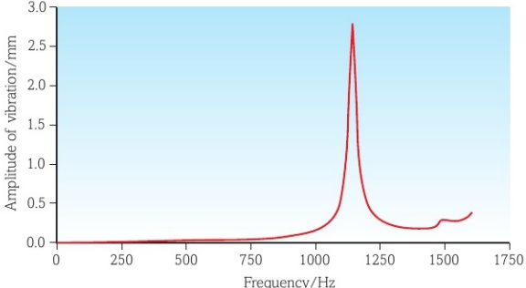

▲ fig A Graphical illustration of how the driving frequency in a washing machine affects the oscillation amplitude of its side panel. At all frequencies here, the amplitude of forced vibration is the same, and relatively small. When the motor's vibration reaches about 1100 Hz, the graph peaks, showing that the side panel vibrates significantly, which will be very noisy.

<!-- page 170 -->

CP16

## EXAM HINT

Make sure you have a good understanding of this practical as your understanding of the experimental method may be assessed in your exams.

## PRACTICAL SKILLS

## Investigating resonance

The set-up in fig B allows us to monitor the amplitude of vibrations of a mass on a spring, as we force it to vibrate at different frequencies. By monitoring for a very large amplitude of vibration, we can determine the resonant (or natural) frequency for the set-up.

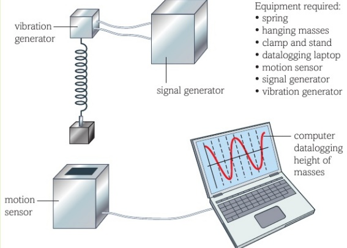

▲ fig B Forced oscillations can be set up at a desired driving frequency.

From previously, we know that a mass oscillating on a spring follows the equation for its time period:

 $$ T=2\pi\sqrt{\frac{m}{k}} $$ 

The time period will be the reciprocal of the natural frequency, f, and this is also the resonant frequency:

 $ f = \frac{1}{2\pi} \sqrt{\frac{k}{m}} $

Thus, by finding the resonant frequency, from monitoring the amplitude of forced oscillations, we could determine an unknown mass that is hanging on the spring:

 $$ m=\frac{k}{4\pi^{2}f^{2}} $$ 

The spring constant, k, could be found by measuring the resonant frequency for a known mass and rearranging the equation to find k:

 $ k = 4\pi^{2}f^{2}m $

Safety Note: Use a stand clamped to the bench to hold the vibration generator. Use a small mass and keep the vibrations small.

## DAMPED OSCILLATIONS

If a system is performing SHM at its natural frequency, its energy may be dissipated through a friction force acting on the system, or the plastic deformation of a ductile material in the system. If a pendulum is left to swing without interference, its amplitude will constantly decrease with each swing due to air resistance and internal stresses within the flexing material of the string. These effects can be amplified if we attach a small sail to catch the air. This artificial increasing of the air resistance is an example of damping (or in fact an increase in the damping, as there would already be a tiny air resistance force on the pendulum). Note that although the amplitude decreases, the period remains constant throughout.

Damped oscillations suffer a loss in energy in each oscillation and this reduces the amplitude over time (fig C).

The amount of damping may vary, which will change how quickly the amplitude is reduced. If the oscillator completes several oscillations, the amplitude will decrease exponentially. This is known as underdamping (sometimes called light damping). Swinging the pendulum in a bowl of water will make its amplitude of oscillation drop very rapidly, and it might not even complete one cycle. This is known as overdamping.

<!-- page 171 -->

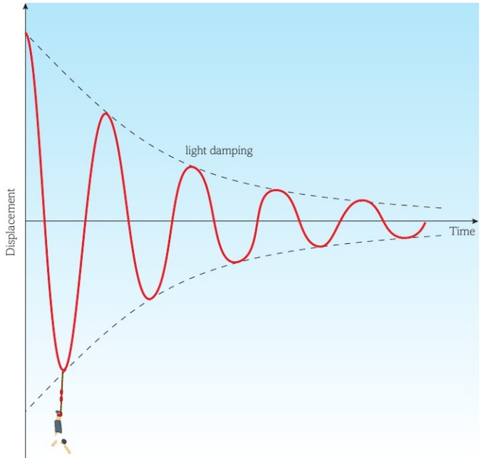

▲ fig C Damping reduces oscillation amplitude. A bungee jumper's amplitude decreases because elastic stresses in the rubber rope dissipate energy as heat, and air resistance removes kinetic energy. Note that the dissipation of sound energy by screaming will not reduce the amplitude as this does not come from the oscillation energy!

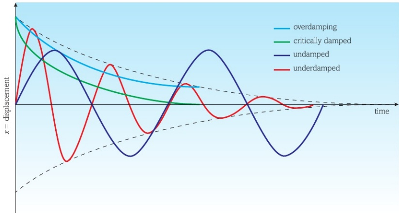

fig D Different degrees of damping

If the damping is such that the oscillator returns to its equilibrium position in the quickest possible time, without going past that position (known as overshooting), then it is critically damped. Overdamping is useful in many situations, such as car suspension systems, but too much overdamping could cause the oscillator to take a very long time to return to its equilibrium position. You can appreciate this if you imagine a pendulum swung through treacle – an extreme example of overdamping.

<!-- page 172 -->

# PRACTICAL SKILLS

## Investigating damping

fig E How does damping affect oscillations?

In fig E, you can see how to investigate the effects of more or less damping. The card sail will act as an air resistance, and altering its size will change its damping effect, making the amplitude decrease more. Can you make a card sail that provides critical damping?

Safety Note: Make sure the spring is held securely in the clamp and only hang small masses on the spring.

## RESONANCE PROBLEMS AND DAMPING SOLUTIONS

Damping solutions to real problems, such as the noisy washing machine, can be designed into new products and structures (fig F). Objects usually oscillate with large amplitudes at their natural frequency, so this is the frequency at which these engineering solutions are most often aimed. Creating damping systems that are a good balance between underdamping, critical damping and severe overdamping is a tough problem for engineers in many real situations, especially as many objects have several natural frequencies.

In some cases, the amplitude of resonant oscillations can be so great that they damage the system. This is what happens when an opera singer breaks a wine glass by singing loudly at just the right pitch (fig G).

For some oscillators (e.g. clocks) we want minimum damping; whereas for others (e.g. a mountain bike shock-absorbing system (fig H)) we want oscillations to stop as fast as possible. To make this happen requires an exact damping system ('critical damping') so that the system returns to equilibrium without overshooting.

fig H Mountain bike suspension has springs to accept some movement, and shock absorbers to critically dampen any oscillations.

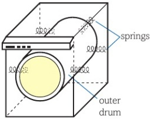

fig F Damping in a washing machine lessens the effects of resonant vibrations.

fig G The resonance of a glass can damage it.

## DID YOU KNOW?

Shattering a wine glass by singing is a classic example of resonance (as explored in the 2005 Discovery Channel television show MythBusters). But it is actually only possible if the glass already contains microscopic defects where cracks can start.

<!-- page 173 -->

# PRACTICAL SKILLS

## Investigating damping solutions to design problems

A signal generator can be connected to a vibration generator to produce driving forces with a changeable frequency. This can then be used to investigate the effects of damping on oscillations. You could set up a model of an earthquake shaking a building and see how dampers could be attached to the model, either internally or externally, to reduce the damage caused by resonance.

▲ fig I Vibration testing of a model building to simulate earthquakes.

Professional research institutions will use large scale models on shaking platforms to test new designs for skyscraper protection. In a school laboratory, a structure made of straws or struts of wood could be tested with foam padding dampers and a vibration generator.

As we saw in Book 1, Section 2B, climbing ropes need to be made of a material which will stretch slightly, without breaking, to stop a climber from falling. This is arranged through the construction of climbing ropes. There are many strands woven together, and if you follow one individual strand, it forms a spiral. The climber hanging on the rope can act like a mass hanging on a spring. However, the material chosen must be stiff enough. If a climber fell whilst using a bungee cord as a safety rope, they would bounce many times before stopping. It would not be uncomfortable, but could well cause the climber to hit the rock face (several times!). So, the stiffness and construction of the rope must be a perfect combination of stretchy which avoids a sudden, painful stop to a fall, but still stiff enough to bring the climber to a halt. After a fall, a climbing rope has been permanently damaged and must be replaced. The rope material is ductile and suffers a plastic deformation which acts to reduce the amplitude of oscillations. A less stiff material could avoid replacement but would not damp the oscillations safely. In effect, the plastic deformation of the ductile rope material provides critical damping. Potential oscillations are stopped before they start. During an earthquake, steel framed buildings can absorb some of the vibration energy because steel is ductile, so its plastic deformation damps the oscillations.

▲Fig J In the Taipei 101 skyscraper, a giant steel pendulum, with a mass of 660 tonnes, is tethered by giant shock absorbers. It is the world's largest wind vibration damper.

## CHECKPOINT

1. Give a real life example of:

(a) forced oscillations (b) free oscillations

(c) damping (d) resonance.

## SKILLS REASONING/ARGUMENTATION

2. Explain why a car which is accelerating may have an annoying rattle of the dashboard for part of the time.

## SKILLS PRODUCTIVITY

3. Describe, using scientific terminology, how the problem in question 2 could be overcome.

4. Explain the differences between overdamping, underdamping and critical damping.

5. Explain how a damper between girders in a skyscraper could reduce damage caused by an earthquake.

## SKILLS ADAPTIVE LEARNING

6. Explain how some dance music that has an inaudible bass frequency of between 5 and 10 Hz can get people dancing.

## SUBJECT VOCABULARY

free oscillation the oscillation of a system, free from the influence of any forces from outside the system

natural frequency the frequency of oscillation that a system will take if it undergoes free oscillations

forced oscillation the oscillation of a system under the influence of an external (usually repeatedly applied) force

driving frequency the frequency of an external force applied to a system undergoing forced oscillations

resonance very large amplitude oscillations that occur when a driving frequency matches the natural frequency of a system

damped oscillations work is done on the damping system and energy is dissipated in the damping system with each oscillation, so the amplitude of oscillations decreases

damping the material, or system, causing energy loss during each damped oscillation

critical damping when damping is such that the oscillator returns to its equilibrium position in the quickest possible time, without going past that position

<!-- page 174 -->

# 10A THINKING BIGGER

TAIPEI 101

SKILLS

CRITICAL THINKING, PROBLEM SOLVING, INTERPRETATION, CONTINUOUS LEARNING, ADAPTIVE LEARNING, PRODUCTIVITY, COMMUNICATION

Taipei 101 is a 100-storey skyscraper. It was designed to be safe in a number of extreme conditions, including very strong winds and earthquakes. Near the top of the building, there is a system to reduce the effects of resonance from these conditions.

ONLINE INFORMATION

## TUNED MASS DAMPER (TMD)

The complete name of the TAIPEI 101 wind damper is the tuned mass damper (TMD). The TMD has been specifically designed as a passive damper system and is positioned at the center of the tower between the 87th and 92nd floors. Its main purpose is to reduce the swaying of the tower during strong winds and eliminate any resulting discomfort experienced by anyone within the building. Unlike conventional damper systems that are usually hidden from public view, special functional and aesthetic considerations have been made for the TAIPEI 101 wind damper so that visitors can take a look at the entire wind damper system and see how it operates at the Observatory.

From https://www.taipei-101.com.tw/en/observatory-damper.aspx

fig A The viewing gallery of the Taipei 101 Tuned Mass Damper.

## THE 728-TON TMD

To achieve stability and lessen the impact of violent motion, a gigantic tuned mass damper was designed. The damper consists of a steel sphere 18 feet across and weighing 728 ton, suspended from the 92nd to the 87th floor. Acting like a giant pendulum, the massive steel ball sways to counteract the building's movement caused by strong gusts of wind. Eight steel cables form a sling to support the ball, while eight viscous dampers act like shock absorbers when the sphere shifts. The ball can move 5 ft. in any direction and reduce sways by 40 percent. Two additional tuned mass dampers, each weighing 7 tons, installed at the tip of the spire, provide additional protection against strong wind loads. The engineers were so proud of their creation that they made the damper publicly visible from an indoor observatory located inside the tower, where recorded voice tours and informative displays explain to visitors how the thing works. During particularly windy days one can see the damper in action.

From http://www.amusingplanet.com/2014/08/the-728-ton-tuned-mass-damper-of-taipei.html

<!-- page 175 -->

## THINKING BIGGER

## SCIENCE COMMUNICATION

The two extracts are from the website of the Taipei 101 building itself, and then a website called AmusingPlanet.com which tells stories about amazing things around the world.

1 (a) Describe the level of scientific language used in the extracts. What is the intended audience for each?

(b) Explain what shows us that the second quote from the Amusing Planet website is aimed at readers in the USA.

## PHYSICS IN DETAIL

Now we will look at the physics in detail. Some of these questions will link to topics elsewhere in this book, so you may need to combine concepts from different areas of physics to work out the answers.

2 (a) What physics phenomenon could allow the wind to cause surprisingly large movements of the skyscraper?

Consider how measurements are presented to the reader.

## INTERPRETATION NOTE

(b) Why would the skyscraper suffer different variations of this problem with different wind speeds?

(c) Why are large movements of the building a problem?

(d) Explain how an earthquake could also cause a similar problem, including similarities and differences with swaying caused by the wind.

4 (a) Calculate the density of the steel used in the giant sphere. The unit 1 foot is approximately 30.8 cm, and 1 ton is approximately 1.1 metric tonnes.

3 (a) How does this mass damper stop the building from swaying too much? Explain the physics principles behind it.

(b) The sphere hangs from eight cables that are each 42 m in length. Assuming it acts as a simple pendulum, calculate its natural frequency.

(b) Why is the damper positioned so high up the building, around the 90th floor?

5 The giant steel sphere has its movements restricted by large shock absorbers. These are hydraulic pistons which provide large forces opposing any movements. Why are these shock absorbers necessary?

## PHYSICS TIP

Think about how the sphere might move if it were free to swing.

## ACTIVITY

The owners of the Taipei 101 building would like to add an information board specially for young visitors in the Observatory viewing area. Design a storyboard of diagrams that could be drawn out like a comic to show young children how the tuned mass damper reduces the swaying of the building. You may wish to look up the character 'Damper Baby' and use them in your storyboard.

## THINKING BIGGER TIP

You do not need to draw out the comic in detail, just plan the picture sequence and what each picture would show, and note how this explains the physics of each step.

<!-- page 176 -->

# 10A EXAM PRACTICE

1 What is the length of a simple pendulum that has a time period of 1.24 s on Earth?

A 0.00397 m

B 0.308 m

C 0.382 m

D 2.4 m [1]

(Total for Question 1 = 1 mark)

If an oscillator is performing simple harmonic motion:

A Its acceleration is proportional to its velocity and in the same direction.

B Its acceleration is proportional to its displacement and in the opposite direction.

C Its velocity is proportional to its displacement and in the same direction.

D Its acceleration is inversely proportional to its displacement and in the opposite direction.

(Total for Question 2 = 1 mark)

3 A mass suspended on a spring can undergo simple harmonic motion because:

A The spring obeys Hooke's law that  $ F = -kx $.

B The weight of the mass will be W = mg.

C The spring's elastic force will form a Newton's third law pair with the weight of the mass.

D The spring will act as a damper. [1]

(Total for Question 3 = 1 mark)

4 Which of these is a correct equation for the acceleration in simple harmonic motion?

A  $ a = -\omega^{2}x $

B  $ a = -\omega x^{2} $

C  $ a = -A\omega\cos\omega t $

D  $ a = \omega^{2}x $

(Total for Question 4 = 1 mark)

5 (a) Define a simple harmonic motion.

(b) The graph shows the variation in water level displacement with time for the water in a harbour. The water level displacement varies with simple harmonic motion.

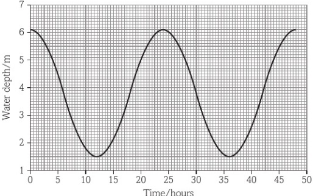

(i) Use the graph to calculate the amplitude and the time period of the variation in the water level displacement.

(ii) Show that the maximum rate of change of water level displacement is about 0.6 m hour $ ^{-1} $. [3]

(iii) On a copy of the graph shown in part (b), sketch how the rate of change of water level displacement varies with time for the interval 0–30 hours. The variation in water level displacement with time has been drawn for you. You need not add any numerical values to the y-axis. [2]

(Total for Question 5 = 9 marks)

6 A student makes the ‘ruler piano’ shown.

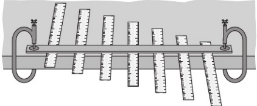

One end of each ruler is held flat on the desk whilst the other end is set into oscillation.

Each ruler oscillates at a different frequency. Some of the rulers produce an audible sound.

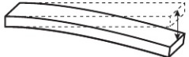

(a) State the condition for an oscillation to be simple harmonic.

<!-- page 177 -->

## EXAM PRACTICE

(b) The end of one ruler moves through 5.0 cm from one extreme position to the other, and makes 10 complete oscillations in 4.5 s.

Calculate the maximum velocity of this end.

(c) A standing wave is set up on each oscillating ruler.

Explain why each length of ruler oscillates at a different frequency. [3]

(Total for Question 6 = 8 marks)

7 A bar magnet is suspended by a thread attached to a wooden support. The bar magnet hangs horizontally as shown and lines up with the Earth's magnetic field.

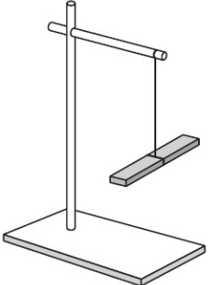

(a) State why the support should be made of wood and not steel. [1]

(b) The magnet is rotated horizontally about its centre through approximately  $ 20^{\circ} $ from its equilibrium position. When it is released it oscillates in a horizontal plane about the string.

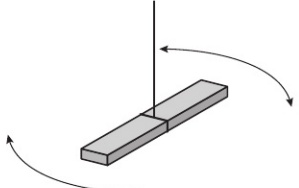

Describe how you would measure the period of these oscillations as accurately as possible.

(c) You are told that these oscillations are lightly damped. State what you would observe if the oscillations were heavily damped.

(d) A large coil of wire is now placed vertically around the centre of the magnet.

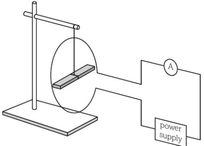

When current is passed through the coil it produces a magnetic field in the same direction as the Earth's magnetic field. When the magnet is again rotated horizontally, it oscillates at an increased frequency.

(i) A student thinks that the period T of the oscillations is related to the current in the coil I by

 $$ \frac{1}{T^{2}}=kI $$ 

where k is a constant.

Explain why this suggests that a graph of  $ \frac{1}{T^{2}} $ against I will produce a straight line through the origin.

(ii) The student carries out an experiment to measure T as I is varied. He obtains the following data.

<table border=1 style='margin: auto; word-wrap: break-word;'><tr><td style='text-align: center; word-wrap: break-word;'>I/A</td><td style='text-align: center; word-wrap: break-word;'>Mean T/s</td></tr><tr><td style='text-align: center; word-wrap: break-word;'>0</td><td style='text-align: center; word-wrap: break-word;'>1.230</td></tr><tr><td style='text-align: center; word-wrap: break-word;'>1.00</td><td style='text-align: center; word-wrap: break-word;'>0.827</td></tr><tr><td style='text-align: center; word-wrap: break-word;'>2.00</td><td style='text-align: center; word-wrap: break-word;'>0.673</td></tr><tr><td style='text-align: center; word-wrap: break-word;'>3.00</td><td style='text-align: center; word-wrap: break-word;'>0.581</td></tr><tr><td style='text-align: center; word-wrap: break-word;'>4.02</td><td style='text-align: center; word-wrap: break-word;'>0.520</td></tr><tr><td style='text-align: center; word-wrap: break-word;'>5.01</td><td style='text-align: center; word-wrap: break-word;'>0.475</td></tr></table>

 $$ \frac{1}{T^{2}}=kI $$ 

Plot a graph that would test the relationship:

Draw your own table to show any processed data.[5]

(iii) The student's teacher suggests that the equation

 $$ \frac{1}{T^{2}}=k I+b $$ 

is a better mathematical model for the data.

Explain why his teacher is right.

(Total for Question 7 = 14 marks)

8 Explain how damping and the plastic deformation of ductile materials affects oscillations. Include explanations of overdamping, underdamping and critical damping. [6]

(Total for Question 8 = 6 marks)

