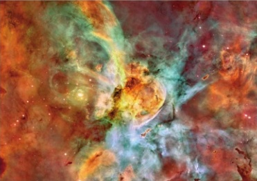
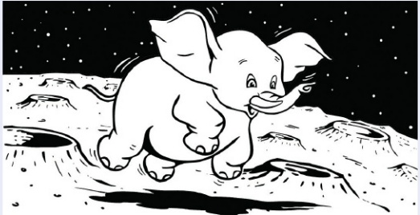
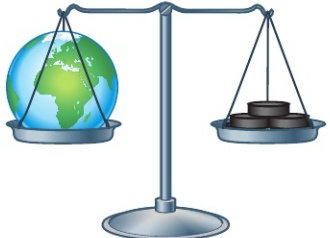
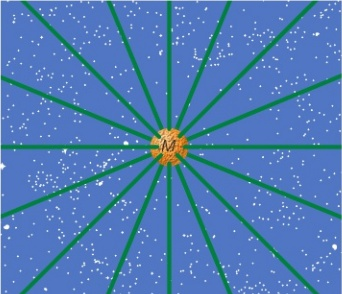
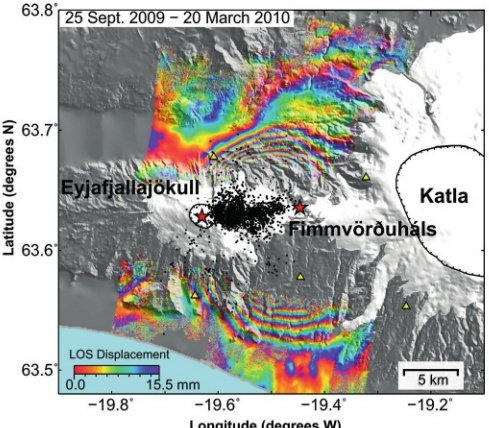

# 11A Gravitational fields

<!-- edx_ial_phy2.pdf p178-187 -->

<!-- page 178 -->

# TOPIC 11 ASTROPHYSICS AND COSMOLOGY

# CHAPTER 11A GRAVITATIONAL FIELDS

Gravity is one of the most obvious scientific phenomena and we have studied it for a very long time. When you drop a pen you can see gravity and its effects clearly and we know how to utilise these in very precise ways.

In November 2014, the European Space Agency landed a probe on the comet 67P/Churyumov-Gerasimenko. This may not sound remarkable. We have landed probes on the Moon, Mars, other planets and moons of other planets. However, the size and mass of this comet means that the gravitational field is so weak that it would be difficult to create a centripetal force of attraction on the probe which would allow orbiting. The ESA had to ensure that the lander was travelling at less than one metre per second, and even then the lander bounced significantly.

However, gravity remains one of the least well-understood areas of physics. There are a number of experiments currently ongoing to try and observe some of the theoretical explanations of how gravity works on a fundamental level. As yet, none have been conclusive, but as their sensitivity improves, scientists hope that we will be able to collect enough experimental evidence to confirm how gravity works. Gravity waves, quantum gravity and so-called strong gravity are current areas of interest to cutting-edge physicists.

## MATHS SKILLS FOR THIS CHAPTER

• Solving algebraic equations (e.g. finding a satellite's orbital height above the surface of the Earth)

Changing the subject of a non-linear equation (e.g. finding the separation of objects using Newton's universal law of gravitation)

Sketching and interpreting relationships shown graphically (e.g. comparing sketch graphs of gravitational field strength and potential)

Distinguishing between average and instantaneous rates of change (e.g. gravitational field strength as the rate of change of potential with distance)

<!-- page 179 -->

## What prior knowledge do I need?

Topic 1A (Book 1: IAS)

Weight and gravity

Newton's laws of motion

Topic 1B (Book 1: IAS)

Gravitational potential energy

Topic 5B

Circular motion

Topic 6A

Coulomb's law

Electric fields and electric potential

## What will I study in this chapter?

How gravitational forces follow an inverse square relationship

What is meant by a gravitational field

How to calculate the strength of gravitational fields

Gravitational potential

Comparisons of electric and gravitational fields

## What will I study later?

How gravity leads to the development of stars

The production of elements in stellar nuclear fusion

The gravitational field strength at the surface of a black hole

The influence of gravity on the development of galaxies and the Universe as a whole

Dark matter and its gravitational effects

Gravitational lensing as evidence for black holes

<!-- page 180 -->

## 11A 1 GRAVITATIONAL FORCES

## LEARNING OBJECTIVES

Use the equation  $ F = \frac{G m_1 m_2}{r^2} $.

Define a gravitational field, and gravitational field strength.

Be able to apply Newton's laws of motion and universal gravitation to orbital motion.

## THE ATTRACTION OF GRAVITY

The current theories about the formation of the galaxies, stars and planets are all driven by one fundamental underlying force: gravity. Every particle with mass attracts every other particle with mass. So, if the Big Bang spread tiny particles across space, they would all attract each other. The acceleration generated by these tiny forces might be exceedingly small, but the Universe has plenty of time. Slowly but surely, the particles move towards each other and clump together. This effect is greater for particles nearer to each other, as they attract more strongly than those separated by larger distances. These clumps of matter will continue to attract other nearby particles or lumps that have formed, and continue to  $  \text{accrete}  $ (come together under the influence of gravity) into larger and larger bodies of material. This collection of matter might become a planet, or if enough material gets packed together densely enough, nuclear fusion may start and it becomes a star.

fig A Gravity drives the formation of stars – here from clouds of gas in the Carina nebula.

Like electric fields created by charged particles, a massive particle will also generate a radial gravitational field around itself. A particle that has mass will experience a force when it is in a gravitational field. Unlike electric fields, gravity is always attractive.

The force that a body will experience is the strength of the gravitational field (g) multiplied by the amount of mass (m), as given by the equation:

 $$ F=mg $$ 

From this force equation, we can also see how quickly a massive particle would accelerate. From Newton's second law we know that  $ F = ma $, so we can equate the two equations:

 $$ F=mg=ma $$ 

So:

 $$ a=\frac{mg}{m}=g $$ 

Therefore, what we have previously referred to as the acceleration due to gravity is the same as the gravitational field strength, g. On Earth, these are 9.81 m s $ ^{-2} $ or 9.81 N kg $ ^{-1} $.

## WORKED EXAMPLE 1

What force will a two-tonne elephant feel when it is in the Moon's surface gravitational field, which has a strength of  $ 1.62 \, N \, kg^{-1} $?

 $$ \begin{aligned}F&=mg\\&=2000\times1.62\\F&=3240N\end{aligned} $$ 

fig B The Moon's weaker gravitational field makes Earth-developed muscles seem extra strong.

# GRAVITATIONAL FORCES

## [ 411 ]

aur corpus aliud quodonque yel gravitate omnino delituereter vel pro quantitate materiae fue minis graviarer, quoniam id non difert ab alius coporonixus nifi in forma materae, pofler idem per mationem formae gradam transformatari in corpus eujdem condionis cum its que pro quantitate materiae quam maximè gravitarer, (per Hypoch. III) & vicifíum corpora maxime gravia, formam ilis gradatum induendo, poffere gravitarum diam gradatum amitere. Ac proinde pondtra peadement à hormis corporum, poffenque cam formis variari, contra quam probatum eft in Corollario superiore.

Carol. 3. Icaque Vacuum occultariò darur. Nam fi fpara omnia plena efficient, gravitas specifica fluidi quo regio aeris implerenur, ob hummam denitarem materia, nil coderet gravitari specifica argeni vivi, vel auri, vel corporis altenus cujulconque denifami; & propietrea nec aurum neque alund quodconque corpus in aere declendere poflet. Nam corpora in fluidis, rifi specifica graviora fint, miniède defendunt.

Carol. 4. Gravitatem diverti generis effe à vi magnetica. Nam intractio magnatica non effit ut materia atracta. Corpora aliqua magis trahuntur, alia minus, plurima non trahuntur. Etique vis magnetica longe major pro quanticate materia quam vis gravitaris: fed & in codem corpore intendi potet & remiti; in recta vel & magnere decetior in raisone difiantia plofquam duplicata; propera quod vis longe fortior fit in contra, quam cum atraecia vel minimum leparantur ab invicem.

##### Prop. VII. Theor. VII

Gravitätem in corpora unierfa feri, conque proportionalem cffc quanti-

sati materie in fognie.

Planetas ornes in le mutuò graves effe jam ante probavimus, ut & graviratem in unorumquemque feorim fpetatum effe reciproc ut quadratum diftautae locorum à centro Planetae. Er inde confequens

## [413]

el, (per Prop. LXIX. Lib. & ejus Corollaria) gravitatem in omnos proportionalem clíc materia in iddem.

Porró cim Planeta cujufvis A partes ornes graves fue in Planetam quemvis B, & gravitas partis cujufque fit ad gravitatem toius, or materia partis ad rnerariam torius, & actioni omni reactio (per moos Legem teriam) aqualis fit; Planeta B in partes ornes Planet A vicillium gravitabii, & crit gravitas fua in partem unam quamque ad gravitatem fuan in toom, ut materia partis ad reactiam toius. U, E, D.

Carol I. Orn�n igitur & componitur gravitas in Planetam toum ex gravitate in partes fingulas. Cujus rei exempla habemos in attractionibus Magnetics & Electricis. Orn�n enim atractio omnis in toum ex atractionibus in partes fingulas. Res intelligent in gravitate, conspiendo Planetas plures minores in summ Globum coire & Planetam majorem componere. Nam vis toimus ex viribus parium componeniam exiri debebit. Sigus objiciam quod corpora omnia, quae apud nos funt, hac lege gravata deberent in le musso, cum tamen equimodi gravitas neriquam fentiam: Reipendio quod gravitas in hac corpora, cum fit ad gravitatem in Ternium totam ut funt hac corpora ad Terram tozam, longe minor et quam que fentiri podre.

Civil 2. Gravitatio in frigulas corporis particulus aequales et reciproc ut quadratum difiantæ locorum à particula. Patet per Coriol. 3. Prop. LXXIV. Lib. I.

##### Prop. VII. Theor. VIII

Si Gaboron durom in fe mutub gravitatium materia undique, in regio-

mboe que a cecrio equaliter digitant, homogena fa: erit panus Gobi

alterativae in alterum reciproc sit quadratum difflavia inter cura.

Polquam ivenidien graviratem in Planetam totum ociri & componi ex gravitaribus in parte; & ette in parte iugulas reciproc

fig C As with much of modern science, the law of the force of gravity between two objects was first published by Sir Isaac Newton.

<!-- page 181 -->

Newton was the first scientist to publish the equation that gives us the gravitational force between two masses,  $ m_{1} $ and  $ m_{2} $, which are separated by a distance, r, between their centres of gravity:

where $G$ is the gravitational constant, $G = 6.67 \times 10^{-11} \, \text{N} \, \text{m}^2 \, \text{kg}^{-2}$.

 $$ F=\frac{G m_{1}m_{2}}{r^{2}} $$ 

## WORKED EXAMPLE 2

(a) What force will exist between two neutrons in the Crab Nebula which are two metres apart?

 $$ \begin{aligned}F&=\frac{Gm_{1}m_{2}}{r^{2}}\\&=\frac{6.67\times10^{-11}\times1.67\times10^{-27}\times1.67\times10^{-27}}{2^{2}}\\F&=4.65\times10^{-65}N\end{aligned} $$ 

(b) How quickly will each accelerate towards the other (ignoring the effects of all other particles)?

 $ a = \frac{F}{m} $

 $ = \frac{4.65 \times 10^{-65}}{1.67 \times 10^{-27}} $

 $ a = 2.78 \times 10^{-38} \, \text{m} \, s^{-2} $

(c) Why is it difficult to calculate how long they would take to reach each other?

The acceleration is inversely proportional to the square of the distance between them. Therefore, the acceleration is constantly increasing as they get closer together. Our usual equations of motion require uniform acceleration.

## WEIGHING THE EARTH

Newton thought about how the Moon knows that the Earth is there, when he suggested that gravity keeps the Moon in orbit around the Earth. The answer to Newton's problem is still not fully understood by scientists, but his formula can be used to great effect. It was of vital importance to NASA scientists when they made calculations in order to send the six Apollo Moon missions about fifty years ago.

Even before space travel, it was possible to use data about the Moon's  $ \text{orbit} $ to work out the mass of the Earth. The time period of the Moon's orbit around the Earth is 27.3 days, or  $ T = 2.36 \times 10^6 $ s. The average orbital radius for the Moon is 384 000 km, or  $ r = 3.84 \times 10^8 $ m. From these data, we can calculate the mass of the Earth:

Gravitational attraction between Moon and Earth,  $ F = \frac{G m_{E} m_{M}}{r^{2}} $

Centripetal force required to keep Moon in orbit,  $ F = \frac{m_M v^2}{r} $

Gravity is the cause of the centripetal force, so these are equal:

 $$ \frac{G m_{E}m_{M}}{r^{2}}=\frac{m_{M}v^{2}}{r} $$ 

 $$ \frac{Gm_{E}}{r^{2}}=\frac{v^{2}}{r} $$ 

 $$ \frac{Gm_{E}}{r}=v^{2} $$ 

## EXAM HINT

 $$ m_{E}=\frac{r v^{2}}{G} $$ 

Calculations about the properties of satellites usually need us to put the gravitational force expression equal to the centripetal force expression and then re-arrange.

 $$ \frac{G m_{1}m_{2}}{r^{2}}=\frac{m_{2}v^{2}}{r} $$ 

The speed of the Moon comes from the time it takes to orbit:

 $$ \begin{aligned}&\nu=\frac{2\pi r}{T}\\ &=\frac{2\pi\times3.84\times10^{8}}{2.36\times10^{6}}\\ &\nu=1022m s^{-1}\\ \end{aligned} $$ 

 $$ m_{E}=\frac{3.84\times10^{8}\times1022^{2}}{6.67\times10^{-11}} $$ 

 $$ m_{E}=6.01\times10^{24}kg $$ 

▲ fig D Weighing the Earth can be done by observing the Moon.

## LEARNING TIP

Due to a wide variety of measuring devices and techniques, and rounding errors, you may see slight variations in the quoted mass of the Earth. They should all be close to  $ 6 \times 10^{24} $ kg.

## CHECKPOINT

## SKILLS INTERPRETATION

1. Explain why the weight of an object on the Earth is found by multiplying its mass in kilograms by 9.81.

2. Calculate the gravitational force between two  $ \pi^0 $ particles in deep space, if they are 8 metres apart. The mass of a neutral pion is  $ 2.40 \times 10^{-28} $ kg.

3. Calculate the gravitational force between the Earth and the Moon if the Moon's mass is  $ 7.35 \times 10^{22} $ kg.

4. Calculate the average distance of the Earth from the Sun, if the mass of the Sun is  $ 2.0 \times 10^{30} $ kg.

5. Draw a sketch graph to show how the magnitude of the gravitational attraction, $F$, between two masses varies with the inverse square of the separation: $\frac{1}{r^{2}}$.

## SUBJECT VOCABULARY

accrete to grow slowly by attracting and joining with many small pieces of rock and dust, due to the force of gravity

gravitational field a region of spacetime which is curved. This curvature will cause particles to experience an accelerating force uniform acceleration acceleration that always has the same value; constant acceleration

orbit the curved path that a planet, satellite or similar object takes around another object in space

<!-- page 182 -->

# 11A 2 GRAVITATIONAL FIELDS

## LEARNING OBJECTIVES

Derive and use the equation  $ g = \frac{Gm}{r^{2}} $ for the gravitational field strength due to a point mass.

Use the equation  $ V_{grav} = -\frac{GM}{r} $ for a radial gravitational field.

Compare electrical and gravitational fields.

## RADIAL FIELDS

fig A The radial gravitational field around a point mass.

Any mass will generate a gravitational field, which will then exert a force on any mass within the field. As gravity is always attractive, the field produced by a point mass will be radial in shape and the field lines will always point towards the mass (fig A).

## GRAVITATIONAL FIELD STRENGTH

The radial field produced by a point mass naturally has its field lines closer together nearer the mass, as a result of its geometry (see fig A). This means that the strength of the field decreases with increasing distance from the mass causing it. The decrease is significant. In outer space, where it is the furthest possible from a galaxy or other particles, there are regions where there is almost no gravity. This can be explained mathematically by the formula which tells us the strength of a gravitational field at a certain distance, r, from a mass, M. We have already seen the force on a mass, m, caused by a gravitational field is F = mg. Also, the gravitational force on a mass, m, because of another mass, M, is given by Newton's expression:

 $$ F=\frac{GMm}{r^{2}} $$ 

These two expressions are calculating the same force, so must themselves be equal:

 $$ F=\frac{GMm}{r^{2}}=mg $$ 

 $$ \therefore\quad g=\frac{GM}{r^{2}} $$ 

i.e. the field strength is independent of the object being acted upon.

## WORKED EXAMPLE 1

Calculate the gravitational field strength caused by the Earth at the distance of a geostationary satellite, which orbits at a height, $h$, of 35 800 km above the surface of the Earth. The radius of the Earth, $R_E$, is 6400 km. From Section 11A.1 we have the mass of the Earth as $6.01 \times 10^{24}$ kg.

Distance from the Earth's centre:

 $$ \begin{aligned}r&=R_{E}+h=42200km=4.22\times10^{7}m\\g&=\frac{GM}{r^{2}}\\&=\frac{6.67\times10^{-11}\times6.01\times10^{24}}{(4.22\times10^{7})^{2}}\end{aligned} $$ 

 $$ \therefore g=0.23N kg^{-1} $$ 

## GRAVITATIONAL POTENTIAL

Potential energy is the stored energy that an object has due to its position. The potential at a point in any type of field is the amount of energy which is needed to get to that position in the field for any object which is affected by the field. Therefore for a gravitational field it is expressed as an amount of energy per unit mass (J kg $ ^{-1} $), as mass is what is affected by the field. The definition of gravitational potential is the amount of work done per unit mass to move an object from an infinite distance to that point in the field. As gravitational fields are always attractive, objects will always gain energy on moving into a point in the field, and so gravitational potential is always a negative quantity. Gravitational potential can be calculated at a distance r from a mass M from the equation:

 $$ V_{grav}=-\frac{GM}{r} $$ 

## WORKED EXAMPLE 2

Calculate the gravitational potential caused by the Earth, at the distance of a geostationary satellite, which orbits at a height, h, of 35 800 km above the surface of the Earth. The radius of the Earth,  $ R_{E} $, is 6400 km.

 $$ r=R_{E}+h=42200km=4.22\times10^{7}m $$ 

 $$ \begin{aligned}V_{grav}&=-\frac{GM}{r}\\&=\frac{-6.67\times10^{-11}\times6.02\times10^{24}}{(4.22\times10^{7})}\end{aligned} $$ 

 $$ V_{\mathrm{g r a v}}=-9.52\mathrm{M J k g}^{-1} $$ 

The gravitational field strength tells us how quickly the potential is changing over distance, and the mathematical connection between the two is:

 $$ g=-\frac{dV_{grav}}{dx} $$

<!-- page 183 -->

For small distances, in which g does not change significantly, this can be calculated using the actual distance change:

 $$ g=-\frac{\Delta V_{grav}}{\Delta x} $$ 

 $$ g\Delta x=-\Delta V_{g r a v} $$ 

As the potential was defined per unit mass, and is already a negative value, the magnitude of the actual gravitational potential energy change for an object of mass m will then be given by:

 $$ E=m\times\Delta V_{grav}=mg\Delta x $$ 

which we have previously used (see Book 1, Section 1B.1) as:

 $ \Delta E_p = mg\Delta h $

## ELECTRIC AND GRAVITATIONAL FIELDS

You may have noticed something familiar about the equations we have been using to calculate gravitational forces and fields. Mathematically, they are of exactly the same form as those we used to calculate the force between charged particles, electric potential and electric field strength. The only differences are the symbols we use to represent the quantities causing the fields, and the constants of proportionality. The similarities come from the fact that both types of field are radial from a point. The constants of proportionality depend upon the way the forces interact with the Universe, and with the unit system that we use in the calculations.

<table border=1 style='margin: auto; word-wrap: break-word;'><tr><td style='text-align: center; word-wrap: break-word;'>QUANTITY</td><td style='text-align: center; word-wrap: break-word;'>GRAVITATIONAL FIELD</td><td style='text-align: center; word-wrap: break-word;'>ELECTRICAL FIELD</td></tr><tr><td style='text-align: center; word-wrap: break-word;'>force</td><td style='text-align: center; word-wrap: break-word;'>$ F = \frac{G m_1 m_2}{r^2} $</td><td style='text-align: center; word-wrap: break-word;'>$ F = \frac{k q_1 q_2}{r^2} $</td></tr><tr><td style='text-align: center; word-wrap: break-word;'>field strength</td><td style='text-align: center; word-wrap: break-word;'>$ g = \frac{G m}{r^2} $</td><td style='text-align: center; word-wrap: break-word;'>$ E = \frac{k q}{r^2} $</td></tr><tr><td style='text-align: center; word-wrap: break-word;'>potential</td><td style='text-align: center; word-wrap: break-word;'>$ V_{grav} = -\frac{G m}{r} $</td><td style='text-align: center; word-wrap: break-word;'>$ V = \frac{k q}{r} $</td></tr></table>

table A Gravitational and electric fields compared. Remember, the Coulomb law constant  $ k = \frac{1}{4\pi\epsilon_0} = 9.0 \times 10^9 \, \text{N} \, \text{m}^2 \, \text{C}^{-2} $.

Although the force and field strength of the gravitational and electrical fields share the same form, they do differ in some significant ways. Gravitational forces are always attractive but electric forces are not. As electrical charges can be either positive or negative, the electric field can be in either direction to or from a charge. A charged particle can be shielded from an electric field, but a massive particle cannot be shielded from a gravitational field. In addition, the electromagnetic force is significantly stronger than the gravitational force.

## DID YOU KNOW?

Gravity is the weakest of the four fundamental forces in nature (see Section 7C), but it is the only one that acts on all matter particles, and at all distances.

## WORKED EXAMPLE 3

An electron and a proton experience electrical attraction and gravitational attraction. When the electron is 10 metres from the proton the electrostatic attraction is F. Calculate the distance of the electron from the proton when the gravitational attraction is also equal to F. Comment on the answer.

Electrostatic force:

 $$ \begin{aligned}F&=\frac{kq_{1}q_{2}}{r^{2}}\\&=\frac{9.0\times10^{9}\times1.6\times10^{-19}\times-1.6\times10^{-19}}{10^{2}}\end{aligned} $$ 

 $$ \therefore F=-2.3\times10^{-30}N $$ 

Gravitational attraction:

 $$ \begin{aligned}F&=\frac{GMm}{r^{2}}\\&=2.3\times10^{-30}N\end{aligned} $$ 

 $$ \begin{aligned}r^{2}&=\frac{Gm_{p}m_{e}}{2.3\times10^{-30}}\\&=4.41\times10^{-38}\end{aligned} $$ 

 $$ r=2.1\times10^{-19}m $$ 

The distance between the two centres of gravity, therefore, is smaller than the radius of a proton, so it would be impossible for the electron to get this close. Gravity is an extremely weak force in comparison to the other three forces in nature, but it affects all matter, not just things that are charged.

## CHECKPOINT

1. Calculate the gravitational field strength and gravitational potential at the orbit of a polar satellite that travels at 900 km above the surface of the Earth.

## SKILLS PROBLEM SOLVING, ANALYSIS

### 2. Compare the magnitudes of:

(a) the force of attraction between an electron and a proton in a hydrogen atom (radius =  $ 0.53 \times 10^{-10} $ m), with

(b) the gravitational attraction of the Sun on Pluto. Pluto has a mass of  $ 1.29 \times 10^{22} $ kg and orbits at an average distance of 5900 million kilometres from the Sun.

## SKILLS CRITICAL THINKING

3. If the Earth's gravity exerts a force of attraction on the Moon equal to the electrostatic attraction between the proton and the electron in a hydrogen atom, then what would the mass of the Moon be?

## SKILLS PROBLEM SOLVING, CRITICAL THINKING

4. There is a point on the line between the centres of the Earth and the Moon where their gravitational fields have equal magnitude but are in opposite directions, effectively creating a point of zero gravity. Calculate the distance of this point from the centre of the Earth. (Mass of the Moon = 7.35 × 10^{22} kg)

## SUBJECT VOCABULARY

gravitational potential the amount of work done per unit mass to move an object from an infinite distance to that point in the field

<!-- page 184 -->

# 11A THINKING BIGGER

# MONITORING VOLCANOS

CRITICAL THINKING, PROBLEM SOLVING, REASONING/ ARGUMENTATION, INTERPRETATION, ADAPTIVE LEARNING, ADAPTABILITY, CONTINUOUS LEARNING, PRODUCTIVITY, COMMUNICATION

Volcanology is the study of volcanoes. The importance of detailed scientific research into the development and explosions of volcanoes was highlighted by the 2010 eruption of Eyjafjallajökull in Iceland, which closed much of Europe's airspace for nearly a week. The extract below is a section from the book Introducing Volcanology. It explains how internal changes within a volcano can be monitored by their effects on the local gravitational field strength. These internal changes might be early signs that an eruption will occur.

POPULAR SCIENCE BOOK

# GRAVITY AND ELECTROMAGNETIC MONITORING

The overall structure and even slight changes in the character of a volcano at more local scales can be studied using gravity. A general survey of the gross volcanic structure using gravity can provide an understanding of any underlying anomalies that may relate to the presence of dense or light bodies beneath the structure. Gravity measurements may also be used to get much closer to understanding what's happening in the magma plumbing before and even during eruptions. To do this a technique known as microgravity provides much more necessary detail. This is a geophysical technique that can measure minute changes in the Earth's gravity. It must be corrected to take account of any ground movements that are occurring at the same time, as these will have an effect on the overall gravity measurement. Filling of a magma chamber with new magma, or the vesiculation of an existing magma reservoir, prior to eruption, will change the density of the surroundings and can be picked up with microgravity.

Electromagnetic fields (EM) are also used to provide quite a sensitive source of measurement in the shallow parts of a volcanic system, partly due to limitations on the penetration depth that can be recorded. EM signals can be affected by the electrical resistivity which can be changed by fluids, and changes in the geomagnetic field, altered by magma movement and magma type. These measurements, when combined with other remote sensing techniques, can be very powerful tools with which to monitor the shallow volcanic system.

fig A Mapping volcanic land deformation around the Fimmvöröuháls volcano in Iceland, using interference patterns (the coloured bands) between satellite maps from different times.

<!-- page 185 -->

## THINKING BIGGER

## SCIENCE COMMUNICATION

The preface of this book says that it is aimed at 'those with an inquisitive interest as well as the more advanced reader'.

1 Explain how the author has written at a scientific level appropriate to his target audience. What has he assumed about the reader's capability, and in which areas has he restricted the depth of explanation?

2 Why do you think some words and phrases (for example 'vesiculation') are in bold print in the text?

3 The image in fig A is from two pages after the text, and accompanies a different section in the book. What is its relevance to the text quoted here?

## INTERPRETATION NOTE

The preface refers to a wide range of readers. Consider how this will affect the author's decisions about how much scientific detail to include in this section of text.

## PHYSICS IN DETAIL

Now we will look at the physics in detail. Some of these questions will link to topics elsewhere in this book, so you may need to combine concepts from different areas of physics to work out the answers.

 4 We say that the gravitational field strength at the Earth's surface is 9.81 N kg $ ^{-1} $.

(a) Write the equation for the gravitational field strength at the surface of a planet.

(b) What assumptions are made in using this equation, which are not really accurate for planet Earth?

(c) Which of these assumptions would be affected by the movements of magma and gases within a volcano, which cause the variation of surface gravity, as described in the extract?

(d) In terms of the equation, how could ground movements also affect the gravitational field strength?

5 (a) Explain how the colour bands in fig A illustrate changes in ground level over time.

(b) Why would any variations in ground level not affect the orbital radius of the satellite that took measurements to generate fig A?

(c) What scientific strength is there in comparing the conclusions from fig A and those from a microgravity survey as described in the text?

6 The section about electromagnetic field testing suggests that the EM signals will be differently affected by areas of differing resistivity.

(a) Explain how the electrical resistivity of regions within a volcano might change over time.

(b) Explain how variations in resistivity could alter the penetration by electric fields.

## ACTIVITY

Write a design brief for an experiment to measure variations in gravitational field strength. Your experiment should be capable of monitoring over time, and also over a range of geographical locations around a volcano. Include instructions about the measurements the equipment needs to make, and what is required to be able to make conclusions.

## PHYSICS TIP

Consider the difference between materials in the internal structure of the Earth, and especially in the Earth's crust.

## PHYSICS TIP

Consider the effects of the gravitational field at the surface of the Earth. How could these help to develop a useful system for measurement? How could you amplify the very small variations to generate detectable differences in gravity?

<!-- page 186 -->

# 11A EXAM PRACTICE

1 Which statement is correct?

A Gravitational field strength is a scalar quantity.

B Electrostatic field strength is a scalar quantity.

C Gravitational and electrostatic forces both follow an inverse square law.

D Gravitational and electrostatic forces are both contact forces.

(Total for Question 1 = 1 mark)

2 Which is a reasonable estimate of the gravitational force of attraction between you and your chair?

A  $ 4 \times 10^{-7} $ N

B 80 kg

C 785 N

D 6400 N

(Total for Question 2 = 1 mark)

3 The Orion spacecraft consists of a capsule (mass = 8913 kg) and a service module (mass = 12 337 kg) and is designed to carry four astronauts (mass 80.0 kg each). Calculate the minimum energy needed to move the fully manned spacecraft completely outside the influence of the gravitational field of the Earth.

(Mass of the Earth = 6.00 × 10^{24} kg)

Radius of the Earth = 6.40 × 10^6 m

G = 6.67 × 10^-11 N m^2 kg^-2

A 2.12 × 10^3 J

B 6.30 × 10^6 J

C 1.34 × 10^12 J

D 1.36 × 10^12 J

(Total for Question 3 = 1 mark)

4 Which of the following expressions correctly gives the distance, R, from a mass, M, where its gravitational potential will equal V?

A  $ R = -GMV_{grav} $

B  $ R = -\frac{GM}{V_{grav}} $

C  $ R = -\frac{M}{GV_{grav}} $

D  $ R = -\frac{G}{MV} $

 $$ R=-\frac{G}{MV_{grav}} $$ 

(Total for Question 4 = 1 mark)

5 In a physics lesson a student learns that the Earth is 81 times more massive than the Moon. Searching the Internet, he is surprised to discover that the gravitational field strength at the surface of the Earth is only 6 times greater than that at the surface of the Moon.

Use the above data to compare the radius of the Earth with that of the Moon. [3]

(Total for Question 4 = 3 marks)

6 (a) Derive an expression for the gravitational field strength g at a distance r from the centre of mass M. [2]

(b) Use your expression to calculate g at the surface of the Earth.

mass of Earth M_{E}=5.97\times10^{24}kg

radius of Earth  $ r_{E}=6.38\times10^{6} $ m [1]

(Total for Question 5 = 3 marks)

7 The Hubble Space Telescope (HST) was launched in 1990 into an orbit of radius 6940 km. The satellite makes 15 complete orbits of the Earth every 24 hours and its position high above the Earth's atmosphere has allowed high quality images of extremely distant objects to be produced.

(a) Show that the HST has a centripetal acceleration of about  $ 8 \, m s^{-2} $ [4]

(b) The HST is kept in orbit by the gravitational pull of the Earth. Use your answer to (a) to calculate a value for the mass of the Earth. [3]

(Total for Question 7 = 7 marks)

<!-- page 187 -->

## EXAM PRACTICE

8 Communications satellites were first proposed in 1945 by the science fiction author Arthur C. Clarke. In an article published in the magazine Wireless World he asked whether rocket stations could give worldwide radio coverage.

In the article Clarke states:

There are an infinite number of possible stable orbits, circular and elliptical, in which a rocket would remain if the initial conditions were correct. A velocity of  $ 8 \, \text{km} \, \text{s}^{-1} $ applies only to the closest possible orbit, one just outside the atmosphere, and the period of revolution would be about 90 minutes. As the radius of the orbit increases the velocity decreases, since gravity is diminishing and less centrifugal force is needed to balance it.

With permission of Electronics World  $ \underline{\text{www.electronicsworld.co.uk}} $

(a) State what is meant in the article by the phrase ‘gravity is diminishing’, and criticise the statement that ‘less centrifugal force is needed to balance (the satellite)’. [3]

(b) (i) By deriving an appropriate equation, show that the orbital speed of the satellite decreases as the radius of orbit increases. [3]

(ii) By deriving an appropriate equation, show that the orbital period of a satellite increases as the orbital speed decreases. [2]

(c) The period T of a satellite in a circular orbit is given by the equation:

 $$ T= {\sqrt{\frac{4\pi^{2}r^{3}}{G M}}} $$ 

where r is the radius of orbit and M is the mass of the Earth.

Calculate the period of a satellite in an orbit  $ 4.0 \times 10^{5} $ m above the surface of the Earth.

mass of the Earth = 5.98 × 10^{24} kg

radius of the Earth = 6.36 × 10⁶ m

(d) After a time the radius of the satellite's orbit will start to decrease due to the resistive forces acting on the satellite from the atmosphere. As this happens the satellite speeds up.

Describe the energy changes occurring as the radius of the orbit decreases.

(Total for Question 8 = 12 marks)

(a) State what is meant by the term gravitational field and write an equation for the gravitational strength acting on a mass in this room. [2]

(b) Sketch a graph of the gravitational potential,  $ V_{grav} $ at increasing distance, r, from a mass, M. [2]

(c) Calculate the gravitational potentials at the surface of the Earth due to:

(i) the Sun [1]

(ii) the Earth. [1]

Mass of the Earth =  $ 6.0 \times 10^{24} $ kg

Mass of the Sun =  $ 2.0 \times 10^{30} $ kg

Radius of the Earth =  $ 6.4 \times 10^{6} $ m

Radius of the Earth's orbit =  $ 1.5 \times 10^{11} $ m

G =  $ 6.67 \times 10^{-11} $ N m $ ^{2} $ kg $ ^{-2} $

(Total for Question 9 = 6 marks)

(Total for Question 9 = 6 marks)

10 Explain the similarities and differences between gravitational and electric fields.

(Total for Question 10 = 6 marks)

