# 11B Space

<!-- edx_ial_phy2.pdf p188-213 -->

<!-- page 188 -->

# TOPIC 11 ASTROPHYSICS AND COSMOLOGY

## CHAPTER 11B SPACE

Humans have always wondered at the stars in the night sky. Stories from long ago about constellations, paintings and recent photographs, have all added to the mystery.

Scientists have applied the usual techniques of measurement and evidence-seeking to the studies of astronomy and astrophysics. It is remarkable how much information we have gained about the stars, galaxies and the Universe as a whole, from only the light that lands on us from these distant celestial bodies. We can use this information to infer the existence of many things we cannot see. Most of the Universe is dark energy and dark matter, and although we cannot detect either of these, starlight can tell us they are there and affecting everything in the Universe.

In this chapter, we will look at how stars emit energy as electromagnetic radiation of various wavelengths, and what we can find out from the measurements of this radiation when it arrives at the Earth. We will see how to determine the distance to a star, how hot it is, what type of star it is, what it is made of, and also much more.

## MATHS SKILLS FOR THIS CHAPTER

Use of angles in 2D and 3D structures (e.g. using trigonometric parallax)

Use of small angle approximations (e.g. in trigonometric parallax)

- Solving algebraic equations (e.g. finding the temperature of a star from its peak wavelength)

• Changing the subject of a non-linear equation (e.g. finding the temperature of a star from its luminosity)

• Sketching and interpreting relationships shown graphically (e.g. comparing the Stefan–Boltzmann curves for stars of different temperatures)

<!-- page 189 -->

## What prior knowledge do I need?

Topic 1A (Book 1: IAS)

Newton's laws of motion

Topic 1B (Book 1: IAS)

Conservation of energy

Topic 3D (Book 1: IAS)

Emission and absorption spectra

Topic 8A

Heat and temperature

Topic 11A

Gravitational forces

## What will I study in this chapter? The life cycles of stars

How to calculate the energy emitted by stars

Stellar classification

How to measure the distances to stars and galaxies

Redshift and Hubble's law

The development of galaxies and the Universe as a whole

Dark matter and dark energy

## What will I study later?

Study beyond International A Level

The development of planets and star systems

The interactions between galaxies

The mapping of dark matter

Experimental research into dark matter

The structure and operation of telescopes

<!-- page 190 -->

## 11B 1 STARSHINE

## LEARNING OBJECTIVES

Define a black body radiator.

☑ Interpret radiation curves for a black body radiator.

Use the equation  $ L = \sigma A T^{4} $ for the Stefan-Boltzmann law.

Use Wien's law equation  $ \lambda_{max}T = 2.90 \times 10^{-3} mK $.

## STELLAR PROPERTIES

Stars are at such large distances from the Earth that the only information we have about them is the electromagnetic radiation we receive from them (fig A). However, from this limited information, we can measure various stellar properties. These allow us to classify stars into various groups which have quite strange names, such as red giant, white dwarf and blue supergiant. They are much too far away for us to send probes to them, or even to send signals to them in the hope of detecting reflections. However, scientists have managed to determine a large amount of detailed information from even the faintest glows in the night sky. Incredibly, the electromagnetic emissions from stars can tell us their temperature, chemical composition, speed of movement, approximate age, size and much more.

fig A Starlight is the only information we have about the stars.

## BLACK BODY RADIATION

A black body radiator is a theoretical body which completely absorbs all radiation that lands on it. We can imagine a cavity with a tiny hole in one side, and the hole itself is the black body. It is considered to absorb all radiation that lands on the hole, as it goes into the box (or cavity) and bounces around with no chance of escaping out of the hole before it is absorbed inside the box. No radiation is reflected, hence the name 'black body'.

fig B A box with a tiny hole in the surface is considered to be a perfect black body.

All objects emit electromagnetic radiation. Infrared cameras can detect radiation from our bodies, but with our eyes we can only see visible EM radiation from hot objects; for example, the red glow from a fire. We know that good absorbers of radiation are also good emitters, and a black body radiator is considered to be a perfect emitter. It will emit EM radiation at all wavelengths, and how much of each wavelength will depend on the black body's temperature.

## THE STEFAN-BOLTZMANN LAW

How bright is a star? With the naked eye, we are only able to distinguish six different levels of how bright stars appear to us (fig C). This is insufficient for scientific use, as many stars of differing brightness would appear identical to our eyes. Astronomers therefore use a more precise measure to classify the actual brightness of stars: their output power, which is known as luminosity.

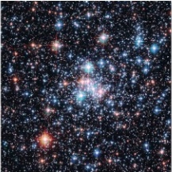

fig C Can you identify the brightest and dimmest stars in this star cluster, NGC 290?

We define luminosity as the rate at which energy of all types is radiated by an object in all directions. This depends upon both the object's size and, more importantly, its temperature.

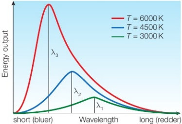

▲ fig D Black body radiation curves for different temperatures.

The electromagnetic radiation is emitted across a very large range of wavelengths. A perfect black body radiator will emit energy across the entire electromagnetic spectrum, following a distribution like those in fig D. This distribution is given by the Stefan–Boltzmann law. This tells us that the output power from a black body is proportional to its surface area and the fourth power of its temperature in kelvin.

 $$ L=\sigma A T^{4} $$ 

where the Stefan–Boltzmann constant,  $ \sigma = 5.67 \times 10^{-8} \, \text{W} \, \text{m}^{-2} \, \text{K}^{-4} $. For a sphere, this would become:

 $$ L=4\pi r^{2}\sigma T^{4} $$

<!-- page 191 -->

Working on the assumption that a star acts like a black body emitter, which is a very good approximation, this equation describes the luminosity of a star.

## LEARNING TIP

A black body radiator is a theoretical perfect emitter, which follows the Stefan–Boltzmann energy output curve for its temperature, as illustrated in fig C, and also follows Wien's law below. Here we are approximating stars to perfect black bodies. Remember, black body radiation is a thermodynamics idea that can be applied in other areas of physics.

## WORKED EXAMPLE 1

The Sun has a radius of  $ 7.0 \times 10^{8} $ m and its surface temperature is 5800 K. What is the luminosity of the Sun?

Luminosity of the Sun, L:

 $$ \begin{aligned}L&=\sigma A T^{4}\\&=\sigma4\pi r^{2}T^{4}\\&=5.67\times10^{-8}\times4\pi(7.0\times10^{8})^{2}\times5800^{4}\\&=3.95\times10^{26}W\\ \end{aligned} $$ 

What would be the surface temperature of a star of radius  $ 14.0 \times 10^{8} $ m with the same luminosity as the Sun?

 $$ \begin{aligned}A_{star}&=4\pi r^{2}\\&=4\pi\times(14.0\times10^{8})^{2}\\&=2.46\times10^{19}m^{2}\\ \end{aligned} $$ 

 $$ \begin{aligned}T_{star}&=\sqrt[4]{\frac{L}{\sigma A}}\\&=\sqrt[4]{\frac{3.95\times10^{26}}{(5.67\times10^{-8}\times2.46\times10^{19})}}\\&=4100K\end{aligned} $$ 

Therefore a bigger star can be at a lower temperature and yet have the same luminosity, i.e. it looks as bright.

## WIEN'S LAW

To calculate luminosity, we needed to know the temperature of the star. There are various methods for determining the temperatures of stars, but we will focus on one that uses the wavelengths of light given off by a star. When we examine the range of wavelengths emitted by a star, known as its spectrum, we find that some wavelengths are given off with more intensity than others.

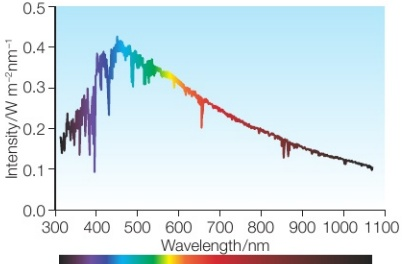

▲ fig E The spectrum of light emitted by the Sun.

We saw from the Stefan–Boltzmann law that as the temperature of a black body increases, it emits more energy. Fig D shows how the amount of energy emitted at different wavelengths changes with temperature. At higher temperatures the curve has a more pronounced peak, and the wavelength of the peak output gets shorter as the temperature rises. The relationship between the peak output wavelength and temperature is described by Wien's law:

The number  $ 2.898 \times 10^{-3} $ m K is known as Wien's constant.

 $$ \lambda_{max}T=2.898\times10^{-3}mK $$ 

## WORKED EXAMPLE 2

Looking at the spectrum of light from Betelgeuse, in the constellation of Orion, its peak wavelength is at  $ 9.35 \times 10^{-7} $ m. What is the surface temperature of Betelgeuse?

 $$ \begin{aligned}\lambda_{max}T&=2.898\times10^{-3}\\T&=\frac{2.898\times10^{-3}}{\lambda_{max}}\\&=\frac{2.898\times10^{-3}}{9.35\times10^{-7}}\\T&=3100K\end{aligned} $$ 

## CHECKPOINT

1. What is the luminosity of the star Sirius, which has a surface temperature of 12 000 K and a diameter of 2 220 000 km?

2. (a) The Sun's surface temperature has been measured as being 5800 K. Calculate the peak wavelength of the solar spectrum.

(b) The peak wavelength from the Sun is in fact measured at ground level as being 470 nm. Why is the measured value different from your calculated value from part (a)?

## SKILLS ANALYSIS

3. Calculate the peak wavelength output we would expect of Bellatrix if its surface temperature is 21 500 K.

## SKILLS INTERPRETATION

4. From fig F, calculate the temperatures of Canopus and Rigel.

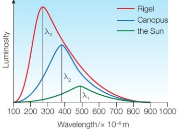

fig F Spectral emission curves for three stars.

## SUBJECT VOCABULARY

red giant a large star which is cooler than our Sun, e.g. 3000 K. white dwarf a small, hot star, perhaps 10 000 K

blue supergiant a very large, very hot star, perhaps 25 000 K black body radiator a theoretical object, that completely absorbs all radiation that lands on it

luminosity the rate at which energy of all types is radiated by an object in all directions

Stefan-Boltzmann law the power output from a black body is proportional to its surface area and the fourth power of its temperature in kelvin,  $ L = \sigma AT^{4} $

Wien's law the relationship between the peak output wavelength and temperature for a black body radiator is given by the equation:

 $ \lambda_{max}T = 2.898 \times 10^{-3} \, \text{mK} $

<!-- page 192 -->

# 11B 2 STELLAR CLASSIFICATION

## LEARNING OBJECTIVES

Sketch and interpret a simple Hertzsprung–Russell diagram relating stellar luminosity to surface temperature.

Relate the Hertzsprung–Russell diagram to the life cycle of stars.

## EXAM HINT

## STAR CLASSES

You will not be expected to remember detailed facts like those in this table in the exam.

Astronomers have classified stars into groups according to their temperature. This is a useful property to use since stars with similar temperatures tend to share many other features. As we saw from Wien's law (see fig E in Section 11B.1) the temperature determines the spectral output of the star, but it can also suggest chemical composition and age.

<table border=1 style='margin: auto; word-wrap: break-word;'><tr><td style='text-align: center; word-wrap: break-word;'>SPECTRAL CLASS</td><td style='text-align: center; word-wrap: break-word;'>EFFECTIVE TEMPERATURE/K</td><td style='text-align: center; word-wrap: break-word;'>COLOUR</td><td style='text-align: center; word-wrap: break-word;'>$ M/M_{SUN} $</td><td style='text-align: center; word-wrap: break-word;'>$ R/R_{SUN} $</td><td style='text-align: center; word-wrap: break-word;'>$ L/L_{SUN} $</td><td style='text-align: center; word-wrap: break-word;'>MAIN SEQUENCE LIFESPAN</td></tr><tr><td style='text-align: center; word-wrap: break-word;'>O</td><td style='text-align: center; word-wrap: break-word;'>28 000-50 000</td><td style='text-align: center; word-wrap: break-word;'>blue</td><td style='text-align: center; word-wrap: break-word;'>20-60</td><td style='text-align: center; word-wrap: break-word;'>9-15</td><td style='text-align: center; word-wrap: break-word;'>90 000-800 000</td><td style='text-align: center; word-wrap: break-word;'>1-10 Myr</td></tr><tr><td style='text-align: center; word-wrap: break-word;'>B</td><td style='text-align: center; word-wrap: break-word;'>10 000-28 000</td><td style='text-align: center; word-wrap: break-word;'>blue-white</td><td style='text-align: center; word-wrap: break-word;'>3-18</td><td style='text-align: center; word-wrap: break-word;'>3.0-8.4</td><td style='text-align: center; word-wrap: break-word;'>95-52 000</td><td style='text-align: center; word-wrap: break-word;'>11-400 Myr</td></tr><tr><td style='text-align: center; word-wrap: break-word;'>A</td><td style='text-align: center; word-wrap: break-word;'>7500-10 000</td><td style='text-align: center; word-wrap: break-word;'>white</td><td style='text-align: center; word-wrap: break-word;'>2.0-3.0</td><td style='text-align: center; word-wrap: break-word;'>1.7-2.7</td><td style='text-align: center; word-wrap: break-word;'>8-55</td><td style='text-align: center; word-wrap: break-word;'>400 Myr-3 Gyr</td></tr><tr><td style='text-align: center; word-wrap: break-word;'>F</td><td style='text-align: center; word-wrap: break-word;'>6000-7500</td><td style='text-align: center; word-wrap: break-word;'>white-yellow</td><td style='text-align: center; word-wrap: break-word;'>1.1-1.6</td><td style='text-align: center; word-wrap: break-word;'>1.2-1.6</td><td style='text-align: center; word-wrap: break-word;'>2.0-6.5</td><td style='text-align: center; word-wrap: break-word;'>3-7 Gyr</td></tr><tr><td style='text-align: center; word-wrap: break-word;'>G</td><td style='text-align: center; word-wrap: break-word;'>4900-6000</td><td style='text-align: center; word-wrap: break-word;'>yellow</td><td style='text-align: center; word-wrap: break-word;'>0.85-1.1</td><td style='text-align: center; word-wrap: break-word;'>0.85-1.1</td><td style='text-align: center; word-wrap: break-word;'>0.66-1.5</td><td style='text-align: center; word-wrap: break-word;'>7-15 Gyr</td></tr><tr><td style='text-align: center; word-wrap: break-word;'>K</td><td style='text-align: center; word-wrap: break-word;'>3500-4900</td><td style='text-align: center; word-wrap: break-word;'>orange</td><td style='text-align: center; word-wrap: break-word;'>0.65-0.85</td><td style='text-align: center; word-wrap: break-word;'>0.65-0.85</td><td style='text-align: center; word-wrap: break-word;'>0.10-0.42</td><td style='text-align: center; word-wrap: break-word;'>17 Gyr</td></tr><tr><td style='text-align: center; word-wrap: break-word;'>M</td><td style='text-align: center; word-wrap: break-word;'>2000-3500</td><td style='text-align: center; word-wrap: break-word;'>red</td><td style='text-align: center; word-wrap: break-word;'>0.08-0.05</td><td style='text-align: center; word-wrap: break-word;'>0.17-0.63</td><td style='text-align: center; word-wrap: break-word;'>0.001-0.08</td><td style='text-align: center; word-wrap: break-word;'>56 Gyr</td></tr></table>

table A Spectral class summary.

The spectral star classes are labelled by letters (table A). One mnemonic for remembering the letters, in order from hottest to coolest, is:

## Only Brilliant Astronomers Fix Grave Kepler Mistakes

You will notice a number of trends in the data in table A. The hotter stars often have more mass and are more luminous. The larger gravitational pressure at the centre of a massive star makes the nuclear fusion reactions within the star run very fast, producing a lot of energy and using the hydrogen fuel in the star at a very high rate. In addition, more massive stars are also larger. Therefore, with large size and high temperatures, the hotter stars are very luminous, giving off a lot of energy. At the same distance away from us, these will then appear very bright in the night sky compared with a smaller, cooler star.

Table A also shows the change in colour that goes along with changing stellar class. The overall impression of the O class spectrum is a bluish colour, whereas for the M class spectrum there is a strong red colour showing (also see fig A). These changes are a direct result of the variation in output curve we saw associated with Wien's law. Fig B highlights how this comes about.

<!-- page 193 -->

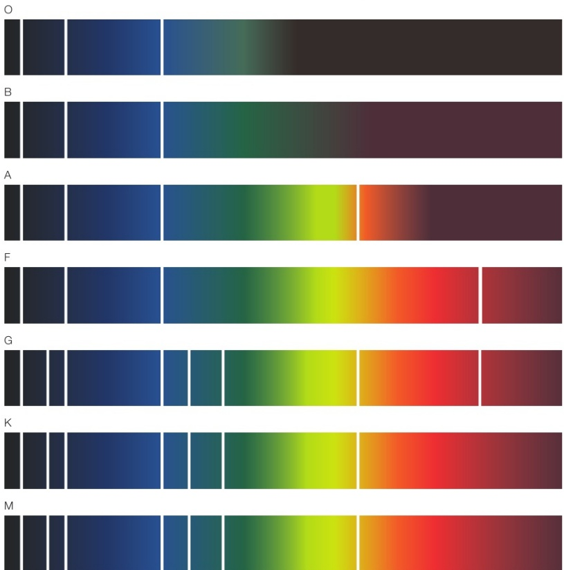

▲ fig A Light spectra from typical stars in each star class. Note the white lines, which highlight the position of absorption lines (actually black in the original photos). These give us information about the chemical composition of the stars, and the Doppler shift which tells us their velocity.

Looking at fig B, if we combine together equal intensity parts of the colours of the visible spectrum, this will produce white light. The extra emissions above this white basic emission – the peak of the curve on the graph – will show the colour the star appears. Also, given the pattern of decreasing size with luminosity we have seen above, it is logical to find that blue supergiants are generally O class stars, whereas red dwarf stars are usually in the M class.

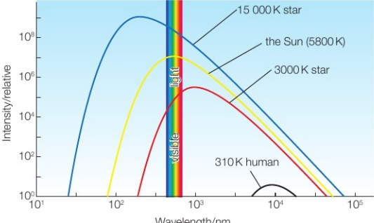

fig B The peak of a star's Wien's law curve shows us what colour it will appear.

<!-- page 194 -->

## THE HERTZSPRUNG-RUSSELL DIAGRAM

If you plot a graph of luminosity against star temperature to confirm the trend of table A, you will find that there is a general correlation. However, the more data you add, the more complex the picture becomes. We must also remember that the temperature measurement assumes the star behaves as a black body, and the luminosity is similarly often not as accurate as we would like. In general, luminosity has to be determined from a calculation that includes the distance to the star, and measuring the distances to stars is by no means an exact science (see Section 11B.3 for more details). Such a plot can give us some very useful insights, but is not a graph in the true sense. It is known as a Hertzsprung-Russell diagram (fig C).

## EXAM HINT

You will be expected to be able to sketch a simple Hertzsprung-Russell diagram from memory in the exam. This should include approximate values for the axes.

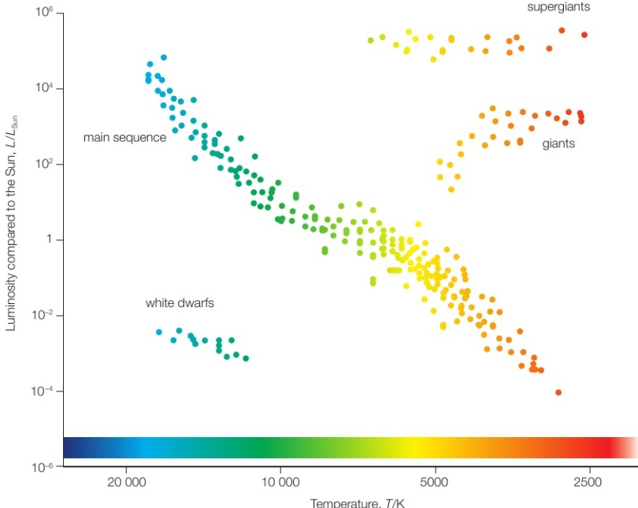

## fig C A Hertzsprung-Russell diagram

Most stars we observe fall on a diagonal line across the Hertzsprung–Russell diagram, which is called the main sequence. These main sequence stars are stable stars which will exist in this state for the majority of their lifetime. Their correlation represents the connection between brightness and high temperature. Note that the plot is always drawn with hotter temperatures on the left-hand side. There are also other stages in a star's evolution, which appear in other places on the diagram, but these are much shorter than its stable period. Thus there are far fewer stars in those parts of the H–R diagram. For example, as blue supergiants burn out in just a few million years, most of these have already done so, and we do not see many; the top left area of the H–R diagram is lightly populated.

## STELLAR EVOLUTION

The majority of ordinary matter in the Universe is hydrogen ( $ \approx $ 75%) or helium ( $ \approx $ 24%), and it is from these elements that stars are initially formed. From an accreting collection of these gases, called a protostar, the life cycle of a star follows a number of stages, with the star ending its life as a white dwarf, neutron star or black hole. As the star undergoes nuclear fusion, the binding energy differences of the nuclei before and after fusion mean that the process releases energy, often as electromagnetic radiation, to heat the star. The structure of the star is protected from gravitational

<!-- page 195 -->

collapse by the pressure from the vibration of its particles and the electromagnetic radiation which is trying to escape. It is this constant battle between the outward pressure and gravity that drives the evolution of a star throughout its lifetime. The initial mass of the star is a critical factor in determining how the battle goes, and which of the possible life cycles a star will follow (fig D).

The multiple possible life cycles for stars are usually grouped together into just two paths in which the outcomes are similar. These are the life cycle for low-mass stars (such as our Sun) and the life cycle for massive stars, which have at least four times the mass of our Sun.

## LOW-MASS STARS

Once it has accreted about the mass of our Sun, a low-mass star will start to undergo nuclear fusion of hydrogen, converting this into helium. This is a stable stage of life in which radiation pressure and gravity are in equilibrium. The star will remain in this state for billions of years. Eventually, it will run low on hydrogen fuel, but will have produced so much energy that it will expand slightly. This expansion causes the temperature to fall and the star becomes a red giant. Our Sun is expected to undergo this change in another 4–5 billion years, when it will expand beyond the orbit of Venus. Once most of the hydrogen fuel is used, the star will start fusing helium nuclei. This complex process can cause an explosion which throws some material from the star out into space, forming a planetary nebula. As the fuel to produce energy to support the star runs out, the outward pressure from fusion drops and gravity takes hold, causing the star to contract to a much smaller size. This heats up the star significantly and it becomes a white dwarf. As time continues, the star will slowly run out of energy and die, passing through the red dwarf stage to become a black dwarf. Note that the black dwarf stage is theoretical, as it takes a white dwarf longer than the current age of the Universe to cool this much, so there has not yet been time for any to develop.

## MASSIVE STARS

If a protostar has more than four times the mass of our Sun, the star begins life as a blue supergiant. As with low-mass stars, nuclear fusion begins and the star enters a stable stage of life in which heat pressure and gravity are in equilibrium. However, the fusion processes happen at much higher temperatures than in lower mass stars. The core of our Sun may be at 15 million kelvin, whereas a large star could have a core temperature of 40 million kelvin. This means that it burns very quickly, and the conditions make it possible for further fusion of some of the larger nuclei it produces to occur. The fusion of helium can produce a variety of the larger elements, which have mass numbers which are multiples of 4 (helium has four nucleons), such as carbon, oxygen and silicon. There will then be stages of carbon and oxygen fusing. A high-mass star is likely to be on the main sequence for only up to a billion years. When the material of such a star has been fused to become mostly iron, it can no longer undergo nuclear fusion and it stops producing energy. This happens even more suddenly than in a low-mass star, and with the enormous gravitational forces produced by the large mass, it undergoes a major collapse. This sudden increase in density produces a sudden huge burst of energy, effectively bouncing the collapse back out. This explosion is called a (Type II) supernova and is the most immense burst of energy ever witnessed. It is so bright, at about 10 billion times the luminosity of the Sun, that you can see the change in the night sky with the naked eye.

Within a supernova explosion there is so much energy that nuclear reactions occur that produce the elements above iron in the periodic table. The natural occurrence of these elements is evidence that supernovae must have occurred in the past, as the binding energies of these heavy elements are such that they cannot be created in other natural processes in the Universe.

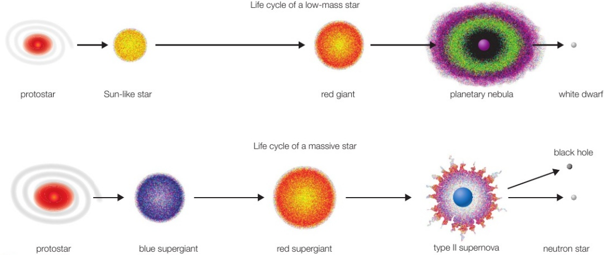

<!-- page 196 -->

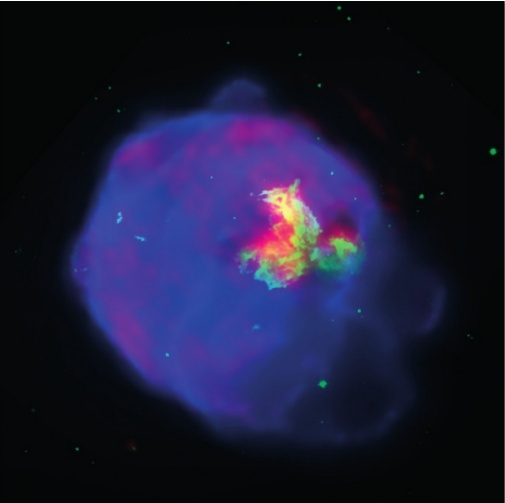

fig E The remains of supernova N63A Menagerie.

After a high-mass star has exploded as a supernova, the entire star may be completely shattered. If there remains a central core of stellar material, this will either be a neutron star (if the core was up to three solar masses) or a black hole (if the core kept more than three solar masses). Neither of these is easy to detect, as they emit little or no light, and they are not plotted on the Hertzsprung–Russell diagram. A neutron star consists almost entirely of neutrons, packed as densely together as the nucleons within the nucleus of an atom. They can hold three times the mass of the Sun but are only about 10 km in diameter. Black holes are even smaller and hold even more matter than neutron stars. This means that their gravitational pull is immense, so strong that even things travelling at the speed of light cannot escape.

You will see from fig F that a given star develops through its life as various different types of star. If we observe it at each of these points in its life, they would be plotted in different places on the H–R diagram. Thus, we can plot the life cycle of a star as a movement around the H–R diagram (fig F).

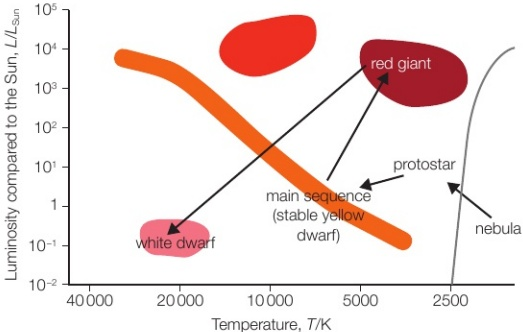

fig F The Sun's life cycle will move it around the H-R diagram.

## CHECKPOINT

## SKILLS CRITICAL THINKING

1. The mass of the Sun is  $ 2.0 \times 10^{30} $ kg. If we assume that it is completely composed of protons, how many protons is this? If the Sun fuses all of its protons during its estimated nine billion year lifetime, how many protons are undergoing nuclear fusion every second?

## SKILLS INTERPRETATION

2. ▶ Draw a flow chart showing the life cycles of:

(a) a star which starts out with six times the mass of the Sun

(b) a star which starts out with twice the mass of the Sun.

3. Calculate the gravitational field strength at the surface of a black hole, that has five times the mass of the Sun and a diameter of 10 cm. How does this compare to the Earth's gravitational field strength?

## SKILLS INTERPRETATION, INTEGRITY

4. (a) From memory, make a quick sketch of the Hertzsprung-Russell diagram and mark on it the path taken by a star with the same mass as our Sun as it develops through the various stages of its life cycle.

(b) Mark on your sketch the life cycle path taken by a blue supergiant if it starts out with a mass that is 8 times that of the Sun.

5. Why do the nuclear fusion processes within stars usually produce elements with a mass number which is a multiple of four, such as carbon-12, oxygen-16 and silicon-20?

6. (a) Why can't the nuclear fusion in stars produce elements higher in the periodic table than iron-56?

(b) How do heavier elements than iron-56 exist, when the Big Bang produced an initial Universe composed of only hydrogen and helium?

## SUBJECT VOCABULARY

Hertzsprung-Russell diagram a plot of stars, showing luminosity (or absolute magnitude) on the y-axis, and temperature (or spectral class) on the x-axis

main sequence a diagonal line from top left to bottom right of a Hertzsprung-Russell diagram which marks stars that are in a generally stable phase of their existence

main sequence star a stable star whose core performs hydrogen fusion and produces mostly helium

protostar the mass of dust and gas clumping together under the force of gravity prior to the start of nuclear fusion in its core, which will go on to become a star

neutron star one of the possible conclusions to the life of a large mass star; small and very dense, composed of neutrons

black hole one of the possible conclusions to the life of a large mass star; a region of space-time in which the gravity is so strong that it prevents anything from escaping, including EM radiation

planetary nebula the remains of an explosion at the end of the life cycle of a low-mass star; material which may eventually join together into new planets

black dwarf the final stage of the life cycle of a small mass star, when nuclear fusion has ceased and it has cooled so that it no longer emits visible light

supernova the explosion of a large mass star at the end of its lifetime, when it becomes extremely unstable

<!-- page 197 -->

# 11B 3 DISTANCES TO THE STARS

## LEARNING OBJECTIVES

Determine astronomical distances using trigonometric parallax.

Use the equation for the intensity of a star,  $ I = \frac{L}{4\pi d^{2}} $.

Measure astronomical distances using standard candles.

## BIG DISTANCE UNITS

Astronomical distances are very large. Our nearest neighbour is the Moon, and even that is nearly 400 000 000 m away. The Sun is 150 000 000 000 m away, and the distance to the orbit of Neptune is 4 500 000 000 000 m. Measuring across space generates very large values. Using standard form notation helps with this, but astronomers have defined a number of alternative distance units to cut down the magnitudes of the numbers involved.

You have probably already heard of the light year. This is the distance that light can travel in one year, which is about  $ 10^{16} $ m. We also use the astronomical unit (AU), which is the radius of the Earth's orbit around the Sun:  $ 1\ AU = 1.5 \times 10^{11} $ m.

Much of our understanding of the structure and formation of galaxies depends on being able to measure the distances to stars accurately. Astronomers have developed a number of techniques for doing this, but all have their limitations. These limitations can be overcome, or at least minimised, by comparing the results from the different techniques on the same star, and refining the techniques to improve accuracy.

## LEARNING TIP

Some of the techniques explained in this section are used on individual stars, and some are used on large groups of stars, such as galaxies or star clusters.

## TRIGONOMETRIC PARALLAX

To measure the distance to relatively close stars, astronomers use a method which is commonly used in surveying, known as trigonometric parallax. As the Earth moves around the Sun, a relatively close star will appear to move across the background of more distant stars. This optical illusion is used to determine the distance of the star. The star itself does not move significantly during the course of the observations. To determine the trigonometric parallax you measure the angle to a star, and observe how that changes as the position of the Earth changes. We know that in six months the Earth will be exactly on the opposite side of its orbit, and therefore will be two astronomical units from its location today.

Using observations of the star which is to be measured against a background of much more distant stars, we can measure the angle between the star and the Earth in these two different positions in space, six months apart. As we know the size of the Earth's orbit, geometry allows calculation of the distance to the star.

<!-- page 198 -->

fig A You can observe the principle behind parallax measurements using your fingers to represent near and distant stars.

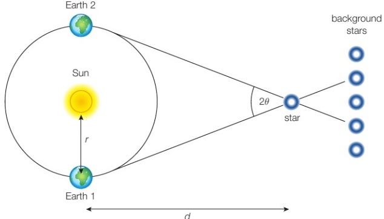

fig B Trigonometric parallax measurements

Using observations of the star to be measured against a background of much more distant stars, we can measure the angle between the star and the Earth in these two different positions in space, six months apart. As we know the size of the Earth's orbit, geometry allows calculation of the distance to the star.

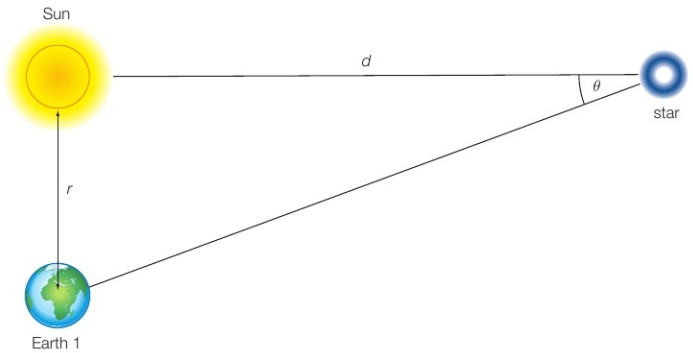

▲ fig C The geometry of trigonometric parallax.

<!-- page 199 -->

By taking the picture of fig B and cutting it in half, we get a right-angled triangle formed as shown in fig C, with the parallax angle,  $ \theta $.

 $$ \tan\theta=\frac{r}{d} $$ 

 $$ d=\frac{r}{\tan\theta} $$ 

At small angles, as we are usually using in astronomy,  $ \tan\theta\approx\theta $. The distance, d, will come out in the same units used to measure r, so we also have:

 $$ d=\frac{r}{\theta} $$ 

## THE PARSEC

A parsec (pc) is a measure of distance. It is an abbreviation of ‘parallax second’. It is the distance a star must be from the Sun in order for the angle Earth-star-Sun to be 1 arcsecond.

 $$ \begin{array}{l} \text{1 parsec} =\displaystyle {\frac{1.5 \times 10^{11}}{\tan (1/3600)}} \\ \qquad = 3.09 \times 10^{16} \text{m} \end{array} $$ 

1 light year =  $ 3 \times 10^{8} \times 365 \times 24 \times 60 \times 60 $

 $ = 9.46 \times 10^{15} m $

1 parsec = 3.27 light years

The triangle geometry also means that if we have the angle measurement in arcseconds,  $ \theta $, the distance, d, to the star, measured in parsecs, is easily obtainable from:

 $$ d=\frac{1}{\theta} $$ 

## WORKED EXAMPLE 1

Astronomers measuring the parallax angle to Alpha Centauri found that the angle measured after a six-month period was 1.52 seconds of arc different from that measured at first. How far is Alpha Centauri from Earth?

$$
\begin{aligned}
2\theta &= 1.52" \quad r = 1.5 \times 10^{11} \text{ m} \\
\theta &= \frac{1.52}{2} = 0.76" \\
&= 0.76 \times \frac{1}{3600} \\
&= 2.11 \times 10^{-4} \text{°} \\
d &= \frac{r}{\tan\theta} \\
&= \frac{1.5 \times 10^{11}}{\tan(2.11 \times 10^{-4})} \\
&= \frac{1.5 \times 10^{11}}{3.68 \times 10^{-6}} \\
d &= 4.07 \times 10^{16} \text{ m} \\
&\text{Alternatively, straight to parsecs:} \\
d &= \frac{1}{\theta} = \frac{1}{0.76} \\
d &= 1.32 \text{ pc}
\end{aligned}
$$

## LEARNING TIP

When making measurements for the trigonometric parallax of stars, astronomers often need to be able to measure very small differences in the angles. Remember that each degree can be split into 60 minutes, and each minute of arc (an arc is a part of a circle) can be split into 60 seconds.

1 degree = 60 arcminutes

= 3600 arcseconds

1° = 60′ = 3600″

The accuracy of trigonometric parallax depends on the accuracy of the angle measurement. With atmospheric interference for Earth-based telescopes, this was for many years limited to stellar distances of about 100 light years. The European Space Agency's Gaia mission is an orbiting telescope, which has an accuracy in the angle measurement of 24 microarcseconds. This corresponds to allowing accurate distance measurement to stars as far away as 135 000 light years. Section 11B.4 also highlights how important it is to know stellar distances accurately.

<!-- page 200 -->

# STANDARD CANDLES

fig D A light source appears dimmer with increasing distance.

We saw previously that the brightness of a star was linked to its size and its temperature. However, the Stefan–Boltzmann law only considers the power output of the star at its surface. The luminosity of a star is its overall power output over its entire surface. How bright it looks to us, or how much energy we receive from it, depends on how far away the star is (fig D). It follows that if we knew the power output of a star, then how bright it appears to us on Earth would give away its distance.

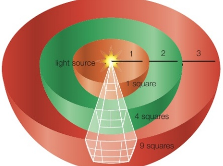

▲ fig E The inverse square law, showing energy spread over greater and greater areas with increasing distance from a star.

In Book 1, Section 3D.4 we saw that measurements of energy intensity are calculated as power per unit area. The general equation we had for intensity was  $ I = \frac{P}{A} $. The inverse square law means that the energy emitted by a star will spread out in all directions over the surface of an increasing sphere (fig E). As the surface area of a sphere is  $ 4\pi r^2 $, this gives us an equation for the radiant energy intensity at a certain distance,  $ d $, from a star:

 $$ I=\frac{L}{4\pi d^{2}} $$ 

where L is the luminosity in watts.

## WORKED EXAMPLE 2

The Sun has a luminosity of  $ L = 3.8 \times 10^{26} $ W. What is the radiant energy intensity from the Sun at the surface of the Earth?

 $$ d=1.5\times10^{11}m $$ 

 $$ \begin{aligned}I&=\frac{L}{4\pi d^{2}}\\&=\frac{3.8\times10^{26}}{4\pi(1.5\times10^{11})^{2}}\\I&=1300Wm^{-2}\end{aligned} $$ 

Some stars, including some variable stars and supernovae, have properties which mean their luminosity can be determined quite separately from other measurements. These are known as standard candles. If we have a figure for the luminosity, and measure the energy intensity (brightness) of the star reaching the Earth, we can then calculate how far away it is by comparing it with a standard candle with the same luminosity.

## WORKED EXAMPLE 3

The luminosity of Betelgeuse is  $ 5.4 \times 10^{30} $ W. Its radiant energy intensity at the Earth is  $ 1.1 \times 10^{-8} $ W m $ ^{-2} $. How far away is Betelgeuse?

 $$ I=\frac{L}{4\pi d^{2}} $$ 

 $$ d^{2}=\frac{L}{4\pi I} $$ 

 $$ d=\sqrt{\frac{L}{4\pi I}} $$ 

 $$ =\sqrt{\frac{5.4\times10^{30}}{4\pi\left(1.1\times10^{-8}\right)}} $$ 

 $$ d=6.2\times10^{18}m $$ 

 $$ d=660ly $$ 

 $$ d=200pc $$ 

## VARIABLE STARS

Over a period of years at the beginning of the twentieth century, Henrietta Leavitt, working at the Harvard College Observatory, catalogued many stars in the nearby Magellanic Clouds. She monitored them over time and found that, for some stars, their brightness changed, changing in a repeating cycle. The time period of this oscillation in brightness was constant and, importantly, was in direct proportion to the luminosity of each star (fig F).

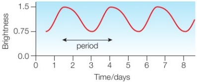

▲ fig F The brightness variation typical of RR Lyrae variable stars. These are stars which have left the main sequence, but have not yet exhausted all of their nuclear fuels. They alternately expand and contract causing their light to change repeatedly.

<!-- page 201 -->

It was possible to calculate the intrinsic luminosity of these stars, as they were close enough to use trigonometric parallax to find their distance. Leavitt had discovered the period–luminosity relation. A longer time period for oscillation meant a brighter star. Astronomers then took this relationship and used it to determine the luminosity of variable stars at much greater distances. From the luminosity, the distance to these stars can be determined using our expression for the radiant energy flux (brightness) observed on Earth. RR Lyrae variable stars allow us to measure distances to about 760 000 parsecs. However, Leavitt particularly studied Cepheid variable stars. There are two types of these, and the more luminous Type I Cepheids give us the greatest distance measurements using the standard candle technique, out to about 40 million parsecs.

## TEMPERATURE-LUMINOSITY RELATIONSHIP

One of the simplest methods of determining the luminosity of a star is to look at its spectrum. The peak wavelength gives the temperature from Wien's law, and the width of spectral lines can determine whether or not it is a main sequence star. If it is, and you find its place on the main sequence of the H–R diagram as shown in fig G, you can read the luminosity from the y-axis. However, this is one of the least reliable standard candle measurements.

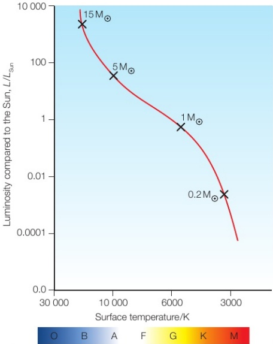

▲ fig G The relationship between stellar size and temperature gives luminosity, which in turn can give distance.

## CHECKPOINT

## SKILLS ADAPTIVE LEARNING

1. Using the data shown in Worked Example 1 on page 189, calculate how far away Alpha Centauri is in astronomical units.

2. The parallax angle to Barnard's Star is 0.545". How far away is Barnard's Star in

(a) metres?

(b) light years?

(c) parsecs?

(d) astronomical units?

3. The luminosity of Rigel is  $ 3.9 \times 10^{31} $ W. At the Earth, Rigel's radiant energy intensity is  $ 5.42 \times 10^{-8} $ W. How far away is the star?

4. Jupiter's orbit is 5.2 AU from the Sun. If Jupiter is considered as a black body with a temperature of 110 K, and radius 69 900 km, calculate:

(a) the maximum radiant energy intensity at the surface of the Earth due to Jupiter's electromagnetic emissions (hint: you will first need to calculate the luminosity).

(b) the peak wavelength of Jupiter's energy output.

5. How does the energy we receive from Jupiter compare with what we get from the Sun?

## SUBJECT VOCABULARY

light year the distance that light can travel in one year, in a vacuum, which is about  $ 10^{16} $ m

astronomical unit (AU) a distance unit, equal to the radius of the Earth's orbit around the Sun:  $ 1 \, AU = 1.5 \times 10^{11} \, m $

trigonometric parallax a method for measuring the distance to relatively close stars. It works by comparing their measured angle in the sky at six monthly intervals, and using these measurements to calculate the distance using trigonometry

parallax angle the difference in angular observation of a given star, for use in the trigonometric parallax method of measuring the distance to a star

parsec (pc) the distance a star must be from the Sun in order for the parallax angle Earth-star-Sun to be 1 arcsecond:

 $$ 1\mathrm{pc}=3.09\times10^{16}\mathrm{m} $$ 

standard candles stars with properties such that their luminosity can be determined from measurements other than brightness

<!-- page 202 -->

# 11B 4 THE AGE OF THE UNIVERSE

## LEARNING OBJECTIVES

Define the Doppler effect and explain its application to the light from other stars and galaxies.

Use the equation for red shift of light,  $ z = \frac{\Delta\lambda}{\lambda} \approx \frac{\Delta f}{f} \approx \frac{v}{c} $.

Describe Hubble's law and the equation  $ v = H_{0}d $ for objects at cosmological distances.

## THE DOPPLER EFFECT

Astronomers first began to look at the spectra of stars in other galaxies during the 1920s. They noticed that the spectra looked very similar to the spectra from stars in our own galaxy but that all the features present were shifted by the same relative amount towards the red end of the spectrum. This phenomenon became known as the red shift. This shift is due to the relative motion of other galaxies with respect to ours, in an effect called the Doppler effect: an observer receiving waves emitted from a moving body observes that the wavelength of the waves has been altered to a new wavelength.

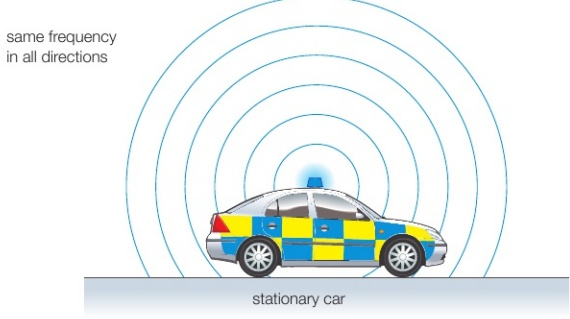

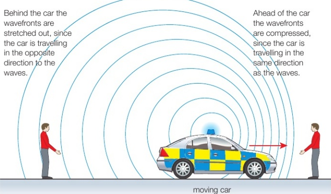

fig A The Doppler effect causes a change in frequency and wavelength if there is relative motion between the wave source and the observer.

<!-- page 203 -->

A star or galaxy moving away emits light that appears to have a longer wavelength than expected. We also experience this effect when, for example, we hear a car coming towards us and driving past at a steady rate (fig A). As it approaches, the note of its engine rises to a maximum pitch, and then falls as the car travels away. You could imagine the waves getting squashed closer together (shorter wavelength) as the car drives towards you, and then stretched further apart (longer wavelength) as it drives away.

laboratory spectrum

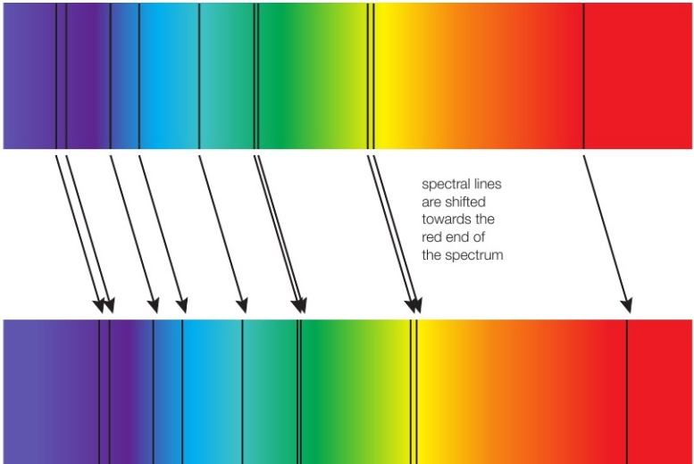

spectrum from a distant galaxy

fig B Comparison of light from distant galaxies with light produced in (stationary) Earth-based experiments can allow calculation of the galaxy's speed away from Earth.

The amount of red shift a galaxy exhibits, z, allows us to calculate how fast it is moving. This can be done using measurements of either wavelength or frequency changes (fig B).

 $$ z=\frac{\Delta\lambda}{\lambda}\approx\frac{\Delta f}{f}\approx\frac{v}{C} $$ 

## WORKED EXAMPLE 1

In a laboratory sample, the hydrogen alpha spectral absorption line is at a wavelength of 656.285 nanometres. In the spectrum from a nearby star, this line is observed at a wavelength of 656.315 nm. How fast is this star moving and in which direction?

The wavelength from the star is longer than it should be, so the star is moving away.

 $$ \begin{aligned}\Delta\lambda&=656.315-656.285=0.030nm\\\frac{\Delta\lambda}{\lambda}&=\frac{v}{c}\\v&=c\times\frac{\Delta\lambda}{\lambda}\\&=3\times10^{8}\times\frac{0.030}{656.285}\\&=13700m s^{-1}\\v&=13.7km s^{-1}\end{aligned} $$ 

## LEARNING TIP

Sometimes we see a blue-shift, but this is not common. This shows the star or galaxy is coming towards us.

<!-- page 204 -->

## LEARNING TIP

Local motions deviating from the overall expansion can affect the red shift in a confusing way, which is the main reason that the points in fig D show a significant scatter around the best-fit line. Most of the movement causing red shift comes from the expansion of the Universe.

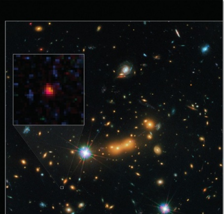

▲ fig C This image is a composite taken with Hubble's WFC 3 and ACS on 5 October and 29 November 2011. It shows dwarf galaxy MACS0647-JD, which is one of the most distant objects yet observed. It has a red shift of about z = 11.

## HUBBLE'S LAW

Astronomers quickly realised that red shift implied that galaxies surrounding us were travelling away from us. In 1929 the American astronomer Edwin Hubble published his finding that the value of a galaxy's red shift is proportional to its distance from us – that is, the further away a galaxy is, the faster it is moving. Hubble's paper had the same effect on the twentieth century view of the Universe as Galileo's work on the solar system had some 300 years earlier. Instead of being static, the Universe was expanding. The philosophical implications continue to intrigue scientists and religious scholars (see Section 11B.5).

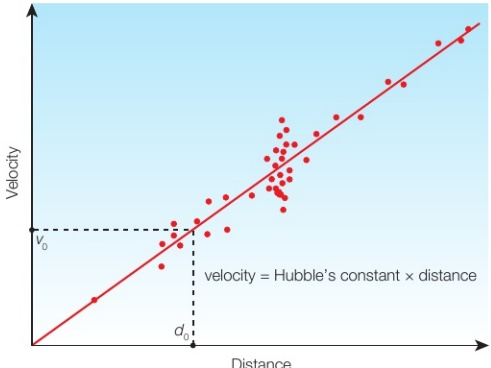

▲ fig D As almost all galaxies show red shifts in their spectra, Hubble concluded that all the galaxies must be moving apart from each other and the Universe is expanding.

Considering the speeds of galaxies and their distances, there is a simple relationship between them. This is known as Hubble's law:

 $$ \nu=H_{0}d $$ 

So, the velocity of a galaxy is directly proportional to the distance to it. We can find the constant of proportionality, the Hubble constant, from the gradient of the graph in fig D. This has had many values over the years, which demonstrates the immense difficulties involved in accurately determining astronomical distances. Since the launch of the ESA Planck Surveyor, the uncertainty in measurements and so the uncertainty in the Hubble constant has reduced significantly, and data from the Gaia survey will improve it even more. The current value is considered accurate to within

<!-- page 205 -->

1% and is  $ H_0 = 70.9 $ km s $ ^{-1} $ Mpc $ ^{-1} $, although the most recent data give a slightly lower value (see fig A in Section 11B.5). With an accurate value for  $ H_0 $, astronomers can now also use Hubble's law to determine distances to newly observed objects, such as that in fig C.

## WORKED EXAMPLE 2

A supernova appears in the night sky, and astronomers find that it has a red shift of $z = 0.45$. How far away is the supernova?

$z = \frac{v}{c}$

$v = z \times c$

$= 0.45 \times 3 \times 10^{8}$

$= 1.35 \times 10^{8} \, \text{m} \, \text{s}^{-1}$

$= 1.35 \times 10^{5} \, \text{km} \, \text{s}^{-1}$

According to Hubble's law:

$v = H_{0}d$

$d = \frac{v}{H_{0}}$

$= \frac{1.35 \times 10^{5}}{70.9}$

$d = 1900 \, \text{Mpc}$

Note that the speed was found in km s^{-1}, as we have the Hubble constant in km s^{-1} Mpc^{-1}.

## HOW OLD IS THE UNIVERSE?

All distant objects show a red shift and so they are all moving away from us. This implies that the Universe as a whole is expanding. If we imagine time running backwards from the present, then the known Universe would contract back to a point where everything is in the same place. This would be the time of the Big Bang, when everything first exploded outwards from that single point. Therefore, if we can find the Hubble constant, it will tell us how quickly the Universe is expanding. From this we can work out when it all started.

For an object to travel a distance  $ d_{0} $ from the beginning of time, at a speed of  $ v_{0} $, the time taken,  $ T_{0} $, can be calculated from the basic equation for speed:

 $$  speed=\frac{distance}{time} $$ 

 $$ v_{0}=\frac{d_{0}}{T_{0}} $$ 

 $$ T_{0}=\frac{d_{0}}{v_{0}} $$ 

If we consider the gradient of the Hubble graph,  $ H_{0} = \frac{\nu_{0}}{d_{0}} $.

 $ \therefore\quad T_{0}=\frac{1}{H_{0}} $

Note that in this calculation you should use the same units for the distance and for the length component of the units for recession velocity. Usually, though, the Hubble constant is quoted in units of km s $ ^{-1} $ Mpc $ ^{-1} $.

 $$ H_{0}=70.9\mathrm{~k m}\mathrm{s}^{-1}\mathrm{M p c}^{-1}=70900\mathrm{m}\mathrm{s}^{-1}\mathrm{M p c}^{-1} $$ 

 $$ 1pc=3.09\times10^{16}m $$ 

 $$ 1\ Mpc=3.09\times10^{22}m $$ 

 $$ H_{0}=\frac{70\ 900}{3.09\times10^{22}} $$ 

 $$ =2.29\times10^{-18}m s^{-1}m^{-1} $$ 

 $$ H_{0}=2.29\times10^{-18}s^{-1} $$ 

 $$ T_{0}=\frac{1}{H_{0}} $$ 

 $$ T_{0}=\frac{1}{2.29\times10^{-18}} $$ 

 $$ T_{0}=4.36\times10^{17}s $$ 

This value for  $ T_{0} $ gives the age of the Universe as 13.8 billion years.

## CHECKPOINT

## SKILLS CONTINUOUS LEARNING, PERSONAL AND SOCIAL RESPONSIBILITY

1. Edwin Hubble discovered that the light from other galaxies is Doppler shifted towards the red end of the light spectrum. What does this tell us about the movement of galaxies? Why did this lead Hubble to conclude that the Universe is expanding?

2. (a) Why do spectators at a motor race hear the characteristic 'Neeoooww' sound as each car passes?

(b) Why do the drivers hear a sound of constant pitch?

3. The galaxy NGC 7320C has a red shift value of z = 0.02.

(a) At what wavelength would you expect to find the hydrogen alpha line in the spectrum of light from NGC 7320C?

(b) Use the best modern value for Hubble's constant to calculate the distance to NGC 7320C in megaparsecs.

## SKILLS ANALYSIS

4. The value for the Hubble constant has varied over the years, from 50 km s $ ^{-1} $ Mpc $ ^{-1} $ to 100 km s $ ^{-1} $ Mpc $ ^{-1} $, as different star data were used to draw the graph. Calculate the range of ages of the Universe that this represents.

## SUBJECT VOCABULARY

red shift the apparent change in wavelength of a star's spectrum, caused by increasing separation between the star and Earth. Doppler effect the effect that an observer who is receiving waves emitted from a moving body observes that the wavelength of the waves has been altered, to a new wavelength, as a consequence of the relative motion.

Hubble's law the recession velocity of a galaxy is directly proportional to the distance to it

Hubble constant the constant of proportionality in Hubble's law

Big Bang Theory the theory that the Universe expanded outwards,

from a single point to the currently observed situation

recession velocity the speed at which one object is moving away

from another object

<!-- page 206 -->

# 11B 5 THE FATE OF THE UNIVERSE

## LEARNING OBJECTIVES

Discuss the controversy over the age and ultimate fate of the Universe associated with the value of the Hubble constant and the possible existence of dark matter.

## THE HUBBLE CONSTANT

In Section 11B.4 we saw that there might be a variation in values of the Hubble constant depending on the observational methods used to find it. This is a very significant and important problem, as it can give a huge variation in possible ages for our Universe. Over the years, the Universe's age based on Hubble's law calculations has given answers ranging from 10 billion to 20 billion years. Table A shows a 2014 summary of recent experimental conclusions that indicate a slightly lower value for  $ H_0 $ than the currently accepted  $ 70.9 \, \text{km} \, s^{-1} \, \text{Mpc}^{-1} $. Further observations are needed to confirm these newer results before scientists will agree to change  $ H_0 $. The result of all of this is that we do not have a fixed answer for the age of our Universe, but this keeps changing as experimental methods improve.

<table border=1 style='margin: auto; word-wrap: break-word;'><tr><td rowspan="2">Data set</td><td colspan="3">$ H_{{0}} $</td><td colspan="6">Combined results</td></tr><tr><td style='text-align: center; word-wrap: break-word;'>km s $ ^{-1} $Mpc $ ^{-1} $</td><td style='text-align: center; word-wrap: break-word;'>A</td><td style='text-align: center; word-wrap: break-word;'>B</td><td style='text-align: center; word-wrap: break-word;'>C</td><td style='text-align: center; word-wrap: break-word;'>D</td><td style='text-align: center; word-wrap: break-word;'>E</td><td style='text-align: center; word-wrap: break-word;'>F</td><td style='text-align: center; word-wrap: break-word;'>G</td><td style='text-align: center; word-wrap: break-word;'></td></tr><tr><td style='text-align: center; word-wrap: break-word;'>WMAP9/2013 $ ^{a} $</td><td style='text-align: center; word-wrap: break-word;'>70.0  $ \pm $ 2.2</td><td style='text-align: center; word-wrap: break-word;'></td><td style='text-align: center; word-wrap: break-word;'></td><td style='text-align: center; word-wrap: break-word;'>✓</td><td style='text-align: center; word-wrap: break-word;'>✓</td><td style='text-align: center; word-wrap: break-word;'>✓</td><td style='text-align: center; word-wrap: break-word;'></td><td style='text-align: center; word-wrap: break-word;'></td><td style='text-align: center; word-wrap: break-word;'></td></tr><tr><td style='text-align: center; word-wrap: break-word;'>WMAP9/2014 $ ^{b} $</td><td style='text-align: center; word-wrap: break-word;'>69.4  $ \pm $ 2.2</td><td style='text-align: center; word-wrap: break-word;'></td><td style='text-align: center; word-wrap: break-word;'></td><td style='text-align: center; word-wrap: break-word;'></td><td style='text-align: center; word-wrap: break-word;'></td><td style='text-align: center; word-wrap: break-word;'></td><td style='text-align: center; word-wrap: break-word;'>✓</td><td style='text-align: center; word-wrap: break-word;'>✓</td><td style='text-align: center; word-wrap: break-word;'></td></tr><tr><td style='text-align: center; word-wrap: break-word;'>Planck+WMAPPol/2013 $ ^{c} $</td><td style='text-align: center; word-wrap: break-word;'>67.3  $ \pm $ 1.2</td><td style='text-align: center; word-wrap: break-word;'>✓</td><td style='text-align: center; word-wrap: break-word;'>✓</td><td style='text-align: center; word-wrap: break-word;'></td><td style='text-align: center; word-wrap: break-word;'></td><td style='text-align: center; word-wrap: break-word;'></td><td style='text-align: center; word-wrap: break-word;'></td><td style='text-align: center; word-wrap: break-word;'></td><td style='text-align: center; word-wrap: break-word;'></td></tr><tr><td style='text-align: center; word-wrap: break-word;'>ACT+SPT/2012 $ ^{d} $</td><td style='text-align: center; word-wrap: break-word;'></td><td style='text-align: center; word-wrap: break-word;'></td><td style='text-align: center; word-wrap: break-word;'></td><td style='text-align: center; word-wrap: break-word;'>✓</td><td style='text-align: center; word-wrap: break-word;'>✓</td><td style='text-align: center; word-wrap: break-word;'>✓</td><td style='text-align: center; word-wrap: break-word;'></td><td style='text-align: center; word-wrap: break-word;'></td><td style='text-align: center; word-wrap: break-word;'></td></tr><tr><td style='text-align: center; word-wrap: break-word;'>ACT+SPT/2013 $ ^{d} $</td><td style='text-align: center; word-wrap: break-word;'></td><td style='text-align: center; word-wrap: break-word;'>✓</td><td style='text-align: center; word-wrap: break-word;'>✓</td><td style='text-align: center; word-wrap: break-word;'></td><td style='text-align: center; word-wrap: break-word;'></td><td style='text-align: center; word-wrap: break-word;'></td><td style='text-align: center; word-wrap: break-word;'></td><td style='text-align: center; word-wrap: break-word;'></td><td style='text-align: center; word-wrap: break-word;'></td></tr><tr><td style='text-align: center; word-wrap: break-word;'>ACT+SPT/2014 $ ^{d} $</td><td style='text-align: center; word-wrap: break-word;'></td><td style='text-align: center; word-wrap: break-word;'></td><td style='text-align: center; word-wrap: break-word;'></td><td style='text-align: center; word-wrap: break-word;'></td><td style='text-align: center; word-wrap: break-word;'></td><td style='text-align: center; word-wrap: break-word;'></td><td style='text-align: center; word-wrap: break-word;'></td><td style='text-align: center; word-wrap: break-word;'>✓</td><td style='text-align: center; word-wrap: break-word;'></td></tr><tr><td style='text-align: center; word-wrap: break-word;'>BAO/2012 $ ^{e} $</td><td style='text-align: center; word-wrap: break-word;'></td><td style='text-align: center; word-wrap: break-word;'></td><td style='text-align: center; word-wrap: break-word;'></td><td style='text-align: center; word-wrap: break-word;'>✓</td><td style='text-align: center; word-wrap: break-word;'>✓</td><td style='text-align: center; word-wrap: break-word;'>✓</td><td style='text-align: center; word-wrap: break-word;'></td><td style='text-align: center; word-wrap: break-word;'></td><td style='text-align: center; word-wrap: break-word;'></td></tr><tr><td style='text-align: center; word-wrap: break-word;'>BAO/2013 $ ^{e} $</td><td style='text-align: center; word-wrap: break-word;'></td><td style='text-align: center; word-wrap: break-word;'>✓</td><td style='text-align: center; word-wrap: break-word;'>✓</td><td style='text-align: center; word-wrap: break-word;'></td><td style='text-align: center; word-wrap: break-word;'></td><td style='text-align: center; word-wrap: break-word;'></td><td style='text-align: center; word-wrap: break-word;'></td><td style='text-align: center; word-wrap: break-word;'></td><td style='text-align: center; word-wrap: break-word;'></td></tr><tr><td style='text-align: center; word-wrap: break-word;'>BAO/2014 $ ^{e} $</td><td style='text-align: center; word-wrap: break-word;'></td><td style='text-align: center; word-wrap: break-word;'></td><td style='text-align: center; word-wrap: break-word;'></td><td style='text-align: center; word-wrap: break-word;'></td><td style='text-align: center; word-wrap: break-word;'></td><td style='text-align: center; word-wrap: break-word;'></td><td style='text-align: center; word-wrap: break-word;'>✓</td><td style='text-align: center; word-wrap: break-word;'>✓</td><td style='text-align: center; word-wrap: break-word;'></td></tr><tr><td style='text-align: center; word-wrap: break-word;'>$ H_{{0}} $, Reiss et al. (2011)</td><td style='text-align: center; word-wrap: break-word;'>73.8  $ \pm $ 2.4</td><td style='text-align: center; word-wrap: break-word;'></td><td style='text-align: center; word-wrap: break-word;'></td><td style='text-align: center; word-wrap: break-word;'></td><td style='text-align: center; word-wrap: break-word;'>✓</td><td style='text-align: center; word-wrap: break-word;'></td><td style='text-align: center; word-wrap: break-word;'></td><td style='text-align: center; word-wrap: break-word;'></td><td style='text-align: center; word-wrap: break-word;'></td></tr><tr><td style='text-align: center; word-wrap: break-word;'>$ H_{{0}} $, Reiss (2014)</td><td style='text-align: center; word-wrap: break-word;'>73.0  $ \pm $ 2.4</td><td style='text-align: center; word-wrap: break-word;'></td><td style='text-align: center; word-wrap: break-word;'>✓</td><td style='text-align: center; word-wrap: break-word;'></td><td style='text-align: center; word-wrap: break-word;'></td><td style='text-align: center; word-wrap: break-word;'>✓</td><td style='text-align: center; word-wrap: break-word;'>✓</td><td style='text-align: center; word-wrap: break-word;'>✓</td><td style='text-align: center; word-wrap: break-word;'></td></tr><tr><td style='text-align: center; word-wrap: break-word;'>Combined  $ H_{{0}} $ (km s $ ^{-1} $Mpc $ ^{-1} $)</td><td style='text-align: center; word-wrap: break-word;'></td><td style='text-align: center; word-wrap: break-word;'>67.8</td><td style='text-align: center; word-wrap: break-word;'>68.3</td><td style='text-align: center; word-wrap: break-word;'>68.8</td><td style='text-align: center; word-wrap: break-word;'>69.3</td><td style='text-align: center; word-wrap: break-word;'>69.2</td><td style='text-align: center; word-wrap: break-word;'>69.3</td><td style='text-align: center; word-wrap: break-word;'>69.6</td><td style='text-align: center; word-wrap: break-word;'></td></tr><tr><td style='text-align: center; word-wrap: break-word;'>Combined  $ \sigma $ (km s $ ^{-1} $Mpc $ ^{-1} $)</td><td style='text-align: center; word-wrap: break-word;'></td><td style='text-align: center; word-wrap: break-word;'>0.8</td><td style='text-align: center; word-wrap: break-word;'>0.7</td><td style='text-align: center; word-wrap: break-word;'>0.8</td><td style='text-align: center; word-wrap: break-word;'>0.8</td><td style='text-align: center; word-wrap: break-word;'>0.8</td><td style='text-align: center; word-wrap: break-word;'>0.8</td><td style='text-align: center; word-wrap: break-word;'>0.7</td><td style='text-align: center; word-wrap: break-word;'></td></tr></table>

table A The values of  $ H_{0} $ derived from different measurement techniques and data sets. From The 1% concordance Hubble constant, by Bennett, Larson, Weiland and Hinshaw, Johns Hopkins University, citation: The Astrophysical Journal, Volume 794, Number 2 October 2014

## FUTURE UNIVERSE?

The Universe is expanding. Will this change in the future? The answer to this question depends critically on the mass of the Universe, and more specifically on the density of matter. Gravity is the force that could slow the expansion down to a stop, and possibly even then start to cause the Universe to contract back inwards (fig A). This might eventually end in a Big Crunch. The force of gravity between particles decreases with the square of the distance. This means that, if the matter in the Universe is low density, then the gravitational forces between particles, stars and galaxies will be generally weak. The Universe will continue expanding forever. However, if the matter in the Universe has more than a critical density then the gravitational forces will succeed in causing the Big Crunch.

<!-- page 207 -->

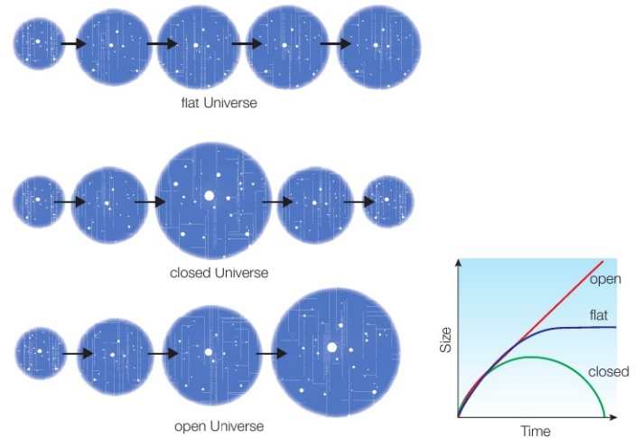

fig A Our Universe could expand forever, keep slowing down but never reaching a standstill, or slow down to a standstill and start collapsing.

## DARK MATTER

To determine the future of the Universe, scientists have been trying to work out its density. However, they have hit upon some big problems. In the 1960s and 1970s, American astronomer Vera Rubin made observations of many galaxies and found a very unexpected result. The stars in the galaxies usually rotate at similar speeds, whatever their distance from the galactic centre. This is completely different to the Solar System, in which the further planets from the Sun orbit much more slowly than those close in.

Galaxies emit an amount of light. We can measure this by measuring their apparent brightness and calculating the inverse square decrease in this which is caused by the distance to the galaxy. From the actual luminosity of a galaxy, we can estimate the mass of all its stars. Galaxies rotate and this means that all the stars they contain must be experiencing a centripetal force towards the centre of the galaxy's rotation. When astronomers measure the rotational speed of the stars in the galaxies, they find that the mass suggested by the luminosity calculations is not nearly enough to create the centripetal force needed to keep the galaxy spinning (fig C). In fact, the mass of the stars is generally only about 10% of that needed. This suggests that galaxies must contain a lot of mass that does not emit light. This has been called dark matter.

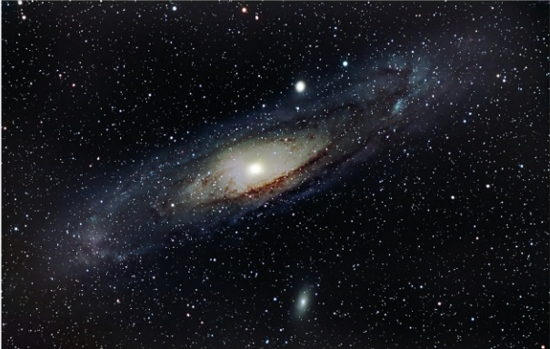

## LEARNING TIP

▲ fig C The mass of stars lighting up a galaxy is not nearly enough to provide a gravitational centripetal force strong enough to hold the stars in place against their rotational velocity.

Density is the key to the future of the Universe. More than a critical density and the Universe will stop expanding and contract back to a Big Crunch. Less than a critical density and the Universe will keep expanding forever.

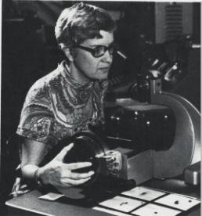

fig B Vera Rubin's discovery of unexpected orbital speeds for stars in the Andromeda galaxy highlighted profound problems in the theories about the structure of the Universe.

<!-- page 208 -->

Astronomers have not yet discovered what the dark matter could be. Most stars will have a planetary system, but the mass of all these planets is not nearly enough to hold a galaxy together. Black holes or interstellar gases are good candidates for dark matter, but these (and other similar suggestions) are also not observed in sufficient quantities. We can account for some dark matter with straightforward things such as these, but scientists are convinced that the majority of dark matter is of a different but as yet unknown form.

## GRAVITATIONAL LENSING

Einstein's theory of gravity explains that large masses will deform space-time – the fabric of the Universe – so that it accelerates things. This is quite different from Newton's explanation of gravity as a force. The curving of space-time predicts that the direction of travel of light will be affected. Very large masses, such as galaxies or black holes, will cause a bending of light in a similar way as passing through a lens. This effect has been widely observed in photographs of deep space (fig D).

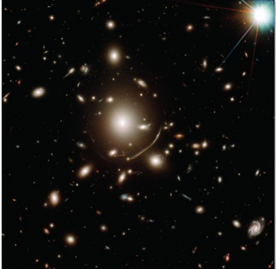

▲ fig D Gravitational lensing shows the extended arc beneath the Abell 383 galaxy cluster. Such arcs are images of much more distant galaxies where the light has been bent around the Abell 383 galaxy cluster by its enormous mass.

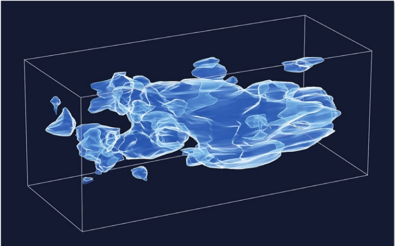

▲ fig E Using gravitational lensing, astronomers have verified the existence of dark matter, to the extent that they have made incredibly detailed maps of its locations in space. This picture was generated from images taken by NASA's Hubble Space Telescope.

<!-- page 209 -->

## DARK ENERGY

Until the very end of the twentieth century, it was not known which of the three possible outcomes for the Universe (fig A) would happen.

The Hubble Space Telescope was launched in 1990 and its observations of distant supernovae have shown that the expansion of the Universe is not slowing, as we would expect from the gravitational attractions of all the matter in it, but it is actually accelerating. The Universe is getting larger at a faster and faster rate. We do not yet know what is causing this cosmic acceleration, but it is called dark energy. All we know about dark energy is how much it is affecting the expansion of the Universe, and so what proportion of the Universe it is. It turns out that dark energy is approximately two-thirds of everything that exists; and we have no idea what it is or how to observe it.

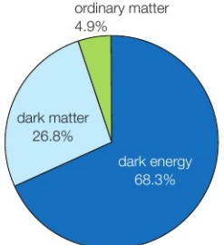

▲ fig F The ordinary matter we can see and feel makes up only about 5% of the Universe. Dark matter is a little over a quarter of everything, but dark energy is more than two-thirds of the Universe.

## CHECKPOINT

SKILLS REASONING/ARGUMENTATION

1. Give two reasons why the exact value of the Hubble constant is difficult to determine. SKILLS CONTINUOUS LEARNING

2. What is the importance of the 'critical density' of the Universe?

SKILLS PERSONAL AND SOCIAL RESPONSIBILITY

3. Describe two phenomena that have led scientists to believe in the existence of dark matter.

## SUBJECT VOCABULARY

critical density the density of matter in the Universe, below which the Universe will keep expanding forever. Big Crunch a possible future for the Universe, in which the Universe contracts inwards to a single point dark matter a material in the Universe that explains some anomalous behaviours of galaxies; as yet its nature has not been identified.

## LEARNING TIP

dark energy a source of a force that is causing the expansion of the Universe to accelerate; its nature has not been identified

Most physicists believe that the

as yet unidentified dark matter

is the solution to the

unobserved mass. However,

dark energy is much more of a

mystery. Some scientists have

suggested that by changing the

mathematics in the theory of

gravity, the unexplained

observations could be

accounted for. However,

Einstein's gravity theory works

so well for many observations

that we are not ready to change

it until a better version is

developed.

## EXAM HINT

When you are asked to describe something, you may have to develop linked pieces of information, but you do not have to include a reason or justification.

<!-- page 210 -->

# 11B THINKING BIGGER

## DARK ENERGY

## SKILLS CRITICAL THINKING, PROBLEM SOLVING, INTERPRETATION, PRODUCTIVITY, COMMUNICATION

The European Space Agency (ESA) has a space telescope mission called Euclid, for the study of dark energy, gravity and dark matter. These are high-level physics concepts and are not often explained simply for children. The webpage shown here comes from a website called Our Universe for Kids.

## WEBSITE FOR CHILDREN

## OUR EXPANDING UNIVERSE

Dark energy and dark matter are not the same. One is matter and the other is energy, but they are both dark, and just like dark matter while it's believed that dark energy is there and does exist, as its believed that there is some evidence of this, the energy cannot be completely proven and confirmed.

Gravity plays an important part in the existence of dark energy and also dark matter, and that is how this phenomenon is measured.

Scientists believe that dark matter makes up about 25% of the universe, with dark energy making up all but the rest at about 70%. That means that only 5% of the visual matter such as the stars, planets and gas clouds makes up the entire universe. That's pretty amazing when you think about it.

So, dark energy is believed to make up around two thirds of basically everything in the universe and we still know almost nothing about it.

Again just like dark matter, we know almost for sure that it's there, and in time we will figure out more about this type of energy, that's for sure. It might turn out to be somewhat different, but we are on the right track.

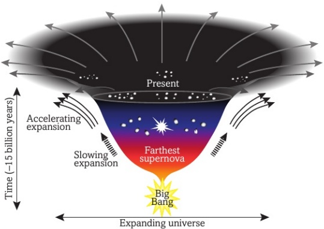

fig A Dark matter.

## Q&A CORNER

Q: Are dark energy & dark matter the same?

A: No, they are different. One is matter and the other is energy.

Q: How much of the universe is made up of dark energy?

A:  $ \frac{2}{3} $'s.

Q: What is dark energy?

A: Dark energy is the driving force that expands space.

Q: How much of a percentage of the universe do scientists believe dark energy takes up?

A: 70%

<!-- page 211 -->

## THINKING BIGGER

## SCIENCE COMMUNICATION

The article is from the website written by a father and his young son.

1 (a) Explain why it is written as a series of short paragraphs.

(b) Explain why the article is only 213 words long.

(c) Comment on the size and location of the picture accompanying the article.

2 Describe the level of science presented in this article, and explain how scientific concepts are presented for the intended audience.

## PHYSICS IN DETAIL

Now we will look at the physics in detail. Some of these questions will link to topics elsewhere in this book, so you may need to combine concepts from different areas of physics to work out the answers.

3 Write a paragraph to explain how 'Gravity plays an important part in ... how [dark matter] is measured'.

4 (a) Explain how astronomers can detect that a galaxy is rotating.

Our Universe for Kids website's stated mission is to: 'Continue to research and create content on different aspects of the universe for the educational and recreational purposes of all kids everywhere that are as interested as we are in the wonders of our amazing universe.'

(b) Explain how unexpectedly fast rotation of galaxies can be explained if there is undetected dark matter mass in the galaxy.

6 The consortium that is working together to make the ESA Euclid mission happen includes over 120 laboratories from institutions in 15 countries. What would be reasons explaining the need for such a large number of contributors?

5 Explain the basic difference between dark matter and dark energy.

## INTERPRETATION NOTE

## PHYSICS TIP

Consider the Doppler effect at points on opposite sides of a rotating galaxy.

## ACTIVITY

Write a script for a comparable article for the BBC's international radio station, the BBC World Service. You should include the same main basic information as the kids' website, but should develop the depth of the scientific reporting for an adult public audience, and include some information about the Euclid mission. This task may require some further research.

## THINKING BIGGER TIP

Consider that the BBC World Service is broadcast globally and reaches nearly 200 million listeners each week.

Further consider that although only 5% of the population of Earth have English as their first language, your report should be written in English.

<!-- page 212 -->

# 11B EXAM PRACTICE

[Note: In questions marked with an asterisk (*), marks will be awarded for your ability to structure your answer logically, showing how the points that you make are related or follow on from each other.]

1 What is the peak wavelength of electromagnetic radiation emitted by a star which has a surface temperature of 12 000 K?

A  $ 2.42 \times 10^{-7} $ m

B  $ 0.242 \, m $

C  $ 34.8 \, m $

D  $ 4.13 \times 10^{6} \, m $ [1]

(Total for Question 1 = 1 mark)

2 The intensity of the energy from the Sun arriving at the Earth is  $ 1370 \, W m^{-2} $. The diameter of the Earth's orbit is  $ 3.0 \times 10^{11} \, m $. What is the luminosity of the Sun?

A  $ 4.85 \times 10^{-21} $ W

B  $ 2.58 \times 10^{15} $ W

C  $ 3.87 \times 10^{26} $ W

D  $ 1.55 \times 10^{27} $ W [1]

(Total for Question 2 = 1 mark)

3 In the laboratory, sodium absorbs light with a wavelength of  $ 5.893 \times 10^{-7} $ m. The light from a star shows the same sodium absorption line at a wavelength of  $ 5.895 \times 10^{-7} $ m.

A The star is approaching the Earth at a speed of  $ 0.06 \, m s^{-1} $.

B The star is going away from the Earth at a speed of  $ 0.06 \, m s^{-1} $.

C The star is approaching the Earth at a speed of  $ 100 \, km \, s^{-1} $.

D The star is going away from the Earth at a speed of  $ 100 \, km \, s^{-1} $.

(Total for Question 3 = 1 mark)

4 What do scientists believe will happen at the end of the Universe?

A The Big Bang

B The Big Crunch

C The Big Rip

D Scientists don't have enough evidence to decide. [1]

5 The planet Mars has a mean distance from the Sun of  $ 2.3 \times 10^{11} $ m compared with the Earth's mean distance from the Sun of  $ 1.5 \times 10^{11} $ m.

(a) Calculate the ratio  $ \frac{Sun's radiation flux at distance of Mars}{Sun's radiation flux at distance of Earth} $

(b) With reference to your answer to (a), comment on the suggestion that Mars could be capable of supporting life. [2] (Total for Question 5 = 4 marks)

6 Parallax measurements are used to determine the distance to nearby stars, but this method is unsuitable for more distant objects.

Describe how parallax measurements are used to determine the distance to nearby stars and explain how the use of a standard candle enables the distance to more remote objects to be determined. [6]

(Total for Question 6 = 6 marks)

7 The current position of our Sun, S, is shown on the Hertzsprung–Russell (H–R) diagram below.

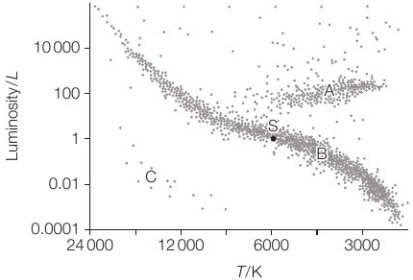

(a) (i) Identify the three main regions of the H-R diagram. [3]

(ii) Add lines to a copy of the diagram to show the evolutionary path of our Sun from the time when it comes to the end of its hydrogen-burning phase. [2]

(b) Most stars are so far way from the Earth that astronomers can only observe them as a point source of radiation.

Explain how astronomers calculate the sizes of these stars, using information from the H-R diagram. [3]

(Total for Question 7 = 8 marks)

<!-- page 213 -->

## EXAM PRACTICE

8 The graph shows how the velocity varies with distance for several distant galaxies. All the galaxies are moving away from Earth, and there appears to be a linear relationship between the velocity and the distance to the galaxy.

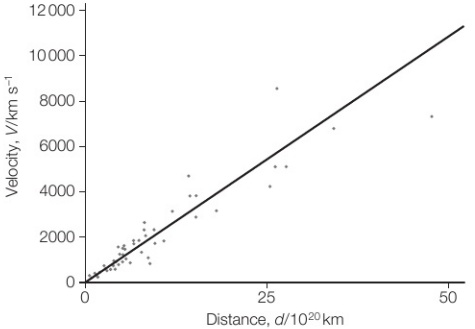

(a) Use the graph to estimate an age for the Universe. [4]

 $ ^{*} $(b) Describe how astronomers would have determined the velocity of each galaxy. [5]

 $ ^{*} $(c) Scientists are uncertain about the ultimate fate of the Universe. Explain why. [3]

(Total for Question 8 = 12 marks)

9 A student carries out an experiment on the Stefan–Boltzmann law.

 $ L = \sigma T^{4}A $

She uses the filament of a light bulb as a model for a black body radiator.

(a) She obtains the following results.

 $$ L=23.5W\pm2\%\qquad T=2400K\pm4\% $$ 

The student estimates the surface area of the filament A to be  $ 2.0 \times 10^{-5} \, \text{m}^2 \pm 5\% $.

(i) Use her results to calculate an experimental value for the Stefan-Boltzmann constant  $ \sigma $. [1]

(ii) Calculate the percentage uncertainty in the experimental value of  $ \sigma $.

(iii) Calculate the percentage difference between the experimental value of  $ \sigma $ and the accepted value,  $ \sigma = 5.67 \times 10^{-8} \, \text{W} \, \text{m}^{-2} \, \text{K}^{-4} $.

(iv) Use these percentages to comment on the reliability of the experimental value for  $ \sigma $.

(b) The Stefan–Boltzmann law can be written as

 $ \ln L = 4\ln T + \ln \sigma A $

The student obtains a range of values for L and T and plots a graph of  $ \ln L $ against  $ \ln T $.

(i) Explain clearly how she could use this graph to obtain a value for  $ \sigma $. [2]

(ii) She realises that she cannot control the temperature of the room.

Explain why this will have almost no effect on the result of the experiment. [1]

(Total for Question 9 = 8 marks)

