# Maths skills

<!-- edx_ial_phy2.pdf p214-219 -->

<!-- page 214 -->

## MATHS SKILLS

For you to be able to develop your skills, knowledge and understanding in Physics, you will also need to develop your mathematical skills in several key areas. This section gives more explanation and examples of some key mathematical concepts you need to understand. Further examples relevant to your International A Level Physics studies are given throughout this book and in Book 1 (IAS).

## ARITHMETIC AND NUMERICAL COMPUTATION

## USING LOGARITHMS

Many formulae in science and mathematics involve powers. Consider the equation:

 $ 10^{x} = 62 $

We know that the value of x lies between 1 and 2, but how can we find a precise answer? The term logarithm means index or power, and logarithms allow us to solve such equations. We can take the 'logarithm base 10' of each side using the log button of a calculator.

## WORKED EXAMPLE 1

 $ 10^{x} = 62 $
 $ \log_{10}(10^{x}) = \log_{10}(62) $
x = 1.792392...

We can calculate the logarithm using any number as the base by using the  $ \log_{\Box}(\Box) $ button.

## WORKED EXAMPLE 2

 $ 2^{x} = 7 $
 $ \log_{2}(2^{x}) = \log_{2}(7) $
x = 2.807355...

Many equations relating to the natural world involve powers of e. We call these exponentials. The logarithm base e is referred to as the natural logarithm and denoted as  $ \ln $.

There are three laws of logarithms, which are derived from the laws of indices:

 $ \log a + \log b = \log ab $ (addition rule)
 $ \log a - \log b = \log a/b $ (subtraction rule)
 $ \log a^{n}=n\log a $ (power rule)

## WORKED EXAMPLE 3

Using the equation  $ N = N_0 e^{-\lambda t} $, calculate the decay constant for a substance that has a half-life of 3 years.

 $$ \frac{N_{0}}{2}=N_{0}\mathrm{e}^{-\lambda t}; $$ 

 $$ \frac{1}{2}=e^{-3\lambda} $$ 

 $$ \therefore\ln\left(\frac{1}{2}\right)=-3\lambda $$ 

 $$ \lambda=\frac{\left(ln2\right)}{3}=0.231\ldots $$ 

Note that the units for this answer will be years $ ^{-1} $.

<!-- page 215 -->

## GRAPHS

## USING LOGARITHMIC PLOTS

An earthquake which measures 8.0 on the Richter scale is much more than twice as powerful as an earthquake measuring 4.0 on the Richter scale. This is because the units which are used to measure earthquakes use the concept of logarithm scales in charts and graphs. This helps us to accommodate enormous increases (or decreases) in one variable as another variable changes.

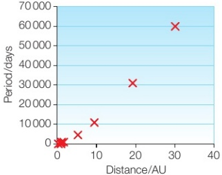

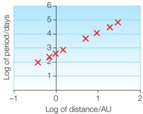

fig A These two graphs both show distance from the Sun and period for the eight planets in the Solar System.

If the data being represented follows a power law, using a logarithmic scale will result in a straight-line graph (fig B).

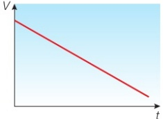

fig B We obtain a straight line when we plot  $ \log V $ against time for a discharging capacitor because it is an exponential relationship.

## SKETCHING MATHEMATICAL FUNCTIONS

It is helpful to be familiar with standard mathematical functions when modelling physical relationships.

## Sine and cosine functions

Remember the following facts about the sine and cosine functions:

Both functions oscillate between 1 and -1.

The sine function can be translated 90 degrees to the left to produce the cosine function.

Each curve repeats itself every 360 degrees (called the period of 360 degrees).

Each function carries on to positive infinity and minus infinity.

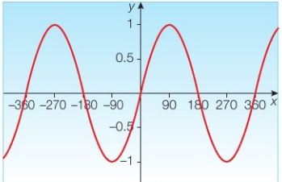

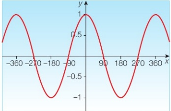

fig C The sine and cosine functions:  $ y = \sin x $ and  $ y = \cos x $.

<!-- page 216 -->

The functions  $ y = \sin^{2}x $,  $ y = \cos^{2}x $ are the squares of the sine and cosine functions. Remember that:

both functions are always positive

both functions oscillate between 0 and 1.

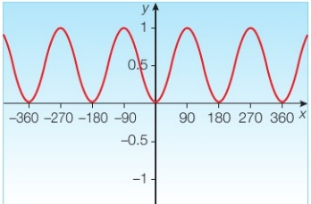

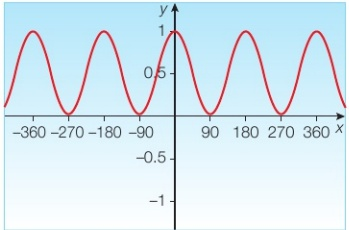

▲ fig D The sine squared and cosine squared functions:  $ y = \sin^{2}x $ and  $ y = \cos^{2}x $.

## Reciprocal functions

Reciprocal functions such as $y = \frac{1}{x}$ and $y = \frac{1}{x^2}$ are also useful to recognise. Note that:

Both functions get closer and closer to zero but never reach zero. The x-axis is referred to as an ‘asymptote’ – that is, a line that a curve tends towards but never actually reaches.

The functions are not defined at x = 0.

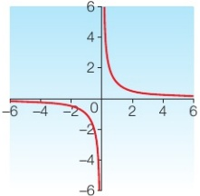

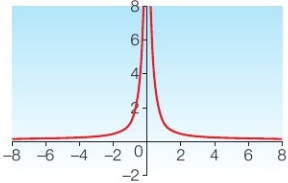

▲ fig E Reciprocal functions:  $ y = \frac{1}{x} $ and  $ y = \frac{1}{x^2} $.

## Exponential functions

Exponential functions take the form  $ y = ab^{x} $. Note that:

• All exponential functions of the form  $ y = b^{x} $ pass through the point  $ (0, 1) $.

The term exponential is sometimes used to refer to the natural exponential function, which is the special case  $ y = e^{x} $.

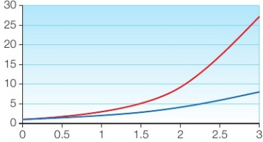

fig F Exponential functions:  $ y = 2^x $ and  $ y = 3^x $.

<!-- page 217 -->

## THE AREA BETWEEN A CURVE AND THE x-AXIS

The area between a curve and the x-axis was interesting to Sir Isaac Newton and was one of the key concepts that led him to develop the techniques of differentiation and integration. Newton demonstrated that it was possible to find the area between a curve and the axis using an innovative method of summing up strips of area between two distinct limits of the curve.

For many graphs, this area has physical significance:

The area beneath the curve of a velocity-time graph is equivalent to distance travelled.

The area under a voltage-charge graph is equivalent to the energy stored for a capacitor.

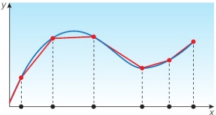

▲ fig G The area between the x-axis and the curve can be estimated by summing up the area of strips. Smaller strips give a more accurate answer.

## GEOMETRY AND TRIGONOMETRY

## USING RADIANS

One theory for how the degree was chosen as a unit of rotation is that Babylonian astronomers used observations of the night sky to estimate an impressively close 360 days as the number of days in a year. A degree was defined as  $ \frac{1}{360} $ of a full rotation, meaning that a full rotation contains 360 degrees.

When working with trigonometric functions and calculus, it can be much simpler to use radians. A radian is defined as  $ \frac{1}{2\pi} $ of a full rotation, so a full rotation contains  $ 2\pi $ radians. (You can read more about radians in Section 5B.1.)

 $$ 2\pi rad=360^{\circ} $$ 

 $$ \pi rad=180^{\circ} $$ 

 $$ 1rad\approx57.296^{\circ} $$ 

## WORKED EXAMPLE 4

Convert:

(a)  $ 3\pi $ radians into degrees

(b)  $ 60^{\circ} $ into radians.

(a)  $ 3\pi $ radians =  $ 3 \times 180 $ degrees = 540 degrees

(b) 60 degrees = 60  $ \left(\frac{\pi}{180}\right) $ radians =  $ \frac{\pi}{3} $ radians

## LEARNING TIP

When using a calculator to calculate  $ \sin x $,  $ \cos x $ and  $ \tan x $, make sure your calculator is set up to use the angle unit that you need. Most calculators will show 'D' or 'DEG' on the display when in degree mode and 'R' or 'RAD' when in radian mode.

<!-- page 218 -->

## APPLYING YOUR SKILLS

You will often find that you need to use more than one maths technique to answer a question. In this section, we will look at four example questions and consider which maths skills are required and how to apply them.

## WORKED EXAMPLE 5

When the switch S is to the left, cell E charges the capacitor C; and when S is moved to the right, C discharges through the ammeter and the resistor R. The discharge current I is given by:

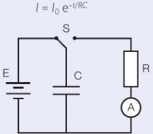

fig H Circuit showing charging and discharging capacitor.

(a) Sketch a graph of I against t.

(b) Explain why the area under the graph is equal to the initial charge on the capacitor.

(c) Explain why a graph of  $ \ln I $ against t will be a straight line.

(d) How would you use a graph of  $ \ln I $ against t to determine a value for the time constant RC?

(a) You should be able to deduce the shape of the graph from the equation. Note that:

• There is a finite intercept on the vertical axis.

• The curve decreases at a decreasing rate.

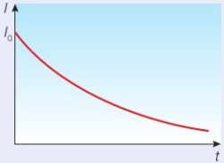

▲ fig I Graph showing discharge current against time where  $ I = I_{0} e^{-t/RC} $

(b) From the Formulae sheet,  $ I = \frac{\Delta Q}{\Delta t} $ so  $ \Delta Q = I \times \Delta t $, which is the area under a graph (fig I) of current against time. (To calculate the charge stored you can either perform an integration, which is beyond the scope of the specification, or you can measure the area using the scales on the axes and by counting squares. You will find Q = EC.)

(c) Take logarithm base e of the original equation:  $ I = I_{0} e^{-t/RC} $

 $$ \ln I=\ln I_{0}-\frac{t}{RC} $$ 

or:

 $$ \ln I=-\frac{t}{RC}+\ln I_{0} $$ 

This is in the form  $ y = mx + c $.

So, if we plot  $ \ln I $ on the y-axis and t on the x-axis, the gradient will be given by  $ m = -\frac{1}{RC} $, and since this is a constant the gradient of the graph will be constant and the line will be straight.

(d) When t is plotted in seconds, the time constant is equal to the gradient of the straight line on the graph of  $ \ln I $ vs t.

<!-- page 219 -->

## WORKED EXAMPLE 6

An object performs simple harmonic motion. The graph below shows how its velocity varies with time.

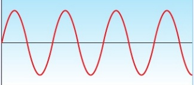

fig J Graph showing how velocity varies with time for an object performing simple harmonic motion.

(a) Sketch a graph showing how the acceleration of the object varies with time.

(b) Add to your graph a line showing how the kinetic energy of the body varies with time.

(a) The graph of velocity against time follows the shape of a sine curve.

The graph of acceleration against time follows the shape of a cosine curve.

(b) The graph of kinetic energy against time follows the shape of  $ y = \sin^{2}x $. Note that this does not become negative.

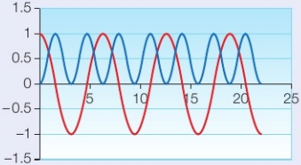

fig K Graph showing acceleration and kinetic energy.

## WORKED EXAMPLE 7

The graph (fig L) shows how the relative intensity of the radiation from a black body varies with temperature. There are three lines on the graph representing the energy from bodies at different temperatures.

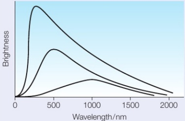

▲ fig L Graph showing variation in the relative intensity of the radiation from a black body with wavelength as temperature varies.

(a) Explain which of the lines represents the hottest body.

(b) Explain why the area under the lines increases as shown.

(a) According to Wien's law (from the Formulae sheet:  $ \lambda_{max}T=2.898\times10^{-3}mK $), the peak wavelength,  $ \lambda_{max} $, decreases with increasing temperature, so the top line is the hottest body.

(b) The area under the line represents the total energy radiated per unit time or luminosity, which increases with temperature according to the Stefan-Boltzmann law. So, the line showing the highest temperature has the greatest area under it.

## WORKED EXAMPLE 8

(a) Explain why the angular speed  $ \omega $ of an orbiting body is given by:

 $ \omega = \frac{2\pi}{T} $

where T is the time taken for one orbit.

(b) Calculate the angular velocity of the Moon around the Earth.

(a) Angular speed =  $ \frac{\text{angular distance}}{\text{time}} = \frac{\text{one complete orbit}}{\text{time taken}} = \frac{2\pi}{T} $, where the angular distance for one complete orbit is  $ 2\pi $ radians.

(b) For the Moon, T = 28 days = 28 × 24 hours = 28 × 24 × 3600 seconds

So  $ \omega = \frac{2\pi \, rad}{28 \times 24 \times 3600 \, s} = 2.60 \times 10^{-6} \, rad \, s^{-1} $

Since a radian is a ratio of two lengths it has no units and is usually not included in units for angular velocity, so  $ \omega = 2.60 \times 10^{-6} \, s^{-1} $.

